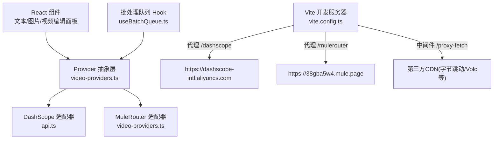
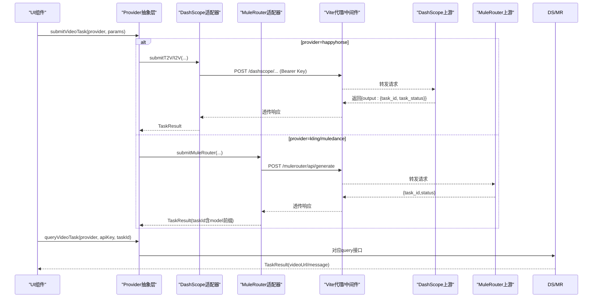
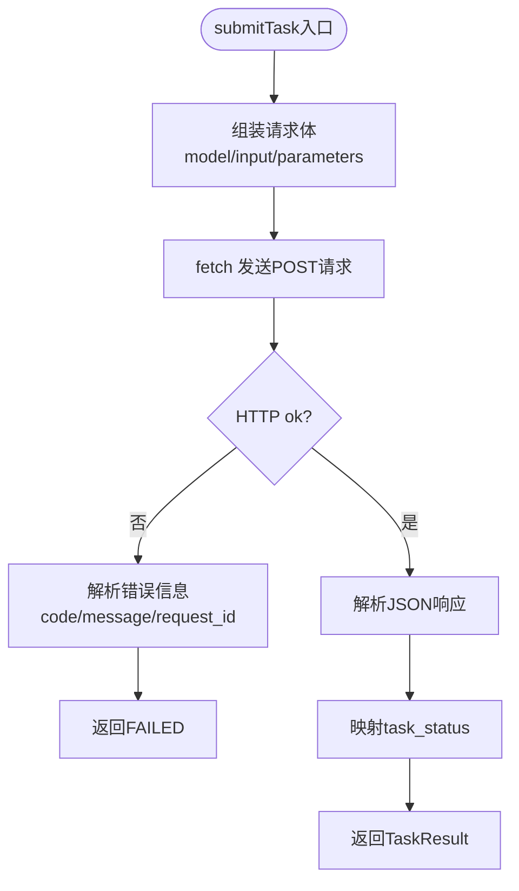
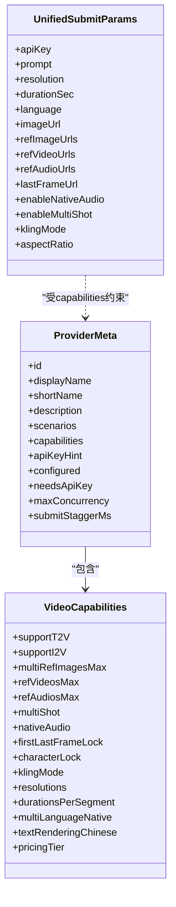
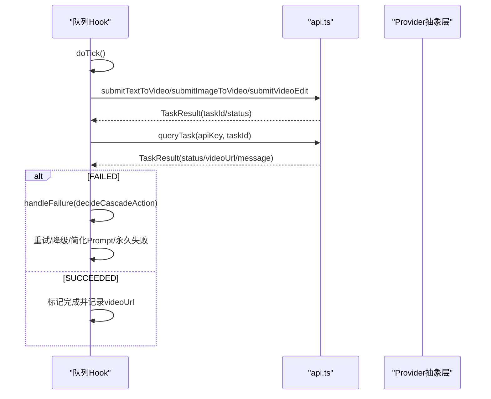
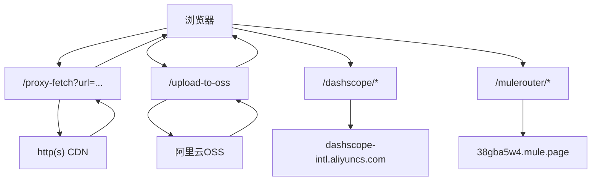
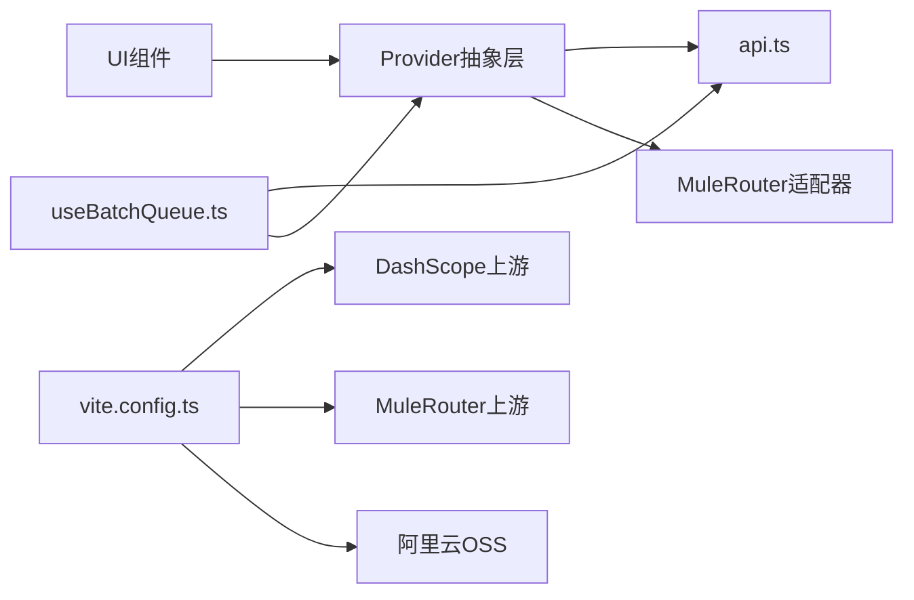

# API集成层

<cite>
**本文引用的文件**   
- [src/lib/api.ts](file://src/lib/api.ts)
- [src/lib/video-providers.ts](file://src/lib/video-providers.ts)
- [vite.config.ts](file://vite.config.ts)
- [src/components/ApiKeyModal.tsx](file://src/components/ApiKeyModal.tsx)
- [src/hooks/useBatchQueue.ts](file://src/hooks/useBatchQueue.ts)
- [src/components/TextToVideoPanel.tsx](file://src/components/TextToVideoPanel.tsx)
- [src/components/ImageToVideoPanel.tsx](file://src/components/ImageToVideoPanel.tsx)
- [src/components/VideoEditPanel.tsx](file://src/components/VideoEditPanel.tsx)
- [package.json](file://package.json)
</cite>

## 目录
1. [简介](#简介)
2. [项目结构](#项目结构)
3. [核心组件](#核心组件)
4. [架构总览](#架构总览)
5. [详细组件分析](#详细组件分析)
6. [依赖关系分析](#依赖关系分析)
7. [性能与网络优化](#性能与网络优化)
8. [API接口文档](#api接口文档)
9. [最佳实践](#最佳实践)
10. [故障排除指南](#故障排除指南)
11. [结论](#结论)

## 简介
本文件面向开发者，系统化梳理本项目中“阿里云百炼”视频生成API的封装实现、多提供商抽象层设计、认证与重试策略、错误处理模式、网络请求优化以及批量任务调度。文档同时提供完整的API调用约定（HTTP方法、URL模式、请求响应格式、认证方式）、调试工具与排障建议，帮助快速集成与稳定运行。

## 项目结构
前端采用Vite + React + TypeScript，API集成位于lib层，通过Vite开发服务器代理转发到上游服务；UI组件负责参数收集与交互；批处理Hook管理并发、轮询与降级重试。

图表来源
- [vite.config.ts:1-66](file://vite.config.ts#L1-L66)
- [vite.config.ts:277-293](file://vite.config.ts#L277-L293)
- [src/lib/video-providers.ts:1-12](file://src/lib/video-providers.ts#L1-L12)
- [src/lib/api.ts:1-10](file://src/lib/api.ts#L1-L10)

章节来源
- [vite.config.ts:1-66](file://vite.config.ts#L1-L66)
- [vite.config.ts:277-293](file://vite.config.ts#L277-L293)
- [src/lib/video-providers.ts:1-12](file://src/lib/video-providers.ts#L1-L12)
- [src/lib/api.ts:1-10](file://src/lib/api.ts#L1-L10)

## 核心组件
- 阿里云百炼适配层：统一提交与查询接口，封装鉴权头、异步标志、状态映射与错误归一化。
- 多提供商抽象层：以Provider元数据声明能力矩阵，按provider路由到具体adapter，支持HappyHorse与MuleRouter系列模型。
- 批处理队列：控制并发、轮询、失败降级与重试，持久化状态与日志。
- 开发服务器中间件：跨域资源代理与OSS上传中转，解决浏览器CORS限制与公网URL需求。

章节来源
- [src/lib/api.ts:1-217](file://src/lib/api.ts#L1-L217)
- [src/lib/video-providers.ts:1-559](file://src/lib/video-providers.ts#L1-L559)
- [src/hooks/useBatchQueue.ts:1-322](file://src/hooks/useBatchQueue.ts#L1-L322)
- [vite.config.ts:1-66](file://vite.config.ts#L1-L66)

## 架构总览
系统由三层组成：
- 表现层：各业务面板组件收集用户输入并触发提交。
- 集成层：Provider抽象层根据选择将请求分发至不同后端（DashScope或MuleRouter）。
- 基础设施层：Vite开发服务器提供代理与中间件，屏蔽跨域与鉴权细节。

图表来源
- [src/lib/video-providers.ts:491-544](file://src/lib/video-providers.ts#L491-L544)
- [src/lib/api.ts:125-201](file://src/lib/api.ts#L125-L201)
- [vite.config.ts:277-293](file://vite.config.ts#L277-L293)

## 详细组件分析

### 阿里云百炼适配层（api.ts）
- 职责
  - 构造DashScope异步视频生成请求体，附加语言提示与负面提示词。
  - 统一设置Authorization与X-DashScope-Async头。
  - 提交后返回TaskResult；查询任务状态并映射为统一状态。
- 关键流程
  - 提交：POST /dashscope/api/v1/services/aigc/video-generation/video-synthesis
  - 查询：GET /dashscope/api/v1/tasks/{taskId}
- 错误处理
  - 网络异常捕获并返回FAILED状态与消息。
  - HTTP非2xx时解析code/message/request_id并归一化。
  - 响应非JSON时返回结构化错误。
- 状态映射
  - PENDING/RUNNING/SUCCEEDED/FAILED/UNKNOWN 统一枚举。

图表来源
- [src/lib/api.ts:125-174](file://src/lib/api.ts#L125-L174)
- [src/lib/api.ts:176-201](file://src/lib/api.ts#L176-L201)
- [src/lib/api.ts:203-216](file://src/lib/api.ts#L203-L216)

章节来源
- [src/lib/api.ts:1-217](file://src/lib/api.ts#L1-L217)

### 视频提供商抽象层（video-providers.ts）
- 设计原则
  - capabilities元数据驱动UI控件启用/禁用与上限值。
  - submit/queryTask通过dispatch函数路由到对应adapter。
  - MuleRouter系列走聚合代理，无需API Key，通过model字段区分子模式。
  - taskId编码包含model前缀，便于查询还原。
- 能力矩阵
  - 支持文生视频/图生视频、多参考图/视频/音频、原生音效、首尾帧锁定、Kling模式、分辨率/时长选项、中文渲染表现、价格档位等。
- 重试机制
  - fetchWithRetry对429/502/503/504进行指数退避重试，提升稳定性。
- URL包装
  - wrapWithProxyFetch将第三方CDN视频URL包装为/dev server同源代理，避免CORS。
- 路由逻辑
  - HappyHorse：使用api.ts的提交/查询。
  - Kling/Muledance：使用MuleRouter适配器。

图表来源
- [src/lib/video-providers.ts:28-70](file://src/lib/video-providers.ts#L28-L70)
- [src/lib/video-providers.ts:167-184](file://src/lib/video-providers.ts#L167-L184)

章节来源
- [src/lib/video-providers.ts:1-559](file://src/lib/video-providers.ts#L1-L559)

### 批处理队列（useBatchQueue.ts）
- 职责
  - 维护任务队列状态、并发控制、轮询与失败决策。
  - 支持重试、参数降级、Prompt简化与永久失败。
  - 持久化状态与日志，页面刷新可恢复。
- 关键流程
  - doTick每5秒扫描可用槽位，提交queued任务。
  - pollTask轮询任务结果，成功则更新videoUrl，失败进入handleFailure。
  - handleFailure依据错误信息与配置决定重试/降级/简化Prompt/永久失败。

图表来源
- [src/hooks/useBatchQueue.ts:98-185](file://src/hooks/useBatchQueue.ts#L98-L185)
- [src/hooks/useBatchQueue.ts:187-264](file://src/hooks/useBatchQueue.ts#L187-L264)

章节来源
- [src/hooks/useBatchQueue.ts:1-322](file://src/hooks/useBatchQueue.ts#L1-L322)

### 开发服务器中间件与代理（vite.config.ts）
- 功能
  - /proxy-fetch：将第三方CDN视频URL转为同源访问，强制CORS允许。
  - /upload-to-oss：将本地base64图片上传至阿里云OSS，返回公网URL供MuleRouter使用。
  - 代理：/dashscope与/mulerouter分别转发到上游服务，设置超时与rewrite规则。
- 安全与配置
  - OSS凭据从环境变量加载，不暴露到前端。
  - 接入点（Access Point）签名上传兼容。

图表来源
- [vite.config.ts:11-66](file://vite.config.ts#L11-L66)
- [vite.config.ts:151-260](file://vite.config.ts#L151-L260)
- [vite.config.ts:277-293](file://vite.config.ts#L277-L293)

章节来源
- [vite.config.ts:1-294](file://vite.config.ts#L1-L294)

### 认证管理（ApiKeyModal.tsx）
- 用途
  - 管理DashScope API Key与可选ImgBB Key（用于图床上传）。
  - 仅存储在本地浏览器，不上传到服务端。
- 使用场景
  - 当选择HappyHorse时需要API Key；MuleRouter系列无需Key。

章节来源
- [src/components/ApiKeyModal.tsx:1-75](file://src/components/ApiKeyModal.tsx#L1-L75)

## 依赖关系分析
- 模块耦合
  - Provider抽象层依赖api.ts与自身内部MuleRouter逻辑。
  - 批处理队列依赖api.ts与Provider抽象层。
  - UI组件通过Provider抽象层间接依赖底层适配器。
- 外部依赖
  - Vite代理与中间件依赖Node http/https与crypto。
  - OSS上传依赖ali-oss SDK（普通bucket）或手动签名（接入点）。

图表来源
- [src/lib/video-providers.ts:1-12](file://src/lib/video-providers.ts#L1-L12)
- [src/hooks/useBatchQueue.ts:1-12](file://src/hooks/useBatchQueue.ts#L1-L12)
- [vite.config.ts:277-293](file://vite.config.ts#L277-L293)

章节来源
- [src/lib/video-providers.ts:1-12](file://src/lib/video-providers.ts#L1-L12)
- [src/hooks/useBatchQueue.ts:1-12](file://src/hooks/useBatchQueue.ts#L1-L12)
- [vite.config.ts:277-293](file://vite.config.ts#L277-L293)

## 性能与网络优化
- 连接池与超时
  - 开发服务器代理设置长超时（120s），适合视频生成长耗时任务。
  - proxy-fetch中间件设置upstream超时，避免长时间阻塞。
- 重试与退避
  - MuleRouter适配器内置429/502/503/504重试，指数退避，降低瞬时抖动影响。
- 缓存机制
  - 当前未实现显式HTTP缓存；可通过Service Worker或浏览器Cache-Control策略扩展。
- 并发控制
  - 批处理队列通过concurrency限制并行提交与轮询数量，避免打满上游限流。
- 资源代理
  - 通过/proxy-fetch绕过第三方CDN无CORS头的限制，减少跨域失败导致的重传。

[本节为通用指导，不直接分析具体文件]

## API接口文档

### 阿里云百炼（DashScope）
- 基础路径
  - 开发环境：/dashscope
  - 实际目标：https://dashscope-intl.aliyuncs.com
- 认证方式
  - Header: Authorization: Bearer <API Key>
  - Header: X-DashScope-Async: enable
- 接口列表
  - 提交任务
    - 方法：POST
    - 路径：/dashscope/api/v1/services/aigc/video-generation/video-synthesis
    - 请求体：包含model、input（prompt/negative_prompt/media等）、parameters（resolution/duration等）
    - 响应：{ output: { task_id, task_status, message } }
  - 查询任务
    - 方法：GET
    - 路径：/dashscope/api/v1/tasks/{taskId}
    - 响应：{ output: { task_status, video_url/results[0].url, message } }
- 错误码与消息
  - 非2xx响应时，解析code/message/request_id并归一化为TaskResult.message。

章节来源
- [src/lib/api.ts:5-8](file://src/lib/api.ts#L5-L8)
- [src/lib/api.ts:125-174](file://src/lib/api.ts#L125-L174)
- [src/lib/api.ts:176-201](file://src/lib/api.ts#L176-L201)
- [vite.config.ts:277-282](file://vite.config.ts#L277-L282)

### MuleRouter聚合代理
- 基础路径
  - 开发环境：/mulerouter
  - 实际目标：https://38gba5w4.mule.page
- 认证方式
  - 无需API Key（代理已配置鉴权）
- 接口列表
  - 提交任务
    - 方法：POST
    - 路径：/mulerouter/api/generate
    - 请求体：包含model、prompt、duration、aspect_ratio、resolution、sound、mode、image/last_frame_image/images/videos/audios等
    - 响应：{ success, task_id, status, model, data, error, message }
  - 查询任务
    - 方法：GET
    - 路径：/mulerouter/api/task/{model}/{task_id}
    - 响应：{ success, task_id, status, results[], data, error, message }
- 特殊处理
  - taskId编码：<model>::<task_id>，便于查询还原。
  - 视频URL包装：wrapWithProxyFetch转换为/dev server同源代理URL。

章节来源
- [src/lib/video-providers.ts:23-12](file://src/lib/video-providers.ts#L23-L12)
- [src/lib/video-providers.ts:301-408](file://src/lib/video-providers.ts#L301-L408)
- [src/lib/video-providers.ts:413-457](file://src/lib/video-providers.ts#L413-L457)
- [src/lib/video-providers.ts:463-471](file://src/lib/video-providers.ts#L463-L471)
- [vite.config.ts:283-293](file://vite.config.ts#L283-L293)

### 开发服务器中间件
- /proxy-fetch
  - 作用：将第三方CDN视频URL转为同源访问，强制CORS允许。
  - 超时：upstream超时120s。
- /upload-to-oss
  - 作用：将本地base64图片上传至阿里云OSS，返回公网URL。
  - 支持：普通bucket与接入点（Access Point）签名上传。

章节来源
- [vite.config.ts:11-66](file://vite.config.ts#L11-L66)
- [vite.config.ts:151-260](file://vite.config.ts#L151-L260)

## 最佳实践
- 错误码处理
  - 统一解析code/message/request_id，记录完整上下文以便定位。
  - 对429/502/503/504实施重试与退避，避免瞬时失败。
- 限流控制
  - 根据Provider元数据的maxConcurrency与submitStaggerMs控制并发与提交间隔。
  - 批处理队列通过concurrency限制并行度，避免打满上游。
- 安全考虑
  - API Key仅存于本地浏览器，不在前端硬编码。
  - OSS凭据通过环境变量注入，不暴露到前端。
  - 第三方CDN视频URL通过/proxy-fetch中转，避免CORS问题。
- 用户体验
  - 失败时自动降级（分辨率/时长/Prompt简化），提高成功率。
  - 轮询间隔合理（如5秒），避免频繁请求。
  - 持久化状态与日志，刷新后可恢复进度。

[本节为通用指导，不直接分析具体文件]

## 故障排除指南
- 常见问题
  - 429限流：检查并发与提交间隔，适当增大submitStaggerMs或降低concurrency。
  - 502/503/504：网络波动或上游临时异常，等待重试或稍后重试。
  - CORS错误：确保使用/proxy-fetch包装第三方CDN URL。
  - 非JSON响应：检查代理是否生效，确认Rewrite规则与目标地址。
- 调试步骤
  - 打开浏览器控制台，查看[MuleRouter]相关warn日志，获取完整响应体。
  - 检查代理日志（开发服务器输出），确认请求转发与超时情况。
  - 验证API Key是否正确，确认DashScope服务可用性。
  - 对于OSS上传失败，检查.env.local中的凭据与Bucket配置。

章节来源
- [src/lib/video-providers.ts:263-296](file://src/lib/video-providers.ts#L263-L296)
- [src/lib/video-providers.ts:393-401](file://src/lib/video-providers.ts#L393-L401)
- [src/lib/video-providers.ts:448-457](file://src/lib/video-providers.ts#L448-L457)
- [vite.config.ts:44-53](file://vite.config.ts#L44-L53)
- [vite.config.ts:180-186](file://vite.config.ts#L180-L186)

## 结论
本项目通过Provider抽象层实现了多AI视频生成服务的统一接入，结合批处理队列与开发服务器中间件，提供了稳定的API集成体验。在认证管理、重试策略、错误处理与网络优化方面均有完善实现，满足生产级应用的需求。开发者可基于此架构快速扩展新的视频生成服务，并保持一致的调用与错误处理语义。