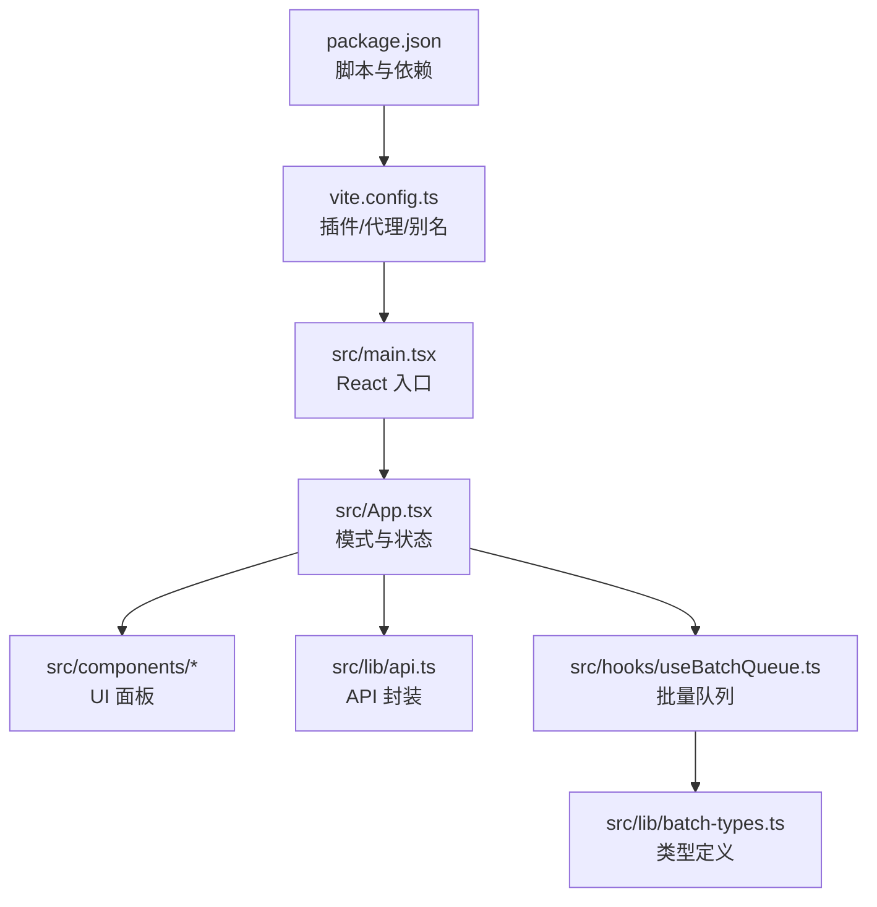
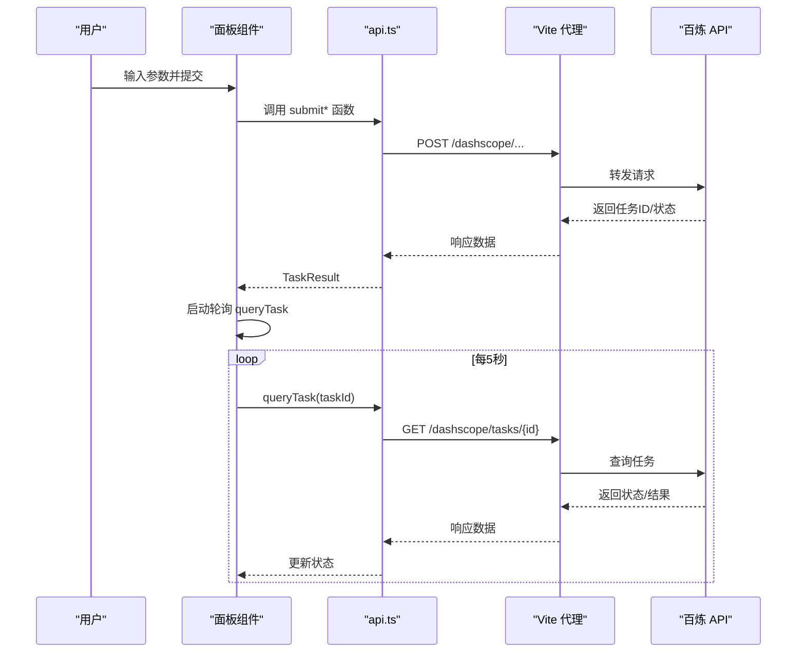
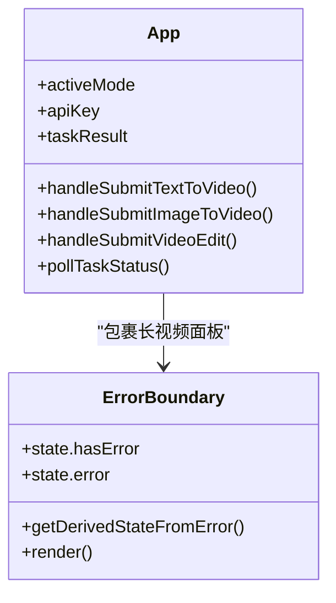
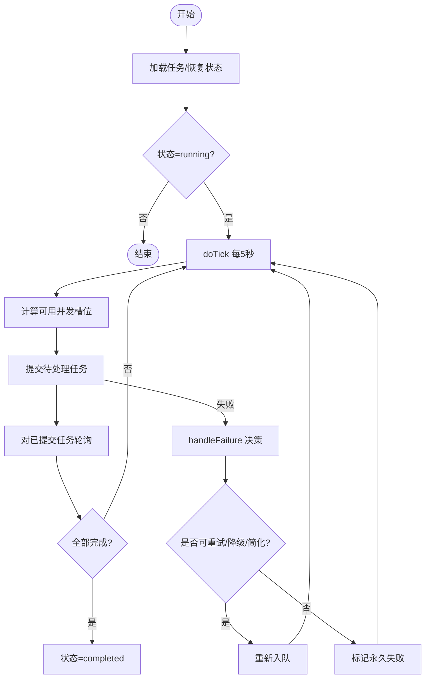
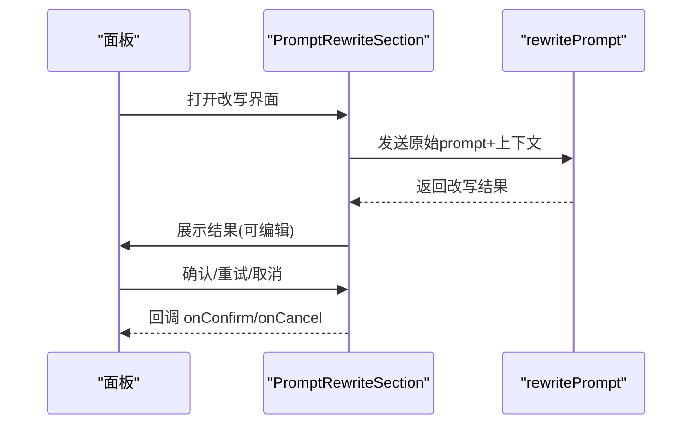
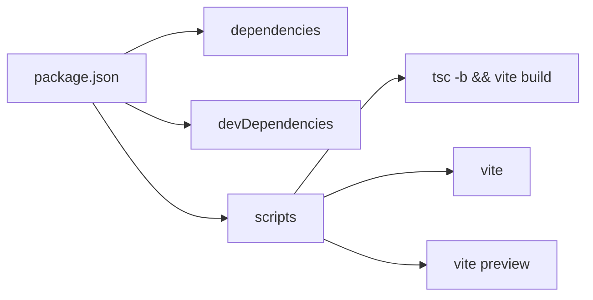

# 开发指南

<cite>
**本文引用的文件**   
- [package.json](file://package.json)
- [tsconfig.json](file://tsconfig.json)
- [tsconfig.app.json](file://tsconfig.app.json)
- [vite.config.ts](file://vite.config.ts)
- [src/main.tsx](file://src/main.tsx)
- [src/App.tsx](file://src/App.tsx)
- [src/components/ErrorBoundary.tsx](file://src/components/ErrorBoundary.tsx)
- [src/lib/api.ts](file://src/lib/api.ts)
- [src/hooks/useBatchQueue.ts](file://src/hooks/useBatchQueue.ts)
- [src/lib/batch-types.ts](file://src/lib/batch-types.ts)
- [src/components/TextToVideoPanel.tsx](file://src/components/TextToVideoPanel.tsx)
- [src/components/ImageToVideoPanel.tsx](file://src/components/ImageToVideoPanel.tsx)
- [src/components/VideoEditPanel.tsx](file://src/components/VideoEditPanel.tsx)
- [src/components/PromptRewriteSection.tsx](file://src/components/PromptRewriteSection.tsx)
- [src/components/Header.tsx](file://src/components/Header.tsx)
- [src/components/TabNav.tsx](file://src/components/TabNav.tsx)
- [src/components/VideoPreview.tsx](file://src/components/VideoPreview.tsx)
</cite>

## 目录
1. [简介](#简介)
2. [项目结构](#项目结构)
3. [核心组件](#核心组件)
4. [架构总览](#架构总览)
5. [详细组件分析](#详细组件分析)
6. [依赖分析](#依赖分析)
7. [性能考虑](#性能考虑)
8. [故障排查指南](#故障排查指南)
9. [结论](#结论)
10. [附录](#附录)

## 简介
本指南面向开发者，覆盖本地开发环境搭建、TypeScript 与 Vite 配置说明、代码组织与命名约定、测试策略、调试技巧、错误处理最佳实践以及代码审查清单。目标是帮助团队快速上手并保持高质量交付。

## 项目结构
- 构建与脚本：通过 package.json 的 scripts 提供 dev/build/preview 命令；构建流程先执行 TypeScript 类型检查再打包。
- 应用入口：main.tsx 挂载 React 根节点并启用 StrictMode。
- 路由与模式：App.tsx 管理应用模式（文生视频、图生视频、视频编辑、批量、长视频）与全局状态（API Key、任务结果、提示）。
- 业务模块：
  - lib/api.ts：封装百炼视频生成 API 提交与查询。
  - hooks/useBatchQueue.ts：批量队列调度、重试、降级、简化 Prompt 等策略。
  - components/*：页面级面板与通用 UI 组件。
- 工具与样式：Tailwind + PostCSS + Autoprefixer；Vite 插件实现代理与 OSS 中转上传。

图表来源
- [package.json:6-10](file://package.json#L6-L10)
- [vite.config.ts:262-293](file://vite.config.ts#L262-L293)
- [src/main.tsx:1-11](file://src/main.tsx#L1-L11)
- [src/App.tsx:1-164](file://src/App.tsx#L1-L164)
- [src/lib/api.ts:1-217](file://src/lib/api.ts#L1-L217)
- [src/hooks/useBatchQueue.ts:1-322](file://src/hooks/useBatchQueue.ts#L1-L322)
- [src/lib/batch-types.ts:1-123](file://src/lib/batch-types.ts#L1-L123)

章节来源
- [package.json:1-36](file://package.json#L1-L36)
- [src/main.tsx:1-11](file://src/main.tsx#L1-L11)
- [src/App.tsx:1-164](file://src/App.tsx#L1-L164)

## 核心组件
- 应用外壳与导航
  - Header：顶部标题与设置入口。
  - TabNav：切换“文生视频/图生视频/视频编辑/批量/长视频”模式。
  - App：集中管理 API Key、任务轮询、Toast 提示与模式渲染。
- 功能面板
  - TextToVideoPanel：文本描述、分辨率、时长、AI 改写。
  - ImageToVideoPanel：首帧图片上传或 URL、运动描述、AI 改写。
  - VideoEditPanel：源视频上传或 URL、参考图、编辑指令、AI 改写。
  - PromptRewriteSection：统一改写交互，调用后端改写服务并展示结果。
- 预览与状态
  - VideoPreview：根据任务状态显示等待/生成中/完成/失败。
  - ErrorBoundary：捕获子树渲染异常并提供重试。
- 批量能力
  - useBatchQueue：基于 useReducer 的状态机，支持并发控制、重试、降级、Prompt 简化、持久化与日志。

章节来源
- [src/components/Header.tsx:1-28](file://src/components/Header.tsx#L1-L28)
- [src/components/TabNav.tsx:1-39](file://src/components/TabNav.tsx#L1-L39)
- [src/App.tsx:1-164](file://src/App.tsx#L1-L164)
- [src/components/TextToVideoPanel.tsx:1-117](file://src/components/TextToVideoPanel.tsx#L1-L117)
- [src/components/ImageToVideoPanel.tsx:1-164](file://src/components/ImageToVideoPanel.tsx#L1-L164)
- [src/components/VideoEditPanel.tsx:1-157](file://src/components/VideoEditPanel.tsx#L1-L157)
- [src/components/PromptRewriteSection.tsx:1-167](file://src/components/PromptRewriteSection.tsx#L1-L167)
- [src/components/VideoPreview.tsx:1-65](file://src/components/VideoPreview.tsx#L1-L65)
- [src/components/ErrorBoundary.tsx:1-39](file://src/components/ErrorBoundary.tsx#L1-L39)
- [src/hooks/useBatchQueue.ts:1-322](file://src/hooks/useBatchQueue.ts#L1-L322)

## 架构总览
前端采用 React + Vite + TypeScript 技术栈，通过 Vite 开发服务器进行热更新与中间件扩展。关键链路：
- 用户操作触发各 Panel 提交请求。
- api.ts 将请求转发到 /dashscope 代理至百炼接口。
- 任务异步执行，前端定时轮询任务状态。
- 批量模式由 useBatchQueue 驱动，具备并发、重试、降级与简化 Prompt 策略。
- 本地开发时，Vite 提供 /proxy-fetch 与 /upload-to-oss 中间件以解决跨域与本地资源上传问题。

图表来源
- [src/components/TextToVideoPanel.tsx:1-117](file://src/components/TextToVideoPanel.tsx#L1-L117)
- [src/components/ImageToVideoPanel.tsx:1-164](file://src/components/ImageToVideoPanel.tsx#L1-L164)
- [src/components/VideoEditPanel.tsx:1-157](file://src/components/VideoEditPanel.tsx#L1-L157)
- [src/lib/api.ts:1-217](file://src/lib/api.ts#L1-L217)
- [vite.config.ts:277-291](file://vite.config.ts#L277-L291)

## 详细组件分析

### 应用外壳与错误边界
- App 负责模式切换、API Key 管理、任务轮询与 Toast 提示；对长视频面板使用 ErrorBoundary 包裹，避免局部崩溃影响整体。
- ErrorBoundary 为类组件，捕获渲染期错误并提供重试按钮。

图表来源
- [src/App.tsx:1-164](file://src/App.tsx#L1-L164)
- [src/components/ErrorBoundary.tsx:1-39](file://src/components/ErrorBoundary.tsx#L1-L39)

章节来源
- [src/App.tsx:1-164](file://src/App.tsx#L1-L164)
- [src/components/ErrorBoundary.tsx:1-39](file://src/components/ErrorBoundary.tsx#L1-L39)

### 批量队列与状态机
- useBatchQueue 使用 useReducer 维护队列状态，包含任务列表、运行状态与设置。
- 核心流程：
  - doTick：按并发槽位从队列取任务提交，并对处于 polling 的任务发起查询。
  - processTask：根据任务定义选择对应提交函数，成功后进入 polling。
  - pollTask：查询任务状态，成功则标记完成，失败则进入失败处理。
  - handleFailure：依据策略决定重试、降级或简化 Prompt，必要时标记永久失败。
  - start/pause/resume/cancel：控制定时器与状态重置。
  - 持久化：状态变更节流保存到本地存储，并在 beforeunload 时阻止意外关闭。

图表来源
- [src/hooks/useBatchQueue.ts:1-322](file://src/hooks/useBatchQueue.ts#L1-L322)
- [src/lib/batch-types.ts:1-123](file://src/lib/batch-types.ts#L1-L123)

章节来源
- [src/hooks/useBatchQueue.ts:1-322](file://src/hooks/useBatchQueue.ts#L1-L322)
- [src/lib/batch-types.ts:1-123](file://src/lib/batch-types.ts#L1-L123)

### 提示词改写流程
- PromptRewriteSection 在挂载时自动触发改写，调用 rewritePrompt 获取结果，支持编辑确认、重试与取消。
- 三个面板均复用该组件，保证一致的改写体验。

图表来源
- [src/components/PromptRewriteSection.tsx:1-167](file://src/components/PromptRewriteSection.tsx#L1-L167)
- [src/components/TextToVideoPanel.tsx:1-117](file://src/components/TextToVideoPanel.tsx#L1-L117)
- [src/components/ImageToVideoPanel.tsx:1-164](file://src/components/ImageToVideoPanel.tsx#L1-L164)
- [src/components/VideoEditPanel.tsx:1-157](file://src/components/VideoEditPanel.tsx#L1-L157)

章节来源
- [src/components/PromptRewriteSection.tsx:1-167](file://src/components/PromptRewriteSection.tsx#L1-L167)
- [src/components/TextToVideoPanel.tsx:1-117](file://src/components/TextToVideoPanel.tsx#L1-L117)
- [src/components/ImageToVideoPanel.tsx:1-164](file://src/components/ImageToVideoPanel.tsx#L1-L164)
- [src/components/VideoEditPanel.tsx:1-157](file://src/components/VideoEditPanel.tsx#L1-L157)

## 依赖分析
- 运行时依赖：React、ReactDOM、react-router-dom、@ffmpeg/*、ali-oss、lucide-react、tailwind-merge、tailwindcss-animate 等。
- 开发依赖：Vite、TypeScript、PostCSS、Autoprefixer、Tailwind CSS、@vitejs/plugin-react。
- 构建脚本：dev 启动 Vite；build 先 tsc -b 再 vite build；preview 预览产物。

图表来源
- [package.json:1-36](file://package.json#L1-L36)

章节来源
- [package.json:1-36](file://package.json#L1-L36)

## 性能考虑
- 并发与限流：批量队列默认并发为 2，可根据网络与服务端限制调整 concurrency。
- 轮询间隔：当前轮询间隔为 5 秒，可在不增加服务端压力的前提下平衡实时性。
- 资源优化：Vite 已排除 @ffmpeg/* 预构建，避免不必要的依赖优化开销。
- 渲染优化：组件内状态粒度合理，避免不必要重渲染；长视频面板使用 ErrorBoundary 隔离风险。

[本节为通用建议，无需源码引用]

## 故障排查指南
- 网络与跨域
  - 第三方 CDN 无 CORS：使用 /proxy-fetch?url= 中间件进行同源访问。
  - 本地图片转公网：通过 /upload-to-oss 中转上传到 OSS，返回公网 URL。
  - 代理配置：/dashscope 与 /mulerouter 已在 Vite server.proxy 中配置。
- 环境变量
  - OSS 相关变量需置于 .env.local（如 OSS_ACCESS_KEY_ID、OSS_ACCESS_KEY_SECRET、OSS_BUCKET、OSS_REGION、OSS_ENDPOINT、OSS_ACCESS_POINT_ALIAS），仅 Node 端读取。
- 任务状态
  - 若长时间停留在 RUNNING：检查 queryTask 是否正确轮询、服务端是否返回有效 videoUrl。
  - 失败信息：查看 Toast 与批量日志，定位具体错误原因。
- 浏览器调试
  - 使用浏览器 Network 面板观察 /dashscope 与 /upload-to-oss 请求。
  - 使用 Console 查看 Vite 中间件输出（如 proxy-fetch、upload-to-oss 的错误日志）。
- 错误边界
  - 长视频面板异常会被 ErrorBoundary 捕获，点击“重试”可恢复。

章节来源
- [vite.config.ts:11-66](file://vite.config.ts#L11-L66)
- [vite.config.ts:151-260](file://vite.config.ts#L151-L260)
- [vite.config.ts:277-291](file://vite.config.ts#L277-L291)
- [src/components/ErrorBoundary.tsx:1-39](file://src/components/ErrorBoundary.tsx#L1-L39)
- [src/App.tsx:42-55](file://src/App.tsx#L42-L55)

## 结论
本项目采用清晰的模块化结构与稳健的错误处理机制，配合 Vite 插件与批量队列策略，提供了良好的开发与用户体验。遵循本文的开发规范与排障建议，有助于提升团队协作效率与代码质量。

[本节为总结，无需源码引用]

## 附录

### 开发环境搭建与配置要求
- Node.js 版本：建议使用与包管理器锁文件兼容的版本（参考 package-lock.json）。
- 安装依赖：在项目根目录执行 npm install。
- 启动开发服务器：npm run dev。
- 构建生产包：npm run build。
- 预览构建产物：npm run preview。

章节来源
- [package.json:6-10](file://package.json#L6-L10)

### IDE 推荐设置
- VS Code 扩展：ESLint、Prettier、Tailwind CSS IntelliSense、TypeScript 语言服务。
- 保存时格式化：开启保存时自动格式化，保持风格一致。
- 路径别名：确保 TS 与编辑器识别 @/* 别名（见 tsconfig.app.json 与 vite.config.ts）。

章节来源
- [tsconfig.app.json:19-22](file://tsconfig.app.json#L19-L22)
- [vite.config.ts:264-268](file://vite.config.ts#L264-L268)

### 代码规范与命名约定
- 文件结构
  - src/components：页面级面板与通用 UI 组件。
  - src/hooks：自定义 Hook（如批量队列、日志）。
  - src/lib：业务逻辑与工具（API 封装、批处理类型与策略、视频处理工具）。
- 命名约定
  - 组件：PascalCase，文件名与导出名一致。
  - Hook：useXxx 形式。
  - 常量与类型：大驼峰或大写常量。
  - 函数：动词短语，语义清晰（如 submitTextToVideo、queryTask）。
- 样式
  - 使用 Tailwind 原子类，结合 tailwind-merge 与 clsx 动态拼接。

章节来源
- [src/components/TextToVideoPanel.tsx:1-117](file://src/components/TextToVideoPanel.tsx#L1-L117)
- [src/hooks/useBatchQueue.ts:1-322](file://src/hooks/useBatchQueue.ts#L1-L322)
- [src/lib/api.ts:1-217](file://src/lib/api.ts#L1-L217)

### Git 工作流
- 分支模型：主分支保护，功能分支命名 feature/xxx，修复分支 hotfix/xxx。
- 提交信息：遵循约定式提交（feat/fix/docs/chore 等），便于自动生成变更日志。
- 合并前检查：确保 npm run build 通过，无新增类型错误或警告。

[本节为通用流程建议，无需源码引用]

### TypeScript 配置与编译选项
- 顶层 tsconfig.json 引用 tsconfig.app.json，便于多配置管理。
- 关键选项
  - target: ES2020，lib: ES2020 + DOM + DOM.Iterable。
  - module: ESNext，moduleResolution: bundler，isolationModules: true。
  - strict: true，noUnusedLocals/Parameters/FallthroughCasesInSwitch/noUncheckedSideEffectImports。
  - jsx: react-jsx，allowImportingTsExtensions: true。
  - baseUrl 与 paths：@/* 映射到 ./src/*。
  - noEmit: true，由 Vite 负责打包。
- 路径别名
  - 同时配置于 tsconfig.app.json 与 vite.config.ts，确保编辑器与构建一致。

章节来源
- [tsconfig.json:1-7](file://tsconfig.json#L1-L7)
- [tsconfig.app.json:1-26](file://tsconfig.app.json#L1-L26)
- [vite.config.ts:264-268](file://vite.config.ts#L264-L268)

### 测试策略与用例编写
- 单元测试
  - 针对纯函数与工具（如 batch-cascade、batch-parser、utils）编写断言。
  - 使用 Jest/Vitest 均可，建议与现有构建体系集成。
- 集成测试
  - 模拟 API 层（api.ts）与批量队列（useBatchQueue）交互，验证状态机流转与重试策略。
- 端到端测试
  - 使用 Playwright/Cypress 模拟用户操作（提交任务、轮询、查看结果），校验 UI 反馈与最终产出。
- 覆盖率与门禁
  - 设定最低覆盖率阈值，CI 中强制通过。

[本节为通用策略建议，无需源码引用]

### 调试技巧与工具使用
- 浏览器调试
  - Network：观察 /dashscope、/upload-to-oss、/proxy-fetch 的请求与响应。
  - Console：查看 Vite 中间件打印的错误信息。
- 日志分析
  - 批量模式下的日志条目（时间戳、任务索引、事件、级别）用于定位问题。
- 性能分析
  - Performance 面板录制关键交互，关注长任务与频繁重渲染。
  - 使用 React Profiler 分析组件渲染成本。

章节来源
- [src/hooks/useBatchQueue.ts:1-322](file://src/hooks/useBatchQueue.ts#L1-L322)
- [vite.config.ts:11-66](file://vite.config.ts#L11-L66)
- [vite.config.ts:151-260](file://vite.config.ts#L151-L260)

### 错误处理与异常捕获最佳实践
- 统一错误返回：api.ts 将网络错误与 HTTP 非 2xx 情况转换为统一的 TaskResult 格式，便于上层处理。
- 组件级容错：长视频面板使用 ErrorBoundary 隔离异常，提供重试。
- 批量失败处理：根据错误消息与策略决定重试、降级或简化 Prompt，避免无限循环。

章节来源
- [src/lib/api.ts:125-174](file://src/lib/api.ts#L125-L174)
- [src/components/ErrorBoundary.tsx:1-39](file://src/components/ErrorBoundary.tsx#L1-L39)
- [src/hooks/useBatchQueue.ts:187-264](file://src/hooks/useBatchQueue.ts#L187-L264)

### 代码审查清单与质量保证流程
- 功能性
  - 需求实现是否完整？边界条件是否覆盖？
- 类型安全
  - 是否启用严格模式？新增类型是否明确？是否存在 any？
- 可读性与一致性
  - 命名是否符合约定？组件职责是否单一？
- 性能与稳定性
  - 是否有不必要的重渲染？轮询与并发是否合理？
- 安全性
  - 敏感信息是否仅存在于 .env.local？是否避免在前端暴露密钥？
- 文档与注释
  - 复杂逻辑是否添加必要注释？变更是否更新相关文档？

[本节为通用流程建议，无需源码引用]