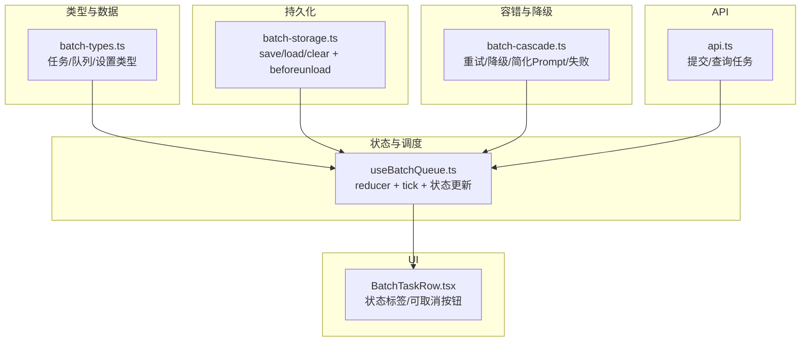
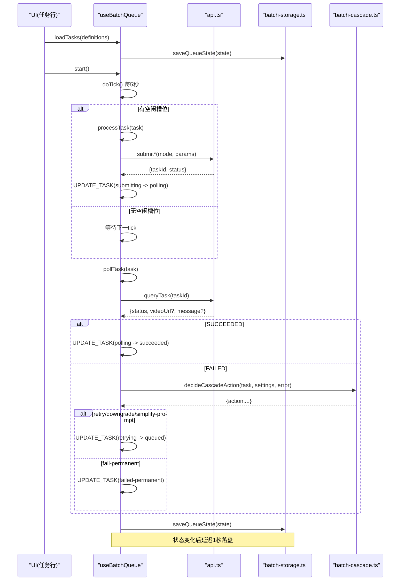
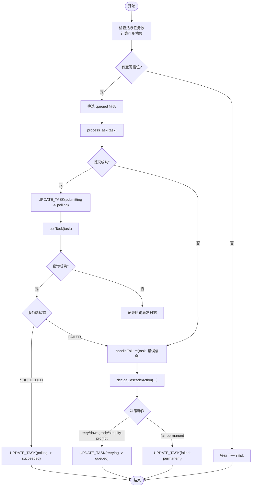
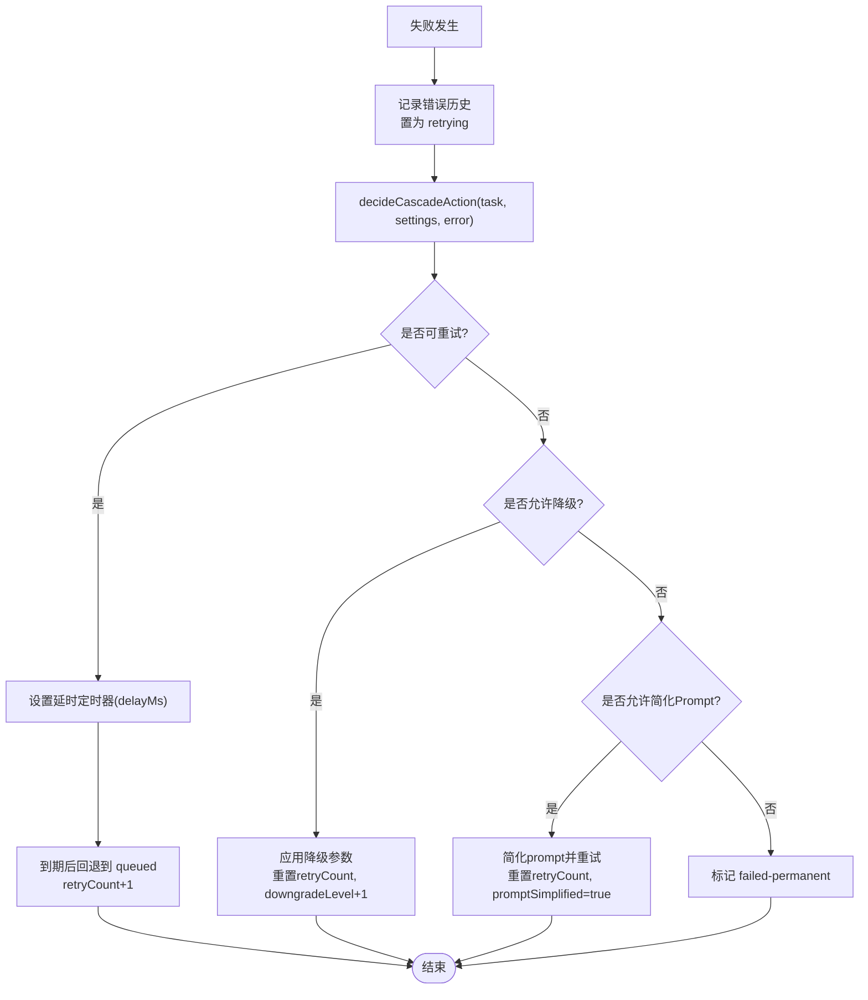
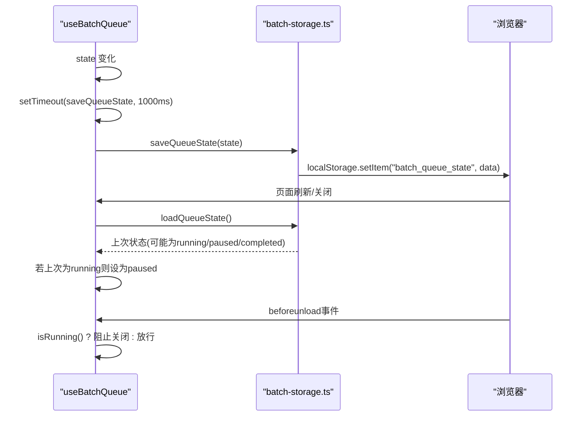
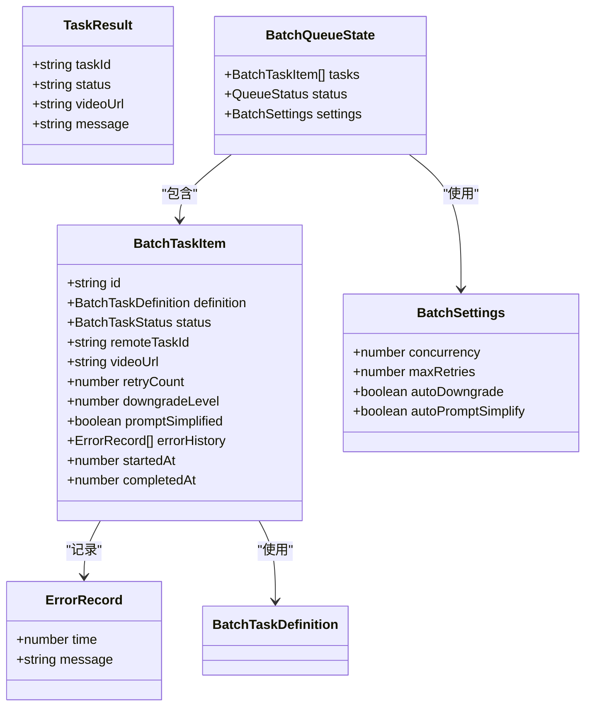
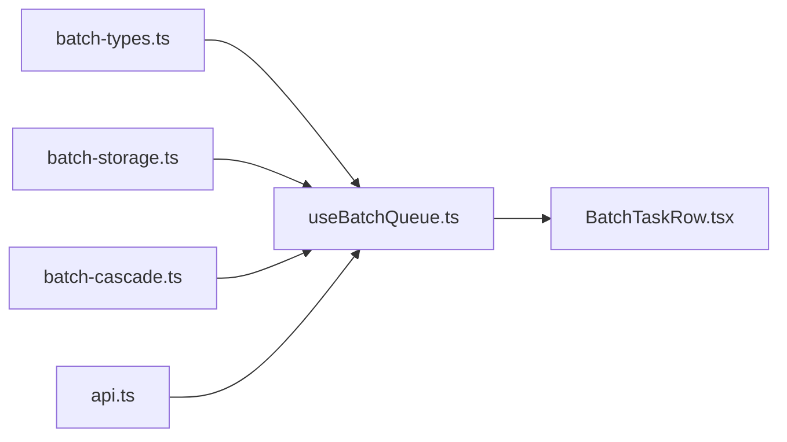

# 任务生命周期管理

<cite>
**本文引用的文件列表**
- [src/lib/batch-types.ts](file://src/lib/batch-types.ts)
- [src/hooks/useBatchQueue.ts](file://src/hooks/useBatchQueue.ts)
- [src/lib/batch-storage.ts](file://src/lib/batch-storage.ts)
- [src/lib/batch-cascade.ts](file://src/lib/batch-cascade.ts)
- [src/lib/api.ts](file://src/lib/api.ts)
- [src/components/batch/BatchTaskRow.tsx](file://src/components/batch/BatchTaskRow.tsx)
</cite>

## 目录
1. [简介](#简介)
2. [项目结构](#项目结构)
3. [核心组件](#核心组件)
4. [架构总览](#架构总览)
5. [详细组件分析](#详细组件分析)
6. [依赖关系分析](#依赖关系分析)
7. [性能考量](#性能考量)
8. [故障排查指南](#故障排查指南)
9. [结论](#结论)
10. [附录](#附录)

## 简介
本文件围绕“批量视频生成任务”的生命周期与状态管理进行系统化说明，覆盖以下关键目标：
- 完整解释任务状态：queued（排队中）、submitting（提交中）、polling（轮询中）、succeeded（成功）、failed-permanent（永久失败）、cancelled（已取消）、retrying（重试中）
- 明确状态转换规则与触发条件
- 阐述状态持久化策略、恢复机制与 beforeunload 事件处理
- 提供状态管理的代码示例路径，展示如何正确更新与监听状态
- 梳理错误处理流程及不同错误类型对应的状态转换和处理策略

## 项目结构
与任务生命周期相关的核心代码分布在如下模块：
- 类型定义：任务、队列、设置等数据结构
- 状态机与调度：基于 useReducer 的队列状态管理与 tick 调度
- 持久化：localStorage 保存/加载队列状态与日志，以及页面离开保护
- 容错降级：根据错误信息、重试次数、参数配置决定下一步动作
- API 封装：提交任务与查询任务结果
- UI 展示：任务行渲染与可取消状态控制



图表来源
- [src/lib/batch-types.ts:1-123](file://src/lib/batch-types.ts#L1-L123)
- [src/hooks/useBatchQueue.ts:1-322](file://src/hooks/useBatchQueue.ts#L1-L322)
- [src/lib/batch-storage.ts:1-89](file://src/lib/batch-storage.ts#L1-L89)
- [src/lib/batch-cascade.ts:1-101](file://src/lib/batch-cascade.ts#L1-L101)
- [src/lib/api.ts:1-217](file://src/lib/api.ts#L1-L217)
- [src/components/batch/BatchTaskRow.tsx:1-80](file://src/components/batch/BatchTaskRow.tsx#L1-L80)

章节来源
- [src/lib/batch-types.ts:1-123](file://src/lib/batch-types.ts#L1-L123)
- [src/hooks/useBatchQueue.ts:1-322](file://src/hooks/useBatchQueue.ts#L1-L322)
- [src/lib/batch-storage.ts:1-89](file://src/lib/batch-storage.ts#L1-L89)
- [src/lib/batch-cascade.ts:1-101](file://src/lib/batch-cascade.ts#L1-L101)
- [src/lib/api.ts:1-217](file://src/lib/api.ts#L1-L217)
- [src/components/batch/BatchTaskRow.tsx:1-80](file://src/components/batch/BatchTaskRow.tsx#L1-L80)

## 核心组件
- 类型层（batch-types.ts）
  - 定义任务状态枚举 BatchTaskStatus、任务项 BatchTaskItem、队列状态 BatchQueueState、执行设置 BatchSettings 等
  - 提供默认设置 DEFAULT_BATCH_SETTINGS 与 ID 生成工具 generateId
- 状态与调度（useBatchQueue.ts）
  - 使用 useReducer 维护队列状态，提供 LOAD_TASKS、SET_STATUS、UPDATE_SETTINGS、UPDATE_TASK、CANCEL_TASK、RESET 等动作
  - 每 5 秒执行 doTick：按并发度从 queued 挑选任务进入 submitting；对 polling 的任务调用 pollTask
  - processTask 负责提交任务并转入 polling；pollTask 负责查询任务结果并转为 succeeded 或进入失败处理
  - handleFailure 统一处理失败，记录错误历史，调用降级策略 decideCascadeAction，并根据决策执行 retry/downgrade/simplify-prompt/fail-permanent
  - 完成检测：当所有任务处于 succeeded/failed-permanent/cancelled 时，将队列状态置为 completed 并停止轮询
- 持久化（batch-storage.ts）
  - saveQueueState/loadQueueState/clearQueueState 用于 localStorage 存取队列状态
  - getInitialQueueState 提供初始状态
  - registerBeforeUnload 注册页面离开警告，若队列正在运行则阻止关闭
- 容错与降级（batch-cascade.ts）
  - decideCascadeAction 依据重试次数、是否允许降级、是否允许简化 Prompt 等策略选择下一步动作
  - simplifyPrompt 对提示词做清理与截断
- API（api.ts）
  - submitTextToVideo/submitImageToVideo/submitVideoEdit 提交异步任务
  - queryTask 查询任务状态与结果
  - mapStatus 将服务端状态映射到内部 TaskResult.status
- UI（BatchTaskRow.tsx）
  - 根据任务状态显示对应标签与操作按钮，仅允许在 queued/retrying 状态下取消

章节来源
- [src/lib/batch-types.ts:1-123](file://src/lib/batch-types.ts#L1-L123)
- [src/hooks/useBatchQueue.ts:1-322](file://src/hooks/useBatchQueue.ts#L1-L322)
- [src/lib/batch-storage.ts:1-89](file://src/lib/batch-storage.ts#L1-L89)
- [src/lib/batch-cascade.ts:1-101](file://src/lib/batch-cascade.ts#L1-L101)
- [src/lib/api.ts:1-217](file://src/lib/api.ts#L1-L217)
- [src/components/batch/BatchTaskRow.tsx:1-80](file://src/components/batch/BatchTaskRow.tsx#L1-L80)

## 架构总览
下图展示了任务从创建到完成的整体流程，包括提交、轮询、失败处理与最终落盘。



图表来源
- [src/hooks/useBatchQueue.ts:98-185](file://src/hooks/useBatchQueue.ts#L98-L185)
- [src/lib/api.ts:125-201](file://src/lib/api.ts#L125-L201)
- [src/lib/batch-cascade.ts:19-56](file://src/lib/batch-cascade.ts#L19-L56)
- [src/lib/batch-storage.ts:8-27](file://src/lib/batch-storage.ts#L8-L27)

## 详细组件分析

### 任务状态与转换规则
- 状态集合
  - queued：任务已入队，等待提交
  - submitting：正在提交到服务端
  - polling：已提交，等待服务端返回结果
  - succeeded：生成成功
  - failed-permanent：达到最大重试或无法继续降级，标记永久失败
  - cancelled：用户主动取消（仅允许在 queued/retrying 时取消）
  - retrying：失败后进入重试准备阶段（可能伴随延时）
- 转换规则
  - queued → submitting：doTick 计算可用并发槽位，选取 queued 任务调用 processTask
  - submitting → polling：提交成功且返回 taskId 时
  - submitting → retrying：提交异常或返回失败时进入失败处理
  - polling → succeeded：查询结果为 SUCCEEDED
  - polling → retrying：查询结果为 FAILED 时进入失败处理
  - retrying → queued：根据降级策略决定 delayMs 后回到队列（重试/降级/简化Prompt）
  - retrying → failed-permanent：达到最大重试且无法降级/简化时
  - queued → cancelled / retrying → cancelled：用户触发取消
  - 队列级：当所有任务均处于 succeeded/failed-permanent/cancelled 时，队列状态变为 completed

```mermaid
stateDiagram-v2
[*] --> queued
queued --> submitting : "doTick 分配槽位"
submitting --> polling : "提交成功, 返回taskId"
submitting --> retrying : "提交失败/异常"
polling --> succeeded : "查询=SUCCEEDED"
polling --> retrying : "查询=FAILED"
retrying --> queued : "重试/降级/简化Prompt"
retrying --> failed-permanent : "达到上限且无法降级"
queued --> cancelled : "用户取消"
retrying --> cancelled : "用户取消"
succeeded --> [*]
failed-permanent --> [*]
cancelled --> [*]
```

图表来源
- [src/hooks/useBatchQueue.ts:98-185](file://src/hooks/useBatchQueue.ts#L98-L185)
- [src/hooks/useBatchQueue.ts:187-264](file://src/hooks/useBatchQueue.ts#L187-L264)
- [src/components/batch/BatchTaskRow.tsx:11-24](file://src/components/batch/BatchTaskRow.tsx#L11-L24)

章节来源
- [src/lib/batch-types.ts:22-44](file://src/lib/batch-types.ts#L22-L44)
- [src/hooks/useBatchQueue.ts:98-185](file://src/hooks/useBatchQueue.ts#L98-L185)
- [src/hooks/useBatchQueue.ts:187-264](file://src/hooks/useBatchQueue.ts#L187-L264)
- [src/components/batch/BatchTaskRow.tsx:11-24](file://src/components/batch/BatchTaskRow.tsx#L11-L24)

### 提交与轮询流程
- 提交流程（processTask）
  - 根据任务模式选择对应提交接口
  - 捕获网络/解析/HTTP 错误，统一包装为失败消息
  - 成功返回 taskId 则转 polling；否则进入失败处理
- 轮询流程（pollTask）
  - 查询任务状态，SUCCEEDED 则写入 videoUrl 并转 succeeded
  - FAILED 则进入失败处理
  - 异常仅记录日志，不改变状态（保持 polling），由下一次 tick 继续轮询



图表来源
- [src/hooks/useBatchQueue.ts:98-185](file://src/hooks/useBatchQueue.ts#L98-L185)
- [src/lib/batch-cascade.ts:19-56](file://src/lib/batch-cascade.ts#L19-L56)

章节来源
- [src/hooks/useBatchQueue.ts:126-185](file://src/hooks/useBatchQueue.ts#L126-L185)
- [src/lib/api.ts:125-201](file://src/lib/api.ts#L125-L201)

### 失败处理与降级策略
- 失败入口：handleFailure
  - 记录错误历史，立即将任务置为 retrying
  - 调用 decideCascadeAction 获取下一步动作
- 降级策略（decideCascadeAction）
  - 优先重试原参数（指数退避：2s、4s、8s...）
  - 若允许自动降级，尝试降低分辨率或时长
  - 若允许简化 Prompt 且尚未简化，尝试简化提示词并重试
  - 以上均不可用时，标记 permanent failure
- 具体动作
  - retry：设置 delayMs 定时器，到期后将任务回退到 queued，并递增 retryCount
  - downgrade：调整 resolution/duration，重置 retryCount，增加 downgradeLevel
  - simplify-prompt：简化 prompt，重置 retryCount，标记 promptSimplified
  - fail-permanent：直接标记 failed-permanent 并记录完成时间



图表来源
- [src/hooks/useBatchQueue.ts:187-264](file://src/hooks/useBatchQueue.ts#L187-L264)
- [src/lib/batch-cascade.ts:19-56](file://src/lib/batch-cascade.ts#L19-L56)

章节来源
- [src/hooks/useBatchQueue.ts:187-264](file://src/hooks/useBatchQueue.ts#L187-L264)
- [src/lib/batch-cascade.ts:19-56](file://src/lib/batch-cascade.ts#L19-L56)

### 状态持久化与恢复
- 保存时机
  - 每次 state 变化后，通过 useEffect 延迟 1 秒调用 saveQueueState，避免频繁落盘
  - saveQueueState 会尝试 JSON.stringify 并写入 localStorage；若空间不足，会裁剪 errorHistory 再重试
- 恢复机制
  - 初始化时 loadQueueState 读取上次状态；若上次为 running，则恢复为 paused，避免自动继续
  - 提供 clearQueueState 用于完全清除
- beforeunload 处理
  - registerBeforeUnload 在页面即将关闭时判断队列是否仍在运行，若是则阻止关闭，提醒用户



图表来源
- [src/hooks/useBatchQueue.ts:71-81](file://src/hooks/useBatchQueue.ts#L71-L81)
- [src/lib/batch-storage.ts:8-41](file://src/lib/batch-storage.ts#L8-L41)
- [src/lib/batch-storage.ts:79-88](file://src/lib/batch-storage.ts#L79-L88)

章节来源
- [src/hooks/useBatchQueue.ts:71-81](file://src/hooks/useBatchQueue.ts#L71-L81)
- [src/lib/batch-storage.ts:8-41](file://src/lib/batch-storage.ts#L8-L41)
- [src/lib/batch-storage.ts:79-88](file://src/lib/batch-storage.ts#L79-L88)

### 状态管理的使用示例（路径引用）
- 加载任务并启动
  - 参考路径：[loadTasks/start:266-284](file://src/hooks/useBatchQueue.ts#L266-L284)
- 暂停/恢复/取消
  - 参考路径：[pause/resume/cancel:286-306](file://src/hooks/useBatchQueue.ts#L286-L306)
- 单个任务取消
  - 参考路径：[cancelTask:308-312](file://src/hooks/useBatchQueue.ts#L308-L312)
- 更新设置（并发、重试等）
  - 参考路径：[updateSettings:314-316](file://src/hooks/useBatchQueue.ts#L314-L316)
- 监听状态变化
  - 参考路径：[useReducer + dispatch:22-51](file://src/hooks/useBatchQueue.ts#L22-L51)
- 持久化与恢复
  - 参考路径：[saveQueueState/loadQueueState/getInitialQueueState/registerBeforeUnload:8-88](file://src/lib/batch-storage.ts#L8-L88)

章节来源
- [src/hooks/useBatchQueue.ts:266-316](file://src/hooks/useBatchQueue.ts#L266-L316)
- [src/lib/batch-storage.ts:8-88](file://src/lib/batch-storage.ts#L8-L88)

### 错误处理与状态映射
- 提交阶段错误
  - 网络异常、JSON 解析失败、HTTP 非 2xx 等情况，统一返回 FAILED 并携带 message
  - 处理：进入 handleFailure，记录错误历史，进入降级策略
- 轮询阶段错误
  - 查询失败仅记录 warn 日志，不改变任务状态，等待下次 tick 继续轮询
- 服务端状态映射
  - PENDING/RUNNING/SUCCEEDED/FAILED 映射到内部 TaskResult.status，UNKNOWN 作为兜底
- 失败分类与处理
  - 临时性错误（如网络抖动、服务限流）：通过重试/降级/简化 Prompt 提升成功率
  - 永久性错误（如参数不合法、资源不可用）：达到上限后标记 failed-permanent



图表来源
- [src/lib/batch-types.ts:22-76](file://src/lib/batch-types.ts#L22-L76)
- [src/lib/api.ts:32-37](file://src/lib/api.ts#L32-L37)

章节来源
- [src/lib/api.ts:125-201](file://src/lib/api.ts#L125-L201)
- [src/hooks/useBatchQueue.ts:126-185](file://src/hooks/useBatchQueue.ts#L126-L185)
- [src/hooks/useBatchQueue.ts:187-264](file://src/hooks/useBatchQueue.ts#L187-L264)

## 依赖关系分析
- 低耦合高内聚
  - batch-types.ts 仅定义类型，被多处引用
  - useBatchQueue.ts 聚合 reducer、调度、API 调用、持久化与降级逻辑
  - batch-storage.ts 专注本地存储与页面离开保护
  - batch-cascade.ts 独立实现降级策略，便于扩展
  - api.ts 封装 HTTP 请求与状态映射
- 外部依赖
  - 浏览器 API：localStorage、beforeunload、setInterval/setTimeout
  - 后端 API：/dashscope 下的视频合成与任务查询接口



图表来源
- [src/lib/batch-types.ts:1-123](file://src/lib/batch-types.ts#L1-L123)
- [src/hooks/useBatchQueue.ts:1-322](file://src/hooks/useBatchQueue.ts#L1-L322)
- [src/lib/batch-storage.ts:1-89](file://src/lib/batch-storage.ts#L1-L89)
- [src/lib/batch-cascade.ts:1-101](file://src/lib/batch-cascade.ts#L1-L101)
- [src/lib/api.ts:1-217](file://src/lib/api.ts#L1-L217)
- [src/components/batch/BatchTaskRow.tsx:1-80](file://src/components/batch/BatchTaskRow.tsx#L1-L80)

章节来源
- [src/hooks/useBatchQueue.ts:1-322](file://src/hooks/useBatchQueue.ts#L1-L322)
- [src/lib/batch-types.ts:1-123](file://src/lib/batch-types.ts#L1-L123)
- [src/lib/batch-storage.ts:1-89](file://src/lib/batch-storage.ts#L1-L89)
- [src/lib/batch-cascade.ts:1-101](file://src/lib/batch-cascade.ts#L1-L101)
- [src/lib/api.ts:1-217](file://src/lib/api.ts#L1-L217)
- [src/components/batch/BatchTaskRow.tsx:1-80](file://src/components/batch/BatchTaskRow.tsx#L1-L80)

## 性能考量
- 轮询间隔：当前 tick 间隔为 5 秒，兼顾实时性与服务器压力
- 并发控制：settings.concurrency 限制同时提交/轮询的任务数，避免过载
- 防抖持久化：状态变化后延迟 1 秒落盘，减少 I/O 频率
- 降级策略：通过降低分辨率/时长或简化 Prompt 提高成功率，减少无效重试
- 错误历史裁剪：localStorage 满时自动裁剪 errorHistory，保障基本状态可恢复

## 故障排查指南
- 常见问题定位
  - 任务卡在 submitting：检查提交接口返回是否为 FAILED 或抛出异常；查看错误日志
  - 任务卡在 polling：确认 queryTask 是否正常返回；若网络异常仅记录 warn，需等待下次 tick
  - 任务反复重试：查看 decideCascadeAction 的决策路径与 settings.maxRetries/autoDowngrade/autoPromptSimplify 配置
  - 页面刷新后未恢复：确认 localStorage 是否被清空或存储空间不足；检查 loadQueueState 返回值
- 建议排查步骤
  - 打开日志面板，筛选 error/warn 级别，关注“提交任务...”、“轮询异常”、“失败”等事件
  - 检查 BatchTaskRow 中的重试次数与降级标记，辅助判断是否触发了降级/简化策略
  - 核对 settings 配置，适当调大 concurrency 或 maxRetries 以改善吞吐与成功率

章节来源
- [src/hooks/useBatchQueue.ts:126-185](file://src/hooks/useBatchQueue.ts#L126-L185)
- [src/hooks/useBatchQueue.ts:187-264](file://src/hooks/useBatchQueue.ts#L187-L264)
- [src/lib/batch-storage.ts:8-27](file://src/lib/batch-storage.ts#L8-L27)
- [src/components/batch/BatchTaskRow.tsx:11-24](file://src/components/batch/BatchTaskRow.tsx#L11-L24)

## 结论
该任务生命周期管理系统通过清晰的状态机、稳健的降级策略与可靠的持久化机制，实现了批量视频生成任务的稳定执行与良好用户体验。其设计要点包括：
- 明确的状态定义与转换规则，确保行为可预测
- 统一的失败处理入口与多级降级策略，提升成功率
- 延迟持久化与 beforeunload 保护，增强鲁棒性
- 合理的并发与轮询策略，平衡性能与稳定性

## 附录
- 相关类型与常量
  - 任务状态枚举、任务项字段、队列状态、默认设置等定义
  - 参考路径：[batch-types.ts:1-123](file://src/lib/batch-types.ts#L1-L123)
- 关键函数路径
  - 提交与查询：[api.ts:125-201](file://src/lib/api.ts#L125-L201)
  - 状态调度与更新：[useBatchQueue.ts:98-185](file://src/hooks/useBatchQueue.ts#L98-L185)
  - 降级策略：[batch-cascade.ts:19-56](file://src/lib/batch-cascade.ts#L19-L56)
  - 持久化与页面离开保护：[batch-storage.ts:8-88](file://src/lib/batch-storage.ts#L8-L88)
  - UI 状态展示与取消控制：[BatchTaskRow.tsx:11-24](file://src/components/batch/BatchTaskRow.tsx#L11-L24)