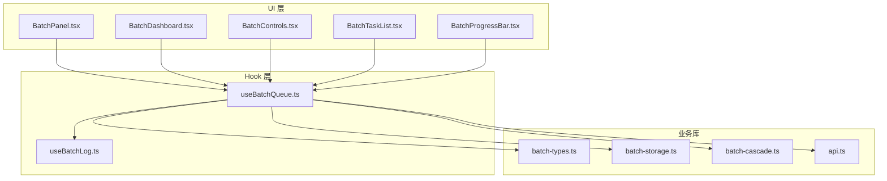
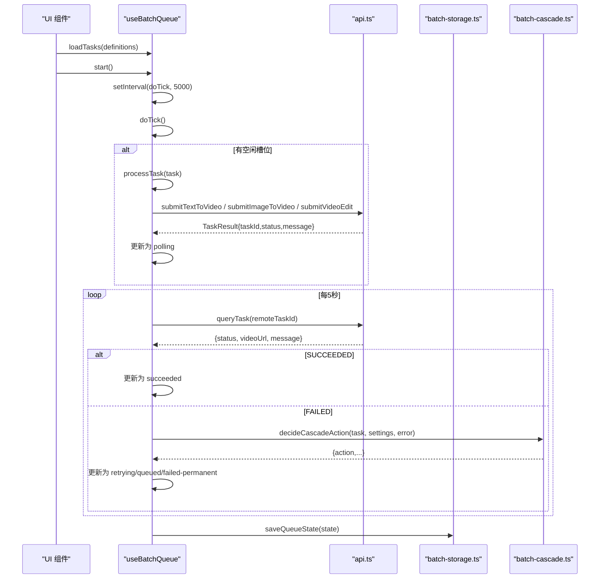
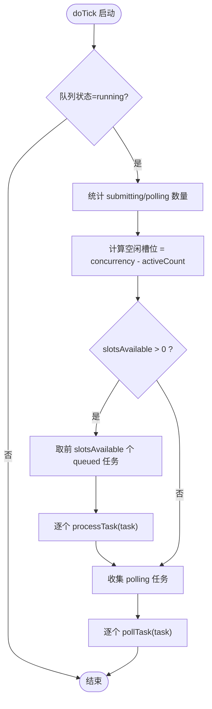
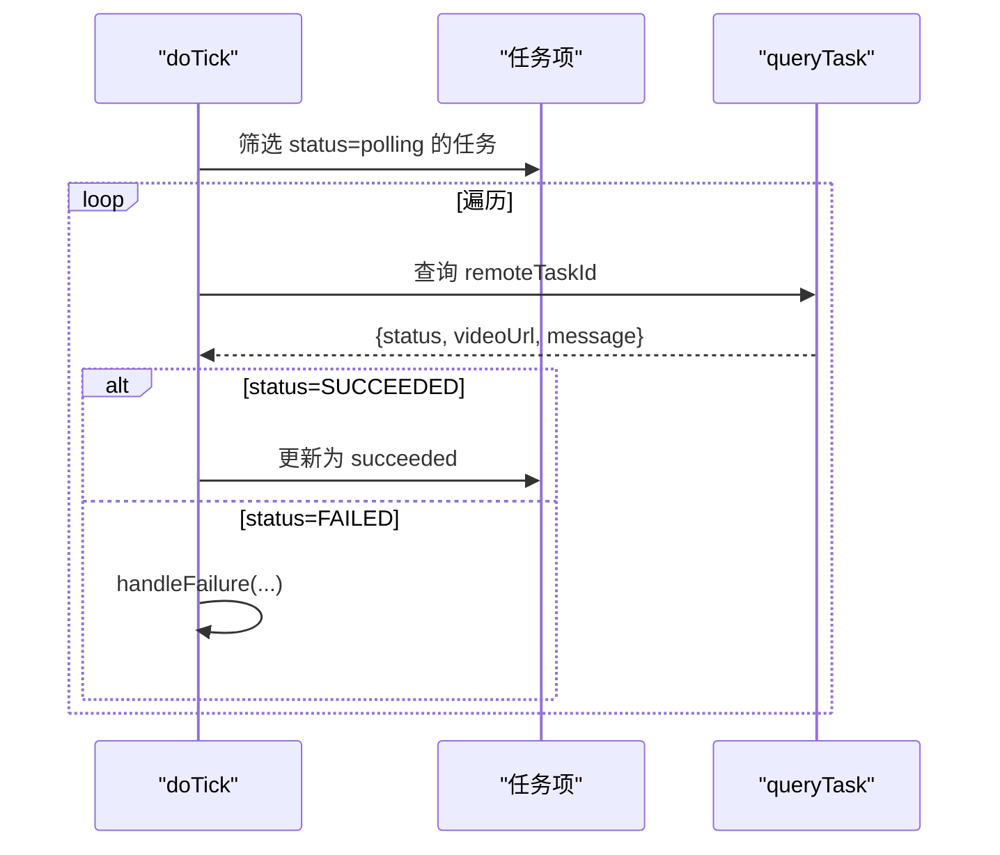
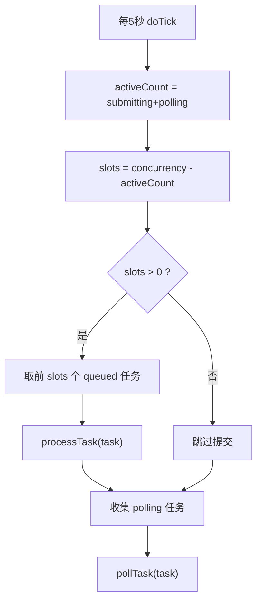
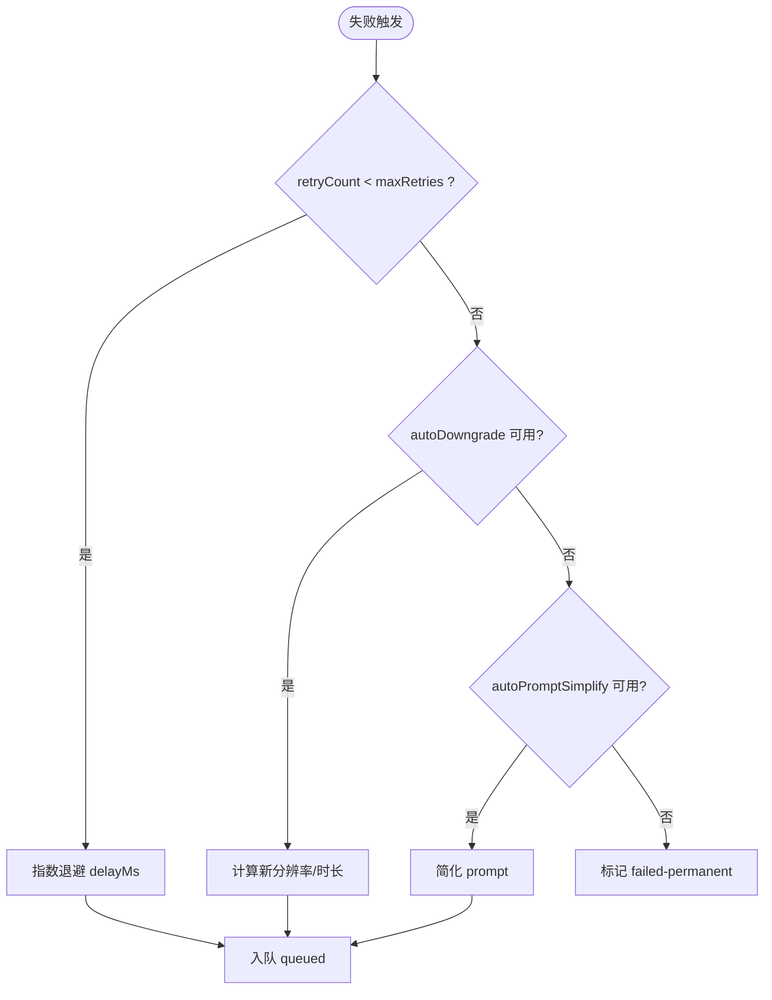
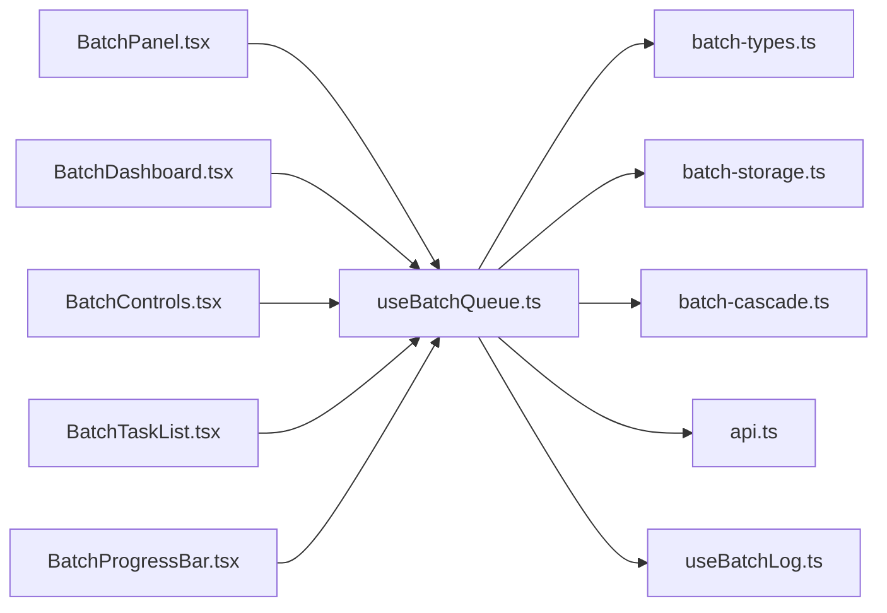

# 任务队列管理

<cite>
**本文引用的文件列表**   
- [useBatchQueue.ts](file://src/hooks/useBatchQueue.ts)
- [batch-types.ts](file://src/lib/batch-types.ts)
- [batch-storage.ts](file://src/lib/batch-storage.ts)
- [batch-cascade.ts](file://src/lib/batch-cascade.ts)
- [api.ts](file://src/lib/api.ts)
- [useBatchLog.ts](file://src/hooks/useBatchLog.ts)
- [BatchPanel.tsx](file://src/components/batch/BatchPanel.tsx)
- [BatchDashboard.tsx](file://src/components/batch/BatchDashboard.tsx)
- [BatchControls.tsx](file://src/components/batch/BatchControls.tsx)
- [BatchTaskList.tsx](file://src/components/batch/BatchTaskList.tsx)
- [BatchProgressBar.tsx](file://src/components/batch/BatchProgressBar.tsx)
</cite>

## 目录
1. [简介](#简介)
2. [项目结构](#项目结构)
3. [核心组件](#核心组件)
4. [架构总览](#架构总览)
5. [详细组件分析](#详细组件分析)
6. [依赖关系分析](#依赖关系分析)
7. [性能与并发特性](#性能与并发特性)
8. [故障排查指南](#故障排查指南)
9. [结论](#结论)
10. [附录：API 使用示例](#附录api-使用示例)

## 简介
本仓库实现了一个面向批量视频生成的前端任务队列管理系统。其核心是一个 React Hook useBatchQueue，负责任务的加载、调度、提交、轮询、失败重试/降级、状态持久化以及 UI 控制。系统通过 API 层与后端异步任务服务交互，采用“提交-轮询”模式完成长耗时任务的结果获取，并通过本地存储实现运行态的断点恢复。

## 项目结构
- hooks 层
  - useBatchQueue.ts：批量队列的核心逻辑（调度、状态机、轮询、容错）
  - useBatchLog.ts：日志记录与持久化
- lib 层
  - batch-types.ts：类型定义与默认设置
  - batch-storage.ts：队列状态与日志的本地持久化
  - batch-cascade.ts：失败后的级联决策（重试、降级、简化提示词、永久失败）
  - api.ts：与后端异步任务服务的封装（提交、查询）
- components/batch 层
  - BatchPanel.tsx：入口面板，组合输入、设置与仪表盘
  - BatchDashboard.tsx：进度、控制、任务列表、日志时间线
  - BatchControls.tsx：开始/暂停/恢复/取消等按钮
  - BatchTaskList.tsx / BatchProgressBar.tsx：任务列表与进度条



图表来源
- [BatchPanel.tsx:1-58](file://src/components/batch/BatchPanel.tsx#L1-L58)
- [BatchDashboard.tsx:1-89](file://src/components/batch/BatchDashboard.tsx#L1-L89)
- [BatchControls.tsx:1-50](file://src/components/batch/BatchControls.tsx#L1-L50)
- [BatchTaskList.tsx:1-27](file://src/components/batch/BatchTaskList.tsx#L1-L27)
- [BatchProgressBar.tsx:1-36](file://src/components/batch/BatchProgressBar.tsx#L1-L36)
- [useBatchQueue.ts:1-322](file://src/hooks/useBatchQueue.ts#L1-L322)
- [useBatchLog.ts:1-39](file://src/hooks/useBatchLog.ts#L1-L39)
- [batch-types.ts:1-123](file://src/lib/batch-types.ts#L1-L123)
- [batch-storage.ts:1-89](file://src/lib/batch-storage.ts#L1-L89)
- [batch-cascade.ts:1-101](file://src/lib/batch-cascade.ts#L1-L101)
- [api.ts:1-200](file://src/lib/api.ts#L1-L200)

章节来源
- [BatchPanel.tsx:1-58](file://src/components/batch/BatchPanel.tsx#L1-L58)
- [BatchDashboard.tsx:1-89](file://src/components/batch/BatchDashboard.tsx#L1-L89)
- [useBatchQueue.ts:1-322](file://src/hooks/useBatchQueue.ts#L1-L322)
- [batch-types.ts:1-123](file://src/lib/batch-types.ts#L1-L123)
- [batch-storage.ts:1-89](file://src/lib/batch-storage.ts#L1-L89)
- [batch-cascade.ts:1-101](file://src/lib/batch-cascade.ts#L1-L101)
- [api.ts:1-200](file://src/lib/api.ts#L1-L200)

## 核心组件
- useBatchQueue Hook
  - 职责：维护队列全局状态、任务生命周期、并发槽位分配、定时调度、失败容错、结果处理、持久化与页面离开保护。
  - 对外暴露：state、logs、loadTasks、start、pause、resume、cancel、cancelTask、updateSettings、addLog。
- 类型与配置
  - BatchTaskItem、BatchTaskDefinition、BatchSettings、QueueStatus 等类型集中定义，提供默认设置。
- 持久化
  - 使用 localStorage 保存队列状态与日志，支持最大条目裁剪与异常回退。
- 级联容错
  - 根据当前任务状态与设置，决定重试、参数降级、Prompt 简化或永久失败。
- API 封装
  - 提交任务与查询任务，统一错误映射与消息返回。

章节来源
- [useBatchQueue.ts:1-322](file://src/hooks/useBatchQueue.ts#L1-L322)
- [batch-types.ts:1-123](file://src/lib/batch-types.ts#L1-L123)
- [batch-storage.ts:1-89](file://src/lib/batch-storage.ts#L1-L89)
- [batch-cascade.ts:1-101](file://src/lib/batch-cascade.ts#L1-L101)
- [api.ts:1-200](file://src/lib/api.ts#L1-L200)

## 架构总览
整体采用“Hook 驱动 + 组件消费”的前端分层架构：
- UI 组件仅负责展示与用户操作，调用 Hook 提供的 API。
- Hook 内部维护状态机与调度循环，协调 API 层与持久化层。
- 失败路径由级联策略模块统一决策，保证一致性与可配置性。



图表来源
- [useBatchQueue.ts:98-124](file://src/hooks/useBatchQueue.ts#L98-L124)
- [useBatchQueue.ts:126-161](file://src/hooks/useBatchQueue.ts#L126-L161)
- [useBatchQueue.ts:163-185](file://src/hooks/useBatchQueue.ts#L163-L185)
- [useBatchQueue.ts:187-264](file://src/hooks/useBatchQueue.ts#L187-L264)
- [api.ts:63-123](file://src/lib/api.ts#L63-L123)
- [api.ts:176-200](file://src/lib/api.ts#L176-L200)
- [batch-storage.ts:8-27](file://src/lib/batch-storage.ts#L8-L27)
- [batch-cascade.ts:19-56](file://src/lib/batch-cascade.ts#L19-L56)

## 详细组件分析

### useBatchQueue Hook 核心实现
- 状态与动作
  - 使用 useReducer 管理 BatchQueueState，动作包括 LOAD_TASKS、SET_STATUS、UPDATE_SETTINGS、UPDATE_TASK、CANCEL_TASK、RESET。
  - 通过 stateRef 保持最新状态快照，避免闭包过期导致调度逻辑读取旧值。
- 任务生命周期与状态转换
  - 初始状态：从本地存储恢复；若上次为 running，则恢复为 paused，避免自动继续执行。
  - 任务状态：queued -> submitting -> polling -> succeeded | failed-permanent | cancelled；失败时进入 retrying，再回到 queued 或最终标记永久失败。
  - 队列状态：idle -> running -> paused/completed；所有任务终态后自动置 completed。
- 并发控制机制
  - 基于 settings.concurrency 计算空闲槽位，每次 tick 将最多 slotsAvailable 个 queued 任务推进到 submitting。
  - 使用 processingRef 集合防止同一任务重复提交或重复轮询。
- 调度算法与分发策略
  - 固定周期 tick（5s），优先检查空槽并分发 queued 任务；随后对 polling 任务进行轮询。
  - 未显式实现优先级队列，按入队顺序分发；可通过外部排序在 loadTasks 前调整顺序。
- 轮询机制
  - 每个 polling 任务独立轮询，使用 poll-{taskId} 作为处理锁键，避免并发冲突。
  - 成功时写入 videoUrl 并结束；失败时进入 handleFailure 流程。
- 失败与容错
  - 调用 decideCascadeAction 决策：指数退避重试 -> 参数降级 -> Prompt 简化 -> 永久失败。
  - 重试通过 setTimeout 延迟后重新入队；降级会修改 resolution/duration；简化会截断并清理特殊字符。
- 持久化与页面保护
  - 状态变更节流保存到 localStorage；注册 beforeunload 事件，运行中阻止误关闭。
- 日志
  - 使用 useBatchLog 记录关键事件，限制最大条目数并持久化。



图表来源
- [useBatchQueue.ts:98-124](file://src/hooks/useBatchQueue.ts#L98-L124)
- [useBatchQueue.ts:126-161](file://src/hooks/useBatchQueue.ts#L126-L161)
- [useBatchQueue.ts:163-185](file://src/hooks/useBatchQueue.ts#L163-L185)

章节来源
- [useBatchQueue.ts:22-51](file://src/hooks/useBatchQueue.ts#L22-L51)
- [useBatchQueue.ts:53-96](file://src/hooks/useBatchQueue.ts#L53-L96)
- [useBatchQueue.ts:98-124](file://src/hooks/useBatchQueue.ts#L98-L124)
- [useBatchQueue.ts:126-161](file://src/hooks/useBatchQueue.ts#L126-L161)
- [useBatchQueue.ts:163-185](file://src/hooks/useBatchQueue.ts#L163-L185)
- [useBatchQueue.ts:187-264](file://src/hooks/useBatchQueue.ts#L187-L264)
- [useBatchQueue.ts:266-321](file://src/hooks/useBatchQueue.ts#L266-L321)

### 任务状态机设计
- 状态集合
  - 任务状态：queued、submitting、polling、retrying、succeeded、failed-permanent、cancelled
  - 队列状态：idle、running、paused、completed
- 转换规则
  - queued -> submitting：tick 分发并提交
  - submitting -> polling：提交成功获得 remoteTaskId
  - submitting -> retrying：提交异常或返回失败
  - polling -> succeeded：查询结果为 SUCCEEDED
  - polling -> retrying：查询结果为 FAILED
  - retrying -> queued：重试定时器触发，重置 remoteTaskId
  - retrying -> failed-permanent：达到最大重试且无法降级/简化
  - queued -> cancelled：用户取消
  - 全部任务终态 -> completed：自动收尾并停止轮询

```mermaid
stateDiagram-v2
[*] --> idle
idle --> running : "start()"
running --> paused : "pause()"
paused --> running : "resume()"
running --> completed : "全部任务终态"
[*] --> queued
queued --> submitting : "提交"
submitting --> polling : "获得 remoteTaskId"
submitting --> retrying : "提交失败"
polling --> succeeded : "查询成功"
polling --> retrying : "查询失败"
retrying --> queued : "重试/降级/简化后入队"
retrying --> failed-permanent : "达到上限"
queued --> cancelled : "取消"
```

图表来源
- [useBatchQueue.ts:22-51](file://src/hooks/useBatchQueue.ts#L22-L51)
- [useBatchQueue.ts:126-161](file://src/hooks/useBatchQueue.ts#L126-L161)
- [useBatchQueue.ts:163-185](file://src/hooks/useBatchQueue.ts#L163-L185)
- [useBatchQueue.ts:187-264](file://src/hooks/useBatchQueue.ts#L187-L264)
- [useBatchQueue.ts:84-96](file://src/hooks/useBatchQueue.ts#L84-L96)

章节来源
- [batch-types.ts:22-53](file://src/lib/batch-types.ts#L22-L53)
- [useBatchQueue.ts:84-96](file://src/hooks/useBatchQueue.ts#L84-L96)

### 轮询机制实现原理
- 定时检查：setInterval 每 5 秒触发一次 doTick。
- 任务查询：对每个 polling 任务调用 queryTask，依据返回 status 分支处理。
- 结果处理：
  - SUCCEEDED：写入 videoUrl，标记 succeeded，记录成功日志。
  - FAILED：进入失败处理流程，触发级联决策。
- 并发安全：使用 poll-{taskId} 作为处理锁，避免重复轮询。



图表来源
- [useBatchQueue.ts:98-124](file://src/hooks/useBatchQueue.ts#L98-L124)
- [useBatchQueue.ts:163-185](file://src/hooks/useBatchQueue.ts#L163-L185)
- [api.ts:176-200](file://src/lib/api.ts#L176-L200)

章节来源
- [useBatchQueue.ts:98-124](file://src/hooks/useBatchQueue.ts#L98-L124)
- [useBatchQueue.ts:163-185](file://src/hooks/useBatchQueue.ts#L163-L185)
- [api.ts:176-200](file://src/lib/api.ts#L176-L200)

### 任务调度算法详解
- 队列优先级
  - 默认按入队顺序（FIFO）。如需自定义优先级，可在 loadTasks 之前对 definitions 排序。
- 槽位分配
  - 每 tick 计算 activeCount = submitting + polling 的数量，空闲槽位 = concurrency - activeCount。
  - 将前 slotsAvailable 个 queued 任务推进到 submitting。
- 任务分发策略
  - 先分发提交，再轮询已提交任务，确保资源利用最大化。
  - 使用 processingRef 去重，避免同一任务被重复提交或轮询。



图表来源
- [useBatchQueue.ts:98-124](file://src/hooks/useBatchQueue.ts#L98-L124)

章节来源
- [useBatchQueue.ts:98-124](file://src/hooks/useBatchQueue.ts#L98-L124)

### 失败与级联决策
- 决策流程
  - 第一步：指数退避重试（delayMs = 2^(retryCount+1)*1000）
  - 第二步：参数降级（分辨率降低、时长缩短）
  - 第三步：Prompt 简化（去除特殊符号、截断长度）
  - 第四步：永久失败
- 降级策略
  - 分辨率顺序：1080p -> 720p -> 480p
  - 时长顺序：10 -> 7 -> 5 -> 3 -> 2
  - 降级级别逐步推进，直至无法继续降级。



图表来源
- [useBatchQueue.ts:187-264](file://src/hooks/useBatchQueue.ts#L187-L264)
- [batch-cascade.ts:19-56](file://src/lib/batch-cascade.ts#L19-L56)
- [batch-cascade.ts:61-85](file://src/lib/batch-cascade.ts#L61-L85)
- [batch-cascade.ts:90-100](file://src/lib/batch-cascade.ts#L90-L100)

章节来源
- [useBatchQueue.ts:187-264](file://src/hooks/useBatchQueue.ts#L187-L264)
- [batch-cascade.ts:19-56](file://src/lib/batch-cascade.ts#L19-L56)
- [batch-cascade.ts:61-85](file://src/lib/batch-cascade.ts#L61-L85)
- [batch-cascade.ts:90-100](file://src/lib/batch-cascade.ts#L90-L100)

### 持久化与页面保护
- 状态持久化
  - 使用 saveQueueState 节流保存，异常时裁剪 errorHistory 再次尝试，仍失败则放弃。
  - 初始化时 loadQueueState，若上次为 running，则恢复为 paused。
- 日志持久化
  - 使用 saveLogs/loadLogs 限制最大条目数，避免存储溢出。
- 页面离开保护
  - registerBeforeUnload 在运行中阻止浏览器关闭。

章节来源
- [batch-storage.ts:8-27](file://src/lib/batch-storage.ts#L8-L27)
- [batch-storage.ts:30-41](file://src/lib/batch-storage.ts#L30-L41)
- [batch-storage.ts:49-68](file://src/lib/batch-storage.ts#L49-L68)
- [batch-storage.ts:79-88](file://src/lib/batch-storage.ts#L79-L88)
- [useBatchQueue.ts:53-81](file://src/hooks/useBatchQueue.ts#L53-L81)

### UI 集成与使用
- BatchPanel
  - 接收 apiKey 与 showToast，组合输入区、设置区与仪表盘。
  - 调用 queue.loadTasks、queue.start、queue.pause、queue.resume、queue.cancel。
- BatchDashboard
  - 展示进度条、控制面板、任务列表与日志时间线。
- BatchControls
  - 根据队列状态切换按钮显示（开始/暂停/恢复/取消）。
- BatchTaskList / BatchProgressBar
  - 渲染任务行与进度百分比。

章节来源
- [BatchPanel.tsx:1-58](file://src/components/batch/BatchPanel.tsx#L1-L58)
- [BatchDashboard.tsx:1-89](file://src/components/batch/BatchDashboard.tsx#L1-L89)
- [BatchControls.tsx:1-50](file://src/components/batch/BatchControls.tsx#L1-L50)
- [BatchTaskList.tsx:1-27](file://src/components/batch/BatchTaskList.tsx#L1-L27)
- [BatchProgressBar.tsx:1-36](file://src/components/batch/BatchProgressBar.tsx#L1-L36)

## 依赖关系分析
- 组件依赖 Hook，Hook 依赖类型、存储、级联策略与 API 封装。
- 无循环依赖；各模块职责清晰，耦合度低。



图表来源
- [useBatchQueue.ts:1-322](file://src/hooks/useBatchQueue.ts#L1-L322)
- [batch-types.ts:1-123](file://src/lib/batch-types.ts#L1-L123)
- [batch-storage.ts:1-89](file://src/lib/batch-storage.ts#L1-L89)
- [batch-cascade.ts:1-101](file://src/lib/batch-cascade.ts#L1-L101)
- [api.ts:1-200](file://src/lib/api.ts#L1-L200)
- [useBatchLog.ts:1-39](file://src/hooks/useBatchLog.ts#L1-L39)
- [BatchPanel.tsx:1-58](file://src/components/batch/BatchPanel.tsx#L1-L58)
- [BatchDashboard.tsx:1-89](file://src/components/batch/BatchDashboard.tsx#L1-L89)
- [BatchControls.tsx:1-50](file://src/components/batch/BatchControls.tsx#L1-L50)
- [BatchTaskList.tsx:1-27](file://src/components/batch/BatchTaskList.tsx#L1-L27)
- [BatchProgressBar.tsx:1-36](file://src/components/batch/BatchProgressBar.tsx#L1-L36)

章节来源
- [useBatchQueue.ts:1-322](file://src/hooks/useBatchQueue.ts#L1-L322)
- [batch-types.ts:1-123](file://src/lib/batch-types.ts#L1-L123)
- [batch-storage.ts:1-89](file://src/lib/batch-storage.ts#L1-L89)
- [batch-cascade.ts:1-101](file://src/lib/batch-cascade.ts#L1-L101)
- [api.ts:1-200](file://src/lib/api.ts#L1-L200)
- [useBatchLog.ts:1-39](file://src/hooks/useBatchLog.ts#L1-L39)
- [BatchPanel.tsx:1-58](file://src/components/batch/BatchPanel.tsx#L1-L58)
- [BatchDashboard.tsx:1-89](file://src/components/batch/BatchDashboard.tsx#L1-L89)
- [BatchControls.tsx:1-50](file://src/components/batch/BatchControls.tsx#L1-L50)
- [BatchTaskList.tsx:1-27](file://src/components/batch/BatchTaskList.tsx#L1-L27)
- [BatchProgressBar.tsx:1-36](file://src/components/batch/BatchProgressBar.tsx#L1-L36)

## 性能与并发特性
- 并发控制
  - 通过 concurrency 限制同时处于 submitting/polling 的任务数，避免过载。
- 轮询频率
  - 固定 5 秒间隔，平衡实时性与网络开销。可根据场景调整。
- 存储优化
  - 持久化时裁剪 errorHistory 与日志条目，防止 localStorage 溢出。
- 去重与防抖
  - processingRef 避免重复提交/轮询；saveTimerRef 节流保存。

[本节为通用指导，不直接分析具体文件]

## 故障排查指南
- 常见问题
  - 任务一直停留在 submitting：检查 API 提交是否返回 taskId；确认网络与鉴权。
  - 轮询无进展：确认 remoteTaskId 存在；检查 queryTask 返回状态映射。
  - 频繁失败：查看日志中的错误信息；适当增大 maxRetries 或启用 autoDowngrade/autoPromptSimplify。
  - 页面刷新后未继续：确认上次状态是否为 running；Hook 会将 running 恢复为 paused，需手动 resume。
- 定位方法
  - 查看日志时间线，关注提交与轮询异常信息。
  - 检查本地存储中的队列状态与日志条目。
  - 核对 BatchSettings 的并发与重试配置。

章节来源
- [useBatchLog.ts:1-39](file://src/hooks/useBatchLog.ts#L1-L39)
- [batch-storage.ts:49-68](file://src/lib/batch-storage.ts#L49-L68)
- [useBatchQueue.ts:163-185](file://src/hooks/useBatchQueue.ts#L163-L185)
- [useBatchQueue.ts:53-81](file://src/hooks/useBatchQueue.ts#L53-L81)

## 结论
该任务队列管理系统以 useBatchQueue 为核心，实现了完整的任务生命周期管理、并发控制、失败容错与持久化能力。通过清晰的类型定义与模块化设计，系统具备良好的可扩展性与可维护性。UI 层与 Hook 解耦，便于复用与测试。建议在生产环境中结合监控与告警进一步提升稳定性。

[本节为总结，不直接分析具体文件]

## 附录：API 使用示例
以下示例展示如何在组件中使用 useBatchQueue 提供的接口。为避免直接粘贴代码，仅提供路径与说明。

- 加载任务
  - 方法：loadTasks(definitions: BatchTaskDefinition[])
  - 说明：将一组任务定义转换为运行时任务项，初始状态为 queued。
  - 参考路径：[useBatchQueue.ts:266-277](file://src/hooks/useBatchQueue.ts#L266-L277)
- 启动队列
  - 方法：start()
  - 说明：设置状态为 running，启动定时调度。
  - 参考路径：[useBatchQueue.ts:279-284](file://src/hooks/useBatchQueue.ts#L279-L284)
- 暂停队列
  - 方法：pause()
  - 说明：设置状态为 paused，清除定时器。
  - 参考路径：[useBatchQueue.ts:286-289](file://src/hooks/useBatchQueue.ts#L286-L289)
- 恢复队列
  - 方法：resume()
  - 说明：设置状态为 running，重启定时器。
  - 参考路径：[useBatchQueue.ts:291-296](file://src/hooks/useBatchQueue.ts#L291-L296)
- 取消全部
  - 方法：cancel()
  - 说明：清除定时器与重试计时器，重置状态并清空本地存储与日志。
  - 参考路径：[useBatchQueue.ts:298-306](file://src/hooks/useBatchQueue.ts#L298-L306)
- 取消单个任务
  - 方法：cancelTask(taskId: string)
  - 说明：将指定任务置为 cancelled，并清理对应重试定时器。
  - 参考路径：[useBatchQueue.ts:308-312](file://src/hooks/useBatchQueue.ts#L308-L312)
- 更新设置
  - 方法：updateSettings(settings: Partial<BatchSettings>)
  - 说明：动态调整并发、重试、降级与简化策略。
  - 参考路径：[useBatchQueue.ts:314-316](file://src/hooks/useBatchQueue.ts#L314-L316)
- 添加日志
  - 方法：addLog(taskId, taskIndex, event, level)
  - 说明：记录任务相关事件，持久化并限制条目数。
  - 参考路径：[useBatchLog.ts:12-30](file://src/hooks/useBatchLog.ts#L12-L30)

章节来源
- [useBatchQueue.ts:266-316](file://src/hooks/useBatchQueue.ts#L266-L316)
- [useBatchLog.ts:12-30](file://src/hooks/useBatchLog.ts#L12-L30)