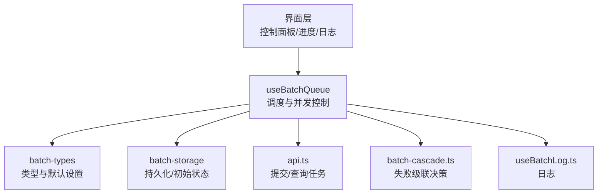
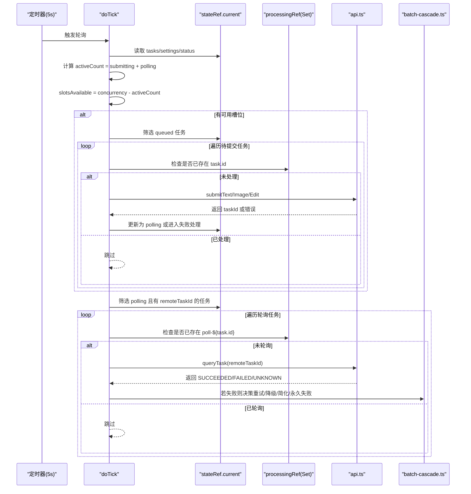
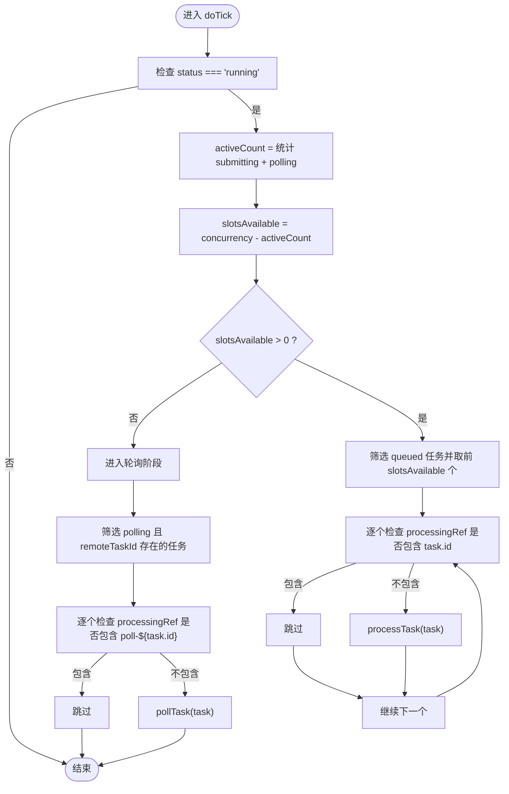
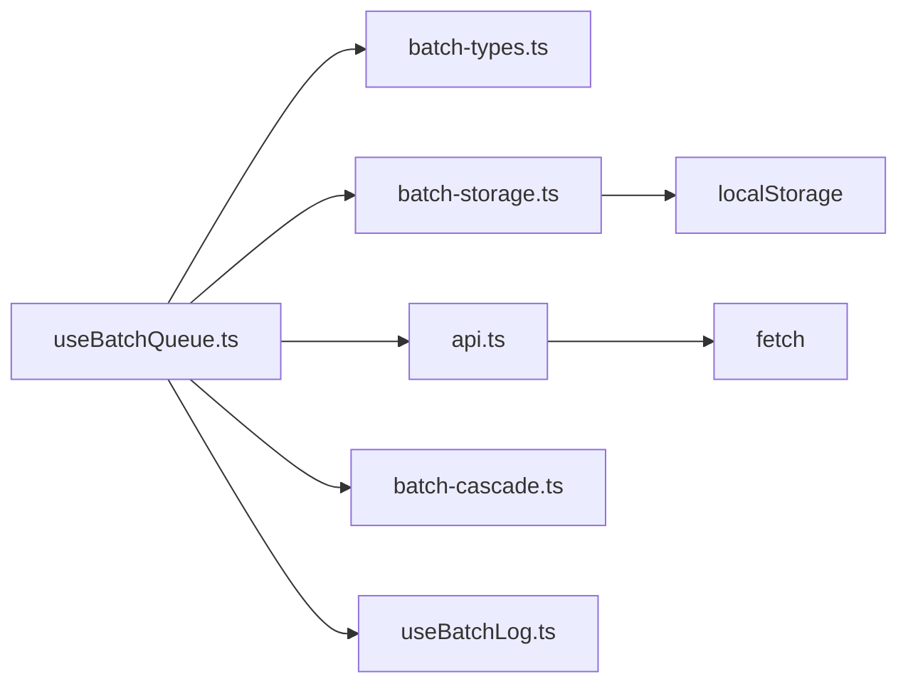

# 并发控制机制

<cite>
**本文引用的文件**   
- [useBatchQueue.ts](file://src/hooks/useBatchQueue.ts)
- [batch-types.ts](file://src/lib/batch-types.ts)
- [batch-storage.ts](file://src/lib/batch-storage.ts)
- [api.ts](file://src/lib/api.ts)
- [batch-cascade.ts](file://src/lib/batch-cascade.ts)
- [useBatchLog.ts](file://src/hooks/useBatchLog.ts)
</cite>

## 目录
1. [简介](#简介)
2. [项目结构](#项目结构)
3. [核心组件](#核心组件)
4. [架构总览](#架构总览)
5. [详细组件分析](#详细组件分析)
6. [依赖关系分析](#依赖关系分析)
7. [性能考量](#性能考量)
8. [故障排查指南](#故障排查指南)
9. [结论](#结论)
10. [附录：配置与示例](#附录配置与示例)

## 简介
本文件聚焦于批量视频生成任务的并发控制机制，系统性说明以下关键点：
- 槽位分配算法、活跃任务计数、可用槽位计算
- processingRef 的使用方式（任务处理标记、防止重复处理）
- doTick 调度逻辑（每5秒轮询、任务分发策略、并发限制）
- activeCount 的计算方法（submitting 与 polling 状态的任务统计）
- 并发配置 settings.concurrency 的设置与影响
- 实际代码路径与调优建议

## 项目结构
与并发控制直接相关的模块位于 hooks 与 lib 目录下：
- useBatchQueue.ts：队列调度、并发控制、重试与降级主逻辑
- batch-types.ts：类型定义与默认设置
- batch-storage.ts：状态持久化与初始状态
- api.ts：提交与查询任务的网络封装
- batch-cascade.ts：失败后的级联决策（重试/降级/简化Prompt/永久失败）
- useBatchLog.ts：日志记录

图表来源
- [useBatchQueue.ts:98-124](file://src/hooks/useBatchQueue.ts#L98-L124)
- [batch-types.ts:112-117](file://src/lib/batch-types.ts#L112-L117)
- [batch-storage.ts:70-77](file://src/lib/batch-storage.ts#L70-L77)
- [api.ts:125-174](file://src/lib/api.ts#L125-L174)
- [batch-cascade.ts:19-56](file://src/lib/batch-cascade.ts#L19-L56)
- [useBatchLog.ts:12-30](file://src/hooks/useBatchLog.ts#L12-L30)

章节来源
- [useBatchQueue.ts:1-322](file://src/hooks/useBatchQueue.ts#L1-L322)
- [batch-types.ts:1-123](file://src/lib/batch-types.ts#L1-L123)
- [batch-storage.ts:1-89](file://src/lib/batch-storage.ts#L1-L89)
- [api.ts:1-217](file://src/lib/api.ts#L1-L217)
- [batch-cascade.ts:1-101](file://src/lib/batch-cascade.ts#L1-L101)
- [useBatchLog.ts:1-38](file://src/hooks/useBatchLog.ts#L1-L38)

## 核心组件
- 调度器：doTick 每5秒执行一次，负责从排队任务中挑选可提交的任务并启动轮询。
- 并发控制器：通过 activeCount 与 settings.concurrency 计算可用槽位 slotsAvailable，限制同时处于 submitting/polling 的任务数。
- 防重入标记：processingRef 使用 Set 记录正在处理的 task.id 或 poll-task 的键，避免重复提交或重复轮询。
- 失败回退：handleFailure 结合 batch-cascade 决定重试、参数降级、Prompt 简化或永久失败。
- 状态持久化：state 变化后延迟写入 localStorage，支持页面刷新恢复。

章节来源
- [useBatchQueue.ts:98-124](file://src/hooks/useBatchQueue.ts#L98-L124)
- [useBatchQueue.ts:126-161](file://src/hooks/useBatchQueue.ts#L126-L161)
- [useBatchQueue.ts:163-185](file://src/hooks/useBatchQueue.ts#L163-L185)
- [useBatchQueue.ts:187-264](file://src/hooks/useBatchQueue.ts#L187-L264)
- [batch-types.ts:112-117](file://src/lib/batch-types.ts#L112-L117)
- [batch-storage.ts:70-77](file://src/lib/batch-storage.ts#L70-L77)

## 架构总览
下图展示了 doTick 的调度流程、并发限制与防重入机制如何协同工作。

图表来源
- [useBatchQueue.ts:98-124](file://src/hooks/useBatchQueue.ts#L98-L124)
- [useBatchQueue.ts:126-161](file://src/hooks/useBatchQueue.ts#L126-L161)
- [useBatchQueue.ts:163-185](file://src/hooks/useBatchQueue.ts#L163-L185)
- [useBatchQueue.ts:187-264](file://src/hooks/useBatchQueue.ts#L187-L264)
- [api.ts:125-174](file://src/lib/api.ts#L125-L174)
- [batch-cascade.ts:19-56](file://src/lib/batch-cascade.ts#L19-L56)

## 详细组件分析

### 并发控制与槽位分配
- 活跃任务计数 activeCount：统计当前处于 submitting 或 polling 状态的任务数量。
- 可用槽位 slotsAvailable：settings.concurrency - activeCount。
- 槽位分配：从 queued 任务中按顺序取前 slotsAvailable 个进行提交；若 processingRef 中已有该任务ID，则跳过，防止重复提交。
- 并发限制：由于每次只允许最多 concurrency 个任务处于 submitting/polling，从而实现对后端请求的并发上限控制。

图表来源
- [useBatchQueue.ts:98-124](file://src/hooks/useBatchQueue.ts#L98-L124)
- [useBatchQueue.ts:126-161](file://src/hooks/useBatchQueue.ts#L126-L161)
- [useBatchQueue.ts:163-185](file://src/hooks/useBatchQueue.ts#L163-L185)

章节来源
- [useBatchQueue.ts:98-124](file://src/hooks/useBatchQueue.ts#L98-L124)
- [useBatchQueue.ts:126-161](file://src/hooks/useBatchQueue.ts#L126-L161)
- [useBatchQueue.ts:163-185](file://src/hooks/useBatchQueue.ts#L163-L185)

### processingRef 的使用方式
- 作用：作为全局“正在处理”集合，防止同一任务被重复提交或重复轮询。
- 关键用法：
  - processTask 开始时将 task.id 加入 Set，结束时删除。
  - pollTask 开始时将 poll-${task.id} 加入 Set，结束时删除。
  - doTick 在调用前检查 processingRef 是否已存在对应键，存在则跳过。
- 取消时清理：cancel 会清空 processingRef，确保重置后无残留标记。

章节来源
- [useBatchQueue.ts:126-161](file://src/hooks/useBatchQueue.ts#L126-L161)
- [useBatchQueue.ts:163-185](file://src/hooks/useBatchQueue.ts#L163-L185)
- [useBatchQueue.ts:298-306](file://src/hooks/useBatchQueue.ts#L298-L306)

### doTick 的调度逻辑
- 轮询频率：start/resume 中 setInterval(doTick, 5000)，即每5秒执行一次。
- 任务分发策略：
  - 先计算 activeCount 与 slotsAvailable，再按顺序从 queued 中取出可提交任务。
  - 对每个 polling 任务尝试轮询其远程任务结果。
- 并发限制：通过 concurrency 与 activeCount 的差值控制同时进行的提交与轮询数量。

章节来源
- [useBatchQueue.ts:279-296](file://src/hooks/useBatchQueue.ts#L279-L296)
- [useBatchQueue.ts:98-124](file://src/hooks/useBatchQueue.ts#L98-L124)

### activeCount 的计算方法
- 计算公式：activeCount = 状态为 submitting 的任务数 + 状态为 polling 的任务数。
- 目的：反映当前占用槽位的任务总数，用于计算剩余可用槽位。

章节来源
- [useBatchQueue.ts:102-104](file://src/hooks/useBatchQueue.ts#L102-L104)

### 失败处理与级联决策
- 失败入口：processTask 网络异常或提交返回失败；pollTask 查询返回 FAILED。
- 决策流程：
  1) 指数退避重试（次数受 maxRetries 限制）
  2) 自动参数降级（分辨率降低、时长缩短）
  3) 自动简化 Prompt（去除特殊字符、截断长度）
  4) 永久失败
- 重试计时器：使用 retryTimersRef 管理延时重试，取消时会统一清理。

章节来源
- [useBatchQueue.ts:187-264](file://src/hooks/useBatchQueue.ts#L187-L264)
- [batch-cascade.ts:19-56](file://src/lib/batch-cascade.ts#L19-L56)
- [batch-cascade.ts:61-85](file://src/lib/batch-cascade.ts#L61-L85)
- [batch-cascade.ts:90-100](file://src/lib/batch-cascade.ts#L90-L100)

### 并发配置选项
- settings.concurrency：最大并发数，默认值为 2，范围建议 1-5。
- 影响：
  - 增大 concurrency 可提高吞吐，但可能增加后端压力与失败率。
  - 减小 concurrency 可降低失败率，提升稳定性。
- 其他相关设置：
  - maxRetries：最大重试次数，配合指数退避。
  - autoDowngrade：是否启用自动参数降级。
  - autoPromptSimplify：是否启用自动简化 Prompt。

章节来源
- [batch-types.ts:112-117](file://src/lib/batch-types.ts#L112-L117)
- [useBatchQueue.ts:279-296](file://src/hooks/useBatchQueue.ts#L279-L296)

## 依赖关系分析
- useBatchQueue 依赖：
  - batch-types：类型与默认设置
  - batch-storage：持久化与初始状态
  - api：提交与查询任务
  - batch-cascade：失败决策
  - useBatchLog：日志记录
- 外部依赖：
  - fetch：网络请求
  - localStorage：状态与日志持久化

图表来源
- [useBatchQueue.ts:1-12](file://src/hooks/useBatchQueue.ts#L1-L12)
- [api.ts:125-174](file://src/lib/api.ts#L125-L174)
- [batch-storage.ts:1-27](file://src/lib/batch-storage.ts#L1-L27)

章节来源
- [useBatchQueue.ts:1-12](file://src/hooks/useBatchQueue.ts#L1-L12)
- [api.ts:125-174](file://src/lib/api.ts#L125-L174)
- [batch-storage.ts:1-27](file://src/lib/batch-storage.ts#L1-L27)

## 性能考量
- 并发度选择：
  - 低并发（1-2）：适合不稳定网络或高失败率的场景，提高成功率。
  - 中等并发（3-4）：平衡吞吐与稳定性，推荐默认值。
  - 高并发（5）：追求吞吐，需关注后端限流与失败率。
- 轮询间隔：固定5秒，兼顾实时性与资源消耗。可根据业务需求调整。
- 重试策略：指数退避有效缓解瞬时失败，但过多重试会增加总体耗时。
- 降级策略：分辨率与时长逐步降级有助于提高成功率，但会影响输出质量。
- 日志与持久化：日志条目限制与状态持久化减少存储压力，避免阻塞主流程。

[本节为通用指导，不直接分析具体文件]

## 故障排查指南
- 现象：任务一直停留在 submitting/polling
  - 检查 processingRef 是否存在残留键（取消后会清理）。
  - 确认 doTick 是否在运行（status 是否为 running）。
- 现象：频繁失败
  - 查看日志中的错误消息，定位网络错误或后端返回码。
  - 适当降低 concurrency 或开启 autoDowngrade/autoPromptSimplify。
- 现象：任务无法完成
  - 检查 maxRetries 与降级策略是否耗尽，必要时调整策略。
  - 确认 remoteTaskId 是否正确传递到 pollTask。

章节来源
- [useBatchQueue.ts:298-306](file://src/hooks/useBatchQueue.ts#L298-L306)
- [useBatchQueue.ts:187-264](file://src/hooks/useBatchQueue.ts#L187-L264)
- [useBatchLog.ts:12-30](file://src/hooks/useBatchLog.ts#L12-L30)

## 结论
本并发控制机制通过 doTick 定时调度、activeCount 动态计算与 processingRef 防重入标记，实现了对提交与轮询的严格并发限制。结合失败级联决策与参数降级，系统在稳定性与吞吐之间取得良好平衡。合理设置 settings.concurrency 与其他容错选项，可在不同网络与后端条件下获得更优表现。

[本节为总结性内容，不直接分析具体文件]

## 附录：配置与示例

### 并发配置项
- concurrency：最大并发数（默认 2）
- maxRetries：最大重试次数（默认 3）
- autoDowngrade：是否自动降级（默认 true）
- autoPromptSimplify：是否自动简化 Prompt（默认 true）

章节来源
- [batch-types.ts:112-117](file://src/lib/batch-types.ts#L112-L117)

### 关键流程参考路径
- 调度入口与并发限制
  - [doTick 实现:98-124](file://src/hooks/useBatchQueue.ts#L98-L124)
  - [start/resume 定时器:279-296](file://src/hooks/useBatchQueue.ts#L279-L296)
- 提交与轮询
  - [processTask 提交:126-161](file://src/hooks/useBatchQueue.ts#L126-L161)
  - [pollTask 轮询:163-185](file://src/hooks/useBatchQueue.ts#L163-185)
- 失败处理与级联决策
  - [handleFailure 失败处理:187-264](file://src/hooks/useBatchQueue.ts#L187-264)
  - [decideCascadeAction 决策:19-56](file://src/lib/batch-cascade.ts#L19-56)
  - [getDowngradedParams 降级策略:61-85](file://src/lib/batch-cascade.ts#L61-85)
  - [simplifyPrompt 简化策略:90-100](file://src/lib/batch-cascade.ts#L90-100)
- 网络接口
  - [submitTask 提交封装:125-174](file://src/lib/api.ts#L125-174)
  - [queryTask 查询封装:176-201](file://src/lib/api.ts#L176-201)
- 状态持久化
  - [saveQueueState/loadQueueState:8-41](file://src/lib/batch-storage.ts#L8-41)
  - [getInitialQueueState:70-77](file://src/lib/batch-storage.ts#L70-77)