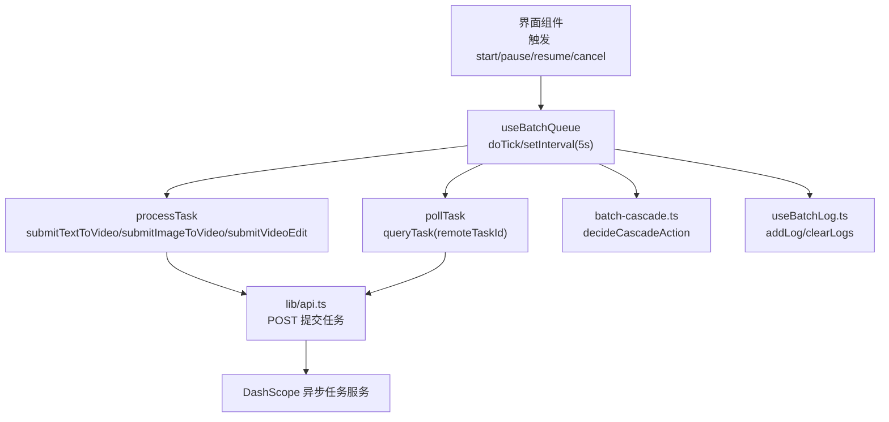
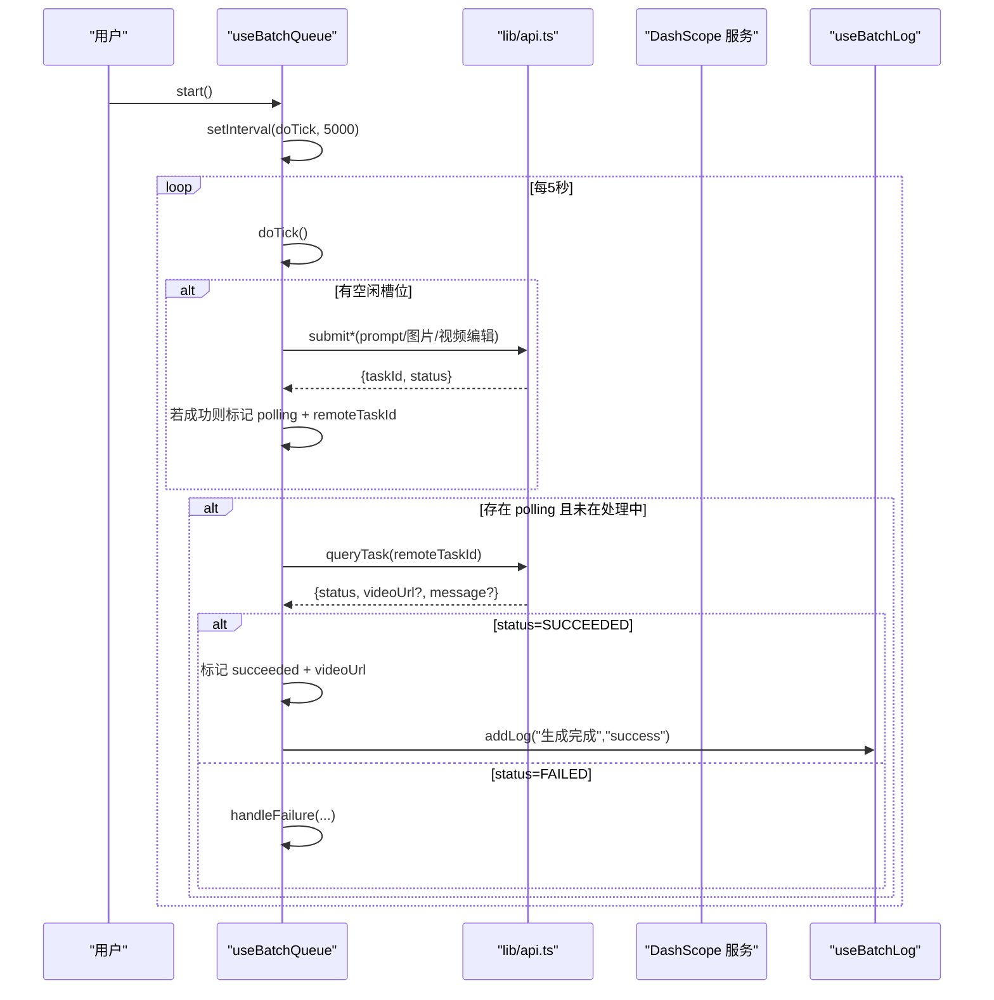
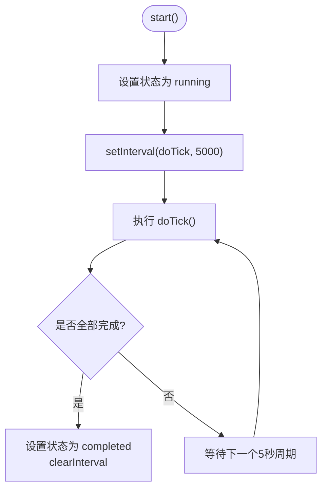
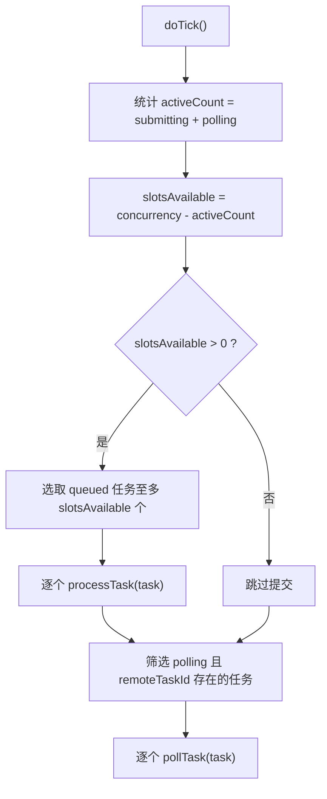
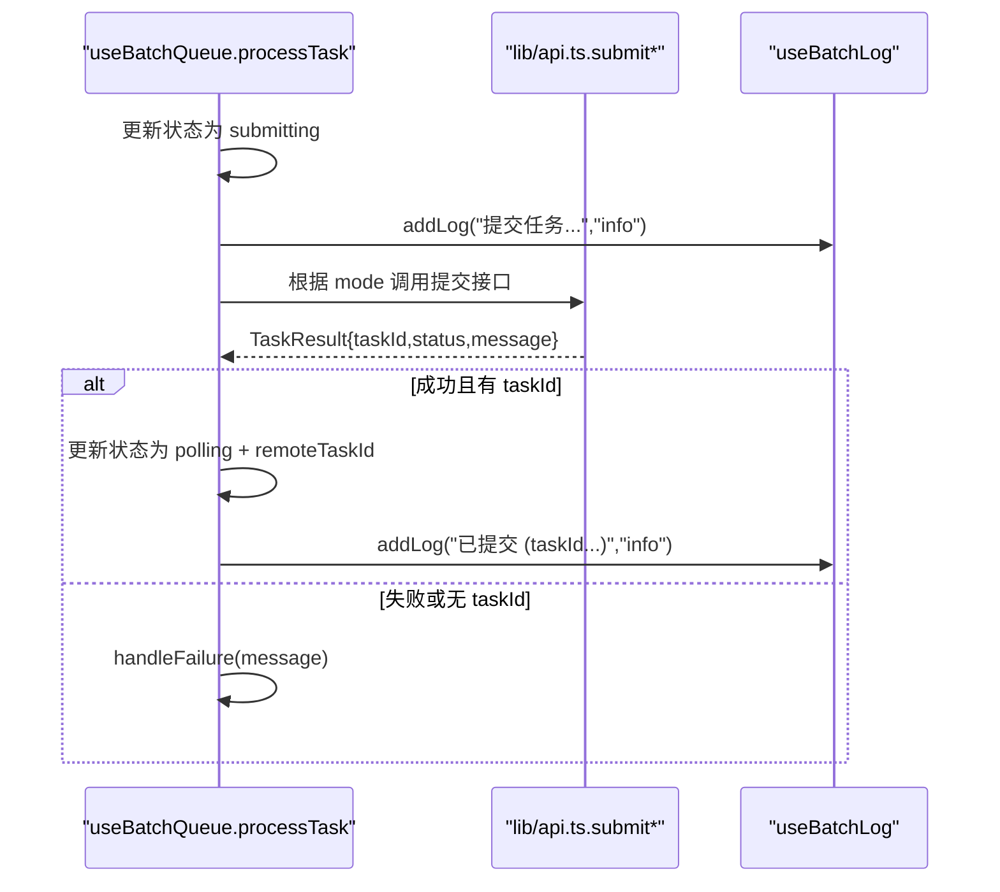
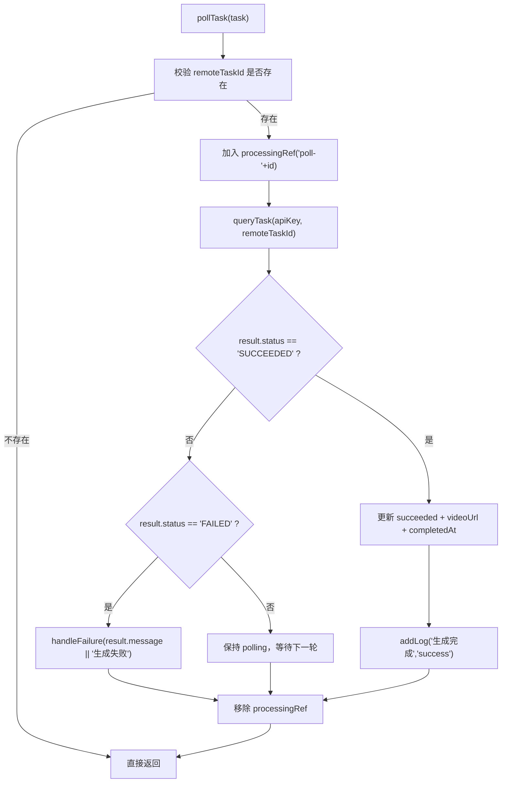
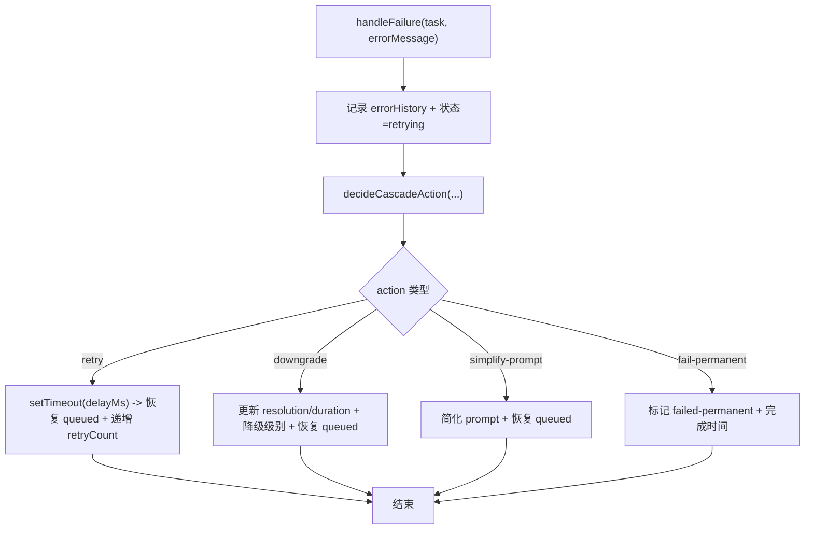
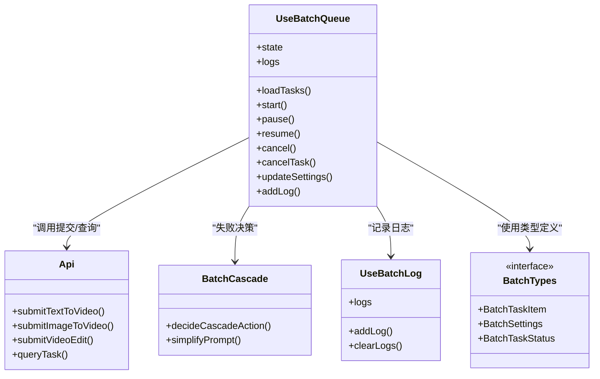

# 轮询机制

<cite>
**本文引用的文件列表**
- [useBatchQueue.ts](file://src/hooks/useBatchQueue.ts)
- [api.ts](file://src/lib/api.ts)
- [batch-types.ts](file://src/lib/batch-types.ts)
- [batch-cascade.ts](file://src/lib/batch-cascade.ts)
- [useBatchLog.ts](file://src/hooks/useBatchLog.ts)
</cite>

## 目录
1. [简介](#简介)
2. [项目结构](#项目结构)
3. [核心组件](#核心组件)
4. [架构总览](#架构总览)
5. [详细组件分析](#详细组件分析)
6. [依赖关系分析](#依赖关系分析)
7. [性能考量](#性能考量)
8. [故障排查指南](#故障排查指南)
9. [结论](#结论)
10. [附录：关键流程与最佳实践](#附录关键流程与最佳实践)

## 简介
本文件围绕“任务轮询机制”进行系统化文档化，重点解释批量视频生成任务的定时检查、状态查询、结果处理、错误处理与重试策略。文档深入剖析 pollTask 函数的实现细节（remoteTaskId 校验、API 调用、状态判断），说明 5 秒轮询间隔的设计原因与性能权衡，并给出生命周期管理、监控调试方法与最佳实践示例路径。

## 项目结构
与轮询机制直接相关的代码主要位于 hooks 与 lib 层：
- hooks/useBatchQueue.ts：队列调度、定时轮询、任务提交与失败处理
- lib/api.ts：任务提交与查询的 HTTP 封装
- lib/batch-types.ts：任务定义、状态类型、设置项等数据结构
- lib/batch-cascade.ts：失败后的级联决策（重试/降级/简化提示词/永久失败）
- hooks/useBatchLog.ts：日志记录与持久化

图表来源
- [useBatchQueue.ts:98-124](file://src/hooks/useBatchQueue.ts#L98-L124)
- [useBatchQueue.ts:126-161](file://src/hooks/useBatchQueue.ts#L126-L161)
- [useBatchQueue.ts:163-185](file://src/hooks/useBatchQueue.ts#L163-L185)
- [api.ts:125-174](file://src/lib/api.ts#L125-L174)
- [api.ts:176-201](file://src/lib/api.ts#L176-L201)
- [batch-cascade.ts:19-56](file://src/lib/batch-cascade.ts#L19-L56)
- [useBatchLog.ts:12-30](file://src/hooks/useBatchLog.ts#L12-L30)

章节来源
- [useBatchQueue.ts:1-322](file://src/hooks/useBatchQueue.ts#L1-L322)
- [api.ts:1-217](file://src/lib/api.ts#L1-L217)
- [batch-types.ts:1-123](file://src/lib/batch-types.ts#L1-L123)
- [batch-cascade.ts:1-101](file://src/lib/batch-cascade.ts#L1-L101)
- [useBatchLog.ts:1-38](file://src/hooks/useBatchLog.ts#L1-L38)

## 核心组件
- 轮询调度器：基于 setInterval 每 5 秒执行一次 doTick，负责并发控制、任务提交与轮询分发。
- 任务提交器：根据任务模式调用不同提交接口，成功后进入 polling 状态并记录 remoteTaskId。
- 轮询处理器：对处于 polling 状态的任务调用 queryTask，依据返回状态更新为 succeeded/failed-permanent 或进入失败处理。
- 失败处理与级联：根据当前重试次数、降级开关、提示词简化开关决定下一步动作（重试/降级/简化/永久失败）。
- 日志系统：记录每个任务的关键事件，便于追踪与排障。

章节来源
- [useBatchQueue.ts:98-124](file://src/hooks/useBatchQueue.ts#L98-L124)
- [useBatchQueue.ts:126-161](file://src/hooks/useBatchQueue.ts#L126-L161)
- [useBatchQueue.ts:163-185](file://src/hooks/useBatchQueue.ts#L163-L185)
- [batch-cascade.ts:19-56](file://src/lib/batch-cascade.ts#L19-L56)
- [useBatchLog.ts:12-30](file://src/hooks/useBatchLog.ts#L12-L30)

## 架构总览
下图展示了从用户操作到任务完成的全链路交互，包括轮询周期、并发控制、失败回退与日志记录。

图表来源
- [useBatchQueue.ts:279-284](file://src/hooks/useBatchQueue.ts#L279-L284)
- [useBatchQueue.ts:98-124](file://src/hooks/useBatchQueue.ts#L98-L124)
- [useBatchQueue.ts:126-161](file://src/hooks/useBatchQueue.ts#L126-L161)
- [useBatchQueue.ts:163-185](file://src/hooks/useBatchQueue.ts#L163-L185)
- [api.ts:125-174](file://src/lib/api.ts#L125-L174)
- [api.ts:176-201](file://src/lib/api.ts#L176-L201)
- [useBatchLog.ts:12-30](file://src/hooks/useBatchLog.ts#L12-L30)

## 详细组件分析

### 轮询调度与生命周期管理
- 启动条件：调用 start() 后，将状态置为 running，创建每 5 秒一次的定时器，并立即执行一次 doTick。
- 结束条件：当所有任务均达到 succeeded/failed-permanent/cancelled 任一终态时，自动切换为 completed 并清理定时器。
- 暂停/恢复：pause() 停止定时器并置为 paused；resume() 重新创建定时器并立即执行一次。
- 取消与清理：cancel() 会清除定时器、重试计时器、处理中集合，重置状态并清空本地存储与日志。

图表来源
- [useBatchQueue.ts:279-284](file://src/hooks/useBatchQueue.ts#L279-L284)
- [useBatchQueue.ts:291-296](file://src/hooks/useBatchQueue.ts#L291-L296)
- [useBatchQueue.ts:298-306](file://src/hooks/useBatchQueue.ts#L298-L306)
- [useBatchQueue.ts:84-96](file://src/hooks/useBatchQueue.ts#L84-L96)

章节来源
- [useBatchQueue.ts:84-96](file://src/hooks/useBatchQueue.ts#L84-L96)
- [useBatchQueue.ts:279-306](file://src/hooks/useBatchQueue.ts#L279-L306)

### 并发控制与任务分发
- 并发上限：settings.concurrency 限制同时处于 submitting 或 polling 的任务数。
- 任务选择：每次 tick 优先挑选 queued 的任务，按可用槽位数量提交；随后挑选 polling 且尚未被处理的任务进行轮询。
- 防重入：processingRef 使用 Set 记录正在处理的 task.id 与 poll-${task.id}，避免重复提交与重复轮询。

图表来源
- [useBatchQueue.ts:98-124](file://src/hooks/useBatchQueue.ts#L98-L124)

章节来源
- [useBatchQueue.ts:98-124](file://src/hooks/useBatchQueue.ts#L98-L124)

### 任务提交流程（processTask）
- 状态变更：提交前将任务置为 submitting，记录开始时间，写入 info 日志。
- 调用提交接口：根据 mode 分别调用文本转视频、图生视频、视频编辑三种提交方法。
- 结果处理：
  - 若返回 taskId，则将任务置为 polling，并保存 remoteTaskId，记录 info 日志。
  - 否则视为提交失败，进入 handleFailure。
- 异常捕获：网络异常或请求失败统一转为错误消息，进入失败处理。

图表来源
- [useBatchQueue.ts:126-161](file://src/hooks/useBatchQueue.ts#L126-L161)
- [api.ts:63-123](file://src/lib/api.ts#L63-L123)
- [useBatchLog.ts:12-30](file://src/hooks/useBatchLog.ts#L12-L30)

章节来源
- [useBatchQueue.ts:126-161](file://src/hooks/useBatchQueue.ts#L126-L161)
- [api.ts:63-123](file://src/lib/api.ts#L63-L123)
- [useBatchLog.ts:12-30](file://src/hooks/useBatchLog.ts#L12-L30)

### 轮询函数 pollTask 详解
- remoteTaskId 校验：若不存在则直接返回，防止无效轮询。
- 防重入：通过 processingRef 增加 poll-${task.id} 标识，确保同一任务在同一 tick 内仅轮询一次。
- API 调用：调用 queryTask(apiKey, remoteTaskId) 获取任务状态。
- 状态判断逻辑：
  - SUCCEEDED：更新为 succeeded，记录 videoUrl 与完成时间，写入 success 日志。
  - FAILED：调用 handleFailure 进入失败处理。
  - 其他状态（PENDING/RUNNING/UNKNOWN）：保持 polling，等待下一轮。
- 异常处理：捕获网络异常或解析异常，记录 warn 日志，不中断后续轮询。

图表来源
- [useBatchQueue.ts:163-185](file://src/hooks/useBatchQueue.ts#L163-L185)
- [api.ts:176-201](file://src/lib/api.ts#L176-L201)
- [useBatchLog.ts:12-30](file://src/hooks/useBatchLog.ts#L12-L30)

章节来源
- [useBatchQueue.ts:163-185](file://src/hooks/useBatchQueue.ts#L163-L185)
- [api.ts:176-201](file://src/lib/api.ts#L176-L201)
- [useBatchLog.ts:12-30](file://src/hooks/useBatchLog.ts#L12-L30)

### 失败处理与级联策略（handleFailure）
- 记录错误历史：追加 errorHistory 条目，更新状态为 retrying，记录 error 日志。
- 决策流程（decideCascadeAction）：
  - 重试原参数：在 maxRetries 范围内，采用指数退避（2s、4s、8s...）。
  - 参数降级：降低分辨率或时长，最多三次降级尝试。
  - 简化提示词：去除特殊字符、截断长度，提升成功率。
  - 永久失败：超过所有容错手段后标记 failed-permanent。
- 重试计时器：使用 setTimeout 延迟后恢复为 queued，并清理 remoteTaskId，以便重新提交。

图表来源
- [useBatchQueue.ts:187-264](file://src/hooks/useBatchQueue.ts#L187-L264)
- [batch-cascade.ts:19-56](file://src/lib/batch-cascade.ts#L19-L56)

章节来源
- [useBatchQueue.ts:187-264](file://src/hooks/useBatchQueue.ts#L187-L264)
- [batch-cascade.ts:19-56](file://src/lib/batch-cascade.ts#L19-L56)

### 轮询间隔设置（5 秒）的原因与性能考虑
- 设计原因：
  - 平衡实时性与资源消耗：5 秒既能较快感知任务完成，又不会频繁发起查询造成服务器压力。
  - 与任务生命周期匹配：视频生成通常耗时较长，5 秒间隔足以覆盖大多数中间状态变化。
- 性能影响：
  - 并发控制：结合 concurrency 限制，避免过多并行轮询导致浏览器负载过高。
  - 防重入：processingRef 保证同一任务在同一 tick 内只进行一次轮询，减少冗余请求。
  - 完成检测：一旦全部任务到达终态，立即停止定时器，避免空转。

章节来源
- [useBatchQueue.ts:279-284](file://src/hooks/useBatchQueue.ts#L279-L284)
- [useBatchQueue.ts:98-124](file://src/hooks/useBatchQueue.ts#L98-L124)
- [useBatchQueue.ts:84-96](file://src/hooks/useBatchQueue.ts#L84-L96)

### 错误处理与重试策略
- 网络异常：提交与查询阶段均捕获异常，转换为错误消息并进入失败处理。
- 超时处理：HTTP 层由 fetch 默认行为处理；如需更细粒度控制可在上层封装 Promise.race 或 AbortController（当前实现未显式设置超时）。
- 重试策略：
  - 指数退避：delayMs = 2^(retryCount+1) * 1000，逐步拉长重试间隔。
  - 最大重试次数：受 settings.maxRetries 控制。
  - 降级与简化：在重试耗尽后自动降级参数或简化提示词，提高成功率。
  - 永久失败：无法继续容错时标记最终失败。

章节来源
- [useBatchQueue.ts:126-161](file://src/hooks/useBatchQueue.ts#L126-L161)
- [useBatchQueue.ts:163-185](file://src/hooks/useBatchQueue.ts#L163-L185)
- [useBatchQueue.ts:187-264](file://src/hooks/useBatchQueue.ts#L187-L264)
- [batch-cascade.ts:19-56](file://src/lib/batch-cascade.ts#L19-L56)

### 监控与调试方法
- 日志记录：
  - 关键节点：提交、已提交、生成完成、失败、轮询异常等均有日志。
  - 持久化：日志保存在本地存储，支持查看历史与导出。
- 状态跟踪：
  - 任务状态：queued/submitting/polling/retrying/succeeded/failed-permanent/cancelled。
  - 全局状态：idle/running/paused/completed。
- 调试建议：
  - 观察日志面板，定位失败原因与重试次数。
  - 检查并发设置与降级策略是否合理。
  - 在网络不稳定环境下适当增大轮询间隔或重试次数。

章节来源
- [useBatchLog.ts:12-30](file://src/hooks/useBatchLog.ts#L12-L30)
- [batch-types.ts:22-44](file://src/lib/batch-types.ts#L22-L44)
- [batch-types.ts:52-67](file://src/lib/batch-types.ts#L52-L67)

## 依赖关系分析
- useBatchQueue 依赖 api.ts 的提交与查询接口，依赖 batch-cascade.ts 的失败决策，依赖 useBatchLog.ts 的日志能力。
- api.ts 提供统一的 TaskResult 模型与状态映射，屏蔽底层 HTTP 差异。
- batch-types.ts 定义了任务与队列的数据结构，贯穿整个轮询流程。

图表来源
- [useBatchQueue.ts:1-322](file://src/hooks/useBatchQueue.ts#L1-L322)
- [api.ts:1-217](file://src/lib/api.ts#L1-L217)
- [batch-cascade.ts:1-101](file://src/lib/batch-cascade.ts#L1-L101)
- [batch-types.ts:1-123](file://src/lib/batch-types.ts#L1-L123)
- [useBatchLog.ts:1-38](file://src/hooks/useBatchLog.ts#L1-L38)

章节来源
- [useBatchQueue.ts:1-322](file://src/hooks/useBatchQueue.ts#L1-L322)
- [api.ts:1-217](file://src/lib/api.ts#L1-L217)
- [batch-cascade.ts:1-101](file://src/lib/batch-cascade.ts#L1-L101)
- [batch-types.ts:1-123](file://src/lib/batch-types.ts#L1-L123)
- [useBatchLog.ts:1-38](file://src/hooks/useBatchLog.ts#L1-L38)

## 性能考量
- 轮询频率：5 秒间隔在用户体验与服务器负载之间取得平衡。对于高并发场景，可适当增大间隔或降低并发度。
- 并发控制：concurrency 限制同时活跃任务数，避免浏览器内存与 CPU 峰值。
- 防重入：processingRef 避免重复轮询与重复提交，减少不必要的网络请求。
- 完成即停：全部任务到达终态后立即清理定时器，避免空转。
- 降级策略：自动降级分辨率与时长，有助于在资源受限或网络波动情况下提高成功率。

[本节为通用指导，无需具体文件引用]

## 故障排查指南
- 常见问题
  - 轮询无响应：检查是否处于 running 状态，确认 interval 未被意外清理。
  - remoteTaskId 为空：提交失败或未返回 taskId，需检查提交接口返回与错误日志。
  - 频繁失败：查看失败日志与重试次数，评估是否需要调整 maxRetries 或开启降级/简化。
- 定位步骤
  - 打开日志面板，搜索对应 taskId 的事件序列。
  - 核对并发设置与降级策略是否符合预期。
  - 在网络不稳定环境下，适当增大轮询间隔或重试次数。
- 恢复措施
  - 暂停/恢复：通过 pause()/resume() 控制轮询。
  - 取消任务：cancelTask() 可终止单个任务的重试计时器。
  - 重置队列：cancel() 清理所有状态与日志，重新开始。

章节来源
- [useBatchQueue.ts:286-312](file://src/hooks/useBatchQueue.ts#L286-L312)
- [useBatchLog.ts:12-30](file://src/hooks/useBatchLog.ts#L12-L30)

## 结论
该轮询机制以 5 秒为周期，结合并发控制、防重入与失败级联策略，实现了稳定可靠的异步任务处理。pollTask 函数严格校验 remoteTaskId，安全调用查询接口，并根据返回状态进行相应处理。通过完善的日志与状态跟踪，开发者可以快速定位问题并进行调优。

[本节为总结性内容，无需具体文件引用]

## 附录：关键流程与最佳实践
- 最佳实践
  - 合理设置 concurrency 与 maxRetries，避免过度请求。
  - 开启 autoDowngrade 与 autoPromptSimplify，提升成功率。
  - 关注日志输出，及时发现问题并调整策略。
- 实际示例路径
  - 轮询启动与周期：[useBatchQueue.ts:279-284](file://src/hooks/useBatchQueue.ts#L279-L284)
  - 任务提交与状态流转：[useBatchQueue.ts:126-161](file://src/hooks/useBatchQueue.ts#L126-L161)
  - 轮询函数实现细节：[useBatchQueue.ts:163-185](file://src/hooks/useBatchQueue.ts#L163-L185)
  - 失败处理与级联决策：[useBatchQueue.ts:187-264](file://src/hooks/useBatchQueue.ts#L187-L264), [batch-cascade.ts:19-56](file://src/lib/batch-cascade.ts#L19-L56)
  - API 封装与状态映射：[api.ts:125-174](file://src/lib/api.ts#L125-L174), [api.ts:176-201](file://src/lib/api.ts#L176-L201)
  - 日志记录与持久化：[useBatchLog.ts:12-30](file://src/hooks/useBatchLog.ts#L12-L30)

章节来源
- [useBatchQueue.ts:279-284](file://src/hooks/useBatchQueue.ts#L279-L284)
- [useBatchQueue.ts:126-161](file://src/hooks/useBatchQueue.ts#L126-L161)
- [useBatchQueue.ts:163-185](file://src/hooks/useBatchQueue.ts#L163-L185)
- [useBatchQueue.ts:187-264](file://src/hooks/useBatchQueue.ts#L187-L264)
- [batch-cascade.ts:19-56](file://src/lib/batch-cascade.ts#L19-L56)
- [api.ts:125-174](file://src/lib/api.ts#L125-L174)
- [api.ts:176-201](file://src/lib/api.ts#L176-L201)
- [useBatchLog.ts:12-30](file://src/hooks/useBatchLog.ts#L12-L30)