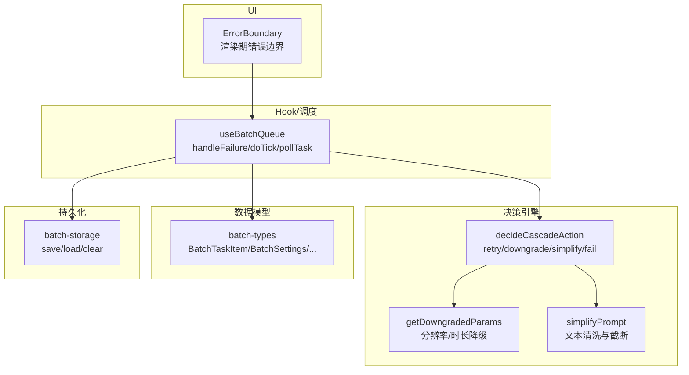
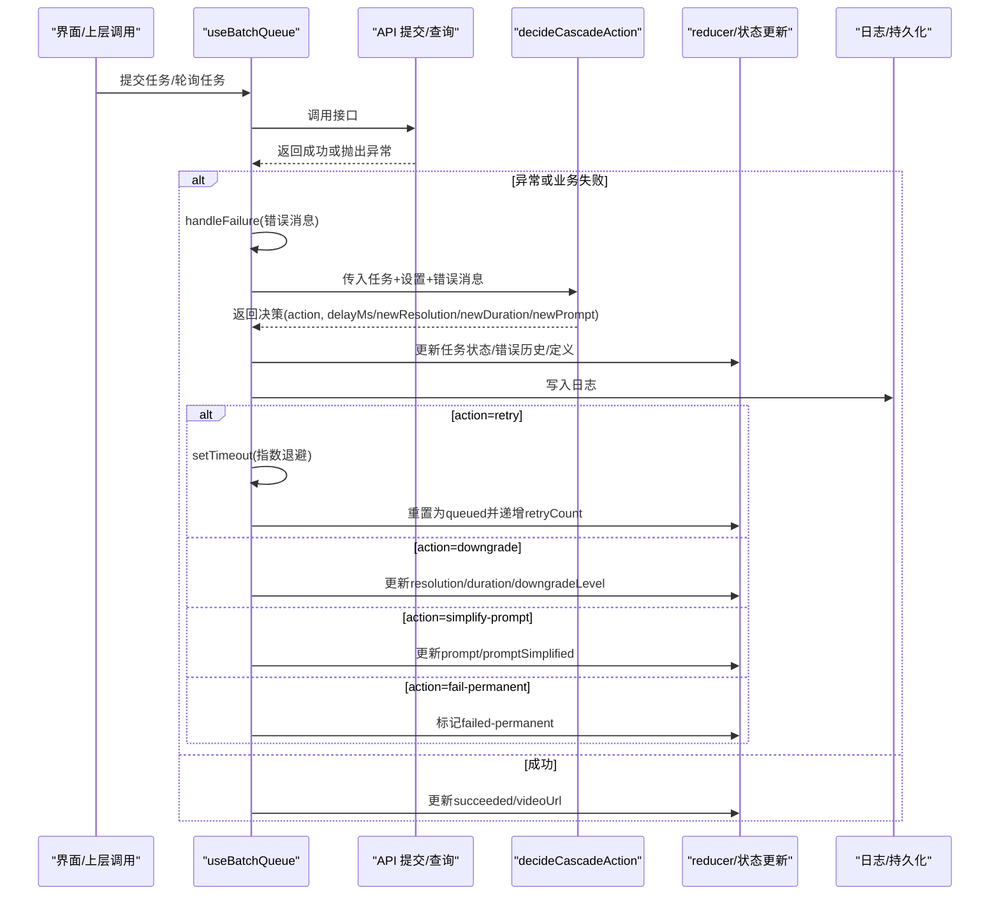
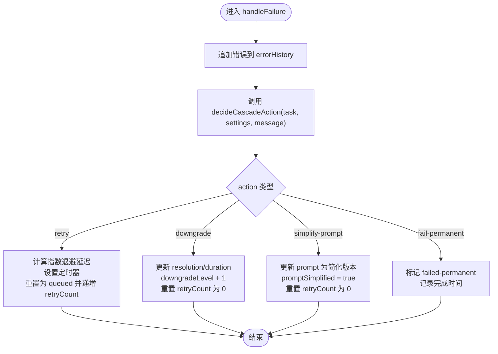
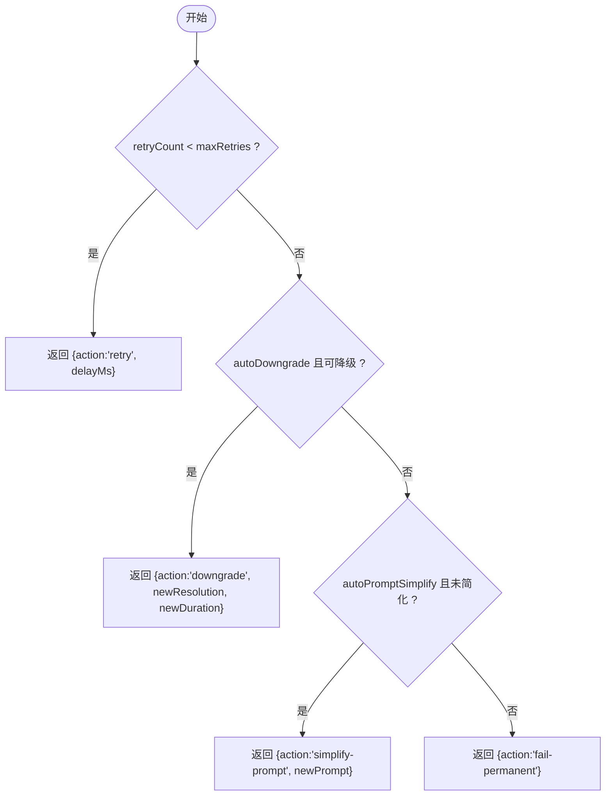
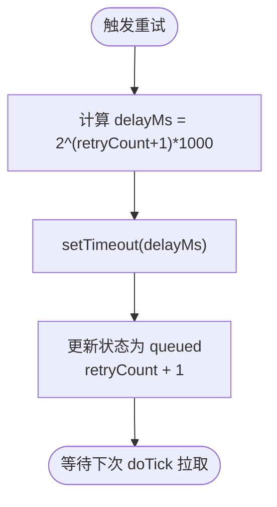
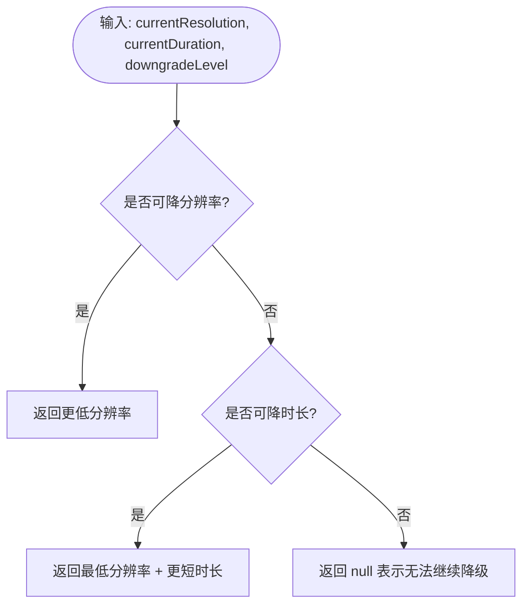
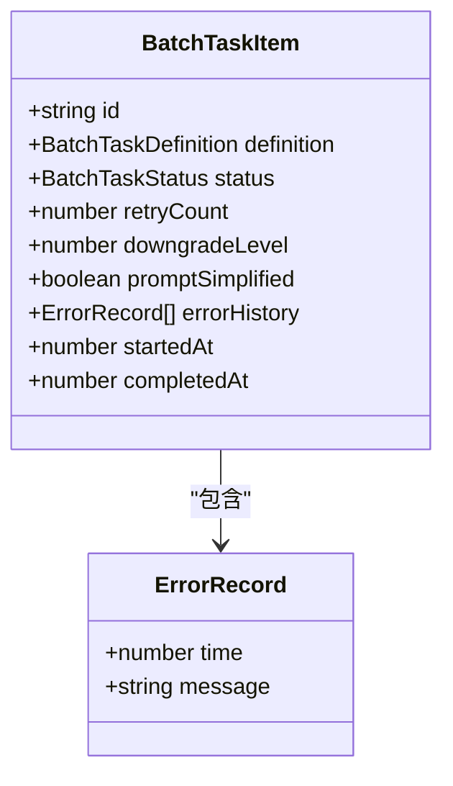
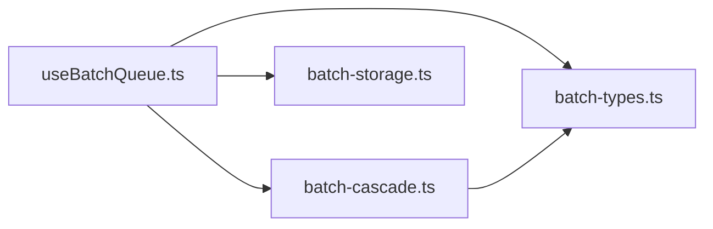

# 错误恢复系统

<cite>
**本文引用的文件**   
- [src/hooks/useBatchQueue.ts](file://src/hooks/useBatchQueue.ts)
- [src/lib/batch-cascade.ts](file://src/lib/batch-cascade.ts)
- [src/lib/batch-types.ts](file://src/lib/batch-types.ts)
- [src/lib/batch-storage.ts](file://src/lib/batch-storage.ts)
- [src/components/ErrorBoundary.tsx](file://src/components/ErrorBoundary.tsx)
</cite>

## 目录
1. [简介](#简介)
2. [项目结构](#项目结构)
3. [核心组件](#核心组件)
4. [架构总览](#架构总览)
5. [详细组件分析](#详细组件分析)
6. [依赖关系分析](#依赖关系分析)
7. [性能考量](#性能考量)
8. [故障排查指南](#故障排查指南)
9. [结论](#结论)
10. [附录：示例与最佳实践](#附录示例与最佳实践)

## 简介
本文件面向“错误恢复系统”，聚焦于批量任务执行过程中的异常处理与自动恢复机制。文档深入解释以下要点：
- handleFailure 函数的实现逻辑、错误分类与处理策略
- 降级决策引擎集成，包括 decideCascadeAction 的调用与决策结果执行
- 四种恢复策略的实现细节：retry（重试）、downgrade（参数降级）、simplify-prompt（简化Prompt）、fail-permanent（永久失败）
- 重试机制：次数限制、延迟策略、指数退避算法
- 降级策略：分辨率降级、时长缩短、Prompt简化的具体实现
- 错误历史记录管理：errorHistory 数组的结构与维护
- 实际代码示例路径，展示完整流程与自定义扩展点

## 项目结构
错误恢复相关代码主要分布在以下模块：
- 队列与调度：useBatchQueue（React Hook），负责任务提交、轮询、失败处理与状态更新
- 降级决策：batch-cascade（纯函数库），提供 decideCascadeAction、getDowngradedParams、simplifyPrompt
- 类型定义：batch-types，定义任务项、设置、日志等数据结构
- 持久化：batch-storage，负责状态与日志的本地存储与裁剪
- UI 层容错：ErrorBoundary，捕获渲染期错误并提供重试入口

图表来源
- [src/hooks/useBatchQueue.ts:187-264](file://src/hooks/useBatchQueue.ts#L187-L264)
- [src/lib/batch-cascade.ts:19-56](file://src/lib/batch-cascade.ts#L19-L56)
- [src/lib/batch-cascade.ts:61-85](file://src/lib/batch-cascade.ts#L61-L85)
- [src/lib/batch-cascade.ts:90-100](file://src/lib/batch-cascade.ts#L90-L100)
- [src/lib/batch-types.ts:32-67](file://src/lib/batch-types.ts#L32-L67)
- [src/lib/batch-storage.ts:8-27](file://src/lib/batch-storage.ts#L8-L27)

章节来源
- [src/hooks/useBatchQueue.ts:1-322](file://src/hooks/useBatchQueue.ts#L1-L322)
- [src/lib/batch-cascade.ts:1-101](file://src/lib/batch-cascade.ts#L1-L101)
- [src/lib/batch-types.ts:1-123](file://src/lib/batch-types.ts#L1-L123)
- [src/lib/batch-storage.ts:1-88](file://src/lib/batch-storage.ts#L1-L88)
- [src/components/ErrorBoundary.tsx:1-38](file://src/components/ErrorBoundary.tsx#L1-L38)

## 核心组件
- useBatchQueue
  - 负责任务生命周期管理：提交、轮询、失败处理、重试调度、状态持久化
  - 关键方法：processTask、pollTask、handleFailure、doTick
- batch-cascade
  - 提供降级决策引擎：根据当前任务状态与全局设置，返回下一步动作
  - 关键函数：decideCascadeAction、getDowngradedParams、simplifyPrompt
- batch-types
  - 定义 BatchTaskItem、BatchSettings、ErrorRecord 等核心类型
- batch-storage
  - 提供队列状态与日志的持久化能力，包含容量裁剪与异常兜底
- ErrorBoundary
  - 捕获 React 渲染期错误，提供用户可见的错误提示与重试按钮

章节来源
- [src/hooks/useBatchQueue.ts:126-185](file://src/hooks/useBatchQueue.ts#L126-L185)
- [src/hooks/useBatchQueue.ts:187-264](file://src/hooks/useBatchQueue.ts#L187-L264)
- [src/lib/batch-cascade.ts:19-56](file://src/lib/batch-cascade.ts#L19-L56)
- [src/lib/batch-cascade.ts:61-85](file://src/lib/batch-cascade.ts#L61-L85)
- [src/lib/batch-cascade.ts:90-100](file://src/lib/batch-cascade.ts#L90-L100)
- [src/lib/batch-types.ts:32-67](file://src/lib/batch-types.ts#L32-L67)
- [src/lib/batch-storage.ts:8-27](file://src/lib/batch-storage.ts#L8-L27)
- [src/components/ErrorBoundary.tsx:12-37](file://src/components/ErrorBoundary.tsx#L12-L37)

## 架构总览
错误恢复系统的整体流程如下：
- 任务提交或轮询阶段发生异常时，统一进入 handleFailure
- handleFailure 记录错误历史并调用 decideCascadeAction 获取决策
- 根据决策执行对应策略：重试（带指数退避）、参数降级、简化 Prompt、永久失败
- 所有状态变更通过 reducer 更新，并由持久化模块落盘

图表来源
- [src/hooks/useBatchQueue.ts:126-185](file://src/hooks/useBatchQueue.ts#L126-L185)
- [src/hooks/useBatchQueue.ts:187-264](file://src/hooks/useBatchQueue.ts#L187-L264)
- [src/lib/batch-cascade.ts:19-56](file://src/lib/batch-cascade.ts#L19-L56)

## 详细组件分析

### 错误处理与恢复主流程：handleFailure
- 职责
  - 收集错误信息并追加到 errorHistory
  - 调用决策引擎 decideCascadeAction 决定下一步动作
  - 根据决策执行相应策略，更新任务状态与定义
  - 记录日志，便于追踪与诊断
- 关键点
  - 错误历史追加：在更新状态前将当前错误推入 errorHistory
  - 决策依据：任务当前 retryCount、downgradeLevel、promptSimplified 以及全局设置 maxRetries、autoDowngrade、autoPromptSimplify
  - 重试延迟：使用指数退避，delayMs = 2^(retryCount+1) * 1000
  - 降级与简化：分别更新 definition.resolution/duration 与 definition.prompt，并推进 downgradeLevel 与 promptSimplified 标志
  - 永久失败：当无法继续重试或降级时，标记 failed-permanent

图表来源
- [src/hooks/useBatchQueue.ts:187-264](file://src/hooks/useBatchQueue.ts#L187-L264)

章节来源
- [src/hooks/useBatchQueue.ts:187-264](file://src/hooks/useBatchQueue.ts#L187-L264)

### 降级决策引擎：decideCascadeAction
- 输入
  - task：当前任务运行时状态（含 retryCount、downgradeLevel、promptSimplified、definition）
  - settings：全局设置（maxRetries、autoDowngrade、autoPromptSimplify）
  - errorMessage：错误消息（用于未来扩展分类）
- 输出
  - CascadeDecision：包含 action 及可选参数（delayMs、newResolution、newDuration、newPrompt）
- 决策顺序
  1) 若未达最大重试次数，返回 retry，附带指数退避延迟
  2) 若开启自动降级且可继续降级，返回 downgrade，附带新分辨率/时长
  3) 若开启自动简化且尚未简化，返回 simplify-prompt，附带简化后的 prompt
  4) 否则返回 fail-permanent
- 复杂度
  - 时间复杂度 O(1)，空间复杂度 O(1)

图表来源
- [src/lib/batch-cascade.ts:19-56](file://src/lib/batch-cascade.ts#L19-L56)

章节来源
- [src/lib/batch-cascade.ts:19-56](file://src/lib/batch-cascade.ts#L19-L56)

### 重试机制：次数限制、延迟策略、指数退避
- 次数限制
  - 由 settings.maxRetries 控制，超过后不再重试
- 延迟策略
  - 指数退避：delayMs = 2^(retryCount+1) * 1000，即 2s、4s、8s…
- 实现要点
  - 使用 setTimeout 安排下一次重试
  - 通过 Map 维护每个任务的定时器引用，支持取消与清理
  - 重试时将任务状态置回 queued，并递增 retryCount

图表来源
- [src/hooks/useBatchQueue.ts:204-215](file://src/hooks/useBatchQueue.ts#L204-L215)
- [src/lib/batch-cascade.ts:24-28](file://src/lib/batch-cascade.ts#L24-L28)

章节来源
- [src/hooks/useBatchQueue.ts:204-215](file://src/hooks/useBatchQueue.ts#L204-L215)
- [src/lib/batch-cascade.ts:24-28](file://src/lib/batch-cascade.ts#L24-L28)

### 降级策略：分辨率降级、时长缩短、Prompt简化
- 分辨率降级
  - 按预设顺序从 1080p -> 720p -> 480p 逐步降低
  - 第一次降级降一级，第二次可能跨级至最低档
- 时长缩短
  - 在分辨率已降至最低后，进一步缩短 duration，按预设序列递减
- Prompt简化
  - 去除特殊符号、合并多余空格、截断长度上限
- 决策与执行
  - getDowngradedParams 根据当前 resolution、duration 与 downgradeLevel 计算下一组参数
  - simplifyPrompt 对原始 prompt 进行清洗与截断
  - handleFailure 中根据决策更新 definition 与降级标志

图表来源
- [src/lib/batch-cascade.ts:61-85](file://src/lib/batch-cascade.ts#L61-L85)
- [src/lib/batch-cascade.ts:90-100](file://src/lib/batch-cascade.ts#L90-L100)

章节来源
- [src/lib/batch-cascade.ts:61-85](file://src/lib/batch-cascade.ts#L61-L85)
- [src/lib/batch-cascade.ts:90-100](file://src/lib/batch-cascade.ts#L90-L100)
- [src/hooks/useBatchQueue.ts:217-252](file://src/hooks/useBatchQueue.ts#L217-L252)

### 错误历史记录：errorHistory 结构与维护
- 结构
  - 类型为 ErrorRecord[]，每项包含 time 与 message
- 维护时机
  - 每次失败时，在 handleFailure 中将当前错误追加到 errorHistory
  - 持久化保存时，若 localStorage 容量不足，会裁剪 errorHistory 保留最近若干条
- 用途
  - 用于问题回溯、统计失败原因分布、辅助人工干预

图表来源
- [src/lib/batch-types.ts:32-50](file://src/lib/batch-types.ts#L32-L50)
- [src/hooks/useBatchQueue.ts:193-200](file://src/hooks/useBatchQueue.ts#L193-L200)
- [src/lib/batch-storage.ts:14-26](file://src/lib/batch-storage.ts#L14-L26)

章节来源
- [src/lib/batch-types.ts:32-50](file://src/lib/batch-types.ts#L32-L50)
- [src/hooks/useBatchQueue.ts:193-200](file://src/hooks/useBatchQueue.ts#L193-L200)
- [src/lib/batch-storage.ts:14-26](file://src/lib/batch-storage.ts#L14-L26)

### 四类恢复策略的执行细节
- retry（重试）
  - 条件：retryCount < maxRetries
  - 行为：记录日志、设置超时、重置状态为 queued、递增 retryCount
- downgrade（参数降级）
  - 条件：autoDowngrade 为真且可继续降级
  - 行为：更新 resolution/duration、downgradeLevel + 1、重置 retryCount
- simplify-prompt（简化Prompt）
  - 条件：autoPromptSimplify 为真且尚未简化
  - 行为：替换为简化后的 prompt、promptSimplified = true、重置 retryCount
- fail-permanent（永久失败）
  - 条件：无法再重试或降级
  - 行为：标记 failed-permanent、记录完成时间

章节来源
- [src/hooks/useBatchQueue.ts:204-263](file://src/hooks/useBatchQueue.ts#L204-L263)
- [src/lib/batch-cascade.ts:19-56](file://src/lib/batch-cascade.ts#L19-L56)

## 依赖关系分析
- 耦合与内聚
  - useBatchQueue 与 batch-cascade 低耦合，仅通过 decideCascadeAction 交互
  - batch-types 作为共享契约，被多处引用，保证类型一致性
  - batch-storage 提供通用持久化能力，避免业务逻辑侵入
- 外部依赖
  - React Hooks（useReducer、useEffect、useRef、useCallback）
  - 浏览器 API（localStorage、setTimeout、setInterval）
- 潜在循环依赖
  - 无直接循环导入；useBatchQueue 依赖 cascade 与 types，cascade 仅依赖 types

图表来源
- [src/hooks/useBatchQueue.ts:1-12](file://src/hooks/useBatchQueue.ts#L1-L12)
- [src/lib/batch-cascade.ts:1-6](file://src/lib/batch-cascade.ts#L1-L6)
- [src/lib/batch-types.ts:1-10](file://src/lib/batch-types.ts#L1-L10)

章节来源
- [src/hooks/useBatchQueue.ts:1-12](file://src/hooks/useBatchQueue.ts#L1-L12)
- [src/lib/batch-cascade.ts:1-6](file://src/lib/batch-cascade.ts#L1-L6)
- [src/lib/batch-types.ts:1-10](file://src/lib/batch-types.ts#L1-L10)

## 性能考量
- 指数退避有效缓解瞬时拥塞，避免雪崩式重试
- 任务并发度受 settings.concurrency 控制，避免过多并行导致后端限流
- 日志与状态持久化采用节流与裁剪策略，防止 localStorage 写放大
- 建议
  - 合理设置 maxRetries 与 autoDowngrade/autoPromptSimplify，平衡成功率与耗时
  - 监控 errorHistory 增长趋势，必要时调整持久化裁剪阈值

[本节为通用指导，不直接分析具体文件]

## 故障排查指南
- 常见问题定位
  - 查看实时日志与最近 50 条记录，快速定位失败节点与错误消息
  - 检查 errorHistory 中的最近错误，确认是否为网络异常或业务拒绝
  - 观察 retryCount 与 downgradeLevel，判断是否已达到重试上限或降级极限
- 操作建议
  - 暂停/恢复队列以隔离问题任务
  - 取消单个任务并重新提交，验证是否为偶发错误
  - 调整 settings（如增大 maxRetries、关闭 autoDowngrade）进行对比测试

章节来源
- [src/hooks/useBatchQueue.ts:279-316](file://src/hooks/useBatchQueue.ts#L279-L316)
- [src/lib/batch-storage.ts:50-68](file://src/lib/batch-storage.ts#L50-L68)

## 结论
该错误恢复系统通过统一的失败处理入口与可配置的降级决策引擎，实现了高可用的批量任务执行。其特点包括：
- 清晰的策略分层：先重试、再降级、再简化、最后放弃
- 可控的重试与退避：基于配置与指数退避，兼顾稳定性与时效性
- 完善的错误历史与日志：便于问题回溯与持续优化
- 可扩展的设计：决策引擎与策略执行解耦，便于接入新的恢复手段

[本节为总结性内容，不直接分析具体文件]

## 附录：示例与最佳实践

### 示例一：完整的错误恢复流程（从失败到重试/降级/简化/放弃）
- 触发点
  - 提交或轮询阶段抛出异常或返回业务失败
- 处理步骤
  - 记录错误到 errorHistory
  - 调用 decideCascadeAction 获取决策
  - 根据决策执行对应策略并更新状态
- 参考路径
  - [src/hooks/useBatchQueue.ts:126-185](file://src/hooks/useBatchQueue.ts#L126-L185)
  - [src/hooks/useBatchQueue.ts:187-264](file://src/hooks/useBatchQueue.ts#L187-L264)
  - [src/lib/batch-cascade.ts:19-56](file://src/lib/batch-cascade.ts#L19-L56)

### 示例二：自定义错误处理策略（扩展点）
- 思路
  - 在 handleFailure 中增加自定义分支，例如针对特定错误码走不同策略
  - 或在 decideCascadeAction 中新增 action 类型，并在 switch 中补充执行逻辑
- 注意事项
  - 保持与现有类型一致（CascadeDecision.action 联合类型）
  - 确保状态更新幂等与可恢复（如重置 remoteTaskId、重试计数等）
- 参考路径
  - [src/lib/batch-cascade.ts:8-14](file://src/lib/batch-cascade.ts#L8-L14)
  - [src/hooks/useBatchQueue.ts:203-263](file://src/hooks/useBatchQueue.ts#L203-L263)

### 示例三：错误历史与持久化裁剪
- 场景
  - 长时间运行后 localStorage 接近上限
- 处理
  - saveQueueState 捕获异常后裁剪 errorHistory 保留最近若干条
- 参考路径
  - [src/lib/batch-storage.ts:8-27](file://src/lib/batch-storage.ts#L8-L27)

### 示例四：UI 层渲染错误的兜底
- 作用
  - 捕获 React 渲染期错误，显示友好提示并提供重试按钮
- 参考路径
  - [src/components/ErrorBoundary.tsx:12-37](file://src/components/ErrorBoundary.tsx#L12-L37)