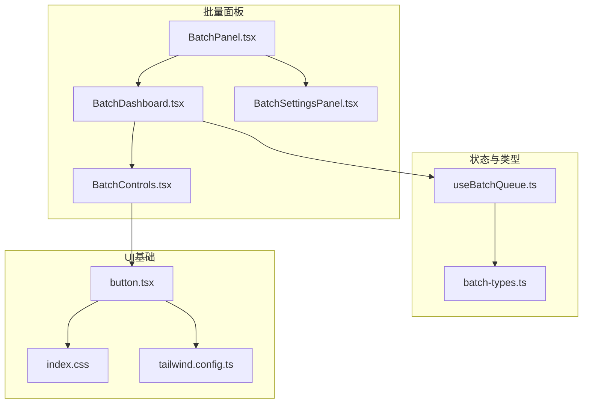
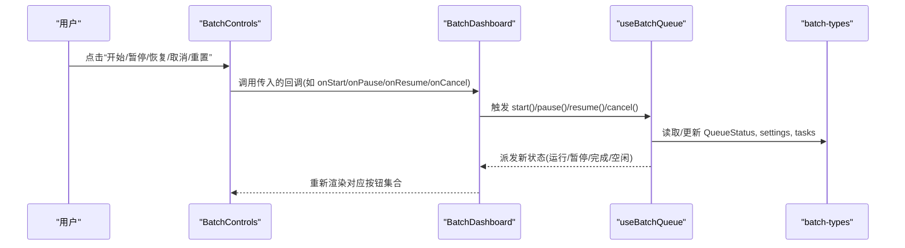
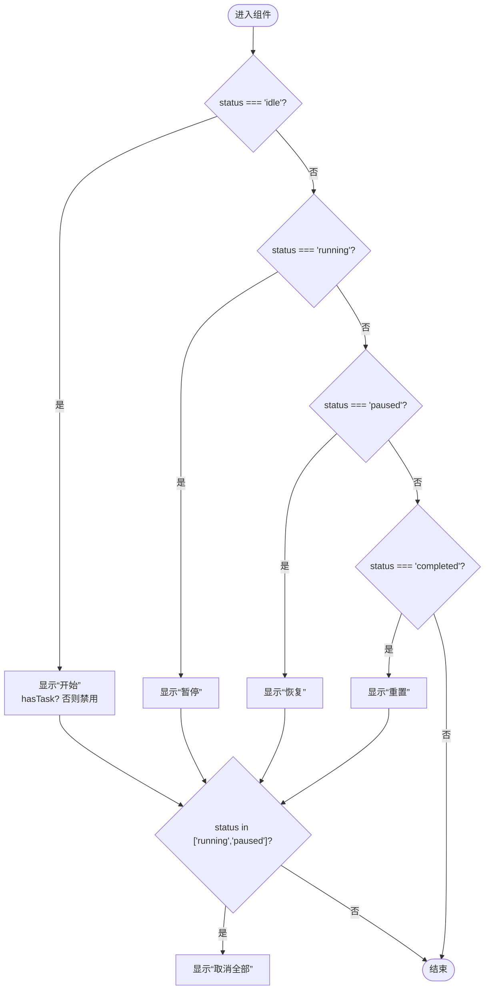
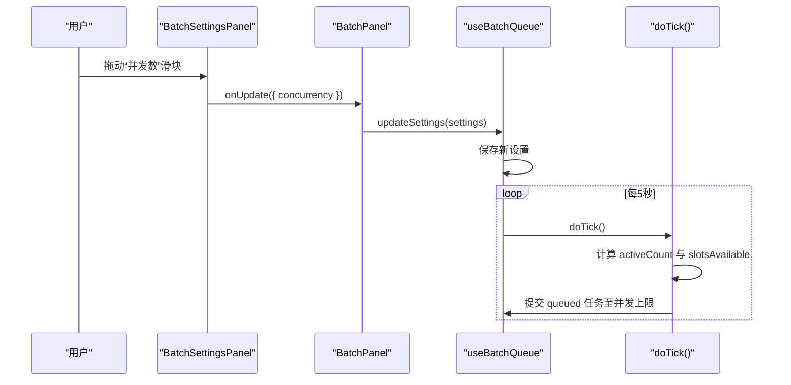
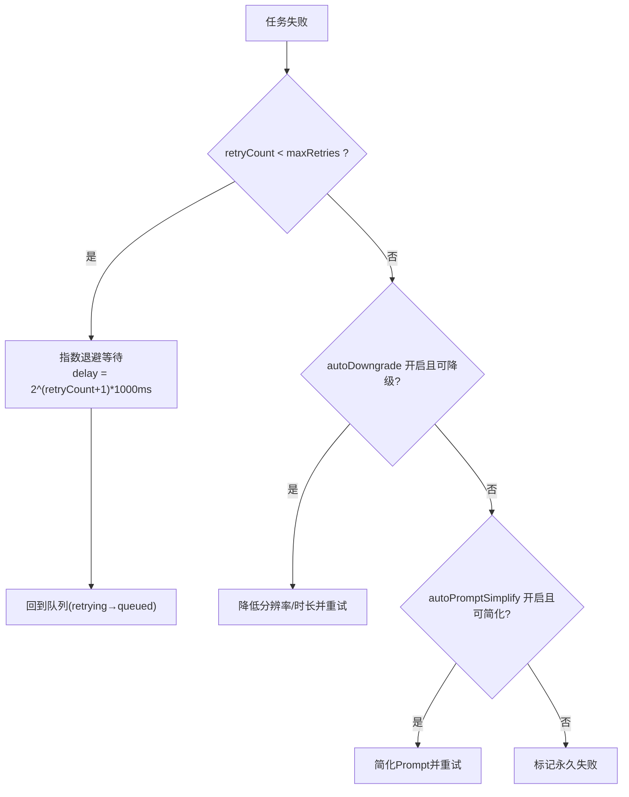
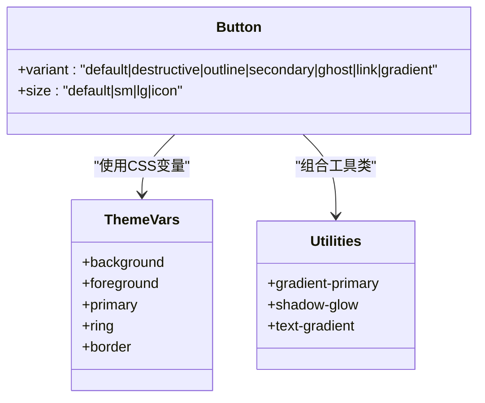
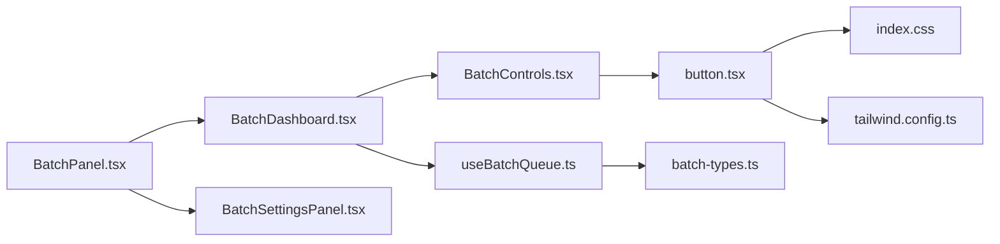

# BatchControls控制面板组件

<cite>
**本文引用的文件列表**
- [BatchControls.tsx](file://src/components/batch/BatchControls.tsx)
- [BatchDashboard.tsx](file://src/components/batch/BatchDashboard.tsx)
- [BatchPanel.tsx](file://src/components/batch/BatchPanel.tsx)
- [BatchSettingsPanel.tsx](file://src/components/batch/BatchSettingsPanel.tsx)
- [useBatchQueue.ts](file://src/hooks/useBatchQueue.ts)
- [batch-types.ts](file://src/lib/batch-types.ts)
- [button.tsx](file://src/components/ui/button.tsx)
- [index.css](file://src/index.css)
- [tailwind.config.ts](file://tailwind.config.ts)
</cite>

## 目录
1. [简介](#简介)
2. [项目结构](#项目结构)
3. [核心组件](#核心组件)
4. [架构总览](#架构总览)
5. [详细组件分析](#详细组件分析)
6. [依赖关系分析](#依赖关系分析)
7. [性能与交互特性](#性能与交互特性)
8. [样式定制与主题适配](#样式定制与主题适配)
9. [无障碍与键盘导航](#无障碍与键盘导航)
10. [故障排查指南](#故障排查指南)
11. [结论](#结论)

## 简介
本文件为 BatchControls 控制面板组件的权威文档，聚焦以下目标：
- 深入说明开始/暂停/恢复/取消/重置按钮的状态机、禁用条件与用户反馈。
- 文档化设置面板（并发数、最大重试次数、自动降级、自动简化Prompt）的实现与状态同步。
- 解释并发控制选项的用户界面交互逻辑。
- 说明重试策略配置界面的设计与行为。
- 介绍超时设置的UI实现与验证逻辑（当前代码未提供相关UI）。
- 提供样式定制与主题适配方法。
- 补充无障碍访问与键盘导航支持说明。

## 项目结构
BatchControls 位于批量任务面板中，作为“仪表盘”区域的顶部控制条，负责根据队列状态切换显示不同的操作按钮，并将用户操作转发给上层 Hook 管理的全局状态。

图表来源
- [BatchPanel.tsx:1-58](file://src/components/batch/BatchPanel.tsx#L1-L58)
- [BatchDashboard.tsx:1-89](file://src/components/batch/BatchDashboard.tsx#L1-L89)
- [BatchControls.tsx:1-50](file://src/components/batch/BatchControls.tsx#L1-L50)
- [BatchSettingsPanel.tsx:1-79](file://src/components/batch/BatchSettingsPanel.tsx#L1-L79)
- [useBatchQueue.ts:1-322](file://src/hooks/useBatchQueue.ts#L1-L322)
- [batch-types.ts:1-123](file://src/lib/batch-types.ts#L1-L123)
- [button.tsx:1-53](file://src/components/ui/button.tsx#L1-L53)
- [index.css:1-111](file://src/index.css#L1-L111)
- [tailwind.config.ts:1-93](file://tailwind.config.ts#L1-L93)

章节来源
- [BatchPanel.tsx:1-58](file://src/components/batch/BatchPanel.tsx#L1-L58)
- [BatchDashboard.tsx:1-89](file://src/components/batch/BatchDashboard.tsx#L1-L89)
- [BatchControls.tsx:1-50](file://src/components/batch/BatchControls.tsx#L1-L50)
- [BatchSettingsPanel.tsx:1-79](file://src/components/batch/BatchSettingsPanel.tsx#L1-L79)
- [useBatchQueue.ts:1-322](file://src/hooks/useBatchQueue.ts#L1-L322)
- [batch-types.ts:1-123](file://src/lib/batch-types.ts#L1-L123)
- [button.tsx:1-53](file://src/components/ui/button.tsx#L1-L53)
- [index.css:1-111](file://src/index.css#L1-L111)
- [tailwind.config.ts:1-93](file://tailwind.config.ts#L1-L93)

## 核心组件
- BatchControls：根据队列状态渲染不同按钮，并处理点击事件回调。
- BatchDashboard：聚合进度、控制条、任务列表与日志，承载预览弹窗等。
- BatchPanel：组合输入区、设置面板与仪表盘，协调 API Key 校验与任务加载。
- BatchSettingsPanel：执行设置（并发数、最大重试次数、自动降级、自动简化Prompt）。
- useBatchQueue：集中式队列状态与调度逻辑（启动、暂停、恢复、取消、轮询、失败回退）。
- batch-types：全局类型定义（任务状态、队列状态、设置项等）。
- Button：通用按钮组件，提供多种变体与尺寸。
- index.css / tailwind.config.ts：主题变量、渐变、阴影与动画配置。

章节来源
- [BatchControls.tsx:1-50](file://src/components/batch/BatchControls.tsx#L1-L50)
- [BatchDashboard.tsx:1-89](file://src/components/batch/BatchDashboard.tsx#L1-L89)
- [BatchPanel.tsx:1-58](file://src/components/batch/BatchPanel.tsx#L1-L58)
- [BatchSettingsPanel.tsx:1-79](file://src/components/batch/BatchSettingsPanel.tsx#L1-L79)
- [useBatchQueue.ts:1-322](file://src/hooks/useBatchQueue.ts#L1-L322)
- [batch-types.ts:1-123](file://src/lib/batch-types.ts#L1-L123)
- [button.tsx:1-53](file://src/components/ui/button.tsx#L1-L53)
- [index.css:1-111](file://src/index.css#L1-L111)
- [tailwind.config.ts:1-93](file://tailwind.config.ts#L1-L93)

## 架构总览
BatchControls 通过父级 Dashboard 接收来自 Hook 的队列状态与回调函数，以受控方式渲染按钮；所有控制动作最终由 useBatchQueue 驱动状态机与后台轮询。

图表来源
- [BatchControls.tsx:1-50](file://src/components/batch/BatchControls.tsx#L1-L50)
- [BatchDashboard.tsx:1-89](file://src/components/batch/BatchDashboard.tsx#L1-L89)
- [useBatchQueue.ts:1-322](file://src/hooks/useBatchQueue.ts#L1-L322)
- [batch-types.ts:1-123](file://src/lib/batch-types.ts#L1-L123)

## 详细组件分析

### BatchControls 按钮状态机与交互
- 状态到按钮映射
  - idle：显示“开始”，当没有任务时禁用。
  - running：显示“暂停”。
  - paused：显示“恢复”。
  - completed：显示“重置”。
  - running/paused：额外显示“取消全部”。
- 禁用条件
  - “开始”在 hasTask 为 false 时禁用。
  - 其他按钮默认不禁用，具体可用性由上层状态保证。
- 用户反馈
  - 按钮点击后由上层 Hook 更新状态，组件按新状态重渲染，即时反馈。
  - 图标与文案随状态变化，直观表达当前可执行动作。

图表来源
- [BatchControls.tsx:1-50](file://src/components/batch/BatchControls.tsx#L1-L50)

章节来源
- [BatchControls.tsx:1-50](file://src/components/batch/BatchControls.tsx#L1-L50)
- [BatchDashboard.tsx:1-89](file://src/components/batch/BatchDashboard.tsx#L1-L89)
- [useBatchQueue.ts:1-322](file://src/hooks/useBatchQueue.ts#L1-L322)
- [batch-types.ts:1-123](file://src/lib/batch-types.ts#L1-L123)

### 设置面板切换功能（展开/收起与状态同步）
- 当前实现
  - 设置面板以固定卡片形式展示，无显式的展开/收起开关或动画。
  - 通过 disabled 属性在任务运行时禁用设置项，避免冲突修改。
- 建议扩展
  - 可在外层容器增加展开/收起状态，配合 Tailwind 的过渡类实现高度动画。
  - 使用受控模式将展开状态提升到父组件，确保与任务状态同步。

章节来源
- [BatchSettingsPanel.tsx:1-79](file://src/components/batch/BatchSettingsPanel.tsx#L1-L79)
- [BatchPanel.tsx:1-58](file://src/components/batch/BatchPanel.tsx#L1-L58)

### 并发控制选项（并发数量调节器）
- UI 实现
  - 使用范围滑块，最小值 1，最大值 5，实时显示当前值。
  - 变更时通过 onUpdate 回调合并到全局设置。
- 交互逻辑
  - 拖动滑块即更新 settings.concurrency。
  - 任务运行期间 disabled 生效，防止运行时调整导致并发窗口抖动。
- 数据流
  - 设置变更经 updateSettings 分发至 useBatchQueue，doTick 每 5 秒计算可用槽位并调度任务。

图表来源
- [BatchSettingsPanel.tsx:1-79](file://src/components/batch/BatchSettingsPanel.tsx#L1-L79)
- [BatchPanel.tsx:1-58](file://src/components/batch/BatchPanel.tsx#L1-L58)
- [useBatchQueue.ts:1-322](file://src/hooks/useBatchQueue.ts#L1-L322)

章节来源
- [BatchSettingsPanel.tsx:1-79](file://src/components/batch/BatchSettingsPanel.tsx#L1-L79)
- [useBatchQueue.ts:1-322](file://src/hooks/useBatchQueue.ts#L1-L322)

### 重试策略配置界面（最大重试次数与重试间隔）
- 最大重试次数
  - 通过滑块设置 maxRetries（1-5），实时更新到全局设置。
  - 实际重试决策由容错策略决定，结合指数退避延迟。
- 重试间隔
  - 当前未提供独立 UI 配置重试间隔；间隔由策略内部基于 retryCount 计算（指数退避）。
- 自动降级与 Prompt 简化
  - 两个复选框分别控制是否启用参数降级与 Prompt 简化。
  - 这些开关影响失败后的回退路径选择。

图表来源
- [BatchSettingsPanel.tsx:1-79](file://src/components/batch/BatchSettingsPanel.tsx#L1-L79)
- [useBatchQueue.ts:1-322](file://src/hooks/useBatchQueue.ts#L1-L322)

章节来源
- [BatchSettingsPanel.tsx:1-79](file://src/components/batch/BatchSettingsPanel.tsx#L1-L79)
- [useBatchQueue.ts:1-322](file://src/hooks/useBatchQueue.ts#L1-L322)

### 超时设置的UI实现与验证逻辑
- 现状
  - 当前仓库未提供“超时设置”的 UI 控件或相关配置项。
- 建议
  - 如需添加，可在设置面板新增“请求超时（秒）”输入框，并在提交任务前进行边界校验（例如 1-300 秒）。
  - 在提交与轮询阶段应用超时控制，避免长时间挂起。

章节来源
- [BatchSettingsPanel.tsx:1-79](file://src/components/batch/BatchSettingsPanel.tsx#L1-L79)
- [useBatchQueue.ts:1-322](file://src/hooks/useBatchQueue.ts#L1-L322)

### 控制面板的样式定制与主题适配
- 主题变量
  - 通过 CSS 自定义属性定义明暗主题色板，Tailwind 直接引用这些变量。
- 渐变与阴影
  - 提供 .gradient-primary、.shadow-glow 等工具类，用于强调按钮与卡片。
- 按钮组件
  - 使用 class-variance-authority 管理变体与尺寸，支持 gradient、outline、ghost 等风格。
- 深色模式
  - 通过 dark 类切换主题变量，组件无需额外改动即可适配。

图表来源
- [button.tsx:1-53](file://src/components/ui/button.tsx#L1-L53)
- [index.css:1-111](file://src/index.css#L1-L111)
- [tailwind.config.ts:1-93](file://tailwind.config.ts#L1-L93)

章节来源
- [button.tsx:1-53](file://src/components/ui/button.tsx#L1-L53)
- [index.css:1-111](file://src/index.css#L1-L111)
- [tailwind.config.ts:1-93](file://tailwind.config.ts#L1-L93)

### 无障碍访问与键盘导航
- 语义化元素
  - 按钮使用原生 button 元素，天然具备焦点管理与键盘操作能力。
- 焦点可见性
  - 按钮组件包含 focus-visible 样式，确保键盘导航时的焦点环清晰可见。
- 标签与提示
  - 建议在必要时为图标按钮添加 aria-label，提升屏幕阅读器体验。
- 对比度与可读性
  - 主题变量保证文本与背景对比度，遵循可访问性最佳实践。

章节来源
- [button.tsx:1-53](file://src/components/ui/button.tsx#L1-L53)
- [index.css:1-111](file://src/index.css#L1-L111)

## 依赖关系分析
- 组件耦合
  - BatchControls 仅依赖状态与回调，不持有业务逻辑，低耦合高内聚。
  - BatchDashboard 聚合多个子组件，承担布局与预览弹窗职责。
  - BatchPanel 编排输入、设置与仪表盘，并负责 API Key 校验与任务加载。
- 外部依赖
  - useBatchQueue 依赖类型定义与存储、API 模块（不在本节源码范围内）。
  - Button 依赖 class-variance-authority 与 Tailwind 工具类。

图表来源
- [BatchControls.tsx:1-50](file://src/components/batch/BatchControls.tsx#L1-L50)
- [BatchDashboard.tsx:1-89](file://src/components/batch/BatchDashboard.tsx#L1-L89)
- [BatchPanel.tsx:1-58](file://src/components/batch/BatchPanel.tsx#L1-L58)
- [BatchSettingsPanel.tsx:1-79](file://src/components/batch/BatchSettingsPanel.tsx#L1-L79)
- [useBatchQueue.ts:1-322](file://src/hooks/useBatchQueue.ts#L1-L322)
- [batch-types.ts:1-123](file://src/lib/batch-types.ts#L1-L123)
- [button.tsx:1-53](file://src/components/ui/button.tsx#L1-L53)
- [index.css:1-111](file://src/index.css#L1-L111)
- [tailwind.config.ts:1-93](file://tailwind.config.ts#L1-L93)

章节来源
- [BatchControls.tsx:1-50](file://src/components/batch/BatchControls.tsx#L1-L50)
- [BatchDashboard.tsx:1-89](file://src/components/batch/BatchDashboard.tsx#L1-L89)
- [BatchPanel.tsx:1-58](file://src/components/batch/BatchPanel.tsx#L1-L58)
- [BatchSettingsPanel.tsx:1-79](file://src/components/batch/BatchSettingsPanel.tsx#L1-L79)
- [useBatchQueue.ts:1-322](file://src/hooks/useBatchQueue.ts#L1-L322)
- [batch-types.ts:1-123](file://src/lib/batch-types.ts#L1-L123)
- [button.tsx:1-53](file://src/components/ui/button.tsx#L1-L53)
- [index.css:1-111](file://src/index.css#L1-L111)
- [tailwind.config.ts:1-93](file://tailwind.config.ts#L1-L93)

## 性能与交互特性
- 调度频率
  - 队列 tick 每 5 秒执行一次，平衡了响应性与资源消耗。
- 并发控制
  - 动态计算活跃任务数与剩余槽位，按需提交任务，避免过载。
- 失败回退
  - 指数退避重试、参数降级与 Prompt 简化形成多级容错，提高成功率。
- 状态持久化
  - 状态变更节流保存到本地存储，刷新后可恢复进度。

章节来源
- [useBatchQueue.ts:1-322](file://src/hooks/useBatchQueue.ts#L1-L322)

## 样式定制与主题适配
- 主题变量
  - 在根节点定义明/暗两套颜色变量，组件通过 Tailwind 的 hsl(var(...)) 引用。
- 渐变与阴影
  - 使用 .gradient-primary 与 .shadow-glow 增强主按钮视觉层次。
- 按钮变体
  - 通过 variant 与 size 快速切换外观，满足强调、次要、幽灵等场景。
- 深色模式
  - 切换 dark 类即可整体适配，无需逐个组件修改。

章节来源
- [index.css:1-111](file://src/index.css#L1-L111)
- [tailwind.config.ts:1-93](file://tailwind.config.ts#L1-L93)
- [button.tsx:1-53](file://src/components/ui/button.tsx#L1-L53)

## 无障碍与键盘导航
- 原生按钮语义
  - 所有操作均使用原生 button，具备 Tab 聚焦、Enter/Space 激活等能力。
- 焦点指示
  - 组件内置 focus-visible 样式，确保键盘操作时焦点环清晰。
- 可访问性建议
  - 为图标按钮补充 aria-label，描述动作含义。
  - 保持足够的颜色对比度，遵循 WCAG 标准。

章节来源
- [button.tsx:1-53](file://src/components/ui/button.tsx#L1-L53)
- [index.css:1-111](file://src/index.css#L1-L111)

## 故障排查指南
- 无法开始
  - 检查是否有有效任务（hasTask 为 true）。
  - 确认已设置 API Key，否则上层会阻止启动。
- 按钮无响应
  - 核对上层回调是否正确绑定（start/pause/resume/cancel）。
  - 查看控制台错误信息，确认网络或权限问题。
- 任务卡住
  - 检查 tick 是否正常触发（每 5 秒）。
  - 观察任务状态是否为 submitting/polling/retrying，必要时重置队列。
- 设置无效
  - 任务运行期间设置被禁用，需先暂停或停止后再调整。

章节来源
- [BatchPanel.tsx:1-58](file://src/components/batch/BatchPanel.tsx#L1-L58)
- [BatchDashboard.tsx:1-89](file://src/components/batch/BatchDashboard.tsx#L1-L89)
- [useBatchQueue.ts:1-322](file://src/hooks/useBatchQueue.ts#L1-L322)

## 结论
BatchControls 以极简的受控接口暴露队列控制能力，配合 useBatchQueue 的状态机与调度逻辑，实现了稳定可靠的批量生成流程。设置面板提供了关键的可调参数，便于在不同网络与负载环境下优化成功率与吞吐。样式系统支持灵活的主题定制与深色模式适配，同时具备良好的键盘可达性。若需进一步增强，可在设置面板引入超时配置与展开/收起动画，以提升用户体验与可控性。