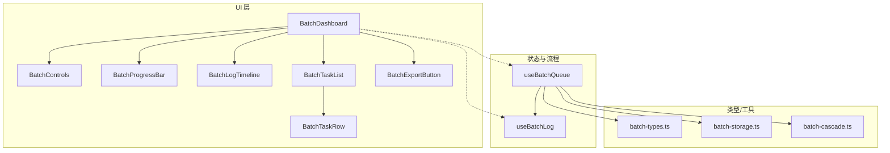
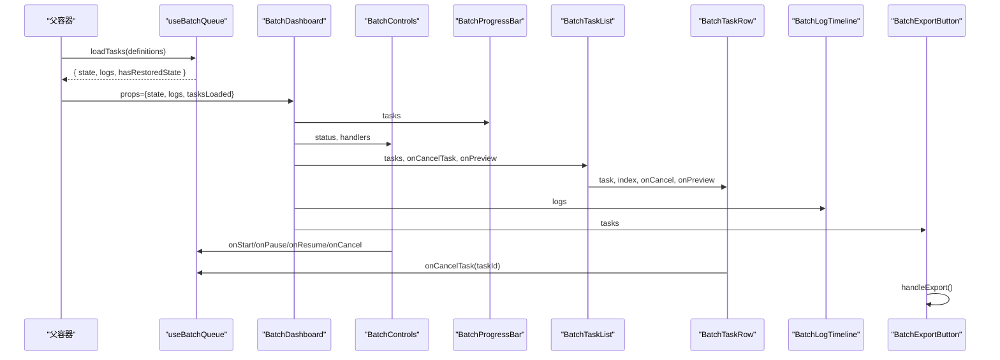
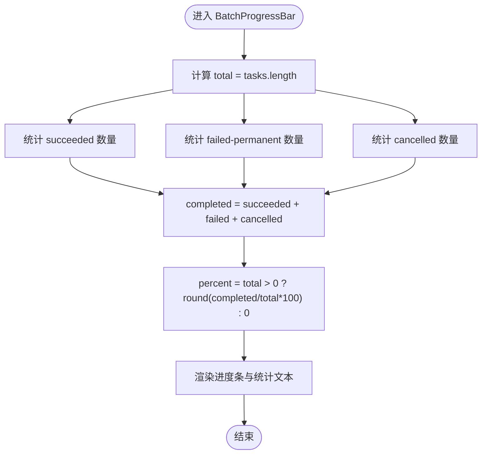
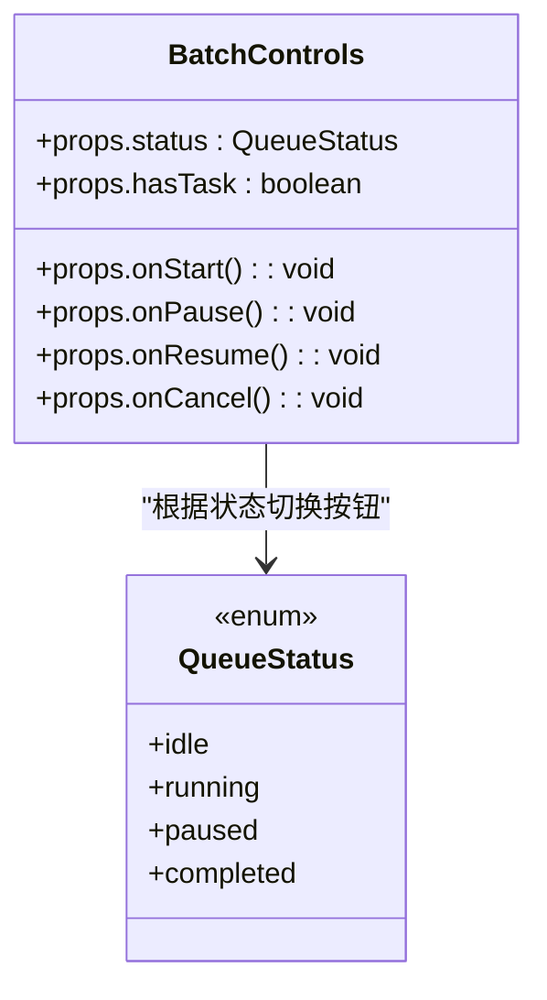
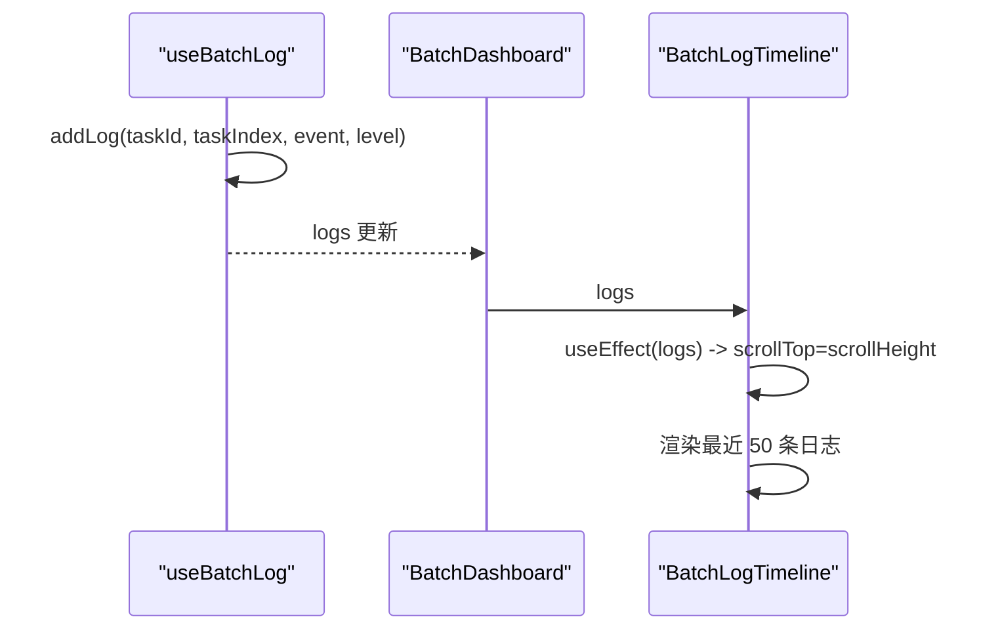
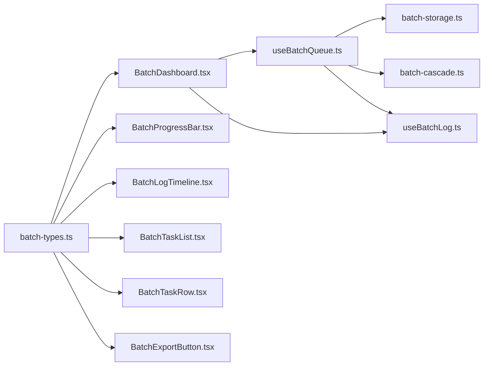

# BatchDashboard仪表板组件

<cite>
**本文引用的文件列表**
- [BatchDashboard.tsx](file://src/components/batch/BatchDashboard.tsx)
- [BatchControls.tsx](file://src/components/batch/BatchControls.tsx)
- [BatchProgressBar.tsx](file://src/components/batch/BatchProgressBar.tsx)
- [BatchLogTimeline.tsx](file://src/components/batch/BatchLogTimeline.tsx)
- [BatchTaskList.tsx](file://src/components/batch/BatchTaskList.tsx)
- [BatchTaskRow.tsx](file://src/components/batch/BatchTaskRow.tsx)
- [BatchExportButton.tsx](file://src/components/batch/BatchExportButton.tsx)
- [useBatchQueue.ts](file://src/hooks/useBatchQueue.ts)
- [useBatchLog.ts](file://src/hooks/useBatchLog.ts)
- [batch-types.ts](file://src/lib/batch-types.ts)
- [batch-storage.ts](file://src/lib/batch-storage.ts)
- [batch-cascade.ts](file://src/lib/batch-cascade.ts)
</cite>

## 目录
1. [简介](#简介)
2. [项目结构](#项目结构)
3. [核心组件](#核心组件)
4. [架构总览](#架构总览)
5. [详细组件分析](#详细组件分析)
6. [依赖关系分析](#依赖关系分析)
7. [性能与体验优化](#性能与体验优化)
8. [故障排查指南](#故障排查指南)
9. [结论](#结论)
10. [附录：定制与样式覆盖](#附录定制与样式覆盖)

## 简介
BatchDashboard 是批量任务监控中心，负责将批量任务的执行状态、进度、日志和结果以直观的界面呈现。其设计理念强调“数据驱动 + 状态集中管理”：通过统一的状态模型与 Hook 编排任务生命周期，UI 层仅负责展示与交互触发，从而保证可维护性与可扩展性。

该组件提供以下关键能力：
- 任务概览统计：实时计算并显示总任务数、完成数、失败数等指标
- 进度可视化：整体进度条与单个任务进度渲染
- 快速操作按钮组：开始、暂停、恢复、取消等控制按钮的状态管理与事件处理
- 日志时间线：集成实时滚动效果，便于追踪执行过程
- 数据绑定机制：state、logs、tasksLoaded 等属性的传递与使用
- 导出与预览：支持批量结果导出与视频预览

## 项目结构
BatchDashboard 位于批量功能模块中，围绕它组织了一系列子组件与 Hook，形成清晰的职责边界：
- UI 层：BatchDashboard、BatchControls、BatchProgressBar、BatchLogTimeline、BatchTaskList、BatchTaskRow、BatchExportButton
- 状态与流程：useBatchQueue（队列调度、重试降级、持久化）
- 日志：useBatchLog（日志追加、持久化）
- 类型定义：batch-types.ts
- 存储与容错：batch-storage.ts、batch-cascade.ts

图表来源
- [BatchDashboard.tsx:1-89](file://src/components/batch/BatchDashboard.tsx#L1-L89)
- [BatchControls.tsx:1-50](file://src/components/batch/BatchControls.tsx#L1-L50)
- [BatchProgressBar.tsx:1-36](file://src/components/batch/BatchProgressBar.tsx#L1-L36)
- [BatchLogTimeline.tsx:1-47](file://src/components/batch/BatchLogTimeline.tsx#L1-L47)
- [BatchTaskList.tsx:1-27](file://src/components/batch/BatchTaskList.tsx#L1-L27)
- [BatchTaskRow.tsx:1-80](file://src/components/batch/BatchTaskRow.tsx#L1-L80)
- [BatchExportButton.tsx:1-41](file://src/components/batch/BatchExportButton.tsx#L1-L41)
- [useBatchQueue.ts:1-322](file://src/hooks/useBatchQueue.ts#L1-L322)
- [useBatchLog.ts:1-39](file://src/hooks/useBatchLog.ts#L1-L39)
- [batch-types.ts:1-123](file://src/lib/batch-types.ts#L1-L123)
- [batch-storage.ts:1-89](file://src/lib/batch-storage.ts#L1-L89)
- [batch-cascade.ts:1-101](file://src/lib/batch-cascade.ts#L1-L101)

章节来源
- [BatchDashboard.tsx:1-89](file://src/components/batch/BatchDashboard.tsx#L1-L89)
- [useBatchQueue.ts:1-322](file://src/hooks/useBatchQueue.ts#L1-L322)
- [batch-types.ts:1-123](file://src/lib/batch-types.ts#L1-L123)

## 核心组件
- BatchDashboard：组合进度、控制、任务列表与日志区域，并提供空态提示与视频预览弹窗
- BatchControls：根据队列状态动态渲染开始/暂停/恢复/重置/取消全部按钮
- BatchProgressBar：基于任务集合计算总体进度与成功/失败/取消计数
- BatchLogTimeline：最近日志的滚动展示，按级别着色
- BatchTaskList / BatchTaskRow：任务行渲染，包含状态标签、重试次数、降级标记、预览与下载入口
- BatchExportButton：将当前任务结果导出为 JSON 文件

章节来源
- [BatchDashboard.tsx:1-89](file://src/components/batch/BatchDashboard.tsx#L1-L89)
- [BatchControls.tsx:1-50](file://src/components/batch/BatchControls.tsx#L1-L50)
- [BatchProgressBar.tsx:1-36](file://src/components/batch/BatchProgressBar.tsx#L1-L36)
- [BatchLogTimeline.tsx:1-47](file://src/components/batch/BatchLogTimeline.tsx#L1-L47)
- [BatchTaskList.tsx:1-27](file://src/components/batch/BatchTaskList.tsx#L1-L27)
- [BatchTaskRow.tsx:1-80](file://src/components/batch/BatchTaskRow.tsx#L1-L80)
- [BatchExportButton.tsx:1-41](file://src/components/batch/BatchExportButton.tsx#L1-L41)

## 架构总览
BatchDashboard 采用“受控组件 + 状态 Hook”的模式：上层容器通过 useBatchQueue 管理全局状态与调度逻辑，并将 state、logs、tasksLoaded 等属性传递给 BatchDashboard；UI 组件只负责渲染与回调触发。

图表来源
- [useBatchQueue.ts:266-321](file://src/hooks/useBatchQueue.ts#L266-L321)
- [BatchDashboard.tsx:21-89](file://src/components/batch/BatchDashboard.tsx#L21-L89)
- [BatchControls.tsx:14-49](file://src/components/batch/BatchControls.tsx#L14-L49)
- [BatchProgressBar.tsx:7-35](file://src/components/batch/BatchProgressBar.tsx#L7-L35)
- [BatchTaskList.tsx:10-26](file://src/components/batch/BatchTaskList.tsx#L10-L26)
- [BatchTaskRow.tsx:21-79](file://src/components/batch/BatchTaskRow.tsx#L21-L79)
- [BatchLogTimeline.tsx:15-46](file://src/components/batch/BatchLogTimeline.tsx#L15-L46)
- [BatchExportButton.tsx:9-40](file://src/components/batch/BatchExportButton.tsx#L9-L40)

## 详细组件分析

### 任务概览统计实现
- 数据来源：从传入的 tasks 数组中筛选不同状态的任务数量
- 计算逻辑：
  - 总数 = tasks.length
  - 成功数 = status === 'succeeded' 的数量
  - 失败数 = status === 'failed-permanent' 的数量
  - 取消数 = status === 'cancelled' 的数量
  - 完成数 = 成功 + 失败 + 取消
  - 百分比 = Math.round((完成数 / 总数) * 100)
- 展示位置：在顶部进度区域同时显示“进度: 完成/总数”以及“成功/失败/取消”明细

章节来源
- [BatchProgressBar.tsx:7-35](file://src/components/batch/BatchProgressBar.tsx#L7-L35)
- [batch-types.ts:22-44](file://src/lib/batch-types.ts#L22-L44)

### 进度可视化组件集成
- 整体进度条：由 BatchProgressBar 渲染，宽度由百分比决定，带过渡动画
- 单个任务进度：由 BatchTaskRow 渲染，包括状态标签、重试次数、降级标记、预览与下载入口
- 渲染时机：当 tasks 变化时，React 自动重新渲染对应组件

图表来源
- [BatchProgressBar.tsx:7-35](file://src/components/batch/BatchProgressBar.tsx#L7-L35)

章节来源
- [BatchProgressBar.tsx:7-35](file://src/components/batch/BatchProgressBar.tsx#L7-L35)
- [BatchTaskRow.tsx:21-79](file://src/components/batch/BatchTaskRow.tsx#L21-L79)

### 快速操作按钮组
- 状态映射：
  - idle：显示“开始”，当无任务时禁用
  - running：显示“暂停”
  - paused：显示“恢复”
  - completed：显示“重置”
  - running/paused：额外显示“取消全部”
- 事件处理：
  - onStart/onPause/onResume/onCancel 由父容器通过 useBatchQueue 暴露
  - 取消全部会清理定时器、重试计时器、处理集合并重置状态

图表来源
- [BatchControls.tsx:14-49](file://src/components/batch/BatchControls.tsx#L14-L49)
- [batch-types.ts:52-57](file://src/lib/batch-types.ts#L52-L57)

章节来源
- [BatchControls.tsx:14-49](file://src/components/batch/BatchControls.tsx#L14-L49)
- [useBatchQueue.ts:279-306](file://src/hooks/useBatchQueue.ts#L279-L306)

### 日志时间线与实时滚动
- 数据源：useBatchLog 提供的 logs 数组，每条记录包含时间戳、任务索引、事件文本与级别
- 滚动策略：每次 logs 更新后，容器 scrollTop 设置为 scrollHeight，实现自动滚动到底部
- 显示范围：仅展示最近 50 条日志，避免 DOM 过大
- 级别颜色：info/warn/error/success 分别映射到不同文本颜色

图表来源
- [useBatchLog.ts:12-35](file://src/hooks/useBatchLog.ts#L12-L35)
- [BatchLogTimeline.tsx:15-46](file://src/components/batch/BatchLogTimeline.tsx#L15-L46)

章节来源
- [useBatchLog.ts:1-39](file://src/hooks/useBatchLog.ts#L1-39)
- [BatchLogTimeline.tsx:15-46](file://src/components/batch/BatchLogTimeline.tsx#L15-L46)

### 数据绑定机制
- 属性传递：
  - state：来自 useBatchQueue，包含 tasks、status、settings
  - logs：来自 useBatchLog，用于日志展示
  - tasksLoaded：由父容器根据是否加载过任务或是否有恢复状态决定
- 使用方式：
  - BatchDashboard 接收上述属性并分发给子组件
  - 子组件通过 props 读取数据，不直接修改状态
- 状态持久化：
  - useBatchQueue 内部通过 batch-storage 保存/加载队列状态与日志
  - 页面刷新后可恢复上次运行状态（非 running 则初始为 paused）

章节来源
- [BatchDashboard.tsx:21-30](file://src/components/batch/BatchDashboard.tsx#L21-L30)
- [useBatchQueue.ts:53-81](file://src/hooks/useBatchQueue.ts#L53-L81)
- [batch-storage.ts:7-41](file://src/lib/batch-storage.ts#L7-L41)

### 任务取消与单任务控制
- 取消全部：清除轮询间隔、重试计时器、处理集合并重置状态
- 取消单个任务：仅对处于排队或重试中的任务进行取消，并清理对应的重试计时器

章节来源
- [useBatchQueue.ts:298-312](file://src/hooks/useBatchQueue.ts#L298-L312)
- [BatchTaskRow.tsx:69-76](file://src/components/batch/BatchTaskRow.tsx#L69-L76)

### 导出功能
- 导出内容：每个任务的序号、提示词、模式、分辨率、时长、状态、视频链接、错误信息、重试次数
- 导出格式：JSON Blob，文件名包含时间戳
- 可用性：当存在至少一个成功任务时启用

章节来源
- [BatchExportButton.tsx:9-40](file://src/components/batch/BatchExportButton.tsx#L9-L40)
- [batch-types.ts:98-109](file://src/lib/batch-types.ts#L98-L109)

## 依赖关系分析
- UI 组件依赖类型定义与图标库
- 状态与流程依赖 API 调用、容错策略与本地存储
- 日志 Hook 独立于队列 Hook，但被队列 Hook 消费

图表来源
- [batch-types.ts:1-123](file://src/lib/batch-types.ts#L1-L123)
- [useBatchQueue.ts:1-322](file://src/hooks/useBatchQueue.ts#L1-L322)
- [batch-storage.ts:1-89](file://src/lib/batch-storage.ts#L1-L89)
- [batch-cascade.ts:1-101](file://src/lib/batch-cascade.ts#L1-L101)
- [useBatchLog.ts:1-39](file://src/hooks/useBatchLog.ts#L1-L39)
- [BatchDashboard.tsx:1-89](file://src/components/batch/BatchDashboard.tsx#L1-L89)

章节来源
- [useBatchQueue.ts:1-322](file://src/hooks/useBatchQueue.ts#L1-L322)
- [batch-types.ts:1-123](file://src/lib/batch-types.ts#L1-L123)

## 性能与体验优化
- 日志限制：最多保留 500 条，UI 仅渲染最近 50 条，降低 DOM 压力
- 状态持久化节流：状态变更延迟 1 秒写入 localStorage，减少频繁 I/O
- 并发控制：通过 settings.concurrency 限制同时提交/轮询的任务数
- 指数退避重试：失败后按 2^(n+1) 秒递增等待，避免雪崩
- 参数降级：优先降分辨率，再降时长，最后简化 Prompt，提升成功率
- 页面离开保护：运行中关闭页面时给出提示，防止中断

章节来源
- [useBatchLog.ts:5-35](file://src/hooks/useBatchLog.ts#L5-L35)
- [useBatchQueue.ts:72-81](file://src/hooks/useBatchQueue.ts#L72-L81)
- [useBatchQueue.ts:98-124](file://src/hooks/useBatchQueue.ts#L98-L124)
- [batch-cascade.ts:19-56](file://src/lib/batch-cascade.ts#L19-L56)
- [batch-storage.ts:80-88](file://src/lib/batch-storage.ts#L80-L88)

## 故障排查指南
- 无法开始任务
  - 检查 tasksLoaded 是否为 true 且 tasks 长度大于 0
  - 确认父容器已调用 loadTasks 并正确设置 tasksLoaded
- 进度不更新
  - 检查 useBatchQueue 的 doTick 是否在执行（状态为 running）
  - 查看日志中是否存在“提交任务...”、“生成中”等条目
- 任务一直重试
  - 查看 errorHistory 与日志中的失败原因
  - 检查 maxRetries 与 autoDowngrade/autoPromptSimplify 配置
- 导出为空
  - 确保至少有一个任务状态为 succeeded
- 日志未滚动
  - 确认 BatchLogTimeline 的 containerRef 可用且 logs 有更新

章节来源
- [BatchDashboard.tsx:34-43](file://src/components/batch/BatchDashboard.tsx#L34-L43)
- [useBatchQueue.ts:98-124](file://src/hooks/useBatchQueue.ts#L98-L124)
- [useBatchQueue.ts:187-264](file://src/hooks/useBatchQueue.ts#L187-L264)
- [BatchExportButton.tsx:10-32](file://src/components/batch/BatchExportButton.tsx#L10-L32)
- [BatchLogTimeline.tsx:18-22](file://src/components/batch/BatchLogTimeline.tsx#L18-L22)

## 结论
BatchDashboard 通过清晰的分层与受控组件设计，实现了批量任务的可视化监控与便捷控制。结合 useBatchQueue 的调度与容错策略，系统在高并发与不稳定网络环境下仍具备良好鲁棒性。UI 层聚焦展示与交互，数据流单向明确，便于后续扩展与定制。

## 附录：定制与样式覆盖
- 主题与配色
  - 通过 Tailwind 类名与 CSS 变量覆盖默认色板（如 text-muted-foreground、bg-secondary、gradient-primary 等）
  - 可在全局样式文件中调整进度条渐变、圆角、阴影等视觉细节
- 布局与尺寸
  - 外层容器使用 flex 纵向布局，可通过自定义 className 调整 padding、border、max-height 等
  - 任务列表区域设置了最大高度与滚动，可按需调整
- 组件替换
  - 可替换 BatchProgressBar 的实现以支持环形进度或多段进度
  - 可替换 BatchLogTimeline 以支持分页、搜索与过滤
- 行为扩展
  - 在 useBatchQueue 中扩展新的容错动作或降级策略
  - 在 BatchExportButton 中增加 CSV/Excel 导出或其他格式

[本节为通用指导，不直接分析具体文件]