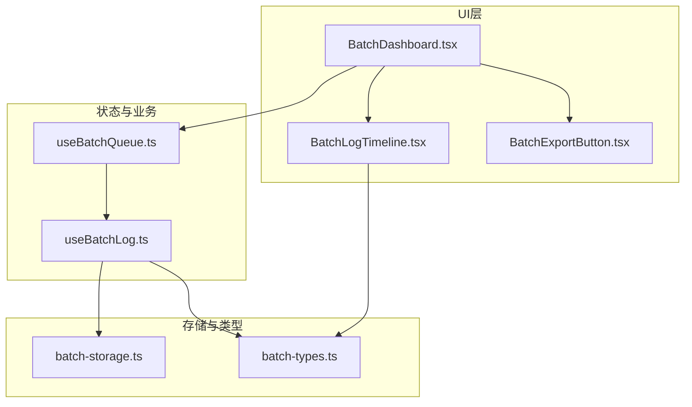
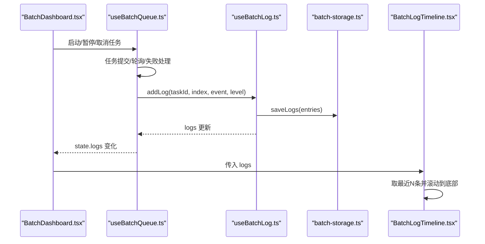
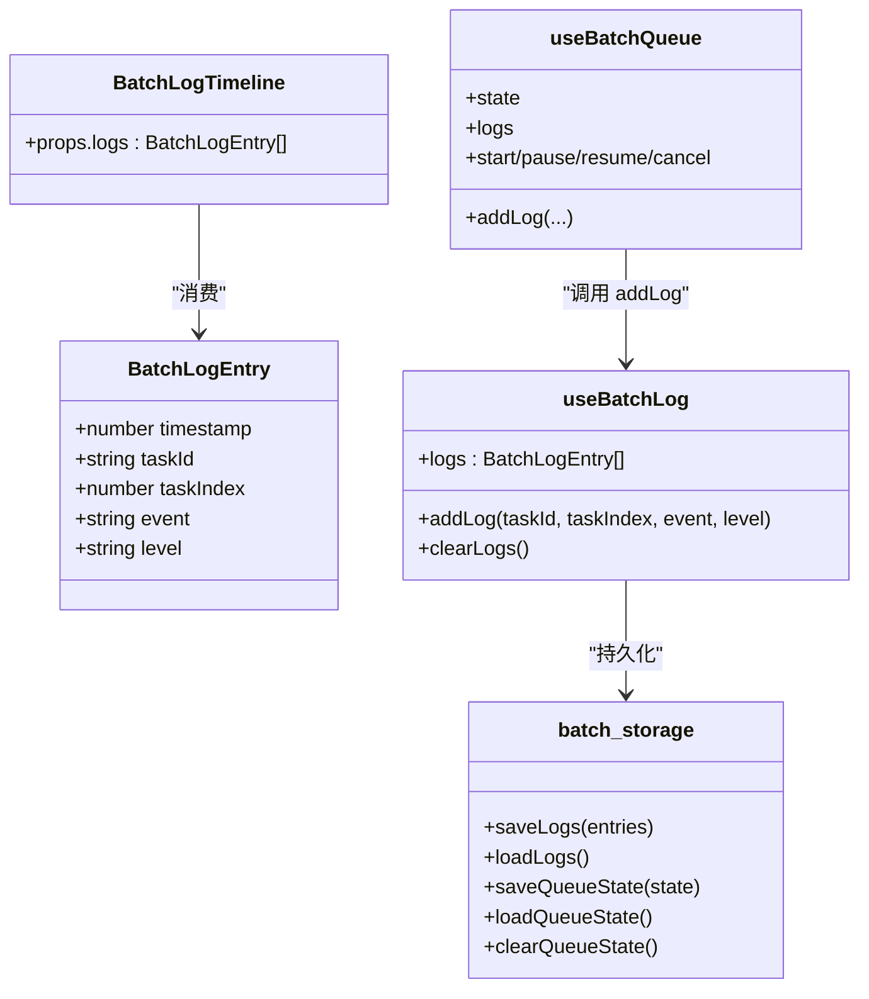
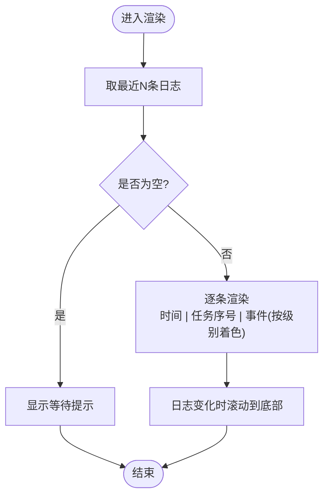
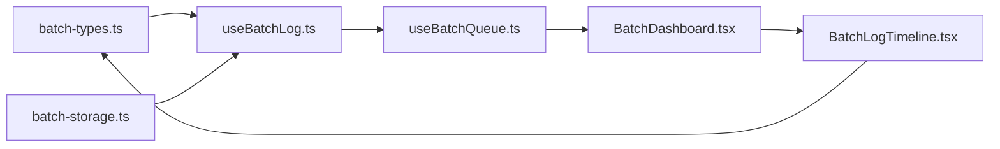

# BatchLogTimeline日志时间线组件

<cite>
**本文引用的文件**   
- [BatchLogTimeline.tsx](file://src/components/batch/BatchLogTimeline.tsx)
- [useBatchLog.ts](file://src/hooks/useBatchLog.ts)
- [batch-types.ts](file://src/lib/batch-types.ts)
- [batch-storage.ts](file://src/lib/batch-storage.ts)
- [useBatchQueue.ts](file://src/hooks/useBatchQueue.ts)
- [BatchDashboard.tsx](file://src/components/batch/BatchDashboard.tsx)
- [BatchExportButton.tsx](file://src/components/batch/BatchExportButton.tsx)
</cite>

## 目录
1. [简介](#简介)
2. [项目结构](#项目结构)
3. [核心组件与数据流](#核心组件与数据流)
4. [架构总览](#架构总览)
5. [详细组件分析](#详细组件分析)
6. [依赖关系分析](#依赖关系分析)
7. [性能考虑与内存管理](#性能考虑与内存管理)
8. [故障排查指南](#故障排查指南)
9. [结论](#结论)
10. [附录：使用与扩展建议](#附录使用与扩展建议)

## 简介
本文件围绕 BatchLogTimeline 日志时间线组件，系统化说明其实时日志显示、滚动机制、日志级别分类与颜色编码、自动滚动到底部的实现逻辑与性能优化策略、过滤与搜索能力现状与扩展方案、日志格式化与语法高亮处理思路、持久化与历史记录保存机制、导出与分享方法，以及在大量日志场景下的性能调优与内存管理建议。文档同时提供架构图、时序图与流程图，帮助读者快速理解并高效使用该组件。

## 项目结构
BatchLogTimeline 位于批量任务面板中，作为“实时日志”区域展示最近若干条日志条目。其数据来源由 useBatchLog 钩子维护，并通过 useBatchQueue 在任务执行过程中写入日志；持久化由 batch-storage 负责；类型定义集中于 batch-types。

图表来源
- [BatchDashboard.tsx:1-89](file://src/components/batch/BatchDashboard.tsx#L1-L89)
- [BatchLogTimeline.tsx:1-47](file://src/components/batch/BatchLogTimeline.tsx#L1-L47)
- [BatchExportButton.tsx:1-41](file://src/components/batch/BatchExportButton.tsx#L1-L41)
- [useBatchQueue.ts:1-322](file://src/hooks/useBatchQueue.ts#L1-L322)
- [useBatchLog.ts:1-39](file://src/hooks/useBatchLog.ts#L1-L39)
- [batch-storage.ts:1-89](file://src/lib/batch-storage.ts#L1-L89)
- [batch-types.ts:1-123](file://src/lib/batch-types.ts#L1-L123)

章节来源
- [BatchDashboard.tsx:1-89](file://src/components/batch/BatchDashboard.tsx#L1-L89)
- [BatchLogTimeline.tsx:1-47](file://src/components/batch/BatchLogTimeline.tsx#L1-L47)
- [useBatchQueue.ts:1-322](file://src/hooks/useBatchQueue.ts#L1-L322)
- [useBatchLog.ts:1-39](file://src/hooks/useBatchLog.ts#L1-L39)
- [batch-storage.ts:1-89](file://src/lib/batch-storage.ts#L1-L89)
- [batch-types.ts:1-123](file://src/lib/batch-types.ts#L1-L123)

## 核心组件与数据流
- 数据模型：BatchLogEntry 包含时间戳、任务标识、任务序号、事件文本与级别（info/warn/error/success）。
- 日志写入：useBatchQueue 在执行任务、轮询结果、失败重试等关键路径调用 addLog 写入日志。
- 日志存储：useBatchLog 维护本地状态，并在每次新增时裁剪至最大条目数后落盘到 localStorage。
- 日志展示：BatchLogTimeline 接收 logs 数组，仅渲染最近若干条，并自动滚动到底部。

图表来源
- [useBatchQueue.ts:126-264](file://src/hooks/useBatchQueue.ts#L126-L264)
- [useBatchLog.ts:12-35](file://src/hooks/useBatchLog.ts#L12-L35)
- [batch-storage.ts:49-68](file://src/lib/batch-storage.ts#L49-L68)
- [BatchDashboard.tsx:82-85](file://src/components/batch/BatchDashboard.tsx#L82-L85)
- [BatchLogTimeline.tsx:15-46](file://src/components/batch/BatchLogTimeline.tsx#L15-L46)

章节来源
- [useBatchQueue.ts:126-264](file://src/hooks/useBatchQueue.ts#L126-L264)
- [useBatchLog.ts:12-35](file://src/hooks/useBatchLog.ts#L12-L35)
- [batch-storage.ts:49-68](file://src/lib/batch-storage.ts#L49-L68)
- [BatchDashboard.tsx:82-85](file://src/components/batch/BatchDashboard.tsx#L82-L85)
- [BatchLogTimeline.tsx:15-46](file://src/components/batch/BatchLogTimeline.tsx#L15-L46)

## 架构总览
从组件职责看：
- BatchLogTimeline：纯展示组件，负责渲染最近日志、按级别着色、自动滚动。
- useBatchLog：日志状态管理与持久化封装。
- useBatchQueue：批量任务编排，贯穿日志写入点。
- batch-storage：队列状态与日志的持久化读写。
- batch-types：统一类型定义。
- BatchDashboard：组合各子组件，将 logs 传递给 BatchLogTimeline。
- BatchExportButton：导出任务结果（非日志），但常与日志配合用于复盘。

图表来源
- [batch-types.ts:69-76](file://src/lib/batch-types.ts#L69-L76)
- [useBatchLog.ts:1-39](file://src/hooks/useBatchLog.ts#L1-L39)
- [useBatchQueue.ts:1-322](file://src/hooks/useBatchQueue.ts#L1-L322)
- [batch-storage.ts:1-89](file://src/lib/batch-storage.ts#L1-L89)
- [BatchLogTimeline.tsx:1-47](file://src/components/batch/BatchLogTimeline.tsx#L1-L47)

## 详细组件分析

### BatchLogTimeline 组件
- 功能要点
  - 仅渲染最近若干条日志，避免长列表导致的渲染压力。
  - 根据日志级别映射不同样式类，实现信息、警告、错误、成功四级视觉区分。
  - 通过 ref 与 effect 监听日志变化，自动滚动到底部。
  - 时间戳以本地时区格式化为时分秒，便于定位问题。
- 关键实现位置
  - 级别颜色映射与渲染：[BatchLogTimeline.tsx:8-13](file://src/components/batch/BatchLogTimeline.tsx#L8-L13)、[BatchLogTimeline.tsx:33-41](file://src/components/batch/BatchLogTimeline.tsx#L33-L41)
  - 自动滚动到底部：[BatchLogTimeline.tsx:18-22](file://src/components/batch/BatchLogTimeline.tsx#L18-L22)
  - 最近日志切片：[BatchLogTimeline.tsx:24](file://src/components/batch/BatchLogTimeline.tsx#L24)

图表来源
- [BatchLogTimeline.tsx:15-46](file://src/components/batch/BatchLogTimeline.tsx#L15-L46)

章节来源
- [BatchLogTimeline.tsx:8-13](file://src/components/batch/BatchLogTimeline.tsx#L8-L13)
- [BatchLogTimeline.tsx:18-22](file://src/components/batch/BatchLogTimeline.tsx#L18-L22)
- [BatchLogTimeline.tsx:24](file://src/components/batch/BatchLogTimeline.tsx#L24)
- [BatchLogTimeline.tsx:33-41](file://src/components/batch/BatchLogTimeline.tsx#L33-L41)

### useBatchLog 钩子
- 功能要点
  - 初始化时从持久化加载历史日志。
  - 新增日志时追加到数组末尾，并裁剪至最大条目数，随后落盘。
  - 提供清空日志接口，同步清空内存与持久化。
- 关键实现位置
  - 初始加载与状态维护：[useBatchLog.ts:8-10](file://src/hooks/useBatchLog.ts#L8-L10)
  - 新增日志与裁剪落盘：[useBatchLog.ts:12-30](file://src/hooks/useBatchLog.ts#L12-L30)
  - 清空日志：[useBatchLog.ts:32-35](file://src/hooks/useBatchLog.ts#L32-L35)

章节来源
- [useBatchLog.ts:8-10](file://src/hooks/useBatchLog.ts#L8-L10)
- [useBatchLog.ts:12-30](file://src/hooks/useBatchLog.ts#L12-L30)
- [useBatchLog.ts:32-35](file://src/hooks/useBatchLog.ts#L32-L35)

### useBatchQueue 中的日志写入点
- 任务提交成功/失败、轮询异常、降级、简化Prompt、达到最大重试等关键路径均会写入对应级别的日志，便于追踪问题根因。
- 关键写入位置示例
  - 提交任务与已提交提示：[useBatchQueue.ts:126-161](file://src/hooks/useBatchQueue.ts#L126-L161)
  - 轮询完成/失败与异常：[useBatchQueue.ts:163-185](file://src/hooks/useBatchQueue.ts#L163-L185)
  - 失败处理与多级决策（重试/降级/简化/永久失败）：[useBatchQueue.ts:187-264](file://src/hooks/useBatchQueue.ts#L187-L264)

章节来源
- [useBatchQueue.ts:126-161](file://src/hooks/useBatchQueue.ts#L126-L161)
- [useBatchQueue.ts:163-185](file://src/hooks/useBatchQueue.ts#L163-L185)
- [useBatchQueue.ts:187-264](file://src/hooks/useBatchQueue.ts#L187-L264)

### 持久化与历史记录
- 日志持久化
  - 保存：裁剪至最大条目数后写入 localStorage。
  - 加载：页面初始化时读取并恢复。
  - 清理：清空队列状态时一并清除日志。
- 关键实现位置
  - 保存/加载/清理：[batch-storage.ts:49-68](file://src/lib/batch-storage.ts#L49-L68)、[batch-storage.ts:43-47](file://src/lib/batch-storage.ts#L43-L47)
  - 最大条目限制常量：[batch-storage.ts:5](file://src/lib/batch-storage.ts#L5)

章节来源
- [batch-storage.ts:49-68](file://src/lib/batch-storage.ts#L49-L68)
- [batch-storage.ts:43-47](file://src/lib/batch-storage.ts#L43-L47)
- [batch-storage.ts:5](file://src/lib/batch-storage.ts#L5)

### 日志导出与分享
- 当前导出按钮针对任务结果进行 JSON 导出，不包含日志内容。若需导出日志，可在现有导出流程基础上增加日志字段或单独导出入口。
- 相关实现位置
  - 任务结果导出：[BatchExportButton.tsx:12-32](file://src/components/batch/BatchExportButton.tsx#L12-L32)

章节来源
- [BatchExportButton.tsx:12-32](file://src/components/batch/BatchExportButton.tsx#L12-L32)

## 依赖关系分析
- 组件耦合
  - BatchLogTimeline 仅依赖类型定义，无副作用，易于替换与测试。
  - useBatchLog 与 batch-storage 强耦合于 localStorage，可通过抽象接口替换为 IndexedDB 或后端服务。
  - useBatchQueue 集中了业务逻辑与日志写入点，是日志数据的主要生产者。
- 外部依赖
  - React Hooks：useState、useRef、useEffect、useCallback、useReducer。
  - Tailwind 样式类：用于级别颜色与布局。

图表来源
- [batch-types.ts:69-76](file://src/lib/batch-types.ts#L69-L76)
- [useBatchLog.ts:1-39](file://src/hooks/useBatchLog.ts#L1-L39)
- [batch-storage.ts:1-89](file://src/lib/batch-storage.ts#L1-L89)
- [useBatchQueue.ts:1-322](file://src/hooks/useBatchQueue.ts#L1-L322)
- [BatchDashboard.tsx:1-89](file://src/components/batch/BatchDashboard.tsx#L1-L89)
- [BatchLogTimeline.tsx:1-47](file://src/components/batch/BatchLogTimeline.tsx#L1-L47)

章节来源
- [batch-types.ts:69-76](file://src/lib/batch-types.ts#L69-L76)
- [useBatchLog.ts:1-39](file://src/hooks/useBatchLog.ts#L1-L39)
- [batch-storage.ts:1-89](file://src/lib/batch-storage.ts#L1-L89)
- [useBatchQueue.ts:1-322](file://src/hooks/useBatchQueue.ts#L1-L322)
- [BatchDashboard.tsx:1-89](file://src/components/batch/BatchDashboard.tsx#L1-L89)
- [BatchLogTimeline.tsx:1-47](file://src/components/batch/BatchLogTimeline.tsx#L1-L47)

## 性能考虑与内存管理
- 渲染优化
  - 仅渲染最近 N 条日志，降低 DOM 节点数量与重排成本。
  - 固定容器高度并启用滚动，避免整表重绘。
- 滚动优化
  - 仅在日志变更时滚动到底部，减少不必要的计算。
  - 对于高频日志场景，可考虑节流滚动或基于 IntersectionObserver 的智能滚动策略。
- 存储优化
  - 新增日志时先裁剪再落盘，控制 localStorage 体积。
  - 页面关闭前可触发一次最终落盘，确保数据一致性。
- 内存管理
  - 使用引用保持最新日志快照，避免闭包陈旧值导致的状态不一致。
  - 取消任务时清理定时器与集合，防止泄漏。
- 大数据量建议
  - 引入虚拟滚动（只渲染可视区域条目）。
  - 将日志分页加载，默认加载最近一页，按需上拉加载更多。
  - 将日志持久化迁移至 IndexedDB，突破 localStorage 容量限制。
  - 对日志事件文本做长度截断与脱敏，减少序列化开销。

章节来源
- [BatchLogTimeline.tsx:18-22](file://src/components/batch/BatchLogTimeline.tsx#L18-L22)
- [BatchLogTimeline.tsx:24](file://src/components/batch/BatchLogTimeline.tsx#L24)
- [useBatchLog.ts:25-29](file://src/hooks/useBatchLog.ts#L25-L29)
- [batch-storage.ts:50-57](file://src/lib/batch-storage.ts#L50-L57)
- [useBatchQueue.ts:298-306](file://src/hooks/useBatchQueue.ts#L298-L306)

## 故障排查指南
- 日志不显示
  - 检查 useBatchQueue 是否正确调用 addLog。
  - 确认 BatchDashboard 是否将 logs 正确传递至 BatchLogTimeline。
- 滚动异常
  - 确认容器存在且高度设置合理，effect 依赖 logs 变化。
- 持久化失效
  - 检查 localStorage 是否被禁用或配额不足；必要时降级为内存态。
- 大量日志卡顿
  - 调整最近日志切片数量，或引入虚拟滚动与分页加载。
- 级别颜色不正确
  - 确认日志级别为 info/warn/error/success 之一，否则回退默认样式。

章节来源
- [BatchDashboard.tsx:82-85](file://src/components/batch/BatchDashboard.tsx#L82-L85)
- [BatchLogTimeline.tsx:18-22](file://src/components/batch/BatchLogTimeline.tsx#L18-L22)
- [batch-storage.ts:50-57](file://src/lib/batch-storage.ts#L50-L57)
- [useBatchQueue.ts:126-264](file://src/hooks/useBatchQueue.ts#L126-L264)

## 结论
BatchLogTimeline 以最小依赖实现了实时日志的高效展示与自动滚动，结合 useBatchLog 与 useBatchQueue 形成完整的日志采集、持久化与可视化链路。当前版本聚焦“最近日志”的轻量呈现，适合监控与调试。面向大规模日志场景，建议在渲染层引入虚拟滚动与分页、在存储层迁移至 IndexedDB，并完善过滤、搜索与导出能力，以获得更佳的体验与可观测性。

## 附录：使用与扩展建议
- 过滤与搜索
  - 现状：未内置按时间范围、级别、关键词的过滤与搜索。
  - 建议：在 BatchDashboard 层增加筛选控件，基于 logs 派生 filteredLogs 并传给 BatchLogTimeline；支持多条件组合与快捷标签（如“仅错误”、“最近5分钟”）。
- 日志格式化与语法高亮
  - 现状：事件文本直接渲染，无特殊解析。
  - 建议：对结构化日志（如 JSON）进行解析与折叠；对关键字（错误码、URL、ID）进行正则高亮；对超长文本提供展开/折叠。
- 导出与分享
  - 现状：任务结果可导出为 JSON。
  - 建议：新增“导出日志”按钮，支持按时间段与级别筛选后导出；支持复制剪贴板与生成分享链接（含查询参数）。
- 交互增强
  - 点击某条日志可定位到对应任务的详情或错误堆栈。
  - 支持手动锁定滚动，避免新日志打断用户阅读。

章节来源
- [BatchDashboard.tsx:82-85](file://src/components/batch/BatchDashboard.tsx#L82-L85)
- [BatchExportButton.tsx:12-32](file://src/components/batch/BatchExportButton.tsx#L12-L32)
- [BatchLogTimeline.tsx:33-41](file://src/components/batch/BatchLogTimeline.tsx#L33-L41)