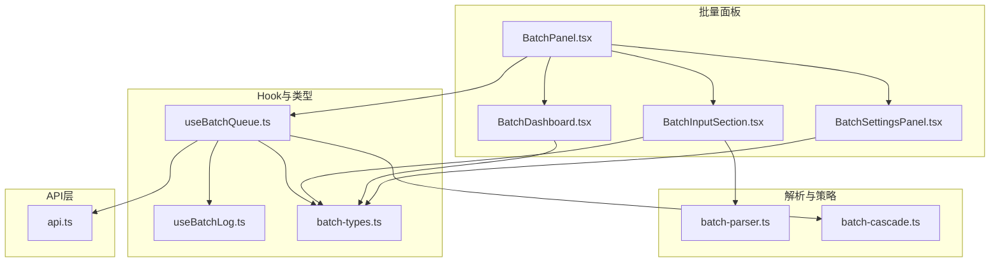
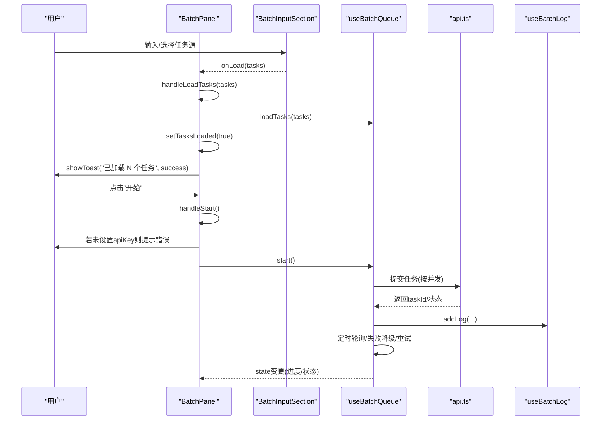
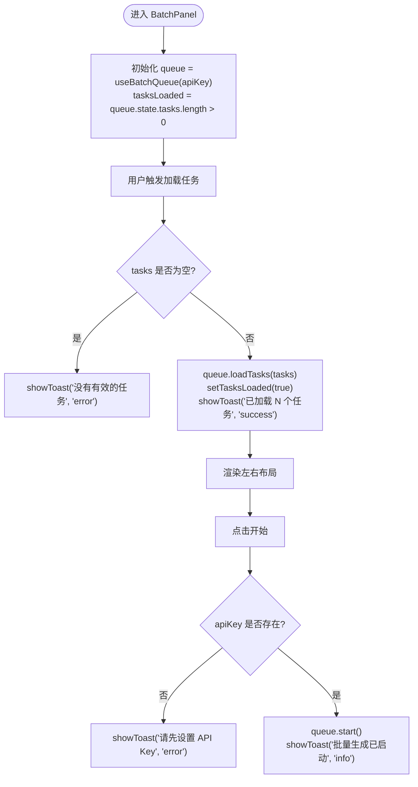
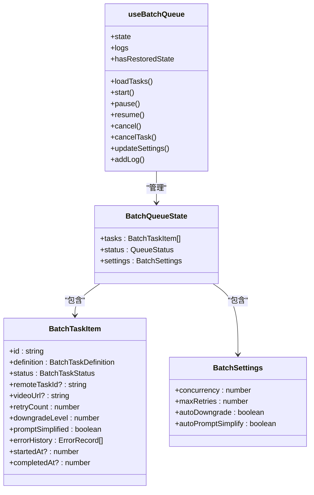
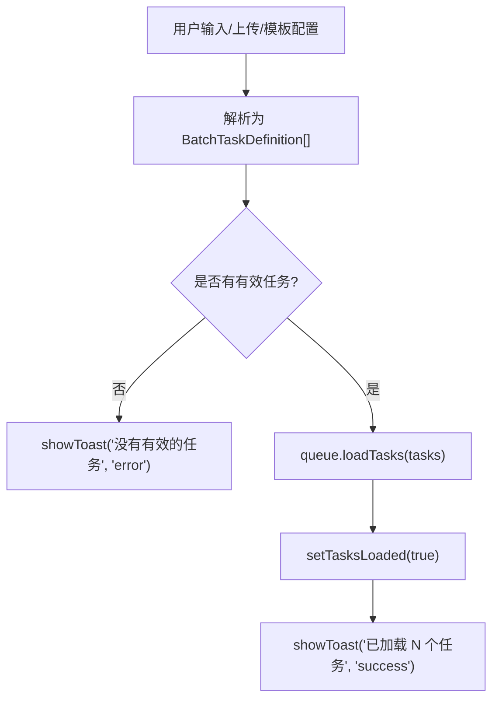
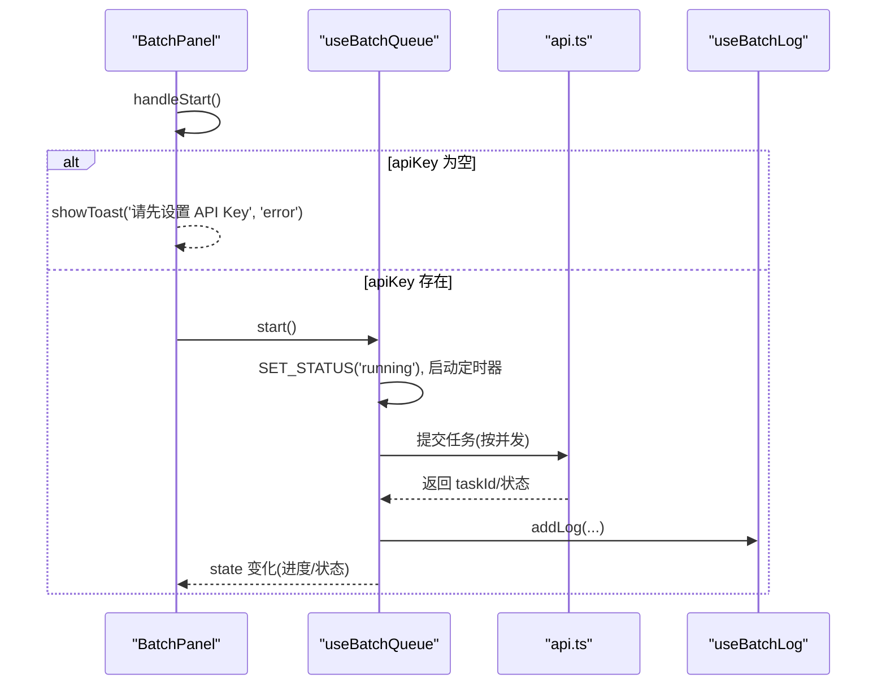
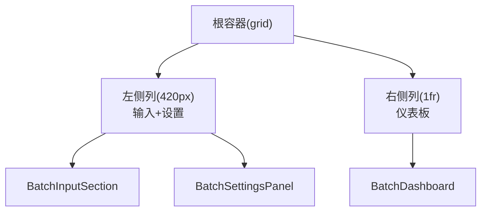
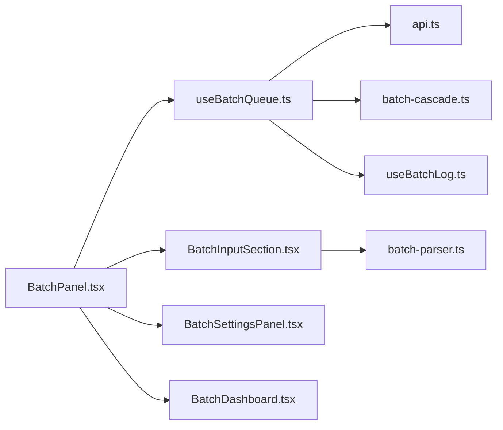

# BatchPanel主面板组件

<cite>
**本文引用的文件**
- [BatchPanel.tsx](file://src/components/batch/BatchPanel.tsx)
- [useBatchQueue.ts](file://src/hooks/useBatchQueue.ts)
- [batch-types.ts](file://src/lib/batch-types.ts)
- [BatchInputSection.tsx](file://src/components/batch/BatchInputSection.tsx)
- [BatchDashboard.tsx](file://src/components/batch/BatchDashboard.tsx)
- [BatchSettingsPanel.tsx](file://src/components/batch/BatchSettingsPanel.tsx)
- [MultiPromptInput.tsx](file://src/components/batch/MultiPromptInput.tsx)
- [batch-parser.ts](file://src/lib/batch-parser.ts)
- [api.ts](file://src/lib/api.ts)
- [batch-cascade.ts](file://src/lib/batch-cascade.ts)
- [useBatchLog.ts](file://src/hooks/useBatchLog.ts)
</cite>

## 目录
1. [简介](#简介)
2. [项目结构](#项目结构)
3. [核心组件与职责](#核心组件与职责)
4. [架构总览](#架构总览)
5. [详细组件分析](#详细组件分析)
6. [依赖关系分析](#依赖关系分析)
7. [性能与并发特性](#性能与并发特性)
8. [故障排查指南](#故障排查指南)
9. [结论](#结论)
10. [附录：扩展与自定义最佳实践](#附录扩展与自定义最佳实践)

## 简介
本文件围绕 BatchPanel 主面板组件，系统性说明其作为批量处理功能的核心容器职责、Props 接口设计、与 useBatchQueue Hook 的集成方式、任务加载流程 handleLoadTasks 的实现细节、启动任务处理函数 handleStart 的业务逻辑与 API Key 校验、响应式布局实现（左侧输入设置区与右侧仪表板区的网格布局），并提供组件扩展与自定义的最佳实践。

## 项目结构
BatchPanel 位于批量处理模块中，负责编排输入、设置与仪表板三大区域，并通过 useBatchQueue Hook 管理队列状态、任务执行、重试降级与日志记录。

图表来源
- [BatchPanel.tsx:1-58](file://src/components/batch/BatchPanel.tsx#L1-L58)
- [useBatchQueue.ts:1-322](file://src/hooks/useBatchQueue.ts#L1-L322)
- [batch-types.ts:1-123](file://src/lib/batch-types.ts#L1-L123)
- [BatchInputSection.tsx:1-55](file://src/components/batch/BatchInputSection.tsx#L1-L55)
- [BatchDashboard.tsx:1-89](file://src/components/batch/BatchDashboard.tsx#L1-L89)
- [BatchSettingsPanel.tsx:1-79](file://src/components/batch/BatchSettingsPanel.tsx#L1-L79)
- [MultiPromptInput.tsx:1-148](file://src/components/batch/MultiPromptInput.tsx#L1-L148)
- [batch-parser.ts:1-203](file://src/lib/batch-parser.ts#L1-L203)
- [api.ts:1-200](file://src/lib/api.ts#L1-L200)
- [batch-cascade.ts:1-101](file://src/lib/batch-cascade.ts#L1-L101)
- [useBatchLog.ts:1-39](file://src/hooks/useBatchLog.ts#L1-L39)

章节来源
- [BatchPanel.tsx:1-58](file://src/components/batch/BatchPanel.tsx#L1-L58)
- [useBatchQueue.ts:1-322](file://src/hooks/useBatchQueue.ts#L1-L322)
- [batch-types.ts:1-123](file://src/lib/batch-types.ts#L1-L123)

## 核心组件与职责
- BatchPanel：主面板容器，协调输入、设置与仪表板；提供 Props apiKey 和 showToast；维护 tasksLoaded 标志；封装 handleLoadTasks 与 handleStart。
- BatchInputSection：任务来源切换与输入入口（多行/文件/模板）。
- BatchSettingsPanel：并发数、最大重试次数、自动降级与自动简化 Prompt 的设置。
- BatchDashboard：进度条、控制按钮、任务列表、日志时间线与视频预览弹窗。
- useBatchQueue：基于 useReducer 的队列状态机，驱动提交、轮询、失败回退、持久化与日志。
- batch-parser：将多行文本、CSV/JSON 或模板组合展开为 BatchTaskDefinition[]。
- api：封装异步任务提交与查询。
- batch-cascade：失败后的降级与重试决策。
- useBatchLog：日志追加与清理，带本地持久化。

章节来源
- [BatchPanel.tsx:1-58](file://src/components/batch/BatchPanel.tsx#L1-L58)
- [BatchInputSection.tsx:1-55](file://src/components/batch/BatchInputSection.tsx#L1-L55)
- [BatchSettingsPanel.tsx:1-79](file://src/components/batch/BatchSettingsPanel.tsx#L1-L79)
- [BatchDashboard.tsx:1-89](file://src/components/batch/BatchDashboard.tsx#L1-L89)
- [useBatchQueue.ts:1-322](file://src/hooks/useBatchQueue.ts#L1-L322)
- [batch-parser.ts:1-203](file://src/lib/batch-parser.ts#L1-L203)
- [api.ts:1-200](file://src/lib/api.ts#L1-L200)
- [batch-cascade.ts:1-101](file://src/lib/batch-cascade.ts#L1-L101)
- [useBatchLog.ts:1-39](file://src/hooks/useBatchLog.ts#L1-L39)

## 架构总览
BatchPanel 通过 useBatchQueue 暴露 state/logs/actions，子组件仅消费状态并触发回调。数据流自上而下，事件自下而上。

图表来源
- [BatchPanel.tsx:13-34](file://src/components/batch/BatchPanel.tsx#L13-L34)
- [useBatchQueue.ts:98-185](file://src/hooks/useBatchQueue.ts#L98-L185)
- [api.ts:63-123](file://src/lib/api.ts#L63-L123)
- [useBatchLog.ts:12-30](file://src/hooks/useBatchLog.ts#L12-L30)

## 详细组件分析

### BatchPanel 主面板
- Props 接口
  - apiKey: string，用于调用后端 API 时携带鉴权信息。
  - showToast: (message, type) => void，由上层注入的 Toast 通知能力。
- 关键状态
  - tasksLoaded: boolean，用于控制仪表板是否显示空态占位。
- 核心方法
  - handleLoadTasks(tasks): 校验非空后调用 queue.loadTasks，置 tasksLoaded=true，并成功反馈。
  - handleStart(): 校验 apiKey 存在后调用 queue.start，并给出启动提示。
- 布局
  - 使用 CSS Grid 在桌面端采用固定宽度左列 + 自适应右列的布局；移动端单列堆叠。
  - 左侧：BatchInputSection 与 BatchSettingsPanel 垂直排列。
  - 右侧：BatchDashboard 展示进度、控制、任务列表与日志。

图表来源
- [BatchPanel.tsx:13-34](file://src/components/batch/BatchPanel.tsx#L13-L34)
- [BatchPanel.tsx:36-56](file://src/components/batch/BatchPanel.tsx#L36-L56)

章节来源
- [BatchPanel.tsx:8-11](file://src/components/batch/BatchPanel.tsx#L8-L11)
- [BatchPanel.tsx:13-34](file://src/components/batch/BatchPanel.tsx#L13-L34)
- [BatchPanel.tsx:36-56](file://src/components/batch/BatchPanel.tsx#L36-L56)

### useBatchQueue Hook 集成与状态管理
- 状态模型
  - BatchQueueState：包含 tasks、status、settings。
  - BatchTaskItem：单个任务的运行时数据，含定义、状态、重试计数、降级级别、错误历史等。
  - BatchSettings：并发数、最大重试次数、自动降级、自动简化 Prompt。
- 状态更新
  - 使用 useReducer 管理 LOAD_TASKS、SET_STATUS、UPDATE_SETTINGS、UPDATE_TASK、CANCEL_TASK、RESET 等动作。
- 生命周期与持久化
  - 初始状态优先从存储恢复；运行中状态在刷新前会阻止离开页面。
  - 状态变更节流保存至本地存储。
- 执行引擎
  - doTick 每 5s 扫描可提交与待轮询任务，受 concurrency 限制。
  - processTask 根据任务模式调用对应 API 提交；pollTask 轮询任务结果。
  - handleFailure 结合 cascade 策略进行重试、降级、简化 Prompt 或永久失败。
- 对外暴露
  - state、logs、hasRestoredState、loadTasks、start、pause、resume、cancel、cancelTask、updateSettings、addLog。

图表来源
- [batch-types.ts:52-67](file://src/lib/batch-types.ts#L52-L67)
- [batch-types.ts:31-44](file://src/lib/batch-types.ts#L31-L44)
- [useBatchQueue.ts:22-51](file://src/hooks/useBatchQueue.ts#L22-L51)
- [useBatchQueue.ts:318-321](file://src/hooks/useBatchQueue.ts#L318-L321)

章节来源
- [useBatchQueue.ts:1-322](file://src/hooks/useBatchQueue.ts#L1-L322)
- [batch-types.ts:1-123](file://src/lib/batch-types.ts#L1-L123)

### 任务加载流程 handleLoadTasks
- 输入来源
  - MultiPromptInput：多行文本解析为任务列表。
  - FileUploadInput：上传 CSV/JSON 解析。
  - TemplateInput：模板组合展开。
- 验证与反馈
  - 空任务集合直接提示错误。
  - 成功加载后更新 tasksLoaded 并提示数量。
- 解析器
  - parseMultiPrompt：按行拆分，填充默认 mode/resolution/duration。
  - parseUploadedFile：区分 JSON/CSV，逐行校验必填字段与枚举值。
  - expandTemplate：将模板中的分辨率与时长组合展开为多个任务。

图表来源
- [BatchPanel.tsx:17-25](file://src/components/batch/BatchPanel.tsx#L17-L25)
- [batch-parser.ts:9-26](file://src/lib/batch-parser.ts#L9-L26)
- [batch-parser.ts:31-70](file://src/lib/batch-parser.ts#L31-L70)
- [batch-parser.ts:72-125](file://src/lib/batch-parser.ts#L72-L125)
- [batch-parser.ts:182-202](file://src/lib/batch-parser.ts#L182-L202)

章节来源
- [BatchPanel.tsx:17-25](file://src/components/batch/BatchPanel.tsx#L17-L25)
- [MultiPromptInput.tsx:25-28](file://src/components/batch/MultiPromptInput.tsx#L25-L28)
- [batch-parser.ts:1-203](file://src/lib/batch-parser.ts#L1-L203)

### 启动任务处理函数 handleStart
- 业务逻辑
  - 校验 apiKey 存在性，缺失则提示错误。
  - 调用 queue.start 启动调度循环，并给出启动提示。
- 与队列交互
  - start 会设置 status=running，启动定时器，立即执行一次 doTick。

图表来源
- [BatchPanel.tsx:27-34](file://src/components/batch/BatchPanel.tsx#L27-L34)
- [useBatchQueue.ts:279-284](file://src/hooks/useBatchQueue.ts#L279-L284)
- [api.ts:63-123](file://src/lib/api.ts#L63-L123)
- [useBatchLog.ts:12-30](file://src/hooks/useBatchLog.ts#L12-L30)

章节来源
- [BatchPanel.tsx:27-34](file://src/components/batch/BatchPanel.tsx#L27-L34)
- [useBatchQueue.ts:279-284](file://src/hooks/useBatchQueue.ts#L279-L284)

### 响应式布局设计
- 布局策略
  - 使用 grid-cols-1 在移动端单列布局。
  - 使用 lg:grid-cols-[420px_1fr] 在大屏侧固定左侧 420px，右侧自适应。
  - gap-6 提供间距，整体容器内左右分区清晰。
- 区域划分
  - 左侧：BatchInputSection 与 BatchSettingsPanel 纵向排列，承载输入与参数设置。
  - 右侧：BatchDashboard 承载进度、控制、任务列表与日志。

图表来源
- [BatchPanel.tsx:36-56](file://src/components/batch/BatchPanel.tsx#L36-L56)

章节来源
- [BatchPanel.tsx:36-56](file://src/components/batch/BatchPanel.tsx#L36-L56)

## 依赖关系分析
- 组件耦合
  - BatchPanel 对 useBatchQueue 强依赖，对子组件弱依赖（仅通过 props 通信）。
  - Dashboard 仅消费 state/logs 与回调，无副作用。
- 外部依赖
  - api.ts 负责网络请求与错误映射。
  - batch-cascade.ts 决定失败后的降级/重试策略。
  - useBatchLog.ts 提供日志写入与持久化。
  - batch-parser.ts 提供任务定义构建。

图表来源
- [BatchPanel.tsx:1-58](file://src/components/batch/BatchPanel.tsx#L1-L58)
- [useBatchQueue.ts:1-322](file://src/hooks/useBatchQueue.ts#L1-L322)
- [BatchInputSection.tsx:1-55](file://src/components/batch/BatchInputSection.tsx#L1-L55)
- [BatchDashboard.tsx:1-89](file://src/components/batch/BatchDashboard.tsx#L1-L89)
- [BatchSettingsPanel.tsx:1-79](file://src/components/batch/BatchSettingsPanel.tsx#L1-L79)
- [batch-parser.ts:1-203](file://src/lib/batch-parser.ts#L1-L203)
- [api.ts:1-200](file://src/lib/api.ts#L1-L200)
- [batch-cascade.ts:1-101](file://src/lib/batch-cascade.ts#L1-L101)
- [useBatchLog.ts:1-39](file://src/hooks/useBatchLog.ts#L1-L39)

章节来源
- [BatchPanel.tsx:1-58](file://src/components/batch/BatchPanel.tsx#L1-L58)
- [useBatchQueue.ts:1-322](file://src/hooks/useBatchQueue.ts#L1-L322)

## 性能与并发特性
- 并发控制
  - 通过 settings.concurrency 限制同时提交的任务数，避免瞬时压力过大。
- 轮询间隔
  - 使用固定间隔轮询任务状态，降低服务端压力。
- 失败回退
  - 指数退避重试、参数降级与 Prompt 简化，提高成功率。
- 状态持久化
  - 状态与日志落盘，减少刷新丢失风险。

[本节为通用性能讨论，不直接分析具体文件]

## 故障排查指南
- 常见错误与定位
  - 未设置 API Key：handleStart 会提示错误，检查上层传入的 apiKey。
  - 任务为空：handleLoadTasks 会提示错误，检查输入解析是否正确。
  - 网络异常：processTask 捕获异常并记录日志，查看日志时间线定位。
  - 任务失败：handleFailure 记录错误历史，观察 cascade 决策路径。
- 日志与调试
  - 使用 addLog 输出关键节点信息，便于追踪任务生命周期。
  - 清空日志使用 clearLogs，配合浏览器控制台与网络面板交叉验证。

章节来源
- [BatchPanel.tsx:17-34](file://src/components/batch/BatchPanel.tsx#L17-L34)
- [useBatchQueue.ts:126-185](file://src/hooks/useBatchQueue.ts#L126-L185)
- [useBatchQueue.ts:187-264](file://src/hooks/useBatchQueue.ts#L187-L264)
- [useBatchLog.ts:12-35](file://src/hooks/useBatchLog.ts#L12-L35)

## 结论
BatchPanel 以简洁的 Props 与清晰的职责边界，将输入、设置与仪表板有机整合，并通过 useBatchQueue 实现了高可用的批量任务执行框架。其响应式布局与完善的错误处理、重试降级机制，使其具备良好的可扩展性与用户体验。

[本节为总结性内容，不直接分析具体文件]

## 附录：扩展与自定义最佳实践
- 新增任务来源
  - 在 BatchInputSection 中增加新的 sourceType 与对应输入组件，统一通过 onLoad(tasks) 回调上报 BatchTaskDefinition[]。
  - 在 batch-parser.ts 中补充解析逻辑，确保字段校验与错误报告一致。
- 扩展执行策略
  - 在 batch-cascade.ts 中增加新的降级或简化策略，并在 useBatchQueue.handleFailure 中接入。
- 增强 UI 能力
  - 在 BatchDashboard 中新增导出、筛选、排序等功能，保持只读状态消费与回调触发模式。
- 安全与鉴权
  - 确保 apiKey 仅在必要处传递，避免泄露；必要时在上层做敏感信息保护。
- 性能调优
  - 调整 concurrency 与轮询间隔，平衡吞吐与延迟；对大任务集考虑分页或分批加载。

[本节为概念性指导，不直接分析具体文件]