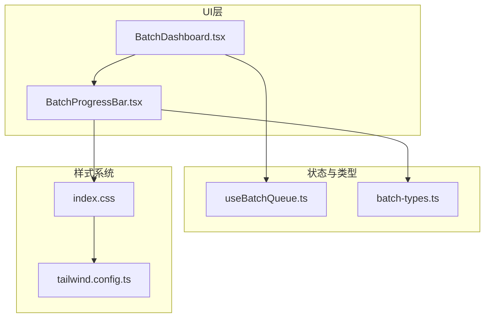
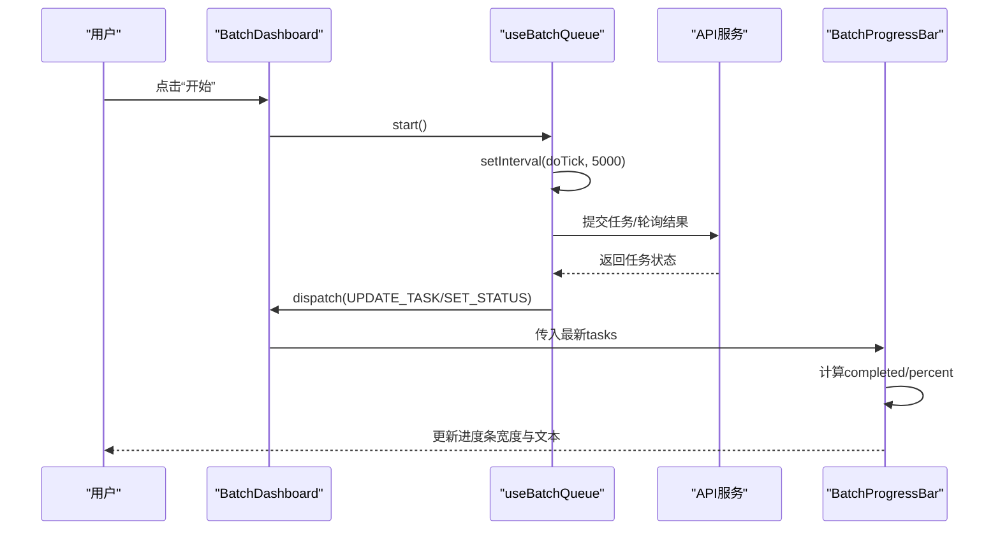
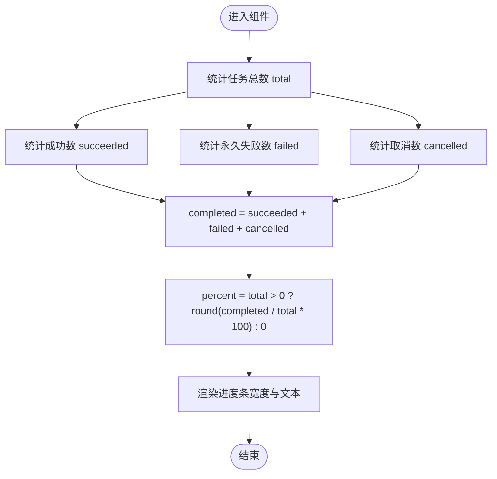
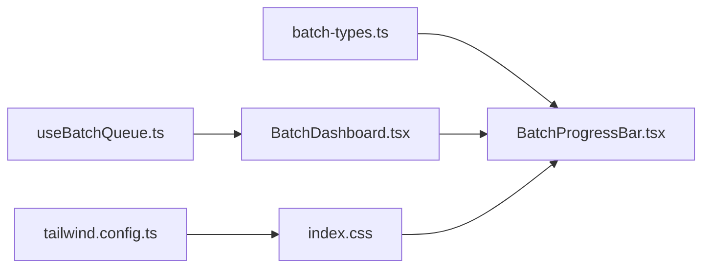

# BatchProgressBar进度条组件

<cite>
**本文引用的文件**
- [BatchProgressBar.tsx](file://src/components/batch/BatchProgressBar.tsx)
- [useBatchQueue.ts](file://src/hooks/useBatchQueue.ts)
- [batch-types.ts](file://src/lib/batch-types.ts)
- [BatchDashboard.tsx](file://src/components/batch/BatchDashboard.tsx)
- [index.css](file://src/index.css)
- [tailwind.config.ts](file://tailwind.config.ts)
</cite>

## 目录
1. [简介](#简介)
2. [项目结构](#项目结构)
3. [核心组件](#核心组件)
4. [架构总览](#架构总览)
5. [详细组件分析](#详细组件分析)
6. [依赖关系分析](#依赖关系分析)
7. [性能与可访问性](#性能与可访问性)
8. [故障排查指南](#故障排查指南)
9. [结论](#结论)
10. [附录：样式与主题配置](#附录样式与主题配置)

## 简介
本文件围绕 BatchProgressBar 进度条组件，系统化说明其动画效果、视觉设计、整体进度计算逻辑、分段进度实现思路、百分比动态更新机制、可访问性支持、自定义样式与主题配置方法，以及在不同尺寸设备上的响应式适配方案。同时提供性能优化建议（CSS 动画与 Canvas 渲染的选择策略），帮助开发者在现有代码基础上进行扩展与定制。

## 项目结构
BatchProgressBar 位于批量任务面板中，作为仪表板的一部分展示整体完成度。其数据来源于 useBatchQueue 维护的任务队列状态，并通过 Tailwind CSS 与全局样式类实现渐变与过渡动画。



图表来源
- [BatchDashboard.tsx:1-89](file://src/components/batch/BatchDashboard.tsx#L1-L89)
- [BatchProgressBar.tsx:1-36](file://src/components/batch/BatchProgressBar.tsx#L1-L36)
- [useBatchQueue.ts:1-322](file://src/hooks/useBatchQueue.ts#L1-L322)
- [batch-types.ts:1-123](file://src/lib/batch-types.ts#L1-L123)
- [index.css:66-110](file://src/index.css#L66-L110)
- [tailwind.config.ts:1-93](file://tailwind.config.ts#L1-L93)

章节来源
- [BatchDashboard.tsx:1-89](file://src/components/batch/BatchDashboard.tsx#L1-L89)
- [BatchProgressBar.tsx:1-36](file://src/components/batch/BatchProgressBar.tsx#L1-L36)
- [useBatchQueue.ts:1-322](file://src/hooks/useBatchQueue.ts#L1-L322)
- [batch-types.ts:1-123](file://src/lib/batch-types.ts#L1-L123)
- [index.css:66-110](file://src/index.css#L66-L110)
- [tailwind.config.ts:1-93](file://tailwind.config.ts#L1-L93)

## 核心组件
- BatchProgressBar：接收 tasks 数组，统计已完成/失败/取消数量，计算总体完成百分比，并以渐变进度条呈现。
- useBatchQueue：管理任务队列生命周期（提交、轮询、重试、降级、完成判定等），通过 reducer 驱动状态变化，并持久化状态。
- batch-types：定义任务项、任务状态、队列状态、设置等类型。
- index.css：定义 .gradient-primary 等工具类，用于进度条的渐变背景。
- tailwind.config.ts：配置颜色、圆角、动画关键帧等。

章节来源
- [BatchProgressBar.tsx:1-36](file://src/components/batch/BatchProgressBar.tsx#L1-L36)
- [useBatchQueue.ts:1-322](file://src/hooks/useBatchQueue.ts#L1-L322)
- [batch-types.ts:1-123](file://src/lib/batch-types.ts#L1-L123)
- [index.css:66-110](file://src/index.css#L66-L110)
- [tailwind.config.ts:1-93](file://tailwind.config.ts#L1-L93)

## 架构总览
BatchProgressBar 是纯展示型组件，不直接持有业务状态，而是由父级 BatchDashboard 传入 tasks。任务的增删改查与执行流程由 useBatchQueue 负责，最终通过 React 状态更新触发 UI 重渲染，从而驱动进度条百分比变化。



图表来源
- [BatchDashboard.tsx:1-89](file://src/components/batch/BatchDashboard.tsx#L1-L89)
- [useBatchQueue.ts:98-124](file://src/hooks/useBatchQueue.ts#L98-L124)
- [useBatchQueue.ts:126-185](file://src/hooks/useBatchQueue.ts#L126-L185)
- [BatchProgressBar.tsx:7-35](file://src/components/batch/BatchProgressBar.tsx#L7-L35)

## 详细组件分析

### 进度计算逻辑
- 已完成任务比例：基于任务状态为 succeeded、failed-permanent、cancelled 的数量之和除以任务总数，四舍五入得到百分比。
- 剩余任务估算：当前未包含显式的“预计剩余时间”算法；如需估算，可在 doTick 间隔内结合历史完成速率进行线性外推。



图表来源
- [BatchProgressBar.tsx:7-14](file://src/components/batch/BatchProgressBar.tsx#L7-L14)

章节来源
- [BatchProgressBar.tsx:7-14](file://src/components/batch/BatchProgressBar.tsx#L7-L14)

### 动画效果与视觉设计
- 渐变背景：使用 .gradient-primary 工具类，采用双色调渐变，提升视觉层次。
- 过渡动画：通过 transition-all duration-500 对宽度变化做平滑过渡，避免跳变。
- 容器样式：外层容器使用圆角与溢出隐藏，确保进度条两端圆角一致。

```mermaid
classDiagram
class BatchProgressBar {
+props : { tasks : BatchTaskItem[] }
+computed : { total, succeeded, failed, cancelled, completed, percent }
+render() : JSX
}
class Styles {
+".gradient-primary" : "渐变背景"
+".transition-all duration-500" : "宽度过渡动画"
}
BatchProgressBar --> Styles : "使用"
```

图表来源
- [BatchProgressBar.tsx:15-35](file://src/components/batch/BatchProgressBar.tsx#L15-L35)
- [index.css:66-70](file://src/index.css#L66-L70)

章节来源
- [BatchProgressBar.tsx:15-35](file://src/components/batch/BatchProgressBar.tsx#L15-L35)
- [index.css:66-70](file://src/index.css#L66-L70)

### 分段进度条的实现思路
当前实现为单段进度条，仅以统一渐变色表示整体完成度。若需分段显示不同区间（如排队、生成中、失败、取消）的含义与过渡动画，可采用以下两种方案：

- 多段叠加方案（推荐）：将进度条拆分为多个子段，分别对应 queued、submitting/polling、retrying、succeeded、failed-permanent、cancelled 的状态占比，每段使用不同颜色或渐变，并在状态切换时添加过渡动画。
- 分层叠加方案：在同一容器中按顺序绘制各段矩形，利用 overflow-hidden 与 border-radius 保持整体圆角一致性。

注意：
- 分段颜色语义应与任务状态标签保持一致，便于用户理解。
- 过渡动画建议使用 CSS transition 控制 width 与 opacity，避免频繁重排。

[本节为概念性说明，不涉及具体源码]

### 进度百分比的动态更新机制与防抖处理
- 动态更新：useBatchQueue 通过 reducer 更新任务状态，React 自动触发重新渲染，BatchProgressBar 根据最新 tasks 计算新的 percent 并更新 DOM。
- 防抖与节流：
  - 状态持久化已内置 1 秒延迟保存，避免频繁写入存储。
  - 任务调度使用固定间隔（约 5 秒）轮询，降低前端压力。
  - 建议在极端高频场景下对 percent 计算或日志输出增加防抖/节流，但当前实现已较为克制。

章节来源
- [useBatchQueue.ts:72-76](file://src/hooks/useBatchQueue.ts#L72-L76)
- [useBatchQueue.ts:279-284](file://src/hooks/useBatchQueue.ts#L279-L284)
- [useBatchQueue.ts:291-296](file://src/hooks/useBatchQueue.ts#L291-L296)
- [BatchProgressBar.tsx:7-14](file://src/components/batch/BatchProgressBar.tsx#L7-L14)

### 可访问性支持（ARIA 与屏幕阅读器）
当前组件未显式设置 ARIA 属性。建议补充：
- role="progressbar"
- aria-valuenow={percent}
- aria-valuemin={0}
- aria-valuemax={100}
- aria-label="批量任务进度"
- 可选 aria-describedby 指向描述文本元素

这些改动有助于屏幕阅读器正确播报进度值与含义。

[本节为通用建议，不涉及具体源码]

### 自定义样式与主题配置
- 主题色：通过 CSS 变量与 Tailwind 颜色映射统一管理，支持明暗模式切换。
- 进度条渐变：修改 .gradient-primary 的 HSL 值即可更换主色渐变。
- 圆角与阴影：通过 --radius 与 shadow-* 工具类调整外观。
- 动画时长与缓动：可通过 Tailwind 的 transition-* 与 animation-* 配置调整。

章节来源
- [index.css:6-53](file://src/index.css#L6-L53)
- [index.css:66-70](file://src/index.css#L66-L70)
- [tailwind.config.ts:10-62](file://tailwind.config.ts#L10-L62)
- [tailwind.config.ts:63-86](file://tailwind.config.ts#L63-L86)

### 响应式适配方案
- 容器宽度：外层容器使用 flex/grid 布局，随视口自适应。
- 字体与间距：使用 Tailwind 的 text-xs、gap-*、p-* 等工具类，在小屏设备上保持可读性与紧凑布局。
- 高度与圆角：h-2 与 rounded-full 保证小高度下的清晰表现与圆角一致性。

章节来源
- [BatchDashboard.tsx:45-75](file://src/components/batch/BatchDashboard.tsx#L45-L75)
- [BatchProgressBar.tsx:16-32](file://src/components/batch/BatchProgressBar.tsx#L16-L32)

## 依赖关系分析
- BatchProgressBar 依赖 batch-types 中的 BatchTaskItem 类型，用于统计与渲染。
- BatchDashboard 组合 BatchProgressBar 与 useBatchQueue，承担数据流编排。
- useBatchQueue 依赖 API 模块与批处理逻辑，驱动任务状态变更。
- 样式系统由 index.css 与 tailwind.config.ts 共同构成。



图表来源
- [batch-types.ts:1-123](file://src/lib/batch-types.ts#L1-L123)
- [BatchProgressBar.tsx:1-36](file://src/components/batch/BatchProgressBar.tsx#L1-L36)
- [useBatchQueue.ts:1-322](file://src/hooks/useBatchQueue.ts#L1-L322)
- [BatchDashboard.tsx:1-89](file://src/components/batch/BatchDashboard.tsx#L1-L89)
- [index.css:66-110](file://src/index.css#L66-L110)
- [tailwind.config.ts:1-93](file://tailwind.config.ts#L1-L93)

章节来源
- [batch-types.ts:1-123](file://src/lib/batch-types.ts#L1-L123)
- [BatchProgressBar.tsx:1-36](file://src/components/batch/BatchProgressBar.tsx#L1-L36)
- [useBatchQueue.ts:1-322](file://src/hooks/useBatchQueue.ts#L1-L322)
- [BatchDashboard.tsx:1-89](file://src/components/batch/BatchDashboard.tsx#L1-L89)
- [index.css:66-110](file://src/index.css#L66-L110)
- [tailwind.config.ts:1-93](file://tailwind.config.ts#L1-L93)

## 性能与可访问性

### 性能优化建议
- 优先使用 CSS 动画与过渡：当前实现已使用 transition-all duration-500，适合大多数场景，开销低且易于维护。
- 大数据量时的渲染优化：
  - 列表虚拟化：当任务数量较大时，考虑虚拟滚动以减少 DOM 节点。
  - 增量更新：仅在任务状态变化时更新相关行，避免整表重绘。
- Canvas 渲染选择：
  - 适用场景：需要极高频率更新的复杂可视化（如实时波形、大量分段进度）。
  - 不适用场景：简单进度条与少量分段，Canvas 反而引入额外复杂度与内存占用。
- 减少重排重绘：
  - 使用 transform 与 opacity 替代 layout 属性动画。
  - 合并多次状态更新，必要时使用 requestAnimationFrame 或节流。

[本节为通用指导，不涉及具体源码]

### 可访问性增强清单
- 为进度条容器添加 role="progressbar" 与 aria-* 属性。
- 为数字文本提供语义化标签，便于朗读。
- 确保对比度符合 WCAG 标准，尤其在暗色模式下。
- 键盘可达性：确保所有交互按钮具备焦点可见性与操作反馈。

[本节为通用建议，不涉及具体源码]

## 故障排查指南
- 进度不更新：
  - 检查 useBatchQueue 的 interval 是否被清理或重复创建。
  - 确认任务状态是否正确更新到 state.tasks。
- 进度异常为 0%：
  - 检查 tasks 是否为空或全部处于非完成状态。
  - 确认计算逻辑中 completed 的统计范围是否符合预期。
- 动画卡顿：
  - 检查是否存在大量同步 DOM 操作。
  - 评估是否需要改用 transform/opacity 动画或减少重排。

章节来源
- [useBatchQueue.ts:72-76](file://src/hooks/useBatchQueue.ts#L72-L76)
- [useBatchQueue.ts:279-284](file://src/hooks/useBatchQueue.ts#L279-L284)
- [BatchProgressBar.tsx:7-14](file://src/components/batch/BatchProgressBar.tsx#L7-L14)

## 结论
BatchProgressBar 是一个简洁高效的进度展示组件，依托 useBatchQueue 提供的任务状态与 Tailwind 样式系统，实现了平滑的渐变与过渡动画。当前实现聚焦于整体完成度展示，未来可按需扩展为分段进度条，并结合 ARIA 属性提升可访问性。在性能方面，建议优先使用 CSS 动画，仅在复杂可视化场景下考虑 Canvas 渲染。

[本节为总结性内容，不涉及具体源码]

## 附录：样式与主题配置
- 主题变量：在 :root 与 .dark 中定义 HSL 变量，统一明暗模式色彩。
- 工具类：
  - .gradient-primary：进度条主渐变。
  - .shadow-glow、.text-gradient、.border-gradient：辅助视觉效果。
- Tailwind 配置：
  - colors、borderRadius、keyframes、animation 等扩展项，便于全局复用。

章节来源
- [index.css:6-53](file://src/index.css#L6-L53)
- [index.css:66-110](file://src/index.css#L66-L110)
- [tailwind.config.ts:10-86](file://tailwind.config.ts#L10-L86)