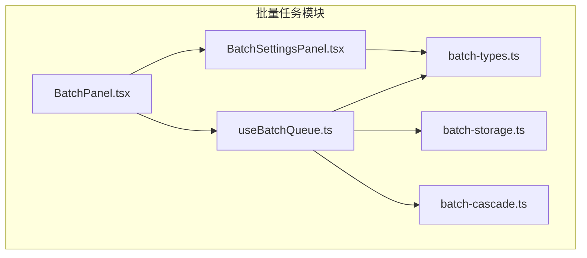
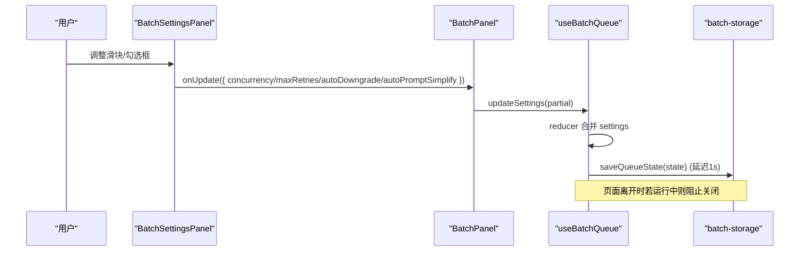
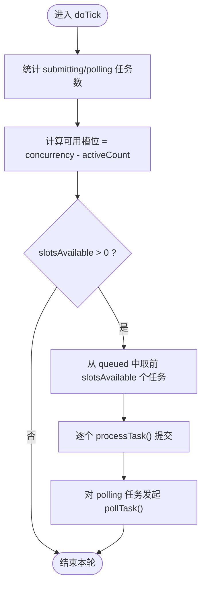
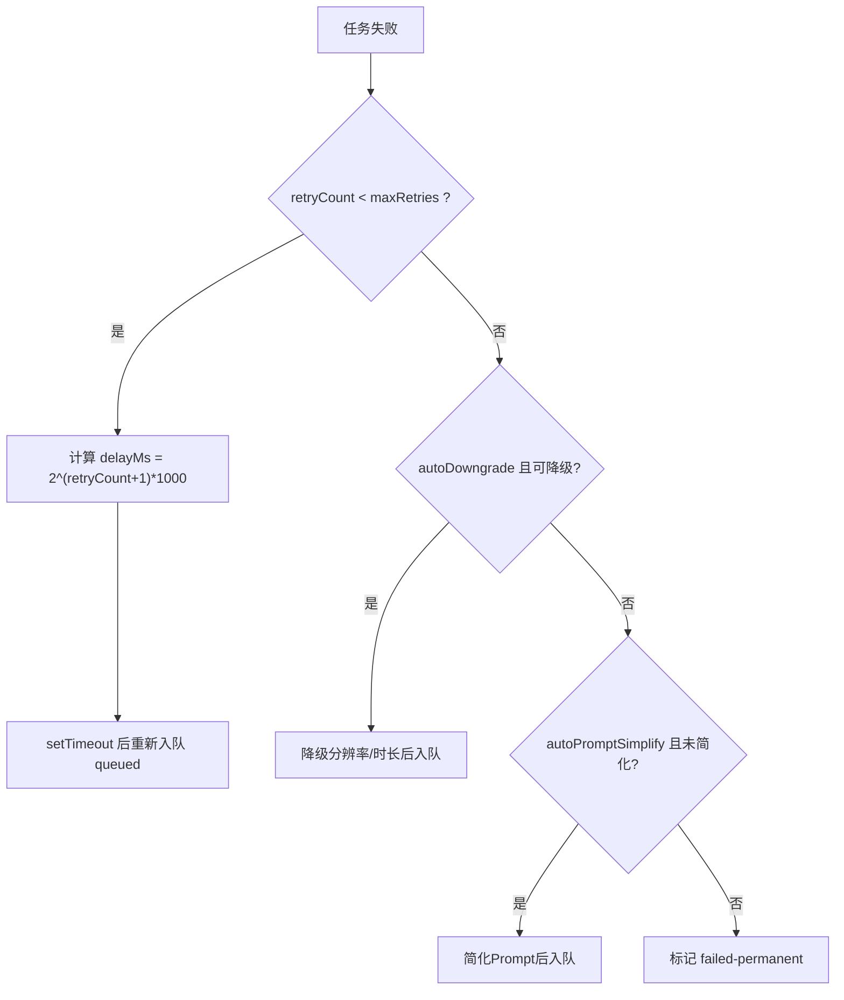
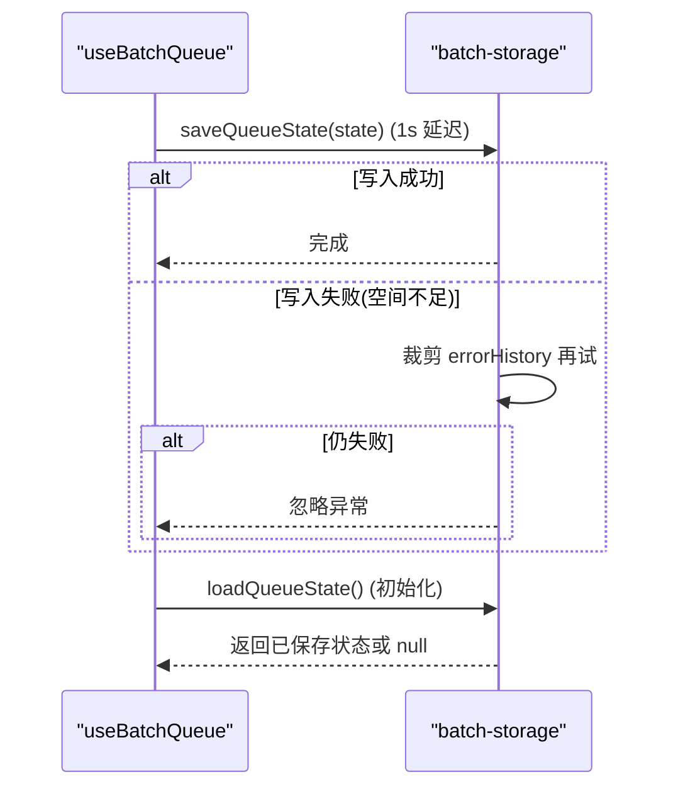
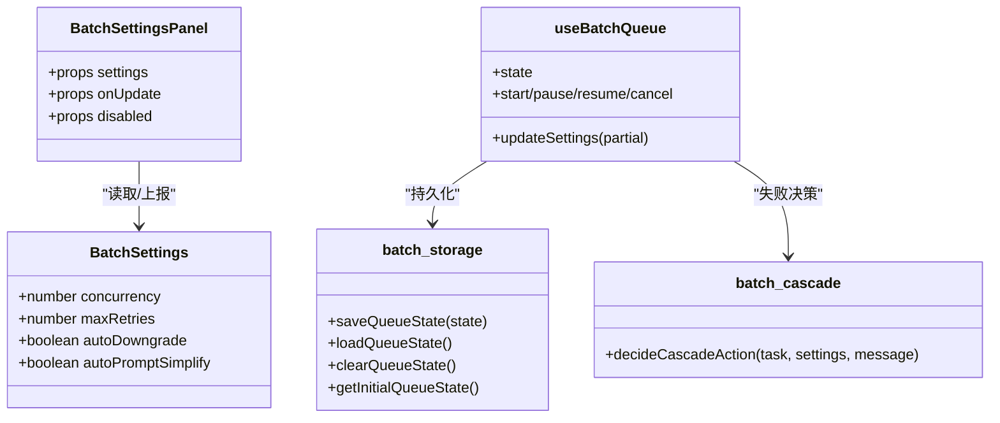

# BatchSettingsPanel设置面板组件

<cite>
**本文引用的文件**   
- [BatchSettingsPanel.tsx](file://src/components/batch/BatchSettingsPanel.tsx)
- [batch-types.ts](file://src/lib/batch-types.ts)
- [batch-storage.ts](file://src/lib/batch-storage.ts)
- [useBatchQueue.ts](file://src/hooks/useBatchQueue.ts)
- [batch-cascade.ts](file://src/lib/batch-cascade.ts)
- [BatchPanel.tsx](file://src/components/batch/BatchPanel.tsx)
</cite>

## 目录
1. [简介](#简介)
2. [项目结构](#项目结构)
3. [核心组件](#核心组件)
4. [架构总览](#架构总览)
5. [详细组件分析](#详细组件分析)
6. [依赖关系分析](#依赖关系分析)
7. [性能与并发控制](#性能与并发控制)
8. [故障排查指南](#故障排查指南)
9. [结论](#结论)
10. [附录：扩展与自定义配置项指南](#附录扩展与自定义配置项指南)

## 简介
本文件为 BatchSettingsPanel 设置面板组件的权威文档，聚焦以下方面：
- 配置项管理与数据绑定机制
- 表单验证与用户体验优化（含错误提示）
- 并发控制实现（最大并发数量调节器与规则）
- 重试策略配置界面设计（最大重试次数、重试间隔）
- 超时配置的表单实现与数据绑定说明
- 高级选项展开/收起交互设计与默认值管理
- 配置数据的持久化存储与本地缓存机制
- 配置模板导入导出功能实现说明
- 设置面板扩展方法与自定义配置项添加指南

## 项目结构
BatchSettingsPanel 位于批量任务模块中，作为左侧“执行设置”面板，负责将用户可编辑的配置项同步到全局队列状态。其父容器 BatchPanel 负责挂载该面板并传递状态更新回调。

图示来源
- [BatchPanel.tsx:1-58](file://src/components/batch/BatchPanel.tsx#L1-L58)
- [BatchSettingsPanel.tsx:1-79](file://src/components/batch/BatchSettingsPanel.tsx#L1-L79)
- [useBatchQueue.ts:1-322](file://src/hooks/useBatchQueue.ts#L1-L322)
- [batch-types.ts:1-123](file://src/lib/batch-types.ts#L1-L123)
- [batch-storage.ts:1-89](file://src/lib/batch-storage.ts#L1-L89)
- [batch-cascade.ts:1-101](file://src/lib/batch-cascade.ts#L1-L101)

章节来源
- [BatchPanel.tsx:1-58](file://src/components/batch/BatchPanel.tsx#L1-L58)
- [BatchSettingsPanel.tsx:1-79](file://src/components/batch/BatchSettingsPanel.tsx#L1-L79)

## 核心组件
- BatchSettingsPanel：纯展示型设置面板，提供并发数、最大重试次数、自动降级参数、自动简化Prompt等开关与滑块控件，通过 onUpdate 回调向父级上报变更。
- useBatchQueue：集中式状态管理 Hook，维护队列状态、设置、日志、任务生命周期，并提供 updateSettings 方法供面板调用。
- batch-types：定义 BatchSettings 类型与默认值 DEFAULT_BATCH_SETTINGS。
- batch-storage：负责队列状态与日志的持久化（localStorage），以及初始状态构造。
- batch-cascade：失败后的级联决策（重试、降级、简化Prompt、永久失败）。

章节来源
- [BatchSettingsPanel.tsx:1-79](file://src/components/batch/BatchSettingsPanel.tsx#L1-L79)
- [useBatchQueue.ts:1-322](file://src/hooks/useBatchQueue.ts#L1-L322)
- [batch-types.ts:1-123](file://src/lib/batch-types.ts#L1-L123)
- [batch-storage.ts:1-89](file://src/lib/batch-storage.ts#L1-L89)
- [batch-cascade.ts:1-101](file://src/lib/batch-cascade.ts#L1-L101)

## 架构总览
设置面板的数据流采用单向数据流：
- 父组件持有真实状态（useBatchQueue 返回 state.settings）
- 子组件仅渲染当前 settings，并通过 onUpdate 上报变更
- 父组件使用 updateSettings 合并变更到全局状态
- 状态变化触发持久化保存（延迟防抖）

图示来源
- [BatchSettingsPanel.tsx:10-76](file://src/components/batch/BatchSettingsPanel.tsx#L10-L76)
- [BatchPanel.tsx:36-57](file://src/components/batch/BatchPanel.tsx#L36-L57)
- [useBatchQueue.ts:71-81](file://src/hooks/useBatchQueue.ts#L71-L81)
- [useBatchQueue.ts:314-316](file://src/hooks/useBatchQueue.ts#L314-L316)
- [batch-storage.ts:7-27](file://src/lib/batch-storage.ts#L7-L27)

## 详细组件分析

### 组件接口与职责
- 输入属性
  - settings：当前执行设置（只读）
  - onUpdate：接收 Partial<BatchSettings> 的回调，用于局部更新
  - disabled：是否禁用所有控件（当队列处于运行态时禁用）
- 输出行为
  - 不直接修改状态，仅通过 onUpdate 上报变更
  - 根据 disabled 控制交互可用性

章节来源
- [BatchSettingsPanel.tsx:4-8](file://src/components/batch/BatchSettingsPanel.tsx#L4-L8)
- [BatchPanel.tsx:40-41](file://src/components/batch/BatchPanel.tsx#L40-L41)

### 配置项清单与默认值
- 并发数 concurrency：范围 1-5，默认 2
- 最大重试次数 maxRetries：默认 3
- 自动降级参数 autoDowngrade：默认 true
- 自动简化Prompt autoPromptSimplify：默认 true

章节来源
- [batch-types.ts:62-67](file://src/lib/batch-types.ts#L62-L67)
- [batch-types.ts:112-117](file://src/lib/batch-types.ts#L112-L117)

### 并发控制设置（最大并发数量调节器与验证规则）
- UI 实现：使用 range 滑块，最小值 1，最大值 5，实时显示当前值
- 数据绑定：onChange 将 Number(e.target.value) 通过 onUpdate 上报
- 验证规则：由 HTML 原生 min/max 约束；运行时在 doTick 中基于 settings.concurrency 计算可用槽位
- 生效时机：doTick 每 5 秒轮询一次，按当前 active 任务数与 concurrency 决定入队提交数量

图示来源
- [useBatchQueue.ts:98-124](file://src/hooks/useBatchQueue.ts#L98-L124)
- [useBatchQueue.ts:279-284](file://src/hooks/useBatchQueue.ts#L279-L284)

章节来源
- [BatchSettingsPanel.tsx:18-36](file://src/components/batch/BatchSettingsPanel.tsx#L18-L36)
- [useBatchQueue.ts:98-124](file://src/hooks/useBatchQueue.ts#L98-L124)

### 重试策略配置界面（最大重试次数与重试间隔）
- 界面元素：range 滑块控制 maxRetries，范围 1-5
- 默认值：DEFAULT_BATCH_SETTINGS.maxRetries = 3
- 重试间隔：采用指数退避策略，delayMs = 2^(retryCount+1) * 1000（即 2s、4s、8s...）
- 决策逻辑：decideCascadeAction 依据 retryCount 与 settings.maxRetries 决定是否继续重试

图示来源
- [batch-cascade.ts:19-56](file://src/lib/batch-cascade.ts#L19-L56)
- [useBatchQueue.ts:187-264](file://src/hooks/useBatchQueue.ts#L187-L264)

章节来源
- [BatchSettingsPanel.tsx:38-52](file://src/components/batch/BatchSettingsPanel.tsx#L38-L52)
- [batch-types.ts:112-117](file://src/lib/batch-types.ts#L112-L117)
- [batch-cascade.ts:19-56](file://src/lib/batch-cascade.ts#L19-L56)
- [useBatchQueue.ts:187-264](file://src/hooks/useBatchQueue.ts#L187-L264)

### 超时配置的表单实现与数据绑定
- 现状：当前 BatchSettings 与 UI 未暴露“超时”相关字段或控件
- 建议方案（概念性）：
  - 在 BatchSettings 新增 timeoutSeconds 字段
  - 在面板增加数字输入控件，绑定 onChange -> onUpdate
  - 在 processTask 或 pollTask 中引入 AbortController 或请求超时封装，达到取消长时间挂起请求的目的
- 注意：本节为扩展建议，非现有实现

[本节为概念性说明，不涉及具体源码]

### 高级选项的展开/收起交互设计与默认值管理
- 现状：当前面板未提供“高级选项”分组与展开/收起交互
- 建议方案（概念性）：
  - 新增 collapsible 区域，默认收起，包含更多高级参数（如超时、网络重试策略、代理等）
  - 使用受控状态控制展开/收起
  - 默认值统一取自 DEFAULT_BATCH_SETTINGS 或独立的高级默认对象
- 注意：本节为概念性说明，不涉及具体源码

[本节为概念性说明，不涉及具体源码]

### 配置数据的持久化存储与本地缓存机制
- 持久化键名：
  - 队列状态：'batch_queue_state'
  - 日志条目：'batch_log_entries'
- 写入策略：
  - 状态变更通过 useEffect + setTimeout 延迟 1s 写入 localStorage，避免频繁 IO
  - 写入失败时尝试裁剪 errorHistory 后再写，仍失败则放弃
- 读取策略：
  - 初始化时 loadQueueState 恢复 tasks/status/settings
  - getInitialQueueState 提供空状态与默认 settings
- 清理策略：
  - clearQueueState 同时移除队列状态与日志
  - registerBeforeUnload 在页面离开时若正在运行则阻止关闭

图示来源
- [useBatchQueue.ts:71-81](file://src/hooks/useBatchQueue.ts#L71-L81)
- [batch-storage.ts:7-27](file://src/lib/batch-storage.ts#L7-L27)
- [batch-storage.ts:29-41](file://src/lib/batch-storage.ts#L29-L41)
- [batch-storage.ts:70-77](file://src/lib/batch-storage.ts#L70-L77)
- [batch-storage.ts:79-88](file://src/lib/batch-storage.ts#L79-L88)

章节来源
- [batch-storage.ts:1-89](file://src/lib/batch-storage.ts#L1-L89)
- [useBatchQueue.ts:71-81](file://src/hooks/useBatchQueue.ts#L71-L81)

### 配置模板的导入导出功能实现
- 现状：当前未提供“配置模板”的导入/导出入口
- 建议方案（概念性）：
  - 导出：序列化 DEFAULT_BATCH_SETTINGS 与用户覆盖值，生成 JSON 文件下载
  - 导入：解析上传的 JSON，校验字段类型与取值范围，合并到当前 settings
  - 与现有持久化一致，支持一键重置为默认值
- 注意：本节为概念性说明，不涉及具体源码

[本节为概念性说明，不涉及具体源码]

### 配置验证规则与错误提示的用户体验优化
- 现状：
  - 并发数与最大重试次数通过 HTML range 的 min/max 进行基础限制
  - 未实现额外的前端校验与错误提示
- 建议方案（概念性）：
  - 在 onUpdate 之前增加校验函数，检查数值范围、布尔值合法性
  - 对非法输入给出即时反馈（如红色边框、提示文案）
  - 对关键操作（如开始运行）进行前置校验（例如 API Key 存在性已在父组件处理）
- 注意：本节为概念性说明，不涉及具体源码

[本节为概念性说明，不涉及具体源码]

## 依赖关系分析
- 组件层
  - BatchSettingsPanel 依赖 batch-types 中的 BatchSettings 类型
  - BatchPanel 组合 BatchSettingsPanel 并注入 updateSettings
- 状态层
  - useBatchQueue 维护 BatchQueueState，包含 settings
  - 通过 reducer 的 UPDATE_SETTINGS 动作合并 settings
- 持久化层
  - batch-storage 提供 save/load/clear 能力
- 容错层
  - batch-cascade 提供失败后的降级/简化/重试决策

图示来源
- [batch-types.ts:62-67](file://src/lib/batch-types.ts#L62-L67)
- [BatchSettingsPanel.tsx:10-76](file://src/components/batch/BatchSettingsPanel.tsx#L10-L76)
- [useBatchQueue.ts:22-51](file://src/hooks/useBatchQueue.ts#L22-L51)
- [batch-storage.ts:1-89](file://src/lib/batch-storage.ts#L1-L89)
- [batch-cascade.ts:1-101](file://src/lib/batch-cascade.ts#L1-L101)

章节来源
- [BatchPanel.tsx:1-58](file://src/components/batch/BatchPanel.tsx#L1-L58)
- [useBatchQueue.ts:1-322](file://src/hooks/useBatchQueue.ts#L1-L322)
- [batch-types.ts:1-123](file://src/lib/batch-types.ts#L1-L123)
- [batch-storage.ts:1-89](file://src/lib/batch-storage.ts#L1-L89)
- [batch-cascade.ts:1-101](file://src/lib/batch-cascade.ts#L1-L101)

## 性能与并发控制
- 并发控制
  - 通过 settings.concurrency 限制同时提交的任务数
  - doTick 每 5 秒扫描一次，动态计算可用槽位并调度任务
- 重试与退避
  - 指数退避减少瞬时压力，避免雪崩
- 持久化节流
  - 状态变更延迟 1s 写入，降低 I/O 频率
- 建议
  - 可在高并发场景下考虑将 doTick 间隔缩短至 2-3 秒以提升吞吐
  - 可对重试间隔增加上限，防止极端情况下等待过久

[本节为通用性能讨论，不涉及具体源码]

## 故障排查指南
- 常见问题
  - 设置未生效：确认父组件是否正确传入 onUpdate 并在运行态禁用面板
  - 持久化丢失：检查浏览器 localStorage 容量与权限
  - 任务无法重试：检查 decideCascadeAction 的决策路径与 maxRetries 设置
- 定位手段
  - 查看日志：useBatchLog 记录提交、轮询、失败、重试等事件
  - 观察状态：BatchDashboard 展示任务状态与进度
  - 断点调试：在 reducer 的 UPDATE_SETTINGS 分支打断点，确认 settings 合并结果

章节来源
- [useBatchQueue.ts:187-264](file://src/hooks/useBatchQueue.ts#L187-L264)
- [batch-storage.ts:29-41](file://src/lib/batch-storage.ts#L29-L41)

## 结论
BatchSettingsPanel 以简洁的受控表单形式呈现执行设置，配合 useBatchQueue 的状态管理与 batch-storage 的持久化，实现了可靠的并发控制与重试策略。当前版本未内置超时配置、高级选项折叠、模板导入导出与显式校验提示，但这些均可在不破坏现有架构的前提下平滑扩展。

[本节为总结性内容，不涉及具体源码]

## 附录：扩展与自定义配置项指南
- 新增配置项步骤
  1. 在 batch-types.ts 的 BatchSettings 中添加新字段与默认值
  2. 在 BatchSettingsPanel 中新增对应控件，绑定 onChange -> onUpdate
  3. 在 useBatchQueue 的 reducer 中确保 UPDATE_SETTINGS 能正确合并新字段
  4. 如需影响运行逻辑，在 doTick/processTask/pollTask 等处消费新字段
  5. 如需持久化，无需额外改动（reducer 合并后会被 saveQueueState 保存）
- 示例参考路径
  - 类型与默认值：[batch-types.ts:62-67](file://src/lib/batch-types.ts#L62-L67)、[batch-types.ts:112-117](file://src/lib/batch-types.ts#L112-L117)
  - 面板控件与数据绑定：[BatchSettingsPanel.tsx:18-75](file://src/components/batch/BatchSettingsPanel.tsx#L18-L75)
  - 状态更新入口：[useBatchQueue.ts:314-316](file://src/hooks/useBatchQueue.ts#L314-L316)
  - 持久化写入：[batch-storage.ts:7-27](file://src/lib/batch-storage.ts#L7-L27)

章节来源
- [batch-types.ts:62-67](file://src/lib/batch-types.ts#L62-L67)
- [batch-types.ts:112-117](file://src/lib/batch-types.ts#L112-L117)
- [BatchSettingsPanel.tsx:18-75](file://src/components/batch/BatchSettingsPanel.tsx#L18-L75)
- [useBatchQueue.ts:314-316](file://src/hooks/useBatchQueue.ts#L314-L316)
- [batch-storage.ts:7-27](file://src/lib/batch-storage.ts#L7-L27)