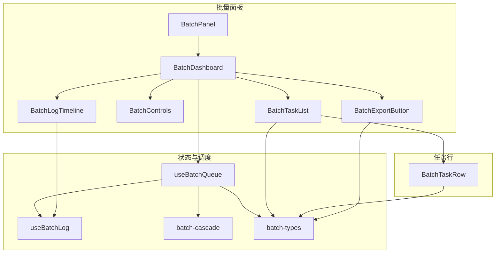
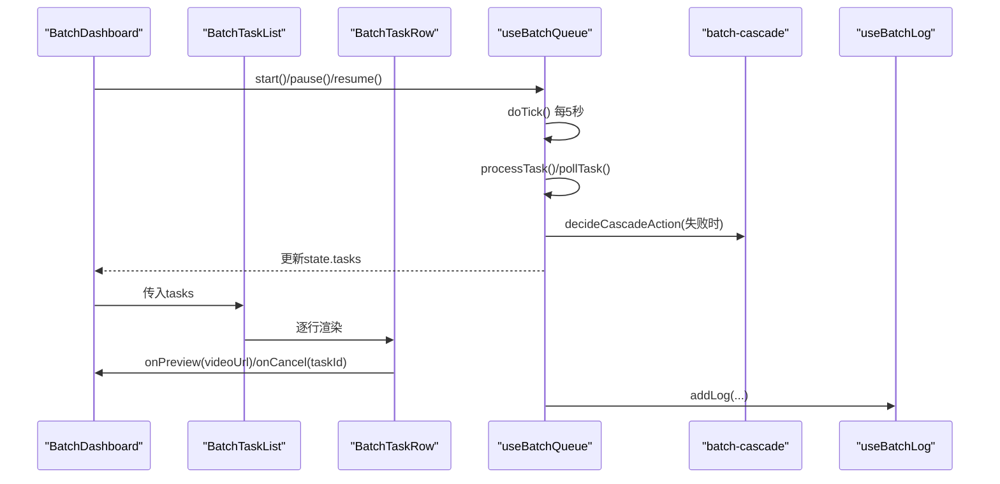
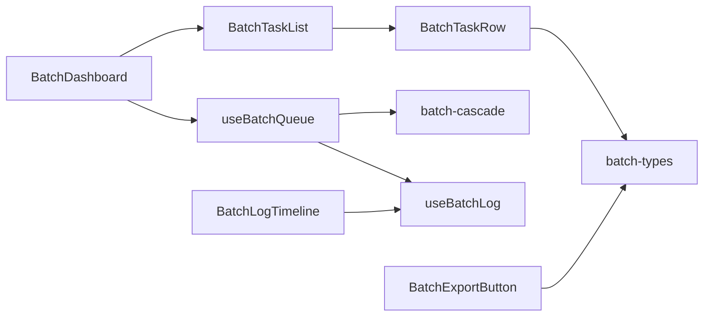
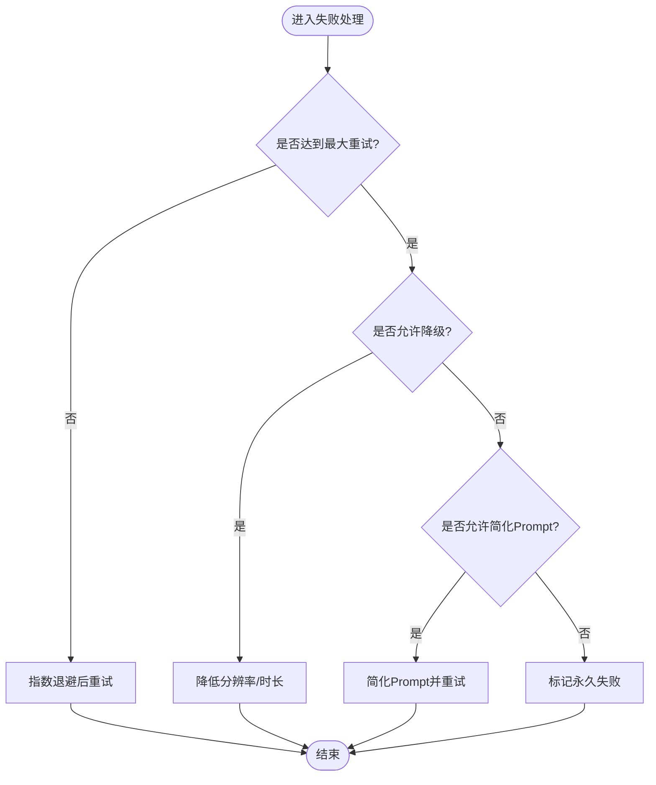

# BatchTaskList任务列表组件

<cite>
**本文引用的文件**
- [BatchTaskList.tsx](file://src/components/batch/BatchTaskList.tsx)
- [BatchTaskRow.tsx](file://src/components/batch/BatchTaskRow.tsx)
- [batch-types.ts](file://src/lib/batch-types.ts)
- [useBatchQueue.ts](file://src/hooks/useBatchQueue.ts)
- [BatchDashboard.tsx](file://src/components/batch/BatchDashboard.tsx)
- [BatchControls.tsx](file://src/components/batch/BatchControls.tsx)
- [BatchExportButton.tsx](file://src/components/batch/BatchExportButton.tsx)
- [BatchLogTimeline.tsx](file://src/components/batch/BatchLogTimeline.tsx)
- [useBatchLog.ts](file://src/hooks/useBatchLog.ts)
- [batch-cascade.ts](file://src/lib/batch-cascade.ts)
</cite>

## 目录
1. [简介](#简介)
2. [项目结构](#项目结构)
3. [核心组件](#核心组件)
4. [架构总览](#架构总览)
5. [详细组件分析](#详细组件分析)
6. [依赖关系分析](#依赖关系分析)
7. [性能考量与优化](#性能考量与优化)
8. [故障排查指南](#故障排查指南)
9. [结论](#结论)
10. [附录](#附录)

## 简介
本文件围绕 BatchTaskList 任务列表组件，系统性梳理其数据渲染逻辑、状态视觉设计、单行交互（预览/下载/取消）、排序筛选能力现状与扩展点、分页与虚拟滚动方案建议、搜索过滤算法实现思路、导出功能以及大数据量场景下的性能调优策略。文档同时覆盖与队列调度、错误降级、日志记录等周边模块的集成方式，帮助读者快速理解并高效使用或二次开发该组件。

## 项目结构
与 BatchTaskList 相关的代码主要位于 src/components/batch 与 src/hooks、src/lib 下：
- 组件层：BatchTaskList、BatchTaskRow、BatchDashboard、BatchControls、BatchExportButton、BatchLogTimeline
- 类型与工具：batch-types、batch-cascade
- 钩子与持久化：useBatchQueue、useBatchLog



图表来源
- [BatchDashboard.tsx:1-89](file://src/components/batch/BatchDashboard.tsx#L1-L89)
- [BatchTaskList.tsx:1-27](file://src/components/batch/BatchTaskList.tsx#L1-L27)
- [BatchTaskRow.tsx:1-80](file://src/components/batch/BatchTaskRow.tsx#L1-L80)
- [useBatchQueue.ts:1-322](file://src/hooks/useBatchQueue.ts#L1-L322)
- [useBatchLog.ts:1-39](file://src/hooks/useBatchLog.ts#L1-L39)
- [batch-cascade.ts:1-101](file://src/lib/batch-cascade.ts#L1-L101)
- [batch-types.ts:1-123](file://src/lib/batch-types.ts#L1-L123)

章节来源
- [BatchDashboard.tsx:1-89](file://src/components/batch/BatchDashboard.tsx#L1-L89)
- [BatchTaskList.tsx:1-27](file://src/components/batch/BatchTaskList.tsx#L1-L27)
- [BatchTaskRow.tsx:1-80](file://src/components/batch/BatchTaskRow.tsx#L1-L80)
- [batch-types.ts:1-123](file://src/lib/batch-types.ts#L1-L123)

## 核心组件
- BatchTaskList：负责将任务数组渲染为可滚动的列表容器，并在空态时展示“暂无任务”。
- BatchTaskRow：单行任务卡片，展示序号、提示词摘要、分辨率/时长、重试次数、降级标记、状态标签，以及成功时的预览/下载按钮和可取消操作。
- useBatchQueue：集中管理任务队列状态、提交/轮询/失败处理、并发控制、暂停/恢复/重置、状态持久化与日志注入。
- batch-cascade：失败后的级联容错决策（重试、参数降级、Prompt简化、永久失败）。
- BatchExportButton：将当前任务结果导出为 JSON。
- BatchLogTimeline：最近日志滚动视图。

章节来源
- [BatchTaskList.tsx:1-27](file://src/components/batch/BatchTaskList.tsx#L1-L27)
- [BatchTaskRow.tsx:1-80](file://src/components/batch/BatchTaskRow.tsx#L1-L80)
- [useBatchQueue.ts:1-322](file://src/hooks/useBatchQueue.ts#L1-L322)
- [batch-cascade.ts:1-101](file://src/lib/batch-cascade.ts#L1-L101)
- [BatchExportButton.tsx:1-41](file://src/components/batch/BatchExportButton.tsx#L1-L41)
- [BatchLogTimeline.tsx:1-46](file://src/components/batch/BatchLogTimeline.tsx#L1-L46)

## 架构总览
BatchTaskList 作为纯展示组件，由上层 Dashboard 传入 tasks 与回调；实际的任务生命周期由 useBatchQueue 驱动，通过 reducer 更新 state.tasks，从而触发 React 重渲染。



图表来源
- [useBatchQueue.ts:98-185](file://src/hooks/useBatchQueue.ts#L98-L185)
- [batch-cascade.ts:19-56](file://src/lib/batch-cascade.ts#L19-L56)
- [BatchDashboard.tsx:45-89](file://src/components/batch/BatchDashboard.tsx#L45-L89)
- [BatchTaskList.tsx:19-26](file://src/components/batch/BatchTaskList.tsx#L19-L26)
- [BatchTaskRow.tsx:21-79](file://src/components/batch/BatchTaskRow.tsx#L21-L79)
- [useBatchLog.ts:12-30](file://src/hooks/useBatchLog.ts#L12-L30)

## 详细组件分析

### BatchTaskList 任务列表
- 职责：接收 tasks 数组，按顺序渲染每个任务的 BatchTaskRow；当 tasks 为空时显示占位文案。
- 数据流：由父组件（BatchDashboard）从 useBatchQueue.state.tasks 获取，随队列推进自动更新。
- 交互：无直接交互，仅透传 onCancelTask 与 onPreview 给行内操作。

章节来源
- [BatchTaskList.tsx:1-27](file://src/components/batch/BatchTaskList.tsx#L1-L27)
- [BatchDashboard.tsx:77-80](file://src/components/batch/BatchDashboard.tsx#L77-L80)

### BatchTaskRow 单行任务
- 信息展示：
  - 序号：基于 index+1 的单调递增编号。
  - 任务摘要：prompt 文本截断显示。
  - 元信息：resolution、duration、retryCount、downgradeLevel。
  - 状态标签：根据 status 映射到不同文案与样式类。
- 交互能力：
  - 预览：当任务成功且有 videoUrl 时，点击播放图标触发 onPreview。
  - 下载：成功且存在 videoUrl 时提供下载链接。
  - 取消：当任务处于 queued 或 retrying 时可取消。
- 视觉设计（颜色编码与图标）：
  - 排队：中性灰背景 + 灰色文字
  - 提交中/生成中：主色背景 + 主色文字
  - 重试中：黄色系背景 + 黄色文字
  - 完成：绿色系背景 + 绿色文字
  - 失败：破坏性色背景 + 破坏性文字
  - 已取消：中性灰背景 + 灰色文字
  - 图标：Play（预览）、Download（下载）、X（取消）

```mermaid
classDiagram
class BatchTaskRow {
+task : BatchTaskItem
+index : number
+onCancel(taskId) : void
+onPreview(videoUrl) : void
}
class BatchTaskItem {
+id : string
+definition : BatchTaskDefinition
+status : BatchTaskStatus
+remoteTaskId? : string
+videoUrl? : string
+retryCount : number
+downgradeLevel : number
+promptSimplified : boolean
+errorHistory : ErrorRecord[]
+startedAt? : number
+completedAt? : number
}
class BatchTaskDefinition {
+id : string
+mode : VideoMode
+prompt : string
+resolution : "480p"|"720p"|"1080p"
+duration : number
+imageUrl? : string
+videoUrl? : string
+refImageUrl? : string
}
class BatchTaskStatus {
<<enum>>
"queued"
"submitting"
"polling"
"retrying"
"succeeded"
"failed-permanent"
"cancelled"
}
BatchTaskRow --> BatchTaskItem : "读取"
BatchTaskItem --> BatchTaskDefinition : "包含"
BatchTaskItem --> BatchTaskStatus : "枚举"
```

图表来源
- [BatchTaskRow.tsx:1-80](file://src/components/batch/BatchTaskRow.tsx#L1-L80)
- [batch-types.ts:10-44](file://src/lib/batch-types.ts#L10-L44)
- [batch-types.ts:22-29](file://src/lib/batch-types.ts#L22-L29)

章节来源
- [BatchTaskRow.tsx:1-80](file://src/components/batch/BatchTaskRow.tsx#L1-L80)
- [batch-types.ts:10-44](file://src/lib/batch-types.ts#L10-L44)

### 任务状态与视觉映射
- 状态枚举定义见 batch-types.ts。
- 行内状态标签映射在 BatchTaskRow 中维护，采用“文案 + 样式类”的组合，便于统一主题与无障碍对比度。

章节来源
- [batch-types.ts:22-29](file://src/lib/batch-types.ts#L22-L29)
- [BatchTaskRow.tsx:11-19](file://src/components/batch/BatchTaskRow.tsx#L11-L19)

### 任务详情展开
- 当前实现未内置“详情展开”区域。如需扩展，可在 BatchTaskRow 内部增加折叠面板，展示 errorHistory、startedAt/completedAt、远程任务ID等字段，并通过本地状态控制展开/收起。

[本节为概念性扩展建议，不直接分析具体文件]

### 手动重试与删除
- 手动重试：当前未提供显式“重试”按钮。可通过在 BatchTaskRow 增加“重试”入口，调用 useBatchQueue 暴露的重试方法（需新增 hook 方法），或将任务重新置回 queued 并清空 remoteTaskId。
- 删除：当前未提供“删除”入口。可在 BatchTaskRow 增加“删除”，调用 hook 移除对应 task（需新增 hook 方法）。

[本节为概念性扩展建议，不直接分析具体文件]

### 排序与筛选
- 当前实现未内置排序与筛选。建议在 BatchDashboard 层引入本地状态（如 sortKey、sortDir、filterStatus、keyword），对 tasks 进行内存级排序/过滤后再传给 BatchTaskList。
- 推荐维度：
  - 状态：按状态分组或优先级排序（如 succeeded > failed-permanent > cancelled > polling > submitting > queued > retrying）
  - 时间：按 startedAt/completedAt 升/降序
  - 优先级：若后续引入 priority 字段，可按数值排序
  - 关键词：匹配 prompt 片段（大小写不敏感）

[本节为概念性扩展建议，不直接分析具体文件]

### 分页加载与虚拟滚动
- 当前实现为全量渲染，受限于容器最大高度 max-h-[280px] 与 overflow-y-auto 做局部滚动。
- 大数据量优化建议：
  - 虚拟滚动：使用 react-window 或 @tanstack/react-virtual 仅渲染可视区行，显著降低 DOM 节点数量。
  - 分页加载：结合后端游标或前端分片，按需加载下一页。
  - 骨架屏与懒加载：首屏只渲染前 N 条，其余按需加载。
  - 稳定 key：确保使用唯一稳定的 id（当前已使用 task.id）。

[本节为概念性扩展建议，不直接分析具体文件]

### 搜索与过滤算法
- 建议在前端维护 keyword 状态，对 tasks 执行简单字符串包含匹配（忽略大小写、去除多余空白），并结合 filterStatus 组合条件。
- 性能要点：
  - 防抖输入（如 200ms）减少频繁计算。
  - 将过滤结果缓存，避免重复计算。
  - 大数据量下优先使用虚拟滚动配合过滤。

[本节为概念性扩展建议，不直接分析具体文件]

### 自定义列配置与导出
- 自定义列：可在 BatchTaskRow 外层包裹一个列可见性开关（例如勾选要显示的列），根据配置动态渲染字段。
- 导出：已有 BatchExportButton，将任务结果序列化为 JSON 并触发浏览器下载。

章节来源
- [BatchExportButton.tsx:1-41](file://src/components/batch/BatchExportButton.tsx#L1-L41)

## 依赖关系分析
- BatchTaskList 依赖：
  - 类型：BatchTaskItem
  - 子组件：BatchTaskRow
- BatchTaskRow 依赖：
  - 类型：BatchTaskItem、BatchTaskStatus
  - 图标库：lucide-react
- 状态与调度：
  - useBatchQueue 通过 reducer 管理 tasks、status、settings，并提供 start/pause/resume/cancel/cancelTask/updateSettings 等方法。
  - 失败路径通过 batch-cascade 决定下一步动作（重试/降级/简化Prompt/永久失败）。
  - 日志通过 useBatchLog 追加，限制最大条目数并持久化。



图表来源
- [BatchTaskList.tsx:1-27](file://src/components/batch/BatchTaskList.tsx#L1-L27)
- [BatchTaskRow.tsx:1-80](file://src/components/batch/BatchTaskRow.tsx#L1-L80)
- [BatchDashboard.tsx:1-89](file://src/components/batch/BatchDashboard.tsx#L1-L89)
- [useBatchQueue.ts:1-322](file://src/hooks/useBatchQueue.ts#L1-L322)
- [batch-cascade.ts:1-101](file://src/lib/batch-cascade.ts#L1-L101)
- [useBatchLog.ts:1-39](file://src/hooks/useBatchLog.ts#L1-L39)
- [BatchExportButton.tsx:1-41](file://src/components/batch/BatchExportButton.tsx#L1-L41)
- [BatchLogTimeline.tsx:1-46](file://src/components/batch/BatchLogTimeline.tsx#L1-L46)

章节来源
- [useBatchQueue.ts:22-51](file://src/hooks/useBatchQueue.ts#L22-L51)
- [useBatchQueue.ts:98-185](file://src/hooks/useBatchQueue.ts#L98-L185)
- [batch-cascade.ts:19-56](file://src/lib/batch-cascade.ts#L19-L56)
- [useBatchLog.ts:12-30](file://src/hooks/useBatchLog.ts#L12-L30)

## 性能考量与优化
- 渲染层面
  - 使用唯一稳定的 key（当前已使用 task.id）。
  - 大数据量场景建议引入虚拟滚动，仅渲染可视区行。
  - 对长文本 prompt 进行截断显示，避免布局抖动。
- 状态更新频率
  - 队列 tick 间隔为 5 秒，避免过于频繁的轮询。
  - 日志写入做了上限裁剪（最多保留最近若干条），防止日志无限增长。
- 网络与并发
  - 通过 settings.concurrency 控制并发提交数量，避免压垮服务端。
  - 失败后指数退避重试，降低瞬时压力。
- 存储与持久化
  - 队列状态与日志有持久化机制，刷新后可恢复，提升用户体验。
- 建议
  - 为列表添加骨架屏与占位符，提升感知性能。
  - 对导出功能增加进度反馈与大文件分块导出（可选）。

章节来源
- [useBatchQueue.ts:279-284](file://src/hooks/useBatchQueue.ts#L279-L284)
- [useBatchQueue.ts:25-51](file://src/hooks/useBatchQueue.ts#L25-L51)
- [useBatchLog.ts:5-29](file://src/hooks/useBatchLog.ts#L5-L29)
- [batch-types.ts:62-67](file://src/lib/batch-types.ts#L62-L67)

## 故障排查指南
- 常见问题定位
  - 任务无法开始：检查 API Key 是否设置，确认 hasTask 为真。
  - 任务一直“提交中/生成中”：查看实时日志，确认远端任务是否返回 taskId 与状态。
  - 频繁失败：观察失败原因与降级策略是否生效（分辨率/时长/Prompt 简化）。
  - 列表卡顿：考虑启用虚拟滚动或分页加载。
- 相关流程参考
  - 提交与轮询流程：processTask -> pollTask -> 状态更新
  - 失败处理流程：handleFailure -> decideCascadeAction -> 重试/降级/简化/永久失败



图表来源
- [useBatchQueue.ts:187-264](file://src/hooks/useBatchQueue.ts#L187-L264)
- [batch-cascade.ts:19-56](file://src/lib/batch-cascade.ts#L19-L56)

章节来源
- [useBatchQueue.ts:187-264](file://src/hooks/useBatchQueue.ts#L187-L264)
- [batch-cascade.ts:19-56](file://src/lib/batch-cascade.ts#L19-L56)

## 结论
BatchTaskList 与其子组件 BatchTaskRow 提供了清晰的任务列表展示与基础交互（预览/下载/取消），并与 useBatchQueue 的队列调度、失败降级、日志记录紧密协作。当前版本未内置排序、筛选、搜索、分页与虚拟滚动，但具备良好的扩展点。建议在 Dashboard 层补充这些能力，并在大数据量场景下引入虚拟滚动以提升性能。导出功能已可用，满足基本复盘需求。

## 附录
- 关键类型说明（节选）
  - BatchTaskItem：任务运行时数据，含定义、状态、重试次数、降级级别、错误历史、时间戳等。
  - BatchTaskStatus：任务状态枚举，用于 UI 状态标签映射。
  - BatchSettings：并发、最大重试、自动降级、自动简化 Prompt 等全局设置。
  - ExportResultItem：导出结果的字段结构。

章节来源
- [batch-types.ts:32-44](file://src/lib/batch-types.ts#L32-L44)
- [batch-types.ts:22-29](file://src/lib/batch-types.ts#L22-L29)
- [batch-types.ts:62-67](file://src/lib/batch-types.ts#L62-L67)
- [batch-types.ts:99-109](file://src/lib/batch-types.ts#L99-L109)