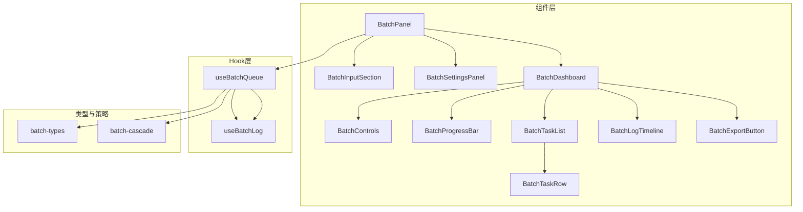
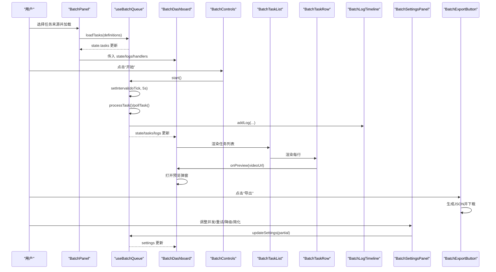
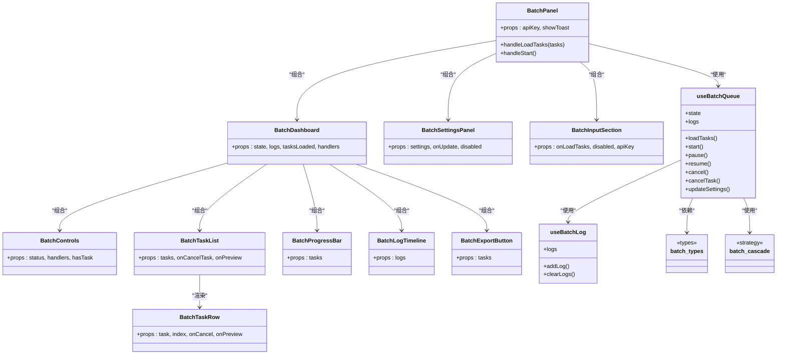

# 批量处理UI组件

<cite>
**本文引用的文件**   
- [BatchPanel.tsx](file://src/components/batch/BatchPanel.tsx)
- [BatchDashboard.tsx](file://src/components/batch/BatchDashboard.tsx)
- [BatchControls.tsx](file://src/components/batch/BatchControls.tsx)
- [BatchTaskList.tsx](file://src/components/batch/BatchTaskList.tsx)
- [BatchTaskRow.tsx](file://src/components/batch/BatchTaskRow.tsx)
- [BatchProgressBar.tsx](file://src/components/batch/BatchProgressBar.tsx)
- [BatchLogTimeline.tsx](file://src/components/batch/BatchLogTimeline.tsx)
- [BatchSettingsPanel.tsx](file://src/components/batch/BatchSettingsPanel.tsx)
- [BatchInputSection.tsx](file://src/components/batch/BatchInputSection.tsx)
- [BatchExportButton.tsx](file://src/components/batch/BatchExportButton.tsx)
- [useBatchQueue.ts](file://src/hooks/useBatchQueue.ts)
- [useBatchLog.ts](file://src/hooks/useBatchLog.ts)
- [batch-types.ts](file://src/lib/batch-types.ts)
- [batch-cascade.ts](file://src/lib/batch-cascade.ts)
</cite>

## 目录
1. [简介](#简介)
2. [项目结构](#项目结构)
3. [核心组件](#核心组件)
4. [架构总览](#架构总览)
5. [详细组件分析](#详细组件分析)
6. [依赖关系分析](#依赖关系分析)
7. [性能与体验优化](#性能与体验优化)
8. [故障排查指南](#故障排查指南)
9. [结论](#结论)
10. [附录：最佳实践与扩展指南](#附录最佳实践与扩展指南)

## 简介
本文件面向“批量处理”功能的前端 UI 组件体系，系统性梳理 BatchPanel 主面板、BatchDashboard 仪表板、BatchControls 控制面板、BatchTaskList 任务列表、BatchProgressBar 进度条、BatchLogTimeline 日志时间线、BatchSettingsPanel 设置面板等组件的架构设计、状态绑定、事件处理与数据流。文档同时覆盖队列调度 Hook（useBatchQueue）、日志 Hook（useBatchLog）以及容错降级策略（batch-cascade），并提供可视化图示、常见问题定位方法与扩展建议，帮助开发者快速理解并二次开发。

## 项目结构
批量处理相关代码集中在 src/components/batch 与 src/hooks、src/lib 下，采用“组件 + Hook + 类型/策略”的分层组织方式：
- 组件层：负责渲染与用户交互
- Hook 层：封装队列调度、日志记录、持久化等逻辑
- 类型与策略层：定义数据结构、默认值与容错降级算法

图表来源
- [BatchPanel.tsx:1-58](file://src/components/batch/BatchPanel.tsx#L1-L58)
- [BatchDashboard.tsx:1-89](file://src/components/batch/BatchDashboard.tsx#L1-L89)
- [BatchControls.tsx:1-50](file://src/components/batch/BatchControls.tsx#L1-L50)
- [BatchTaskList.tsx:1-27](file://src/components/batch/BatchTaskList.tsx#L1-L27)
- [BatchTaskRow.tsx:1-80](file://src/components/batch/BatchTaskRow.tsx#L1-L80)
- [BatchProgressBar.tsx:1-36](file://src/components/batch/BatchProgressBar.tsx#L1-L36)
- [BatchLogTimeline.tsx:1-47](file://src/components/batch/BatchLogTimeline.tsx#L1-L47)
- [BatchSettingsPanel.tsx:1-79](file://src/components/batch/BatchSettingsPanel.tsx#L1-L79)
- [BatchInputSection.tsx:1-55](file://src/components/batch/BatchInputSection.tsx#L1-L55)
- [BatchExportButton.tsx:1-41](file://src/components/batch/BatchExportButton.tsx#L1-L41)
- [useBatchQueue.ts:1-322](file://src/hooks/useBatchQueue.ts#L1-L322)
- [useBatchLog.ts:1-39](file://src/hooks/useBatchLog.ts#L1-L39)
- [batch-types.ts:1-123](file://src/lib/batch-types.ts#L1-L123)
- [batch-cascade.ts:1-101](file://src/lib/batch-cascade.ts#L1-L101)

章节来源
- [BatchPanel.tsx:1-58](file://src/components/batch/BatchPanel.tsx#L1-L58)
- [BatchDashboard.tsx:1-89](file://src/components/batch/BatchDashboard.tsx#L1-L89)
- [useBatchQueue.ts:1-322](file://src/hooks/useBatchQueue.ts#L1-L322)
- [batch-types.ts:1-123](file://src/lib/batch-types.ts#L1-L123)

## 核心组件
本节概述各组件职责与协作关系，重点说明状态来源、事件流向与关键交互。

- BatchPanel 主面板
  - 职责：组合输入区、设置区与右侧仪表板；桥接 useBatchQueue 提供的状态与方法；提供加载任务与启动批处理的入口。
  - 状态绑定：通过 useBatchQueue 获取 state、logs，并将 loadTasks/start/pause/resume/cancel/cancelTask/updateSettings 等方法透传给子组件。
  - 事件处理：校验 API Key 后调用 queue.start()；将解析后的任务定义转换为运行时任务项并载入队列。

- BatchDashboard 仪表板
  - 职责：展示进度、控制按钮、任务列表与实时日志；提供视频预览弹窗。
  - 状态绑定：接收 state.status、tasks、logs 等；根据 tasksLoaded 与 tasks.length 决定空态占位。
  - 事件处理：转发开始/暂停/恢复/取消到父级方法；导出结果；触发预览。

- BatchControls 控制面板
  - 职责：根据队列状态动态显示“开始/暂停/恢复/重置/取消全部”等操作按钮。
  - 交互：按钮禁用条件由 hasTask 与 status 共同决定。

- BatchTaskList 任务列表
  - 职责：遍历任务数组渲染行；为空时显示提示。
  - 数据渲染：将每个任务交由 BatchTaskRow 渲染，传递取消与预览回调。

- BatchTaskRow 任务行
  - 职责：展示任务序号、提示词、分辨率/时长、重试次数、降级标记、状态标签；成功时提供预览与下载；可取消排队或重试中的任务。
  - 状态映射：使用状态枚举到文本与样式的映射表。

- BatchProgressBar 进度条
  - 职责：计算完成数、失败数、取消数与百分比；以渐变动画条展示整体进度。
  - 样式：基于 CSS 过渡实现平滑宽度变化。

- BatchLogTimeline 日志时间线
  - 职责：仅展示最近若干条日志；自动滚动到底部；按级别着色。
  - 过滤：当前实现为固定截取末尾若干条，未提供高级过滤。

- BatchSettingsPanel 设置面板
  - 配置项：并发数（滑块）、最大重试次数（滑块）、自动降级开关、自动简化 Prompt 开关。
  - 交互：变更时调用 onUpdate 合并到全局 settings。

- BatchInputSection 任务输入区
  - 模式切换：多行输入、文件上传、模板组合三种来源。
  - 输出：统一产出 BatchTaskDefinition[] 并通过 onLoadTasks 回传。

- BatchExportButton 导出按钮
  - 行为：将任务结果序列化为 JSON 并触发浏览器下载。

章节来源
- [BatchPanel.tsx:1-58](file://src/components/batch/BatchPanel.tsx#L1-L58)
- [BatchDashboard.tsx:1-89](file://src/components/batch/BatchDashboard.tsx#L1-L89)
- [BatchControls.tsx:1-50](file://src/components/batch/BatchControls.tsx#L1-L50)
- [BatchTaskList.tsx:1-27](file://src/components/batch/BatchTaskList.tsx#L1-L27)
- [BatchTaskRow.tsx:1-80](file://src/components/batch/BatchTaskRow.tsx#L1-L80)
- [BatchProgressBar.tsx:1-36](file://src/components/batch/BatchProgressBar.tsx#L1-L36)
- [BatchLogTimeline.tsx:1-47](file://src/components/batch/BatchLogTimeline.tsx#L1-L47)
- [BatchSettingsPanel.tsx:1-79](file://src/components/batch/BatchSettingsPanel.tsx#L1-L79)
- [BatchInputSection.tsx:1-55](file://src/components/batch/BatchInputSection.tsx#L1-L55)
- [BatchExportButton.tsx:1-41](file://src/components/batch/BatchExportButton.tsx#L1-L41)

## 架构总览
整体采用“受控状态 + 事件回调”的单向数据流：
- 状态中心：useBatchQueue 维护队列状态（任务、状态机、设置），并通过 reducer 更新。
- 视图层：BatchPanel 作为容器，将状态与方法分发给 Dashboard、Settings、Input 等子组件。
- 执行引擎：doTick 定时轮询，依据并发槽位提交任务、轮询远程任务状态，并在失败时走 cascade 策略。
- 日志系统：useBatchLog 集中管理日志条目，支持持久化与清理。

图表来源
- [BatchPanel.tsx:1-58](file://src/components/batch/BatchPanel.tsx#L1-L58)
- [BatchDashboard.tsx:1-89](file://src/components/batch/BatchDashboard.tsx#L1-L89)
- [BatchControls.tsx:1-50](file://src/components/batch/BatchControls.tsx#L1-L50)
- [BatchTaskList.tsx:1-27](file://src/components/batch/BatchTaskList.tsx#L1-L27)
- [BatchTaskRow.tsx:1-80](file://src/components/batch/BatchTaskRow.tsx#L1-L80)
- [BatchLogTimeline.tsx:1-47](file://src/components/batch/BatchLogTimeline.tsx#L1-L47)
- [BatchSettingsPanel.tsx:1-79](file://src/components/batch/BatchSettingsPanel.tsx#L1-L79)
- [BatchExportButton.tsx:1-41](file://src/components/batch/BatchExportButton.tsx#L1-L41)
- [useBatchQueue.ts:1-322](file://src/hooks/useBatchQueue.ts#L1-L322)
- [useBatchLog.ts:1-39](file://src/hooks/useBatchLog.ts#L1-L39)

## 详细组件分析

### BatchPanel 主面板
- 组件层次
  - 左侧：BatchInputSection（任务来源）+ BatchSettingsPanel（执行设置）
  - 右侧：BatchDashboard（进度/控制/列表/日志）
- 状态绑定
  - 通过 useBatchQueue(apiKey) 获取 state、logs 及操作方法。
  - 本地 tasksLoaded 用于区分首次加载与后续刷新。
- 事件处理
  - handleLoadTasks：校验非空 -> queue.loadTasks -> 提示成功。
  - handleStart：校验 apiKey -> queue.start -> 提示已启动。
- 注意事项
  - 运行中禁用输入与设置更新，避免状态不一致。

章节来源
- [BatchPanel.tsx:1-58](file://src/components/batch/BatchPanel.tsx#L1-L58)
- [useBatchQueue.ts:1-322](file://src/hooks/useBatchQueue.ts#L1-L322)

### BatchDashboard 仪表板
- 功能组织
  - 顶部：BatchProgressBar + BatchControls + BatchExportButton
  - 中部：BatchTaskList（可滚动区域）
  - 底部：BatchLogTimeline
- 状态与交互
  - 当 tasksLoaded 为 false 且无任务时，显示空态占位。
  - 支持视频预览弹窗，关闭遮罩或右上角按钮即可退出。
- 数据流
  - 所有操作均通过 props 回调向上委托给 BatchPanel/useBatchQueue。

章节来源
- [BatchDashboard.tsx:1-89](file://src/components/batch/BatchDashboard.tsx#L1-L89)

### BatchControls 控制面板
- 状态驱动按钮
  - idle：显示“开始”，需有任务才可用
  - running：显示“暂停”、“取消全部”
  - paused：显示“恢复”
  - completed：显示“重置”
- 交互语义
  - 取消全部会清空队列与日志，回到初始状态。

章节来源
- [BatchControls.tsx:1-50](file://src/components/batch/BatchControls.tsx#L1-L50)

### BatchTaskList 与 BatchTaskRow 任务列表
- 渲染逻辑
  - 空列表提示；否则逐行渲染。
- 行内信息
  - 序号、提示词、分辨率/时长、重试次数、降级标记、状态标签。
- 行操作
  - 成功：预览与下载
  - 排队/重试中：可取消单任务
- 状态映射
  - 使用映射表将状态码转为文案与样式类名。

章节来源
- [BatchTaskList.tsx:1-27](file://src/components/batch/BatchTaskList.tsx#L1-L27)
- [BatchTaskRow.tsx:1-80](file://src/components/batch/BatchTaskRow.tsx#L1-L80)

### BatchProgressBar 进度条
- 统计维度
  - 总数、已完成（成功/失败/取消）、百分比
- 动画与样式
  - 使用 CSS transition-all 平滑过渡宽度变化；背景渐变主题色。

章节来源
- [BatchProgressBar.tsx:1-36](file://src/components/batch/BatchProgressBar.tsx#L1-L36)

### BatchLogTimeline 日志时间线
- 实时滚动
  - 监听 logs 变化，自动滚动到底部。
- 显示策略
  - 仅展示最近若干条日志，避免长列表性能问题。
- 级别着色
  - info/warn/error/success 对应不同颜色。

章节来源
- [BatchLogTimeline.tsx:1-47](file://src/components/batch/BatchLogTimeline.tsx#L1-L47)

### BatchSettingsPanel 设置面板
- 配置项
  - 并发数：范围 1-5，影响 doTick 每次可提交的槽位数
  - 最大重试次数：影响指数退避重试上限
  - 自动降级参数：决定是否在重试耗尽后尝试降低分辨率/时长
  - 自动简化 Prompt：是否在降级后尝试简化提示词
- 交互
  - 运行中禁用修改，防止执行期变更导致不一致。

章节来源
- [BatchSettingsPanel.tsx:1-79](file://src/components/batch/BatchSettingsPanel.tsx#L1-L79)
- [batch-types.ts:1-123](file://src/lib/batch-types.ts#L1-L123)

### BatchInputSection 任务输入区
- 来源模式
  - 多行输入、文件上传、模板组合
- 输出
  - 统一产出 BatchTaskDefinition[]，供 BatchPanel 载入队列

章节来源
- [BatchInputSection.tsx:1-55](file://src/components/batch/BatchInputSection.tsx#L1-L55)

### BatchExportButton 导出按钮
- 行为
  - 将任务结果序列化为 JSON，包含索引、提示词、模式、分辨率、时长、状态、视频链接、错误信息、重试次数等字段。
  - 触发浏览器下载。

章节来源
- [BatchExportButton.tsx:1-41](file://src/components/batch/BatchExportButton.tsx#L1-L41)
- [batch-types.ts:1-123](file://src/lib/batch-types.ts#L1-L123)

## 依赖关系分析
- 组件耦合
  - BatchPanel 聚合多个子组件，承担编排职责；子组件多为纯展示与轻量交互，耦合度低。
- Hook 依赖
  - useBatchQueue 依赖 batch-types、batch-cascade、useBatchLog 与存储模块（持久化）。
  - useBatchLog 依赖存储模块进行日志持久化。
- 外部集成点
  - 任务提交与查询通过 api 模块（submitTextToVideo/submitImageToVideo/submitVideoEdit/queryTask）完成。
- 潜在循环依赖
  - 组件与 Hook 之间为单向依赖，未见循环引用。

图表来源
- [BatchPanel.tsx:1-58](file://src/components/batch/BatchPanel.tsx#L1-L58)
- [BatchDashboard.tsx:1-89](file://src/components/batch/BatchDashboard.tsx#L1-L89)
- [BatchControls.tsx:1-50](file://src/components/batch/BatchControls.tsx#L1-L50)
- [BatchTaskList.tsx:1-27](file://src/components/batch/BatchTaskList.tsx#L1-L27)
- [BatchTaskRow.tsx:1-80](file://src/components/batch/BatchTaskRow.tsx#L1-L80)
- [BatchProgressBar.tsx:1-36](file://src/components/batch/BatchProgressBar.tsx#L1-L36)
- [BatchLogTimeline.tsx:1-47](file://src/components/batch/BatchLogTimeline.tsx#L1-L47)
- [BatchSettingsPanel.tsx:1-79](file://src/components/batch/BatchSettingsPanel.tsx#L1-L79)
- [BatchInputSection.tsx:1-55](file://src/components/batch/BatchInputSection.tsx#L1-L55)
- [BatchExportButton.tsx:1-41](file://src/components/batch/BatchExportButton.tsx#L1-L41)
- [useBatchQueue.ts:1-322](file://src/hooks/useBatchQueue.ts#L1-L322)
- [useBatchLog.ts:1-39](file://src/hooks/useBatchLog.ts#L1-L39)
- [batch-types.ts:1-123](file://src/lib/batch-types.ts#L1-L123)
- [batch-cascade.ts:1-101](file://src/lib/batch-cascade.ts#L1-L101)

## 性能与体验优化
- 列表渲染
  - 任务列表使用稳定 key（task.id），避免不必要的重排。
  - 当前未实现虚拟滚动，若任务量较大可考虑引入虚拟列表。
- 日志限制
  - 日志最多保留固定数量，避免 DOM 节点过多导致卡顿。
- 轮询频率
  - 使用固定间隔轮询，可在高并发场景下评估是否按需缩短或延长间隔。
- 动画性能
  - 进度条使用 CSS transition，GPU 友好；如需更复杂动画可考虑 requestAnimationFrame。
- 并发控制
  - 并发数直接影响网络请求压力，建议结合后端限流与错误率动态调整。

[本节为通用指导，不直接分析具体文件]

## 故障排查指南
- 无法开始任务
  - 检查 API Key 是否已设置；确认已加载有效任务；查看控制台是否有网络异常。
- 任务一直“提交中/生成中”
  - 观察日志时间线，确认是否收到 remoteTaskId；检查网络与后端返回状态。
- 频繁失败与重试
  - 查看 errorHistory 与日志级别；适当提高 maxRetries 或开启自动降级/简化 Prompt。
- 进度不更新
  - 确认队列状态是否为 running；检查 doTick 定时器是否正常；查看浏览器控制台是否有报错。
- 导出结果为空
  - 确保至少有一个任务成功；检查导出按钮是否被禁用。

章节来源
- [useBatchQueue.ts:1-322](file://src/hooks/useBatchQueue.ts#L1-L322)
- [useBatchLog.ts:1-39](file://src/hooks/useBatchLog.ts#L1-L39)
- [BatchLogTimeline.tsx:1-47](file://src/components/batch/BatchLogTimeline.tsx#L1-L47)
- [BatchExportButton.tsx:1-41](file://src/components/batch/BatchExportButton.tsx#L1-L41)

## 结论
该批量处理 UI 组件体系以 useBatchQueue 为核心，配合清晰的组件分层与类型定义，实现了从任务输入、设置、执行、监控到导出的完整闭环。通过状态驱动的控件与日志时间线，用户可直观掌握批量任务的执行状况；通过 cascade 策略与设置面板，具备较强的容错与调优能力。建议在大规模任务场景下进一步引入虚拟列表、增量更新与更细粒度的错误分类，以提升性能与可观测性。

[本节为总结性内容，不直接分析具体文件]

## 附录：最佳实践与扩展指南

- 组件使用最佳实践
  - 始终先加载任务再启动；在运行中避免修改设置。
  - 合理设置并发与重试次数，平衡吞吐与稳定性。
  - 利用日志时间线与导出功能复盘任务执行情况。

- 自定义扩展
  - 新增任务来源：在 BatchInputSection 中添加新 tab 与对应的输入组件，统一产出 BatchTaskDefinition[]。
  - 扩展设置项：在 batch-types 中扩展 BatchSettings，并在 BatchSettingsPanel 中增加 UI 与更新逻辑。
  - 增强日志过滤：在 BatchLogTimeline 中增加级别筛选与关键词搜索。
  - 自定义进度样式：在 BatchProgressBar 中替换渐变主题或添加分段进度。
  - 扩展导出格式：在 BatchExportButton 中支持 CSV/Excel 导出。

- 状态与事件约定
  - 所有状态变更通过 useBatchQueue 暴露的方法触发，组件侧保持“受控”原则。
  - 事件回调命名遵循 onStart/onPause/onResume/onCancel/onCancelTask/onUpdate 等语义化约定。

章节来源
- [BatchInputSection.tsx:1-55](file://src/components/batch/BatchInputSection.tsx#L1-L55)
- [BatchSettingsPanel.tsx:1-79](file://src/components/batch/BatchSettingsPanel.tsx#L1-L79)
- [BatchLogTimeline.tsx:1-47](file://src/components/batch/BatchLogTimeline.tsx#L1-L47)
- [BatchProgressBar.tsx:1-36](file://src/components/batch/BatchProgressBar.tsx#L1-L36)
- [BatchExportButton.tsx:1-41](file://src/components/batch/BatchExportButton.tsx#L1-L41)
- [batch-types.ts:1-123](file://src/lib/batch-types.ts#L1-L123)
- [useBatchQueue.ts:1-322](file://src/hooks/useBatchQueue.ts#L1-L322)