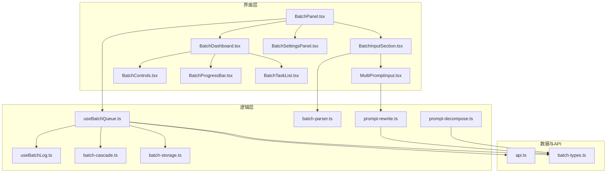
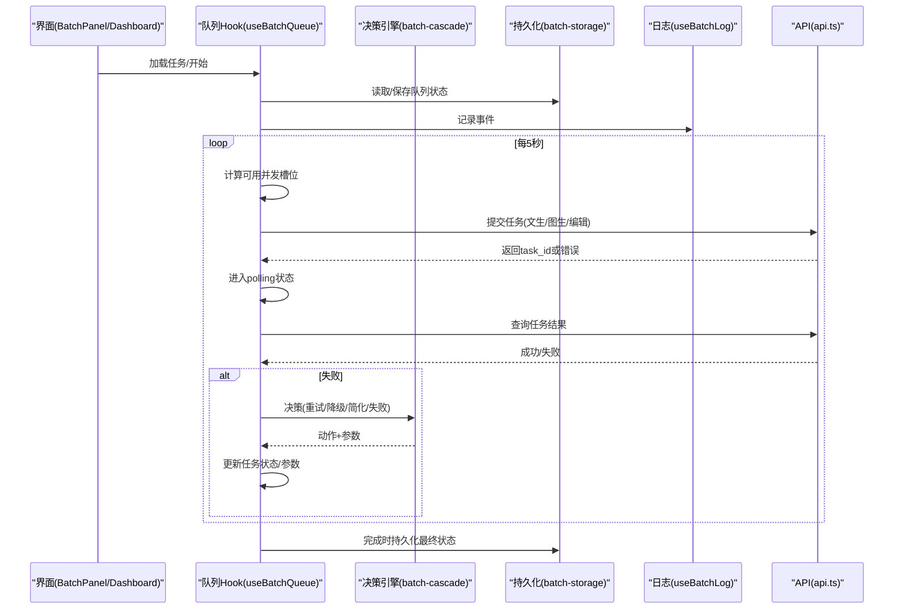
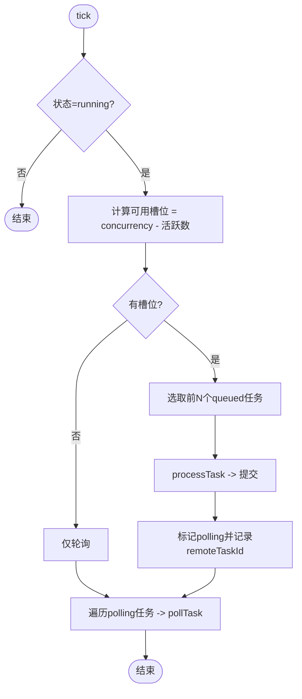
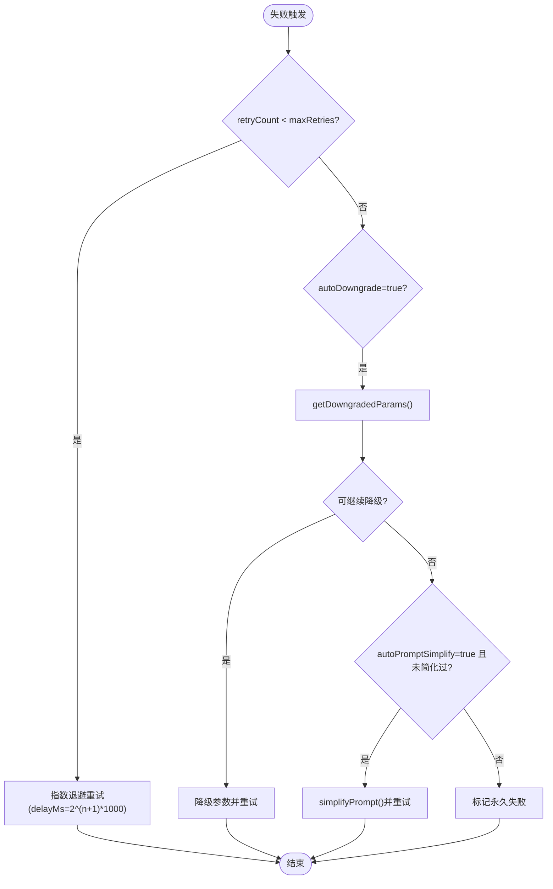
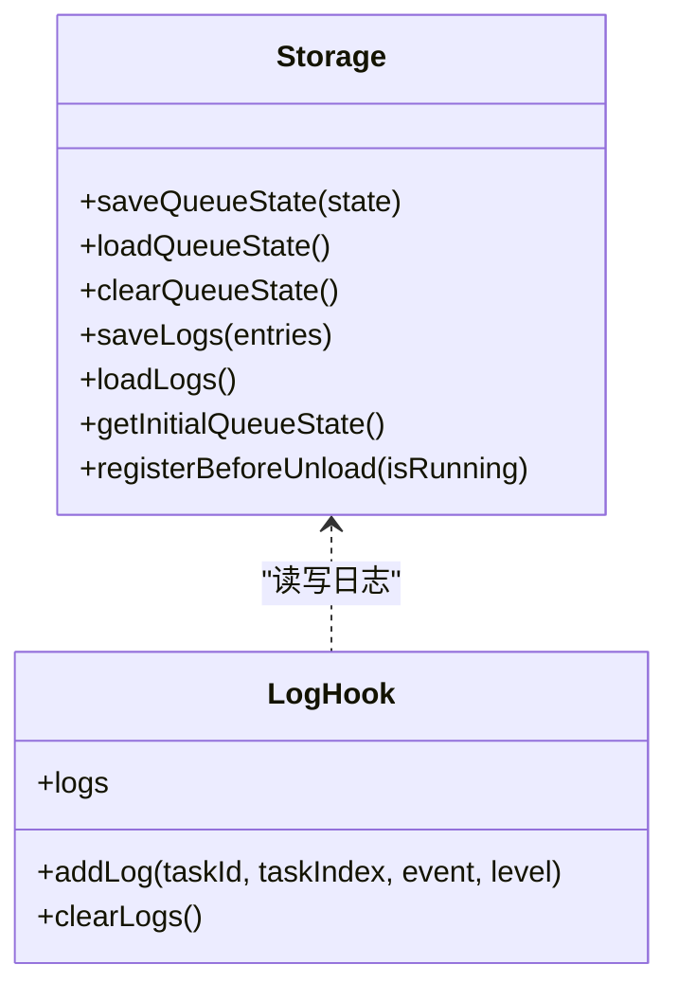
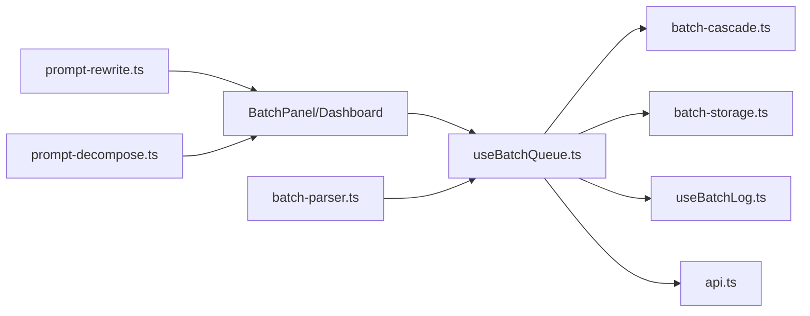

# 批量处理系统

<cite>
**本文引用的文件**   
- [useBatchQueue.ts](file://src/hooks/useBatchQueue.ts)
- [batch-cascade.ts](file://src/lib/batch-cascade.ts)
- [batch-storage.ts](file://src/lib/batch-storage.ts)
- [batch-types.ts](file://src/lib/batch-types.ts)
- [api.ts](file://src/lib/api.ts)
- [useBatchLog.ts](file://src/hooks/useBatchLog.ts)
- [BatchPanel.tsx](file://src/components/batch/BatchPanel.tsx)
- [BatchDashboard.tsx](file://src/components/batch/BatchDashboard.tsx)
- [BatchInputSection.tsx](file://src/components/batch/BatchInputSection.tsx)
- [MultiPromptInput.tsx](file://src/components/batch/MultiPromptInput.tsx)
- [BatchSettingsPanel.tsx](file://src/components/batch/BatchSettingsPanel.tsx)
- [BatchControls.tsx](file://src/components/batch/BatchControls.tsx)
- [BatchProgressBar.tsx](file://src/components/batch/BatchProgressBar.tsx)
- [BatchTaskList.tsx](file://src/components/batch/BatchTaskList.tsx)
- [prompt-decompose.ts](file://src/lib/prompt-decompose.ts)
- [prompt-rewrite.ts](file://src/lib/prompt-rewrite.ts)
</cite>

## 目录
1. [简介](#简介)
2. [项目结构](#项目结构)
3. [核心组件](#核心组件)
4. [架构总览](#架构总览)
5. [详细组件分析](#详细组件分析)
6. [依赖关系分析](#依赖关系分析)
7. [性能与调优](#性能与调优)
8. [故障排查指南](#故障排查指南)
9. [结论](#结论)
10. [附录：配置项与最佳实践](#附录配置项与最佳实践)

## 简介
本系统面向大量视频生成任务的批量处理能力，提供任务队列管理、智能容错决策（自动重试、参数降级、Prompt简化）、状态持久化与断点续传、可视化控制面板与日志追踪等功能。通过前端 Hook 驱动的任务调度器与本地存储机制，用户可在浏览器中高效编排、监控并恢复大批量任务执行。

## 项目结构
- 入口与面板
  - 批量面板入口：组合输入区、设置区与仪表盘
  - 仪表盘：进度条、控制按钮、任务列表、日志时间线
- 队列与调度
  - 基于 React useReducer 的队列状态机
  - 定时轮询与并发槽位控制
  - 失败后的级联决策引擎
- 数据与类型
  - 统一的类型定义、默认设置、ID 生成
  - 解析器支持多行文本、CSV/JSON 导入、模板展开
- 持久化与日志
  - localStorage 保存队列状态与日志
  - 页面离开保护提示
- 外部集成
  - 阿里云百炼异步视频合成 API 封装
  - Prompt 改写与分镜拆解工具

图表来源
- [BatchPanel.tsx:1-58](file://src/components/batch/BatchPanel.tsx#L1-L58)
- [BatchDashboard.tsx:1-89](file://src/components/batch/BatchDashboard.tsx#L1-L89)
- [BatchInputSection.tsx:1-55](file://src/components/batch/BatchInputSection.tsx#L1-L55)
- [MultiPromptInput.tsx:1-148](file://src/components/batch/MultiPromptInput.tsx#L1-L148)
- [BatchSettingsPanel.tsx:1-79](file://src/components/batch/BatchSettingsPanel.tsx#L1-L79)
- [BatchControls.tsx:1-50](file://src/components/batch/BatchControls.tsx#L1-L50)
- [BatchProgressBar.tsx:1-36](file://src/components/batch/BatchProgressBar.tsx#L1-L36)
- [BatchTaskList.tsx:1-27](file://src/components/batch/BatchTaskList.tsx#L1-L27)
- [useBatchQueue.ts:1-322](file://src/hooks/useBatchQueue.ts#L1-L322)
- [useBatchLog.ts:1-39](file://src/hooks/useBatchLog.ts#L1-L39)
- [batch-cascade.ts:1-101](file://src/lib/batch-cascade.ts#L1-L101)
- [batch-storage.ts:1-89](file://src/lib/batch-storage.ts#L1-L89)
- [api.ts:1-217](file://src/lib/api.ts#L1-L217)
- [batch-types.ts:1-123](file://src/lib/batch-types.ts#L1-L123)
- [prompt-rewrite.ts:1-221](file://src/lib/prompt-rewrite.ts#L1-L221)
- [prompt-decompose.ts:1-295](file://src/lib/prompt-decompose.ts#L1-L295)

章节来源
- [BatchPanel.tsx:1-58](file://src/components/batch/BatchPanel.tsx#L1-L58)
- [BatchDashboard.tsx:1-89](file://src/components/batch/BatchDashboard.tsx#L1-L89)
- [useBatchQueue.ts:1-322](file://src/hooks/useBatchQueue.ts#L1-L322)
- [batch-types.ts:1-123](file://src/lib/batch-types.ts#L1-L123)

## 核心组件
- 批量队列 Hook（useBatchQueue）
  - 使用 useReducer 维护任务集合、全局状态与设置
  - 每 5 秒 tick 一次，按并发槽位从“排队”中挑选任务提交
  - 对已提交任务进行轮询，根据结果更新任务状态
  - 失败时调用级联决策引擎，决定重试、降级、简化 Prompt 或永久失败
  - 将状态与日志持久化到 localStorage，并在页面关闭前给出警告
- 智能容错决策引擎（batch-cascade）
  - 指数退避重试
  - 参数降级：分辨率优先降，再降时长
  - Prompt 简化：去特殊字符、合并空格、截断长度
- 持久化与日志（batch-storage, useBatchLog）
  - 队列状态与日志分别持久化，限制最大条目数
  - 页面离开保护，避免意外刷新导致中断
- 输入与解析（BatchInputSection, MultiPromptInput, batch-parser）
  - 支持多行 Prompt、CSV/JSON 导入、模板组合展开
  - 支持 AI 批量改写 Prompt（可选）
- 控制面板（BatchDashboard, BatchControls, BatchProgressBar, BatchTaskList）
  - 开始/暂停/恢复/重置/取消全部
  - 实时进度统计与任务明细
  - 日志时间线与预览弹窗

章节来源
- [useBatchQueue.ts:1-322](file://src/hooks/useBatchQueue.ts#L1-L322)
- [batch-cascade.ts:1-101](file://src/lib/batch-cascade.ts#L1-L101)
- [batch-storage.ts:1-89](file://src/lib/batch-storage.ts#L1-L89)
- [useBatchLog.ts:1-39](file://src/hooks/useBatchLog.ts#L1-L39)
- [BatchInputSection.tsx:1-55](file://src/components/batch/BatchInputSection.tsx#L1-L55)
- [MultiPromptInput.tsx:1-148](file://src/components/batch/MultiPromptInput.tsx#L1-L148)
- [BatchDashboard.tsx:1-89](file://src/components/batch/BatchDashboard.tsx#L1-L89)
- [BatchControls.tsx:1-50](file://src/components/batch/BatchControls.tsx#L1-L50)
- [BatchProgressBar.tsx:1-36](file://src/components/batch/BatchProgressBar.tsx#L1-L36)
- [BatchTaskList.tsx:1-27](file://src/components/batch/BatchTaskList.tsx#L1-L27)

## 架构总览
整体采用“前端队列 + 本地持久化 + 远程异步任务”的架构。前端负责编排、调度、容错与展示；后端为阿里云百炼异步视频合成服务，返回 task_id 后由前端轮询获取结果。

图表来源
- [useBatchQueue.ts:1-322](file://src/hooks/useBatchQueue.ts#L1-L322)
- [batch-cascade.ts:1-101](file://src/lib/batch-cascade.ts#L1-L101)
- [batch-storage.ts:1-89](file://src/lib/batch-storage.ts#L1-L89)
- [useBatchLog.ts:1-39](file://src/hooks/useBatchLog.ts#L1-L39)
- [api.ts:1-217](file://src/lib/api.ts#L1-L217)

## 详细组件分析

### 任务队列与调度（useBatchQueue）
- 状态机
  - 全局状态：idle / running / paused / completed
  - 任务状态：queued / submitting / polling / retrying / succeeded / failed-permanent / cancelled
- 调度算法
  - 每 5 秒扫描一次，统计正在 submit/poll 的任务数量，用 settings.concurrency 减去活跃数得到剩余槽位
  - 从 queued 中取前 N 个任务，逐个 processTask
  - 对 remoteTaskId 存在的 polling 任务逐个 pollTask
- 提交与轮询
  - 根据任务定义模式选择对应 API 接口
  - 成功后进入 polling，失败则进入 handleFailure
- 失败处理与级联决策
  - 调用 decideCascadeAction 决定下一步
  - 支持重试（指数退避）、参数降级、Prompt 简化、永久失败
- 持久化与恢复
  - 每次状态变化延迟 1s 写入 localStorage
  - 初始化时尝试恢复上次状态，若处于 running 则改为 paused
  - 注册 beforeunload 防止误关
- 日志
  - 统一 addLog，最多保留 500 条，持久化到 localStorage

图表来源
- [useBatchQueue.ts:98-124](file://src/hooks/useBatchQueue.ts#L98-L124)
- [useBatchQueue.ts:126-185](file://src/hooks/useBatchQueue.ts#L126-L185)

章节来源
- [useBatchQueue.ts:1-322](file://src/hooks/useBatchQueue.ts#L1-L322)

### 智能容错决策引擎（batch-cascade）
- 决策流程
  1) 若未达到最大重试次数：以指数退避策略重试
  2) 若开启自动降级：按顺序降低分辨率，再降低时长
  3) 若开启自动简化且未简化过：对 Prompt 做简化
  4) 否则：标记永久失败
- 降级策略
  - 分辨率顺序：1080p → 720p → 480p
  - 时长顺序：10 → 7 → 5 → 3 → 2
  - 降级级别控制：先降分辨率，再进一步降分辨率，最后降时长
- Prompt 简化
  - 去除常见特殊符号、合并多余空格、截断至 100 字符

图表来源
- [batch-cascade.ts:19-56](file://src/lib/batch-cascade.ts#L19-L56)
- [batch-cascade.ts:61-85](file://src/lib/batch-cascade.ts#L61-L85)
- [batch-cascade.ts:90-100](file://src/lib/batch-cascade.ts#L90-L100)

章节来源
- [batch-cascade.ts:1-101](file://src/lib/batch-cascade.ts#L1-L101)

### 任务状态持久化与断点续传（batch-storage, useBatchLog）
- 队列状态
  - save/load/clear 三个方法，异常时裁剪 errorHistory 再次尝试
  - getInitialQueueState 提供默认初始状态
- 日志
  - 最多保留 500 条，追加时自动裁剪
- 页面离开保护
  - registerBeforeUnload 在运行中阻止关闭

图表来源
- [batch-storage.ts:1-89](file://src/lib/batch-storage.ts#L1-L89)
- [useBatchLog.ts:1-39](file://src/hooks/useBatchLog.ts#L1-L39)

章节来源
- [batch-storage.ts:1-89](file://src/lib/batch-storage.ts#L1-L89)
- [useBatchLog.ts:1-39](file://src/hooks/useBatchLog.ts#L1-L39)

### 批量控制面板与操作
- 输入区
  - 多行 Prompt：逐行解析为任务，支持 AI 批量改写
  - 文件上传：CSV/JSON 解析与校验
  - 模板组合：按分辨率×时长展开为多个任务
- 设置区
  - 并发数 1-5
  - 最大重试次数 1-5
  - 自动降级开关
  - 自动简化 Prompt 开关
- 仪表盘
  - 进度条：成功/失败/取消计数与百分比
  - 控制按钮：开始/暂停/恢复/重置/取消全部
  - 任务列表：单任务取消、预览
  - 日志时间线：事件、级别、时间戳

章节来源
- [BatchInputSection.tsx:1-55](file://src/components/batch/BatchInputSection.tsx#L1-L55)
- [MultiPromptInput.tsx:1-148](file://src/components/batch/MultiPromptInput.tsx#L1-L148)
- [BatchSettingsPanel.tsx:1-79](file://src/components/batch/BatchSettingsPanel.tsx#L1-L79)
- [BatchDashboard.tsx:1-89](file://src/components/batch/BatchDashboard.tsx#L1-L89)
- [BatchControls.tsx:1-50](file://src/components/batch/BatchControls.tsx#L1-L50)
- [BatchProgressBar.tsx:1-36](file://src/components/batch/BatchProgressBar.tsx#L1-L36)
- [BatchTaskList.tsx:1-27](file://src/components/batch/BatchTaskList.tsx#L1-L27)

### 外部 API 与模型集成
- 视频生成 API
  - 提交接口：text-to-video / image-to-video / video-edit
  - 查询接口：按 taskId 轮询
  - 错误处理：网络异常、HTTP 非 JSON、业务错误码均被捕获并转为 FAILED
- Prompt 改写与分镜拆解
  - 批量改写：支持上下文与图片增强
  - 分镜拆解：输出 globalStyle 与 scenes，支持图片元信息判断是否含密集文字

章节来源
- [api.ts:1-217](file://src/lib/api.ts#L1-L217)
- [prompt-rewrite.ts:1-221](file://src/lib/prompt-rewrite.ts#L1-L221)
- [prompt-decompose.ts:1-295](file://src/lib/prompt-decompose.ts#L1-L295)

## 依赖关系分析
- 模块耦合
  - useBatchQueue 强依赖 batch-cascade、batch-storage、useBatchLog、api
  - 界面组件仅消费 useBatchQueue 暴露的状态与方法，低耦合
- 外部依赖
  - 阿里云百炼 API（DashScope）
  - Qwen 大模型（用于 Prompt 改写与分镜拆解）

图表来源
- [useBatchQueue.ts:1-322](file://src/hooks/useBatchQueue.ts#L1-L322)
- [batch-cascade.ts:1-101](file://src/lib/batch-cascade.ts#L1-L101)
- [batch-storage.ts:1-89](file://src/lib/batch-storage.ts#L1-L89)
- [useBatchLog.ts:1-39](file://src/hooks/useBatchLog.ts#L1-L39)
- [api.ts:1-217](file://src/lib/api.ts#L1-L217)
- [BatchPanel.tsx:1-58](file://src/components/batch/BatchPanel.tsx#L1-L58)
- [BatchDashboard.tsx:1-89](file://src/components/batch/BatchDashboard.tsx#L1-L89)
- [batch-parser.ts:1-203](file://src/lib/batch-parser.ts#L1-L203)
- [prompt-rewrite.ts:1-221](file://src/lib/prompt-rewrite.ts#L1-L221)
- [prompt-decompose.ts:1-295](file://src/lib/prompt-decompose.ts#L1-L295)

## 性能与调优
- 并发控制
  - 建议根据浏览器与网络状况设置 concurrency 为 2-3，避免过多并发导致请求拥塞
- 重试与退避
  - 指数退避可有效缓解瞬时失败，但需结合 maxRetries 控制总体耗时
- 参数降级
  - 自动降级能提升成功率，但会牺牲画质与时长，建议在关键任务上谨慎开启
- Prompt 简化
  - 当模型对复杂 Prompt 不稳定时可启用，注意可能丢失细节
- 轮询间隔
  - 当前固定 5 秒，可根据任务规模与服务响应调整
- 持久化开销
  - 状态变更节流 1s 写入，避免频繁 I/O；日志上限 500 条，避免 localStorage 溢出

[本节为通用指导，不直接分析具体文件]

## 故障排查指南
- 无法启动任务
  - 检查是否已设置 API Key
  - 确认任务列表不为空
- 任务一直轮询无结果
  - 查看日志中的轮询异常信息
  - 检查网络与 DashScope 服务状态
- 频繁失败
  - 观察错误历史，必要时开启自动降级或简化 Prompt
  - 适当降低并发与重试次数
- 页面刷新后任务丢失
  - 系统会自动恢复上次状态；如仍丢失，检查浏览器 localStorage 是否可用

章节来源
- [useBatchQueue.ts:187-264](file://src/hooks/useBatchQueue.ts#L187-L264)
- [batch-storage.ts:1-89](file://src/lib/batch-storage.ts#L1-L89)
- [useBatchLog.ts:1-39](file://src/hooks/useBatchLog.ts#L1-L39)

## 结论
本批量处理系统通过清晰的前端队列与容错策略，实现了高可用的大规模视频生成任务编排。配合本地持久化与可视化面板，用户可便捷地导入任务、监控进度、查看日志并进行必要的手动干预。合理配置并发、重试与降级策略，可显著提升成功率与用户体验。

[本节为总结性内容，不直接分析具体文件]

## 附录：配置项与最佳实践

### 配置选项
- 并发数（concurrency）
  - 范围：1-5
  - 建议：2-3 起步，逐步上调观察稳定性
- 最大重试次数（maxRetries）
  - 范围：1-5
  - 建议：3 作为默认，极端不稳定环境可适当提高
- 自动降级（autoDowngrade）
  - 建议：开启，优先保障成功率
- 自动简化 Prompt（autoPromptSimplify）
  - 建议：在模型对长 Prompt 不稳定时开启

章节来源
- [batch-types.ts:112-117](file://src/lib/batch-types.ts#L112-L117)
- [BatchSettingsPanel.tsx:1-79](file://src/components/batch/BatchSettingsPanel.tsx#L1-L79)

### 使用案例与最佳实践
- 快速上手
  - 在“多行”输入框粘贴若干 Prompt，点击“加载任务”，然后“开始”
  - 如需提升质量，可使用“AI 改写全部”优化描述
- 批量导入
  - CSV：至少包含 prompt 列，可选 mode/resolution/duration/imageUrl/videoUrl/refImageUrl
  - JSON：数组格式，每项为任务对象，字段同上
- 模板组合
  - 设置 promptTemplate、mode、resolutions、durations，一键展开为多任务
- 监控与排障
  - 关注进度条与日志时间线，失败任务可查看错误历史
  - 必要时对单个任务执行“取消”，或全局“取消全部”后重置
- 断点续传
  - 刷新页面后系统会恢复上次状态（running 会变为 paused），手动“恢复”即可继续

章节来源
- [BatchInputSection.tsx:1-55](file://src/components/batch/BatchInputSection.tsx#L1-L55)
- [MultiPromptInput.tsx:1-148](file://src/components/batch/MultiPromptInput.tsx#L1-L148)
- [batch-parser.ts:1-203](file://src/lib/batch-parser.ts#L1-L203)
- [BatchDashboard.tsx:1-89](file://src/components/batch/BatchDashboard.tsx#L1-L89)
- [batch-storage.ts:1-89](file://src/lib/batch-storage.ts#L1-L89)