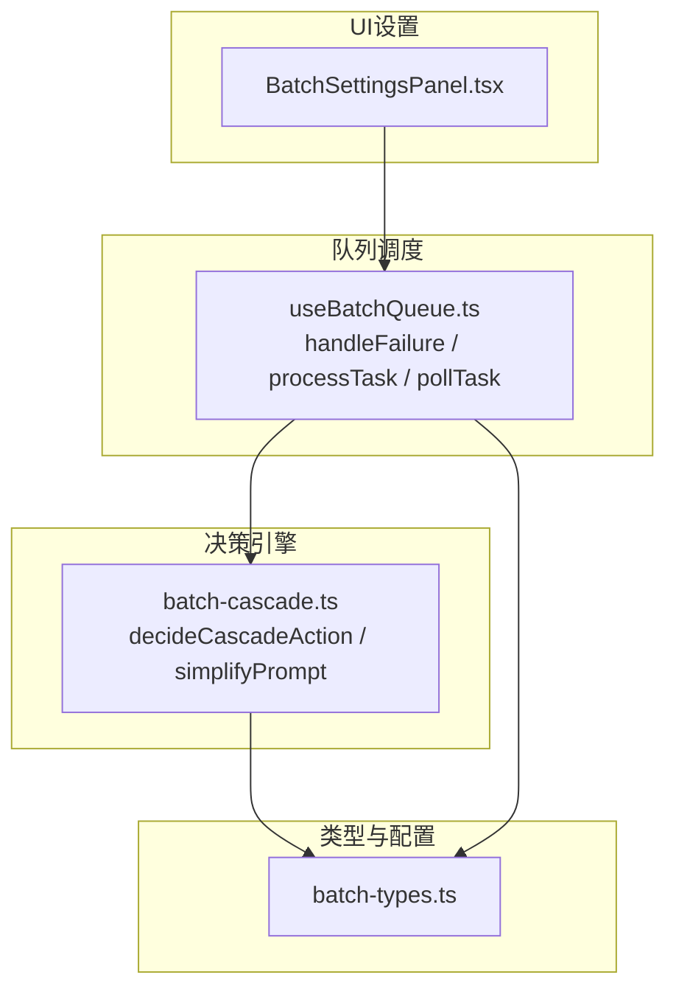
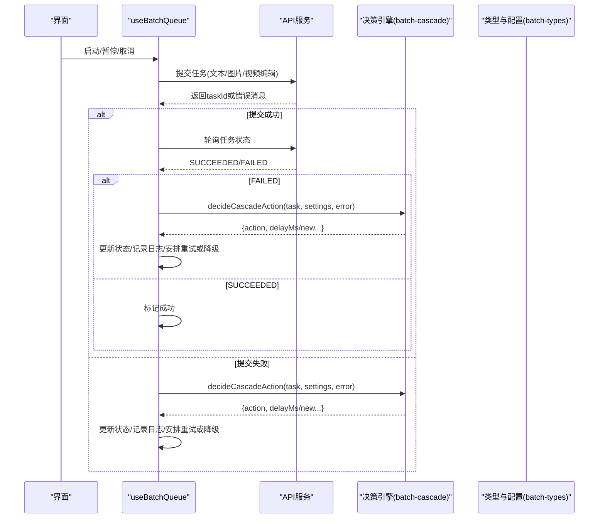
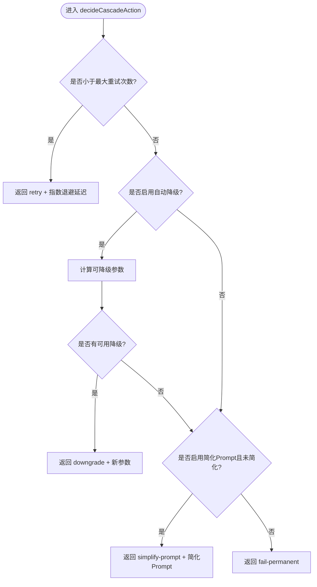
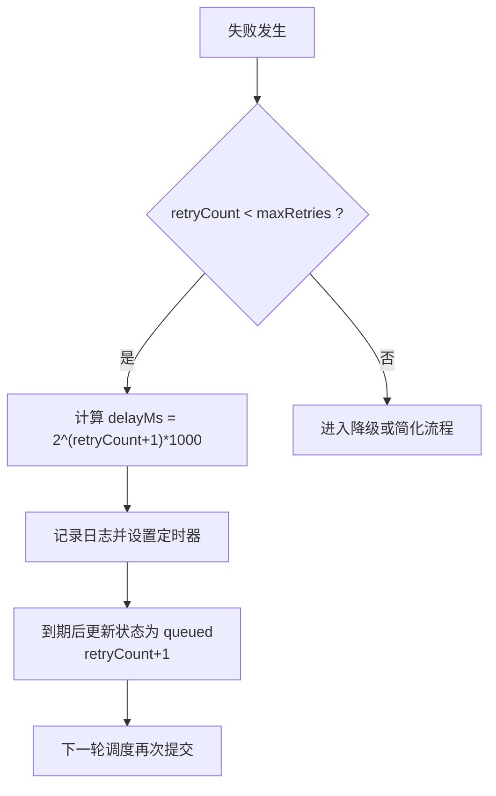
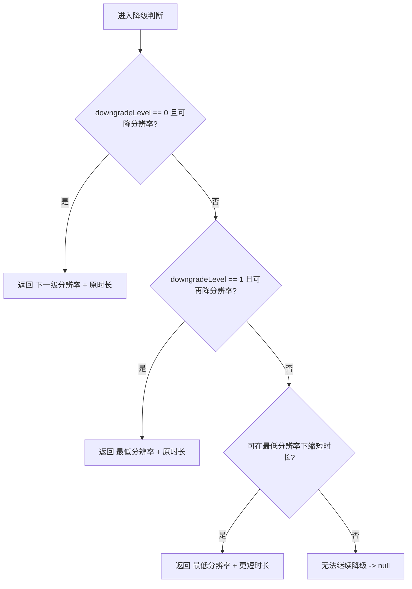
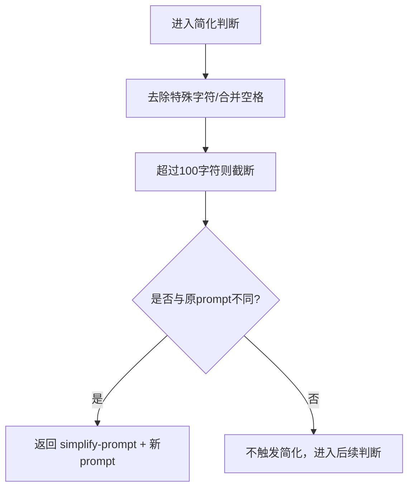
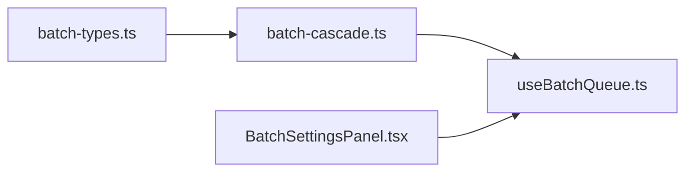

# 智能容错决策引擎

<cite>
**本文引用的文件**
- [src/lib/batch-cascade.ts](file://src/lib/batch-cascade.ts)
- [src/lib/batch-types.ts](file://src/lib/batch-types.ts)
- [src/hooks/useBatchQueue.ts](file://src/hooks/useBatchQueue.ts)
- [src/components/batch/BatchSettingsPanel.tsx](file://src/components/batch/BatchSettingsPanel.tsx)
</cite>

## 目录
1. [简介](#简介)
2. [项目结构](#项目结构)
3. [核心组件](#核心组件)
4. [架构总览](#架构总览)
5. [详细组件分析](#详细组件分析)
6. [依赖关系分析](#依赖关系分析)
7. [性能考量](#性能考量)
8. [故障排查指南](#故障排查指南)
9. [结论](#结论)
10. [附录：配置与使用案例](#附录配置与使用案例)

## 简介
本文件为“智能容错决策引擎”的权威文档，聚焦于批量任务执行过程中的错误恢复与自适应策略。核心围绕 decideCascadeAction 函数展开，解释其错误分析、决策树算法、重试策略选择等关键逻辑；并深入说明四种容错策略的实现：自动重试（retry）、参数降级（downgrade）、Prompt简化（simplify-prompt）、永久失败（fail-permanent）。同时覆盖延迟计算与指数退避策略、配置项说明，以及典型错误场景下的决策流程与结果。

## 项目结构
该引擎位于前端 React 应用中，采用“类型定义 + 决策逻辑 + 队列调度 + UI设置”的分层组织方式：
- 类型与默认配置：src/lib/batch-types.ts
- 决策引擎：src/lib/batch-cascade.ts
- 队列调度与状态管理：src/hooks/useBatchQueue.ts
- 用户可配置的UI面板：src/components/batch/BatchSettingsPanel.tsx

图表来源
- [src/lib/batch-types.ts:1-123](file://src/lib/batch-types.ts#L1-L123)
- [src/lib/batch-cascade.ts:1-101](file://src/lib/batch-cascade.ts#L1-L101)
- [src/hooks/useBatchQueue.ts:1-322](file://src/hooks/useBatchQueue.ts#L1-L322)
- [src/components/batch/BatchSettingsPanel.tsx:1-79](file://src/components/batch/BatchSettingsPanel.tsx#L1-L79)

章节来源
- [src/lib/batch-types.ts:1-123](file://src/lib/batch-types.ts#L1-L123)
- [src/lib/batch-cascade.ts:1-101](file://src/lib/batch-cascade.ts#L1-L101)
- [src/hooks/useBatchQueue.ts:1-322](file://src/hooks/useBatchQueue.ts#L1-L322)
- [src/components/batch/BatchSettingsPanel.tsx:1-79](file://src/components/batch/BatchSettingsPanel.tsx#L1-L79)

## 核心组件
- 决策接口与动作类型：定义 CascadeDecision 的 action 枚举及可选字段（delayMs、newResolution、newDuration、newPrompt），用于统一表达下一步动作。
- 决策主函数：decideCascadeAction 根据任务当前状态与全局设置，按固定顺序返回最优容错动作。
- 降级参数计算：getDowngradedParams 基于分辨率与时长有序集合，结合已降级次数决定新参数组合。
- Prompt简化：simplifyPrompt 去除特殊符号、合并空格、截断长度，降低提示词复杂度。
- 队列调度：useBatchQueue 中的 handleFailure 调用决策引擎，并根据决策更新任务状态、记录日志、安排重试或降级。
- 配置面板：BatchSettingsPanel 暴露并发数、最大重试次数、自动降级、自动简化Prompt等开关与滑块。

章节来源
- [src/lib/batch-cascade.ts:8-56](file://src/lib/batch-cascade.ts#L8-L56)
- [src/lib/batch-cascade.ts:58-85](file://src/lib/batch-cascade.ts#L58-L85)
- [src/lib/batch-cascade.ts:87-101](file://src/lib/batch-cascade.ts#L87-L101)
- [src/hooks/useBatchQueue.ts:187-264](file://src/hooks/useBatchQueue.ts#L187-L264)
- [src/components/batch/BatchSettingsPanel.tsx:10-78](file://src/components/batch/BatchSettingsPanel.tsx#L10-L78)

## 架构总览
下图展示了从任务提交到失败处理、再到决策与重试/降级的完整时序。

图表来源
- [src/hooks/useBatchQueue.ts:126-185](file://src/hooks/useBatchQueue.ts#L126-L185)
- [src/hooks/useBatchQueue.ts:187-264](file://src/hooks/useBatchQueue.ts#L187-L264)
- [src/lib/batch-cascade.ts:19-56](file://src/lib/batch-cascade.ts#L19-L56)
- [src/lib/batch-types.ts:61-67](file://src/lib/batch-types.ts#L61-L67)

## 详细组件分析

### 决策主函数 decideCascadeAction
- 输入：当前任务对象、全局设置、错误信息字符串
- 输出：CascadeDecision，包含动作类型与必要的新参数
- 决策顺序（决策树）：
  1) 若未达最大重试次数：返回 retry，附带指数退避延迟
  2) 若开启自动降级且可继续降级：返回 downgrade，附带新的分辨率与时长
  3) 若开启自动简化Prompt且尚未简化：返回 simplify-prompt，附带简化后的提示词
  4) 否则：返回 fail-permanent

图表来源
- [src/lib/batch-cascade.ts:19-56](file://src/lib/batch-cascade.ts#L19-L56)

章节来源
- [src/lib/batch-cascade.ts:19-56](file://src/lib/batch-cascade.ts#L19-L56)

### 四种容错策略详解

#### 1) 自动重试（retry）
- 触发条件：task.retryCount < settings.maxRetries
- 行为：以指数退避延迟重新入队，等待下一次调度
- 延迟算法：delayMs = 2^(retryCount+1) * 1000，即 2s、4s、8s 递增
- 状态更新：在队列中由 handleFailure 分支处理，将任务状态置为 queued，并重试计数+1

图表来源
- [src/lib/batch-cascade.ts:24-28](file://src/lib/batch-cascade.ts#L24-L28)
- [src/hooks/useBatchQueue.ts:204-215](file://src/hooks/useBatchQueue.ts#L204-L215)

章节来源
- [src/lib/batch-cascade.ts:24-28](file://src/lib/batch-cascade.ts#L24-L28)
- [src/hooks/useBatchQueue.ts:204-215](file://src/hooks/useBatchQueue.ts#L204-L215)

#### 2) 参数降级（downgrade）
- 触发条件：settings.autoDowngrade 为真，且 getDowngradedParams 能返回有效新参数
- 降级策略：
  - 第一次降级：优先降低分辨率（从高到低）
  - 第二次降级：进一步降低分辨率至最低档
  - 第三次及以后：在最低分辨率基础上逐步缩短时长
- 状态更新：重置 retryCount，提升 downgradeLevel，更新 definition.resolution/duration

图表来源
- [src/lib/batch-cascade.ts:61-85](file://src/lib/batch-cascade.ts#L61-L85)

章节来源
- [src/lib/batch-cascade.ts:61-85](file://src/lib/batch-cascade.ts#L61-L85)
- [src/hooks/useBatchQueue.ts:217-234](file://src/hooks/useBatchQueue.ts#L217-L234)

#### 3) Prompt简化（simplify-prompt）
- 触发条件：settings.autoPromptSimplify 为真，且 task.promptSimplified 为假
- 行为：对原始 prompt 进行清理与截断，生成更简洁版本
- 状态更新：重置 retryCount，标记 promptSimplified 为真，更新 definition.prompt

图表来源
- [src/lib/batch-cascade.ts:87-101](file://src/lib/batch-cascade.ts#L87-L101)
- [src/hooks/useBatchQueue.ts:236-252](file://src/hooks/useBatchQueue.ts#L236-L252)

章节来源
- [src/lib/batch-cascade.ts:87-101](file://src/lib/batch-cascade.ts#L87-L101)
- [src/hooks/useBatchQueue.ts:236-252](file://src/hooks/useBatchQueue.ts#L236-L252)

#### 4) 永久失败（fail-permanent）
- 触发条件：以上所有策略均不可用或未生效
- 行为：标记任务为 failed-permanent，记录完成时间，停止重试

章节来源
- [src/lib/batch-cascade.ts:54-56](file://src/lib/batch-cascade.ts#L54-L56)
- [src/hooks/useBatchQueue.ts:254-262](file://src/hooks/useBatchQueue.ts#L254-L262)

### 延迟计算与指数退避
- 公式：delayMs = 2^(retryCount+1) * 1000
- 效果：首次重试约2秒，随后依次翻倍，避免瞬时风暴式重试
- 实现位置：决策函数内计算，并在队列侧通过 setTimeout 应用

章节来源
- [src/lib/batch-cascade.ts:24-28](file://src/lib/batch-cascade.ts#L24-L28)
- [src/hooks/useBatchQueue.ts:204-215](file://src/hooks/useBatchQueue.ts#L204-L215)

### 配置选项说明
- concurrency：并发度（1-5），控制同时运行的任务数量
- maxRetries：最大重试次数（默认3），超出后进入降级/简化/失败流程
- autoDowngrade：是否允许自动参数降级（默认true）
- autoPromptSimplify：是否允许自动简化Prompt（默认true）
- 超时设置：当前代码未显式实现请求级超时控制，建议在API层或网络库中补充

章节来源
- [src/lib/batch-types.ts:61-67](file://src/lib/batch-types.ts#L61-L67)
- [src/lib/batch-types.ts:112-117](file://src/lib/batch-types.ts#L112-L117)
- [src/components/batch/BatchSettingsPanel.tsx:18-75](file://src/components/batch/BatchSettingsPanel.tsx#L18-L75)

## 依赖关系分析
- batch-cascade.ts 依赖 batch-types.ts 的类型定义（BatchTaskItem、BatchSettings）
- useBatchQueue.ts 依赖 batch-cascade.ts 的决策能力，并驱动状态机与调度
- BatchSettingsPanel.tsx 仅负责UI展示与更新 settings，间接影响决策路径

图表来源
- [src/lib/batch-types.ts:1-123](file://src/lib/batch-types.ts#L1-L123)
- [src/lib/batch-cascade.ts:1-101](file://src/lib/batch-cascade.ts#L1-L101)
- [src/hooks/useBatchQueue.ts:1-322](file://src/hooks/useBatchQueue.ts#L1-L322)
- [src/components/batch/BatchSettingsPanel.tsx:1-79](file://src/components/batch/BatchSettingsPanel.tsx#L1-L79)

章节来源
- [src/lib/batch-types.ts:1-123](file://src/lib/batch-types.ts#L1-L123)
- [src/lib/batch-cascade.ts:1-101](file://src/lib/batch-cascade.ts#L1-L101)
- [src/hooks/useBatchQueue.ts:1-322](file://src/hooks/useBatchQueue.ts#L1-L322)
- [src/components/batch/BatchSettingsPanel.tsx:1-79](file://src/components/batch/BatchSettingsPanel.tsx#L1-L79)

## 性能考量
- 指数退避可有效缓解服务端瞬时压力，但需关注长时间重试带来的资源占用
- 降级策略优先降低分辨率，其次缩短时长，有助于快速恢复成功率
- 并发度建议根据客户端与服务端负载动态调整，避免过多并发导致雪崩
- 当前未实现请求级超时，建议在API封装层增加超时与熔断机制，防止长尾请求阻塞队列

[本节为通用指导，无需源码引用]

## 故障排查指南
- 查看任务错误历史：errorHistory 记录了每次失败的时间与消息，便于定位问题
- 检查重试次数与降级级别：retryCount 与 downgradeLevel 反映当前所处阶段
- 观察日志：handleFailure 会在各分支记录关键事件，包括重试倒计时、降级参数变化、简化Prompt等
- 确认配置：maxRetries、autoDowngrade、autoPromptSimplify 直接影响决策路径

章节来源
- [src/hooks/useBatchQueue.ts:187-264](file://src/hooks/useBatchQueue.ts#L187-L264)
- [src/lib/batch-types.ts:32-50](file://src/lib/batch-types.ts#L32-L50)

## 结论
智能容错决策引擎通过清晰的决策树与分层策略，实现了高可用的批量任务执行保障。在达到最大重试次数后，系统自动尝试参数降级与Prompt简化，最终仍失败时才会标记永久失败。配合指数退避与合理的并发控制，能够在复杂网络与服务环境下显著提升整体成功率与用户体验。

[本节为总结性内容，无需源码引用]

## 附录：配置与使用案例

### 配置项一览
- concurrency：并发度（1-5）
- maxRetries：最大重试次数（默认3）
- autoDowngrade：自动降级（默认true）
- autoPromptSimplify：自动简化Prompt（默认true）

章节来源
- [src/lib/batch-types.ts:61-67](file://src/lib/batch-types.ts#L61-L67)
- [src/lib/batch-types.ts:112-117](file://src/lib/batch-types.ts#L112-L117)
- [src/components/batch/BatchSettingsPanel.tsx:18-75](file://src/components/batch/BatchSettingsPanel.tsx#L18-L75)

### 使用案例与决策过程

- 案例A：临时网络抖动
  - 现象：提交或轮询出现短暂异常
  - 决策：因未达到最大重试次数，返回 retry，并按指数退避延迟重试
  - 结果：多数情况下在2-8秒内恢复成功

- 案例B：服务端限流或容量不足
  - 现象：多次重试仍失败
  - 决策：达到最大重试次数后，若开启自动降级，则尝试降低分辨率或时长
  - 结果：在更低资源需求下提高成功率

- 案例C：提示词过长或含特殊符号导致解析失败
  - 现象：即使重试与降级仍失败
  - 决策：若开启自动简化Prompt，则清理并截断提示词后重试
  - 结果：简化后的提示词更易被服务端接受

- 案例D：持续失败且无可用降级空间
  - 现象：已达到最低分辨率与最短时长，且Prompt已简化
  - 决策：返回 fail-permanent
  - 结果：任务标记永久失败，便于人工介入

章节来源
- [src/lib/batch-cascade.ts:19-56](file://src/lib/batch-cascade.ts#L19-L56)
- [src/hooks/useBatchQueue.ts:204-262](file://src/hooks/useBatchQueue.ts#L204-L262)