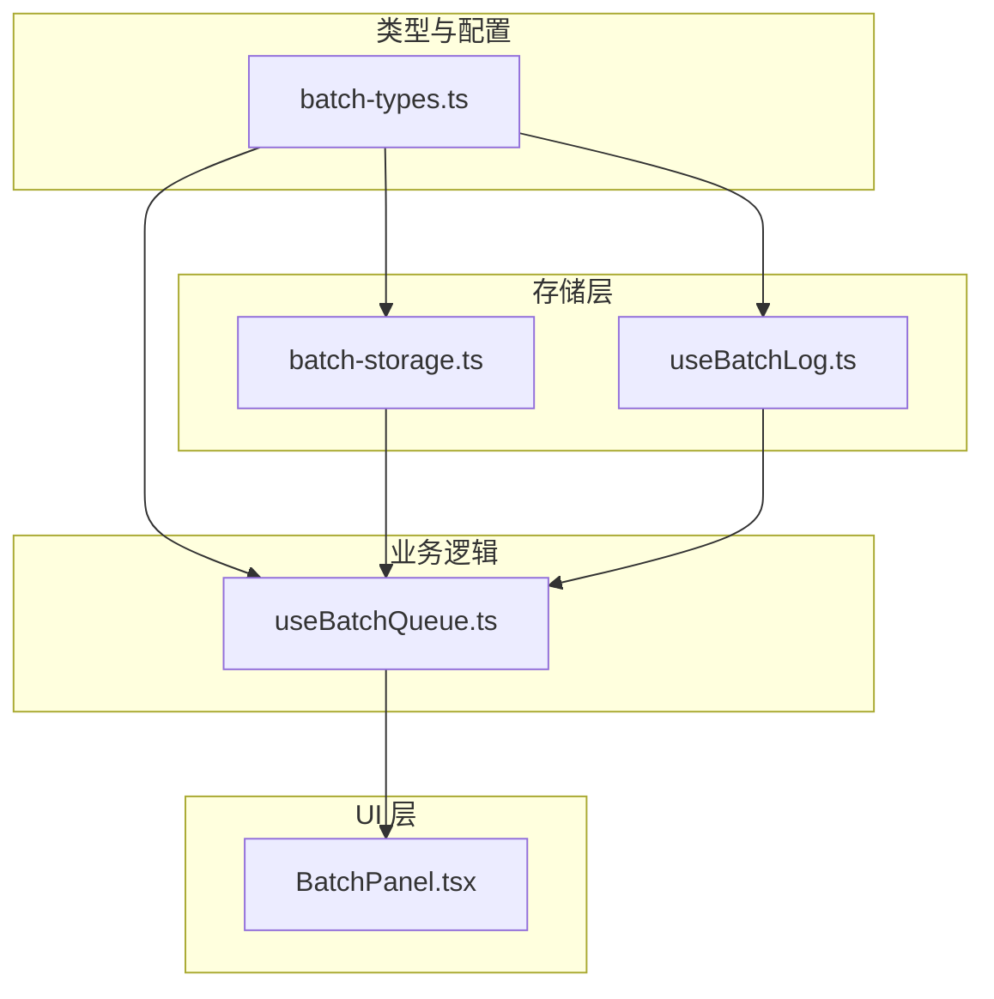
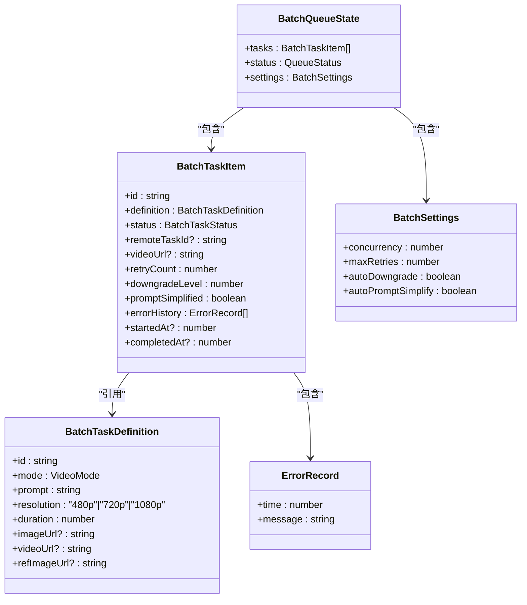
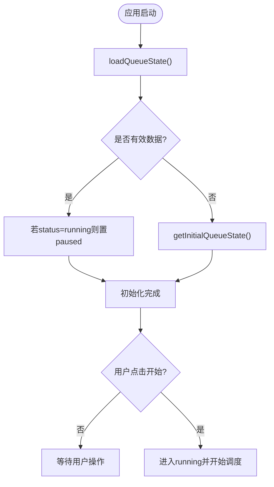
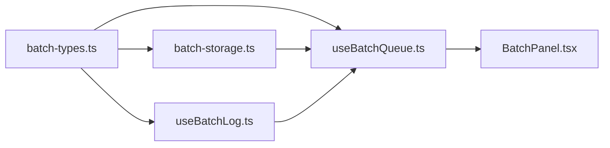

# 状态持久化机制

<cite>
**本文引用的文件列表**
- [batch-storage.ts](file://src/lib/batch-storage.ts)
- [batch-types.ts](file://src/lib/batch-types.ts)
- [useBatchQueue.ts](file://src/hooks/useBatchQueue.ts)
- [useBatchLog.ts](file://src/hooks/useBatchLog.ts)
- [BatchPanel.tsx](file://src/components/batch/BatchPanel.tsx)
</cite>

## 目录
1. [简介](#简介)
2. [项目结构](#项目结构)
3. [核心组件](#核心组件)
4. [架构总览](#架构总览)
5. [详细组件分析](#详细组件分析)
6. [依赖关系分析](#依赖关系分析)
7. [性能考虑](#性能考虑)
8. [故障排查指南](#故障排查指南)
9. [结论](#结论)
10. [附录：API 参考与使用示例](#附录api-参考与使用示例)

## 简介
本文件面向“批量任务队列”的状态持久化机制，系统性说明本地存储实现、数据模型设计、状态恢复流程、页面关闭处理、日志持久化以及性能优化建议。目标是帮助开发者理解并扩展该机制，确保在页面刷新或意外关闭后仍能可靠地恢复队列状态，并提供断点续传能力与数据完整性校验。

## 项目结构
与状态持久化相关的代码主要分布在以下位置：
- 类型定义与默认配置：src/lib/batch-types.ts
- 本地存储 API（localStorage）封装：src/lib/batch-storage.ts
- 队列 Hook（状态管理、调度、恢复、持久化触发）：src/hooks/useBatchQueue.ts
- 日志 Hook（日志持久化）：src/hooks/useBatchLog.ts
- 面板入口（集成 Hook 与 UI）：src/components/batch/BatchPanel.tsx



图表来源
- [batch-types.ts:1-123](file://src/lib/batch-types.ts#L1-L123)
- [batch-storage.ts:1-89](file://src/lib/batch-storage.ts#L1-L89)
- [useBatchQueue.ts:1-322](file://src/hooks/useBatchQueue.ts#L1-L322)
- [useBatchLog.ts:1-39](file://src/hooks/useBatchLog.ts#L1-L39)
- [BatchPanel.tsx:1-58](file://src/components/batch/BatchPanel.tsx#L1-L58)

章节来源
- [batch-types.ts:1-123](file://src/lib/batch-types.ts#L1-L123)
- [batch-storage.ts:1-89](file://src/lib/batch-storage.ts#L1-L89)
- [useBatchQueue.ts:1-322](file://src/hooks/useBatchQueue.ts#L1-L322)
- [useBatchLog.ts:1-39](file://src/hooks/useBatchLog.ts#L1-L39)
- [BatchPanel.tsx:1-58](file://src/components/batch/BatchPanel.tsx#L1-L58)

## 核心组件
- 数据模型与默认设置
  - BatchQueueState：包含 tasks、status、settings
  - BatchTaskItem：单条任务的运行时状态，含 definition、status、remoteTaskId、retryCount、downgradeLevel、promptSimplified、errorHistory、时间戳等
  - ErrorRecord：错误记录条目
  - BatchSettings：并发度、最大重试次数、自动降级、自动简化 Prompt 等开关
  - DEFAULT_BATCH_SETTINGS：默认配置
- 本地存储 API
  - saveQueueState / loadQueueState / clearQueueState：队列状态的序列化、反序列化与清理
  - saveLogs / loadLogs：日志的持久化与加载
  - getInitialQueueState：生成初始空状态
  - registerBeforeUnload：注册页面离开事件处理器
- 队列 Hook
  - useBatchQueue：基于 useReducer 管理状态；启动/暂停/恢复/取消；失败重试与降级；定时轮询；状态节流持久化；beforeunload 提示；完成检测；恢复标记 hasRestoredState

章节来源
- [batch-types.ts:10-123](file://src/lib/batch-types.ts#L10-L123)
- [batch-storage.ts:7-89](file://src/lib/batch-storage.ts#L7-L89)
- [useBatchQueue.ts:22-322](file://src/hooks/useBatchQueue.ts#L22-L322)

## 架构总览
整体采用“类型定义 + 存储层 + 业务 Hook + UI 组件”的分层架构。存储层对 localStorage 进行统一封装，提供幂等的读写接口；Hook 负责状态机、调度与持久化触发；UI 仅消费 Hook 暴露的 API。

```mermaid
sequenceDiagram
participant UI as "BatchPanel.tsx"
participant Hook as "useBatchQueue.ts"
participant Store as "batch-storage.ts"
participant Log as "useBatchLog.ts"
participant LS as "localStorage"
UI->>Hook : 初始化(useBatchQueue(apiKey))
Hook->>Store : loadQueueState()
Store->>LS : getItem("batch_queue_state")
LS-->>Store : JSON字符串或null
Store-->>Hook : 解析后的状态或null
Hook->>Hook : 若为running则置paused; 构造initialState
Hook->>Hook : useEffect(节流保存, 1s)
Hook->>Store : saveQueueState(state)
Store->>LS : setItem("batch_queue_state", JSON.stringify(state))
Note over Hook,Store : 异常时裁剪errorHistory再试
UI->>Hook : start()/pause()/resume()/cancel()
Hook->>Log : addLog(...)
Log->>Store : saveLogs(entries)
Store->>LS : setItem("batch_log_entries", JSON.stringify(trimmed))
Hook->>Hook : beforeunload注册(registerBeforeUnload)
Hook->>LS : 无直接写入(仅提示)
```

图表来源
- [useBatchQueue.ts:53-81](file://src/hooks/useBatchQueue.ts#L53-L81)
- [useBatchQueue.ts:71-76](file://src/hooks/useBatchQueue.ts#L71-L76)
- [batch-storage.ts:7-47](file://src/lib/batch-storage.ts#L7-L47)
- [useBatchLog.ts:12-35](file://src/hooks/useBatchLog.ts#L12-L35)

## 详细组件分析

### 数据模型与关系
- BatchQueueState
  - tasks: BatchTaskItem[]
  - status: QueueStatus（idle | running | paused | completed）
  - settings: BatchSettings
- BatchTaskItem
  - id: string
  - definition: BatchTaskDefinition
  - status: BatchTaskStatus（queued | submitting | polling | retrying | succeeded | failed-permanent | cancelled）
  - remoteTaskId?: string
  - videoUrl?: string
  - retryCount: number
  - downgradeLevel: number
  - promptSimplified: boolean
  - errorHistory: ErrorRecord[]
  - startedAt?: number
  - completedAt?: number
- ErrorRecord
  - time: number
  - message: string
- BatchSettings
  - concurrency: number（1-5）
  - maxRetries: number（默认3）
  - autoDowngrade: boolean（默认true）
  - autoPromptSimplify: boolean（默认true）



图表来源
- [batch-types.ts:10-76](file://src/lib/batch-types.ts#L10-L76)
- [batch-types.ts:52-67](file://src/lib/batch-types.ts#L52-L67)

章节来源
- [batch-types.ts:10-76](file://src/lib/batch-types.ts#L10-L76)
- [batch-types.ts:52-67](file://src/lib/batch-types.ts#L52-L67)

### 本地存储实现原理
- 键名约定
  - 队列状态键："batch_queue_state"
  - 日志键："batch_log_entries"
- 序列化与容错
  - 保存：JSON.stringify 后写入；捕获异常时裁剪每个任务的 errorHistory 至最近若干条，再次尝试写入；仍失败则放弃
  - 加载：getItem 后 JSON.parse；若缺失或结构不合法（如 tasks 非数组），返回 null
  - 清除：移除队列状态与日志两个键
- 日志持久化
  - 追加新日志后截断至固定上限（500条），再写入
  - 读取为空时返回空数组

章节来源
- [batch-storage.ts:3-68](file://src/lib/batch-storage.ts#L3-L68)
- [useBatchLog.ts:5-35](file://src/hooks/useBatchLog.ts#L5-L35)

### 队列状态结构与版本管理
- 当前版本策略
  - 未显式引入 schema version 字段；通过加载时的基本结构校验保证最低兼容性
  - 若未来需要演进，可在 BatchQueueState 增加 version 字段并在 loadQueueState 中做迁移
- 数据结构稳定性
  - 新增字段应允许 undefined 兼容旧数据
  - 删除字段应在迁移阶段剔除或保留占位

章节来源
- [batch-storage.ts:30-41](file://src/lib/batch-storage.ts#L30-L41)
- [batch-types.ts:52-76](file://src/lib/batch-types.ts#L52-L76)

### 状态恢复机制（页面刷新/断点续传/完整性校验）
- 页面初始化恢复
  - 从 localStorage 加载状态；若存在且原状态为 running，则重置为 paused，避免自动继续执行
  - 若无历史状态，则使用 getInitialQueueState 创建空状态
- 断点续传
  - 恢复后，用户可点击“开始”，队列将从 queued 的任务继续提交与轮询
  - 已完成/永久失败/已取消的任务保持最终态，不会重复执行
- 数据完整性校验
  - 加载时校验 tasks 是否为数组；否则视为无效数据丢弃
  - 日志加载失败时回退到空数组
- 恢复标记
  - hasRestoredState：当存在历史状态且非 idle 时返回 true，可用于 UI 提示“已恢复上次会话”



图表来源
- [useBatchQueue.ts:53-58](file://src/hooks/useBatchQueue.ts#L53-L58)
- [batch-storage.ts:30-41](file://src/lib/batch-storage.ts#L30-L41)
- [batch-storage.ts:70-77](file://src/lib/batch-storage.ts#L70-L77)

章节来源
- [useBatchQueue.ts:53-58](file://src/hooks/useBatchQueue.ts#L53-L58)
- [useBatchQueue.ts:318-321](file://src/hooks/useBatchQueue.ts#L318-L321)
- [batch-storage.ts:30-41](file://src/lib/batch-storage.ts#L30-L41)

### beforeunload 事件处理逻辑
- 注册时机
  - 在 Hook 初始化时注册 beforeunload 监听器，传入 isRunning 判断函数
- 行为
  - 当队列处于 running 状态时，阻止浏览器默认关闭行为，触发浏览器原生确认提示
  - 返回注销函数用于组件卸载时移除监听器
- 注意
  - 该事件仅用于提示，不会在此处主动保存状态（状态由节流保存机制保障）

章节来源
- [useBatchQueue.ts:78-81](file://src/hooks/useBatchQueue.ts#L78-L81)
- [batch-storage.ts:79-88](file://src/lib/batch-storage.ts#L79-L88)

### 日志持久化
- 追加日志
  - 每次新增日志项后，将日志数组截断至固定上限，再调用 saveLogs 持久化
- 清空日志
  - 清空内存中的日志并持久化为空数组
- 加载日志
  - 初始化时从 localStorage 读取，失败则回退为空数组

章节来源
- [useBatchLog.ts:7-35](file://src/hooks/useBatchLog.ts#L7-L35)
- [batch-storage.ts:49-68](file://src/lib/batch-storage.ts#L49-L68)

### 状态保存策略与节流
- 触发时机
  - 每当 state 变化，通过 useEffect 延迟 1 秒后调用 saveQueueState，避免频繁写入
- 异常处理
  - 若首次写入失败，会裁剪每个任务的 errorHistory 至最近若干条后再尝试一次；仍失败则忽略
- 取消与重置
  - cancel 会清理定时器、处理集合并调用 clearQueueState 与 clearLogs

章节来源
- [useBatchQueue.ts:71-76](file://src/hooks/useBatchQueue.ts#L71-L76)
- [useBatchQueue.ts:298-306](file://src/hooks/useBatchQueue.ts#L298-L306)
- [batch-storage.ts:7-27](file://src/lib/batch-storage.ts#L7-L27)

### 任务生命周期与失败处理（与持久化的交互）
- 提交流程
  - 根据任务模式选择对应提交 API，成功后进入 polling 状态并记录 remoteTaskId
- 轮询与结果
  - 成功：更新 videoUrl 与 completedAt，标记 succeeded
  - 失败：记录错误历史，进入失败处理分支
- 失败处理
  - 依据策略决定重试、参数降级、简化 Prompt 或永久失败
  - 所有状态变更都会触发节流保存，从而持久化最新进度

章节来源
- [useBatchQueue.ts:126-185](file://src/hooks/useBatchQueue.ts#L126-L185)
- [useBatchQueue.ts:187-264](file://src/hooks/useBatchQueue.ts#L187-L264)

## 依赖关系分析
- batch-types.ts 被 batch-storage.ts、useBatchQueue.ts、useBatchLog.ts 引用，作为唯一的数据契约
- batch-storage.ts 被 useBatchQueue.ts 与 useBatchLog.ts 引用，提供统一的本地存储能力
- useBatchQueue.ts 组合了存储与日志能力，并向 UI 暴露高层 API
- BatchPanel.tsx 仅依赖 useBatchQueue.ts，不直接访问存储层



图表来源
- [batch-types.ts:1-123](file://src/lib/batch-types.ts#L1-L123)
- [batch-storage.ts:1-89](file://src/lib/batch-storage.ts#L1-L89)
- [useBatchQueue.ts:1-322](file://src/hooks/useBatchQueue.ts#L1-L322)
- [useBatchLog.ts:1-39](file://src/hooks/useBatchLog.ts#L1-L39)
- [BatchPanel.tsx:1-58](file://src/components/batch/BatchPanel.tsx#L1-L58)

章节来源
- [batch-types.ts:1-123](file://src/lib/batch-types.ts#L1-L123)
- [batch-storage.ts:1-89](file://src/lib/batch-storage.ts#L1-L89)
- [useBatchQueue.ts:1-322](file://src/hooks/useBatchQueue.ts#L1-L322)
- [useBatchLog.ts:1-39](file://src/hooks/useBatchLog.ts#L1-L39)
- [BatchPanel.tsx:1-58](file://src/components/batch/BatchPanel.tsx#L1-L58)

## 性能考虑
- 节流保存
  - 使用 1 秒延迟保存，降低 localStorage 写入频率，减少主线程阻塞风险
- 日志限长
  - 日志最多保留 500 条，避免无限增长导致序列化开销增大
- 错误历史裁剪
  - 当存储空间不足时，优先保留最近的错误记录，提升恢复可用性
- 并发控制
  - 通过 concurrency 限制同时提交/轮询的任务数，避免网络风暴
- 轮询间隔
  - 使用固定间隔轮询，避免高频请求造成服务器压力

[本节为通用指导，无需源码引用]

## 故障排查指南
- 无法恢复状态
  - 检查 localStorage 是否存在 "batch_queue_state" 键，且值为合法的 JSON 对象，包含 tasks 数组
  - 若 tasks 非数组或结构不完整，将被视为无效数据丢弃
- 保存失败
  - 可能因存储空间不足；系统会自动裁剪 errorHistory 并重试；仍失败则放弃
  - 可通过 clearQueueState 清理后重试
- 日志丢失
  - 检查 "batch_log_entries" 键是否存在；加载失败会回退为空数组
- 页面关闭未提示
  - 确认队列状态不是 running；仅在 running 时触发浏览器原生确认提示

章节来源
- [batch-storage.ts:30-41](file://src/lib/batch-storage.ts#L30-L41)
- [batch-storage.ts:7-27](file://src/lib/batch-storage.ts#L7-L27)
- [useBatchLog.ts:7-35](file://src/hooks/useBatchLog.ts#L7-L35)
- [batch-storage.ts:79-88](file://src/lib/batch-storage.ts#L79-L88)

## 结论
该状态持久化方案以简洁可靠的 localStorage 为核心，结合类型约束、基础校验与容错裁剪，实现了队列状态与日志的持久化与恢复。通过节流保存与 beforeunload 提示，兼顾了用户体验与数据安全。建议在后续迭代中引入明确的版本字段与迁移逻辑，进一步提升向前/向后兼容性。

[本节为总结性内容，无需源码引用]

## 附录：API 参考与使用示例

### 存储层 API
- saveQueueState(state)
  - 作用：将队列状态序列化为 JSON 并保存到 localStorage
  - 参数：state（BatchQueueState）
  - 返回值：void
  - 异常处理：若空间不足，自动裁剪 errorHistory 后重试；仍失败则忽略
  - 使用示例路径：[saveQueueState 调用位置:71-76](file://src/hooks/useBatchQueue.ts#L71-L76)
- loadQueueState()
  - 作用：从 localStorage 读取并解析队列状态
  - 返回值：BatchQueueState | null
  - 校验：若 tasks 不存在或非数组，返回 null
  - 使用示例路径：[loadQueueState 调用位置:53-58](file://src/hooks/useBatchQueue.ts#L53-L58)
- clearQueueState()
  - 作用：移除队列状态与日志键
  - 使用示例路径：[clearQueueState 调用位置:298-306](file://src/hooks/useBatchQueue.ts#L298-L306)
- saveLogs(entries)
  - 作用：将日志数组截断至上限后持久化
  - 使用示例路径：[saveLogs 调用位置:25-29](file://src/hooks/useBatchLog.ts#L25-L29)
- loadLogs()
  - 作用：读取日志，失败返回空数组
  - 使用示例路径：[loadLogs 调用位置](file://src/hooks/useBatchLog.ts#L8)
- getInitialQueueState()
  - 作用：返回默认空状态
  - 使用示例路径：[getInitialQueueState 调用位置:55-57](file://src/hooks/useBatchQueue.ts#L55-L57)
- registerBeforeUnload(isRunning)
  - 作用：注册 beforeunload 监听，运行中时提示用户
  - 返回值：注销函数
  - 使用示例路径：[registerBeforeUnload 调用位置:78-81](file://src/hooks/useBatchQueue.ts#L78-L81)

章节来源
- [batch-storage.ts:7-88](file://src/lib/batch-storage.ts#L7-L88)
- [useBatchQueue.ts:53-81](file://src/hooks/useBatchQueue.ts#L53-L81)
- [useBatchQueue.ts:298-306](file://src/hooks/useBatchQueue.ts#L298-L306)
- [useBatchLog.ts:7-35](file://src/hooks/useBatchLog.ts#L7-L35)

### 队列 Hook API（供 UI 使用）
- loadTasks(definitions)
  - 作用：将一组任务定义转换为任务项并加入队列
  - 使用示例路径：[loadTasks 定义:266-277](file://src/hooks/useBatchQueue.ts#L266-L277)
- start()
  - 作用：启动队列，开启定时调度
  - 使用示例路径：[start 定义:279-284](file://src/hooks/useBatchQueue.ts#L279-L284)
- pause()
  - 作用：暂停队列，停止定时调度
  - 使用示例路径：[pause 定义:286-289](file://src/hooks/useBatchQueue.ts#L286-L289)
- resume()
  - 作用：恢复队列，重新启用定时调度
  - 使用示例路径：[resume 定义:291-296](file://src/hooks/useBatchQueue.ts#L291-L296)
- cancel()
  - 作用：取消全部任务，清理定时器与状态，并清除持久化数据
  - 使用示例路径：[cancel 定义:298-306](file://src/hooks/useBatchQueue.ts#L298-L306)
- cancelTask(taskId)
  - 作用：取消单个任务（仅限 queued/retrying）
  - 使用示例路径：[cancelTask 定义:308-312](file://src/hooks/useBatchQueue.ts#L308-L312)
- updateSettings(settings)
  - 作用：更新批量执行设置
  - 使用示例路径：[updateSettings 定义:314-316](file://src/hooks/useBatchQueue.ts#L314-L316)
- hasRestoredState
  - 作用：标识是否已从本地恢复出有效状态
  - 使用示例路径：[hasRestoredState 计算:318-321](file://src/hooks/useBatchQueue.ts#L318-L321)

章节来源
- [useBatchQueue.ts:266-321](file://src/hooks/useBatchQueue.ts#L266-L321)

### 使用示例（路径指引）
- 在面板中加载任务并启动
  - 参考：[BatchPanel.tsx 中的 handleLoadTasks/handleStart:17-34](file://src/components/batch/BatchPanel.tsx#L17-L34)
- 在 Hook 中恢复状态并节流保存
  - 参考：[useBatchQueue.ts 初始化与保存逻辑:53-76](file://src/hooks/useBatchQueue.ts#L53-L76)

章节来源
- [BatchPanel.tsx:17-34](file://src/components/batch/BatchPanel.tsx#L17-L34)
- [useBatchQueue.ts:53-76](file://src/hooks/useBatchQueue.ts#L53-L76)