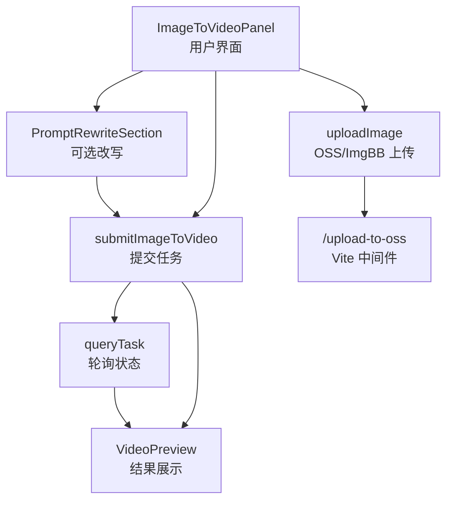
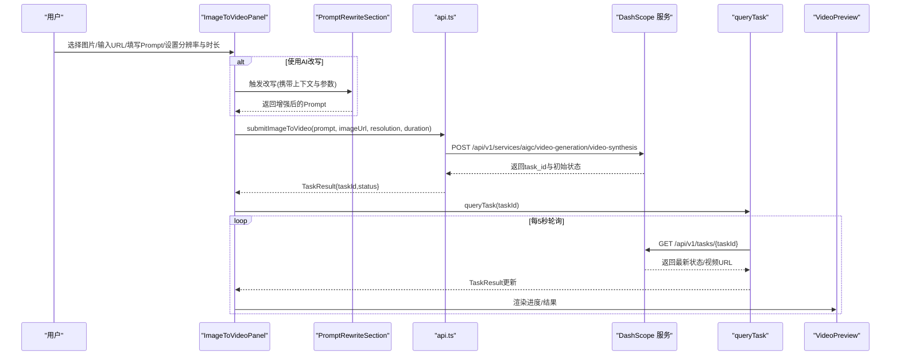
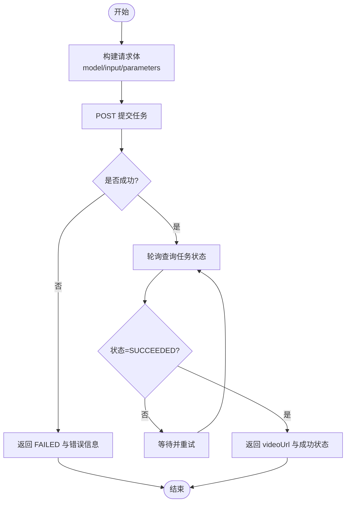
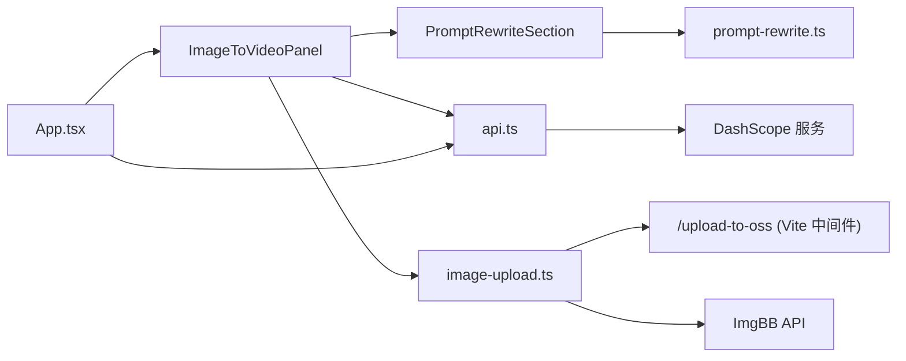

# 图像转视频功能

<cite>
**本文引用的文件列表**
- [src/components/ImageToVideoPanel.tsx](file://src/components/ImageToVideoPanel.tsx)
- [src/lib/api.ts](file://src/lib/api.ts)
- [src/App.tsx](file://src/App.tsx)
- [src/lib/image-upload.ts](file://src/lib/image-upload.ts)
- [src/lib/prompt-rewrite.ts](file://src/lib/prompt-rewrite.ts)
- [src/components/PromptRewriteSection.tsx](file://src/components/PromptRewriteSection.tsx)
- [vite.config.ts](file://vite.config.ts)
- [package.json](file://package.json)
</cite>

## 目录
1. [简介](#简介)
2. [项目结构](#项目结构)
3. [核心组件](#核心组件)
4. [架构总览](#架构总览)
5. [详细组件分析](#详细组件分析)
6. [依赖关系分析](#依赖关系分析)
7. [性能与质量优化建议](#性能与质量优化建议)
8. [故障排查指南](#故障排查指南)
9. [结论](#结论)
10. [附录：API 定义与参数说明](#附录api-定义与参数说明)

## 简介
本章节面向“图像转视频”功能的端到端实现，覆盖从前端图片上传、格式校验、尺寸调整与压缩，到调用后端生成接口、任务状态轮询与结果展示的完整流程。文档同时提供最佳实践与常见问题解决方案，帮助初学者快速上手，并为高级用户提供深入的技术细节。

## 项目结构
该功能位于 React + Vite 前端项目中，关键路径如下：
- 用户交互面板：ImageToVideoPanel（图生视频）
- 提示词改写：PromptRewriteSection + prompt-rewrite（可选增强）
- API 封装：submitImageToVideo、queryTask（提交与查询）
- 图片上传：image-upload（OSS/ImgBB 双后端）
- 应用编排：App（任务提交、轮询、预览）
- 开发期图片中转：vite.config.ts 中的 /upload-to-oss 中间件

图表来源
- [src/components/ImageToVideoPanel.tsx:1-164](file://src/components/ImageToVideoPanel.tsx#L1-L164)
- [src/components/PromptRewriteSection.tsx:1-167](file://src/components/PromptRewriteSection.tsx#L1-L167)
- [src/lib/api.ts:83-102](file://src/lib/api.ts#L83-L102)
- [src/lib/api.ts:176-201](file://src/lib/api.ts#L176-L201)
- [src/lib/image-upload.ts:91-102](file://src/lib/image-upload.ts#L91-L102)
- [vite.config.ts:179-213](file://vite.config.ts#L179-L213)

章节来源
- [src/components/ImageToVideoPanel.tsx:1-164](file://src/components/ImageToVideoPanel.tsx#L1-L164)
- [src/lib/api.ts:1-217](file://src/lib/api.ts#L1-L217)
- [src/App.tsx:1-164](file://src/App.tsx#L1-L164)
- [src/lib/image-upload.ts:1-110](file://src/lib/image-upload.ts#L1-L110)
- [src/lib/prompt-rewrite.ts:1-221](file://src/lib/prompt-rewrite.ts#L1-L221)
- [src/components/PromptRewriteSection.tsx:1-167](file://src/components/PromptRewriteSection.tsx#L1-L167)
- [vite.config.ts:179-213](file://vite.config.ts#L179-L213)

## 核心组件
- ImageToVideoPanel：负责首帧图片上传或 URL 输入、运动描述 Prompt 编辑、分辨率与时长选择、触发提交或 AI 改写后提交。
- PromptRewriteSection：基于 Qwen 模型对 Prompt 进行结构化增强，支持多模态输入（长视频场景），在图生视频场景中可自动注入时长与分辨率信息。
- api.ts：封装 DashScope 异步任务接口，包含提交图像转视频、查询任务状态、错误映射等。
- image-upload.ts：将本地图片上传至公网（优先 OSS 中转，失败回退 ImgBB），返回可被服务访问的 HTTP(S) URL。
- App.tsx：统一编排提交流程、任务轮询、Toast 提示与结果预览。

章节来源
- [src/components/ImageToVideoPanel.tsx:1-164](file://src/components/ImageToVideoPanel.tsx#L1-L164)
- [src/components/PromptRewriteSection.tsx:1-167](file://src/components/PromptRewriteSection.tsx#L1-L167)
- [src/lib/api.ts:1-217](file://src/lib/api.ts#L1-L217)
- [src/lib/image-upload.ts:1-110](file://src/lib/image-upload.ts#L1-L110)
- [src/App.tsx:1-164](file://src/App.tsx#L1-L164)

## 架构总览
下图展示了“图像转视频”的关键数据流与控制流：用户上传图片 → 可选上传至公网 → 构造请求体 → 提交异步任务 → 轮询任务状态 → 渲染结果。

图表来源
- [src/components/ImageToVideoPanel.tsx:33-39](file://src/components/ImageToVideoPanel.tsx#L33-L39)
- [src/components/PromptRewriteSection.tsx:39-62](file://src/components/PromptRewriteSection.tsx#L39-L62)
- [src/lib/api.ts:83-102](file://src/lib/api.ts#L83-L102)
- [src/lib/api.ts:176-201](file://src/lib/api.ts#L176-L201)
- [src/App.tsx:42-55](file://src/App.tsx#L42-L55)

## 详细组件分析

### 图像上传与预处理
- 上传入口
  - 支持本地文件选择与拖拽，读取为 Data URL 用于预览；同时创建 Blob URL 作为提交时的 imageUrl。
  - 也支持直接粘贴外部图片 URL。
- 公网上传（推荐）
  - 通过 uploadImage(file, imgbbKey?) 自动选择后端：优先 OSS 中转（零配置前端），失败时回退 ImgBB（需配置 Key）。
  - OSS 中转由 Vite dev server 中间件处理，接收 base64 图片并写入对象存储，返回公网 URL。
- 格式与大小建议
  - 接受常见图片格式（JPG/PNG），建议分辨率 1280x720 左右，避免过大导致网络与解析压力。
  - 若使用长视频或多图参考，代码中实现了 Canvas 缩放与 JPEG 压缩策略（短边不低于 480，长边不高于 1280，质量约 0.6），可作为图生视频的参考。

章节来源
- [src/components/ImageToVideoPanel.tsx:21-39](file://src/components/ImageToVideoPanel.tsx#L21-L39)
- [src/lib/image-upload.ts:30-46](file://src/lib/image-upload.ts#L30-L46)
- [src/lib/image-upload.ts:53-86](file://src/lib/image-upload.ts#L53-L86)
- [src/lib/image-upload.ts:91-102](file://src/lib/image-upload.ts#L91-L102)
- [vite.config.ts:179-213](file://vite.config.ts#L179-L213)
- [src/components/LongVideoPanel.tsx:374-432](file://src/components/LongVideoPanel.tsx#L374-L432)

### 提示词改写（可选）
- 作用：将简短描述改写为结构化、更具画面感的 Prompt，提升生成质量。
- 能力：根据上下文（text-to-video、image-to-video、video-edit、long-video、batch）注入不同 Few-shot 示例与约束；当存在图片时，视觉模型会结合图片内容增强分镜规划。
- 集成：在 ImageToVideoPanel 中点击“AI 改写并生成”，先调用 rewritePrompt，再使用改写后的 Prompt 提交任务。

章节来源
- [src/components/PromptRewriteSection.tsx:1-167](file://src/components/PromptRewriteSection.tsx#L1-L167)
- [src/lib/prompt-rewrite.ts:84-201](file://src/lib/prompt-rewrite.ts#L84-L201)
- [src/components/ImageToVideoPanel.tsx:124-133](file://src/components/ImageToVideoPanel.tsx#L124-L133)

### 图像转视频 API 调用与响应处理
- 提交接口
  - 函数：submitImageToVideo(apiKey, { prompt, imageUrl, resolution?, duration?, language? })
  - 请求体包含 model、input（prompt、negative_prompt、media.first_frame.url）、parameters（resolution、duration）。
  - 附加语言提示（如英文/粤语）以改善风格一致性。
- 任务查询
  - 函数：queryTask(apiKey, taskId)
  - 返回状态映射（PENDING/RUNNING/SUCCEEDED/FAILED/UNKNOWN），成功时附带 videoUrl。
- 错误处理
  - 网络异常、非 JSON 响应、HTTP 非 2xx 均会被捕获并转换为统一的 TaskResult 错误消息。

图表来源
- [src/lib/api.ts:83-102](file://src/lib/api.ts#L83-L102)
- [src/lib/api.ts:125-174](file://src/lib/api.ts#L125-L174)
- [src/lib/api.ts:176-201](file://src/lib/api.ts#L176-L201)
- [src/lib/api.ts:203-216](file://src/lib/api.ts#L203-L216)

章节来源
- [src/lib/api.ts:83-102](file://src/lib/api.ts#L83-L102)
- [src/lib/api.ts:125-174](file://src/lib/api.ts#L125-L174)
- [src/lib/api.ts:176-201](file://src/lib/api.ts#L176-L201)
- [src/lib/api.ts:203-216](file://src/lib/api.ts#L203-L216)

### 任务状态管理与结果展示
- 提交成功后，App 启动轮询（默认每 5 秒一次），直到 SUCCEEDED 或 FAILED。
- 成功时显示 Toast 并在 VideoPreview 中播放生成的视频；失败时展示错误信息。

章节来源
- [src/App.tsx:42-55](file://src/App.tsx#L42-L55)
- [src/App.tsx:76-93](file://src/App.tsx#L76-L93)

## 依赖关系分析
- 组件层
  - ImageToVideoPanel 依赖 PromptRewriteSection（可选）与 api.ts（提交/查询）。
  - App.tsx 协调各面板与任务状态。
- 工具层
  - image-upload.ts 提供公网图片上传能力，依赖 Vite 中间件 /upload-to-oss 或直接调用 ImgBB。
  - prompt-rewrite.ts 调用 Qwen 兼容模式接口进行 Prompt 改写。
- 运行时依赖
  - @ffmpeg/* 与 ali-oss 存在于 package.json，当前图生视频主流程未直接使用 FFmpeg；ali-oss 可能用于其他功能或扩展。

图表来源
- [src/components/ImageToVideoPanel.tsx:1-164](file://src/components/ImageToVideoPanel.tsx#L1-L164)
- [src/components/PromptRewriteSection.tsx:1-167](file://src/components/PromptRewriteSection.tsx#L1-L167)
- [src/lib/api.ts:1-217](file://src/lib/api.ts#L1-L217)
- [src/lib/image-upload.ts:1-110](file://src/lib/image-upload.ts#L1-L110)
- [src/lib/prompt-rewrite.ts:1-221](file://src/lib/prompt-rewrite.ts#L1-L221)
- [vite.config.ts:179-213](file://vite.config.ts#L179-L213)
- [package.json:1-36](file://package.json#L1-L36)

章节来源
- [package.json:1-36](file://package.json#L1-L36)

## 性能与质量优化建议
- 图片尺寸与压缩
  - 建议首帧分辨率接近目标输出分辨率（如 1280x720），避免过大造成传输与解码压力。
  - 长边不超过 1280，短边不低于 480，JPEG 质量 0.6~0.85 之间平衡体积与清晰度。
- 公网 URL 优先
  - 尽量使用公网可访问的图片 URL（OSS/ImgBB），减少 Base64 体积带来的带宽与解析开销。
- 提示词质量
  - 使用 AI 改写增强镜头运动、光影、氛围等维度，有助于提升生成稳定性与表现力。
- 轮询间隔与超时
  - 默认 5 秒轮询适合单任务；批量或长视频场景可适当增大间隔，避免频繁请求。
- 资源释放
  - 使用 Blob URL 预览后及时 revokeObjectURL，避免内存泄漏。

[本节为通用指导，无需源码引用]

## 故障排查指南
- 图片格式不支持
  - 现象：上传失败或无法预览。
  - 排查：确认 JPG/PNG 等常见格式；检查浏览器兼容性；必要时在服务端转换。
- 文件大小限制
  - 现象：提交失败或响应慢。
  - 排查：压缩图片、降低分辨率；优先使用公网 URL；关注服务端的图片大小限制。
- 生成质量不佳
  - 现象：画面模糊、运动不自然。
  - 排查：优化 Prompt（加入镜头运动、光影、氛围描述）；调整分辨率与时长；尝试 AI 改写。
- 网络与鉴权错误
  - 现象：提交失败、返回 HTTP 错误或认证失败。
  - 排查：检查 apiKey 是否正确；确认代理/跨域配置；查看错误消息中的 code/request_id。
- 任务长时间无结果
  - 现象：轮询超时或一直 RUNNING。
  - 排查：适当延长轮询上限；检查服务端负载；避免重复提交相同任务。

章节来源
- [src/lib/api.ts:125-174](file://src/lib/api.ts#L125-L174)
- [src/lib/api.ts:176-201](file://src/lib/api.ts#L176-L201)
- [src/App.tsx:42-55](file://src/App.tsx#L42-L55)

## 结论
图像转视频功能在前端侧完成了从图片上传、可选改写、任务提交到状态轮询与结果展示的闭环。通过合理的图片预处理与提示词增强，能够显著提升生成质量与用户体验。对于大规模或复杂场景，建议引入更完善的图片压缩流水线、重试与熔断机制，以及更细粒度的错误分类与用户引导。

[本节为总结性内容，无需源码引用]

## 附录：API 定义与参数说明
- 提交图像转视频
  - 函数：submitImageToVideo(apiKey, params)
  - 参数：
    - prompt：字符串，描述画面如何动起来
    - imageUrl：字符串，首帧图片的公网 URL 或 Data URL
    - resolution：可选，'480p' | '720p' | '1080p'
    - duration：可选，秒数
    - language：可选，'zh' | 'en' | 'yue'
  - 返回：TaskResult（含 taskId、status、message、videoUrl）
- 查询任务状态
  - 函数：queryTask(apiKey, taskId)
  - 返回：TaskResult（含 status、videoUrl、message）
- 错误映射
  - 网络异常、JSON 解析失败、HTTP 非 2xx 均转为 FAILED 状态并附带可读消息

章节来源
- [src/lib/api.ts:18-37](file://src/lib/api.ts#L18-37)
- [src/lib/api.ts:83-102](file://src/lib/api.ts#L83-L102)
- [src/lib/api.ts:176-201](file://src/lib/api.ts#L176-L201)
- [src/lib/api.ts:203-216](file://src/lib/api.ts#L203-L216)