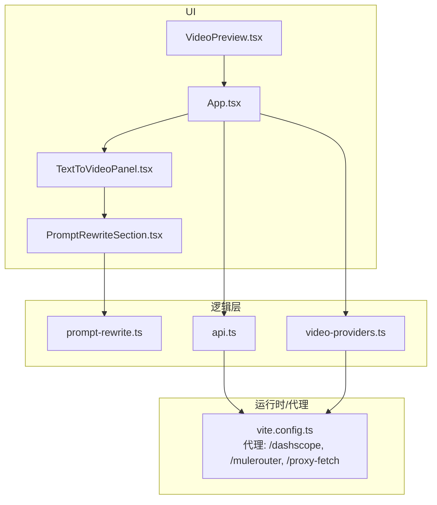
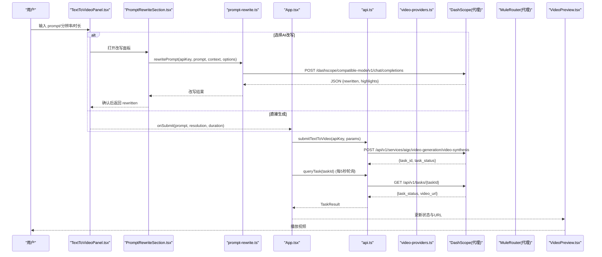
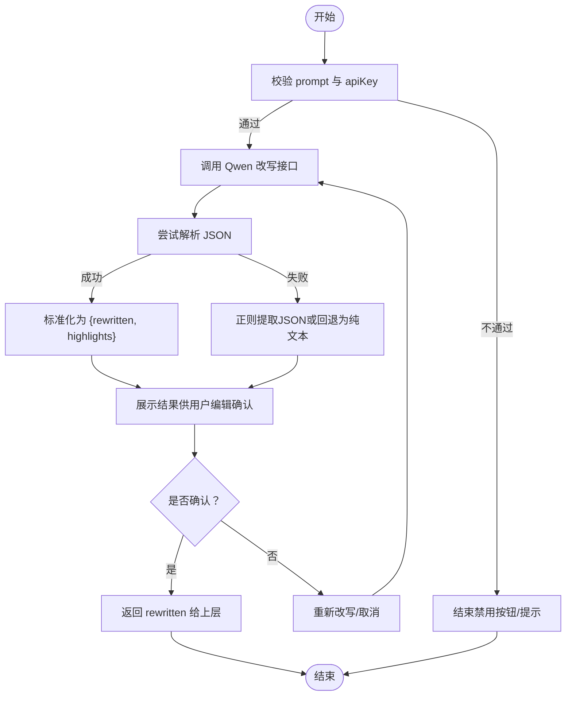
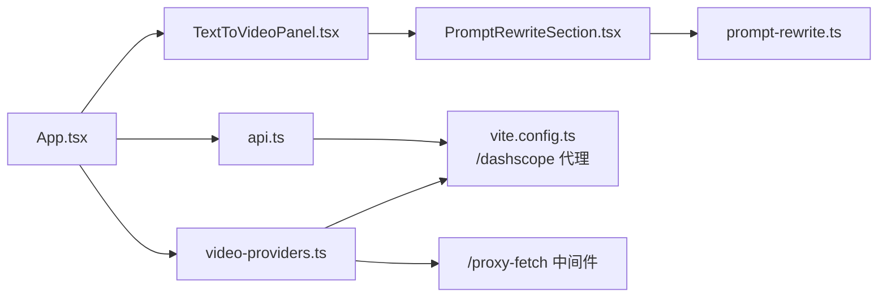

# 文本转视频功能

<cite>
**本文引用的文件**   
- [src/App.tsx](file://src/App.tsx)
- [src/components/TextToVideoPanel.tsx](file://src/components/TextToVideoPanel.tsx)
- [src/components/PromptRewriteSection.tsx](file://src/components/PromptRewriteSection.tsx)
- [src/lib/prompt-rewrite.ts](file://src/lib/prompt-rewrite.ts)
- [src/lib/api.ts](file://src/lib/api.ts)
- [src/lib/video-providers.ts](file://src/lib/video-providers.ts)
- [src/components/VideoPreview.tsx](file://src/components/VideoPreview.tsx)
- [vite.config.ts](file://vite.config.ts)
- [package.json](file://package.json)
</cite>

## 目录
1. [简介](#简介)
2. [项目结构](#项目结构)
3. [核心组件](#核心组件)
4. [架构总览](#架构总览)
5. [详细组件分析](#详细组件分析)
6. [依赖关系分析](#依赖关系分析)
7. [性能与稳定性](#性能与稳定性)
8. [常见问题排查](#常见问题排查)
9. [结论](#结论)
10. [附录：API 与参数说明](#附录api-与参数说明)

## 简介
本仓库实现了一个“文本转视频”的前端应用，支持通过自然语言描述生成动态视频。系统提供：
- 文本到视频的提交与异步任务轮询
- Prompt AI 改写（基于 Qwen 大模型），增强画面主体、镜头运动、光线、风格质感与环境氛围等维度
- 多 Provider 抽象层（HappyHorse、Kling V3 Omni、Muledance 2.0），统一提交与查询接口
- 开发期代理与跨域处理（DashScope、MuleRouter、第三方 CDN）
- 预览与状态展示

该文档面向初学者与高级用户，既给出端到端使用流程与最佳实践，也深入解析关键实现细节与优化策略。

## 项目结构
前端采用 React + TypeScript + Vite 构建，核心模块按职责划分：
- UI 面板：文本输入、Prompt 改写、预览、状态栏
- 业务逻辑：API 封装、Provider 抽象、Prompt 改写
- 开发期中间件：代理转发、CORS 绕过、OSS 中转上传

图表来源
- [src/App.tsx:1-164](file://src/App.tsx#L1-L164)
- [src/components/TextToVideoPanel.tsx:1-117](file://src/components/TextToVideoPanel.tsx#L1-L117)
- [src/components/PromptRewriteSection.tsx:1-167](file://src/components/PromptRewriteSection.tsx#L1-L167)
- [src/lib/prompt-rewrite.ts:1-221](file://src/lib/prompt-rewrite.ts#L1-L221)
- [src/lib/api.ts:1-217](file://src/lib/api.ts#L1-L217)
- [src/lib/video-providers.ts:1-559](file://src/lib/video-providers.ts#L1-L559)
- [vite.config.ts:1-294](file://vite.config.ts#L1-L294)

章节来源
- [src/App.tsx:1-164](file://src/App.tsx#L1-L164)
- [vite.config.ts:1-294](file://vite.config.ts#L1-L294)

## 核心组件
- 文本转视频面板：收集 prompt、分辨率、时长，并触发提交或 AI 改写后提交
- Prompt 改写组件：调用 Qwen 进行结构化改写，支持编辑确认
- API 封装：向 DashScope 提交文生视频任务与查询任务状态
- Provider 抽象：统一不同模型的提交与查询，自动选择适配的 adapter
- 预览与状态：展示生成进度、结果与错误信息

章节来源
- [src/components/TextToVideoPanel.tsx:1-117](file://src/components/TextToVideoPanel.tsx#L1-L117)
- [src/components/PromptRewriteSection.tsx:1-167](file://src/components/PromptRewriteSection.tsx#L1-L167)
- [src/lib/api.ts:1-217](file://src/lib/api.ts#L1-L217)
- [src/lib/video-providers.ts:1-559](file://src/lib/video-providers.ts#L1-L559)
- [src/components/VideoPreview.tsx:1-65](file://src/components/VideoPreview.tsx#L1-L65)

## 架构总览
整体数据流从 UI 发起，经业务逻辑层调用外部服务，再由后端返回异步任务 ID，前端轮询获取最终视频 URL 并在预览区播放。

图表来源
- [src/components/TextToVideoPanel.tsx:1-117](file://src/components/TextToVideoPanel.tsx#L1-L117)
- [src/components/PromptRewriteSection.tsx:1-167](file://src/components/PromptRewriteSection.tsx#L1-L167)
- [src/lib/prompt-rewrite.ts:1-221](file://src/lib/prompt-rewrite.ts#L1-L221)
- [src/lib/api.ts:1-217](file://src/lib/api.ts#L1-L217)
- [src/components/VideoPreview.tsx:1-65](file://src/components/VideoPreview.tsx#L1-L65)
- [vite.config.ts:277-293](file://vite.config.ts#L277-L293)

## 详细组件分析

### 文本转视频面板（TextToVideoPanel）
- 输入参数
  - prompt：自然语言描述，最大 500 字符
  - resolution：可选 480p/720p/1080p（实际由 Provider 能力决定）
  - duration：2~10 秒滑块控制
- 交互流程
  - 点击“AI 改写并生成”进入改写面板；确认后以改写后的 prompt 提交
  - 点击“跳过改写，直接生成”则用原始 prompt 提交
- 提交入口
  - 调用父级传入的 onSubmit(prompt, resolution, duration)

章节来源
- [src/components/TextToVideoPanel.tsx:1-117](file://src/components/TextToVideoPanel.tsx#L1-L117)

### Prompt 改写（PromptRewriteSection + prompt-rewrite）
- 改写目标
  - 将简短描述扩展为结构化提示词，包含画面主体、镜头运动、光线、风格质感、环境氛围等维度
- 技术要点
  - 使用 Qwen 大模型，few-shot 示例 + response_format=json_object 保证结构化输出
  - 支持多种上下文：text-to-video、image-to-video、video-edit、long-video、batch
  - 兼容多种返回格式（标准字段、标签键、长视频扁平字段），失败时回退为纯文本
- 集成方式
  - 在 TextToVideoPanel 中作为子组件嵌入，自动触发改写，用户可编辑并确认
- 优化策略
  - 对非视觉场景启用 json_object 约束，降低解析失败率
  - 对含图片场景切换视觉模型 qwen-vl-plus，并调整 system prompt 引导配图融合
  - 安全序列化与正则兜底，提升鲁棒性

图表来源
- [src/components/PromptRewriteSection.tsx:1-167](file://src/components/PromptRewriteSection.tsx#L1-L167)
- [src/lib/prompt-rewrite.ts:1-221](file://src/lib/prompt-rewrite.ts#L1-L221)

章节来源
- [src/components/PromptRewriteSection.tsx:1-167](file://src/components/PromptRewriteSection.tsx#L1-L167)
- [src/lib/prompt-rewrite.ts:1-221](file://src/lib/prompt-rewrite.ts#L1-L221)

### API 封装（api.ts）
- 主要能力
  - 提交文本转视频任务：submitTextToVideo
  - 查询任务状态：queryTask
  - 统一状态映射与错误包装
- 请求头与模式
  - 设置 X-DashScope-Async 开启异步任务
  - 附加 negative_prompt 抑制乱码文字渲染
  - 根据 language 追加语言提示（en/yue）
- 响应处理
  - 提交返回 taskId 与初始状态
  - 查询返回最终 videoUrl（若完成）

章节来源
- [src/lib/api.ts:1-217](file://src/lib/api.ts#L1-L217)

### Provider 抽象层（video-providers.ts）
- 设计目标
  - 统一不同模型（HappyHorse、Kling V3 Omni、Muledance 2.0）的提交与查询
  - 通过 capabilities 元数据驱动 UI 控件可用性与上限
- 路由机制
  - submitVideoTask/queryVideoTask 根据 provider 分发到对应 adapter
  - MuleRouter 系列通过 model 前缀编码 taskId，便于后续查询还原
- 健壮性
  - fetchWithRetry 自动重试 429/5xx 及网络异常
  - wrapWithProxyFetch 将第三方 CDN 视频链接包装为同源代理，避免 CORS 问题
- 能力矩阵
  - 分辨率、单段时长、原生音频、首尾帧锁定、多参考图、多镜头等

章节来源
- [src/lib/video-providers.ts:1-559](file://src/lib/video-providers.ts#L1-L559)

### 应用编排（App.tsx）
- 状态管理
  - 保存 apiKey/imgbbKey 至 localStorage
  - 维护当前任务结果与提交状态
- 提交流程
  - 校验 apiKey → 提交任务 → 启动轮询 → 成功/失败提示
- 预览与状态栏
  - 根据 TaskResult 显示等待、进行中、完成、失败状态

章节来源
- [src/App.tsx:1-164](file://src/App.tsx#L1-L164)
- [src/components/VideoPreview.tsx:1-65](file://src/components/VideoPreview.tsx#L1-L65)

## 依赖关系分析
- 组件耦合
  - App 作为根容器协调各面板与状态
  - TextToVideoPanel 依赖 PromptRewriteSection 与父级回调
  - PromptRewriteSection 依赖 prompt-rewrite 工具
  - api.ts 与 video-providers.ts 分别对接 DashScope 与 MuleRouter
- 外部依赖
  - @ffmpeg/* 用于本地音视频处理（当前主要用于扩展能力）
  - ali-oss 用于 OSS 上传（开发期通过中间件中转）
- 代理与跨域
  - vite.config.ts 配置 /dashscope 与 /mulerouter 代理
  - /proxy-fetch 中间件解决第三方 CDN 无 CORS 的问题

图表来源
- [src/App.tsx:1-164](file://src/App.tsx#L1-L164)
- [src/components/TextToVideoPanel.tsx:1-117](file://src/components/TextToVideoPanel.tsx#L1-L117)
- [src/components/PromptRewriteSection.tsx:1-167](file://src/components/PromptRewriteSection.tsx#L1-L167)
- [src/lib/prompt-rewrite.ts:1-221](file://src/lib/prompt-rewrite.ts#L1-L221)
- [src/lib/api.ts:1-217](file://src/lib/api.ts#L1-L217)
- [src/lib/video-providers.ts:1-559](file://src/lib/video-providers.ts#L1-L559)
- [vite.config.ts:1-294](file://vite.config.ts#L1-L294)

章节来源
- [package.json:1-36](file://package.json#L1-L36)
- [vite.config.ts:1-294](file://vite.config.ts#L1-L294)

## 性能与稳定性
- 轮询间隔
  - 默认 5 秒轮询一次任务状态，平衡实时性与服务器压力
- 重试与限流
  - MuleRouter 侧内置指数退避重试，应对 429/5xx 与网络抖动
- 并发控制
  - Provider 元数据提供 maxConcurrency 与 submitStaggerMs，批量场景建议遵循
- 资源代理
  - 通过 /proxy-fetch 避免浏览器跨域限制，减少额外请求失败
- 提示词改写
  - 使用 json_object 约束与多格式兼容，降低解析失败导致的重试开销

[本节为通用指导，无需具体文件引用]

## 常见问题排查
- 未配置 API Key
  - 现象：提交被拦截并弹出设置窗口
  - 处理：在设置中填写 DashScope API Key 并保存
- 网络错误或代理未生效
  - 现象：提交失败，提示网络错误或代理不可达
  - 处理：确保 dev server 已启动且 /dashscope 与 /mulerouter 代理有效
- 第三方视频无法播放
  - 现象：视频 URL 存在但无法加载
  - 处理：检查是否通过 wrapWithProxyFetch 包装为 /proxy-fetch 同源地址
- Prompt 质量不佳
  - 现象：生成内容与预期不符
  - 处理：使用“AI 改写”增强维度描述，必要时手动微调
- 生成失败
  - 现象：任务状态为 FAILED 并附带 message
  - 处理：查看 message 详情，调整分辨率/时长/语言提示或重试

章节来源
- [src/App.tsx:42-74](file://src/App.tsx#L42-L74)
- [src/lib/api.ts:125-174](file://src/lib/api.ts#L125-L174)
- [src/lib/video-providers.ts:263-296](file://src/lib/video-providers.ts#L263-L296)
- [src/components/VideoPreview.tsx:1-65](file://src/components/VideoPreview.tsx#L1-L65)

## 结论
本项目提供了完整的“文本转视频”前端解决方案，涵盖 Prompt 改写、多 Provider 抽象、异步任务管理与预览展示。通过合理的代理与重试机制，提升了稳定性与可用性。对于初学者，可直接使用 UI 完成端到端体验；对于高级用户，可通过 Provider 能力矩阵与 API 封装快速扩展新的模型接入点。

[本节为总结，无需具体文件引用]

## 附录：API 与参数说明

### 文本转视频（DashScope HappyHorse）
- 提交接口
  - 路径：/dashscope/api/v1/services/aigc/video-generation/video-synthesis
  - 方法：POST
  - 必要头部：Authorization: Bearer <apiKey>, Content-Type: application/json, X-DashScope-Async: enable
  - 请求体关键字段
    - model：happyhorse-1.1-t2v
    - input.prompt：自然语言描述（可附加语言提示）
    - input.negative_prompt：抑制乱码文字
    - parameters.resolution：'480p'|'720p'|'1080p'（大写）
    - parameters.duration：秒数
  - 响应关键字段
    - output.task_id：任务ID
    - output.task_status：PENDING/RUNNING/SUCCEEDED/FAILED
- 查询接口
  - 路径：/dashscope/api/v1/tasks/{taskId}
  - 方法：GET
  - 头部：Authorization: Bearer <apiKey>
  - 响应关键字段
    - output.video_url：生成的视频地址（完成时）

章节来源
- [src/lib/api.ts:63-81](file://src/lib/api.ts#L63-L81)
- [src/lib/api.ts:176-201](file://src/lib/api.ts#L176-L201)

### Prompt 改写（Qwen）
- 接口
  - 路径：/dashscope/compatible-mode/v1/chat/completions
  - 方法：POST
  - 头部：Authorization: Bearer <apiKey>, Content-Type: application/json
  - 请求体关键字段
    - model：qwen-plus（纯文本）或 qwen-vl-plus（含图片）
    - messages：system/user/assistant 消息数组
    - response_format：{type: 'json_object'}（纯文本场景）
    - temperature：0.7
  - 响应关键字段
    - choices[0].message.content：JSON 字符串，包含 rewritten 与 highlights

章节来源
- [src/lib/prompt-rewrite.ts:84-150](file://src/lib/prompt-rewrite.ts#L84-L150)

### Provider 统一接口（video-providers.ts）
- 提交
  - 函数：submitVideoTask(provider, params)
  - 参数 UnifiedSubmitParams
    - apiKey：string
    - prompt：string
    - resolution：'480p'|'720p'|'1080p'
    - durationSec：number
    - language：'zh'|'en'|'yue'
    - imageUrl/refImageUrls/refVideoUrls/refAudioUrls/lastFrameUrl：可选
    - enableNativeAudio/enableMultiShot/klingMode/aspectRatio：可选
  - 返回：TaskResult（taskId/status/message/videoUrl）
- 查询
  - 函数：queryVideoTask(provider, apiKey, taskId)
  - 返回：TaskResult

章节来源
- [src/lib/video-providers.ts:491-544](file://src/lib/video-providers.ts#L491-L544)

### 使用示例（步骤式）
- 基础文本转视频
  - 在文本面板输入 prompt，选择分辨率与时长，点击“跳过改写，直接生成”
  - 应用层提交任务并轮询，完成后在预览区播放
- 使用 AI 改写
  - 点击“AI 改写并生成”，在改写面板确认或编辑结果后提交
- 多 Provider 切换
  - 通过 Provider 能力矩阵选择合适模型，统一提交与查询流程不变

章节来源
- [src/App.tsx:57-74](file://src/App.tsx#L57-L74)
- [src/components/TextToVideoPanel.tsx:19-23](file://src/components/TextToVideoPanel.tsx#L19-L23)
- [src/components/PromptRewriteSection.tsx:39-67](file://src/components/PromptRewriteSection.tsx#L39-L67)

### 最佳实践建议
- 分辨率与时长
  - 720p/5s 适合快速预览与社媒预热；1080p/10s 适合高质量内容
  - 不同 Provider 支持的分辨率与时长不同，优先依据其 capabilities 选择
- Prompt 质量
  - 明确主体、动作、镜头运动、光线与氛围；避免模糊或矛盾描述
  - 使用 AI 改写增强结构化维度，必要时手动微调
- 语言与文化
  - 指定语言（中文/英文/粤语）有助于语音与场景一致性
- 失败重试
  - 遇到限流或临时错误，等待后重试；关注 message 中的具体原因

[本节为通用指导，无需具体文件引用]