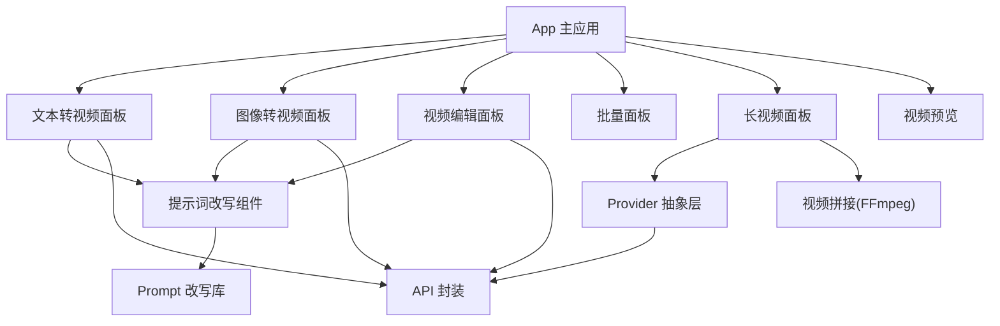
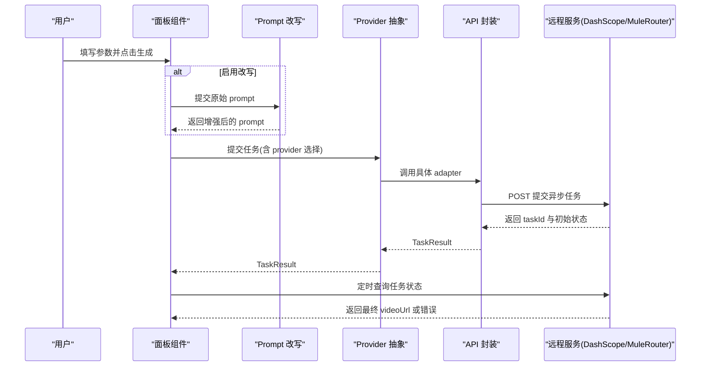
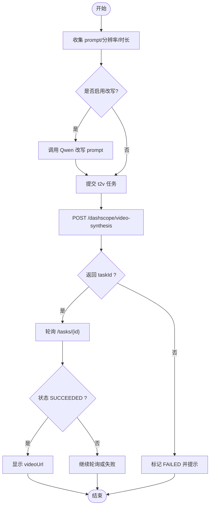
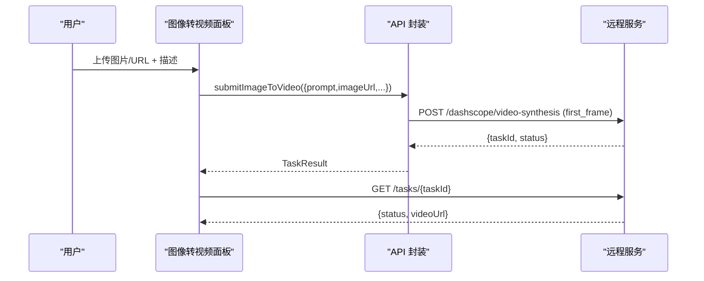
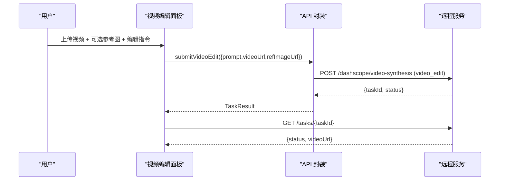
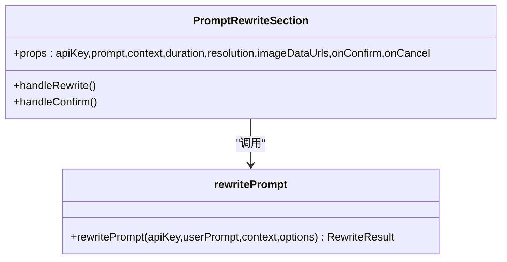
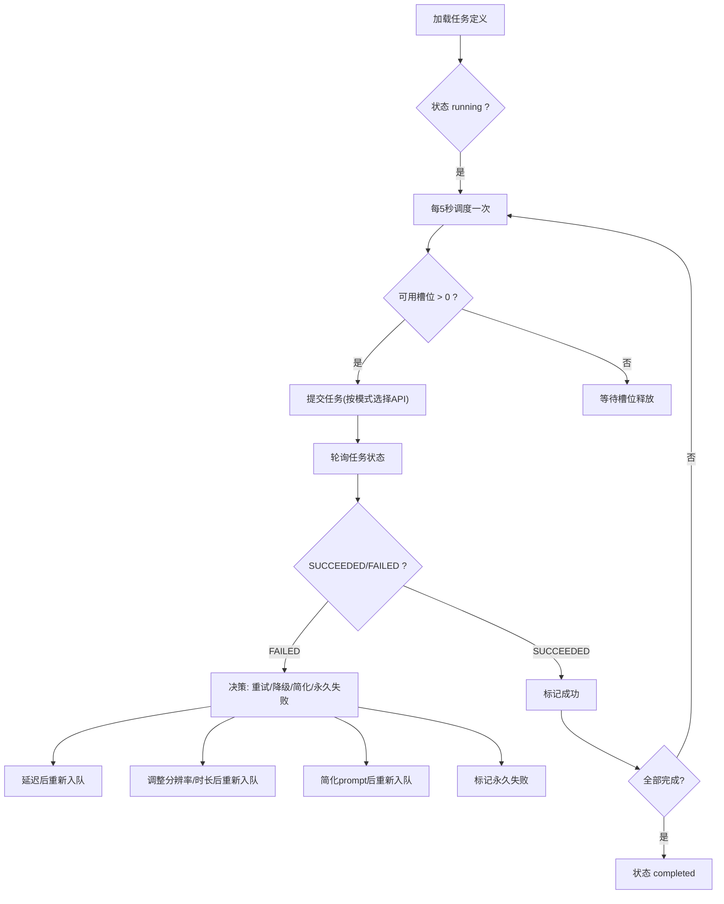
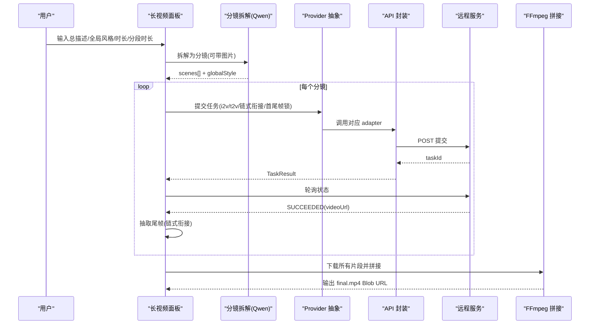
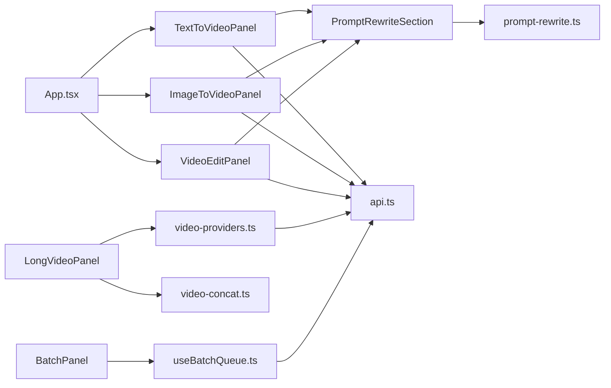

# 核心功能模块

<cite>
**本文引用的文件**
- [src/App.tsx](file://src/App.tsx)
- [src/components/TextToVideoPanel.tsx](file://src/components/TextToVideoPanel.tsx)
- [src/components/ImageToVideoPanel.tsx](file://src/components/ImageToVideoPanel.tsx)
- [src/components/VideoEditPanel.tsx](file://src/components/VideoEditPanel.tsx)
- [src/lib/api.ts](file://src/lib/api.ts)
- [src/lib/video-providers.ts](file://src/lib/video-providers.ts)
- [src/components/PromptRewriteSection.tsx](file://src/components/PromptRewriteSection.tsx)
- [src/lib/prompt-rewrite.ts](file://src/lib/prompt-rewrite.ts)
- [src/hooks/useBatchQueue.ts](file://src/hooks/useBatchQueue.ts)
- [src/components/batch/BatchPanel.tsx](file://src/components/batch/BatchPanel.tsx)
- [src/lib/batch-types.ts](file://src/lib/batch-types.ts)
- [src/components/LongVideoPanel.tsx](file://src/components/LongVideoPanel.tsx)
- [src/lib/video-concat.ts](file://src/lib/video-concat.ts)
- [src/components/VideoPreview.tsx](file://src/components/VideoPreview.tsx)
</cite>

## 目录
1. [简介](#简介)
2. [项目结构](#项目结构)
3. [核心组件](#核心组件)
4. [架构总览](#架构总览)
5. [详细组件分析](#详细组件分析)
6. [依赖关系分析](#依赖关系分析)
7. [性能与优化建议](#性能与优化建议)
8. [故障排查指南](#故障排查指南)
9. [结论](#结论)
10. [附录：API 与参数说明](#附录api-与参数说明)

## 简介
本文件面向 AI 视频生成平台的核心功能模块，围绕三大能力进行系统化文档化：文本转视频、图像转视频、视频编辑。内容覆盖实现原理、输入参数、配置选项、输出格式、处理流程、数据流转与状态管理，并提供最佳实践与常见问题处理方法。同时补充批量任务与长视频拼接等扩展能力的技术细节，帮助初学者快速上手，也为高级用户提供深入的技术洞察。

## 项目结构
前端采用 React + TypeScript + Vite 构建，UI 使用 Tailwind 与基础 UI 组件库；后端通过本地代理访问阿里云百炼（DashScope）与 MuleRouter 聚合服务。核心目录与职责如下：
- src/components: 页面级面板与通用 UI 组件，包含三大核心功能入口与预览区
- src/lib: API 封装、模型 Provider 抽象、Prompt 改写、批处理类型与工具函数
- src/hooks: 批量队列 Hook 与日志 Hook
- public/ffmpeg: ffmpeg.wasm 资源，用于浏览器端视频拼接

图表来源
- [src/App.tsx:1-164](file://src/App.tsx#L1-L164)
- [src/components/TextToVideoPanel.tsx:1-117](file://src/components/TextToVideoPanel.tsx#L1-L117)
- [src/components/ImageToVideoPanel.tsx:1-164](file://src/components/ImageToVideoPanel.tsx#L1-L164)
- [src/components/VideoEditPanel.tsx:1-157](file://src/components/VideoEditPanel.tsx#L1-L157)
- [src/components/PromptRewriteSection.tsx:1-167](file://src/components/PromptRewriteSection.tsx#L1-L167)
- [src/lib/prompt-rewrite.ts:1-221](file://src/lib/prompt-rewrite.ts#L1-L221)
- [src/lib/api.ts:1-217](file://src/lib/api.ts#L1-L217)
- [src/lib/video-providers.ts:1-559](file://src/lib/video-providers.ts#L1-L559)
- [src/lib/video-concat.ts:1-110](file://src/lib/video-concat.ts#L1-L110)
- [src/components/VideoPreview.tsx:1-65](file://src/components/VideoPreview.tsx#L1-L65)

章节来源
- [src/App.tsx:1-164](file://src/App.tsx#L1-L164)

## 核心组件
- 文本转视频面板：提供描述输入、分辨率与时长选择、AI 改写与直接提交
- 图像转视频面板：支持图片上传或 URL 输入、运动描述、分辨率与时长选择、AI 改写与直接提交
- 视频编辑面板：支持源视频上传或 URL、可选参考图、编辑指令、AI 改写与直接提交
- Prompt 改写组件：统一调用 Qwen 对 prompt 进行结构化增强，支持多模态输入
- API 封装：封装 DashScope 异步任务提交与查询，统一错误映射
- Provider 抽象层：统一 HappyHorse 与 MuleRouter（Kling/Muledance）的提交与查询路由
- 批量队列：基于 useReducer 的任务编排、并发控制、重试与降级策略
- 长视频面板：分镜拆解、混合路由（i2v/t2v）、链式衔接、首尾帧硬锁、最终拼接
- 视频预览：根据任务状态展示加载、完成与失败信息

章节来源
- [src/components/TextToVideoPanel.tsx:1-117](file://src/components/TextToVideoPanel.tsx#L1-L117)
- [src/components/ImageToVideoPanel.tsx:1-164](file://src/components/ImageToVideoPanel.tsx#L1-L164)
- [src/components/VideoEditPanel.tsx:1-157](file://src/components/VideoEditPanel.tsx#L1-L157)
- [src/components/PromptRewriteSection.tsx:1-167](file://src/components/PromptRewriteSection.tsx#L1-L167)
- [src/lib/api.ts:1-217](file://src/lib/api.ts#L1-L217)
- [src/lib/video-providers.ts:1-559](file://src/lib/video-providers.ts#L1-L559)
- [src/hooks/useBatchQueue.ts:1-322](file://src/hooks/useBatchQueue.ts#L1-L322)
- [src/components/LongVideoPanel.tsx:1-800](file://src/components/LongVideoPanel.tsx#L1-L800)
- [src/components/VideoPreview.tsx:1-65](file://src/components/VideoPreview.tsx#L1-L65)

## 架构总览
整体采用“面板 → 改写 → Provider/API → 远程服务”的分层架构。面板负责用户交互与参数组装；改写模块提升 prompt 质量；Provider 抽象屏蔽不同模型差异；API 层统一网络请求与错误处理；远程服务返回异步任务 ID，前端轮询获取结果。

图表来源
- [src/components/TextToVideoPanel.tsx:1-117](file://src/components/TextToVideoPanel.tsx#L1-L117)
- [src/components/ImageToVideoPanel.tsx:1-164](file://src/components/ImageToVideoPanel.tsx#L1-L164)
- [src/components/VideoEditPanel.tsx:1-157](file://src/components/VideoEditPanel.tsx#L1-L157)
- [src/components/PromptRewriteSection.tsx:1-167](file://src/components/PromptRewriteSection.tsx#L1-L167)
- [src/lib/prompt-rewrite.ts:1-221](file://src/lib/prompt-rewrite.ts#L1-L221)
- [src/lib/video-providers.ts:1-559](file://src/lib/video-providers.ts#L1-L559)
- [src/lib/api.ts:1-217](file://src/lib/api.ts#L1-L217)

## 详细组件分析

### 文本转视频（Text-to-Video）
- 输入参数
  - 描述文本（prompt）
  - 分辨率：480p/720p/1080p
  - 时长：秒（默认 5s）
  - 语言：中文/英文/粤语（在 API 层附加语言提示）
- 处理流程
  - 用户输入后，可选择“AI 改写并生成”或直接提交
  - 提交时构造 model 为 happyhorse-1.1-t2v，附带 negative_prompt 抑制乱码文字
  - 返回异步任务 ID，前端轮询直至完成或失败
- 输出格式
  - 成功：videoUrl（MP4）
  - 失败：message 包含错误原因
- 关键代码路径
  - 提交入口：[submitTextToVideo:63-81](file://src/lib/api.ts#L63-L81)
  - 面板逻辑：[TextToVideoPanel:1-117](file://src/components/TextToVideoPanel.tsx#L1-L117)
  - 状态轮询：[App.pollTaskStatus:42-55](file://src/App.tsx#L42-L55)

图表来源
- [src/lib/api.ts:63-81](file://src/lib/api.ts#L63-L81)
- [src/App.tsx:42-55](file://src/App.tsx#L42-L55)
- [src/components/TextToVideoPanel.tsx:1-117](file://src/components/TextToVideoPanel.tsx#L1-L117)

章节来源
- [src/components/TextToVideoPanel.tsx:1-117](file://src/components/TextToVideoPanel.tsx#L1-L117)
- [src/lib/api.ts:1-217](file://src/lib/api.ts#L1-L217)
- [src/App.tsx:1-164](file://src/App.tsx#L1-L164)

### 图像转视频（Image-to-Video）
- 输入参数
  - 首帧图片：支持本地上传（Data URL）或外部 URL
  - 运动描述（prompt）
  - 分辨率：480p/720p/1080p
  - 时长：秒（默认 5s）
- 处理流程
  - 优先使用本地上传的 Data URL（兼容 DashScope），否则使用外部 URL
  - 提交时构造 model 为 happyhorse-1.1-i2v，并在 input.media 中传入 first_frame
  - 返回异步任务 ID，前端轮询直至完成或失败
- 输出格式
  - 成功：videoUrl（MP4）
  - 失败：message 包含错误原因
- 关键代码路径
  - 提交入口：[submitImageToVideo:83-102](file://src/lib/api.ts#L83-L102)
  - 面板逻辑：[ImageToVideoPanel:1-164](file://src/components/ImageToVideoPanel.tsx#L1-L164)
  - 状态轮询：[App.pollTaskStatus:42-55](file://src/App.tsx#L42-L55)

图表来源
- [src/components/ImageToVideoPanel.tsx:1-164](file://src/components/ImageToVideoPanel.tsx#L1-L164)
- [src/lib/api.ts:83-102](file://src/lib/api.ts#L83-L102)
- [src/App.tsx:42-55](file://src/App.tsx#L42-L55)

章节来源
- [src/components/ImageToVideoPanel.tsx:1-164](file://src/components/ImageToVideoPanel.tsx#L1-L164)
- [src/lib/api.ts:1-217](file://src/lib/api.ts#L1-L217)
- [src/App.tsx:1-164](file://src/App.tsx#L1-L164)

### 视频编辑（Video Edit）
- 输入参数
  - 源视频：支持本地上传或外部 URL
  - 参考图（可选）：用于风格/角色替换
  - 编辑指令（prompt）
- 处理流程
  - 提交时构造 model 为 happyhorse-1.0-video-edit，input 包含 prompt、video_url 与可选 ref_img_url
  - 返回异步任务 ID，前端轮询直至完成或失败
- 输出格式
  - 成功：videoUrl（MP4）
  - 失败：message 包含错误原因
- 关键代码路径
  - 提交入口：[submitVideoEdit:104-123](file://src/lib/api.ts#L104-L123)
  - 面板逻辑：[VideoEditPanel:1-157](file://src/components/VideoEditPanel.tsx#L1-L157)
  - 状态轮询：[App.pollTaskStatus:42-55](file://src/App.tsx#L42-L55)

图表来源
- [src/components/VideoEditPanel.tsx:1-157](file://src/components/VideoEditPanel.tsx#L1-L157)
- [src/lib/api.ts:104-123](file://src/lib/api.ts#L104-L123)
- [src/App.tsx:42-55](file://src/App.tsx#L42-L55)

章节来源
- [src/components/VideoEditPanel.tsx:1-157](file://src/components/VideoEditPanel.tsx#L1-L157)
- [src/lib/api.ts:1-217](file://src/lib/api.ts#L1-L217)
- [src/App.tsx:1-164](file://src/App.tsx#L1-L164)

### 提示词改写（Prompt Rewriting）
- 目标：将简短描述改写为结构化、可执行的视频生成 prompt，提升生成质量与一致性
- 能力
  - 上下文感知：针对 text-to-video、image-to-video、video-edit、long-video、batch 等不同场景
  - 多模态：当提供图片时，自动切换视觉模型 qwen-vl-plus，并将图片作为输入
  - 结构化输出：返回 rewritten 字符串与 highlights 亮点列表
- 关键代码路径
  - 改写组件：[PromptRewriteSection:1-167](file://src/components/PromptRewriteSection.tsx#L1-L167)
  - 改写库：[rewritePrompt:84-201](file://src/lib/prompt-rewrite.ts#L84-L201)

图表来源
- [src/components/PromptRewriteSection.tsx:1-167](file://src/components/PromptRewriteSection.tsx#L1-L167)
- [src/lib/prompt-rewrite.ts:1-221](file://src/lib/prompt-rewrite.ts#L1-L221)

章节来源
- [src/components/PromptRewriteSection.tsx:1-167](file://src/components/PromptRewriteSection.tsx#L1-L167)
- [src/lib/prompt-rewrite.ts:1-221](file://src/lib/prompt-rewrite.ts#L1-L221)

### 批量任务（Batch Queue）
- 目标：批量导入任务定义，按并发度执行，具备重试、降级与简化 prompt 等自愈策略
- 关键特性
  - 并发控制：settings.concurrency 限制同时提交/轮询数量
  - 重试与降级：根据错误历史与设置决定延迟重试、降低分辨率/时长或简化 prompt
  - 持久化：状态与日志持久化到 localStorage，刷新后可恢复
- 关键代码路径
  - 队列 Hook：[useBatchQueue:1-322](file://src/hooks/useBatchQueue.ts#L1-L322)
  - 批量面板：[BatchPanel:1-58](file://src/components/batch/BatchPanel.tsx#L1-L58)
  - 类型定义：[batch-types:1-123](file://src/lib/batch-types.ts#L1-L123)

图表来源
- [src/hooks/useBatchQueue.ts:1-322](file://src/hooks/useBatchQueue.ts#L1-L322)
- [src/components/batch/BatchPanel.tsx:1-58](file://src/components/batch/BatchPanel.tsx#L1-L58)
- [src/lib/batch-types.ts:1-123](file://src/lib/batch-types.ts#L1-L123)

章节来源
- [src/hooks/useBatchQueue.ts:1-322](file://src/hooks/useBatchQueue.ts#L1-L322)
- [src/components/batch/BatchPanel.tsx:1-58](file://src/components/batch/BatchPanel.tsx#L1-L58)
- [src/lib/batch-types.ts:1-123](file://src/lib/batch-types.ts#L1-L123)

### 长视频生成与拼接（Long Video）
- 目标：将长视频需求拆解为多个短片段，分别生成后再拼接为完整视频
- 关键特性
  - 分镜拆解：调用 Qwen 将总描述拆分为若干镜头，支持绑定参考图
  - 混合路由：根据参考图质量与内容自动选择 i2v 或 t2v，也可手动覆盖
  - 链式衔接：抽取上一段尾帧作为下一段首帧，保证画面连续
  - 首尾帧硬锁：特定模型支持锁定开头/结尾画面，实现无缝循环或固定收尾
  - 内容安全审核：遇到 Green net 拦截时自动清洗敏感词并重试一次
  - 最终拼接：使用 ffmpeg.wasm 在浏览器端将片段拼接为 MP4
- 关键代码路径
  - 长视频面板：[LongVideoPanel:1-800](file://src/components/LongVideoPanel.tsx#L1-L800)
  - Provider 抽象：[video-providers:1-559](file://src/lib/video-providers.ts#L1-L559)
  - 视频拼接：[video-concat:1-110](file://src/lib/video-concat.ts#L1-L110)

图表来源
- [src/components/LongVideoPanel.tsx:1-800](file://src/components/LongVideoPanel.tsx#L1-L800)
- [src/lib/video-providers.ts:1-559](file://src/lib/video-providers.ts#L1-L559)
- [src/lib/video-concat.ts:1-110](file://src/lib/video-concat.ts#L1-L110)

章节来源
- [src/components/LongVideoPanel.tsx:1-800](file://src/components/LongVideoPanel.tsx#L1-L800)
- [src/lib/video-providers.ts:1-559](file://src/lib/video-providers.ts#L1-L559)
- [src/lib/video-concat.ts:1-110](file://src/lib/video-concat.ts#L1-L110)

## 依赖关系分析
- 组件耦合
  - App 作为根容器，集中管理 API Key、任务状态与 Toast 通知
  - 三个核心面板各自维护本地表单状态，并通过回调向 App 提交任务
  - Prompt 改写组件被各面板复用，解耦了改写逻辑与业务面板
- Provider 抽象
  - 统一接口 submitVideoTask/queryVideoTask，内部根据 ProviderId 路由到 HappyHorse 或 MuleRouter
  - capabilities 矩阵驱动 UI 控件可用性（分辨率、时长、原生音效、多镜头等）
- 批处理与长视频
  - 批处理依赖 api.ts 的三种提交方法，结合 useReducer 管理状态机
  - 长视频依赖 Provider 抽象与 FFmpeg 拼接，形成端到端的长视频流水线

图表来源
- [src/App.tsx:1-164](file://src/App.tsx#L1-L164)
- [src/components/TextToVideoPanel.tsx:1-117](file://src/components/TextToVideoPanel.tsx#L1-L117)
- [src/components/ImageToVideoPanel.tsx:1-164](file://src/components/ImageToVideoPanel.tsx#L1-L164)
- [src/components/VideoEditPanel.tsx:1-157](file://src/components/VideoEditPanel.tsx#L1-L157)
- [src/components/PromptRewriteSection.tsx:1-167](file://src/components/PromptRewriteSection.tsx#L1-L167)
- [src/lib/prompt-rewrite.ts:1-221](file://src/lib/prompt-rewrite.ts#L1-L221)
- [src/lib/api.ts:1-217](file://src/lib/api.ts#L1-L217)
- [src/lib/video-providers.ts:1-559](file://src/lib/video-providers.ts#L1-L559)
- [src/lib/video-concat.ts:1-110](file://src/lib/video-concat.ts#L1-L110)
- [src/components/batch/BatchPanel.tsx:1-58](file://src/components/batch/BatchPanel.tsx#L1-L58)
- [src/hooks/useBatchQueue.ts:1-322](file://src/hooks/useBatchQueue.ts#L1-L322)

章节来源
- [src/App.tsx:1-164](file://src/App.tsx#L1-L164)
- [src/lib/video-providers.ts:1-559](file://src/lib/video-providers.ts#L1-L559)
- [src/hooks/useBatchQueue.ts:1-322](file://src/hooks/useBatchQueue.ts#L1-L322)

## 性能与优化建议
- 并发与限流
  - 批量队列建议 concurrency ≤ 5，MuleRouter 类模型建议 maxConcurrency=1，避免 429 限流
  - 提交间隔 stagger（如 500ms~5s）可降低瞬时压力
- 图片与媒体处理
  - 长视频面板内置图片压缩与尺寸规范，避免 base64 过大导致失败
  - 使用 CDN 公网 URL 替代 data URI，减少传输体积与跨域问题
- 轮询与超时
  - 合理设置轮询间隔（15-30s）与最大次数（约 15 分钟），避免长时间占用
- 浏览器端拼接
  - FFmpeg 首次加载耗时较长，应缓存实例并给出进度反馈
  - 大文件拼接建议在服务端进行，以降低客户端内存压力

[本节为通用指导，不直接分析具体文件]

## 故障排查指南
- 常见错误与定位
  - 网络错误/非 JSON 响应：检查代理路径与 CORS，查看 message 中的 HTTP 状态码与 reqId
  - 内容安全审核拦截（Green net）：长视频面板已内置清洗与重试，仍失败需修改 prompt 中的敏感词
  - 图片尺寸/比例不符：遵循 1:2.5~2.5:1 与短边≥300 的限制，必要时使用压缩
  - 任务超时未完成：检查上游服务状态与轮询上限，避免重复提交造成额外费用
- 调试建议
  - 打开控制台查看 MuleRouter/DashScope 的完整响应与 body，便于定位具体问题
  - 使用批量日志与任务状态追踪，观察重试/降级/简化策略的执行效果

章节来源
- [src/lib/api.ts:125-174](file://src/lib/api.ts#L125-L174)
- [src/lib/video-providers.ts:263-457](file://src/lib/video-providers.ts#L263-L457)
- [src/components/LongVideoPanel.tsx:476-567](file://src/components/LongVideoPanel.tsx#L476-L567)

## 结论
本平台以清晰的模块化设计实现了文本转视频、图像转视频与视频编辑三大核心能力，并通过 Provider 抽象与批处理/长视频扩展提升了易用性与可扩展性。借助 Prompt 改写与内容安全审核机制，系统在生成质量与稳定性方面表现良好。建议在生产环境中进一步优化并发策略、媒体处理与服务端拼接，以获得更佳的体验与成本效益。

[本节为总结，不直接分析具体文件]

## 附录：API 与参数说明
- 文本转视频
  - 模型：happyhorse-1.1-t2v
  - 输入：prompt、resolution、duration、language
  - 输出：taskId、status、videoUrl、message
  - 参考：[submitTextToVideo:63-81](file://src/lib/api.ts#L63-L81)、[queryTask:176-201](file://src/lib/api.ts#L176-L201)
- 图像转视频
  - 模型：happyhorse-1.1-i2v
  - 输入：prompt、imageUrl、resolution、duration、language
  - 输出：同文本转视频
  - 参考：[submitImageToVideo:83-102](file://src/lib/api.ts#L83-L102)
- 视频编辑
  - 模型：happyhorse-1.0-video-edit
  - 输入：prompt、videoUrl、refImageUrl
  - 输出：同文本转视频
  - 参考：[submitVideoEdit:104-123](file://src/lib/api.ts#L104-L123)
- Provider 能力矩阵
  - 分辨率、时长、原生音效、多镜头、首尾帧锁等由 capabilities 控制
  - 参考：[PROVIDERS:72-160](file://src/lib/video-providers.ts#L72-L160)
- 批量任务
  - 任务定义：mode、prompt、resolution、duration、imageUrl/videoUrl/refImageUrl
  - 运行状态：queued/submitting/polling/retrying/succeeded/failed-permanent/cancelled
  - 参考：[batch-types:1-123](file://src/lib/batch-types.ts#L1-L123)、[useBatchQueue:1-322](file://src/hooks/useBatchQueue.ts#L1-L322)
- 长视频
  - 分镜拆解：scenes[]、globalStyle、imageMetas
  - 路由模式：i2v/t2v（可手动覆盖）
  - 链式衔接：tailFrameUrl 传递
  - 首尾帧硬锁：lastFramePublicUrl（仅特定模型）
  - 参考：[LongVideoPanel:1-800](file://src/components/LongVideoPanel.tsx#L1-L800)

章节来源
- [src/lib/api.ts:1-217](file://src/lib/api.ts#L1-L217)
- [src/lib/video-providers.ts:1-559](file://src/lib/video-providers.ts#L1-L559)
- [src/lib/batch-types.ts:1-123](file://src/lib/batch-types.ts#L1-L123)
- [src/hooks/useBatchQueue.ts:1-322](file://src/hooks/useBatchQueue.ts#L1-L322)
- [src/components/LongVideoPanel.tsx:1-800](file://src/components/LongVideoPanel.tsx#L1-L800)