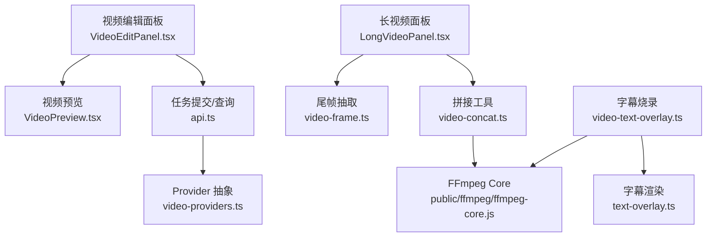
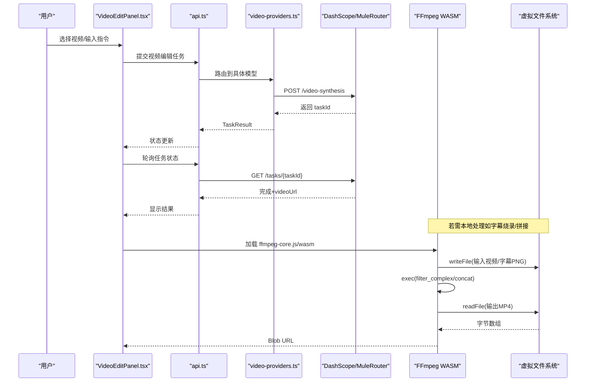
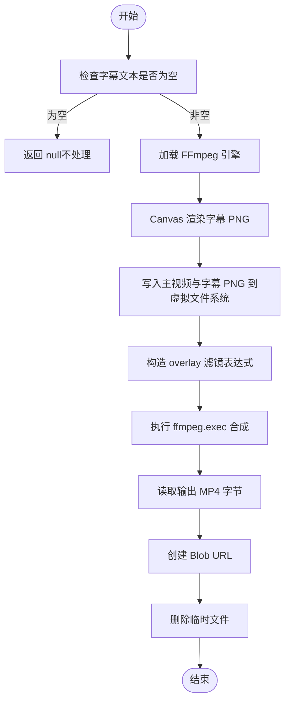
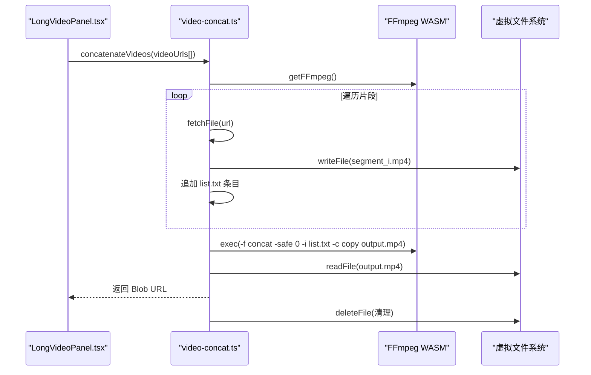
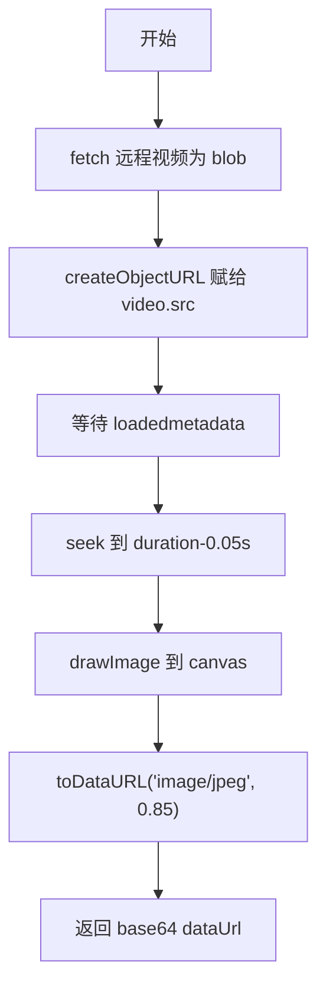
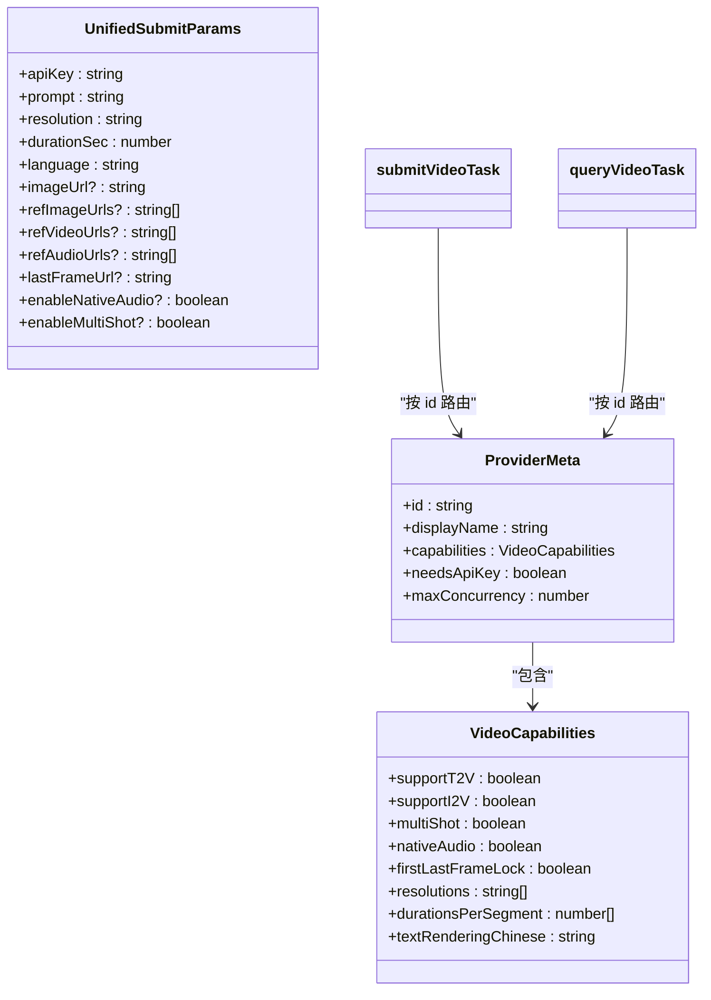
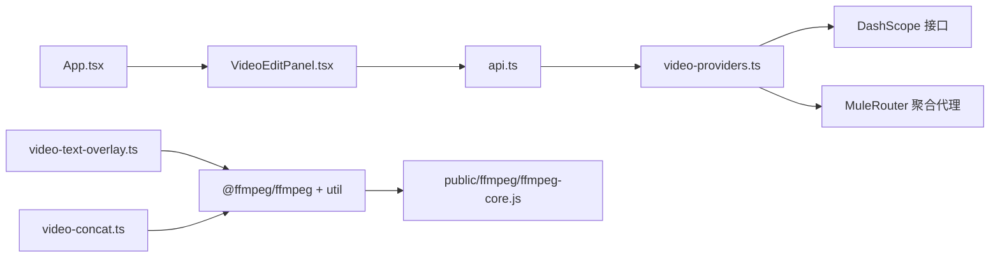

# 视频编辑功能

<cite>
**本文引用的文件列表**
- [src/components/VideoEditPanel.tsx](file://src/components/VideoEditPanel.tsx)
- [src/lib/video-text-overlay.ts](file://src/lib/video-text-overlay.ts)
- [src/lib/text-overlay.ts](file://src/lib/text-overlay.ts)
- [src/lib/video-concat.ts](file://src/lib/video-concat.ts)
- [public/ffmpeg/ffmpeg-core.js](file://public/ffmpeg/ffmpeg-core.js)
- [src/lib/api.ts](file://src/lib/api.ts)
- [src/App.tsx](file://src/App.tsx)
- [src/lib/video-providers.ts](file://src/lib/video-providers.ts)
- [src/components/LongVideoPanel.tsx](file://src/components/LongVideoPanel.tsx)
- [src/lib/video-frame.ts](file://src/lib/video-frame.ts)
</cite>

## 目录
1. [简介](#简介)
2. [项目结构](#项目结构)
3. [核心组件](#核心组件)
4. [架构总览](#架构总览)
5. [详细组件分析](#详细组件分析)
6. [依赖关系分析](#依赖关系分析)
7. [性能与优化建议](#性能与优化建议)
8. [故障排查指南](#故障排查指南)
9. [结论](#结论)
10. [附录：使用示例与最佳实践](#附录使用示例与最佳实践)

## 简介
本文件面向“视频编辑”能力，聚焦于客户端侧基于 FFmpeg WASM 的视频处理与增强流程。现有实现覆盖以下关键能力：
- 字幕烧录：将中文对白文本渲染为透明 PNG，再通过 FFmpeg overlay 滤镜叠加到视频底部居中位置。
- 格式转换与封装：以 libx264 编码输出 MP4（yuv420p），并尽量拷贝音频流。
- 多片段拼接：通过 concat demuxer 将多个 MP4 片段无损拼接，避免二次编码。
- 长视频生成链路中的尾帧衔接：抽取上一段尾帧作为下一段的 i2v 首帧，提升画面连续性。
- 模型路由与任务管理：统一抽象层对接不同后端模型（HappyHorse、Kling、Muledance），并提供任务提交与轮询。

注意：当前代码中“字幕烧录”在长视频面板中被注释禁用，但底层模块仍可用；如需启用，可参考本节用法说明。

## 项目结构
围绕视频编辑的核心文件组织如下：
- 界面入口：视频编辑面板与预览
- 字幕渲染与烧录：Canvas 渲染 + FFmpeg overlay
- 拼接工具：FFmpeg concat 拼接
- 模型与任务：API 封装与 Provider 抽象
- 长视频链路：分镜拆解、尾帧衔接、拼接

图表来源
- [src/components/VideoEditPanel.tsx:1-157](file://src/components/VideoEditPanel.tsx#L1-L157)
- [src/lib/api.ts:1-217](file://src/lib/api.ts#L1-L217)
- [src/components/VideoPreview.tsx:1-65](file://src/components/VideoPreview.tsx#L1-L65)
- [src/components/LongVideoPanel.tsx:1-800](file://src/components/LongVideoPanel.tsx#L1-L800)
- [src/lib/video-concat.ts:1-110](file://src/lib/video-concat.ts#L1-L110)
- [src/lib/video-frame.ts:1-69](file://src/lib/video-frame.ts#L1-L69)
- [src/lib/video-text-overlay.ts:1-110](file://src/lib/video-text-overlay.ts#L1-L110)
- [src/lib/text-overlay.ts:1-92](file://src/lib/text-overlay.ts#L1-L92)
- [public/ffmpeg/ffmpeg-core.js:1-16](file://public/ffmpeg/ffmpeg-core.js#L1-L16)
- [src/lib/video-providers.ts:1-559](file://src/lib/video-providers.ts#L1-L559)

章节来源
- [src/components/VideoEditPanel.tsx:1-157](file://src/components/VideoEditPanel.tsx#L1-L157)
- [src/lib/api.ts:1-217](file://src/lib/api.ts#L1-L217)
- [src/components/VideoPreview.tsx:1-65](file://src/components/VideoPreview.tsx#L1-L65)
- [src/components/LongVideoPanel.tsx:1-800](file://src/components/LongVideoPanel.tsx#L1-L800)
- [src/lib/video-concat.ts:1-110](file://src/lib/video-concat.ts#L1-L110)
- [src/lib/video-frame.ts:1-69](file://src/lib/video-frame.ts#L1-L69)
- [src/lib/video-text-overlay.ts:1-110](file://src/lib/video-text-overlay.ts#L1-L110)
- [src/lib/text-overlay.ts:1-92](file://src/lib/text-overlay.ts#L1-L92)
- [public/ffmpeg/ffmpeg-core.js:1-16](file://public/ffmpeg/ffmpeg-core.js#L1-L16)
- [src/lib/video-providers.ts:1-559](file://src/lib/video-providers.ts#L1-L559)

## 核心组件
- 视频编辑面板：提供上传/输入视频、可选参考图、编辑指令的交互，并提交到后端进行 AI 编辑。
- 字幕烧录模块：将文本渲染为 PNG，调用 FFmpeg overlay 合成到视频底部居中。
- 拼接模块：下载多个视频片段，写入虚拟文件系统，使用 concat 命令拼接为单个 MP4。
- 尾帧抽取：从远程视频 URL 抽取最后一帧，用于链式衔接。
- Provider 抽象：统一封装不同模型的提交与查询逻辑，屏蔽差异。

章节来源
- [src/components/VideoEditPanel.tsx:1-157](file://src/components/VideoEditPanel.tsx#L1-L157)
- [src/lib/video-text-overlay.ts:1-110](file://src/lib/video-text-overlay.ts#L1-L110)
- [src/lib/text-overlay.ts:1-92](file://src/lib/text-overlay.ts#L1-L92)
- [src/lib/video-concat.ts:1-110](file://src/lib/video-concat.ts#L1-L110)
- [src/lib/video-frame.ts:1-69](file://src/lib/video-frame.ts#L1-L69)
- [src/lib/video-providers.ts:1-559](file://src/lib/video-providers.ts#L1-L559)

## 架构总览
整体数据流分为两条主线：
- 单条视频编辑：用户提交视频与指令 → 后端生成结果 → 前端展示。
- 长视频拼接：多段生成后，前端用 FFmpeg 拼接，必要时抽取尾帧做衔接。

图表来源
- [src/components/VideoEditPanel.tsx:1-157](file://src/components/VideoEditPanel.tsx#L1-L157)
- [src/lib/api.ts:1-217](file://src/lib/api.ts#L1-L217)
- [src/lib/video-providers.ts:1-559](file://src/lib/video-providers.ts#L1-L559)
- [src/lib/video-text-overlay.ts:1-110](file://src/lib/video-text-overlay.ts#L1-L110)
- [src/lib/video-concat.ts:1-110](file://src/lib/video-concat.ts#L1-L110)
- [public/ffmpeg/ffmpeg-core.js:1-16](file://public/ffmpeg/ffmpeg-core.js#L1-L16)

## 详细组件分析

### 字幕烧录（overlay 滤镜）
- 渲染阶段：使用 Canvas 将中文文本绘制为白字黑边加粗样式，生成透明背景 PNG dataUrl。
- 合成阶段：通过 FFmpeg 将主视频与字幕 PNG 作为两路输入，使用 filter_complex overlay 定位到底部居中，输出 MP4。
- 资源管理：对每个任务使用唯一文件名，完成后清理虚拟文件系统，避免内存泄漏。

图表来源
- [src/lib/video-text-overlay.ts:1-110](file://src/lib/video-text-overlay.ts#L1-L110)
- [src/lib/text-overlay.ts:1-92](file://src/lib/text-overlay.ts#L1-L92)

章节来源
- [src/lib/video-text-overlay.ts:1-110](file://src/lib/video-text-overlay.ts#L1-L110)
- [src/lib/text-overlay.ts:1-92](file://src/lib/text-overlay.ts#L1-L92)

### 多片段拼接（concat）
- 下载阶段：按顺序下载各片段，写入虚拟文件系统，同时构建 list.txt。
- 拼接阶段：使用 -f concat -c copy 进行流拷贝拼接，避免重新编码，速度极快。
- 进度反馈：提供 loading/downloading/processing/done 阶段与百分比提示。

图表来源
- [src/lib/video-concat.ts:1-110](file://src/lib/video-concat.ts#L1-L110)
- [src/components/LongVideoPanel.tsx:842-912](file://src/components/LongVideoPanel.tsx#L842-L912)

章节来源
- [src/lib/video-concat.ts:1-110](file://src/lib/video-concat.ts#L1-L110)
- [src/components/LongVideoPanel.tsx:842-912](file://src/components/LongVideoPanel.tsx#L842-L912)

### 尾帧抽取（链式衔接）
- 目的：将上一段视频的尾帧作为下一段的 i2v 首帧，保证画面连续。
- 关键点：直接给 <video> 设置远程 URL 会导致 toDataURL CORS 污染，因此先 fetch 为 blob，再 createObjectURL 赋值，规避跨域问题。
- 超时控制：metadata 与 seek 均带超时保护，失败则回退原 routeMode。

图表来源
- [src/lib/video-frame.ts:1-69](file://src/lib/video-frame.ts#L1-L69)

章节来源
- [src/lib/video-frame.ts:1-69](file://src/lib/video-frame.ts#L1-L69)

### 模型路由与任务管理
- Provider 矩阵：声明各模型的能力（分辨率、时长、原生音效、多镜头、首尾帧锁定等）。
- 提交与查询：根据 provider 路由到对应 adapter（HappyHorse 走 DashScope，Kling/Muledance 走 MuleRouter 聚合代理）。
- 错误处理：网络重试、限流重试、状态映射、安全包装（proxy-fetch 绕过跨域）。

图表来源
- [src/lib/video-providers.ts:1-559](file://src/lib/video-providers.ts#L1-L559)

章节来源
- [src/lib/video-providers.ts:1-559](file://src/lib/video-providers.ts#L1-L559)
- [src/lib/api.ts:1-217](file://src/lib/api.ts#L1-L217)

## 依赖关系分析
- FFmpeg WASM 集成
  - 通过 @ffmpeg/ffmpeg 与 @ffmpeg/util 加载 coreURL 与 wasmURL，使用 toBlobURL 避免 Worker 内再次发起网络请求，从而规避 CORS/COEP 问题。
  - public/ffmpeg/ffmpeg-core.js 是编译后的核心脚本，负责 WebAssembly 实例化与运行时初始化。
- 虚拟文件系统
  - FFmpeg 在浏览器中以 MEMFS 模拟文件系统，writeFile/readFile/deleteFile 操作均在内存中进行，需注意及时清理以避免内存占用过高。
- 外部服务
  - DashScope（阿里云百炼）与 MuleRouter（聚合代理）分别承担不同模型的任务提交与查询。
  - 第三方 CDN 视频 URL 可能无 CORS 头，通过 dev server 的 /proxy-fetch 中间件进行同源中转。

图表来源
- [src/App.tsx:1-164](file://src/App.tsx#L1-L164)
- [src/components/VideoEditPanel.tsx:1-157](file://src/components/VideoEditPanel.tsx#L1-L157)
- [src/lib/api.ts:1-217](file://src/lib/api.ts#L1-L217)
- [src/lib/video-providers.ts:1-559](file://src/lib/video-providers.ts#L1-L559)
- [src/lib/video-text-overlay.ts:1-110](file://src/lib/video-text-overlay.ts#L1-L110)
- [src/lib/video-concat.ts:1-110](file://src/lib/video-concat.ts#L1-L110)
- [public/ffmpeg/ffmpeg-core.js:1-16](file://public/ffmpeg/ffmpeg-core.js#L1-L16)

章节来源
- [src/App.tsx:1-164](file://src/App.tsx#L1-L164)
- [src/lib/video-providers.ts:1-559](file://src/lib/video-providers.ts#L1-L559)
- [src/lib/api.ts:1-217](file://src/lib/api.ts#L1-L217)
- [src/lib/video-text-overlay.ts:1-110](file://src/lib/video-text-overlay.ts#L1-L110)
- [src/lib/video-concat.ts:1-110](file://src/lib/video-concat.ts#L1-L110)
- [public/ffmpeg/ffmpeg-core.js:1-16](file://public/ffmpeg/ffmpeg-core.js#L1-L16)

## 性能与优化建议
- FFmpeg 加载与复用
  - 全局缓存 FFmpeg 实例，避免重复加载；已实现懒加载与超时保护。
  - 使用 ultrafast preset 与 CRF 平衡速度与质量；音频流尽量 copy 减少重编码。
- 内存管理
  - 每次合成后立即删除虚拟文件系统临时文件，防止内存泄漏。
  - 长视频拼接时，优先使用 -c copy 流拷贝，避免二次编码带来的 CPU 与内存压力。
- 网络与并发
  - 下载片段顺序进行，避免并发解码导致 OOM；对大文件采用分段或节流策略。
  - 对 MuleRouter 的 429/5xx 错误进行指数退避重试，降低瞬时并发打满风险。
- 字体与渲染
  - 字幕渲染依赖系统字体回退，确保目标设备具备中文字体；必要时预置字体文件以提升一致性。
- 预览与存储
  - 最终视频 Blob 存入 IndexedDB，刷新后可恢复，避免重复生成。

[本节为通用指导，无需特定文件引用]

## 故障排查指南
- FFmpeg 加载超时
  - 现象：页面长时间卡住，控制台报“ffmpeg 加载超时”。
  - 排查：确认 /ffmpeg 静态资源可达；检查 COEP/CORS 配置；查看是否被浏览器拦截。
  - 参考路径：[src/lib/video-text-overlay.ts:12-30](file://src/lib/video-text-overlay.ts#L12-L30)、[src/lib/video-concat.ts:10-38](file://src/lib/video-concat.ts#L10-L38)
- 字幕乱码或不可见
  - 现象：中文显示异常或字幕未出现在视频上。
  - 排查：确认 Canvas 字体栈包含中文字体；检查 overlay 坐标表达式是否正确；验证 PNG 透明度。
  - 参考路径：[src/lib/text-overlay.ts:12-75](file://src/lib/text-overlay.ts#L12-L75)、[src/lib/video-text-overlay.ts:74-92](file://src/lib/video-text-overlay.ts#L74-L92)
- 拼接失败或输出为空
  - 现象：concat 报错或输出文件无法播放。
  - 排查：确认所有片段编码一致（容器、编解码器、像素格式）；list.txt 路径正确；-safe 0 参数生效。
  - 参考路径：[src/lib/video-concat.ts:77-90](file://src/lib/video-concat.ts#L77-L90)
- 尾帧抽取失败
  - 现象：无法获取尾帧，链式衔接失效。
  - 排查：检查 fetch 响应与 blob 创建；确认 metadata 与 seek 事件触发；关注 CORS 限制。
  - 参考路径：[src/lib/video-frame.ts:16-69](file://src/lib/video-frame.ts#L16-L69)
- 任务提交失败或内容审核拦截
  - 现象：返回 FAILED 且 message 包含“green net”等关键词。
  - 排查：自动清洗敏感词并重试一次；若仍失败，修改 prompt 中品牌词或敏感词汇。
  - 参考路径：[src/components/LongVideoPanel.tsx:476-567](file://src/components/LongVideoPanel.tsx#L476-L567)

章节来源
- [src/lib/video-text-overlay.ts:12-30](file://src/lib/video-text-overlay.ts#L12-L30)
- [src/lib/video-concat.ts:10-38](file://src/lib/video-concat.ts#L10-L38)
- [src/lib/text-overlay.ts:12-75](file://src/lib/text-overlay.ts#L12-L75)
- [src/lib/video-text-overlay.ts:74-92](file://src/lib/video-text-overlay.ts#L74-L92)
- [src/lib/video-concat.ts:77-90](file://src/lib/video-concat.ts#L77-L90)
- [src/lib/video-frame.ts:16-69](file://src/lib/video-frame.ts#L16-L69)
- [src/components/LongVideoPanel.tsx:476-567](file://src/components/LongVideoPanel.tsx#L476-L567)

## 结论
本项目在客户端实现了较为完整的视频编辑与增强能力：字幕烧录、格式封装、多片段拼接以及长视频链式衔接。通过统一的 Provider 抽象，兼容多种后端模型，提升了可扩展性与稳定性。结合 FFmpeg WASM 的内存管理与进度反馈机制，能够在浏览器端高效完成常见视频处理任务。后续可在字体渲染、并发控制与错误提示方面进一步优化，以获得更流畅的用户体验。

[本节为总结性内容，无需特定文件引用]

## 附录：使用示例与最佳实践

- 字幕烧录示例（调用路径）
  - 步骤：准备视频 URL 与字幕文本 → 调用 burnSubtitleToVideo → 得到新视频 Blob URL。
  - 参考路径：
    - [src/lib/video-text-overlay.ts:48-109](file://src/lib/video-text-overlay.ts#L48-L109)
    - [src/lib/text-overlay.ts:25-75](file://src/lib/text-overlay.ts#L25-L75)

- 多片段拼接示例（调用路径）
  - 步骤：准备多个视频 URL → 调用 concatenateVideos → 得到拼接后的 Blob URL。
  - 参考路径：
    - [src/lib/video-concat.ts:50-109](file://src/lib/video-concat.ts#L50-L109)
    - [src/components/LongVideoPanel.tsx:842-912](file://src/components/LongVideoPanel.tsx#L842-L912)

- 尾帧衔接示例（调用路径）
  - 步骤：生成一段视频后 → 调用 extractLastFrame → 得到 base64 dataUrl → 作为下一段 i2v 首帧。
  - 参考路径：
    - [src/lib/video-frame.ts:16-69](file://src/lib/video-frame.ts#L16-L69)
    - [src/components/LongVideoPanel.tsx:782-792](file://src/components/LongVideoPanel.tsx#L782-L792)

- 视频编辑任务提交（调用路径）
  - 步骤：在 VideoEditPanel 中收集 prompt 与 videoUrl → 调用 submitVideoEdit → 轮询任务状态 → 展示结果。
  - 参考路径：
    - [src/components/VideoEditPanel.tsx:41-45](file://src/components/VideoEditPanel.tsx#L41-L45)
    - [src/lib/api.ts:104-123](file://src/lib/api.ts#L104-L123)
    - [src/App.tsx:95-112](file://src/App.tsx#L95-L112)

- 最佳实践清单
  - 始终清理 FFmpeg 虚拟文件系统临时文件，避免内存泄漏。
  - 使用 -c copy 进行无损拼接，减少 CPU 与时间开销。
  - 对大文件下载顺序处理，避免并发解码导致的 OOM。
  - 字幕渲染前校验系统字体，必要时预置字体文件。
  - 对第三方 CDN 视频 URL 使用 proxy-fetch 中转，解决跨域问题。

[本节为使用指引，无需特定文件引用]