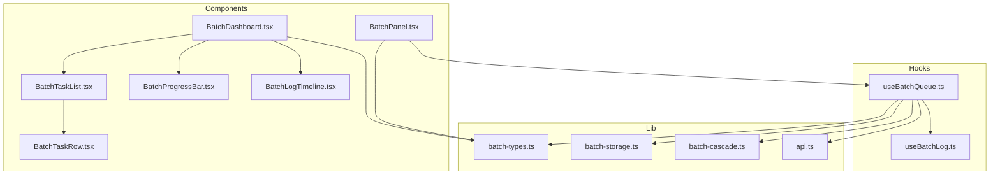
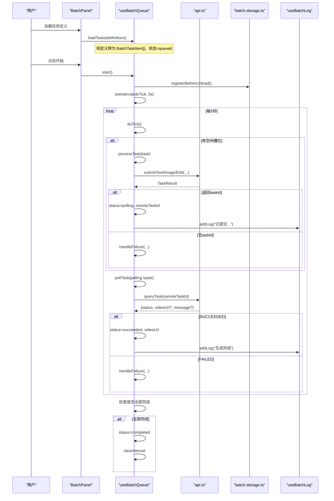
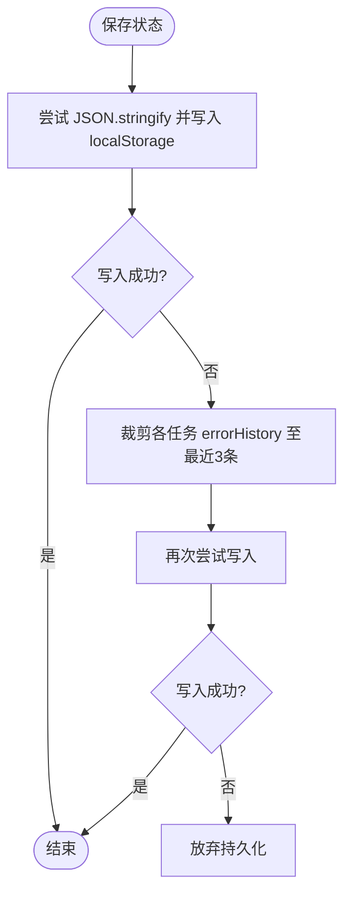
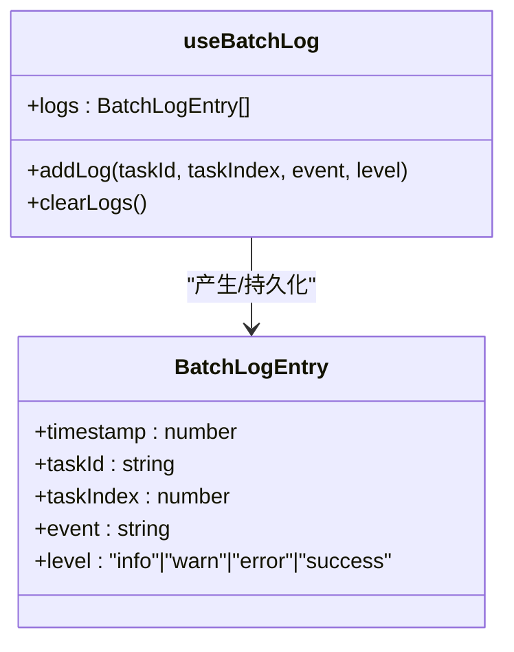
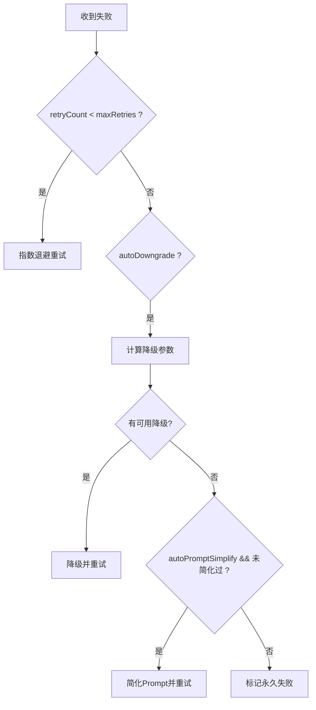
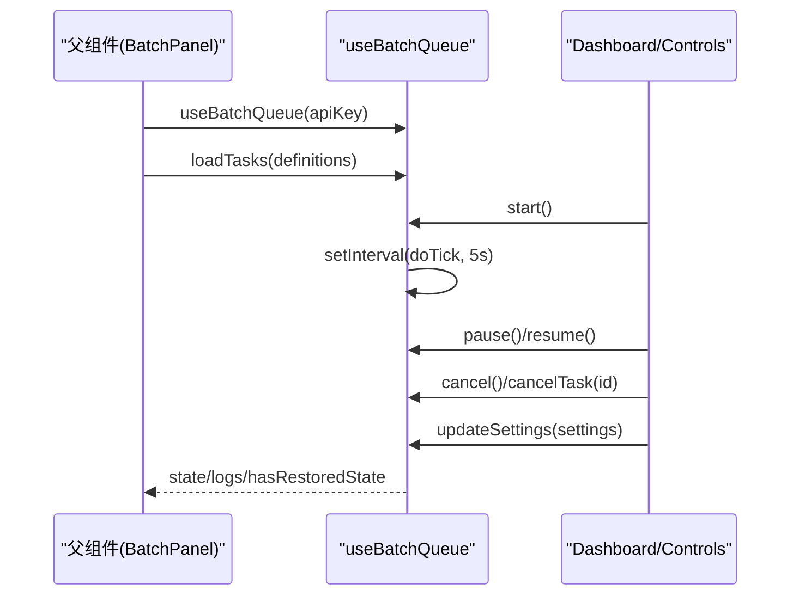
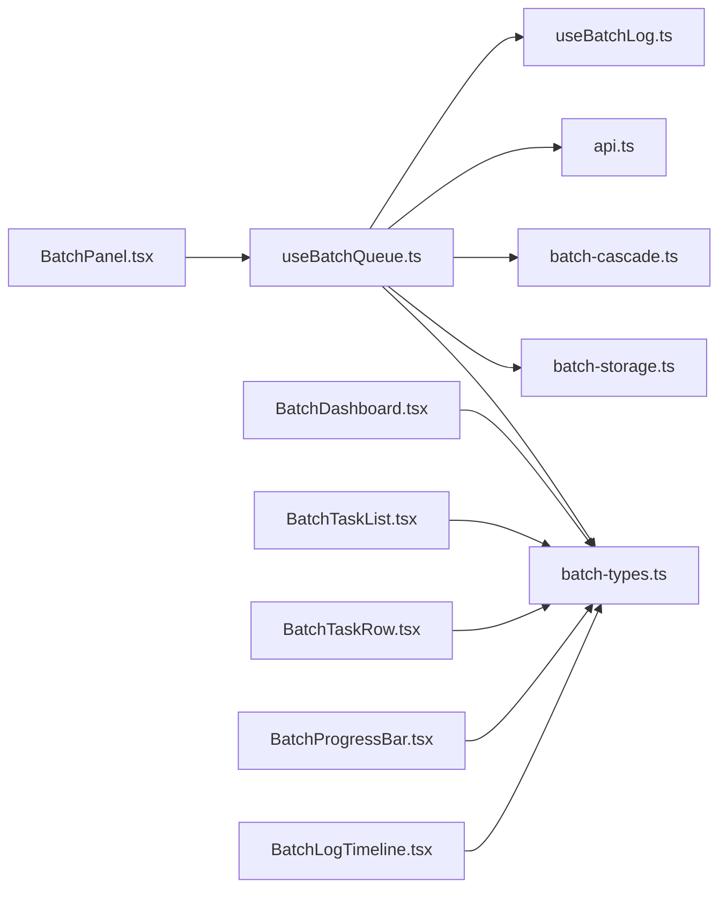

# 状态管理

<cite>
**本文引用的文件**
- [useBatchQueue.ts](file://src/hooks/useBatchQueue.ts)
- [useBatchLog.ts](file://src/hooks/useBatchLog.ts)
- [batch-types.ts](file://src/lib/batch-types.ts)
- [batch-storage.ts](file://src/lib/batch-storage.ts)
- [batch-cascade.ts](file://src/lib/batch-cascade.ts)
- [api.ts](file://src/lib/api.ts)
- [BatchPanel.tsx](file://src/components/batch/BatchPanel.tsx)
- [BatchDashboard.tsx](file://src/components/batch/BatchDashboard.tsx)
- [BatchTaskList.tsx](file://src/components/batch/BatchTaskList.tsx)
- [BatchTaskRow.tsx](file://src/components/batch/BatchTaskRow.tsx)
- [BatchProgressBar.tsx](file://src/components/batch/BatchProgressBar.tsx)
- [BatchLogTimeline.tsx](file://src/components/batch/BatchLogTimeline.tsx)
</cite>

## 目录
1. [简介](#简介)
2. [项目结构](#项目结构)
3. [核心组件](#核心组件)
4. [架构总览](#架构总览)
5. [详细组件分析](#详细组件分析)
6. [依赖关系分析](#依赖关系分析)
7. [性能与内存优化](#性能与内存优化)
8. [故障排查指南](#故障排查指南)
9. [结论](#结论)
10. [附录：使用示例与最佳实践](#附录使用示例与最佳实践)

## 简介
本文件围绕批量队列状态管理系统进行系统化文档化，覆盖以下方面：
- 任务生命周期与状态转换逻辑
- 持久化策略（localStorage）
- useBatchQueue Hook 的设计模式与用法
- 批量日志记录机制（收集、格式化、存储、检索）
- TypeScript 类型定义设计（BatchTaskItem、BatchQueueState 等）
- 最佳实践（性能、内存、错误恢复）
- 在组件中的正确使用方式
- 调试与测试方法

## 项目结构
系统采用“Hook + 纯函数库 + UI 组件”的分层组织方式：
- hooks 层：封装状态机与副作用（useBatchQueue、useBatchLog）
- lib 层：类型定义、持久化、容错降级、API 调用
- components 层：展示与交互（面板、进度条、任务列表、日志时间线）



图表来源
- [useBatchQueue.ts:1-322](file://src/hooks/useBatchQueue.ts#L1-L322)
- [useBatchLog.ts:1-39](file://src/hooks/useBatchLog.ts#L1-L39)
- [batch-types.ts:1-123](file://src/lib/batch-types.ts#L1-L123)
- [batch-storage.ts:1-89](file://src/lib/batch-storage.ts#L1-L89)
- [batch-cascade.ts:1-101](file://src/lib/batch-cascade.ts#L1-L101)
- [api.ts:1-217](file://src/lib/api.ts#L1-L217)
- [BatchPanel.tsx:1-58](file://src/components/batch/BatchPanel.tsx#L1-L58)
- [BatchDashboard.tsx:1-89](file://src/components/batch/BatchDashboard.tsx#L1-L89)
- [BatchTaskList.tsx:1-27](file://src/components/batch/BatchTaskList.tsx#L1-L27)
- [BatchTaskRow.tsx:1-80](file://src/components/batch/BatchTaskRow.tsx#L1-L80)
- [BatchProgressBar.tsx:1-36](file://src/components/batch/BatchProgressBar.tsx#L1-L36)
- [BatchLogTimeline.tsx:1-47](file://src/components/batch/BatchLogTimeline.tsx#L1-L47)

章节来源
- [useBatchQueue.ts:1-322](file://src/hooks/useBatchQueue.ts#L1-L322)
- [batch-types.ts:1-123](file://src/lib/batch-types.ts#L1-L123)
- [batch-storage.ts:1-89](file://src/lib/batch-storage.ts#L1-L89)
- [batch-cascade.ts:1-101](file://src/lib/batch-cascade.ts#L1-L101)
- [api.ts:1-217](file://src/lib/api.ts#L1-L217)
- [BatchPanel.tsx:1-58](file://src/components/batch/BatchPanel.tsx#L1-L58)
- [BatchDashboard.tsx:1-89](file://src/components/batch/BatchDashboard.tsx#L1-L89)
- [BatchTaskList.tsx:1-27](file://src/components/batch/BatchTaskList.tsx#L1-L27)
- [BatchTaskRow.tsx:1-80](file://src/components/batch/BatchTaskRow.tsx#L1-L80)
- [BatchProgressBar.tsx:1-36](file://src/components/batch/BatchProgressBar.tsx#L1-L36)
- [BatchLogTimeline.tsx:1-47](file://src/components/batch/BatchLogTimeline.tsx#L1-L47)

## 核心组件
- useBatchQueue：基于 useReducer 的批量队列状态机，负责任务调度、提交、轮询、重试/降级/简化 Prompt、完成判定、暂停/恢复/取消、持久化。
- useBatchLog：轻量日志 Hook，维护最近 N 条日志并持久化到 localStorage。
- batch-types：集中定义所有数据结构与默认值。
- batch-storage：localStorage 读写、初始状态构造、页面离开保护。
- batch-cascade：失败后的级联决策（重试、参数降级、Prompt 简化、永久失败）。
- api：视频生成任务的提交与查询接口封装。
- UI 组件：面板、仪表盘、任务列表/行、进度条、日志时间线。

章节来源
- [useBatchQueue.ts:1-322](file://src/hooks/useBatchQueue.ts#L1-L322)
- [useBatchLog.ts:1-39](file://src/hooks/useBatchLog.ts#L1-L39)
- [batch-types.ts:1-123](file://src/lib/batch-types.ts#L1-L123)
- [batch-storage.ts:1-89](file://src/lib/batch-storage.ts#L1-L89)
- [batch-cascade.ts:1-101](file://src/lib/batch-cascade.ts#L1-L101)
- [api.ts:1-217](file://src/lib/api.ts#L1-L217)

## 架构总览
整体流程：
- 用户通过 BatchPanel 加载任务定义，触发 loadTasks。
- 点击开始，进入 running 状态，每 5 秒 tick 一次，按并发度从 queued 中挑选任务提交。
- 提交成功后进入 polling 状态，定时轮询任务结果；成功则 succeeded，失败则进入 handleFailure。
- handleFailure 根据 settings 与当前任务状态决定重试/降级/简化 Prompt/永久失败。
- 全部任务终态时自动置为 completed。
- 状态与日志均持久化到 localStorage，支持刷新后恢复。



图表来源
- [useBatchQueue.ts:98-124](file://src/hooks/useBatchQueue.ts#L98-L124)
- [useBatchQueue.ts:126-161](file://src/hooks/useBatchQueue.ts#L126-L161)
- [useBatchQueue.ts:163-185](file://src/hooks/useBatchQueue.ts#L163-L185)
- [useBatchQueue.ts:187-264](file://src/hooks/useBatchQueue.ts#L187-L264)
- [useBatchQueue.ts:84-96](file://src/hooks/useBatchQueue.ts#L84-L96)
- [api.ts:63-123](file://src/lib/api.ts#L63-L123)
- [api.ts:176-201](file://src/lib/api.ts#L176-L201)
- [batch-storage.ts:79-88](file://src/lib/batch-storage.ts#L79-L88)

## 详细组件分析

### 状态机与任务生命周期
- 状态空间
  - 全局状态：idle / running / paused / completed
  - 任务状态：queued / submitting / polling / retrying / succeeded / failed-permanent / cancelled
- 关键转换
  - queued -> submitting：doTick 分配槽位后提交
  - submitting -> polling：提交成功获得 remoteTaskId
  - polling -> succeeded：轮询返回 SUCCEEDED
  - polling -> retrying：轮询或提交失败，进入 handleFailure
  - retrying -> queued：指数退避后重新入队
  - retrying -> succeeded/failed-permanent：降级或简化 Prompt 后再次执行，最终可能失败
  - queued/cancelled：可被 cancelTask 直接取消
  - 全部终态 -> completed：由完成检测 effect 统一设置
- 并发控制
  - 通过 settings.concurrency 限制同时处于 submitting/polling 的任务数
- 完成判定
  - 当所有任务均为 succeeded/failed-permanent/cancelled 且任务数大于 0 时，置 completed 并清理定时器

```mermaid
stateDiagram-v2
[*] --> idle
idle --> running : "start()"
running --> paused : "pause()"
paused --> running : "resume()"
running --> completed : "全部任务终态"
completed --> idle : "cancel()/RESET"
state 任务状态 {
[*] --> queued
queued --> submitting : "提交"
submitting --> polling : "返回taskId"
polling --> succeeded : "SUCCEEDED"
polling --> retrying : "FAILED/异常"
retrying --> queued : "重试/降级/简化后"
retrying --> failed-permanent : "达到最大重试"
queued --> cancelled : "取消"
retrying --> cancelled : "取消"
}
```

图表来源
- [useBatchQueue.ts:22-51](file://src/hooks/useBatchQueue.ts#L22-L51)
- [useBatchQueue.ts:84-96](file://src/hooks/useBatchQueue.ts#L84-L96)
- [useBatchQueue.ts:98-124](file://src/hooks/useBatchQueue.ts#L98-L124)
- [useBatchQueue.ts:126-161](file://src/hooks/useBatchQueue.ts#L126-L161)
- [useBatchQueue.ts:163-185](file://src/hooks/useBatchQueue.ts#L163-L185)
- [useBatchQueue.ts:187-264](file://src/hooks/useBatchQueue.ts#L187-L264)

章节来源
- [useBatchQueue.ts:22-51](file://src/hooks/useBatchQueue.ts#L22-L51)
- [useBatchQueue.ts:84-96](file://src/hooks/useBatchQueue.ts#L84-L96)
- [useBatchQueue.ts:98-124](file://src/hooks/useBatchQueue.ts#L98-L124)
- [useBatchQueue.ts:126-161](file://src/hooks/useBatchQueue.ts#L126-L161)
- [useBatchQueue.ts:163-185](file://src/hooks/useBatchQueue.ts#L163-L185)
- [useBatchQueue.ts:187-264](file://src/hooks/useBatchQueue.ts#L187-L264)

### 持久化策略
- 队列状态
  - saveQueueState：JSON 序列化写入 localStorage；若失败则裁剪 errorHistory 再试；仍失败则放弃
  - loadQueueState：读取并校验基本结构，非法则返回 null
  - clearQueueState：清除队列与日志键
- 日志
  - saveLogs/loadLogs：仅保留最近 MAX_LOG_ENTRIES 条
- 初始状态
  - getInitialQueueState：提供默认 settings 与空任务
- 页面离开保护
  - registerBeforeUnload：当运行中阻止关闭



图表来源
- [batch-storage.ts:8-27](file://src/lib/batch-storage.ts#L8-L27)
- [batch-storage.ts:29-41](file://src/lib/batch-storage.ts#L29-L41)
- [batch-storage.ts:49-68](file://src/lib/batch-storage.ts#L49-L68)
- [batch-storage.ts:70-77](file://src/lib/batch-storage.ts#L70-L77)
- [batch-storage.ts:79-88](file://src/lib/batch-storage.ts#L79-L88)

章节来源
- [batch-storage.ts:8-27](file://src/lib/batch-storage.ts#L8-L27)
- [batch-storage.ts:29-41](file://src/lib/batch-storage.ts#L29-L41)
- [batch-storage.ts:49-68](file://src/lib/batch-storage.ts#L49-L68)
- [batch-storage.ts:70-77](file://src/lib/batch-storage.ts#L70-L77)
- [batch-storage.ts:79-88](file://src/lib/batch-storage.ts#L79-L88)

### 批量日志记录机制
- 收集：在提交、轮询、失败处理等关键路径调用 addLog，附带 taskId、taskIndex、事件文本与级别
- 格式化：UI 侧仅显示最近 50 条，带时间戳与任务序号
- 存储：每次新增后截断至 MAX_ENTRIES 并写入 localStorage
- 检索：初始化时从 localStorage 恢复日志



图表来源
- [useBatchLog.ts:1-39](file://src/hooks/useBatchLog.ts#L1-L39)
- [batch-types.ts:69-76](file://src/lib/batch-types.ts#L69-L76)
- [batch-storage.ts:49-68](file://src/lib/batch-storage.ts#L49-L68)
- [BatchLogTimeline.tsx:1-47](file://src/components/batch/BatchLogTimeline.tsx#L1-L47)

章节来源
- [useBatchLog.ts:1-39](file://src/hooks/useBatchLog.ts#L1-L39)
- [batch-types.ts:69-76](file://src/lib/batch-types.ts#L69-L76)
- [batch-storage.ts:49-68](file://src/lib/batch-storage.ts#L49-L68)
- [BatchLogTimeline.tsx:1-47](file://src/components/batch/BatchLogTimeline.tsx#L1-L47)

### 失败回退与级联决策
- 决策顺序
  1) 原参数重试（指数退避：2^k 秒）
  2) 参数降级（分辨率优先降，其次时长降）
  3) Prompt 简化（去特殊字符、合并空格、截断长度）
  4) 永久失败
- 降级策略
  - 分辨率顺序：1080p -> 720p -> 480p
  - 时长顺序：10 -> 7 -> 5 -> 3 -> 2
  - 降级次数影响策略选择，避免无限降级



图表来源
- [batch-cascade.ts:19-56](file://src/lib/batch-cascade.ts#L19-L56)
- [batch-cascade.ts:61-85](file://src/lib/batch-cascade.ts#L61-L85)
- [batch-cascade.ts:90-100](file://src/lib/batch-cascade.ts#L90-L100)
- [useBatchQueue.ts:187-264](file://src/hooks/useBatchQueue.ts#L187-L264)

章节来源
- [batch-cascade.ts:19-56](file://src/lib/batch-cascade.ts#L19-L56)
- [batch-cascade.ts:61-85](file://src/lib/batch-cascade.ts#L61-L85)
- [batch-cascade.ts:90-100](file://src/lib/batch-cascade.ts#L90-L100)
- [useBatchQueue.ts:187-264](file://src/hooks/useBatchQueue.ts#L187-L264)

### useBatchQueue Hook 设计与用法
- 设计要点
  - 使用 useReducer 管理不可变状态，action 类型安全
  - 使用 useRef 持有最新 state、apiKey、定时器、正在处理集合、重试计时器映射，避免闭包陈旧问题
  - 副作用分离：tick 调度、提交、轮询、失败处理各自独立
  - 持久化节流：状态变化后延迟 1s 保存，降低频繁写入开销
  - 页面离开保护：运行中阻止关闭
- 主要对外能力
  - state：当前队列状态
  - logs：日志数组
  - hasRestoredState：是否从持久化恢复
  - loadTasks(startDefinitions)
  - start/pause/resume/cancel
  - cancelTask(taskId)
  - updateSettings(settings)
  - addLog(...)
- 典型用法
  - 在父组件中获取 queue，传入 apiKey
  - 输入区解析得到 definitions，调用 loadTasks
  - 控制面板按钮调用 start/pause/resume/cancel
  - 将 state 与 logs 透传给 Dashboard 渲染



图表来源
- [useBatchQueue.ts:53-81](file://src/hooks/useBatchQueue.ts#L53-L81)
- [useBatchQueue.ts:266-316](file://src/hooks/useBatchQueue.ts#L266-L316)
- [BatchPanel.tsx:13-57](file://src/components/batch/BatchPanel.tsx#L13-L57)
- [BatchDashboard.tsx:21-89](file://src/components/batch/BatchDashboard.tsx#L21-L89)

章节来源
- [useBatchQueue.ts:53-81](file://src/hooks/useBatchQueue.ts#L53-L81)
- [useBatchQueue.ts:266-316](file://src/hooks/useBatchQueue.ts#L266-L316)
- [BatchPanel.tsx:13-57](file://src/components/batch/BatchPanel.tsx#L13-L57)
- [BatchDashboard.tsx:21-89](file://src/components/batch/BatchDashboard.tsx#L21-L89)

### TypeScript 类型定义设计
- 核心类型
  - BatchTaskDefinition：单次任务参数（模式、提示词、分辨率、时长、可选媒体链接）
  - BatchTaskStatus：任务运行时状态联合类型
  - BatchTaskItem：任务完整运行时数据（含重试计数、降级层级、错误历史、起止时间等）
  - ErrorRecord：错误记录条目
  - QueueStatus：全局队列状态
  - BatchQueueState：包含 tasks、status、settings
  - BatchSettings：并发度、最大重试、自动降级/简化开关
  - BatchLogEntry：日志条目
  - DEFAULT_BATCH_SETTINGS：默认配置
  - generateId：唯一 ID 生成
- 设计考量
  - 使用联合类型表达有限状态，便于 switch/if 分支穷尽性检查
  - 将可变运行时字段与静态定义分离，利于不可变更新
  - 通过 Partial 与 spread 实现局部更新，保持不可变性

章节来源
- [batch-types.ts:10-123](file://src/lib/batch-types.ts#L10-L123)

### 组件集成与渲染
- BatchPanel：组合输入区、设置面板与仪表盘，桥接 useBatchQueue 暴露的方法
- BatchDashboard：汇总进度、控件、任务列表、日志时间线，并提供预览弹窗
- BatchTaskList/BatchTaskRow：渲染任务列表与单行状态、操作按钮
- BatchProgressBar：计算完成比例与统计信息
- BatchLogTimeline：滚动跟随，显示最近日志

章节来源
- [BatchPanel.tsx:1-58](file://src/components/batch/BatchPanel.tsx#L1-L58)
- [BatchDashboard.tsx:1-89](file://src/components/batch/BatchDashboard.tsx#L1-L89)
- [BatchTaskList.tsx:1-27](file://src/components/batch/BatchTaskList.tsx#L1-L27)
- [BatchTaskRow.tsx:1-80](file://src/components/batch/BatchTaskRow.tsx#L1-L80)
- [BatchProgressBar.tsx:1-36](file://src/components/batch/BatchProgressBar.tsx#L1-L36)
- [BatchLogTimeline.tsx:1-47](file://src/components/batch/BatchLogTimeline.tsx#L1-L47)

## 依赖关系分析
- 模块耦合
  - useBatchQueue 强依赖 batch-types、batch-storage、batch-cascade、api、useBatchLog
  - UI 组件弱依赖 types，强依赖 Hook 暴露的 props
- 外部依赖
  - fetch 网络请求（通过 api.ts 封装）
  - localStorage 持久化（通过 batch-storage.ts 封装）
- 潜在循环
  - 当前结构无循环依赖；Hook 与 UI 单向依赖



图表来源
- [useBatchQueue.ts:1-12](file://src/hooks/useBatchQueue.ts#L1-L12)
- [BatchPanel.tsx:1-10](file://src/components/batch/BatchPanel.tsx#L1-L10)
- [BatchDashboard.tsx:1-8](file://src/components/batch/BatchDashboard.tsx#L1-L8)
- [BatchTaskList.tsx:1-3](file://src/components/batch/BatchTaskList.tsx#L1-L3)
- [BatchTaskRow.tsx:1-2](file://src/components/batch/BatchTaskRow.tsx#L1-L2)
- [BatchProgressBar.tsx:1-2](file://src/components/batch/BatchProgressBar.tsx#L1-L2)
- [BatchLogTimeline.tsx:1-3](file://src/components/batch/BatchLogTimeline.tsx#L1-L3)

章节来源
- [useBatchQueue.ts:1-12](file://src/hooks/useBatchQueue.ts#L1-L12)
- [BatchPanel.tsx:1-10](file://src/components/batch/BatchPanel.tsx#L1-L10)
- [BatchDashboard.tsx:1-8](file://src/components/batch/BatchDashboard.tsx#L1-L8)
- [BatchTaskList.tsx:1-3](file://src/components/batch/BatchTaskList.tsx#L1-L3)
- [BatchTaskRow.tsx:1-2](file://src/components/batch/BatchTaskRow.tsx#L1-L2)
- [BatchProgressBar.tsx:1-2](file://src/components/batch/BatchProgressBar.tsx#L1-L2)
- [BatchLogTimeline.tsx:1-3](file://src/components/batch/BatchLogTimeline.tsx#L1-L3)

## 性能与内存优化
- 调度频率
  - 固定 5 秒 tick，避免高频轮询带来的网络与渲染压力
- 并发控制
  - 通过 concurrency 限制活跃任务数，防止资源争用
- 持久化节流
  - 状态变更延迟 1 秒保存，减少 localStorage 写入频次
- 日志限流
  - 最多保留最近 500 条，避免 DOM 与存储膨胀
- 防抖/去重
  - processingRef 防止同一任务重复提交或轮询
  - retryTimersRef 管理单个任务的重试定时器，取消时及时清理
- 内存管理
  - 取消时清空 interval、timers、processingSet，释放引用
  - 持久化失败时裁剪 errorHistory，避免 localStorage 溢出

[本节为通用指导，不直接分析具体文件]

## 故障排查指南
- 常见问题定位
  - 任务一直排队：检查 concurrency 与 activeCount 计算；确认 doTick 是否运行
  - 提交失败：查看日志级别 error/warn，确认 API Key 与网络连通性
  - 轮询无响应：检查 remoteTaskId 是否存在；观察 queryTask 返回状态
  - 无法恢复：检查 localStorage 是否被禁用或配额不足
- 调试建议
  - 打开控制台查看日志时间线
  - 临时增大日志输出或在关键路径打印中间变量
  - 使用浏览器开发者工具监视 localStorage 键值
- 恢复策略
  - 刷新页面后自动恢复上次状态（running 会改为 paused）
  - 如状态损坏，loadQueueState 会返回 null，回到初始状态

章节来源
- [useBatchQueue.ts:98-124](file://src/hooks/useBatchQueue.ts#L98-L124)
- [useBatchQueue.ts:126-161](file://src/hooks/useBatchQueue.ts#L126-L161)
- [useBatchQueue.ts:163-185](file://src/hooks/useBatchQueue.ts#L163-L185)
- [useBatchQueue.ts:298-306](file://src/hooks/useBatchQueue.ts#L298-L306)
- [batch-storage.ts:29-41](file://src/lib/batch-storage.ts#L29-L41)
- [BatchLogTimeline.tsx:1-47](file://src/components/batch/BatchLogTimeline.tsx#L1-L47)

## 结论
该状态管理系统以 useReducer 为核心，结合 refs 管理副作用与资源，实现了高内聚、低耦合的批量队列调度。通过级联失败回退与持久化保障，系统在稳定性与用户体验之间取得良好平衡。配合清晰的类型定义与模块化分层，便于扩展与维护。

[本节为总结性内容，不直接分析具体文件]

## 附录：使用示例与最佳实践

### 在组件中使用 useBatchQueue
- 初始化与加载任务
  - 在父组件中调用 useBatchQueue(apiKey)，拿到 queue
  - 解析用户输入得到 definitions，调用 queue.loadTasks(definitions)
- 启动与暂停
  - 点击开始按钮调用 queue.start()
  - 需要暂停时调用 queue.pause()，恢复时调用 queue.resume()
- 取消与清理
  - 全局取消：queue.cancel()
  - 取消单个任务：queue.cancelTask(taskId)
- 更新设置
  - 动态调整并发度、最大重试、自动降级/简化：queue.updateSettings(settings)
- 渲染
  - 将 queue.state 与 queue.logs 传递给 Dashboard 渲染

章节来源
- [BatchPanel.tsx:13-57](file://src/components/batch/BatchPanel.tsx#L13-L57)
- [useBatchQueue.ts:266-316](file://src/hooks/useBatchQueue.ts#L266-L316)

### 最佳实践清单
- 始终使用不可变更新（reducer 已保证）
- 合理设置 concurrency，避免过高导致服务端限流
- 开启 autoDowngrade/autoPromptSimplify 提升成功率
- 定期清理日志与状态（cancel 时已处理）
- 对大任务集分批导入，避免一次性创建过多任务
- 监控 localStorage 容量，必要时主动清理旧日志

[本节为通用指导，不直接分析具体文件]