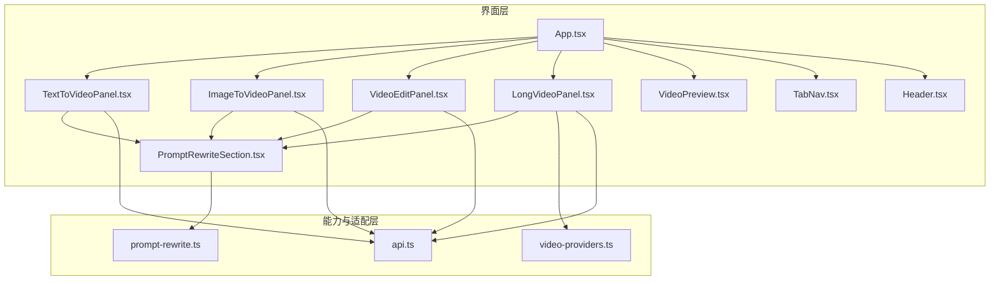
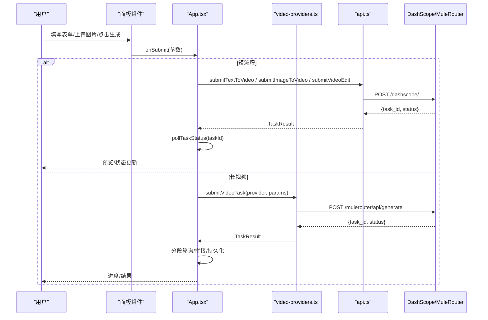
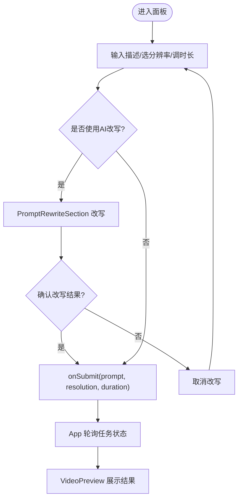
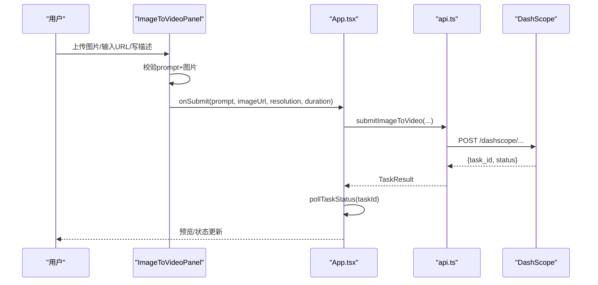
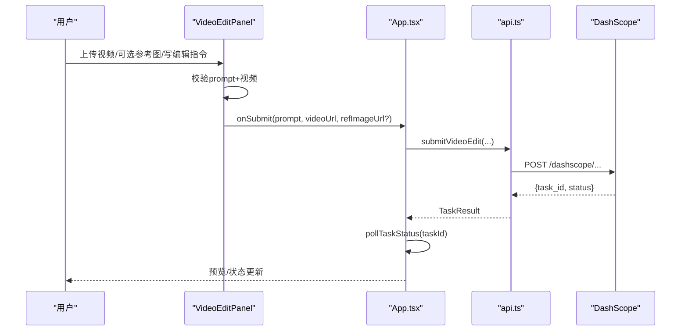
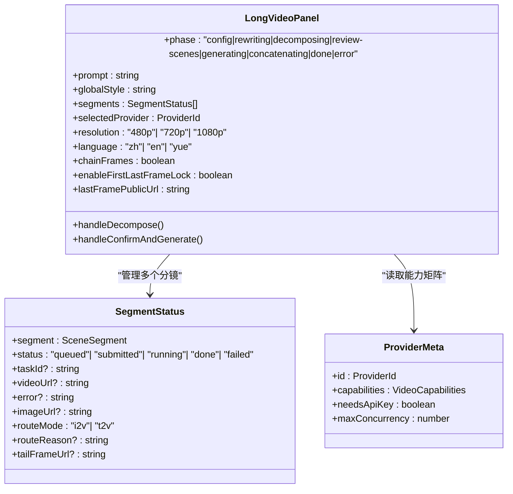
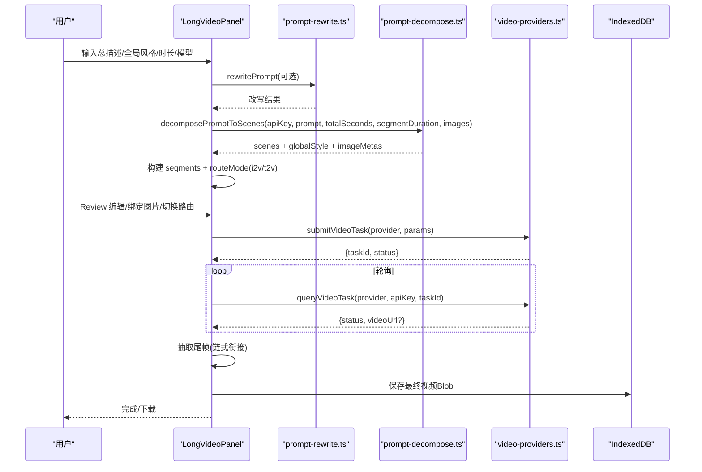
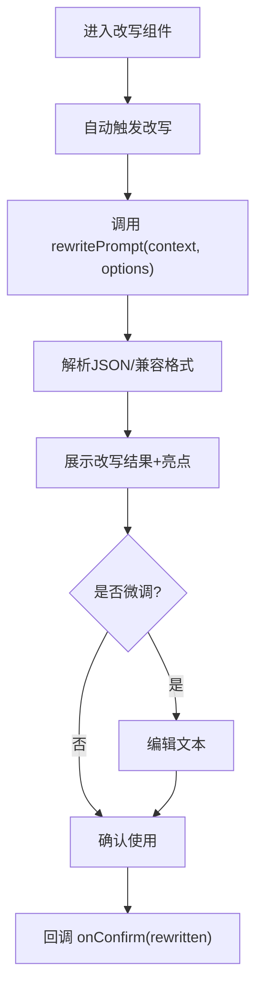
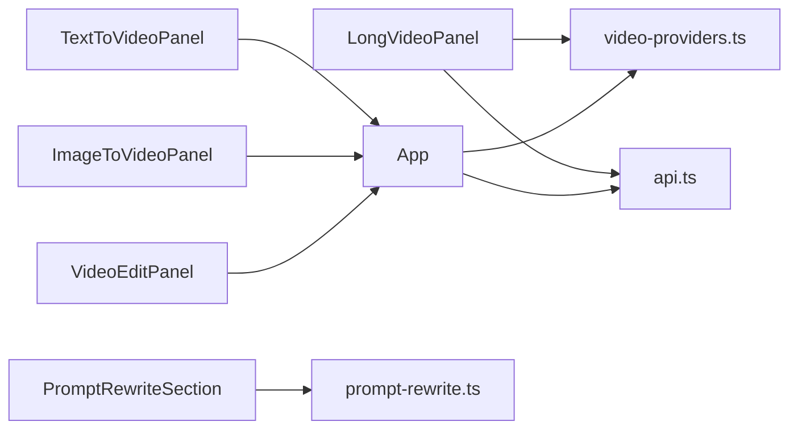

# 功能面板组件

<cite>
**本文引用的文件**
- [App.tsx](file://src/App.tsx)
- [TextToVideoPanel.tsx](file://src/components/TextToVideoPanel.tsx)
- [ImageToVideoPanel.tsx](file://src/components/ImageToVideoPanel.tsx)
- [VideoEditPanel.tsx](file://src/components/VideoEditPanel.tsx)
- [LongVideoPanel.tsx](file://src/components/LongVideoPanel.tsx)
- [PromptRewriteSection.tsx](file://src/components/PromptRewriteSection.tsx)
- [prompt-rewrite.ts](file://src/lib/prompt-rewrite.ts)
- [video-providers.ts](file://src/lib/video-providers.ts)
- [api.ts](file://src/lib/api.ts)
- [VideoPreview.tsx](file://src/components/VideoPreview.tsx)
- [TabNav.tsx](file://src/components/TabNav.tsx)
- [Header.tsx](file://src/components/Header.tsx)
- [button.tsx](file://src/components/ui/button.tsx)
</cite>

## 目录
1. [简介](#简介)
2. [项目结构](#项目结构)
3. [核心组件](#核心组件)
4. [架构总览](#架构总览)
5. [详细组件分析](#详细组件分析)
6. [依赖关系分析](#依赖关系分析)
7. [性能与内存优化](#性能与内存优化)
8. [故障排查指南](#故障排查指南)
9. [结论](#结论)
10. [附录：使用示例与扩展指南](#附录使用示例与扩展指南)

## 简介
本文件面向“AI视频生成”前端应用中的功能面板组件，系统性梳理以下业务面板的设计与实现：文本到视频、图像到视频、视频编辑、长视频分镜拼接、以及通用提示词改写模块。文档覆盖用户交互流程、表单验证与业务规则、与后端API的集成方式与数据流转、复杂状态管理与错误处理、性能优化策略（懒加载、内存管理）、以及自定义与扩展面板的指导。

## 项目结构
整体采用 React + TypeScript 的前端工程，UI 基于 Tailwind + class-variance-authority 的按钮等基础组件；业务逻辑通过 lib 层抽象为可复用的 API 适配层与工具函数。面板组件负责用户输入与交互，调用上层 App 提供的提交回调，最终路由到不同 Provider 的后端服务。

图表来源
- [App.tsx:1-164](file://src/App.tsx#L1-L164)
- [TextToVideoPanel.tsx:1-117](file://src/components/TextToVideoPanel.tsx#L1-L117)
- [ImageToVideoPanel.tsx:1-164](file://src/components/ImageToVideoPanel.tsx#L1-L164)
- [VideoEditPanel.tsx:1-157](file://src/components/VideoEditPanel.tsx#L1-L157)
- [LongVideoPanel.tsx:1-800](file://src/components/LongVideoPanel.tsx#L1-L800)
- [PromptRewriteSection.tsx:1-167](file://src/components/PromptRewriteSection.tsx#L1-L167)
- [prompt-rewrite.ts:1-221](file://src/lib/prompt-rewrite.ts#L1-L221)
- [video-providers.ts:1-559](file://src/lib/video-providers.ts#L1-L559)
- [api.ts:1-217](file://src/lib/api.ts#L1-L217)
- [VideoPreview.tsx:1-65](file://src/components/VideoPreview.tsx#L1-L65)
- [TabNav.tsx:1-39](file://src/components/TabNav.tsx#L1-L39)
- [Header.tsx:1-28](file://src/components/Header.tsx#L1-L28)

章节来源
- [App.tsx:1-164](file://src/App.tsx#L1-L164)
- [TabNav.tsx:1-39](file://src/components/TabNav.tsx#L1-L39)
- [Header.tsx:1-28](file://src/components/Header.tsx#L1-L28)

## 核心组件
- TextToVideoPanel：文本描述输入、分辨率选择、时长滑块、AI改写入口，提交后由 App 统一轮询任务状态并展示预览。
- ImageToVideoPanel：支持本地图片上传或外部URL输入，运动描述、分辨率、时长控制，同样支持AI改写。
- VideoEditPanel：上传源视频或输入视频URL，可选参考图用于风格/角色替换，编辑指令支持AI改写。
- LongVideoPanel：长视频分镜规划、多模型选择、首尾帧硬锁、链式衔接、并发控制、内容安全审核自动重试、IndexedDB持久化。
- PromptRewriteSection：通用改写组件，封装Qwen改写流程，支持结构化输出与高亮亮点展示。

章节来源
- [TextToVideoPanel.tsx:1-117](file://src/components/TextToVideoPanel.tsx#L1-L117)
- [ImageToVideoPanel.tsx:1-164](file://src/components/ImageToVideoPanel.tsx#L1-L164)
- [VideoEditPanel.tsx:1-157](file://src/components/VideoEditPanel.tsx#L1-L157)
- [LongVideoPanel.tsx:1-800](file://src/components/LongVideoPanel.tsx#L1-L800)
- [PromptRewriteSection.tsx:1-167](file://src/components/PromptRewriteSection.tsx#L1-L167)

## 架构总览
面板组件通过 App 暴露的 onSubmit 回调触发任务提交；短流程（文生/图生/编辑）直接走 api.ts 的 DashScope 接口；长视频模式则通过 video-providers.ts 的多Provider适配层，根据所选模型能力矩阵动态决定参数与路由，必要时走 MuleRouter 聚合代理。

图表来源
- [App.tsx:42-112](file://src/App.tsx#L42-L112)
- [api.ts:63-123](file://src/lib/api.ts#L63-L123)
- [video-providers.ts:491-544](file://src/lib/video-providers.ts#L491-L544)

## 详细组件分析

### 文本到视频面板（TextToVideoPanel）
- 用户交互
  - 文本输入区，带字符计数提示。
  - 分辨率三选一（480p/720p/1080p）。
  - 时长滑块（2-10秒），实时显示秒数。
  - “AI改写并生成”与“跳过改写，直接生成”两个按钮。
- 表单验证与业务规则
  - 提交前校验 prompt 非空；禁用态受 isSubmitting 与 prompt 长度影响。
  - 若开启改写，先调用 PromptRewriteSection，确认后以改写后的 prompt 提交。
- 与后端集成
  - 通过 App 的 handleSubmitTextToVideo 调用 api.ts 的 submitTextToVideo，随后轮询任务状态并在 VideoPreview 中展示。
- 状态管理
  - 局部 useState 管理 prompt/resolution/duration/showRewrite。
  - 无跨页面持久化需求。

图表来源
- [TextToVideoPanel.tsx:13-116](file://src/components/TextToVideoPanel.tsx#L13-L116)
- [App.tsx:57-74](file://src/App.tsx#L57-L74)
- [api.ts:63-81](file://src/lib/api.ts#L63-L81)
- [VideoPreview.tsx:1-65](file://src/components/VideoPreview.tsx#L1-L65)

章节来源
- [TextToVideoPanel.tsx:1-117](file://src/components/TextToVideoPanel.tsx#L1-L117)
- [App.tsx:57-74](file://src/App.tsx#L57-L74)
- [api.ts:63-81](file://src/lib/api.ts#L63-L81)
- [VideoPreview.tsx:1-65](file://src/components/VideoPreview.tsx#L1-L65)

### 图像到视频面板（ImageToVideoPanel）
- 用户交互
  - 支持本地图片上传（FileReader + URL.createObjectURL）与外部URL输入。
  - 运动描述文本框、分辨率、时长滑块。
  - 同样提供“AI改写并生成”和“跳过改写，直接生成”。
- 表单验证与业务规则
  - 提交前需同时具备 prompt 与 imageUrl/imagePreview。
  - 优先使用本地上传的 base64 Data URL（便于DashScope解析），否则回退到外部URL。
- 与后端集成
  - 通过 App 的 handleSubmitImageToVideo 调用 api.ts 的 submitImageToVideo，随后轮询任务状态。
- 状态管理
  - 维护 prompt、imageUrl、imagePreview、resolution、duration、showRewrite。

图表来源
- [ImageToVideoPanel.tsx:13-163](file://src/components/ImageToVideoPanel.tsx#L13-L163)
- [App.tsx:76-93](file://src/App.tsx#L76-L93)
- [api.ts:83-102](file://src/lib/api.ts#L83-L102)

章节来源
- [ImageToVideoPanel.tsx:1-164](file://src/components/ImageToVideoPanel.tsx#L1-L164)
- [App.tsx:76-93](file://src/App.tsx#L76-L93)
- [api.ts:83-102](file://src/lib/api.ts#L83-L102)

### 视频编辑面板（VideoEditPanel）
- 用户交互
  - 上传源视频或输入视频URL。
  - 可选上传参考图（用于风格/角色替换）。
  - 编辑指令文本框，支持AI改写。
- 表单验证与业务规则
  - 提交前需 prompt 非空且 videoUrl 存在。
  - 参考图为可选字段。
- 与后端集成
  - 通过 App 的 handleSubmitVideoEdit 调用 api.ts 的 submitVideoEdit，随后轮询任务状态。
- 状态管理
  - 维护 prompt、videoUrl、refImageUrl、videoFileName、refImagePreview、showRewrite。

图表来源
- [VideoEditPanel.tsx:13-156](file://src/components/VideoEditPanel.tsx#L13-L156)
- [App.tsx:95-112](file://src/App.tsx#L95-L112)
- [api.ts:104-123](file://src/lib/api.ts#L104-L123)

章节来源
- [VideoEditPanel.tsx:1-157](file://src/components/VideoEditPanel.tsx#L1-L157)
- [App.tsx:95-112](file://src/App.tsx#L95-L112)
- [api.ts:104-123](file://src/lib/api.ts#L104-L123)

### 长视频面板（LongVideoPanel）
该面板承担最复杂的业务流程：分镜拆解、多模型选择、首尾帧硬锁、链式衔接、并发控制、内容安全审核自动重试、IndexedDB持久化与最终视频拼接。

- 关键能力与配置
  - 模型选择：HappyHorse/Kling/Muledance，能力矩阵驱动UI控件启用/灰掉。
  - 分辨率/单段时长：按模型能力自动修正。
  - 原生音效/多镜头：仅部分模型支持。
  - 首尾帧硬锁：Muledance 支持，需要公网URL。
  - 链式衔接：上段尾帧作为下段首帧，强制串行执行。
  - 语言偏好：中文/英文/粤语，通过提示词前后夹击增强权重。
- 用户交互流程
  - 配置阶段：输入总描述、全局风格、时长、分辨率、模型、并发、链式衔接开关、首尾帧锁等。
  - 改写阶段：可选先进行提示词改写。
  - 分镜拆解：调用 decomposePromptToScenes，返回场景列表与图片绑定建议。
  - 分镜Review：用户可编辑prompt、绑定图片、切换路由模式（i2v/t2v）。
  - 生成阶段：逐段提交任务，支持重试与超时保护，抽取尾帧用于链式衔接。
  - 拼接阶段：将各段视频合并为最终视频，持久化至 IndexedDB。
- 表单验证与业务规则
  - 必填校验：apiKey、prompt。
  - 模型能力校验：分辨率/时长/特性开关不兼容时自动降级。
  - 内容安全审核拦截：自动清洗敏感词并重试一次，失败给出友好提示。
  - 图片压缩与规范：短边≥300、宽高比限制、质量0.6 JPEG。
- 与后端集成
  - 短流程仍走 api.ts；长视频通过 video-providers.ts 的 submitVideoTask/queryVideoTask 路由到具体 adapter。
  - MuleRouter 聚合代理：无需Key，自动重试网络异常与限流，CORS 视频URL包装为同源代理。
- 状态管理与持久化
  - localStorage 保存轻量状态（phase、segments、errorMessage 等）。
  - IndexedDB 存储最终视频 Blob，刷新后可恢复。
  - 中间状态修复：刷新后从持久化恢复合理阶段。

图表来源
- [LongVideoPanel.tsx:19-33](file://src/components/LongVideoPanel.tsx#L19-L33)
- [video-providers.ts:58-70](file://src/lib/video-providers.ts#L58-L70)

图表来源
- [LongVideoPanel.tsx:299-364](file://src/components/LongVideoPanel.tsx#L299-L364)
- [prompt-rewrite.ts:84-201](file://src/lib/prompt-rewrite.ts#L84-L201)
- [video-providers.ts:491-544](file://src/lib/video-providers.ts#L491-L544)

章节来源
- [LongVideoPanel.tsx:1-800](file://src/components/LongVideoPanel.tsx#L1-L800)
- [prompt-rewrite.ts:1-221](file://src/lib/prompt-rewrite.ts#L1-L221)
- [video-providers.ts:1-559](file://src/lib/video-providers.ts#L1-L559)

### 提示词改写组件（PromptRewriteSection）
- 作用：封装 Qwen 改写流程，支持多种上下文（text-to-video、image-to-video、video-edit、long-video、batch）。
- 交互：自动触发改写 → 展示结果 → 支持微调/重新改写/放弃。
- 数据结构：返回 rewritten 字符串与 highlights 数组，兼容多种JSON格式。
- 错误处理：捕获网络/解析异常，显示友好错误信息。

图表来源
- [PromptRewriteSection.tsx:22-166](file://src/components/PromptRewriteSection.tsx#L22-L166)
- [prompt-rewrite.ts:84-201](file://src/lib/prompt-rewrite.ts#L84-L201)

章节来源
- [PromptRewriteSection.tsx:1-167](file://src/components/PromptRewriteSection.tsx#L1-L167)
- [prompt-rewrite.ts:1-221](file://src/lib/prompt-rewrite.ts#L1-L221)

## 依赖关系分析
- 组件耦合
  - 三个短流程面板均依赖 App 的提交回调与全局任务轮询，低耦合、易替换。
  - LongVideoPanel 独立性强，内部包含分镜、模型选择、持久化与拼接逻辑。
- 外部依赖
  - DashScope API（HappyHorse）：通过 api.ts 封装。
  - MuleRouter 聚合代理：通过 video-providers.ts 封装，含重试与CORS代理。
  - Qwen 改写：通过 prompt-rewrite.ts 封装，支持视觉模型与few-shot。
- 潜在循环依赖
  - 当前未发现循环引用；lib 层被组件单向依赖。

图表来源
- [App.tsx:1-164](file://src/App.tsx#L1-L164)
- [video-providers.ts:1-559](file://src/lib/video-providers.ts#L1-L559)
- [api.ts:1-217](file://src/lib/api.ts#L1-L217)
- [prompt-rewrite.ts:1-221](file://src/lib/prompt-rewrite.ts#L1-L221)

章节来源
- [App.tsx:1-164](file://src/App.tsx#L1-L164)
- [video-providers.ts:1-559](file://src/lib/video-providers.ts#L1-L559)
- [api.ts:1-217](file://src/lib/api.ts#L1-L217)
- [prompt-rewrite.ts:1-221](file://src/lib/prompt-rewrite.ts#L1-L221)

## 性能与内存优化
- 懒加载与按需渲染
  - 面板仅在对应 Tab 激活时渲染，避免不必要的初始化。
  - 图片上传使用 FileReader + URL.createObjectURL，仅在提交时转换为 base64，减少常驻内存占用。
- 并发与节流
  - 长视频面板根据模型能力设置最大并发，避免上游限流丢连接。
  - 提交间 stagger 延时，降低瞬时压力。
- 资源清理
  - 图片压缩完成后及时 revokeObjectURL，释放内存。
  - 最终视频 Blob 存 IndexedDB，页面刷新后重建 blob URL，避免泄漏。
- 网络容错
  - fetchWithRetry 对 429/5xx 进行指数退避重试。
  - 视频URL通过同源代理绕过 CORS，提升播放成功率。

[本节为通用指导，不直接分析具体文件]

## 故障排查指南
- 常见错误定位
  - 内容安全审核拦截：长视频面板内置 Green net 检测与清洗重试，失败会提示修改敏感词。
  - 图片尺寸/比例不符：压缩器会在短边不足或长边过大时调整，比例超限直接报错。
  - 模型能力不匹配：切换模型时自动回退不支持的分辨率/时长/特性。
  - 网络异常/限流：MuleRouter 层自动重试，失败消息包含完整响应摘要。
- 调试建议
  - 打开浏览器控制台查看 [MuleRouter]/[GreenNet] 日志。
  - 检查 localStorage 中的会话状态与 IndexedDB 中的视频 Blob。
  - 确认代理路径 /mulerouter 与 /proxy-fetch 在开发环境生效。

章节来源
- [LongVideoPanel.tsx:476-567](file://src/components/LongVideoPanel.tsx#L476-L567)
- [video-providers.ts:263-296](file://src/lib/video-providers.ts#L263-L296)
- [video-providers.ts:463-471](file://src/lib/video-providers.ts#L463-L471)

## 结论
功能面板组件围绕“输入—改写—提交—轮询—预览”的主线展开，短流程简洁直观，长视频模式通过能力矩阵与多Provider适配实现了高度可扩展的视频生成流水线。完善的错误处理、持久化与性能优化策略保障了用户体验与系统稳定性。

[本节为总结性内容，不直接分析具体文件]

## 附录：使用示例与扩展指南

### 使用示例
- 文本到视频
  - 在“文生视频”标签页输入描述，选择分辨率与时长，点击“AI改写并生成”或直接生成。
  - 成功后在右侧预览区域播放视频。
- 图像到视频
  - 上传首帧图片或输入URL，编写运动描述，选择分辨率与时长，提交后等待生成。
- 视频编辑
  - 上传源视频或输入URL，可选参考图，编写编辑指令，提交后等待处理。
- 长视频
  - 输入总描述与全局风格，选择模型与时长，进行分镜拆解与Review，确认后开始生成与拼接。

章节来源
- [App.tsx:114-146](file://src/App.tsx#L114-L146)
- [TabNav.tsx:10-16](file://src/components/TabNav.tsx#L10-L16)

### 自定义与扩展面板
- 新增面板步骤
  - 在 components 目录下新建面板组件，定义 props（如 onSubmit、isSubmitting、apiKey）。
  - 在 App.tsx 中添加新的 activeMode 分支，引入并渲染新面板。
  - 如需接入新模型，在 video-providers.ts 中扩展 PROVIDERS 元数据与 submit/query 路由。
  - 如需新的改写上下文，在 prompt-rewrite.ts 的 FEW_SHOT_CONFIGS 中添加配置。
- 最佳实践
  - 保持表单验证与错误提示一致，复用 UI 基础组件。
  - 对于大对象或二进制数据，优先使用 IndexedDB 或 sessionStorage/localStorage 标记。
  - 对外部资源的访问尽量通过代理或同源路径，避免 CORS 问题。

章节来源
- [App.tsx:114-146](file://src/App.tsx#L114-L146)
- [video-providers.ts:72-160](file://src/lib/video-providers.ts#L72-L160)
- [prompt-rewrite.ts:32-82](file://src/lib/prompt-rewrite.ts#L32-L82)