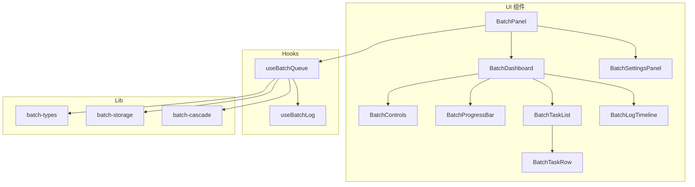
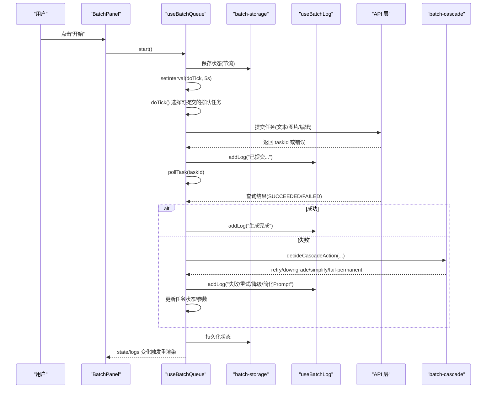
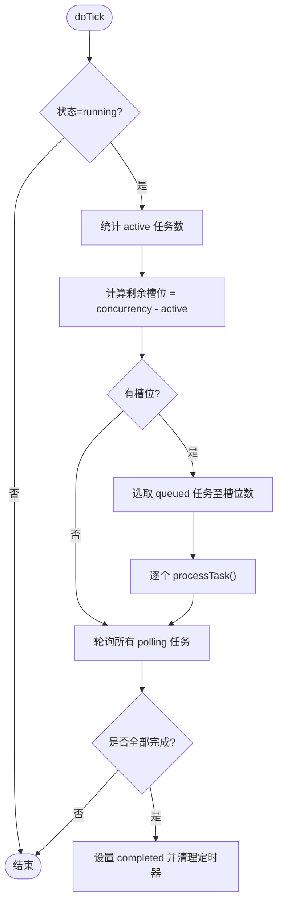
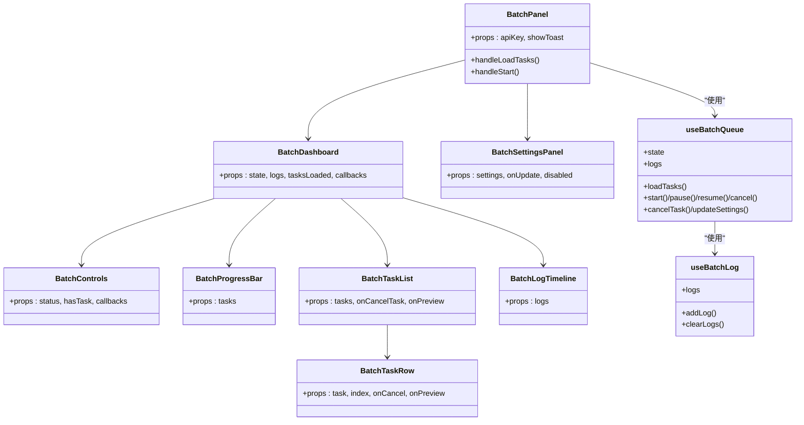

# 批量处理组件

<cite>
**本文引用的文件列表**
- [BatchControls.tsx](file://src/components/batch/BatchControls.tsx)
- [BatchDashboard.tsx](file://src/components/batch/BatchDashboard.tsx)
- [BatchTaskList.tsx](file://src/components/batch/BatchTaskList.tsx)
- [BatchProgressBar.tsx](file://src/components/batch/BatchProgressBar.tsx)
- [BatchLogTimeline.tsx](file://src/components/batch/BatchLogTimeline.tsx)
- [BatchSettingsPanel.tsx](file://src/components/batch/BatchSettingsPanel.tsx)
- [BatchTaskRow.tsx](file://src/components/batch/BatchTaskRow.tsx)
- [BatchPanel.tsx](file://src/components/batch/BatchPanel.tsx)
- [useBatchQueue.ts](file://src/hooks/useBatchQueue.ts)
- [useBatchLog.ts](file://src/hooks/useBatchLog.ts)
- [batch-types.ts](file://src/lib/batch-types.ts)
- [batch-storage.ts](file://src/lib/batch-storage.ts)
- [batch-cascade.ts](file://src/lib/batch-cascade.ts)
- [test-batch.mjs](file://test-batch.mjs)
</cite>

## 目录
1. [简介](#简介)
2. [项目结构](#项目结构)
3. [核心组件](#核心组件)
4. [架构总览](#架构总览)
5. [详细组件分析](#详细组件分析)
6. [依赖关系分析](#依赖关系分析)
7. [性能与可扩展性](#性能与可扩展性)
8. [故障排查指南](#故障排查指南)
9. [结论](#结论)
10. [附录：完整使用示例](#附录完整使用示例)

## 简介
本文件面向“批量处理”相关 UI 组件，系统性梳理 BatchControls、BatchDashboard、BatchTaskList、BatchProgressBar、BatchLogTimeline、BatchSettingsPanel、BatchTaskRow 等组件的职责、交互流程与状态同步机制。文档重点解释这些组件如何与 useBatchQueue Hook 协同工作，覆盖任务创建、进度监控、日志查看、错误处理与用户反馈，并提供集成到现有应用的完整示例路径与扩展建议。

## 项目结构
批量处理功能位于 src/components/batch 目录下，配合 hooks 与 lib 层提供状态管理、持久化、容错降级与类型定义。整体采用“面板 + 仪表盘 + 设置”的布局模式：左侧为输入与设置，右侧为仪表盘（进度、控制、任务列表、日志）。

图表来源
- [BatchPanel.tsx:1-58](file://src/components/batch/BatchPanel.tsx#L1-L58)
- [BatchDashboard.tsx:1-89](file://src/components/batch/BatchDashboard.tsx#L1-L89)
- [BatchControls.tsx:1-50](file://src/components/batch/BatchControls.tsx#L1-L50)
- [BatchProgressBar.tsx:1-36](file://src/components/batch/BatchProgressBar.tsx#L1-L36)
- [BatchTaskList.tsx:1-27](file://src/components/batch/BatchTaskList.tsx#L1-L27)
- [BatchTaskRow.tsx:1-80](file://src/components/batch/BatchTaskRow.tsx#L1-L80)
- [BatchLogTimeline.tsx:1-47](file://src/components/batch/BatchLogTimeline.tsx#L1-L47)
- [BatchSettingsPanel.tsx:1-79](file://src/components/batch/BatchSettingsPanel.tsx#L1-L79)
- [useBatchQueue.ts:1-322](file://src/hooks/useBatchQueue.ts#L1-L322)
- [useBatchLog.ts:1-39](file://src/hooks/useBatchLog.ts#L1-L39)
- [batch-types.ts:1-123](file://src/lib/batch-types.ts#L1-L123)
- [batch-storage.ts:1-89](file://src/lib/batch-storage.ts#L1-L89)
- [batch-cascade.ts:1-101](file://src/lib/batch-cascade.ts#L1-L101)

章节来源
- [BatchPanel.tsx:1-58](file://src/components/batch/BatchPanel.tsx#L1-L58)
- [BatchDashboard.tsx:1-89](file://src/components/batch/BatchDashboard.tsx#L1-L89)
- [useBatchQueue.ts:1-322](file://src/hooks/useBatchQueue.ts#L1-L322)
- [batch-types.ts:1-123](file://src/lib/batch-types.ts#L1-L123)

## 核心组件
- BatchPanel：组合输入区与仪表盘，桥接 useBatchQueue 与 UI 事件，负责加载任务、启动/暂停/重置、提示消息。
- BatchDashboard：聚合进度条、控制面板、任务列表与日志时间线；包含视频预览弹窗。
- BatchControls：根据队列状态渲染开始/暂停/恢复/重置/取消全部按钮。
- BatchProgressBar：计算并展示总体完成度、成功/失败/取消统计。
- BatchTaskList：渲染任务行列表，空态提示。
- BatchTaskRow：单条任务的详情行，显示状态标签、重试次数、降级标记、预览/下载与取消操作。
- BatchLogTimeline：滚动自动定位的实时日志视图，按级别着色。
- BatchSettingsPanel：并发数、最大重试次数、自动降级与自动简化 Prompt 的设置项。

章节来源
- [BatchPanel.tsx:1-58](file://src/components/batch/BatchPanel.tsx#L1-L58)
- [BatchDashboard.tsx:1-89](file://src/components/batch/BatchDashboard.tsx#L1-L89)
- [BatchControls.tsx:1-50](file://src/components/batch/BatchControls.tsx#L1-L50)
- [BatchProgressBar.tsx:1-36](file://src/components/batch/BatchProgressBar.tsx#L1-L36)
- [BatchTaskList.tsx:1-27](file://src/components/batch/BatchTaskList.tsx#L1-L27)
- [BatchTaskRow.tsx:1-80](file://src/components/batch/BatchTaskRow.tsx#L1-L80)
- [BatchLogTimeline.tsx:1-47](file://src/components/batch/BatchLogTimeline.tsx#L1-L47)
- [BatchSettingsPanel.tsx:1-79](file://src/components/batch/BatchSettingsPanel.tsx#L1-L79)

## 架构总览
批量处理的核心由 useBatchQueue 驱动，它维护队列状态、调度提交与轮询、执行容错降级策略、持久化状态与日志，并通过 useBatchLog 提供日志能力。UI 组件通过 props 订阅状态与回调，实现无侵入式的数据流。

图表来源
- [useBatchQueue.ts:1-322](file://src/hooks/useBatchQueue.ts#L1-L322)
- [batch-storage.ts:1-89](file://src/lib/batch-storage.ts#L1-L89)
- [useBatchLog.ts:1-39](file://src/hooks/useBatchLog.ts#L1-L39)
- [batch-cascade.ts:1-101](file://src/lib/batch-cascade.ts#L1-L101)

## 详细组件分析

### BatchPanel（入口面板）
- 职责：整合输入区与仪表盘，调用 useBatchQueue 的 loadTasks/start/pause/resume/cancel/cancelTask/updateSettings，并将状态与日志透传给 Dashboard。
- 关键交互：
  - 加载任务后启用“开始”，未设置 API Key 时阻止启动并提示。
  - 运行中禁用输入与设置变更，避免状态不一致。
- 数据流：将 queue.state 与 queue.logs 作为 props 传递给 Dashboard。

章节来源
- [BatchPanel.tsx:1-58](file://src/components/batch/BatchPanel.tsx#L1-L58)
- [useBatchQueue.ts:1-322](file://src/hooks/useBatchQueue.ts#L1-L322)

### BatchDashboard（仪表盘）
- 职责：汇总进度、控制、任务列表与日志；提供视频预览弹窗。
- 关键点：
  - 当 tasksLoaded 为 false 且无任务时显示占位提示。
  - 顶部区域放置 BatchProgressBar 与 BatchControls、导出按钮。
  - 中部滚动区域渲染 BatchTaskList。
  - 底部固定区域渲染 BatchLogTimeline。
  - 支持在任务完成后点击播放图标打开预览模态框。

章节来源
- [BatchDashboard.tsx:1-89](file://src/components/batch/BatchDashboard.tsx#L1-L89)

### BatchControls（控制栏）
- 职责：根据队列状态动态渲染按钮：
  - idle：显示“开始”，仅在存在任务时可用。
  - running：显示“暂停”。
  - paused：显示“恢复”。
  - completed：显示“重置”。
  - running/paused：均显示“取消全部”。
- 交互：通过 onStart/onPause/onResume/onCancel 回调与 useBatchQueue 对接。

章节来源
- [BatchControls.tsx:1-50](file://src/components/batch/BatchControls.tsx#L1-L50)
- [useBatchQueue.ts:1-322](file://src/hooks/useBatchQueue.ts#L1-L322)

### BatchProgressBar（进度条）
- 职责：基于任务状态计算完成比例与分类计数（成功/失败/取消），以百分比与数字双维度展示。
- 复杂度：O(n)，n 为任务数量。

章节来源
- [BatchProgressBar.tsx:1-36](file://src/components/batch/BatchProgressBar.tsx#L1-L36)

### BatchTaskList（任务列表）
- 职责：遍历任务数组渲染 BatchTaskRow；空态提示“暂无任务”。
- 事件：转发 onCancelTask 与 onPreview 给子行。

章节来源
- [BatchTaskList.tsx:1-27](file://src/components/batch/BatchTaskList.tsx#L1-L27)

### BatchTaskRow（任务行）
- 职责：展示任务编号、提示词、分辨率/时长、重试次数、降级标记、状态标签；提供预览/下载与取消操作。
- 行为：
  - 仅当任务处于 queued/retrying 时可取消。
  - 成功且有 videoUrl 时显示预览与下载。
- 状态映射：内部维护状态到文案与样式的映射表。

章节来源
- [BatchTaskRow.tsx:1-80](file://src/components/batch/BatchTaskRow.tsx#L1-L80)

### BatchLogTimeline（日志时间线）
- 职责：展示最近若干条日志，自动滚动到底部；按级别着色（info/warn/error/success）。
- 性能：仅渲染最近 N 条，避免长列表卡顿。

章节来源
- [BatchLogTimeline.tsx:1-47](file://src/components/batch/BatchLogTimeline.tsx#L1-L47)
- [useBatchLog.ts:1-39](file://src/hooks/useBatchLog.ts#L1-L39)

### BatchSettingsPanel（设置面板）
- 职责：提供并发数、最大重试次数、自动降级、自动简化 Prompt 的配置项。
- 约束：运行中禁用修改，防止影响正在进行的调度。

章节来源
- [BatchSettingsPanel.tsx:1-79](file://src/components/batch/BatchSettingsPanel.tsx#L1-L79)

### useBatchQueue（核心 Hook）
- 状态管理：使用 useReducer 管理 BatchQueueState，支持 LOAD_TASKS/SET_STATUS/UPDATE_SETTINGS/UPDATE_TASK/CANCEL_TASK/RESET。
- 调度循环：每 5 秒执行一次 doTick，依据 concurrency 限制并发，挑选 queued 任务提交，并对 polling 任务进行轮询。
- 任务提交：根据 mode 调用不同 API（文本/图片/视频编辑），记录 remoteTaskId 进入轮询。
- 轮询与完成判定：查询任务结果，成功则标记 succeeded 并记录完成时间；失败则进入容错流程。
- 容错降级：调用 batch-cascade 决策，支持重试（指数退避）、参数降级（分辨率/时长）、Prompt 简化、永久失败。
- 持久化：对状态与日志进行 localStorage 持久化，页面刷新后可恢复；注册 beforeunload 保护。
- 生命周期：start/pause/resume/cancel/cancelTask/updateSettings 暴露给上层 UI。

图表来源
- [useBatchQueue.ts:1-322](file://src/hooks/useBatchQueue.ts#L1-L322)

章节来源
- [useBatchQueue.ts:1-322](file://src/hooks/useBatchQueue.ts#L1-L322)
- [batch-cascade.ts:1-101](file://src/lib/batch-cascade.ts#L1-L101)
- [batch-storage.ts:1-89](file://src/lib/batch-storage.ts#L1-L89)

### useBatchLog（日志 Hook）
- 职责：维护日志数组，限制最大条目数，写入 localStorage，提供 clearLogs。
- 使用方式：在任务生命周期各阶段调用 addLog 记录 info/warn/error/success。

章节来源
- [useBatchLog.ts:1-39](file://src/hooks/useBatchLog.ts#L1-L39)

### 类型与工具
- batch-types：定义任务定义、运行时状态、队列状态、设置、日志、模板组合、解析结果等类型与默认值。
- batch-storage：封装队列状态与日志的持久化、初始状态与页面离开保护。
- batch-cascade：决定容错动作（重试/降级/简化/失败），含分辨率与时长的降级顺序与 Prompt 简化逻辑。

章节来源
- [batch-types.ts:1-123](file://src/lib/batch-types.ts#L1-L123)
- [batch-storage.ts:1-89](file://src/lib/batch-storage.ts#L1-L89)
- [batch-cascade.ts:1-101](file://src/lib/batch-cascade.ts#L1-L101)

## 依赖关系分析
- 组件耦合：
  - BatchPanel 依赖 useBatchQueue 与多个子组件。
  - BatchDashboard 组合进度、控制、列表与日志，不直接持有状态。
  - BatchTaskList 仅负责渲染列表，具体交互下沉到 BatchTaskRow。
- Hook 依赖：
  - useBatchQueue 依赖 batch-types、batch-storage、batch-cascade、useBatchLog 以及 API 层。
  - useBatchLog 依赖 batch-storage。
- 外部依赖：
  - API 层用于提交与查询任务（见测试脚本中的调用方式）。
  - localStorage 用于持久化。

图表来源
- [BatchPanel.tsx:1-58](file://src/components/batch/BatchPanel.tsx#L1-L58)
- [BatchDashboard.tsx:1-89](file://src/components/batch/BatchDashboard.tsx#L1-L89)
- [BatchControls.tsx:1-50](file://src/components/batch/BatchControls.tsx#L1-L50)
- [BatchProgressBar.tsx:1-36](file://src/components/batch/BatchProgressBar.tsx#L1-L36)
- [BatchTaskList.tsx:1-27](file://src/components/batch/BatchTaskList.tsx#L1-L27)
- [BatchTaskRow.tsx:1-80](file://src/components/batch/BatchTaskRow.tsx#L1-L80)
- [BatchLogTimeline.tsx:1-47](file://src/components/batch/BatchLogTimeline.tsx#L1-L47)
- [BatchSettingsPanel.tsx:1-79](file://src/components/batch/BatchSettingsPanel.tsx#L1-L79)
- [useBatchQueue.ts:1-322](file://src/hooks/useBatchQueue.ts#L1-L322)
- [useBatchLog.ts:1-39](file://src/hooks/useBatchLog.ts#L1-L39)

## 性能与可扩展性
- 渲染优化：
  - 日志仅保留最近若干条，避免长列表重排。
  - 进度与统计计算为 O(n)，适合中等规模任务量。
- 调度优化：
  - 使用固定间隔轮询，结合 processingRef 去重，避免重复提交/轮询。
  - 并发受 concurrency 控制，避免瞬时压力过大。
- 持久化：
  - 状态与日志落盘，刷新后可恢复；异常时尝试裁剪 errorHistory 降低体积。
- 可扩展点：
  - 新增任务模式：在提交分支中添加新的 case 并适配 UI。
  - 自定义降级策略：扩展 batch-cascade 的决策树。
  - 日志级别扩展：在日志组件中增加新级别的样式映射。

[本节为通用指导，无需源码引用]

## 故障排查指南
- 常见问题
  - 未设置 API Key：启动前校验并提示。
  - 无有效任务：加载后若为空，提示并阻止启动。
  - 网络异常：提交或轮询异常会记录 warn/error 日志，并根据策略重试或降级。
  - 存储容量不足：持久化捕获异常并裁剪历史后再试。
- 调试建议
  - 观察 BatchLogTimeline 的最近日志，定位失败原因。
  - 检查 BatchTaskRow 的重试次数与降级标记，确认降级策略生效。
  - 使用浏览器控制台查看 localStorage 中的 batch_queue_state 与 batch_log_entries。
- 参考脚本
  - test-batch.mjs 展示了与后端 API 的交互流程，可用于对比与验证。

章节来源
- [BatchPanel.tsx:1-58](file://src/components/batch/BatchPanel.tsx#L1-L58)
- [useBatchQueue.ts:1-322](file://src/hooks/useBatchQueue.ts#L1-L322)
- [batch-storage.ts:1-89](file://src/lib/batch-storage.ts#L1-L89)
- [test-batch.mjs:1-130](file://test-batch.mjs#L1-L130)

## 结论
该批量处理组件体系以 useBatchQueue 为核心，围绕“提交-轮询-容错-持久化”的主循环构建，UI 组件以声明式方式呈现状态与交互。通过合理的并发控制、降级策略与日志可视化，提供了稳定易用的批量任务管理能力。后续可按需扩展任务模式、降级策略与日志级别，以满足更复杂的业务场景。

[本节为总结，无需源码引用]

## 附录：完整使用示例
以下示例展示如何在应用中集成批量处理界面，从任务创建到运行监控的全流程。

- 步骤一：引入 BatchPanel
  - 在父组件中导入 BatchPanel，传入 apiKey 与 showToast。
  - 参考路径：[BatchPanel.tsx:1-58](file://src/components/batch/BatchPanel.tsx#L1-L58)

- 步骤二：准备任务定义
  - 构造 BatchTaskDefinition[]，包含 id、mode、prompt、resolution、duration 等字段。
  - 参考类型定义：[batch-types.ts:10-19](file://src/lib/batch-types.ts#L10-L19)

- 步骤三：加载任务
  - 调用 queue.loadTasks(definitions) 并设置 tasksLoaded 为 true。
  - 参考路径：[BatchPanel.tsx:17-25](file://src/components/batch/BatchPanel.tsx#L17-L25)

- 步骤四：启动/暂停/恢复/重置
  - 绑定 onStart/onPause/onResume/onCancel 到 queue.start/pause/resume/cancel。
  - 参考路径：[BatchPanel.tsx:27-34](file://src/components/batch/BatchPanel.tsx#L27-L34)、[BatchPanel.tsx:45-54](file://src/components/batch/BatchPanel.tsx#L45-L54)

- 步骤五：监控进度与日志
  - 将 queue.state 与 queue.logs 作为 props 传入 Dashboard。
  - 参考路径：[BatchPanel.tsx:45-54](file://src/components/batch/BatchPanel.tsx#L45-L54)

- 步骤六：配置执行参数
  - 使用 BatchSettingsPanel 调整并发数、最大重试次数、自动降级与自动简化 Prompt。
  - 参考路径：[BatchSettingsPanel.tsx:1-79](file://src/components/batch/BatchSettingsPanel.tsx#L1-L79)

- 步骤七：查看任务详情与结果
  - 在任务列表中点击预览打开视频预览弹窗，或下载已完成视频。
  - 参考路径：[BatchTaskRow.tsx:48-67](file://src/components/batch/BatchTaskRow.tsx#L48-L67)、[BatchDashboard.tsx:48-66](file://src/components/batch/BatchDashboard.tsx#L48-L66)

- 步骤八：错误处理与反馈
  - 通过 showToast 提示用户关键事件（如缺少 API Key、无有效任务、启动成功等）。
  - 参考路径：[BatchPanel.tsx:17-34](file://src/components/batch/BatchPanel.tsx#L17-L34)

- 步骤九：参考端到端流程
  - 参考测试脚本中的提交与轮询流程，理解与后端交互细节。
  - 参考路径：[test-batch.mjs:20-79](file://test-batch.mjs#L20-L79)

章节来源
- [BatchPanel.tsx:1-58](file://src/components/batch/BatchPanel.tsx#L1-L58)
- [batch-types.ts:10-19](file://src/lib/batch-types.ts#L10-L19)
- [BatchTaskRow.tsx:48-67](file://src/components/batch/BatchTaskRow.tsx#L48-L67)
- [BatchDashboard.tsx:48-66](file://src/components/batch/BatchDashboard.tsx#L48-L66)
- [test-batch.mjs:20-79](file://test-batch.mjs#L20-L79)