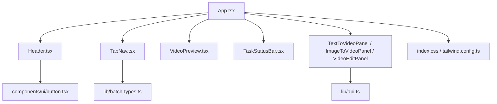
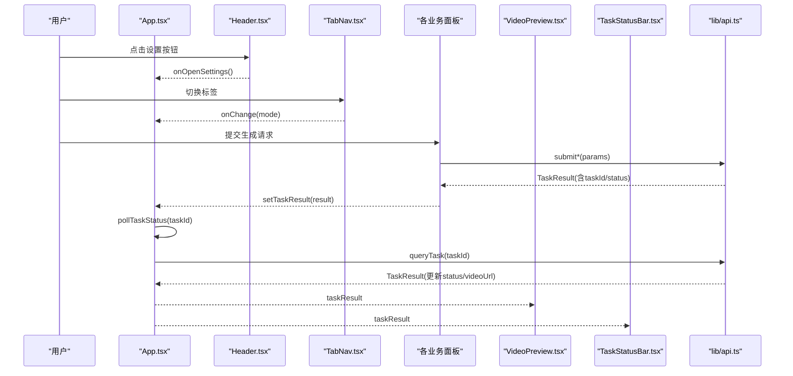
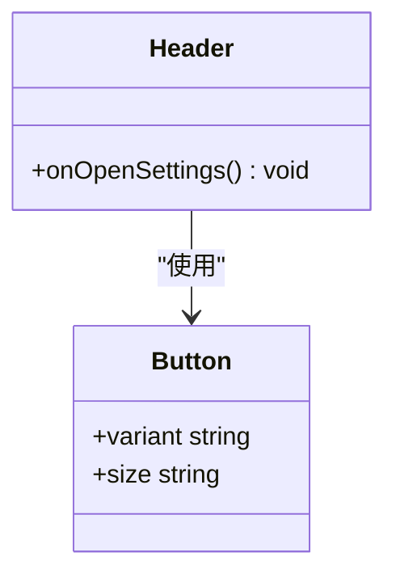
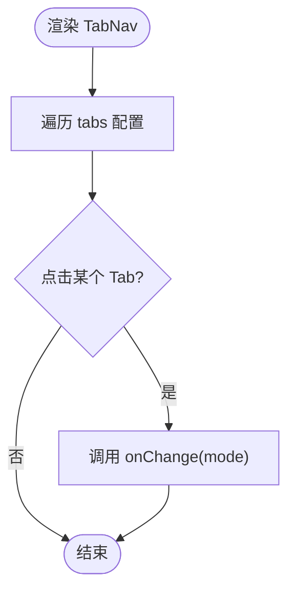
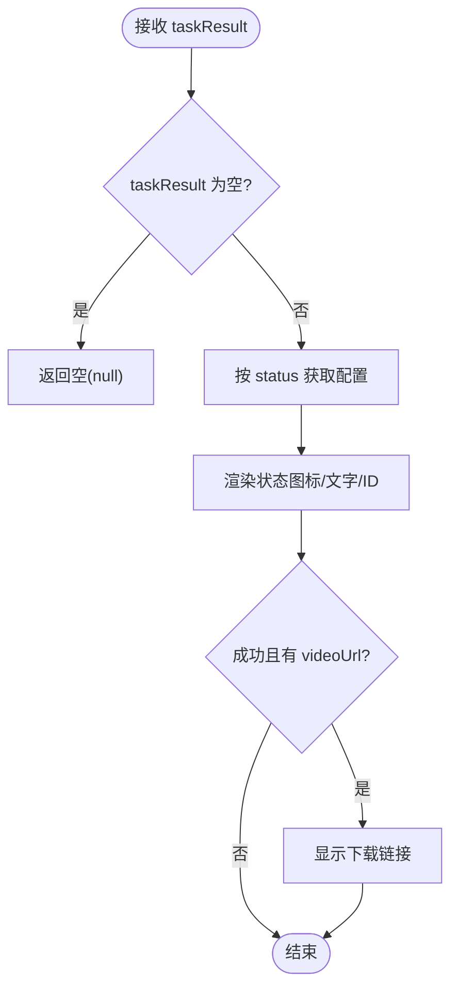
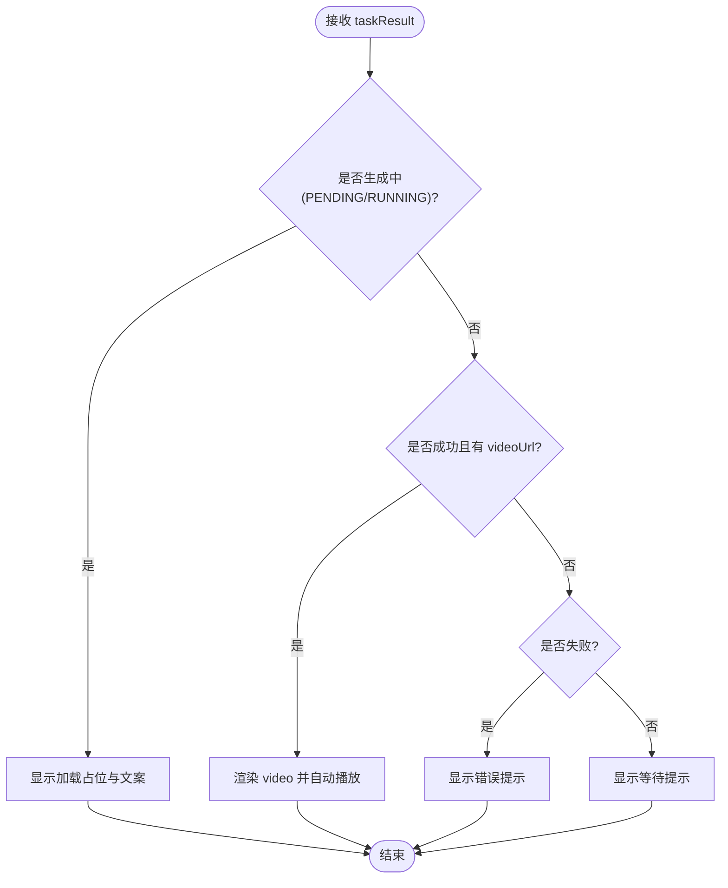
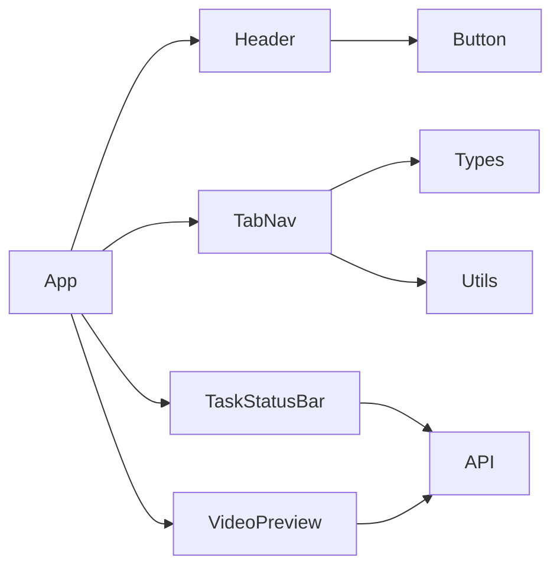

# 核心组件

<cite>
**本文引用的文件**   
- [src/components/Header.tsx](file://src/components/Header.tsx)
- [src/components/TabNav.tsx](file://src/components/TabNav.tsx)
- [src/components/TaskStatusBar.tsx](file://src/components/TaskStatusBar.tsx)
- [src/components/VideoPreview.tsx](file://src/components/VideoPreview.tsx)
- [src/lib/api.ts](file://src/lib/api.ts)
- [src/lib/batch-types.ts](file://src/lib/batch-types.ts)
- [src/lib/utils.ts](file://src/lib/utils.ts)
- [src/components/ui/button.tsx](file://src/components/ui/button.tsx)
- [src/App.tsx](file://src/App.tsx)
- [src/index.css](file://src/index.css)
- [tailwind.config.ts](file://tailwind.config.ts)
</cite>

## 目录
1. [简介](#简介)
2. [项目结构](#项目结构)
3. [核心组件](#核心组件)
4. [架构总览](#架构总览)
5. [详细组件分析](#详细组件分析)
6. [依赖关系分析](#依赖关系分析)
7. [性能考量](#性能考量)
8. [故障排查指南](#故障排查指南)
9. [结论](#结论)
10. [附录](#附录)

## 简介
本文件聚焦于应用的核心UI组件：Header、TabNav、TaskStatusBar、VideoPreview。文档从设计理念、Props接口、事件处理与状态管理、组件间通信模式与依赖关系入手，结合具体使用示例说明如何组合这些组件。同时覆盖响应式设计与可访问性支持、主题定制与样式覆盖方法，以及性能优化建议与最佳实践。

## 项目结构
该应用采用基于功能分层的组织方式：
- 组件层：位于 src/components，包含页面级布局与业务面板组件
- 类型与工具：位于 src/lib，提供API封装、批量任务类型定义与通用工具函数
- 应用入口：src/App.tsx 负责全局状态与路由（模式）切换，组合核心组件
- 样式系统：Tailwind + CSS变量实现主题化与暗色模式

图表来源
- [src/App.tsx:114-146](file://src/App.tsx#L114-L146)
- [src/components/Header.tsx:1-28](file://src/components/Header.tsx#L1-L28)
- [src/components/TabNav.tsx:1-39](file://src/components/TabNav.tsx#L1-L39)
- [src/components/VideoPreview.tsx:1-65](file://src/components/VideoPreview.tsx#L1-L65)
- [src/components/TaskStatusBar.tsx:1-44](file://src/components/TaskStatusBar.tsx#L1-L44)
- [src/lib/api.ts:1-217](file://src/lib/api.ts#L1-L217)
- [src/lib/batch-types.ts:1-123](file://src/lib/batch-types.ts#L1-L123)
- [src/components/ui/button.tsx:1-53](file://src/components/ui/button.tsx#L1-L53)
- [src/index.css:1-111](file://src/index.css#L1-L111)
- [tailwind.config.ts:1-93](file://tailwind.config.ts#L1-L93)

章节来源
- [src/App.tsx:1-164](file://src/App.tsx#L1-L164)
- [src/index.css:1-111](file://src/index.css#L1-L111)
- [tailwind.config.ts:1-93](file://tailwind.config.ts#L1-L93)

## 核心组件
本节概述四个核心组件的职责与设计要点：
- Header：顶部导航栏，展示品牌信息与设置入口
- TabNav：应用模式切换的标签导航
- TaskStatusBar：任务执行状态的可视化条
- VideoPreview：视频预览与生成状态占位

章节来源
- [src/components/Header.tsx:1-28](file://src/components/Header.tsx#L1-L28)
- [src/components/TabNav.tsx:1-39](file://src/components/TabNav.tsx#L1-L39)
- [src/components/TaskStatusBar.tsx:1-44](file://src/components/TaskStatusBar.tsx#L1-L44)
- [src/components/VideoPreview.tsx:1-65](file://src/components/VideoPreview.tsx#L1-L65)

## 架构总览
整体交互流程由 App 作为“状态中心”，通过 props 将任务结果与当前模式传递给子组件；子组件以受控形式向上回调事件或更新父级状态。

图表来源
- [src/App.tsx:42-112](file://src/App.tsx#L42-L112)
- [src/components/Header.tsx:8-26](file://src/components/Header.tsx#L8-L26)
- [src/components/TabNav.tsx:18-37](file://src/components/TabNav.tsx#L18-L37)
- [src/components/VideoPreview.tsx:8-63](file://src/components/VideoPreview.tsx#L8-L63)
- [src/components/TaskStatusBar.tsx:8-43](file://src/components/TaskStatusBar.tsx#L8-L43)
- [src/lib/api.ts:125-216](file://src/lib/api.ts#L125-L216)

## 详细组件分析

### Header 组件
- 职责
  - 展示应用标题与副标题
  - 提供打开设置的入口按钮
- Props 接口
  - onOpenSettings: () => void
- 事件处理
  - 点击设置图标触发 onOpenSettings，由父组件控制弹窗显示
- 状态管理
  - 无内部状态，纯展示型组件
- 依赖关系
  - 使用 Button 基础组件与 lucide-react 图标
- 可访问性与语义
  - 使用 header 语义标签，按钮具备默认可聚焦能力
- 响应式与样式
  - 使用 Tailwind 类进行间距、背景模糊与粘性定位
- 主题定制
  - 颜色与阴影来自 CSS 变量与自定义渐变类

图表来源
- [src/components/Header.tsx:1-28](file://src/components/Header.tsx#L1-L28)
- [src/components/ui/button.tsx:1-53](file://src/components/ui/button.tsx#L1-L53)

章节来源
- [src/components/Header.tsx:1-28](file://src/components/Header.tsx#L1-L28)
- [src/components/ui/button.tsx:1-53](file://src/components/ui/button.tsx#L1-L53)

### TabNav 组件
- 职责
  - 提供应用模式切换（文生视频、图生视频、视频编辑、批量模式、长视频）
- Props 接口
  - activeMode: AppMode
  - onChange: (mode: AppMode) => void
- 事件处理
  - 点击某个 tab 调用 onChange 通知父组件更新 activeMode
- 状态管理
  - 无内部状态，受控组件
- 依赖关系
  - 使用 AppMode 类型与 cn 工具函数
- 可访问性与语义
  - 使用 nav 语义标签，button 元素具备键盘可操作能力
- 响应式与样式
  - 使用 flex 布局与条件样式区分选中态与非选中态
- 主题定制
  - 选中态边框与背景通过渐变与卡片色变量实现

图表来源
- [src/components/TabNav.tsx:1-39](file://src/components/TabNav.tsx#L1-L39)
- [src/lib/batch-types.ts:1-10](file://src/lib/batch-types.ts#L1-L10)
- [src/lib/utils.ts:1-7](file://src/lib/utils.ts#L1-L7)

章节来源
- [src/components/TabNav.tsx:1-39](file://src/components/TabNav.tsx#L1-L39)
- [src/lib/batch-types.ts:1-10](file://src/lib/batch-types.ts#L1-L10)
- [src/lib/utils.ts:1-7](file://src/lib/utils.ts#L1-L7)

### TaskStatusBar 组件
- 职责
  - 根据任务结果展示任务状态、ID片段与下载链接
- Props 接口
  - taskResult: TaskResult | null
- 事件处理
  - 无内部事件，仅展示
- 状态管理
  - 无内部状态，完全受控
- 依赖关系
  - 使用 TaskResult 类型与 lucide-react 图标
- 可访问性与语义
  - 文本信息清晰表达状态，下载链接具备 target 与 rel 安全属性
- 响应式与样式
  - 使用容器内弹性布局与状态色
- 主题定制
  - 颜色与边框使用 CSS 变量

图表来源
- [src/components/TaskStatusBar.tsx:1-44](file://src/components/TaskStatusBar.tsx#L1-L44)
- [src/lib/api.ts:32-37](file://src/lib/api.ts#L32-L37)

章节来源
- [src/components/TaskStatusBar.tsx:1-44](file://src/components/TaskStatusBar.tsx#L1-L44)
- [src/lib/api.ts:32-37](file://src/lib/api.ts#L32-L37)

### VideoPreview 组件
- 职责
  - 展示视频预览、生成中占位与失败提示
- Props 接口
  - taskResult: TaskResult | null
- 事件处理
  - 无内部事件，仅展示
- 状态管理
  - 无内部状态，受控
- 依赖关系
  - 使用 TaskResult 类型与 lucide-react 图标
- 可访问性与语义
  - 使用 video 原生控件，具备自动播放与完整控制条
- 响应式与样式
  - 使用相对定位与背景图，保持内容居中适配
- 主题定制
  - 使用渐变与动画类增强等待体验

图表来源
- [src/components/VideoPreview.tsx:1-65](file://src/components/VideoPreview.tsx#L1-L65)
- [src/lib/api.ts:32-37](file://src/lib/api.ts#L32-L37)

章节来源
- [src/components/VideoPreview.tsx:1-65](file://src/components/VideoPreview.tsx#L1-L65)
- [src/lib/api.ts:32-37](file://src/lib/api.ts#L32-L37)

## 依赖关系分析
- 组件耦合
  - Header、TabNav、TaskStatusBar、VideoPreview 均为无状态展示组件，通过 props 与父组件解耦
- 外部依赖
  - api.ts 提供任务提交与查询接口，返回统一的 TaskResult
  - batch-types.ts 定义 AppMode 等类型，供 TabNav 使用
  - utils.ts 提供 cn 工具用于合并类名
  - ui/button.tsx 提供可复用的按钮变体
- 可能的循环依赖
  - 当前结构未发现循环引用，组件单向依赖类型与工具库

图表来源
- [src/components/Header.tsx:1-28](file://src/components/Header.tsx#L1-L28)
- [src/components/TabNav.tsx:1-39](file://src/components/TabNav.tsx#L1-L39)
- [src/components/TaskStatusBar.tsx:1-44](file://src/components/TaskStatusBar.tsx#L1-L44)
- [src/components/VideoPreview.tsx:1-65](file://src/components/VideoPreview.tsx#L1-L65)
- [src/lib/api.ts:1-217](file://src/lib/api.ts#L1-L217)
- [src/lib/batch-types.ts:1-123](file://src/lib/batch-types.ts#L1-L123)
- [src/lib/utils.ts:1-7](file://src/lib/utils.ts#L1-L7)
- [src/components/ui/button.tsx:1-53](file://src/components/ui/button.tsx#L1-L53)
- [src/App.tsx:114-146](file://src/App.tsx#L114-L146)

章节来源
- [src/App.tsx:114-146](file://src/App.tsx#L114-L146)
- [src/lib/api.ts:1-217](file://src/lib/api.ts#L1-L217)
- [src/lib/batch-types.ts:1-123](file://src/lib/batch-types.ts#L1-L123)
- [src/lib/utils.ts:1-7](file://src/lib/utils.ts#L1-L7)
- [src/components/ui/button.tsx:1-53](file://src/components/ui/button.tsx#L1-L53)

## 性能考量
- 避免不必要的重渲染
  - 上述组件为纯展示型，确保父组件仅在必要时更新 taskResult 与 activeMode
- 轮询策略
  - 任务状态轮询间隔固定，建议在高频场景下考虑退避策略或改用服务端推送
- 资源加载
  - 视频在成功后才加载，避免无效网络请求
- 样式与动画
  - 使用 CSS 变量与 Tailwind 原子类，减少运行时计算开销

[本节为通用指导，不直接分析具体文件]

## 故障排查指南
- 任务提交失败
  - 检查 API Key 是否正确保存与传递
  - 查看 TaskResult.message 中的错误信息
- 轮询未停止
  - 确认父组件在收到 SUCCEEDED 或 FAILED 后清理定时器
- 预览无法播放
  - 检查 videoUrl 是否为有效地址，浏览器是否允许自动播放
- 主题异常
  - 检查 CSS 变量与 dark 模式类是否生效

章节来源
- [src/App.tsx:42-112](file://src/App.tsx#L42-L112)
- [src/lib/api.ts:125-216](file://src/lib/api.ts#L125-L216)

## 结论
Header、TabNav、TaskStatusBar、VideoPreview 构成应用的基础界面骨架。它们遵循受控组件与单向数据流原则，通过父组件集中管理状态并与 API 层协作。借助 Tailwind 与 CSS 变量，组件具备良好的主题化与响应式能力。遵循本文的性能与可访问性建议，可在保证用户体验的同时提升稳定性与可维护性。

[本节为总结性内容，不直接分析具体文件]

## 附录

### 使用示例：如何在应用中组合核心组件
- 在 App 中引入并组合 Header、TabNav、VideoPreview、TaskStatusBar
- 通过 state 管理 activeMode 与 taskResult
- 在各业务面板中调用 API 并提交任务，随后启动轮询更新 taskResult
- 将 taskResult 透传给 VideoPreview 与 TaskStatusBar 进行展示

章节来源
- [src/App.tsx:114-146](file://src/App.tsx#L114-L146)
- [src/App.tsx:42-112](file://src/App.tsx#L42-L112)

### 响应式设计实现方式
- 使用 Tailwind 断点与弹性布局实现自适应
- 容器最大宽度与内边距统一，保证大屏与小屏一致性

章节来源
- [tailwind.config.ts:10-17](file://tailwind.config.ts#L10-L17)
- [src/App.tsx:115-146](file://src/App.tsx#L115-L146)

### 可访问性支持
- 使用语义化标签（header、nav）
- 按钮与链接具备默认可聚焦能力
- 下载链接使用 target="_blank" 与 rel="noopener noreferrer" 提升安全性

章节来源
- [src/components/Header.tsx:8-26](file://src/components/Header.tsx#L8-L26)
- [src/components/TabNav.tsx:18-37](file://src/components/TabNav.tsx#L18-L37)
- [src/components/TaskStatusBar.tsx:31-40](file://src/components/TaskStatusBar.tsx#L31-L40)

### 主题定制选项与样式覆盖方法
- 通过 CSS 变量调整主色、背景、卡片、边框等
- 启用 dark 模式类以切换暗色主题
- 使用自定义渐变与阴影类增强视觉层次

章节来源
- [src/index.css:5-54](file://src/index.css#L5-L54)
- [src/index.css:66-110](file://src/index.css#L66-L110)
- [tailwind.config.ts:18-57](file://tailwind.config.ts#L18-L57)