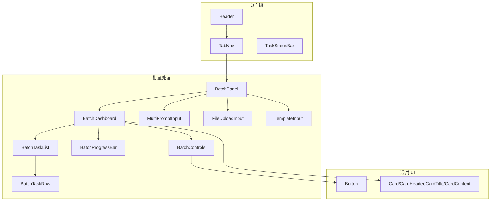
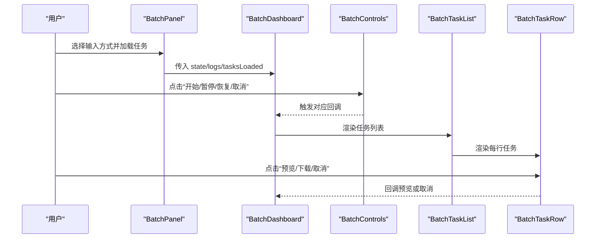
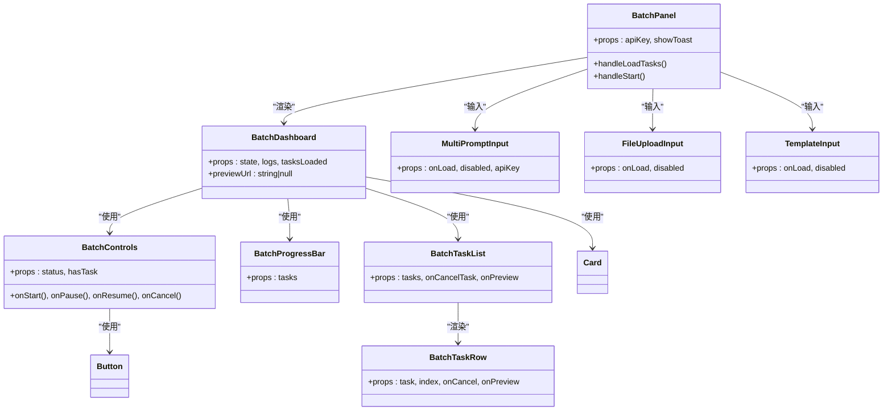

# 用户界面组件

<cite>
**本文引用的文件**
- [Header.tsx](file://src/components/Header.tsx)
- [TabNav.tsx](file://src/components/TabNav.tsx)
- [TaskStatusBar.tsx](file://src/components/TaskStatusBar.tsx)
- [BatchControls.tsx](file://src/components/batch/BatchControls.tsx)
- [BatchDashboard.tsx](file://src/components/batch/BatchDashboard.tsx)
- [BatchPanel.tsx](file://src/components/batch/BatchPanel.tsx)
- [BatchProgressBar.tsx](file://src/components/batch/BatchProgressBar.tsx)
- [BatchTaskList.tsx](file://src/components/batch/BatchTaskList.tsx)
- [BatchTaskRow.tsx](file://src/components/batch/BatchTaskRow.tsx)
- [MultiPromptInput.tsx](file://src/components/batch/MultiPromptInput.tsx)
- [FileUploadInput.tsx](file://src/components/batch/FileUploadInput.tsx)
- [TemplateInput.tsx](file://src/components/batch/TemplateInput.tsx)
- [button.tsx](file://src/components/ui/button.tsx)
- [card.tsx](file://src/components/ui/card.tsx)
- [batch-types.ts](file://src/lib/batch-types.ts)
</cite>

## 目录
1. [简介](#简介)
2. [项目结构](#项目结构)
3. [核心组件](#核心组件)
4. [架构总览](#架构总览)
5. [详细组件分析](#详细组件分析)
6. [依赖分析](#依赖分析)
7. [性能考虑](#性能考虑)
8. [故障排查指南](#故障排查指南)
9. [结论](#结论)
10. [附录](#附录)

## 简介
本文件面向开发者与使用者，系统化文档化本项目中的用户界面组件。内容覆盖：
- 核心导航与状态展示组件（Header、TabNav、TaskStatusBar）
- 批量处理相关 UI（BatchControls、BatchTaskList、BatchProgressBar、BatchDashboard、BatchPanel 等）
- 通用 UI 基础组件库（Button、Card）
- 响应式设计与可访问性支持
- 主题定制与样式覆盖方法
- 使用示例与组合方式
- 性能优化建议与最佳实践

## 项目结构
UI 组件按功能域组织：
- 顶层布局与导航：Header、TabNav
- 任务状态展示：TaskStatusBar
- 批量处理面板：BatchPanel 及其子组件（输入、控制面板、进度、任务列表、日志、导出等）
- 通用 UI 基础组件：Button、Card
- 类型定义：batch-types.ts 提供批量任务、队列状态、设置等类型

图表来源
- [Header.tsx:1-28](file://src/components/Header.tsx#L1-L28)
- [TabNav.tsx:1-39](file://src/components/TabNav.tsx#L1-L39)
- [TaskStatusBar.tsx:1-44](file://src/components/TaskStatusBar.tsx#L1-L44)
- [BatchPanel.tsx:1-58](file://src/components/batch/BatchPanel.tsx#L1-L58)
- [BatchDashboard.tsx:1-89](file://src/components/batch/BatchDashboard.tsx#L1-L89)
- [BatchControls.tsx:1-50](file://src/components/batch/BatchControls.tsx#L1-L50)
- [BatchProgressBar.tsx:1-36](file://src/components/batch/BatchProgressBar.tsx#L1-L36)
- [BatchTaskList.tsx:1-27](file://src/components/batch/BatchTaskList.tsx#L1-L27)
- [BatchTaskRow.tsx:1-80](file://src/components/batch/BatchTaskRow.tsx#L1-L80)
- [MultiPromptInput.tsx:1-148](file://src/components/batch/MultiPromptInput.tsx#L1-L148)
- [FileUploadInput.tsx:1-64](file://src/components/batch/FileUploadInput.tsx#L1-L64)
- [TemplateInput.tsx:1-122](file://src/components/batch/TemplateInput.tsx#L1-L122)
- [button.tsx:1-53](file://src/components/ui/button.tsx#L1-L53)
- [card.tsx:1-55](file://src/components/ui/card.tsx#L1-L55)

章节来源
- [Header.tsx:1-28](file://src/components/Header.tsx#L1-L28)
- [TabNav.tsx:1-39](file://src/components/TabNav.tsx#L1-L39)
- [TaskStatusBar.tsx:1-44](file://src/components/TaskStatusBar.tsx#L1-L44)
- [BatchPanel.tsx:1-58](file://src/components/batch/BatchPanel.tsx#L1-L58)
- [BatchDashboard.tsx:1-89](file://src/components/batch/BatchDashboard.tsx#L1-L89)
- [BatchControls.tsx:1-50](file://src/components/batch/BatchControls.tsx#L1-L50)
- [BatchProgressBar.tsx:1-36](file://src/components/batch/BatchProgressBar.tsx#L1-L36)
- [BatchTaskList.tsx:1-27](file://src/components/batch/BatchTaskList.tsx#L1-L27)
- [BatchTaskRow.tsx:1-80](file://src/components/batch/BatchTaskRow.tsx#L1-L80)
- [MultiPromptInput.tsx:1-148](file://src/components/batch/MultiPromptInput.tsx#L1-L148)
- [FileUploadInput.tsx:1-64](file://src/components/batch/FileUploadInput.tsx#L1-L64)
- [TemplateInput.tsx:1-122](file://src/components/batch/TemplateInput.tsx#L1-L122)
- [button.tsx:1-53](file://src/components/ui/button.tsx#L1-L53)
- [card.tsx:1-55](file://src/components/ui/card.tsx#L1-L55)

## 核心组件
本节聚焦三个关键组件：Header、TabNav、TaskStatusBar。

- Header
  - 职责：应用头部区域，包含品牌标识与设置入口按钮。
  - 属性：onOpenSettings（打开设置的回调）。
  - 交互：点击设置图标触发 onOpenSettings。
  - 样式：粘性定位、背景模糊、渐变主色徽标、阴影发光效果。
  - 可访问性：按钮具备语义化标签与焦点样式。

- TabNav
  - 职责：模式切换导航（文生视频、图生视频、视频编辑、批量模式、长视频）。
  - 属性：activeMode（当前激活模式）、onChange（切换回调）。
  - 交互：点击不同 tab 调用 onChange(mode)。
  - 样式：选中态高亮、过渡动画、图标+文字布局。
  - 可访问性：原生 button 元素，键盘可操作。

- TaskStatusBar
  - 职责：显示单个任务的执行状态（排队中、生成中、已完成、失败、未知），并提供下载链接。
  - 属性：taskResult（任务结果对象或空）。
  - 交互：成功时显示“下载视频”链接；运行中图标旋转。
  - 可访问性：文本描述清晰，链接具备安全属性。

章节来源
- [Header.tsx:1-28](file://src/components/Header.tsx#L1-L28)
- [TabNav.tsx:1-39](file://src/components/TabNav.tsx#L1-L39)
- [TaskStatusBar.tsx:1-44](file://src/components/TaskStatusBar.tsx#L1-L44)

## 架构总览
批量处理 UI 采用“面板 + 仪表盘”的层次结构：
- BatchPanel 作为容器，整合输入区、设置区与右侧仪表盘。
- BatchDashboard 聚合进度、控制、任务列表与日志，并内嵌预览弹窗。
- 输入区支持多行 Prompt、模板组合、文件上传三种方式。
- 控制区根据队列状态动态渲染开始/暂停/恢复/取消等操作。
- 任务列表逐条展示任务详情、状态、重试次数、降级标记、预览与下载。

图表来源
- [BatchPanel.tsx:1-58](file://src/components/batch/BatchPanel.tsx#L1-L58)
- [BatchDashboard.tsx:1-89](file://src/components/batch/BatchDashboard.tsx#L1-L89)
- [BatchControls.tsx:1-50](file://src/components/batch/BatchControls.tsx#L1-L50)
- [BatchTaskList.tsx:1-27](file://src/components/batch/BatchTaskList.tsx#L1-L27)
- [BatchTaskRow.tsx:1-80](file://src/components/batch/BatchTaskRow.tsx#L1-L80)

## 详细组件分析

### 批量控制面板（BatchPanel）
- 职责：编排批量处理的输入、设置与仪表盘，桥接上层 API Key 与 Toast 提示。
- 属性：apiKey、showToast。
- 内部逻辑：
  - 使用 useBatchQueue 管理队列状态与操作。
  - 加载任务后更新 tasksLoaded 标志。
  - 启动前校验 apiKey。
- 布局：左侧输入与设置，右侧仪表盘。

章节来源
- [BatchPanel.tsx:1-58](file://src/components/batch/BatchPanel.tsx#L1-L58)

### 批量仪表盘（BatchDashboard）
- 职责：汇总进度、控制、任务列表与日志，并提供视频预览弹窗。
- 属性：state、logs、tasksLoaded、各类控制回调。
- 交互：
  - 顶部进度条与控制按钮。
  - 任务列表滚动区域。
  - 底部日志时间线。
  - 点击任务行的“预览”弹出全屏视频播放器。
- 可访问性：关闭按钮、视频控件原生支持。

章节来源
- [BatchDashboard.tsx:1-89](file://src/components/batch/BatchDashboard.tsx#L1-L89)

### 批量控制（BatchControls）
- 职责：根据队列状态显示相应操作按钮。
- 属性：status、hasTask、onStart/onPause/onResume/onCancel。
- 状态映射：
  - idle：显示“开始”，禁用条件为无任务。
  - running：显示“暂停”和“取消全部”。
  - paused：显示“恢复”。
  - completed：显示“重置”。
- 可访问性：按钮具备语义化与焦点样式。

章节来源
- [BatchControls.tsx:1-50](file://src/components/batch/BatchControls.tsx#L1-L50)

### 批量进度条（BatchProgressBar）
- 职责：计算并展示完成比例、成功/失败/取消计数。
- 属性：tasks。
- 计算逻辑：
  - 统计 succeeded、failed-permanent、cancelled 数量。
  - 百分比 = (completed / total) * 100。
- 视觉：渐变进度条，平滑过渡动画。

章节来源
- [BatchProgressBar.tsx:1-36](file://src/components/batch/BatchProgressBar.tsx#L1-L36)

### 批量任务列表（BatchTaskList）
- 职责：渲染任务列表，为空时显示占位提示。
- 属性：tasks、onCancelTask、onPreview。
- 行为：遍历 tasks 渲染 BatchTaskRow。

章节来源
- [BatchTaskList.tsx:1-27](file://src/components/batch/BatchTaskList.tsx#L1-L27)

### 批量任务行（BatchTaskRow）
- 职责：展示单条任务的关键信息、状态、重试与降级标记，并提供预览/下载/取消。
- 属性：task、index、onCancel、onPreview。
- 状态标签：queued、submitting、polling、retrying、succeeded、failed-permanent、cancelled。
- 交互：
  - 仅 queued/retrying 允许取消。
  - succeeded 且存在 videoUrl 时显示预览与下载。
- 可访问性：按钮具备 title 提示。

章节来源
- [BatchTaskRow.tsx:1-80](file://src/components/batch/BatchTaskRow.tsx#L1-L80)

### 多行 Prompt 输入（MultiPromptInput）
- 职责：以多行文本形式批量创建任务，支持 AI 改写全部。
- 属性：onLoad、disabled、apiKey。
- 流程：
  - 解析多行文本为任务定义数组。
  - 可选调用改写接口，返回改写后的文本回填。
  - 显示改写进度与错误提示。
- 可访问性：表单元素具备 label 与禁用态样式。

章节来源
- [MultiPromptInput.tsx:1-148](file://src/components/batch/MultiPromptInput.tsx#L1-L148)

### 文件上传输入（FileUploadInput）
- 职责：通过 CSV/JSON 文件批量导入任务。
- 属性：onLoad、disabled。
- 流程：读取文件文本 -> 解析 -> 过滤有效任务 -> 回调 onLoad。
- 可访问性：隐藏原生 input，自定义上传区域点击触发。

章节来源
- [FileUploadInput.tsx:1-64](file://src/components/batch/FileUploadInput.tsx#L1-L64)

### 模板组合输入（TemplateInput）
- 职责：基于模板与参数组合批量生成任务。
- 属性：onLoad、disabled。
- 流程：选择模式、分辨率集合、时长集合 -> 展开模板 -> 生成任务数组 -> 回调 onLoad。
- 可访问性：按钮组具备选中态与禁用态。

章节来源
- [TemplateInput.tsx:1-122](file://src/components/batch/TemplateInput.tsx#L1-L122)

### 通用 UI 组件库

#### Button
- 设计：基于 class-variance-authority 实现变体与尺寸系统。
- 变体：default、destructive、outline、secondary、ghost、link、gradient。
- 尺寸：default、sm、lg、icon。
- 可访问性：focus-visible 环样式、禁用态不透明与指针事件禁用。
- 使用：通过 variant 与 size 组合快速定制外观。

章节来源
- [button.tsx:1-53](file://src/components/ui/button.tsx#L1-L53)

#### Card 系列
- 组件：Card、CardHeader、CardTitle、CardContent。
- 设计：统一圆角、边框、背景与阴影，便于卡片式布局。
- 使用：组合标题、头部与内容区域构建信息块。

章节来源
- [card.tsx:1-55](file://src/components/ui/card.tsx#L1-L55)

### 数据模型与类型（batch-types.ts）
- AppMode：应用导航模式（含批量与长视频）。
- BatchTaskDefinition：单条任务定义（prompt、mode、resolution、duration 等）。
- BatchTaskStatus：任务运行时状态枚举。
- BatchTaskItem：任务完整运行时数据（含重试、降级、错误历史等）。
- QueueStatus：队列全局状态（idle、running、paused、completed）。
- BatchQueueState：队列状态集（tasks、status、settings）。
- BatchSettings：并发度、最大重试、自动降级、自动简化提示词等。
- BatchLogEntry：日志条目（时间戳、任务ID、事件、级别）。
- TemplateCombination：模板组合配置。
- ParseResult/ParseError：文件解析结果与错误。
- ExportResultItem：导出结果项。
- DEFAULT_BATCH_SETTINGS：默认设置。
- generateId：生成唯一 ID。

章节来源
- [batch-types.ts:1-123](file://src/lib/batch-types.ts#L1-L123)

## 依赖分析
- 组件耦合关系：
  - BatchPanel 依赖 useBatchQueue 与多个输入/设置组件，负责编排。
  - BatchDashboard 聚合进度、控制、列表与日志，承担展示与交互协调。
  - BatchTaskList 与 BatchTaskRow 形成列表渲染链。
  - 通用 Button/Card 被多处复用，降低重复样式成本。
- 外部依赖：
  - lucide-react 图标库用于各组件图标。
  - class-variance-authority 用于 Button 变体系统。
  - Tailwind CSS 类名驱动样式与响应式。

图表来源
- [BatchPanel.tsx:1-58](file://src/components/batch/BatchPanel.tsx#L1-L58)
- [BatchDashboard.tsx:1-89](file://src/components/batch/BatchDashboard.tsx#L1-L89)
- [BatchControls.tsx:1-50](file://src/components/batch/BatchControls.tsx#L1-L50)
- [BatchProgressBar.tsx:1-36](file://src/components/batch/BatchProgressBar.tsx#L1-L36)
- [BatchTaskList.tsx:1-27](file://src/components/batch/BatchTaskList.tsx#L1-L27)
- [BatchTaskRow.tsx:1-80](file://src/components/batch/BatchTaskRow.tsx#L1-L80)
- [MultiPromptInput.tsx:1-148](file://src/components/batch/MultiPromptInput.tsx#L1-L148)
- [FileUploadInput.tsx:1-64](file://src/components/batch/FileUploadInput.tsx#L1-L64)
- [TemplateInput.tsx:1-122](file://src/components/batch/TemplateInput.tsx#L1-L122)
- [button.tsx:1-53](file://src/components/ui/button.tsx#L1-L53)
- [card.tsx:1-55](file://src/components/ui/card.tsx#L1-L55)

## 性能考虑
- 列表渲染优化
  - 对长列表（任务列表）建议使用稳定 key（如 task.id），避免不必要的重渲染。
  - 若任务量较大，可考虑虚拟滚动或分页加载。
- 状态更新频率
  - 批量进度与日志高频更新时，注意合并更新或使用节流策略，减少重绘。
- 图片与媒体资源
  - 视频预览仅在需要时加载，避免预加载大量媒体。
- 样式与动画
  - 谨慎使用复杂动画与阴影，尤其在低端设备上。
- 组件拆分
  - 将大组件拆分为更小的纯展示组件，提升可读性与可测试性。

[本节为通用指导，无需源码引用]

## 故障排查指南
- 批量任务无法启动
  - 检查是否已设置 API Key（BatchPanel 在启动前会校验）。
  - 确认已加载至少一个有效任务（BatchControls 的开始按钮在无任务时禁用）。
- 任务状态异常
  - 查看日志时间线（BatchDashboard 底部）定位具体错误。
  - 关注重试次数与降级标记（BatchTaskRow 显示）。
- 预览失败
  - 确认任务状态为 succeeded 且存在 videoUrl。
  - 检查浏览器是否允许自动播放与跨域资源。
- 文件导入无效
  - 检查文件格式（CSV/JSON）与字段（prompt、mode、resolution、duration）。
  - 查看解析错误输出（控制台或 UI 提示）。

章节来源
- [BatchPanel.tsx:1-58](file://src/components/batch/BatchPanel.tsx#L1-L58)
- [BatchControls.tsx:1-50](file://src/components/batch/BatchControls.tsx#L1-L50)
- [BatchTaskRow.tsx:1-80](file://src/components/batch/BatchTaskRow.tsx#L1-L80)
- [BatchDashboard.tsx:1-89](file://src/components/batch/BatchDashboard.tsx#L1-L89)
- [FileUploadInput.tsx:1-64](file://src/components/batch/FileUploadInput.tsx#L1-L64)

## 结论
本组件体系围绕“输入—编排—执行—反馈”的主线构建，提供了从批量任务创建到执行监控的完整 UI 能力。通过通用 Button/Card 组件与类型驱动的批量状态模型，实现了良好的可扩展性与一致性。建议在后续迭代中继续完善可访问性细节、性能优化与主题扩展能力。

[本节为总结，无需源码引用]

## 附录

### 使用示例与组合方式
- 在页面中使用 TabNav 切换到“批量模式”，进入 BatchPanel。
- 在左侧选择一种输入方式（多行 Prompt/模板组合/文件上传），加载任务。
- 在右侧仪表盘点击“开始”，观察进度条与任务列表变化。
- 成功后点击任务行的“预览”或“下载”，或在状态栏直接下载。

章节来源
- [TabNav.tsx:1-39](file://src/components/TabNav.tsx#L1-L39)
- [BatchPanel.tsx:1-58](file://src/components/batch/BatchPanel.tsx#L1-L58)
- [BatchDashboard.tsx:1-89](file://src/components/batch/BatchDashboard.tsx#L1-L89)
- [BatchTaskRow.tsx:1-80](file://src/components/batch/BatchTaskRow.tsx#L1-L80)
- [TaskStatusBar.tsx:1-44](file://src/components/TaskStatusBar.tsx#L1-L44)

### 响应式设计与可访问性
- 响应式
  - 使用 Tailwind 断点与网格布局（如 lg:grid-cols-[420px_1fr]）适配大屏与小屏。
  - 列表区域限制最大高度并启用滚动，保证在小屏下的可用性。
- 可访问性
  - 所有交互元素均为原生按钮或表单控件，具备键盘操作与焦点样式。
  - 链接具备 rel="noopener noreferrer" 安全属性。
  - 图标配合文本说明，确保屏幕阅读器友好。

章节来源
- [BatchPanel.tsx:1-58](file://src/components/batch/BatchPanel.tsx#L1-L58)
- [BatchDashboard.tsx:1-89](file://src/components/batch/BatchDashboard.tsx#L1-L89)
- [button.tsx:1-53](file://src/components/ui/button.tsx#L1-L53)

### 主题定制与样式覆盖
- 主题变量
  - 使用 Tailwind 语义化颜色（primary、background、card、foreground 等）进行整体配色。
- 组件覆盖
  - Button：通过 variant 与 size 快速切换风格；也可通过 className 追加自定义样式。
  - Card：通过 className 调整圆角、边框、阴影等。
- 渐变与阴影
  - 项目中使用了 gradient-primary 与 shadow-glow 等自定义类，可在主题文件中扩展或替换。

章节来源
- [button.tsx:1-53](file://src/components/ui/button.tsx#L1-L53)
- [card.tsx:1-55](file://src/components/ui/card.tsx#L1-L55)