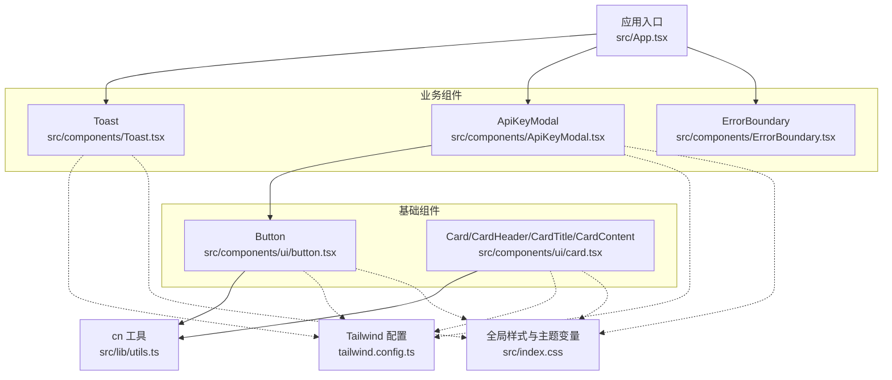
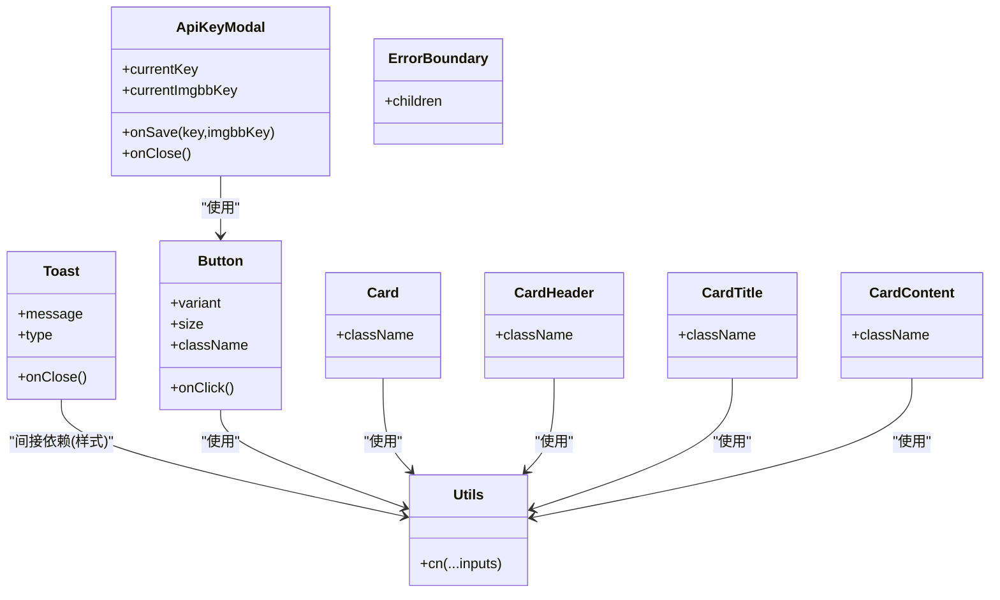
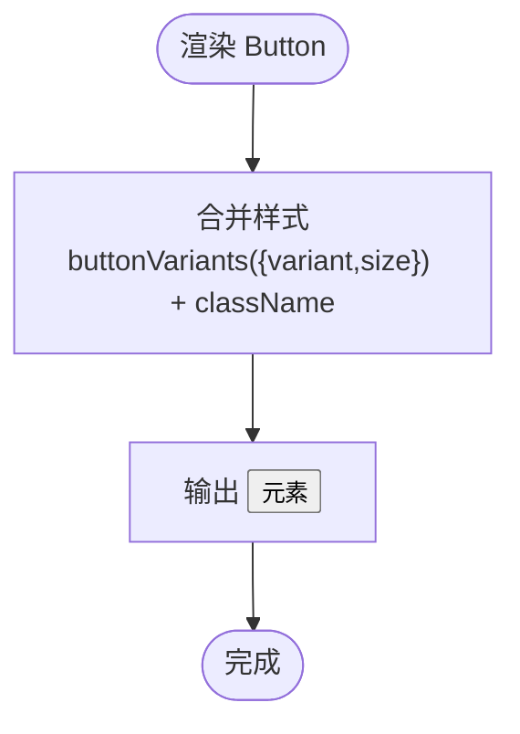
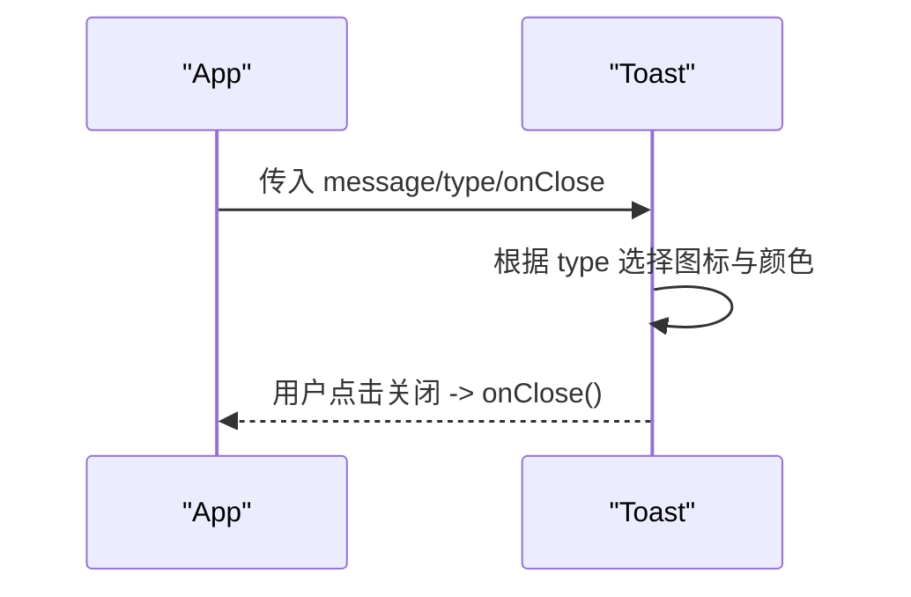
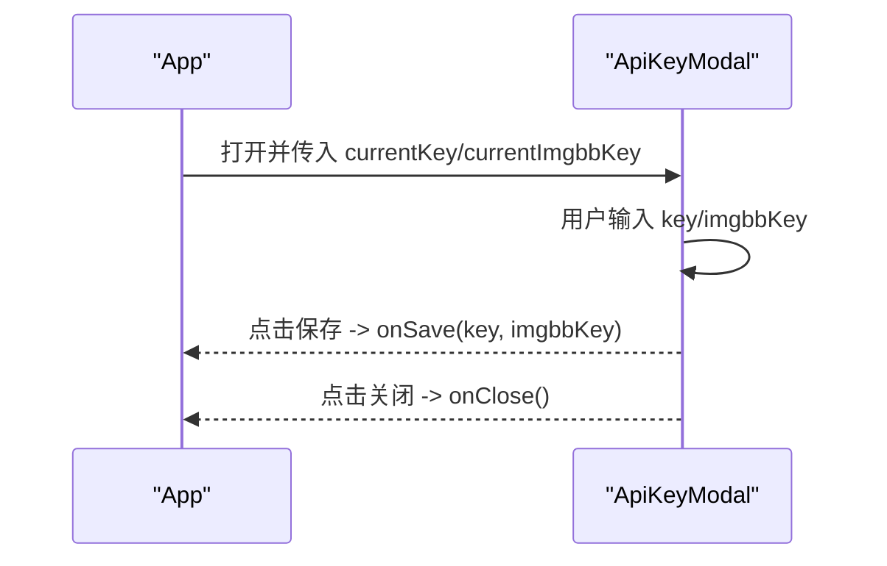
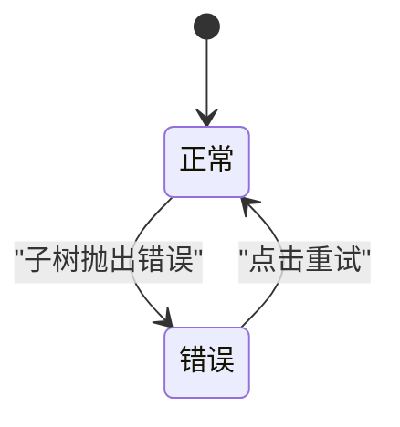
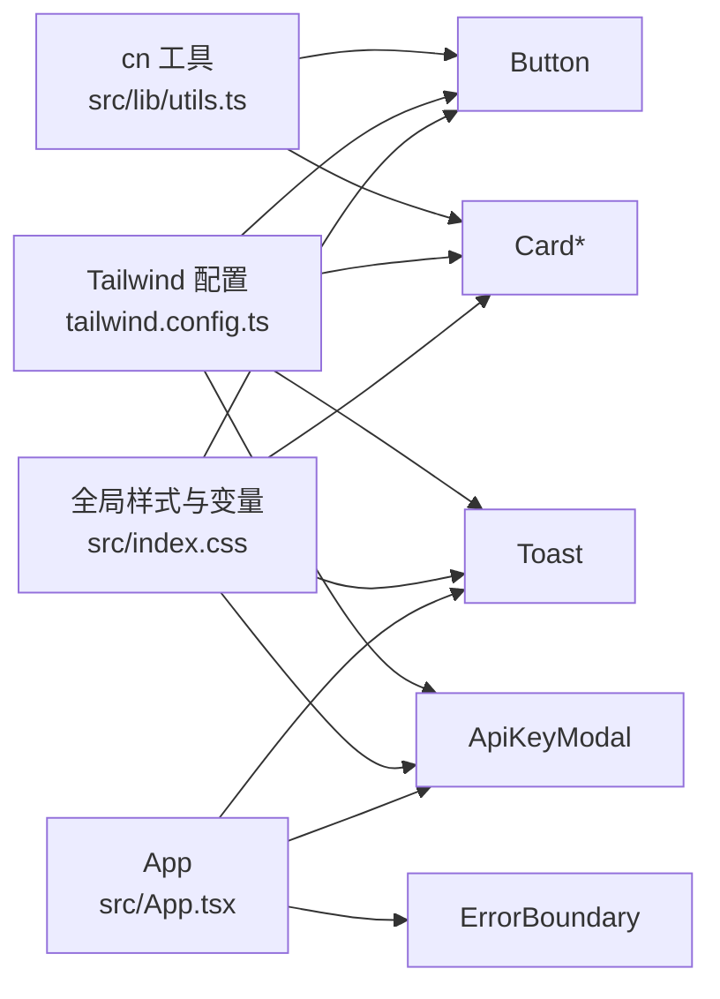

# 通用UI组件库

<cite>
**本文引用的文件**   
- [src/components/ui/button.tsx](file://src/components/ui/button.tsx)
- [src/components/ui/card.tsx](file://src/components/ui/card.tsx)
- [src/components/Toast.tsx](file://src/components/Toast.tsx)
- [src/components/ApiKeyModal.tsx](file://src/components/ApiKeyModal.tsx)
- [src/components/ErrorBoundary.tsx](file://src/components/ErrorBoundary.tsx)
- [src/lib/utils.ts](file://src/lib/utils.ts)
- [tailwind.config.ts](file://tailwind.config.ts)
- [src/index.css](file://src/index.css)
- [src/App.tsx](file://src/App.tsx)
</cite>

## 目录
1. [简介](#简介)
2. [项目结构](#项目结构)
3. [核心组件](#核心组件)
4. [架构总览](#架构总览)
5. [详细组件分析](#详细组件分析)
6. [依赖关系分析](#依赖关系分析)
7. [性能与可访问性](#性能与可访问性)
8. [主题系统与样式覆盖](#主题系统与样式覆盖)
9. [使用示例与组合模式](#使用示例与组合模式)
10. [故障排查指南](#故障排查指南)
11. [结论](#结论)

## 简介
本组件库围绕通用 UI 能力构建，提供 Button、Card、Toast、ApiKeyModal、ErrorBoundary 等基础组件。设计原则强调：
- 高内聚低耦合：每个组件职责单一，通过 props 暴露最小必要接口
- 样式解耦：基于 Tailwind CSS 与 CSS 变量实现主题化与暗色模式
- 可访问性与跨浏览器兼容：遵循语义化标签与焦点管理，利用现代浏览器特性
- 可扩展性：通过变体（variants）与组合模式支持二次定制

## 项目结构
- 基础组件位于 src/components/ui，采用原子化样式与 class-variance-authority 的变体系统
- 业务级弹窗与提示位于 src/components，如 ApiKeyModal 与 Toast
- 错误边界 ErrorBoundary 为类组件，用于捕获渲染期异常
- 工具函数 cn 在 src/lib/utils.ts 中封装 clsx + tailwind-merge，确保样式合并稳定
- 主题与动画在 tailwind.config.ts 与 src/index.css 中集中定义



图表来源
- [src/components/ui/button.tsx:1-53](file://src/components/ui/button.tsx#L1-L53)
- [src/components/ui/card.tsx:1-55](file://src/components/ui/card.tsx#L1-L55)
- [src/components/Toast.tsx:1-28](file://src/components/Toast.tsx#L1-L28)
- [src/components/ApiKeyModal.tsx:1-75](file://src/components/ApiKeyModal.tsx#L1-L75)
- [src/components/ErrorBoundary.tsx:1-39](file://src/components/ErrorBoundary.tsx#L1-L39)
- [src/lib/utils.ts:1-7](file://src/lib/utils.ts#L1-L7)
- [tailwind.config.ts:1-93](file://tailwind.config.ts#L1-L93)
- [src/index.css:1-111](file://src/index.css#L1-L111)
- [src/App.tsx:1-164](file://src/App.tsx#L1-L164)

章节来源
- [src/components/ui/button.tsx:1-53](file://src/components/ui/button.tsx#L1-L53)
- [src/components/ui/card.tsx:1-55](file://src/components/ui/card.tsx#L1-L55)
- [src/components/Toast.tsx:1-28](file://src/components/Toast.tsx#L1-L28)
- [src/components/ApiKeyModal.tsx:1-75](file://src/components/ApiKeyModal.tsx#L1-L75)
- [src/components/ErrorBoundary.tsx:1-39](file://src/components/ErrorBoundary.tsx#L1-L39)
- [src/lib/utils.ts:1-7](file://src/lib/utils.ts#L1-L7)
- [tailwind.config.ts:1-93](file://tailwind.config.ts#L1-L93)
- [src/index.css:1-111](file://src/index.css#L1-L111)
- [src/App.tsx:1-164](file://src/App.tsx#L1-L164)

## 核心组件
本节概述各组件的职责、API 与扩展点。

- Button
  - 职责：统一的按钮交互与视觉风格
  - 关键属性：variant、size、className 及原生 button 属性
  - 事件：onClick 等原生事件透传
  - 样式：基于 class-variance-authority 的变体系统，支持默认、破坏、描边、次要、幽灵、链接、渐变等
  - 可访问性：保留原生 button 语义与焦点环样式
  - 参考路径：[src/components/ui/button.tsx:1-53](file://src/components/ui/button.tsx#L1-L53)

- Card 家族（Card、CardHeader、CardTitle、CardContent）
  - 职责：卡片容器及其子区域，提供一致的间距与排版
  - 关键属性：className 及对应 HTML 元素属性
  - 事件：透传至底层 DOM 元素
  - 样式：圆角、边框、阴影、背景与前景色由主题变量驱动
  - 参考路径：[src/components/ui/card.tsx:1-55](file://src/components/ui/card.tsx#L1-L55)

- Toast
  - 职责：轻量消息反馈（成功、错误、信息）
  - 关键属性：message、type、onClose
  - 事件：onClose 关闭回调
  - 样式：固定定位、入场动画、图标与颜色随 type 变化
  - 参考路径：[src/components/Toast.tsx:1-28](file://src/components/Toast.tsx#L1-L28)

- ApiKeyModal
  - 职责：设置 DashScope 与 ImgBB API Key 的模态框
  - 关键属性：currentKey、currentImgbbKey、onSave、onClose
  - 事件：onSave(key, imgbbKey)、onClose
  - 样式：半透明遮罩、毛玻璃效果、表单输入与保存按钮
  - 参考路径：[src/components/ApiKeyModal.tsx:1-75](file://src/components/ApiKeyModal.tsx#L1-L75)

- ErrorBoundary
  - 职责：捕获子树渲染错误并展示友好界面
  - 关键属性：children
  - 行为：getDerivedStateFromError 更新状态；提供“重试”重置
  - 参考路径：[src/components/ErrorBoundary.tsx:1-39](file://src/components/ErrorBoundary.tsx#L1-L39)

章节来源
- [src/components/ui/button.tsx:1-53](file://src/components/ui/button.tsx#L1-L53)
- [src/components/ui/card.tsx:1-55](file://src/components/ui/card.tsx#L1-L55)
- [src/components/Toast.tsx:1-28](file://src/components/Toast.tsx#L1-L28)
- [src/components/ApiKeyModal.tsx:1-75](file://src/components/ApiKeyModal.tsx#L1-L75)
- [src/components/ErrorBoundary.tsx:1-39](file://src/components/ErrorBoundary.tsx#L1-L39)

## 架构总览
组件间依赖清晰：业务组件复用基础组件；样式统一由 Tailwind 与 CSS 变量驱动；工具函数负责样式合并。



图表来源
- [src/components/ui/button.tsx:1-53](file://src/components/ui/button.tsx#L1-L53)
- [src/components/ui/card.tsx:1-55](file://src/components/ui/card.tsx#L1-L55)
- [src/components/Toast.tsx:1-28](file://src/components/Toast.tsx#L1-L28)
- [src/components/ApiKeyModal.tsx:1-75](file://src/components/ApiKeyModal.tsx#L1-L75)
- [src/components/ErrorBoundary.tsx:1-39](file://src/components/ErrorBoundary.tsx#L1-L39)
- [src/lib/utils.ts:1-7](file://src/lib/utils.ts#L1-L7)

## 详细组件分析

### Button 组件
- 设计要点
  - 使用 class-variance-authority 定义 variant 与 size 两套变体，并通过 cn 合并 className
  - 默认聚焦环、禁用态与过渡动效完善
  - 导出 buttonVariants，便于外部按变体生成自定义样式
- API 摘要
  - 属性：variant(default|destructive|outline|secondary|ghost|link|gradient)、size(default|sm|lg|icon)、className 及其他原生 button 属性
  - 事件：onClick 等原生事件透传
- 样式定制
  - 通过 variant/size 快速切换外观
  - 传入 className 叠加或覆盖默认样式
  - 新增变体可在 buttonVariants 中扩展
- 可访问性
  - 原生 button 语义、键盘可达、焦点可见
- 复杂度与性能
  - 时间复杂度 O(1)，无额外计算开销
  - 仅做样式合并与 DOM 渲染，性能优异



图表来源
- [src/components/ui/button.tsx:1-53](file://src/components/ui/button.tsx#L1-L53)
- [src/lib/utils.ts:1-7](file://src/lib/utils.ts#L1-L7)

章节来源
- [src/components/ui/button.tsx:1-53](file://src/components/ui/button.tsx#L1-L53)
- [src/lib/utils.ts:1-7](file://src/lib/utils.ts#L1-L7)

### Card 组件族
- 设计要点
  - 将卡片拆分为 Card、CardHeader、CardTitle、CardContent，分别承载容器、头部、标题与内容区域
  - 统一使用 cn 合并 className，保持样式一致性
- API 摘要
  - 所有子组件均接受 className 与对应 HTML 元素属性
- 样式定制
  - 通过 className 调整间距、排版与装饰
  - 主题变量控制背景、前景、边框与阴影
- 可访问性
  - 使用语义化 h3 作为标题，利于屏幕阅读器识别
- 复杂度与性能
  - 纯展示型组件，O(1) 渲染

```mermaid
sequenceDiagram
participant Parent as "父组件"
participant Card as "Card"
participant Header as "CardHeader"
participant Title as "CardTitle"
participant Content as "CardContent"
Parent->>Card : 渲染
Card->>Header : 渲染
Header->>Title : 渲染
Header->>Content : 渲染
Note over Card,Content : 通过 className 进行样式叠加
```

图表来源
- [src/components/ui/card.tsx:1-55](file://src/components/ui/card.tsx#L1-L55)
- [src/lib/utils.ts:1-7](file://src/lib/utils.ts#L1-L7)

章节来源
- [src/components/ui/card.tsx:1-55](file://src/components/ui/card.tsx#L1-L55)
- [src/lib/utils.ts:1-7](file://src/lib/utils.ts#L1-L7)

### Toast 组件
- 设计要点
  - 固定定位右上角显示，支持 success/error/info 三种类型
  - 根据 type 动态选择图标与颜色
- API 摘要
  - 属性：message(string)、type('success'|'error'|'info')、onClose(() => void)
- 交互流程
  - 点击关闭按钮触发 onClose
  - 通常由上层组件控制显示/隐藏与自动消失
- 可访问性
  - 建议配合 aria-live 区域与 role="alert" 提升可访问性（当前实现未包含，可按需增强）
- 复杂度与性能
  - 轻量 DOM 节点，动画由 CSS 驱动



图表来源
- [src/components/Toast.tsx:1-28](file://src/components/Toast.tsx#L1-L28)
- [src/App.tsx:1-164](file://src/App.tsx#L1-L164)

章节来源
- [src/components/Toast.tsx:1-28](file://src/components/Toast.tsx#L1-L28)
- [src/App.tsx:1-164](file://src/App.tsx#L1-L164)

### ApiKeyModal 组件
- 设计要点
  - 模态框包含遮罩层与内容区，支持两个密码输入框
  - 保存时调用 onSave 回调，关闭时调用 onClose
- API 摘要
  - 属性：currentKey(string)、currentImgbbKey(string)、onSave((key, imgbbKey) => void)、onClose(() => void)
- 交互流程
  - 打开后编辑输入，点击保存触发 onSave
  - 点击遮罩或关闭按钮触发 onClose
- 可访问性
  - 建议使用 focus trap 与 aria-modal（当前实现未包含，可按需增强）
- 复杂度与性能
  - 简单表单与状态管理，渲染开销小



图表来源
- [src/components/ApiKeyModal.tsx:1-75](file://src/components/ApiKeyModal.tsx#L1-L75)
- [src/App.tsx:1-164](file://src/App.tsx#L1-L164)

章节来源
- [src/components/ApiKeyModal.tsx:1-75](file://src/components/ApiKeyModal.tsx#L1-L75)
- [src/App.tsx:1-164](file://src/App.tsx#L1-L164)

### ErrorBoundary 组件
- 设计要点
  - 类组件，使用 getDerivedStateFromError 捕获错误
  - 渲染错误界面并提供“重试”按钮重置状态
- API 摘要
  - 属性：children
- 错误处理流程
  - 子树抛出错误 -> 更新 hasError 与 error -> 渲染错误视图
  - 点击“重试”重置状态，恢复渲染
- 可访问性
  - 错误信息以文本形式呈现，建议结合 aria-live 提示
- 复杂度与性能
  - 仅在出错时渲染错误视图，正常路径零开销



图表来源
- [src/components/ErrorBoundary.tsx:1-39](file://src/components/ErrorBoundary.tsx#L1-L39)

章节来源
- [src/components/ErrorBoundary.tsx:1-39](file://src/components/ErrorBoundary.tsx#L1-L39)

## 依赖关系分析
- 组件对工具函数的依赖
  - Button、Card 系列通过 cn 合并样式，避免冲突与重复
- 组件对主题系统的依赖
  - 颜色、圆角、阴影等通过 CSS 变量与 Tailwind 配置统一管理
- 应用层集成
  - App 中组合 Toast、ApiKeyModal、ErrorBoundary，形成完整交互闭环



图表来源
- [src/lib/utils.ts:1-7](file://src/lib/utils.ts#L1-L7)
- [tailwind.config.ts:1-93](file://tailwind.config.ts#L1-L93)
- [src/index.css:1-111](file://src/index.css#L1-L111)
- [src/App.tsx:1-164](file://src/App.tsx#L1-L164)
- [src/components/ui/button.tsx:1-53](file://src/components/ui/button.tsx#L1-L53)
- [src/components/ui/card.tsx:1-55](file://src/components/ui/card.tsx#L1-L55)
- [src/components/Toast.tsx:1-28](file://src/components/Toast.tsx#L1-L28)
- [src/components/ApiKeyModal.tsx:1-75](file://src/components/ApiKeyModal.tsx#L1-L75)
- [src/components/ErrorBoundary.tsx:1-39](file://src/components/ErrorBoundary.tsx#L1-L39)

章节来源
- [src/lib/utils.ts:1-7](file://src/lib/utils.ts#L1-L7)
- [tailwind.config.ts:1-93](file://tailwind.config.ts#L1-L93)
- [src/index.css:1-111](file://src/index.css#L1-L111)
- [src/App.tsx:1-164](file://src/App.tsx#L1-L164)

## 性能与可访问性
- 性能
  - 组件均为轻量展示型，主要开销在样式合并与 DOM 渲染
  - 动画与过渡由 CSS 驱动，避免 JS 频繁重排
  - 建议在列表或高频场景中使用 React.memo 包裹复杂子组件
- 可访问性
  - Button 使用原生 button，具备键盘可达性与焦点环
  - CardTitle 使用 h3，有助于结构化文档
  - Toast 与 Modal 可进一步增强 ARIA 属性与焦点管理以提升无障碍体验

## 主题系统与样式覆盖
- 主题变量
  - 在 src/index.css 中定义 --background、--foreground、--primary 等变量，支持 .dark 暗色模式
- Tailwind 映射
  - tailwind.config.ts 将 HSL 变量映射到 color 命名空间，如 primary、card、border 等
- 样式覆盖策略
  - 通过 className 传入覆盖默认样式
  - 在 tailwind.config.ts 中扩展 colors、radius、animation 等
  - 在 src/index.css 中新增 utility 类或修改现有类
- 渐变与阴影
  - 提供 gradient-primary、shadow-glow、shadow-card 等实用类，便于快速构建高级视觉效果

章节来源
- [src/index.css:1-111](file://src/index.css#L1-L111)
- [tailwind.config.ts:1-93](file://tailwind.config.ts#L1-L93)

## 使用示例与组合模式
以下为常见用法与组合方式（以路径引用代替代码片段）：
- 在页面中引入并使用 Button 的不同变体与尺寸
  - 参考：[src/components/Header.tsx:1-28](file://src/components/Header.tsx#L1-L28)
- 使用 Card 家族组织面板内容
  - 参考：[src/components/ImageToVideoPanel.tsx](file://src/components/ImageToVideoPanel.tsx)
  - 参考：[src/components/LongVideoPanel.tsx](file://src/components/LongVideoPanel.tsx)
  - 参考：[src/components/TextToVideoPanel.tsx](file://src/components/TextToVideoPanel.tsx)
  - 参考：[src/components/VideoEditPanel.tsx](file://src/components/VideoEditPanel.tsx)
- 在应用层管理 Toast 的显示与自动消失
  - 参考：[src/App.tsx:1-164](file://src/App.tsx#L1-L164)
- 使用 ApiKeyModal 收集并持久化 API Key
  - 参考：[src/App.tsx:1-164](file://src/App.tsx#L1-L164)
- 用 ErrorBoundary 包裹高风险子树
  - 参考：[src/App.tsx:1-164](file://src/App.tsx#L1-L164)

## 故障排查指南
- 样式不生效
  - 检查是否通过 cn 合并 className，避免 Tailwind 类名冲突
  - 确认 Tailwind 配置 content 路径包含组件所在目录
  - 参考：[src/lib/utils.ts:1-7](file://src/lib/utils.ts#L1-L7)、[tailwind.config.ts:1-93](file://tailwind.config.ts#L1-L93)
- 主题切换无效
  - 确认根节点是否正确切换 .dark 类
  - 检查 CSS 变量是否在 :root 与 .dark 下正确定义
  - 参考：[src/index.css:1-111](file://src/index.css#L1-L111)
- Toast 无法关闭或重复出现
  - 检查上层组件是否正确维护 toast 状态并在 onClose 中清除
  - 参考：[src/App.tsx:1-164](file://src/App.tsx#L1-L164)
- 模态框遮挡或层级问题
  - 检查 z-index 与 backdrop 层级，必要时调整
  - 参考：[src/components/ApiKeyModal.tsx:1-75](file://src/components/ApiKeyModal.tsx#L1-L75)
- 子组件崩溃导致白屏
  - 使用 ErrorBoundary 包裹可疑子树，查看错误信息与重试
  - 参考：[src/components/ErrorBoundary.tsx:1-39](file://src/components/ErrorBoundary.tsx#L1-L39)

章节来源
- [src/lib/utils.ts:1-7](file://src/lib/utils.ts#L1-L7)
- [tailwind.config.ts:1-93](file://tailwind.config.ts#L1-L93)
- [src/index.css:1-111](file://src/index.css#L1-L111)
- [src/components/Toast.tsx:1-28](file://src/components/Toast.tsx#L1-L28)
- [src/components/ApiKeyModal.tsx:1-75](file://src/components/ApiKeyModal.tsx#L1-L75)
- [src/components/ErrorBoundary.tsx:1-39](file://src/components/ErrorBoundary.tsx#L1-L39)
- [src/App.tsx:1-164](file://src/App.tsx#L1-L164)

## 结论
本组件库以简洁清晰的 API、强大的主题系统与良好的可访问性为基础，提供了可复用的 UI 能力。通过变体系统与组合模式，开发者可以快速构建一致且美观的界面。建议在实际项目中：
- 优先使用基础组件的组合而非直接写样式
- 通过主题变量与 Tailwind 配置统一管理视觉风格
- 为复杂交互组件补充必要的可访问性增强
- 在关键子树使用 ErrorBoundary 提升鲁棒性