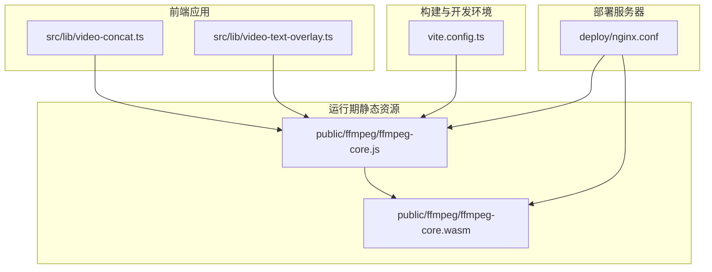
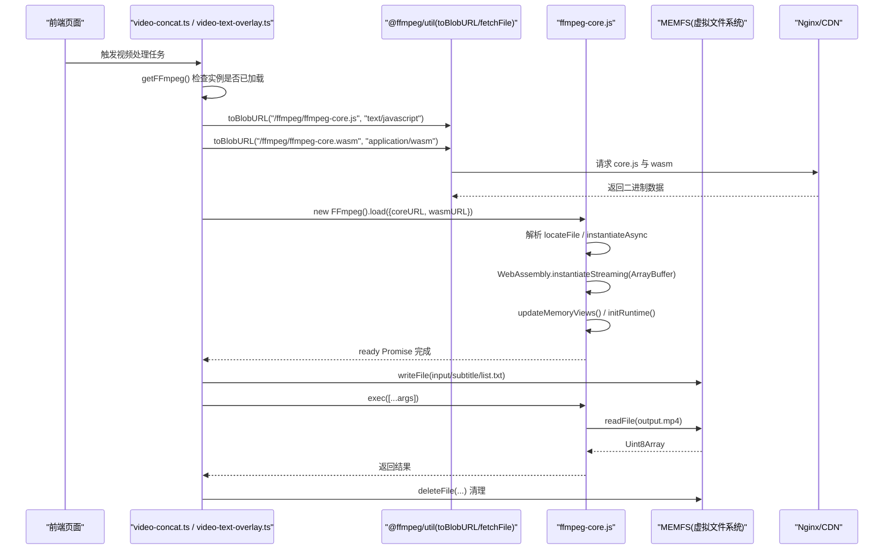
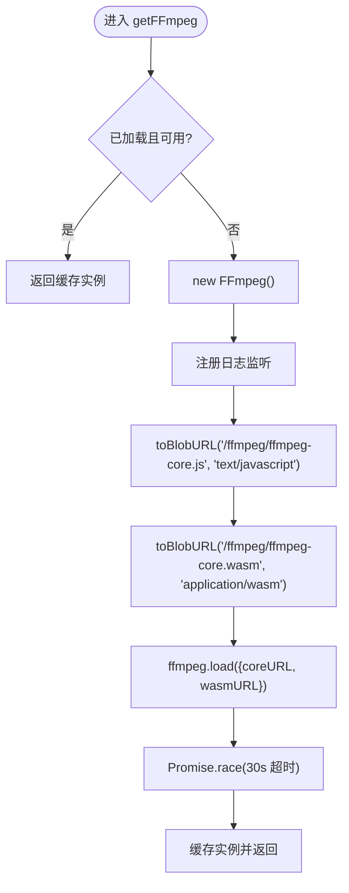
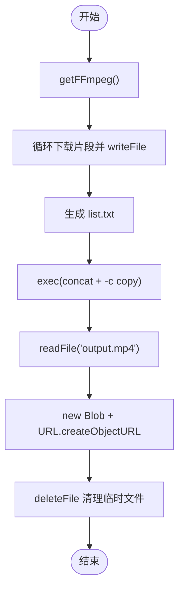
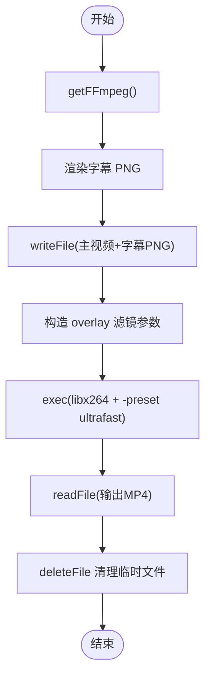
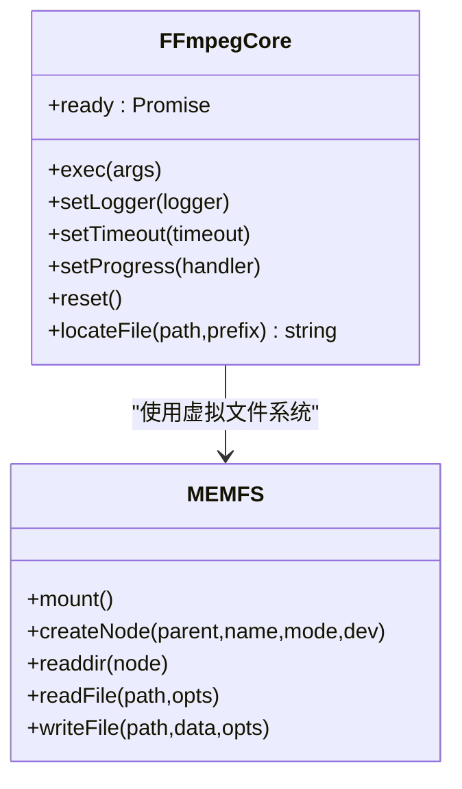
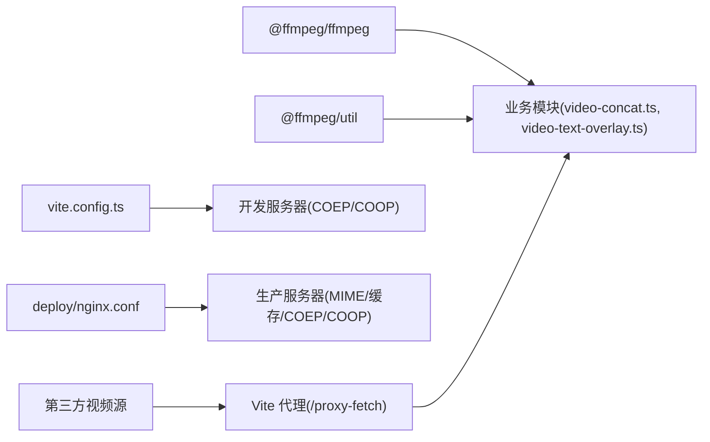

# FFmpeg WASM集成

<cite>
**本文引用的文件**   
- [video-concat.ts](file://src/lib/video-concat.ts)
- [video-text-overlay.ts](file://src/lib/video-text-overlay.ts)
- [ffmpeg-core.js](file://public/ffmpeg/ffmpeg-core.js)
- [nginx.conf](file://deploy/nginx.conf)
- [vite.config.ts](file://vite.config.ts)
</cite>

## 目录
1. [简介](#简介)
2. [项目结构](#项目结构)
3. [核心组件](#核心组件)
4. [架构总览](#架构总览)
5. [详细组件分析](#详细组件分析)
6. [依赖关系分析](#依赖关系分析)
7. [性能考虑](#性能考虑)
8. [故障排除指南](#故障排除指南)
9. [结论](#结论)
10. [附录](#附录)

## 简介
本技术文档围绕项目中 FFmpeg WASM 的集成与使用，系统阐述以下主题：
- WASM 文件的加载机制（核心文件获取、内存分配、初始化流程）
- FFmpeg 实例的生命周期管理（单例模式实现、状态监控、错误处理）
- WASM 路径配置与 CDN 部署策略
- 性能优化建议（预加载、内存使用优化、并发控制）
- 实际集成示例（如何正确初始化与调用）
- 常见问题排查（WASM 加载失败、内存溢出等）

## 项目结构
本项目采用“功能模块 + 静态资源”的组织方式。FFmpeg WASM 的核心运行时位于 public/ffmpeg 目录，业务侧通过 src/lib 下的工具模块进行封装与复用。

图表来源
- [video-concat.ts:1-38](file://src/lib/video-concat.ts#L1-L38)
- [video-text-overlay.ts:1-30](file://src/lib/video-text-overlay.ts#L1-L30)
- [ffmpeg-core.js:1-16](file://public/ffmpeg/ffmpeg-core.js#L1-L16)
- [vite.config.ts:262-294](file://vite.config.ts#L262-L294)
- [nginx.conf:33-43](file://deploy/nginx.conf#L33-L43)

章节来源
- [video-concat.ts:1-38](file://src/lib/video-concat.ts#L1-L38)
- [video-text-overlay.ts:1-30](file://src/lib/video-text-overlay.ts#L1-L30)
- [ffmpeg-core.js:1-16](file://public/ffmpeg/ffmpeg-core.js#L1-L16)
- [vite.config.ts:262-294](file://vite.config.ts#L262-L294)
- [nginx.conf:33-43](file://deploy/nginx.conf#L33-L43)

## 核心组件
- FFmpeg 实例管理器（模块级单例）
  - 职责：保证同一页面仅存在一个已加载的 FFmpeg 实例；提供统一的 getFFmpeg 入口；监听日志事件用于调试。
  - 关键行为：首次加载时创建实例、转换核心文件为 Blob URL、带超时的 load 调用、缓存实例并返回。
- 视频拼接模块
  - 职责：下载多个视频片段到虚拟文件系统，生成 concat 列表，执行流拷贝拼接，导出结果并清理临时文件。
- 字幕烧录模块
  - 职责：将渲染好的 PNG 字幕以 overlay 滤镜叠加到视频底部居中位置，输出新视频并清理临时文件。
- 核心运行时（Emscripten 生成的 ffmpeg-core.js）
  - 职责：负责 WASM 二进制加载、内存视图更新、虚拟文件系统（MEMFS）、网络 I/O、进程启动与参数传递、进度回调桥接等。

章节来源
- [video-concat.ts:10-38](file://src/lib/video-concat.ts#L10-L38)
- [video-text-overlay.ts:12-30](file://src/lib/video-text-overlay.ts#L12-L30)
- [ffmpeg-core.js:1-16](file://public/ffmpeg/ffmpeg-core.js#L1-L16)

## 架构总览
下图展示了从浏览器发起请求到 FFmpeg 执行命令的整体链路，包括静态资源加载、WASM 实例化、虚拟文件系统操作与命令执行。

图表来源
- [video-concat.ts:10-38](file://src/lib/video-concat.ts#L10-L38)
- [video-text-overlay.ts:12-30](file://src/lib/video-text-overlay.ts#L12-L30)
- [ffmpeg-core.js:1-16](file://public/ffmpeg/ffmpeg-core.js#L1-L16)
- [nginx.conf:33-43](file://deploy/nginx.conf#L33-L43)

## 详细组件分析

### 组件A：FFmpeg 实例管理器（模块级单例）
- 设计要点
  - 模块级变量保存实例引用，避免重复创建。
  - 在首次加载前提示用户“正在加载引擎”，提升感知体验。
  - 使用 toBlobURL 将本地静态资源转换为 Blob URL，规避 Worker 内跨域与 COEP/CORS 问题。
  - 对 load 过程增加超时保护，防止长时间挂起。
  - 订阅 log 事件，便于定位问题。
- 生命周期
  - 初始化：new FFmpeg() -> on('log') -> toBlobURL(core/wasm) -> load({coreURL,wasmURL}) -> 缓存实例。
  - 使用：writeFile/exec/readFile/deleteFile。
  - 销毁：当前未显式释放，建议在页面卸载或任务批量完成后统一清理虚拟文件系统。

图表来源
- [video-concat.ts:10-38](file://src/lib/video-concat.ts#L10-L38)
- [video-text-overlay.ts:12-30](file://src/lib/video-text-overlay.ts#L12-L30)

章节来源
- [video-concat.ts:10-38](file://src/lib/video-concat.ts#L10-L38)
- [video-text-overlay.ts:12-30](file://src/lib/video-text-overlay.ts#L12-L30)

### 组件B：视频拼接流程（concat）
- 输入：多个视频 URL 列表
- 步骤
  - 下载每个片段到虚拟文件系统（writeFile）。
  - 生成 concat 列表文件 list.txt。
  - 执行 ffmpeg.exec(['-f','concat','-safe','0','-i','list.txt','-c','copy','output.mp4'])。
  - 读取 output.mp4 并转为 Blob URL。
  - 删除所有临时文件。
- 注意事项
  - 使用 -c copy 进行流拷贝，避免重新编码，显著降低耗时与内存占用。
  - 合理设置进度回调，提升用户体验。

图表来源
- [video-concat.ts:50-109](file://src/lib/video-concat.ts#L50-L109)

章节来源
- [video-concat.ts:50-109](file://src/lib/video-concat.ts#L50-L109)

### 组件C：字幕烧录流程（overlay）
- 输入：视频 URL、字幕文本、分辨率
- 步骤
  - 根据分辨率计算缩放比例，渲染字幕 PNG。
  - 写入主视频与字幕 PNG 到虚拟文件系统。
  - 构造 filter_complex 指定 overlay 位置（底部居中）。
  - 执行 ffmpeg.exec 输出合成后的 MP4。
  - 读取输出并清理临时文件。
- 关键点
  - 使用 libx264 编码器与 ultrafast preset 平衡速度与质量。
  - 音轨可选映射，避免无音频导致失败。

图表来源
- [video-text-overlay.ts:48-109](file://src/lib/video-text-overlay.ts#L48-L109)

章节来源
- [video-text-overlay.ts:48-109](file://src/lib/video-text-overlay.ts#L48-L109)

### 组件D：核心运行时（ffmpeg-core.js）
- 主要职责
  - 动态定位并加载 ffmpeg-core.wasm（支持 locateFile 自定义路径）。
  - 异步实例化 WASM（instantiateStreaming 优先，回退 ArrayBuffer）。
  - 初始化运行时（initRuntime）、更新内存视图（updateMemoryViews）。
  - 暴露 exec、setLogger、setProgress、receiveProgress 等接口供上层调用。
  - 提供 MEMFS 虚拟文件系统，支持读写文件、目录、设备节点等。
- 关键流程
  - 加载阶段：getBinaryPromise -> instantiateAsync -> receiveInstance -> addOnInit -> removeRunDependency。
  - 执行阶段：stringToPtr/stringsToPtr 准备参数 -> _ffmpeg(args.length, stringsToPtr(args)) -> 回调 ret/progress。

图表来源
- [ffmpeg-core.js:1-16](file://public/ffmpeg/ffmpeg-core.js#L1-L16)

章节来源
- [ffmpeg-core.js:1-16](file://public/ffmpeg/ffmpeg-core.js#L1-L16)

## 依赖关系分析
- 运行时依赖
  - @ffmpeg/ffmpeg：提供 FFmpeg 类与 API。
  - @ffmpeg/util：提供 toBlobURL、fetchFile 等工具函数。
- 构建与开发环境
  - Vite 开发服务器需开启 COEP/COOP 响应头，以便启用 SharedArrayBuffer。
  - 生产部署 Nginx 需为 /ffmpeg 路径设置正确的 MIME 类型与缓存策略，并透传 COEP/COOP。
- 外部资源
  - 视频源可能来自第三方 CDN，若缺少 CORS 头，可通过 Vite 中间件代理转发。

图表来源
- [vite.config.ts:262-294](file://vite.config.ts#L262-L294)
- [nginx.conf:33-43](file://deploy/nginx.conf#L33-L43)
- [video-concat.ts:1-38](file://src/lib/video-concat.ts#L1-L38)
- [video-text-overlay.ts:1-30](file://src/lib/video-text-overlay.ts#L1-L30)

章节来源
- [vite.config.ts:262-294](file://vite.config.ts#L262-L294)
- [nginx.conf:33-43](file://deploy/nginx.conf#L33-L43)
- [video-concat.ts:1-38](file://src/lib/video-concat.ts#L1-L38)
- [video-text-overlay.ts:1-30](file://src/lib/video-text-overlay.ts#L1-L30)

## 性能考虑
- 预加载与缓存
  - 将 ffmpeg-core.js 与 ffmpeg-core.wasm 放置于 /ffmpeg 路径，由 Nginx 设置长期缓存（如 7 天），减少重复下载。
  - 在首屏或用户交互前预加载核心文件，缩短首次任务延迟。
- 内存使用优化
  - 优先使用 -c copy 进行流拷贝，避免重编码带来的额外内存与 CPU 开销。
  - 及时清理虚拟文件系统临时文件，避免累积占用。
  - 控制并发：同一时间只运行一个 FFmpeg 实例，避免多任务竞争内存。
- 网络与传输
  - 使用 toBlobURL 将本地静态资源转为 Blob URL，避免 Worker 二次网络请求与跨域问题。
  - 对于第三方视频源，必要时通过后端代理或中转服务解决 CORS 限制。
- 编码参数调优
  - 字幕烧录场景使用 ultrafast preset 与合适的 CRF，平衡速度和质量。
  - 合理选择 pix_fmt（如 yuv420p）以提升兼容性。

[本节为通用指导，不直接分析具体文件]

## 故障排除指南
- WASM 无法加载或实例化失败
  - 检查 Nginx 是否正确设置 application/wasm 与 application/javascript 的 MIME 类型。
  - 确认 /ffmpeg 路径可被访问且未被拦截。
  - 确保响应头包含 Cross-Origin-Opener-Policy: same-origin 与 Cross-Origin-Embedder-Policy: credentialless。
- SharedArrayBuffer 不可用
  - 开发环境：Vite server.headers 中需设置 COEP/COOP。
  - 生产环境：Nginx 需在 /ffmpeg 与静态资源路径添加相应响应头。
- 加载超时
  - 当前实现包含 30 秒超时保护，若仍失败，检查网络带宽与 CDN 可用性。
  - 建议在前端展示明确的错误提示与重试按钮。
- 内存不足或崩溃
  - 避免同时处理过多大文件；分批处理并及时 deleteFile。
  - 尽量使用流拷贝（-c copy）而非重编码。
- 第三方视频源跨域失败
  - 使用 Vite 的 /proxy-fetch 中间件进行同源代理，或在服务端增加 CORS 头。

章节来源
- [nginx.conf:33-43](file://deploy/nginx.conf#L33-L43)
- [vite.config.ts:272-276](file://vite.config.ts#L272-L276)
- [video-concat.ts:28-34](file://src/lib/video-concat.ts#L28-L34)
- [video-text-overlay.ts:22-26](file://src/lib/video-text-overlay.ts#L22-L26)

## 结论
本项目通过模块级单例与 toBlobURL 方案，实现了稳定高效的 FFmpeg WASM 集成。配合 Nginx 的 MIME 与 COEP/COOP 配置，以及合理的内存与并发控制，可在浏览器端完成视频拼接与字幕烧录等常见任务。建议在生产环境中进一步引入预加载与更完善的错误恢复机制，以获得更佳的用户体验。

[本节为总结性内容，不直接分析具体文件]

## 附录
- 关键路径与环境变量
  - 核心文件路径：/ffmpeg/ffmpeg-core.js、/ffmpeg/ffmpeg-core.wasm
  - 开发服务器响应头：Cross-Origin-Opener-Policy、Cross-Origin-Embedder-Policy
  - 生产服务器 MIME 类型：application/wasm、application/javascript
- 参考实现位置
  - 实例管理与加载：video-concat.ts、video-text-overlay.ts
  - 核心运行时：ffmpeg-core.js
  - 部署配置：nginx.conf
  - 开发环境配置：vite.config.ts

[本节为补充信息，不直接分析具体文件]