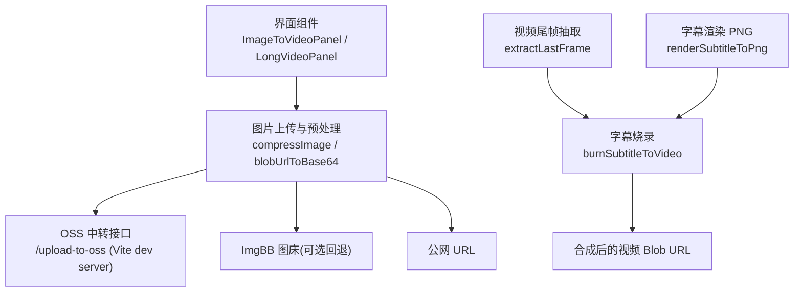
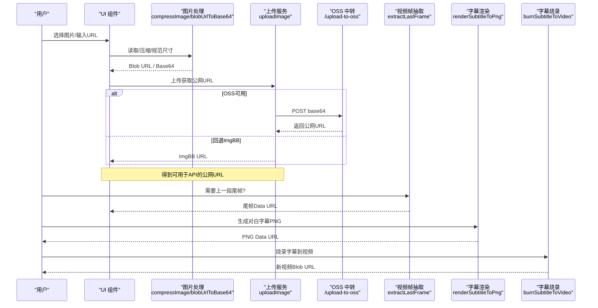
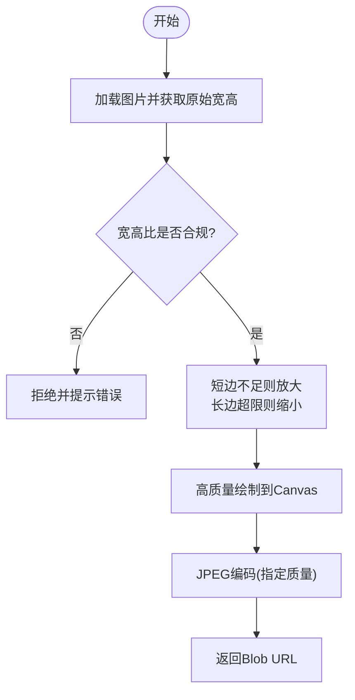
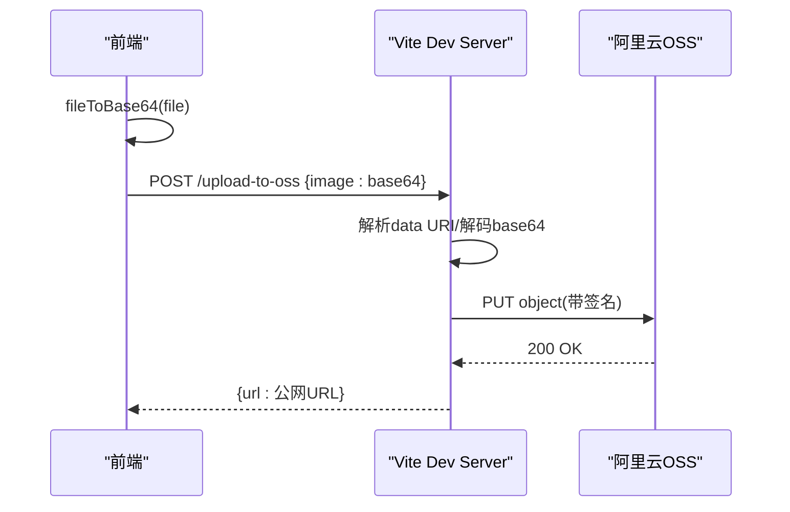
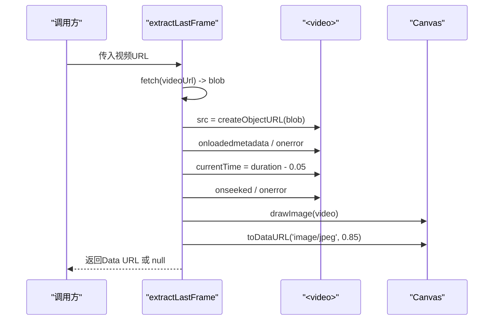
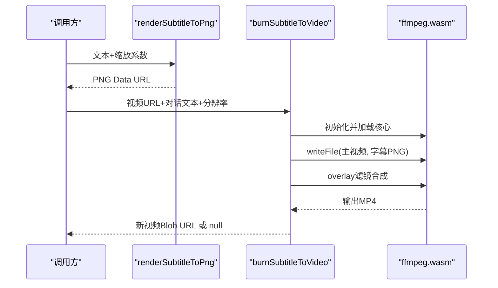
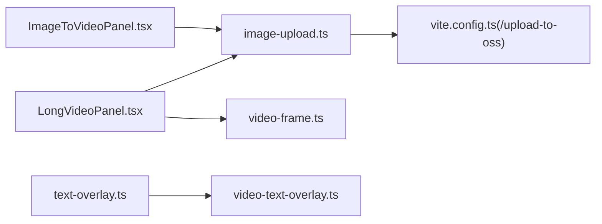

# 图像处理模块

<cite>
**本文引用的文件列表**
- [ImageToVideoPanel.tsx](file://src/components/ImageToVideoPanel.tsx)
- [LongVideoPanel.tsx](file://src/components/LongVideoPanel.tsx)
- [video-frame.ts](file://src/lib/video-frame.ts)
- [image-upload.ts](file://src/lib/image-upload.ts)
- [text-overlay.ts](file://src/lib/text-overlay.ts)
- [video-text-overlay.ts](file://src/lib/video-text-overlay.ts)
- [vite.config.ts](file://vite.config.ts)
</cite>

## 目录
1. [简介](#简介)
2. [项目结构](#项目结构)
3. [核心组件](#核心组件)
4. [架构总览](#架构总览)
5. [详细组件分析](#详细组件分析)
6. [依赖关系分析](#依赖关系分析)
7. [性能与优化](#性能与优化)
8. [错误处理与调试指南](#错误处理与调试指南)
9. [结论](#结论)
10. [附录：示例与最佳实践](#附录示例与最佳实践)

## 简介
本技术文档聚焦于“图像处理模块”，覆盖图片上传、格式与安全校验、压缩与尺寸规范、首帧/尾帧提取、封面与预览图生成、以及字幕烧录等关键能力。文档同时给出流程图与时序图，帮助开发者快速理解数据流与控制流，并提供排障建议与最佳实践。

## 项目结构
本项目为前端应用（React + Vite），图像处理主要发生在浏览器端，通过 Canvas API 完成缩放、裁剪与编码；视频帧抽取使用 <video>+<canvas>；图片公网化通过本地中转接口上传至对象存储或第三方图床；字幕渲染与烧录借助 ffmpeg.wasm。

图表来源
- [LongVideoPanel.tsx:366-432](file://src/components/LongVideoPanel.tsx#L366-L432)
- [image-upload.ts:30-102](file://src/lib/image-upload.ts#L30-L102)
- [vite.config.ts:151-213](file://vite.config.ts#L151-L213)
- [video-frame.ts:16-68](file://src/lib/video-frame.ts#L16-L68)
- [text-overlay.ts:25-75](file://src/lib/text-overlay.ts#L25-L75)
- [video-text-overlay.ts:48-71](file://src/lib/video-text-overlay.ts#L48-L71)

章节来源
- [ImageToVideoPanel.tsx:21-39](file://src/components/ImageToVideoPanel.tsx#L21-L39)
- [LongVideoPanel.tsx:366-474](file://src/components/LongVideoPanel.tsx#L366-L474)
- [image-upload.ts:1-110](file://src/lib/image-upload.ts#L1-L110)
- [vite.config.ts:151-213](file://vite.config.ts#L151-L213)
- [video-frame.ts:1-69](file://src/lib/video-frame.ts#L1-L69)
- [text-overlay.ts:1-92](file://src/lib/text-overlay.ts#L1-L92)
- [video-text-overlay.ts:1-71](file://src/lib/video-text-overlay.ts#L1-L71)

## 核心组件
- 图片上传与预览：支持本地选择与外部 URL 输入，提供 base64 预览与 Blob URL 缓存。
- 图片压缩与尺寸规范：按 API 约束进行宽高比检查、短边放大、长边缩小，输出 JPEG 并控制质量。
- 公网化上传：优先通过本地中转上传到阿里云 OSS，失败时回退到 ImgBB。
- 视频尾帧抽取：规避 CORS，将远端视频下载为 Blob 后取最后一帧作为下一段首帧。
- 字幕渲染与烧录：Canvas 渲染中文透明 PNG，ffmpeg.wasm overlay 烧入视频底部居中。

章节来源
- [ImageToVideoPanel.tsx:21-39](file://src/components/ImageToVideoPanel.tsx#L21-L39)
- [LongVideoPanel.tsx:366-432](file://src/components/LongVideoPanel.tsx#L366-L432)
- [image-upload.ts:30-102](file://src/lib/image-upload.ts#L30-L102)
- [video-frame.ts:16-68](file://src/lib/video-frame.ts#L16-L68)
- [text-overlay.ts:25-75](file://src/lib/text-overlay.ts#L25-L75)
- [video-text-overlay.ts:48-71](file://src/lib/video-text-overlay.ts#L48-L71)

## 架构总览
下图展示了从用户上传图片到最终生成视频的端到端流程，包括安全校验、压缩、公网化、尾帧抽取与字幕烧录。

图表来源
- [LongVideoPanel.tsx:366-474](file://src/components/LongVideoPanel.tsx#L366-L474)
- [image-upload.ts:30-102](file://src/lib/image-upload.ts#L30-L102)
- [vite.config.ts:151-213](file://vite.config.ts#L151-L213)
- [video-frame.ts:16-68](file://src/lib/video-frame.ts#L16-L68)
- [text-overlay.ts:25-75](file://src/lib/text-overlay.ts#L25-L75)
- [video-text-overlay.ts:48-71](file://src/lib/video-text-overlay.ts#L48-L71)

## 详细组件分析

### 图片上传与预览（ImageToVideoPanel）
- 功能要点
  - 支持本地图片选择与外部 URL 输入。
  - 本地图片通过 FileReader 转为 base64 Data URL 用于预览；同时创建 Blob URL 供后续提交。
  - 若存在预览 base64，则优先使用该值提交，避免跨域问题。
- 安全机制
  - 使用 accept="image/*" 限制类型。
  - 未实现服务端二次 MIME 校验，建议在上传中转层做严格校验（见“后端中转”小节）。
- 数据处理
  - 预览阶段使用 base64，提交阶段可切换为 Blob URL 或外部 URL。

章节来源
- [ImageToVideoPanel.tsx:21-39](file://src/components/ImageToVideoPanel.tsx#L21-L39)

### 图片压缩与尺寸规范（LongVideoPanel）
- 目标
  - 满足 i2v 模型对图片的约束：短边不低于阈值、长边不超过上限、宽高比在允许范围内。
- 算法流程
  - 计算宽高比，超限直接拒绝。
  - 短边不足则等比放大；长边过大则等比缩小。
  - 使用高质量插值绘制到 canvas，并以 JPEG 指定质量导出。
- 内存与并发
  - 逐张顺序处理，避免并发解码导致 OOM。
- 输出
  - 返回 Blob URL，便于后续上传或转 base64。

图表来源
- [LongVideoPanel.tsx:366-432](file://src/components/LongVideoPanel.tsx#L366-L432)

章节来源
- [LongVideoPanel.tsx:366-432](file://src/components/LongVideoPanel.tsx#L366-L432)

### 公网化上传（image-upload.ts 与 vite.config.ts）
- 策略
  - 优先走本地中转接口 /upload-to-oss，凭据保存在开发服务器环境变量中，不暴露给前端。
  - 失败且配置了 ImgBB Key 时自动回退。
- 后端中转（Vite dev server 插件）
  - 接收 base64 图片，解析 data URI，解码为 Buffer，设置正确 Content-Type，签名后 PUT 到 OSS。
  - 返回公网 URL。
- 前端校验
  - isPublicHttpUrl 确保仅接受 HTTP(S) 公网地址，排除本地地址。

图表来源
- [image-upload.ts:30-46](file://src/lib/image-upload.ts#L30-L46)
- [vite.config.ts:151-213](file://vite.config.ts#L151-L213)

章节来源
- [image-upload.ts:1-110](file://src/lib/image-upload.ts#L1-L110)
- [vite.config.ts:151-213](file://vite.config.ts#L151-L213)

### 视频尾帧抽取（video-frame.ts）
- 目的
  - 长视频分段生成时，把上一段的尾帧作为下一段的 i2v 首帧，保证衔接自然。
- 关键点
  - 直接 video.src=远程URL 会导致 toDataURL 被 CORS 污染，因此先 fetch → blob → createObjectURL。
  - 等待元数据加载后 seek 到 duration - 0.05s 处取最后一帧。
  - 以 jpeg 0.85 质量导出，控制在合理体积内。
- 超时与错误
  - metadata/seek 均设置超时保护，异常统一返回 null，调用方应回退策略。

图表来源
- [video-frame.ts:16-68](file://src/lib/video-frame.ts#L16-L68)

章节来源
- [video-frame.ts:1-69](file://src/lib/video-frame.ts#L1-69)

### 字幕渲染与烧录（text-overlay.ts 与 video-text-overlay.ts）
- 字幕渲染
  - 使用 Canvas 将中文文本渲染为透明背景 PNG，白字黑描边，底部居中风格固定。
  - 根据分辨率计算字号缩放系数，保证在不同分辨率下视觉一致。
- 字幕烧录
  - 使用 ffmpeg.wasm 将字幕 PNG 叠加到视频底部居中位置。
  - 懒加载 ffmpeg-core.js/wasm，设置加载超时保护。
  - 无字幕时直接返回 null，由调用方回退原视频。

图表来源
- [text-overlay.ts:25-75](file://src/lib/text-overlay.ts#L25-L75)
- [video-text-overlay.ts:12-30](file://src/lib/video-text-overlay.ts#L12-L30)
- [video-text-overlay.ts:48-71](file://src/lib/video-text-overlay.ts#L48-L71)

章节来源
- [text-overlay.ts:1-92](file://src/lib/text-overlay.ts#L1-92)
- [video-text-overlay.ts:1-71](file://src/lib/video-text-overlay.ts#L1-71)

## 依赖关系分析
- 组件耦合
  - ImageToVideoPanel 与 LongVideoPanel 负责交互与状态管理，调用 image-upload.ts 与 compressImage 逻辑。
  - video-frame.ts 独立提供尾帧抽取能力，供长视频拼接场景复用。
  - text-overlay.ts 与 video-text-overlay.ts 组合完成字幕渲染与烧录。
- 外部依赖
  - @ffmpeg/ffmpeg 与 @ffmpeg/util 用于字幕烧录。
  - 浏览器原生 API：FileReader、Canvas、<video>、fetch、URL.createObjectURL/revokeObjectURL。
- 潜在循环依赖
  - 当前模块间为单向依赖，未见循环引用。

图表来源
- [ImageToVideoPanel.tsx:21-39](file://src/components/ImageToVideoPanel.tsx#L21-L39)
- [LongVideoPanel.tsx:366-474](file://src/components/LongVideoPanel.tsx#L366-L474)
- [image-upload.ts:30-102](file://src/lib/image-upload.ts#L30-L102)
- [video-frame.ts:16-68](file://src/lib/video-frame.ts#L16-L68)
- [text-overlay.ts:25-75](file://src/lib/text-overlay.ts#L25-L75)
- [video-text-overlay.ts:48-71](file://src/lib/video-text-overlay.ts#L48-L71)
- [vite.config.ts:151-213](file://vite.config.ts#L151-L213)

章节来源
- [image-upload.ts:1-110](file://src/lib/image-upload.ts#L1-L110)
- [video-frame.ts:1-69](file://src/lib/video-frame.ts#L1-69)
- [text-overlay.ts:1-92](file://src/lib/text-overlay.ts#L1-92)
- [video-text-overlay.ts:1-71](file://src/lib/video-text-overlay.ts#L1-71)
- [vite.config.ts:151-213](file://vite.config.ts#L151-L213)

## 性能与优化
- 图片压缩
  - 采用 JPEG 指定质量（如 0.6/0.85）平衡体积与画质；长边上限与短边下限控制避免过大或过小。
  - 使用高质量插值（imageSmoothingQuality='high'）提升缩放质量。
- 内存管理
  - 逐张顺序处理，避免并发解码导致的 OOM。
  - 及时 revokeObjectURL 释放临时 Blob URL。
- 网络传输
  - 优先使用本地中转上传 OSS，减少跨域与鉴权复杂度；必要时回退第三方图床。
- 视频帧抽取
  - 通过 fetch→blob 规避 CORS；设置 metadata/seek 超时，防止长时间阻塞。
- 字幕烧录
  - ffmpeg.wasm 懒加载并设置加载超时；仅在需要时执行，避免不必要的开销。

[本节为通用指导，无需具体文件来源]

## 错误处理与调试指南
- 图片上传
  - 现象：上传失败或返回空 URL。
  - 排查：确认 /upload-to-oss 后端已配置 OSS 环境变量；检查请求体是否为合法 data URI；查看后端日志中的 HTTP 状态码与响应体。
  - 参考路径
    - [image-upload.ts:30-46](file://src/lib/image-upload.ts#L30-L46)
    - [vite.config.ts:180-213](file://vite.config.ts#L180-L213)
- 图片压缩
  - 现象：宽高比超限、压缩失败、加载失败。
  - 排查：检查原始图片比例是否在允许范围；确认 canvas 上下文可用；关注 toBlob 回调是否返回 blob。
  - 参考路径
    - [LongVideoPanel.tsx:366-432](file://src/components/LongVideoPanel.tsx#L366-L432)
- 尾帧抽取
  - 现象：返回 null。
  - 排查：检查 fetch 是否成功；video 元数据是否加载；seek 是否触发；canvas 尺寸是否有效；注意 CORS 污染。
  - 参考路径
    - [video-frame.ts:16-68](file://src/lib/video-frame.ts#L16-L68)
- 字幕烧录
  - 现象：ffmpeg 加载超时、合成失败。
  - 排查：确认 /ffmpeg 静态资源可达；检查 coreURL/wasmURL 是否正确；核对输入视频与字幕 PNG 是否写入成功。
  - 参考路径
    - [video-text-overlay.ts:12-30](file://src/lib/video-text-overlay.ts#L12-L30)
    - [video-text-overlay.ts:48-71](file://src/lib/video-text-overlay.ts#L48-L71)

章节来源
- [image-upload.ts:30-46](file://src/lib/image-upload.ts#L30-L46)
- [vite.config.ts:180-213](file://vite.config.ts#L180-L213)
- [LongVideoPanel.tsx:366-432](file://src/components/LongVideoPanel.tsx#L366-L432)
- [video-frame.ts:16-68](file://src/lib/video-frame.ts#L16-L68)
- [video-text-overlay.ts:12-30](file://src/lib/video-text-overlay.ts#L12-L30)
- [video-text-overlay.ts:48-71](file://src/lib/video-text-overlay.ts#L48-L71)

## 结论
该图像处理模块围绕“安全、可控、可扩展”的目标设计：前端侧完成严格的尺寸与比例校验、压缩与预览；通过本地中转上传到对象存储，兼顾安全性与易用性；视频尾帧抽取与字幕烧录形成完整的“图生视频”工作流。整体方案在浏览器端实现了高性能与低耦合，适合扩展更多图像/视频处理能力。

[本节为总结，无需具体文件来源]

## 附录：示例与最佳实践
- 图片上传与预览
  - 使用 FileReader 生成 base64 预览，同时维护 Blob URL 用于提交。
  - 参考路径
    - [ImageToVideoPanel.tsx:21-39](file://src/components/ImageToVideoPanel.tsx#L21-L39)
- 图片压缩与规范
  - 先校验宽高比，再按短边/长边阈值进行等比缩放，最后以 JPEG 指定质量导出。
  - 参考路径
    - [LongVideoPanel.tsx:366-432](file://src/components/LongVideoPanel.tsx#L366-L432)
- 公网化上传
  - 优先 /upload-to-oss，失败回退 ImgBB；isPublicHttpUrl 过滤本地地址。
  - 参考路径
    - [image-upload.ts:30-102](file://src/lib/image-upload.ts#L30-L102)
    - [image-upload.ts:107-109](file://src/lib/image-upload.ts#L107-L109)
- 尾帧抽取
  - fetch→blob→createObjectURL 规避 CORS；metadata/seek 超时保护；jpeg 0.85 控制体积。
  - 参考路径
    - [video-frame.ts:16-68](file://src/lib/video-frame.ts#L16-L68)
- 字幕渲染与烧录
  - Canvas 渲染中文透明 PNG；ffmpeg.wasm overlay 烧入底部居中。
  - 参考路径
    - [text-overlay.ts:25-75](file://src/lib/text-overlay.ts#L25-L75)
    - [video-text-overlay.ts:48-71](file://src/lib/video-text-overlay.ts#L48-L71)

[本节为示例指引，无需额外来源]