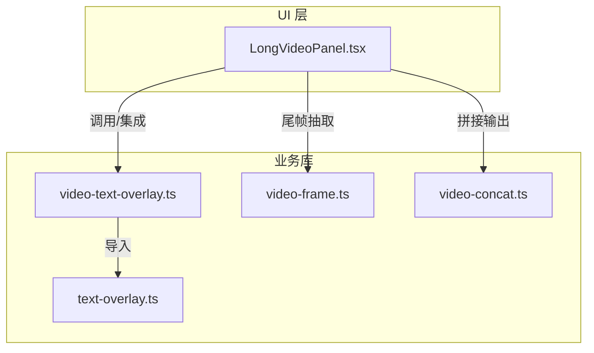
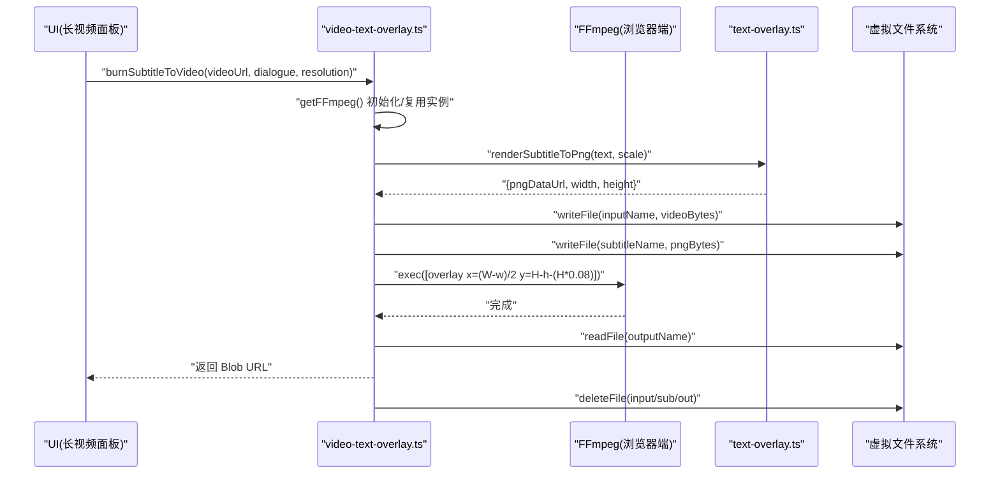
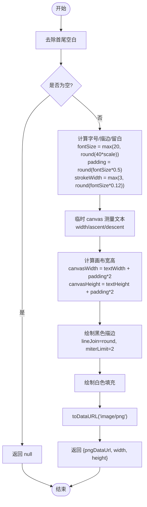
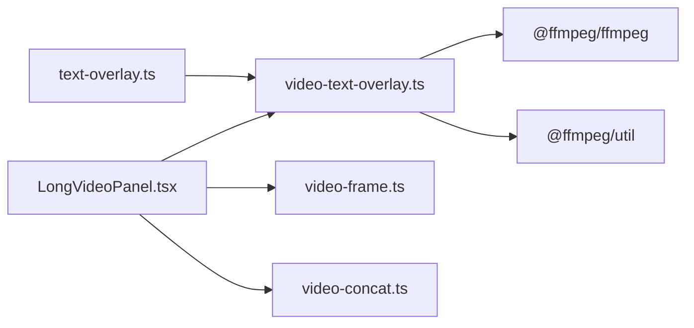

# 字幕渲染系统

<cite>
**本文引用的文件**   
- [text-overlay.ts](file://src/lib/text-overlay.ts)
- [video-text-overlay.ts](file://src/lib/video-text-overlay.ts)
- [LongVideoPanel.tsx](file://src/components/LongVideoPanel.tsx)
- [video-frame.ts](file://src/lib/video-frame.ts)
- [video-concat.ts](file://src/lib/video-concat.ts)
</cite>

## 目录
1. [简介](#简介)
2. [项目结构](#项目结构)
3. [核心组件](#核心组件)
4. [架构总览](#架构总览)
5. [详细组件分析](#详细组件分析)
6. [依赖关系分析](#依赖关系分析)
7. [性能考虑](#性能考虑)
8. [故障排查指南](#故障排查指南)
9. [结论](#结论)
10. [附录：样式与示例](#附录样式与示例)

## 简介
本技术文档围绕“字幕渲染系统”展开，聚焦于在浏览器端将中文对白文本渲染为透明背景 PNG，并通过 ffmpeg.wasm 以 overlay 滤镜烧录到视频底部居中的完整流程。文档覆盖以下关键主题：
- PNG 字幕生成算法：字体渲染、文本测量、布局计算
- 分辨率适配机制：不同视频分辨率下的字号缩放、位置计算、比例调整
- 字幕样式定制选项：字体选择、颜色配置、背景设置、边框效果等视觉属性
- 字幕位置计算的数学原理：居中定位、边距计算、安全区域
- 多种字幕样式的实际示例代码路径（通过源码引用）
- 性能优化技巧：Canvas 绘制优化、字体缓存、批量处理等最佳实践

## 项目结构
本项目采用前端 React + TypeScript 工程，字幕渲染相关逻辑集中在 lib 层，UI 层仅在长视频面板中集成并注释了字幕烧录入口。



图表来源
- [LongVideoPanel.tsx:1-1736](file://src/components/LongVideoPanel.tsx#L1-L1736)
- [text-overlay.ts:1-92](file://src/lib/text-overlay.ts#L1-L92)
- [video-text-overlay.ts:1-110](file://src/lib/video-text-overlay.ts#L1-L110)
- [video-frame.ts:1-69](file://src/lib/video-frame.ts#L1-L69)
- [video-concat.ts:1-110](file://src/lib/video-concat.ts#L1-L110)

章节来源
- [LongVideoPanel.tsx:1-1736](file://src/components/LongVideoPanel.tsx#L1-L1736)
- [text-overlay.ts:1-92](file://src/lib/text-overlay.ts#L1-L92)
- [video-text-overlay.ts:1-110](file://src/lib/video-text-overlay.ts#L1-L110)
- [video-frame.ts:1-69](file://src/lib/video-frame.ts#L1-L69)
- [video-concat.ts:1-110](file://src/lib/video-concat.ts#L1-L110)

## 核心组件
- 文本渲染与布局：负责将输入文本按指定字体、字号、描边和填充绘制为透明 PNG，并返回 dataUrl 及尺寸信息。
- 字幕烧录：基于 ffmpeg.wasm，将生成的字幕 PNG 叠加到视频底部居中位置，输出新视频 Blob URL。
- 长视频面板集成：当前已禁用字幕烧录入口，但保留了完整的调用接口与注释说明，便于后续启用。
- 辅助工具：尾帧抽取用于链式衔接；视频拼接用于多段合成。

章节来源
- [text-overlay.ts:1-92](file://src/lib/text-overlay.ts#L1-L92)
- [video-text-overlay.ts:1-110](file://src/lib/video-text-overlay.ts#L1-L110)
- [LongVideoPanel.tsx:1-1736](file://src/components/LongVideoPanel.tsx#L1-L1736)

## 架构总览
下图展示了从文本到最终视频的端到端流程，包括 Canvas 渲染、ffmpeg.wasm 加载、overlay 合成与资源清理。



图表来源
- [video-text-overlay.ts:1-110](file://src/lib/video-text-overlay.ts#L1-L110)
- [text-overlay.ts:1-92](file://src/lib/text-overlay.ts#L1-L92)

## 详细组件分析

### 文本渲染与布局（PNG 生成）
该模块使用 Canvas 2D API 进行文本测量与绘制，核心步骤如下：
- 字体族回退策略：优先使用常见中文字体，确保跨平台可读性。
- 字号与缩放：以 720p 为基准字号，根据分辨率系数动态缩放。
- 文本测量：利用 measureText 获取宽度、上升/下降高度，计算文本包围盒。
- 布局计算：左右上下留白 padding 与描边宽度 strokeWidth 均与 fontSize 成比例。
- 绘制顺序：先描边后填充，保证白字黑边的对比度与清晰度。
- 输出：返回 PNG dataUrl 以及宽高，供后续 overlay 使用。



图表来源
- [text-overlay.ts:1-92](file://src/lib/text-overlay.ts#L1-L92)

章节来源
- [text-overlay.ts:1-92](file://src/lib/text-overlay.ts#L1-L92)

#### 分辨率适配机制
- 缩放系数：resolutionToScale 将 '720p' 映射为 1，'1080p' 映射为 1.5。
- 字号缩放：fontSize 基于 40px 基准乘以 scale，确保高解析度下字幕清晰可读。
- 描边与留白：strokeWidth 与 padding 随 fontSize 线性变化，保持视觉一致性。
- 位置计算：subtitleFFmpegXY 返回 ffmpeg overlay 的表达式，实现底部居中与 8% 底部安全留白。

章节来源
- [text-overlay.ts:88-92](file://src/lib/text-overlay.ts#L88-L92)
- [text-overlay.ts:77-86](file://src/lib/text-overlay.ts#L77-L86)

#### 字幕位置计算的数学原理
- 水平居中：x = (W - w) / 2，其中 W 为主视频宽度，w 为字幕 PNG 宽度。
- 垂直定位：y = H - h - (H * 0.08)，其中 H 为主视频高度，h 为字幕 PNG 高度，0.08 表示距底部 8% 的安全留白。
- 安全区域：避免字幕被播放器控件或标题遮挡，提升观看体验。

章节来源
- [text-overlay.ts:77-86](file://src/lib/text-overlay.ts#L77-L86)

### 字幕烧录（ffmpeg.wasm 合成）
该模块负责将 PNG 字幕叠加到视频上，主要流程：
- 懒加载 FFmpeg：首次调用时加载 core.js 与 wasm，带超时保护。
- 数据准备：将远程视频 fetchFile 写入虚拟文件系统，同时将 PNG dataUrl 解码为 Uint8Array 写入。
- 构造命令：使用 filter_complex 的 overlay 滤镜，传入居中坐标表达式。
- 编码参数：libx264、ultrafast、crf 23、yuv420p，兼顾速度与兼容性。
- 结果导出：读取 output.mp4 并创建 Blob URL，随后清理虚拟文件。

```mermaid
classDiagram
class VideoTextOverlay {
+burnSubtitleToVideo(videoUrl, dialogue, resolution) Promise~string|null~
-getFFmpeg() Promise~FFmpeg~
-dataUrlToUint8(dataUrl) Uint8Array
}
class TextOverlay {
+renderSubtitleToPng(text, scale) RenderedSubtitle|null
+subtitleFFmpegXY() {x : string,y : string}
+resolutionToScale(resolution) number
}
class FFmpegInstance {
+load({coreURL,wasmURL})
+exec(args)
+writeFile(name,data)
+readFile(name)
+deleteFile(name)
}
VideoTextOverlay --> TextOverlay : "导入并使用"
VideoTextOverlay --> FFmpegInstance : "管理生命周期"
```

图表来源
- [video-text-overlay.ts:1-110](file://src/lib/video-text-overlay.ts#L1-L110)
- [text-overlay.ts:1-92](file://src/lib/text-overlay.ts#L1-L92)

章节来源
- [video-text-overlay.ts:1-110](file://src/lib/video-text-overlay.ts#L1-L110)

### 长视频面板集成与状态
- 字幕烧录入口：在长视频面板中已注释掉 burnSubtitleToVideo 的调用，原因是 AI 预写台词与实际语音不一致，直接烧录会造成混乱。
- 建议方案：接入 ASR 语音识别后再进行字幕烧录，以确保时间轴对齐。
- 其他能力：支持分镜拆解、参考图绑定、链式衔接（尾帧作首帧）、视频拼接等。

章节来源
- [LongVideoPanel.tsx:1-1736](file://src/components/LongVideoPanel.tsx#L1-L1736)

### 尾帧抽取与链式衔接
- 目的：将上一段的尾帧作为下一段的 i2v 首帧，实现画面连续。
- 关键点：规避 CORS 污染，通过 fetch → blob → createObjectURL 方式给 video 元素，再截取最后一帧。
- 压缩策略：jpeg 质量 0.85，控制 base64 体积，适合网络传输与模型输入限制。

章节来源
- [video-frame.ts:1-69](file://src/lib/video-frame.ts#L1-L69)

### 视频拼接（多段合成）
- 使用 ffmpeg.wasm 的 concat 功能，流拷贝不重新编码，速度快。
- 进度反馈：提供 loading/downloading/processing/done 阶段与百分比提示。
- 资源清理：完成后删除所有中间文件，释放内存。

章节来源
- [video-concat.ts:1-110](file://src/lib/video-concat.ts#L1-L110)

## 依赖关系分析
- 模块耦合：
  - video-text-overlay.ts 依赖 text-overlay.ts 的渲染与坐标计算函数。
  - LongVideoPanel.tsx 目前未启用字幕烧录，但具备完整集成条件。
  - video-frame.ts 与 video-concat.ts 为独立工具，服务于长视频工作流。
- 外部依赖：
  - @ffmpeg/ffmpeg 与 @ffmpeg/util 提供浏览器端媒体处理能力。
  - Canvas 2D API 用于文本测量与绘制。



图表来源
- [text-overlay.ts:1-92](file://src/lib/text-overlay.ts#L1-L92)
- [video-text-overlay.ts:1-110](file://src/lib/video-text-overlay.ts#L1-L110)
- [LongVideoPanel.tsx:1-1736](file://src/components/LongVideoPanel.tsx#L1-L1736)
- [video-frame.ts:1-69](file://src/lib/video-frame.ts#L1-L69)
- [video-concat.ts:1-110](file://src/lib/video-concat.ts#L1-L110)

章节来源
- [text-overlay.ts:1-92](file://src/lib/text-overlay.ts#L1-L92)
- [video-text-overlay.ts:1-110](file://src/lib/video-text-overlay.ts#L1-L110)
- [LongVideoPanel.tsx:1-1736](file://src/components/LongVideoPanel.tsx#L1-L1736)
- [video-frame.ts:1-69](file://src/lib/video-frame.ts#L1-L69)
- [video-concat.ts:1-110](file://src/lib/video-concat.ts#L1-L110)

## 性能考虑
- Canvas 绘制优化
  - 复用字体上下文：避免重复设置 font 与 baseline，减少重绘开销。
  - 合理留白与描边：strokeWidth 与 padding 与字号成比例，避免过大画布导致内存压力。
  - 文本测量最小化：单次 measureText 即可得到所需指标，无需多次测量。
- 字体缓存
  - 浏览器会缓存已加载字体，建议在应用启动时预加载常用字体族，降低首次渲染延迟。
- 批量处理
  - 对于多条字幕，可合并渲染为单张 PNG（如多行），减少 ffmpeg 执行次数。
  - 对长视频分段字幕，建议异步队列串行执行，避免并发导致 OOM。
- ffmpeg.wasm 优化
  - 懒加载与实例复用：避免重复加载 core/wasm，缩短首用时延。
  - 编码参数：ultrafast + crf 23 平衡速度与画质；必要时可切换 preset 与 crf。
  - 资源清理：及时 deleteFile，防止虚拟文件系统膨胀。

[本节为通用指导，不直接分析具体文件]

## 故障排查指南
- FFmpeg 加载失败或超时
  - 现象：加载 core.js/wasm 超过 30 秒无响应。
  - 排查：检查静态资源路径 /ffmpeg 是否可达；确认 COEP/CORS 配置；刷新页面重试。
  - 参考实现：带超时的 loadPromise 与 race 机制。
- 字幕烧录失败
  - 现象：burnSubtitleToVideo 返回 null 或抛出异常。
  - 排查：确认 input 视频格式与 codec；检查 overlay 表达式是否正确；查看 console 日志。
  - 参考实现：try/catch 捕获错误并记录日志。
- 中文乱码或字体缺失
  - 现象：文本显示异常或不可见。
  - 排查：确认系统已安装回退字体族；检查 FONT_FAMILY 列表；在不同设备上验证。
  - 参考实现：多字体回退策略。
- CORS 污染导致 toDataURL 失败
  - 现象：从远程 URL 取帧时报 SecurityError。
  - 排查：使用 fetch → blob → createObjectURL 方式给 video 元素；避免直接 src=远程URL。
  - 参考实现：extractLastFrame 的实现。

章节来源
- [video-text-overlay.ts:1-110](file://src/lib/video-text-overlay.ts#L1-L110)
- [text-overlay.ts:1-92](file://src/lib/text-overlay.ts#L1-L92)
- [video-frame.ts:1-69](file://src/lib/video-frame.ts#L1-L69)

## 结论
本字幕渲染系统通过 Canvas 与 ffmpeg.wasm 的组合，实现了高质量的中文字幕 PNG 生成与视频烧录。其设计强调：
- 明确的分辨率适配与位置计算，确保在不同视频尺寸下的一致视觉效果。
- 稳定的字体回退与描边策略，提升可读性与美观度。
- 完善的错误处理与资源管理，保障运行稳定性。
- 可扩展的样式定制与性能优化空间，便于后续迭代。

[本节为总结性内容，不直接分析具体文件]

## 附录：样式与示例
以下为可直接复用的样式与示例代码路径，展示如何实现不同的视觉效果。请根据需求修改对应参数与组合。

- 基础样式（白字黑边加粗）
  - 参考路径：[text-overlay.ts:25-75](file://src/lib/text-overlay.ts#L25-L75)
  - 要点：fontWeight='bold'，strokeStyle='#000000'，fillStyle='#FFFFFF'，lineJoin='round'，miterLimit=2。

- 深色背景半透明条
  - 思路：在绘制文本前，用 fillRect 绘制半透明矩形作为背景条，再绘制文本。
  - 参考路径：[text-overlay.ts:47-68](file://src/lib/text-overlay.ts#L47-L68)
  - 建议：背景透明度 0.3~0.5，圆角可通过 clipPath 实现。

- 彩色描边与阴影
  - 思路：在 strokeText 之前设置 shadowColor/shadowBlur，形成外发光效果。
  - 参考路径：[text-overlay.ts:59-68](file://src/lib/text-overlay.ts#L59-L68)
  - 注意：shadow 会增加绘制耗时，谨慎使用。

- 多行字幕与自动换行
  - 思路：按最大宽度切分为多行，逐行绘制，计算总高度与基线偏移。
  - 参考路径：[text-overlay.ts:34-45](file://src/lib/text-overlay.ts#L34-L45)
  - 建议：行间距约为 fontSize*0.2~0.3。

- 高分辨率适配
  - 参考路径：[text-overlay.ts:88-92](file://src/lib/text-overlay.ts#L88-L92)
  - 要点：scale 与 fontSize 联动，确保 1080p 下更清晰的字幕。

- 底部居中与安全留白
  - 参考路径：[text-overlay.ts:77-86](file://src/lib/text-overlay.ts#L77-L86)
  - 要点：x=(W-w)/2，y=H-h-(H*0.08)。

- 字幕烧录流程
  - 参考路径：[video-text-overlay.ts:48-109](file://src/lib/video-text-overlay.ts#L48-L109)
  - 要点：overlay 滤镜表达式、编码参数、资源清理。

- 长视频面板集成（当前禁用）
  - 参考路径：[LongVideoPanel.tsx:1-1736](file://src/components/LongVideoPanel.tsx#L1-L1736)
  - 要点：注释掉的 burnSubtitleToVideo 调用位置与原因说明。

[本节为示例指引，不直接分析具体文件]