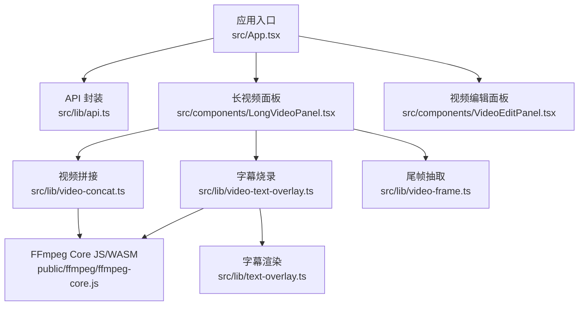
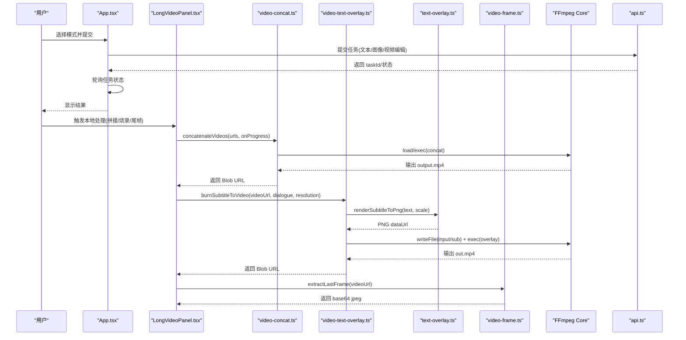
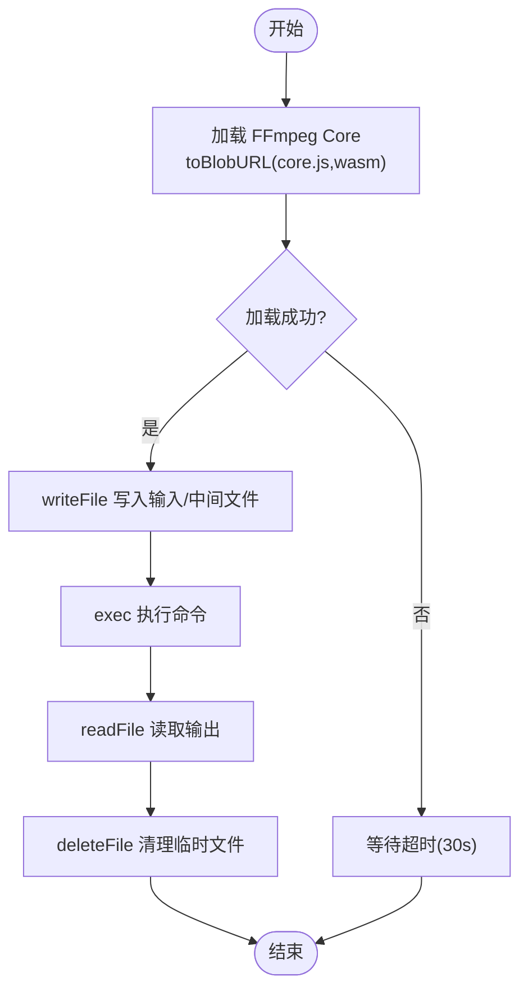
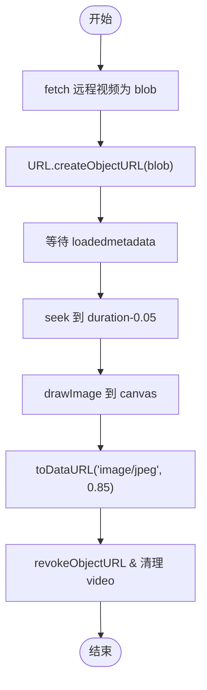
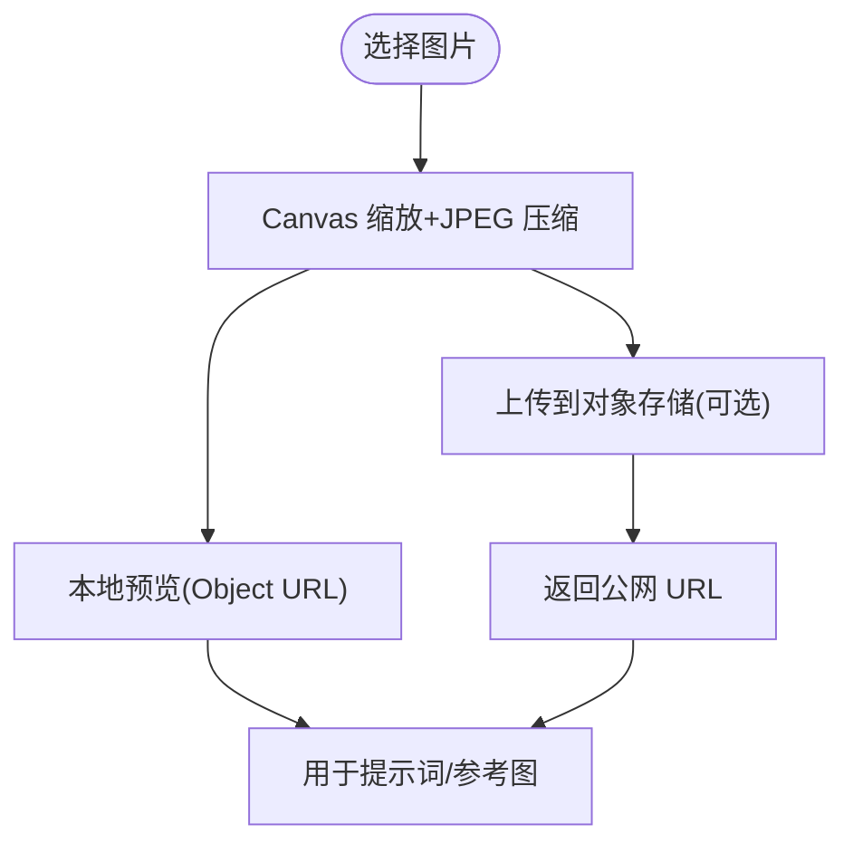
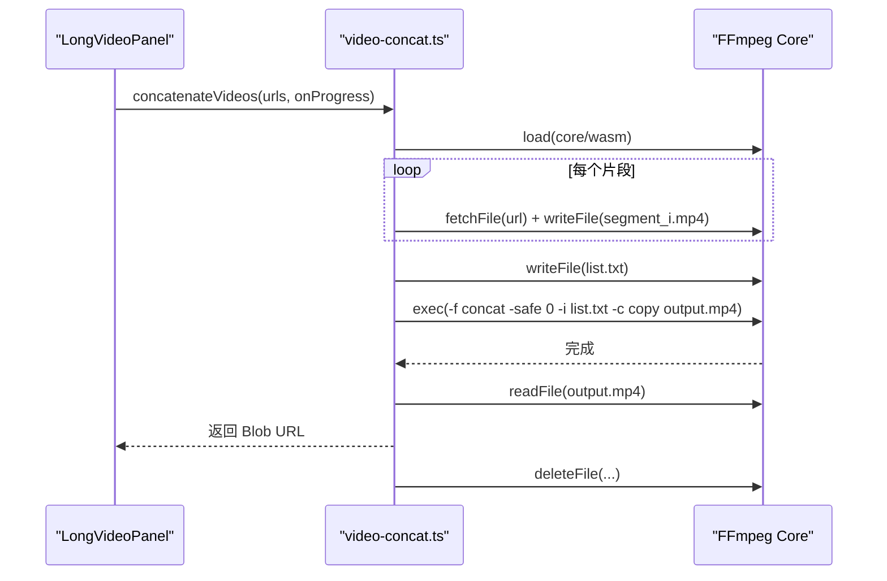
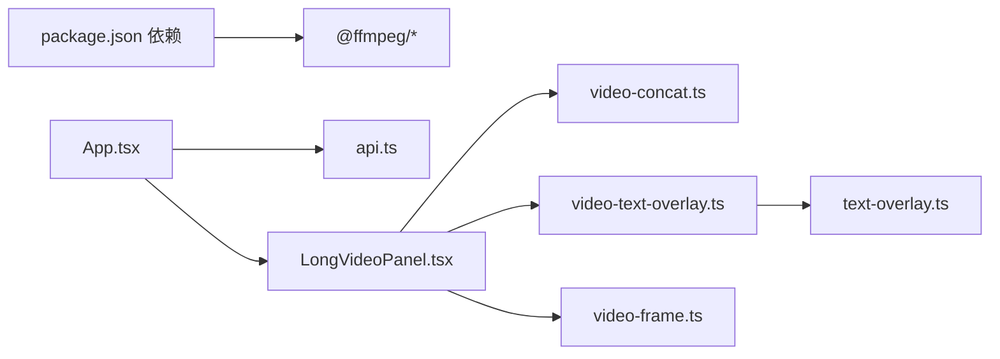

# 视频处理引擎

<cite>
**本文引用的文件列表**
- [package.json](file://package.json)
- [src/lib/video-text-overlay.ts](file://src/lib/video-text-overlay.ts)
- [src/lib/text-overlay.ts](file://src/lib/text-overlay.ts)
- [src/lib/video-concat.ts](file://src/lib/video-concat.ts)
- [src/lib/video-frame.ts](file://src/lib/video-frame.ts)
- [public/ffmpeg/ffmpeg-core.js](file://public/ffmpeg/ffmpeg-core.js)
- [src/components/LongVideoPanel.tsx](file://src/components/LongVideoPanel.tsx)
- [src/components/VideoEditPanel.tsx](file://src/components/VideoEditPanel.tsx)
- [src/App.tsx](file://src/App.tsx)
- [src/lib/api.ts](file://src/lib/api.ts)
</cite>

## 目录
1. [简介](#简介)
2. [项目结构](#项目结构)
3. [核心组件](#核心组件)
4. [架构总览](#架构总览)
5. [详细组件分析](#详细组件分析)
6. [依赖关系分析](#依赖关系分析)
7. [性能与内存优化](#性能与内存优化)
8. [配置选项与调优建议](#配置选项与调优建议)
9. [实际案例](#实际案例)
10. [故障排查与调试指南](#故障排查与调试指南)
11. [结论](#结论)

## 简介
本仓库实现了一个基于浏览器端的视频处理引擎，核心能力包括：
- FFmpeg WASM 集成：在浏览器中加载 ffmpeg-core.wasm，通过虚拟文件系统执行转码、滤镜合成等操作。
- 字幕烧录：使用 Canvas 渲染中文对白为透明 PNG，再通过 overlay 滤镜叠加到视频底部居中位置。
- 视频帧提取：从远程视频抽取尾帧作为下一段生成的首帧，解决 CORS 污染问题。
- 视频拼接：将多个片段按顺序合并为一个 MP4，支持进度回调。
- 图像处理：图片上传、压缩、预览，并可选上传至对象存储获取公网 URL。
- 任务编排：与后端 API 交互，提交文本/图像/视频编辑任务，轮询状态并展示结果。

该引擎以模块化的方式组织功能，便于扩展与维护。

## 项目结构
- 前端入口与路由：App.tsx 负责模式切换、任务提交与结果展示。
- 业务逻辑库：lib 目录下包含视频处理、字幕渲染、API 封装等。
- 组件层：components 提供 UI 面板（长视频、视频编辑等）。
- 静态资源：public/ffmpeg 存放 ffmpeg-core.js 及对应的 wasm 文件。



图表来源
- [src/App.tsx:1-164](file://src/App.tsx#L1-L164)
- [src/lib/api.ts:1-217](file://src/lib/api.ts#L1-L217)
- [src/components/LongVideoPanel.tsx:261-447](file://src/components/LongVideoPanel.tsx#L261-L447)
- [src/components/VideoEditPanel.tsx:1-157](file://src/components/VideoEditPanel.tsx#L1-L157)
- [src/lib/video-concat.ts:1-110](file://src/lib/video-concat.ts#L1-L110)
- [src/lib/video-text-overlay.ts:1-110](file://src/lib/video-text-overlay.ts#L1-L110)
- [src/lib/text-overlay.ts:1-92](file://src/lib/text-overlay.ts#L1-L92)
- [src/lib/video-frame.ts:1-69](file://src/lib/video-frame.ts#L1-L69)
- [public/ffmpeg/ffmpeg-core.js:1-16](file://public/ffmpeg/ffmpeg-core.js#L1-L16)

章节来源
- [src/App.tsx:1-164](file://src/App.tsx#L1-L164)
- [package.json:1-36](file://package.json#L1-L36)

## 核心组件
- FFmpeg WASM 加载器：统一封装 getFFmpeg，负责加载 coreURL/wasmURL、监听日志、超时保护。
- 字幕烧录模块：renderSubtitleToPng + burnSubtitleToVideo，完成“Canvas 渲染 → 写入虚拟 FS → overlay 合成”。
- 视频拼接模块：concatenateVideos，下载片段、写 list.txt、-f concat -c copy 快速拼接。
- 尾帧抽取模块：extractLastFrame，fetch→blob→video→canvas→dataUrl，规避 CORS。
- 图像处理模块：compressImage，Canvas 缩放+JPEG 压缩；可选 OSS 上传。
- API 封装：submitTextToVideo / submitImageToVideo / submitVideoEdit / queryTask。

章节来源
- [src/lib/video-text-overlay.ts:1-110](file://src/lib/video-text-overlay.ts#L1-L110)
- [src/lib/text-overlay.ts:1-92](file://src/lib/text-overlay.ts#L1-L92)
- [src/lib/video-concat.ts:1-110](file://src/lib/video-concat.ts#L1-L110)
- [src/lib/video-frame.ts:1-69](file://src/lib/video-frame.ts#L1-L69)
- [src/components/LongVideoPanel.tsx:261-447](file://src/components/LongVideoPanel.tsx#L261-L447)
- [src/lib/api.ts:1-217](file://src/lib/api.ts#L1-L217)

## 架构总览
系统采用“前端 React + FFmpeg WASM”的纯客户端处理架构，关键流程如下：
- 用户输入（文本/图像/视频）→ 调用 API 提交任务 → 轮询任务状态 → 得到生成结果。
- 本地后处理（可选）：字幕烧录、尾帧抽取、多段拼接。
- FFmpeg 运行于 Web Worker，通过 toBlobURL 加载 core.js 与 .wasm，避免跨域问题。



图表来源
- [src/App.tsx:1-164](file://src/App.tsx#L1-L164)
- [src/lib/api.ts:1-217](file://src/lib/api.ts#L1-L217)
- [src/components/LongVideoPanel.tsx:261-447](file://src/components/LongVideoPanel.tsx#L261-L447)
- [src/lib/video-concat.ts:1-110](file://src/lib/video-concat.ts#L1-L110)
- [src/lib/video-text-overlay.ts:1-110](file://src/lib/video-text-overlay.ts#L1-L110)
- [src/lib/text-overlay.ts:1-92](file://src/lib/text-overlay.ts#L1-L92)
- [src/lib/video-frame.ts:1-69](file://src/lib/video-frame.ts#L1-L69)

## 详细组件分析

### FFmpeg WASM 集成与内存管理
- 加载机制
  - 使用 @ffmpeg/ffmpeg 与 @ffmpeg/util 提供的 toBlobURL 将本地 core.js 与 wasm 转为 Blob URL，避免跨域与 COEP 限制。
  - 单例缓存 FFmpeg 实例，避免重复加载。
  - 增加 30 秒超时保护，防止永久挂起。
- 虚拟文件系统
  - writeFile 写入输入视频与中间产物（如字幕 PNG），exec 执行命令，readFile 读取输出，deleteFile 清理临时文件。
- 内存与性能
  - 使用 -preset ultrafast 与 -crf 23 平衡速度与质量。
  - 拼接场景使用 -c copy 流拷贝，避免重编码。
  - 注意大文件写入与读取会占用较多内存，应控制并发与及时释放。



图表来源
- [src/lib/video-concat.ts:10-38](file://src/lib/video-concat.ts#L10-L38)
- [src/lib/video-text-overlay.ts:12-30](file://src/lib/video-text-overlay.ts#L12-L30)
- [public/ffmpeg/ffmpeg-core.js:1-16](file://public/ffmpeg/ffmpeg-core.js#L1-L16)

章节来源
- [src/lib/video-concat.ts:1-110](file://src/lib/video-concat.ts#L1-L110)
- [src/lib/video-text-overlay.ts:1-110](file://src/lib/video-text-overlay.ts#L1-L110)
- [public/ffmpeg/ffmpeg-core.js:1-16](file://public/ffmpeg/ffmpeg-core.js#L1-L16)

### 字幕烧录功能（字体渲染、位置计算、样式定制）
- 字体渲染
  - 使用 Canvas 2D 绘制白字黑边加粗文本，字体族优先回退到常见中文字体，无需内置字体文件。
  - 根据分辨率设置字号与描边宽度，保证在不同清晰度下可读性一致。
- 位置计算
  - 通过 subtitleFFmpegXY 返回 x=(W-w)/2, y=H-h-(H*0.08)，实现底部居中与留白。
- 合成流程
  - 先渲染 PNG，再写入虚拟 FS，构造 filter_complex 进行 overlay 合成，保留音轨。

```mermaid
classDiagram
class TextOverlay {
+renderSubtitleToPng(text, scale) RenderedSubtitle|null
+subtitleFFmpegXY() {x : string,y : string}
+resolutionToScale(resolution) number
}
class VideoTextOverlay {
-ffmpegInstance : FFmpeg|null
+burnSubtitleToVideo(videoUrl, dialogue, resolution) Promise<string|null>
-getFFmpeg() Promise~FFmpeg~
-dataUrlToUint8(dataUrl) Uint8Array
}
TextOverlay <.. VideoTextOverlay : "被调用"
```

图表来源
- [src/lib/text-overlay.ts:1-92](file://src/lib/text-overlay.ts#L1-L92)
- [src/lib/video-text-overlay.ts:1-110](file://src/lib/video-text-overlay.ts#L1-L110)

章节来源
- [src/lib/text-overlay.ts:1-92](file://src/lib/text-overlay.ts#L1-L92)
- [src/lib/video-text-overlay.ts:1-110](file://src/lib/video-text-overlay.ts#L1-L110)

### 视频帧提取与处理（格式转换、尺寸调整、质量优化）
- 尾帧抽取
  - fetch 下载为 blob，创建 Object URL 给 video 元素，避免 CORS 污染导致 canvas.toDataURL 失败。
  - seek 到 duration-0.05s 取最后一帧，画到 canvas 并导出 JPEG（质量 0.85），控制在合理体积。
- 适用场景
  - 长视频分段生成时，将上一段的尾帧作为下一段 i2v 的首帧，实现画面衔接。



图表来源
- [src/lib/video-frame.ts:16-68](file://src/lib/video-frame.ts#L16-L68)

章节来源
- [src/lib/video-frame.ts:1-69](file://src/lib/video-frame.ts#L1-L69)

### 图像处理模块（上传、验证、压缩优化）
- 压缩流程
  - 使用 Canvas 将图片缩放到目标尺寸，启用 imageSmoothingQuality='high'，导出 JPEG（质量 0.6）。
  - 逐张顺序处理，避免并发解码导致 OOM。
- 上传与预览
  - 本地预览使用 FileReader 或 Object URL。
  - 可选上传至对象存储（如 imgbb/OSS），获得公网 URL 供模型使用。



图表来源
- [src/components/LongVideoPanel.tsx:408-432](file://src/components/LongVideoPanel.tsx#L408-L432)
- [src/components/LongVideoPanel.tsx:434-447](file://src/components/LongVideoPanel.tsx#L434-L447)

章节来源
- [src/components/LongVideoPanel.tsx:261-447](file://src/components/LongVideoPanel.tsx#L261-L447)

### 视频拼接功能
- 流程
  - 下载所有片段，写入虚拟 FS，生成 list.txt，使用 -f concat -safe 0 -i list.txt -c copy 快速拼接。
  - 读取 output.mp4，返回 Blob URL，清理临时文件。
- 进度反馈
  - 分阶段回调 loading/downloading/processing/done，百分比逐步推进。



图表来源
- [src/lib/video-concat.ts:50-109](file://src/lib/video-concat.ts#L50-L109)

章节来源
- [src/lib/video-concat.ts:1-110](file://src/lib/video-concat.ts#L1-L110)

## 依赖关系分析
- 外部依赖
  - @ffmpeg/core、@ffmpeg/ffmpeg、@ffmpeg/util：提供 FFmpeg WASM 运行时与工具函数。
  - react、react-dom、tailwind 等：UI 框架与样式。
- 内部依赖
  - App.tsx 聚合各面板与状态。
  - LongVideoPanel 组合拼接、烧录、尾帧抽取等能力。
  - video-text-overlay 依赖 text-overlay 的渲染与坐标计算。
  - api.ts 封装百炼 HappyHorse 视频生成接口。



图表来源
- [package.json:11-14](file://package.json#L11-L14)
- [src/App.tsx:1-164](file://src/App.tsx#L1-L164)
- [src/lib/api.ts:1-217](file://src/lib/api.ts#L1-L217)
- [src/components/LongVideoPanel.tsx:261-447](file://src/components/LongVideoPanel.tsx#L261-L447)
- [src/lib/video-concat.ts:1-110](file://src/lib/video-concat.ts#L1-L110)
- [src/lib/video-text-overlay.ts:1-110](file://src/lib/video-text-overlay.ts#L1-L110)
- [src/lib/text-overlay.ts:1-92](file://src/lib/text-overlay.ts#L1-L92)
- [src/lib/video-frame.ts:1-69](file://src/lib/video-frame.ts#L1-L69)

章节来源
- [package.json:1-36](file://package.json#L1-L36)
- [src/App.tsx:1-164](file://src/App.tsx#L1-L164)

## 性能与内存优化
- 加载与网络
  - 使用 toBlobURL 避免跨域与 COEP 问题，减少额外请求。
  - 对 FFmpeg 加载增加超时保护，避免长时间阻塞。
- 编码与滤镜
  - 拼接使用 -c copy 流拷贝，避免重编码，显著降低耗时与内存占用。
  - 烧录使用 -preset ultrafast 与 -crf 23，兼顾速度和质量。
- 数据路径
  - 尾帧抽取使用 JPEG 0.85 压缩，控制 base64 体积，利于后续传输。
  - 图片压缩使用 JPEG 0.6，平衡清晰度与大小。
- 并发与 OOM
  - 图片池顺序处理，避免并发解码导致的内存峰值。
  - 及时 revokeObjectURL 与 deleteFile，释放内存与虚拟 FS 空间。

[本节为通用指导，不直接分析具体文件]

## 配置选项与调优建议
- FFmpeg 参数
  - 拼接：-f concat -safe 0 -i list.txt -c copy output.mp4
  - 烧录：-filter_complex "[0:v][1:v]overlay=x=(W-w)/2:y=H-h-(H*0.08)[vout]"，-map '[vout]'，-map '0:a?'，-c:v libx264，-preset ultrafast，-crf 23，-pix_fmt yuv420p
- 分辨率与缩放
  - 字幕字号按分辨率缩放：720p 基准 1，1080p 为 1.5。
- 超时与重试
  - FFmpeg 加载 30 秒超时；可结合 onProgress 提示用户刷新页面重试。
- 内存管理
  - 控制单次处理的视频数量与大小；处理完成后立即清理临时文件与对象 URL。

章节来源
- [src/lib/video-concat.ts:84-90](file://src/lib/video-concat.ts#L84-L90)
- [src/lib/video-text-overlay.ts:74-90](file://src/lib/video-text-overlay.ts#L74-L90)
- [src/lib/text-overlay.ts:81-91](file://src/lib/text-overlay.ts#L81-L91)
- [src/lib/video-text-overlay.ts:22-26](file://src/lib/video-text-overlay.ts#L22-L26)

## 实际案例
- 文本生成视频
  - 在 App 中选择“文本生成视频”，输入提示词与分辨率/时长，提交任务并轮询结果。
- 图像生成视频
  - 上传参考图（可压缩并上传至对象存储），输入提示词，提交任务并轮询结果。
- 视频编辑
  - 上传源视频或输入视频 URL，附加参考图与编辑指令，提交任务并轮询结果。
- 长视频拼接
  - 准备多个片段 URL，调用 concatenateVideos，观察进度回调，最终得到拼接后的 Blob URL。
- 字幕烧录
  - 对某段视频调用 burnSubtitleToVideo，传入对话文本与分辨率，得到带字幕的视频 Blob URL。
- 尾帧抽取
  - 对上一段生成结果调用 extractLastFrame，得到 base64 尾帧，作为下一段 i2v 的首帧。

章节来源
- [src/App.tsx:57-112](file://src/App.tsx#L57-L112)
- [src/lib/api.ts:63-123](file://src/lib/api.ts#L63-L123)
- [src/lib/video-concat.ts:50-109](file://src/lib/video-concat.ts#L50-L109)
- [src/lib/video-text-overlay.ts:48-109](file://src/lib/video-text-overlay.ts#L48-L109)
- [src/lib/video-frame.ts:16-68](file://src/lib/video-frame.ts#L16-L68)

## 故障排查与调试指南
- FFmpeg 加载失败
  - 检查 public/ffmpeg 目录下是否存在 ffmpeg-core.js 与 ffmpeg-core.wasm。
  - 确认 baseURL 指向正确路径，确保浏览器能访问这些静态资源。
  - 查看控制台日志，关注 “[ffmpeg]” 与 “[ffmpeg-subtitle]” 输出。
- 跨域与 COEP 问题
  - 使用 toBlobURL 将 core.js 与 wasm 转为 Blob URL，避免跨域。
  - 若仍失败，检查服务器响应头是否允许跨域与共享上下文。
- 字幕乱码或不可见
  - 确认系统中存在中文字体回退链；必要时在 text-overlay 中调整 FONT_FAMILY。
  - 检查 overlay 坐标公式是否正确，确保字幕位于可见区域。
- 尾帧抽取失败
  - 确认远程视频支持 CORS 或通过 fetch→blob 方式绕过 toDataURL 限制。
  - 检查 video 元数据加载与 seek 事件是否触发，避免超时。
- 拼接失败
  - 确认所有片段格式一致且可被 concat 使用；list.txt 内容正确。
  - 检查 -safe 0 与 -c copy 参数是否生效。
- 内存不足或卡顿
  - 减少并发处理数量，增大处理间隔。
  - 及时清理临时文件与对象 URL，避免内存泄漏。

章节来源
- [src/lib/video-concat.ts:10-38](file://src/lib/video-concat.ts#L10-L38)
- [src/lib/video-text-overlay.ts:12-30](file://src/lib/video-text-overlay.ts#L12-L30)
- [src/lib/video-frame.ts:24-45](file://src/lib/video-frame.ts#L24-L45)
- [src/lib/text-overlay.ts:12-12](file://src/lib/text-overlay.ts#L12-L12)

## 结论
本视频处理引擎在浏览器端实现了完整的 FFmpeg WASM 集成与多种视频处理能力，涵盖字幕烧录、尾帧抽取、视频拼接与图像处理。通过合理的内存管理与性能优化策略，能够在客户端高效完成复杂媒体处理任务。开发者可根据实际需求扩展更多滤镜与处理流程，并结合后端 API 构建端到端的视频生成工作流。