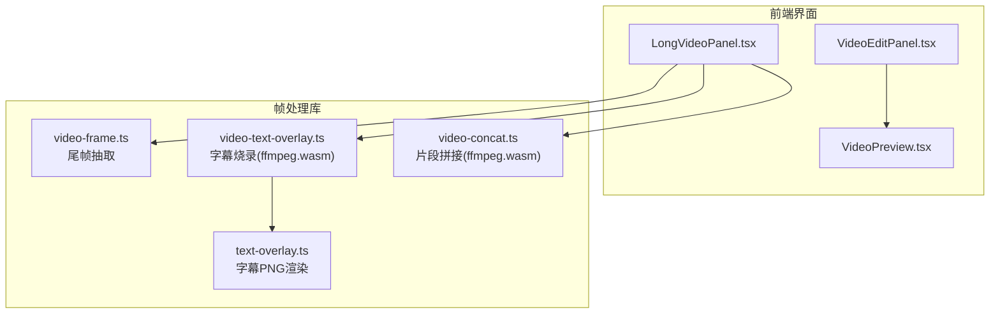
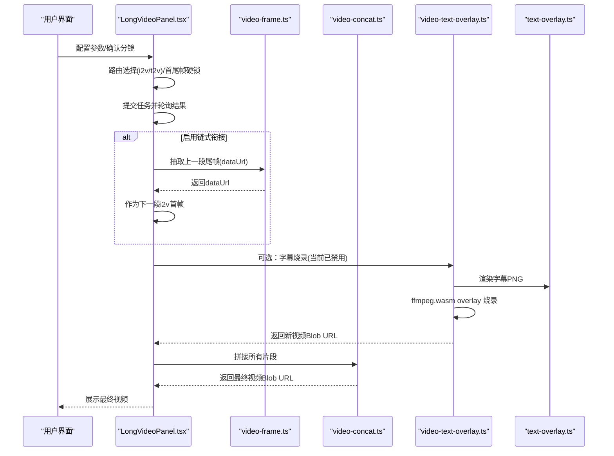
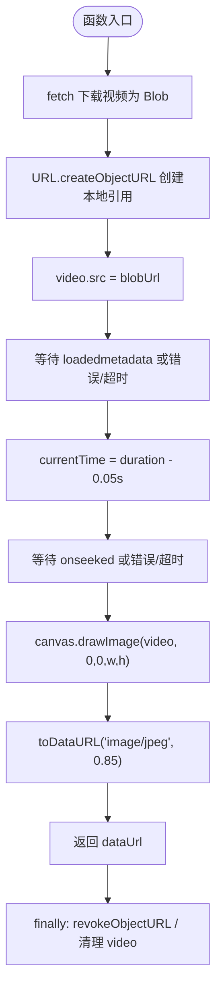
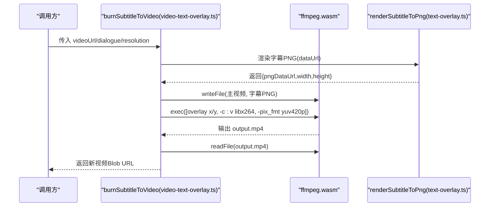
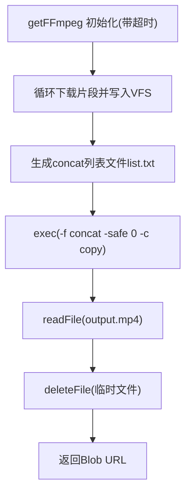
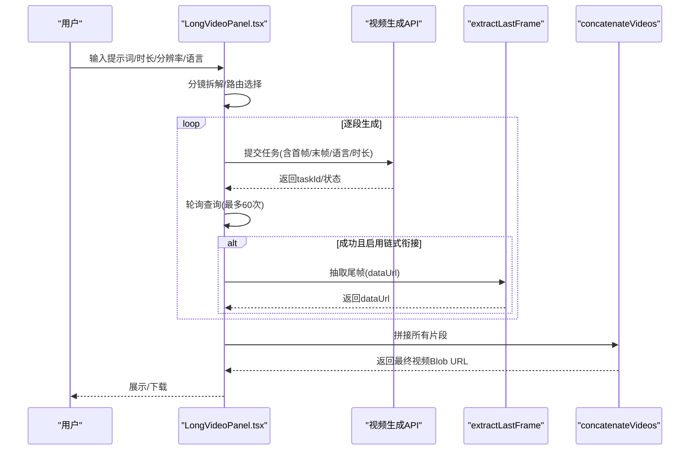
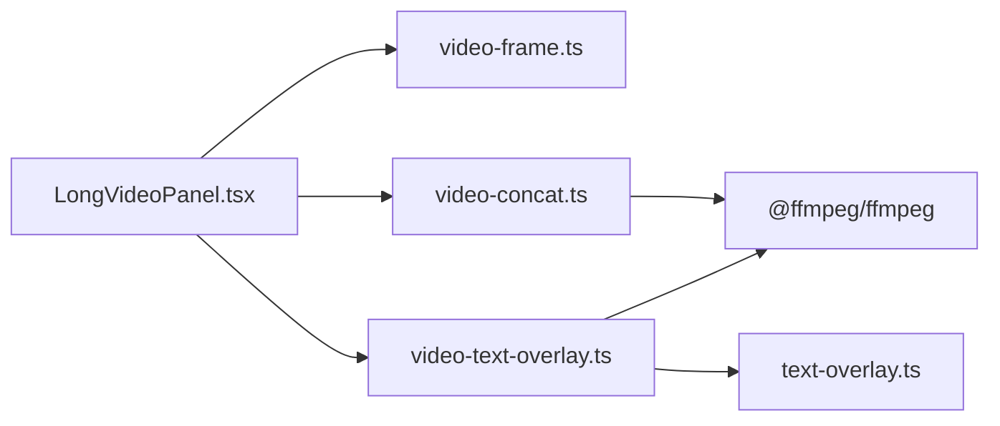

# 视频帧处理

<cite>
**本文引用的文件**   
- [src/lib/video-frame.ts](file://src/lib/video-frame.ts)
- [src/lib/video-concat.ts](file://src/lib/video-concat.ts)
- [src/lib/text-overlay.ts](file://src/lib/text-overlay.ts)
- [src/lib/video-text-overlay.ts](file://src/lib/video-text-overlay.ts)
- [src/components/LongVideoPanel.tsx](file://src/components/LongVideoPanel.tsx)
- [src/components/VideoEditPanel.tsx](file://src/components/VideoEditPanel.tsx)
- [src/components/VideoPreview.tsx](file://src/components/VideoPreview.tsx)
</cite>

## 目录
1. [简介](#简介)
2. [项目结构](#项目结构)
3. [核心组件](#核心组件)
4. [架构总览](#架构总览)
5. [详细组件分析](#详细组件分析)
6. [依赖关系分析](#依赖关系分析)
7. [性能考虑](#性能考虑)
8. [故障排查指南](#故障排查指南)
9. [结论](#结论)
10. [附录：示例与最佳实践](#附录示例与最佳实践)

## 简介
本技术文档聚焦于“视频帧处理模块”，围绕以下目标展开：
- 视频帧提取算法：关键帧识别、时间戳映射、帧率控制等
- 帧格式转换：编码格式支持、像素格式转换、色彩空间处理
- 帧尺寸调整：缩放算法选择、质量保持、性能优化
- 帧数据处理接口：数据访问方法、缓冲区管理、内存优化
- 实际示例：帧分析、修改、合成
- 性能调优：大文件处理、内存管理、异步处理

本项目在前端浏览器环境中实现，主要利用原生媒体能力（<video>/<canvas>）与 ffmpeg.wasm 完成帧抽取、字幕烧录与片段拼接。

## 项目结构
与视频帧处理相关的核心代码位于 src/lib 与 src/components 下：
- 帧抽取与尾帧衔接：src/lib/video-frame.ts
- 字幕渲染与烧录：src/lib/text-overlay.ts、src/lib/video-text-overlay.ts
- 多段视频拼接：src/lib/video-concat.ts
- 长视频流程编排与链式衔接：src/components/LongVideoPanel.tsx
- 视频编辑面板与预览：src/components/VideoEditPanel.tsx、src/components/VideoPreview.tsx

图表来源
- [src/components/LongVideoPanel.tsx](file://src/components/LongVideoPanel.tsx)
- [src/lib/video-frame.ts](file://src/lib/video-frame.ts)
- [src/lib/video-concat.ts](file://src/lib/video-concat.ts)
- [src/lib/text-overlay.ts](file://src/lib/text-overlay.ts)
- [src/lib/video-text-overlay.ts](file://src/lib/video-text-overlay.ts)
- [src/components/VideoEditPanel.tsx](file://src/components/VideoEditPanel.tsx)
- [src/components/VideoPreview.tsx](file://src/components/VideoPreview.tsx)

章节来源
- [src/lib/video-frame.ts:1-68](file://src/lib/video-frame.ts#L1-L68)
- [src/lib/video-concat.ts:1-110](file://src/lib/video-concat.ts#L1-L110)
- [src/lib/text-overlay.ts:1-92](file://src/lib/text-overlay.ts#L1-L92)
- [src/lib/video-text-overlay.ts:1-110](file://src/lib/video-text-overlay.ts#L1-L110)
- [src/components/LongVideoPanel.tsx:1-800](file://src/components/LongVideoPanel.tsx#L1-L800)
- [src/components/VideoEditPanel.tsx:1-157](file://src/components/VideoEditPanel.tsx#L1-L157)
- [src/components/VideoPreview.tsx:1-65](file://src/components/VideoPreview.tsx#L1-L65)

## 核心组件
- 尾帧抽取工具：从远程视频 URL 抽取最后一帧并返回 base64 JPEG dataUrl，用于长视频分段生成时的“上一段尾帧→下一段首帧”的无缝衔接。
- 字幕渲染与烧录：将中文对白文本渲染为透明背景 PNG，再通过 ffmpeg.wasm overlay 滤镜烧录到视频底部居中位置。
- 片段拼接：使用 ffmpeg.wasm 在浏览器端下载多个 MP4 片段并以流拷贝方式拼接输出。
- 长视频编排：负责分镜拆解、路由模式选择（i2v/t2v）、链式衔接、首尾帧硬锁、进度与错误处理等。

章节来源
- [src/lib/video-frame.ts:1-68](file://src/lib/video-frame.ts#L1-L68)
- [src/lib/text-overlay.ts:1-92](file://src/lib/text-overlay.ts#L1-L92)
- [src/lib/video-text-overlay.ts:1-110](file://src/lib/video-text-overlay.ts#L1-L110)
- [src/lib/video-concat.ts:1-110](file://src/lib/video-concat.ts#L1-L110)
- [src/components/LongVideoPanel.tsx:1-800](file://src/components/LongVideoPanel.tsx#L1-L800)

## 架构总览
下图展示了“长视频生成+链式衔接+字幕烧录+片段拼接”的整体流程与组件交互。

图表来源
- [src/components/LongVideoPanel.tsx:1-800](file://src/components/LongVideoPanel.tsx#L1-L800)
- [src/lib/video-frame.ts:1-68](file://src/lib/video-frame.ts#L1-L68)
- [src/lib/video-text-overlay.ts:1-110](file://src/lib/video-text-overlay.ts#L1-L110)
- [src/lib/text-overlay.ts:1-92](file://src/lib/text-overlay.ts#L1-L92)
- [src/lib/video-concat.ts:1-110](file://src/lib/video-concat.ts#L1-L110)

## 详细组件分析

### 尾帧抽取（video-frame.ts）
- 功能要点
  - 通过 fetch 下载视频为 Blob，避免 CORS 污染导致 toDataURL 失败
  - 设置 video.currentTime = duration - 0.05s 定位接近最后一帧
  - 使用 canvas 绘制并导出为 image/jpeg，压缩比 0.85，控制体积
  - 超时保护：metadata 加载与 seek 均带超时
  - 资源清理：revokeObjectURL、移除 src、load()
- 关键技术点
  - 关键帧识别：采用“接近结尾时间点”策略，非严格 I 帧检测；适用于大多数容器/解码器
  - 时间戳映射：duration - 0.05s 近似尾部，兼顾兼容性与稳定性
  - 帧率控制：不显式控制帧率，仅取单帧；如需按固定间隔抽帧可基于 currentTime 步进
  - 像素格式/色彩空间：由浏览器解码管线决定，导出为 JPEG（YUV→RGB 转换由浏览器完成）
  - 内存优化：及时释放 Blob URL，避免常驻内存

图表来源
- [src/lib/video-frame.ts:16-68](file://src/lib/video-frame.ts#L16-L68)

章节来源
- [src/lib/video-frame.ts:1-68](file://src/lib/video-frame.ts#L1-L68)

### 字幕渲染与烧录（text-overlay.ts + video-text-overlay.ts）
- 字幕渲染（text-overlay.ts）
  - 根据分辨率计算字号缩放系数（720p=1，1080p=1.5）
  - 使用 Canvas 测量文字尺寸，绘制白字黑边，输出透明 PNG dataUrl
  - 提供 subtitleFFmpegXY 计算 overlay 坐标（底部居中，距底约 8%）
- 字幕烧录（video-text-overlay.ts）
  - 初始化 ffmpeg.wasm（带超时），写入主视频与字幕 PNG
  - 构造 filter_complex 进行 overlay，输出 libx264 + yuv420p，音频 copy
  - 读取输出文件并返回 Blob URL，清理虚拟文件系统

图表来源
- [src/lib/video-text-overlay.ts:48-109](file://src/lib/video-text-overlay.ts#L48-L109)
- [src/lib/text-overlay.ts:25-91](file://src/lib/text-overlay.ts#L25-L91)

章节来源
- [src/lib/text-overlay.ts:1-92](file://src/lib/text-overlay.ts#L1-L92)
- [src/lib/video-text-overlay.ts:1-110](file://src/lib/video-text-overlay.ts#L1-L110)

### 片段拼接（video-concat.ts）
- 功能要点
  - 懒加载 ffmpeg.wasm 实例，带超时保护
  - 顺序下载各片段，写入虚拟文件系统
  - 生成 concat list.txt，执行 -f concat -c copy 流拷贝拼接
  - 读取输出并返回 Blob URL，清理临时文件
- 关键点
  - 使用 toBlobURL 加载 core/wasm，避免 Worker 内网络请求导致的 CORS/COEP 问题
  - 进度回调：loading/downloading/processing/done 四阶段
  - 性能：-c copy 不进行重编码，秒级完成

图表来源
- [src/lib/video-concat.ts:10-109](file://src/lib/video-concat.ts#L10-L109)

章节来源
- [src/lib/video-concat.ts:1-110](file://src/lib/video-concat.ts#L1-L110)

### 长视频编排与链式衔接（LongVideoPanel.tsx）
- 功能要点
  - 分镜拆解与路由模式选择（i2v/t2v）
  - 链式衔接：启用后，上段尾帧作为下段 i2v 首帧，强制串行执行
  - 首尾帧硬锁：对特定模型生效，需公网 URL
  - 内容安全审核拦截自动清洗并重试一次
  - IndexedDB 持久化最终视频 Blob，刷新恢复
- 与帧处理的关系
  - 调用 extractLastFrame 抽取尾帧，作为下一段首帧
  - 可选调用 burnSubtitleToVideo（当前已禁用）
  - 最终调用 concatenateVideos 拼接全部片段

图表来源
- [src/components/LongVideoPanel.tsx:633-800](file://src/components/LongVideoPanel.tsx#L633-L800)
- [src/lib/video-frame.ts:16-68](file://src/lib/video-frame.ts#L16-L68)
- [src/lib/video-concat.ts:50-109](file://src/lib/video-concat.ts#L50-L109)

章节来源
- [src/components/LongVideoPanel.tsx:1-800](file://src/components/LongVideoPanel.tsx#L1-L800)

## 依赖关系分析
- 组件耦合
  - LongVideoPanel 强依赖 video-frame、video-concat、video-text-overlay（当前禁用）
  - video-text-overlay 依赖 text-overlay（纯渲染逻辑）
  - video-concat 与 video-text-overlay 共享 ffmpeg.wasm 初始化模式
- 外部依赖
  - @ffmpeg/ffmpeg 与 @ffmpeg/util：浏览器端多媒体处理
  - 浏览器原生：<video>, <canvas>, fetch, indexedDB, URL.createObjectURL/revokeObjectURL

图表来源
- [src/components/LongVideoPanel.tsx:1-800](file://src/components/LongVideoPanel.tsx#L1-L800)
- [src/lib/video-frame.ts:1-68](file://src/lib/video-frame.ts#L1-L68)
- [src/lib/video-concat.ts:1-110](file://src/lib/video-concat.ts#L1-L110)
- [src/lib/video-text-overlay.ts:1-110](file://src/lib/video-text-overlay.ts#L1-L110)
- [src/lib/text-overlay.ts:1-92](file://src/lib/text-overlay.ts#L1-L92)

章节来源
- [src/components/LongVideoPanel.tsx:1-800](file://src/components/LongVideoPanel.tsx#L1-L800)
- [src/lib/video-frame.ts:1-68](file://src/lib/video-frame.ts#L1-L68)
- [src/lib/video-concat.ts:1-110](file://src/lib/video-concat.ts#L1-L110)
- [src/lib/video-text-overlay.ts:1-110](file://src/lib/video-text-overlay.ts#L1-L110)
- [src/lib/text-overlay.ts:1-92](file://src/lib/text-overlay.ts#L1-L92)

## 性能考虑
- 大文件处理
  - 优先使用流拷贝（-c copy）减少 CPU 与时间开销
  - 按需加载 ffmpeg.wasm，避免首屏阻塞
  - 使用 Blob URL 与 Object URL 生命周期管理，及时释放
- 内存管理
  - 尾帧抽取后立即 revokeObjectURL，避免常驻内存
  - 字幕 PNG 仅在烧录时生成，完成后释放
  - 最终视频 Blob 存入 IndexedDB，页面刷新后可重建 URL
- 异步与并发
  - 长视频生成默认串行（链式衔接要求），避免并发导致首帧不一致
  - 下载片段顺序执行，避免并发解码导致 OOM
- 质量与体积平衡
  - 尾帧 JPEG 压缩比 0.85，720p 下约 ~150KB，便于作为首帧传输
  - 字幕 PNG 透明背景，overlay 后不影响原视频码率

[本节为通用指导，无需具体文件分析]

## 故障排查指南
- 尾帧抽取失败
  - 检查网络响应是否 ok，CORS 是否允许跨域
  - 关注 metadata/seek 超时，必要时增大 timeoutMs
  - 确保 videoWidth/videoHeight 有效
- 字幕烧录失败
  - 确认 ffmpeg.wasm 加载成功（带超时）
  - 检查 overlay 坐标与分辨率匹配
  - 查看日志输出定位具体错误
- 片段拼接失败
  - 确认所有片段下载成功且写入 VFS
  - 检查 list.txt 格式与路径
  - 观察 exec 返回值与日志

章节来源
- [src/lib/video-frame.ts:16-68](file://src/lib/video-frame.ts#L16-L68)
- [src/lib/video-text-overlay.ts:12-30](file://src/lib/video-text-overlay.ts#L12-L30)
- [src/lib/video-concat.ts:10-38](file://src/lib/video-concat.ts#L10-L38)

## 结论
本模块以轻量前端方案实现了长视频的“分段生成—尾帧衔接—字幕烧录—片段拼接”全流程。通过合理的超时保护、内存管理与进度反馈，保证了用户体验与稳定性。未来可在以下方面继续优化：
- 引入更精确的关键帧检测（如基于容器索引或解码器能力）
- 增加按固定时间间隔抽帧与帧率控制
- 扩展像素格式与色彩空间处理（如 YUV↔RGB 显式转换）
- 进一步降低内存峰值（如分块写入/流式处理）

[本节为总结性内容，无需具体文件分析]

## 附录：示例与最佳实践
- 尾帧抽取示例（路径参考）
  - 调用 extractLastFrame(videoUrl, timeoutMs) 获取 dataUrl，作为下一段 i2v 首帧
  - 参考：[src/lib/video-frame.ts:16-68](file://src/lib/video-frame.ts#L16-L68)
- 字幕烧录示例（路径参考）
  - 调用 burnSubtitleToVideo(videoUrl, dialogue, resolution) 返回新视频 Blob URL
  - 参考：[src/lib/video-text-overlay.ts:48-109](file://src/lib/video-text-overlay.ts#L48-L109)
- 片段拼接示例（路径参考）
  - 调用 concatenateVideos(videoUrls[], onProgress) 返回最终视频 Blob URL
  - 参考：[src/lib/video-concat.ts:50-109](file://src/lib/video-concat.ts#L50-L109)
- 长视频编排示例（路径参考）
  - 在 LongVideoPanel 中组合上述能力，实现链式衔接与最终拼接
  - 参考：[src/components/LongVideoPanel.tsx:633-800](file://src/components/LongVideoPanel.tsx#L633-L800)

章节来源
- [src/lib/video-frame.ts:16-68](file://src/lib/video-frame.ts#L16-L68)
- [src/lib/video-text-overlay.ts:48-109](file://src/lib/video-text-overlay.ts#L48-L109)
- [src/lib/video-concat.ts:50-109](file://src/lib/video-concat.ts#L50-L109)
- [src/components/LongVideoPanel.tsx:633-800](file://src/components/LongVideoPanel.tsx#L633-L800)