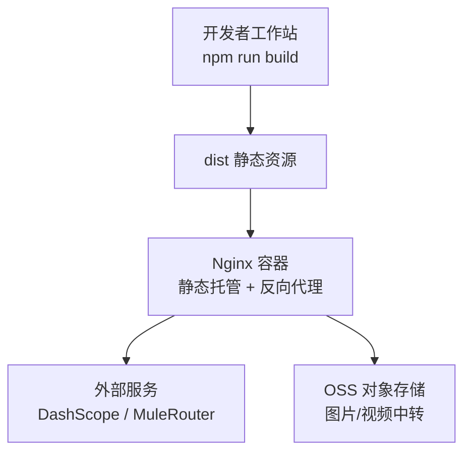
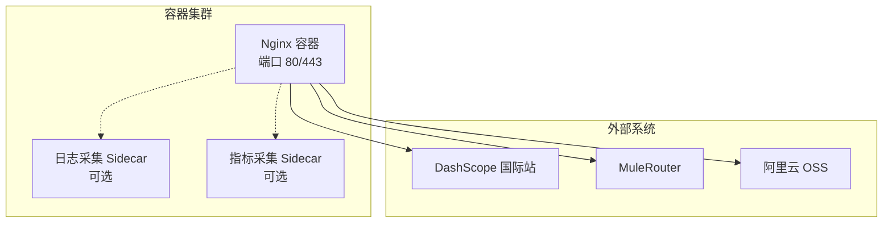
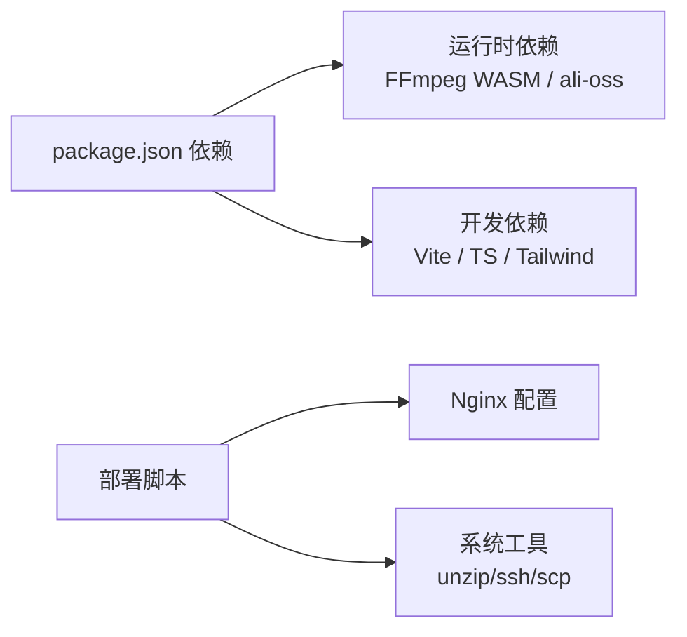

# Docker容器化部署

<cite>
**本文引用的文件列表**
- [package.json](file://package.json)
- [vite.config.ts](file://vite.config.ts)
- [deploy/deploy.sh](file://deploy/deploy.sh)
- [deploy/nginx.conf](file://deploy/nginx.conf)
- [deploy/setup-server.sh](file://deploy/setup-server.sh)
</cite>

## 目录
1. [简介](#简介)
2. [项目结构](#项目结构)
3. [核心组件](#核心组件)
4. [架构总览](#架构总览)
5. [详细组件分析](#详细组件分析)
6. [依赖分析](#依赖分析)
7. [性能考虑](#性能考虑)
8. [故障诊断指南](#故障诊断指南)
9. [结论](#结论)
10. [附录](#附录)

## 简介
本仓库为前端静态站点（React + Vite），当前采用 Nginx 直接托管构建产物，并通过脚本在 ECS 上完成部署。仓库中未包含 Dockerfile、Docker Compose 或 Kubernetes 清单。为满足“容器化部署”的目标，本文基于现有工程与部署脚本，提供一套完整的容器化方案：包括多阶段构建的镜像设计、镜像优化与安全最佳实践、Docker Compose 编排示例、Kubernetes 部署清单示例，以及镜像构建/推送/管理流程、监控日志与故障诊断建议。

## 项目结构
- 应用层：React + TypeScript + Vite 构建的前端 SPA，生产构建输出到 dist 目录。
- 部署层：通过本地脚本打包 dist 并上传至 ECS，远程安装 Nginx 并启用站点配置。
- 运行时：Nginx 作为反向代理与静态资源服务器，转发部分 API 请求到外部服务。

[此图为概念性架构图，不映射具体源码文件]

**章节来源**
- [package.json:1-36](file://package.json#L1-L36)
- [vite.config.ts:1-294](file://vite.config.ts#L1-L294)
- [deploy/deploy.sh:1-46](file://deploy/deploy.sh#L1-L46)
- [deploy/nginx.conf:1-57](file://deploy/nginx.conf#L1-L57)
- [deploy/setup-server.sh:1-59](file://deploy/setup-server.sh#L1-L59)

## 核心组件
- 构建产物：Vite 生产构建输出静态资源，包含 HTML/CSS/JS/WASM 等。
- Web 服务器：Nginx 负责静态资源缓存、Gzip 压缩、跨域头设置、反向代理长耗时接口。
- 环境变量：开发期通过 Vite 加载 .env.local 中的 OSS 凭据；生产环境应通过容器环境变量注入。
- 部署脚本：本地构建、打包、上传、远程初始化与重启 Nginx。

**章节来源**
- [package.json:6-10](file://package.json#L6-L10)
- [vite.config.ts:262-294](file://vite.config.ts#L262-L294)
- [deploy/nginx.conf:1-57](file://deploy/nginx.conf#L1-L57)
- [deploy/deploy.sh:21-38](file://deploy/deploy.sh#L21-L38)
- [deploy/setup-server.sh:12-46](file://deploy/setup-server.sh#L12-L46)

## 架构总览
下图展示推荐的容器化运行架构：Nginx 容器对外暴露 80/443，静态资源由只读卷挂载，反向代理指向外部服务；可选地引入 Sidecar 收集日志与指标。

[此图为概念性架构图，不映射具体源码文件]

## 详细组件分析

### 容器镜像构建（多阶段构建）
目标：最小化镜像体积、减少攻击面、提升可维护性。

- 阶段一：构建器镜像
  - 使用 Node LTS 基础镜像
  - 安装依赖并执行构建命令，产出 dist 目录
- 阶段二：运行镜像
  - 使用精简 Nginx 基础镜像
  - 仅复制 dist 与 Nginx 配置文件
  - 以非 root 用户运行，禁用不必要模块，开启 gzip 与缓存策略

关键要点
- 多阶段构建避免将 Node 工具链带入运行镜像。
- 仅复制必要文件，减小镜像体积。
- 使用只读根文件系统与最小权限原则。
- 通过环境变量注入敏感信息（如 OSS 凭据）。

参考路径
- [package.json:6-10](file://package.json#L6-L10)
- [vite.config.ts:262-294](file://vite.config.ts#L262-L294)
- [deploy/nginx.conf:1-57](file://deploy/nginx.conf#L1-L57)

**章节来源**
- [package.json:6-10](file://package.json#L6-L10)
- [vite.config.ts:262-294](file://vite.config.ts#L262-L294)
- [deploy/nginx.conf:1-57](file://deploy/nginx.conf#L1-L57)

### 镜像优化与安全最佳实践
- 镜像分层优化
  - 先拷贝 package.json 与 lock 文件，预安装依赖，再拷贝源码，利用缓存加速重复构建。
  - 使用多阶段构建，最终镜像仅包含运行所需内容。
- 安全加固
  - 使用非 root 用户运行 Nginx。
  - 关闭不必要的 Nginx 模块与调试信息。
  - 限制网络访问，仅开放 80/443。
  - 定期扫描镜像漏洞，及时更新基础镜像。
- 配置外置
  - 将 Nginx 配置与站点文件分离，便于滚动升级与回滚。
  - 敏感信息通过环境变量或密钥管理服务注入。

参考路径
- [deploy/nginx.conf:1-57](file://deploy/nginx.conf#L1-L57)
- [vite.config.ts:262-294](file://vite.config.ts#L262-L294)

**章节来源**
- [deploy/nginx.conf:1-57](file://deploy/nginx.conf#L1-L57)
- [vite.config.ts:262-294](file://vite.config.ts#L262-L294)

### Docker Compose 编排配置
说明：仓库未提供 docker-compose 文件。以下为推荐的服务定义思路（概念性描述）：
- 服务：nginx
  - 镜像：自定义 Nginx 镜像（多阶段构建产物）
  - 端口：映射 80/443
  - 卷：挂载 dist 与 nginx.conf
  - 环境变量：注入 OSS 相关变量（若需要）
- 网络：默认 bridge 即可，如需内部通信可创建自定义网络
- 数据卷：静态资源与日志持久化（按需）

[本节为概念性说明，不直接分析具体源码文件]

### Kubernetes 部署清单示例
说明：仓库未提供 K8s 清单。以下为推荐资源类型（概念性说明）：
- Deployment：运行 Nginx 副本，挂载 ConfigMap（Nginx 配置）与 Volume（静态资源）
- Service：ClusterIP 暴露内部服务，Ingress 暴露公网
- Ingress：配置域名、TLS、超时与代理规则
- Secret：存放 OSS 凭据等敏感信息
- ConfigMap：存放 Nginx 配置与站点文件（或通过 InitContainer 生成）

[本节为概念性说明，不直接分析具体源码文件]

### 容器镜像的构建、推送与管理流程
- 构建
  - 本地或 CI 中使用多阶段构建生成镜像
  - 打标签包含版本与提交哈希，便于追踪
- 推送
  - 推送到私有镜像仓库（如 Harbor、ACR）
  - 使用受控的凭证与最小权限
- 管理
  - 定期清理无用镜像与标签
  - 对镜像进行漏洞扫描与合规检查
  - 使用镜像签名与校验机制

[本节为通用流程说明，不直接分析具体源码文件]

### 容器监控、日志收集与故障诊断
- 日志
  - 将 Nginx access/error 日志输出到 stdout/stderr，交由容器平台统一收集
  - 结合 Sidecar 或平台原生能力进行聚合与分析
- 监控
  - 暴露 Nginx 指标（如 stub_status 或第三方 exporter）
  - 结合 Prometheus/Grafana 可视化
- 诊断
  - 查看容器日志定位 5xx 错误与上游超时
  - 检查反向代理超时与跨域头是否正确
  - 验证 OSS 上传与代理链路

参考路径
- [deploy/nginx.conf:1-57](file://deploy/nginx.conf#L1-L57)
- [vite.config.ts:262-294](file://vite.config.ts#L262-L294)

**章节来源**
- [deploy/nginx.conf:1-57](file://deploy/nginx.conf#L1-L57)
- [vite.config.ts:262-294](file://vite.config.ts#L262-L294)

## 依赖分析
- 构建依赖
  - React、TypeScript、Vite 及其插件
  - TailwindCSS、PostCSS、Autoprefixer
- 运行时依赖
  - 浏览器端 FFmpeg WASM（@ffmpeg/*）
  - 阿里云 OSS SDK（ali-oss，用于开发期中转上传）
- 部署依赖
  - Nginx（生产环境）
  - 脚本工具：unzip、ssh、scp

**图表来源**
- [package.json:11-34](file://package.json#L11-L34)
- [deploy/deploy.sh:21-38](file://deploy/deploy.sh#L21-L38)
- [deploy/setup-server.sh:12-15](file://deploy/setup-server.sh#L12-L15)
- [deploy/nginx.conf:1-57](file://deploy/nginx.conf#L1-L57)

**章节来源**
- [package.json:11-34](file://package.json#L11-L34)
- [deploy/deploy.sh:21-38](file://deploy/deploy.sh#L21-L38)
- [deploy/setup-server.sh:12-15](file://deploy/setup-server.sh#L12-L15)
- [deploy/nginx.conf:1-57](file://deploy/nginx.conf#L1-L57)

## 性能考虑
- 静态资源缓存
  - 对 assets 与 ffmpeg 资源设置长期缓存与不可变策略
- Gzip 压缩
  - 启用文本类与 wasm 资源的压缩
- 反向代理超时
  - 针对长耗时任务提高代理读取超时
- 跨域与安全头
  - 正确设置 COOP/COEP 以支持 SharedArrayBuffer（WASM 场景）

参考路径
- [deploy/nginx.conf:25-43](file://deploy/nginx.conf#L25-L43)
- [deploy/nginx.conf:12-23](file://deploy/nginx.conf#L12-L23)
- [deploy/nginx.conf:8-10](file://deploy/nginx.conf#L8-L10)
- [vite.config.ts:272-291](file://vite.config.ts#L272-L291)

**章节来源**
- [deploy/nginx.conf:8-43](file://deploy/nginx.conf#L8-L43)
- [vite.config.ts:272-291](file://vite.config.ts#L272-L291)

## 故障诊断指南
- 常见问题
  - 跨域失败：确认 Nginx 已设置必要的跨域与安全头
  - 长任务超时：调整代理超时参数
  - 大文件上传失败：检查 client_max_body_size 与代理超时
  - 资源 404：确认 try_files 回退与静态资源路径
- 诊断步骤
  - 查看 Nginx 错误日志与访问日志
  - 检查反向代理目标可达性与证书
  - 验证 OSS 凭据与上传逻辑（开发期中转）
  - 使用 curl 复现问题并观察响应头

参考路径
- [deploy/nginx.conf:12-23](file://deploy/nginx.conf#L12-L23)
- [deploy/nginx.conf:45-48](file://deploy/nginx.conf#L45-L48)
- [deploy/nginx.conf:55-56](file://deploy/nginx.conf#L55-L56)
- [vite.config.ts:151-260](file://vite.config.ts#L151-L260)

**章节来源**
- [deploy/nginx.conf:12-23](file://deploy/nginx.conf#L12-L23)
- [deploy/nginx.conf:45-48](file://deploy/nginx.conf#L45-L48)
- [deploy/nginx.conf:55-56](file://deploy/nginx.conf#L55-L56)
- [vite.config.ts:151-260](file://vite.config.ts#L151-L260)

## 结论
本项目当前以 Nginx 直接托管静态资源的方式部署。为实现容器化，建议采用多阶段构建的最小化 Nginx 镜像，配合 Compose/K8s 编排，实现可观测、可伸缩与安全的发布体系。同时，遵循镜像优化与安全最佳实践，完善监控与日志收集，以提升稳定性与可维护性。

[本节为总结性内容，不直接分析具体源码文件]

## 附录
- 环境变量建议
  - OSS_ACCESS_KEY_ID、OSS_ACCESS_KEY_SECRET、OSS_BUCKET、OSS_REGION、OSS_ENDPOINT、OSS_ACCESS_POINT_ALIAS（根据实际接入点选择）
- 部署脚本参考
  - 本地构建与上传：deploy/deploy.sh
  - 远程初始化与启动：deploy/setup-server.sh
  - Nginx 配置：deploy/nginx.conf

**章节来源**
- [deploy/deploy.sh:1-46](file://deploy/deploy.sh#L1-L46)
- [deploy/setup-server.sh:1-59](file://deploy/setup-server.sh#L1-L59)
- [deploy/nginx.conf:1-57](file://deploy/nginx.conf#L1-L57)