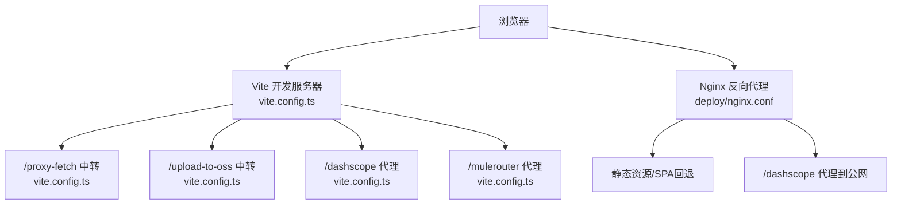
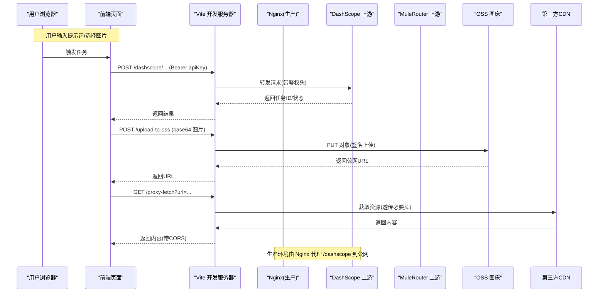
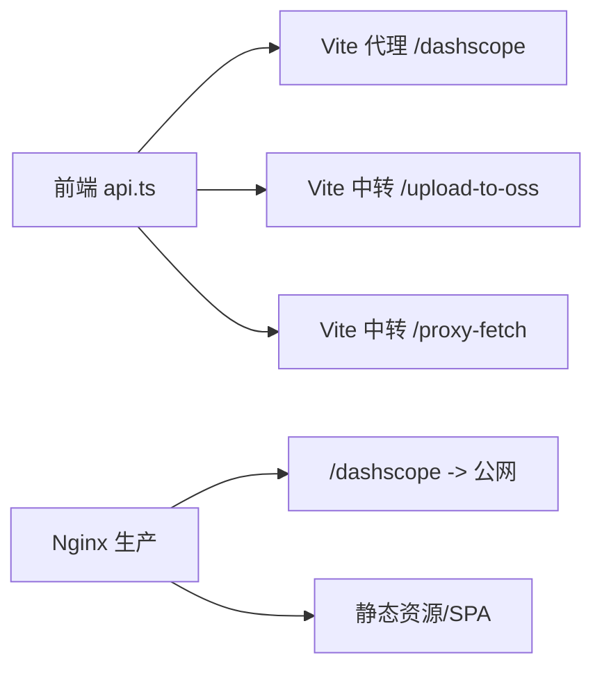

# 安全配置

<cite>
**本文引用的文件**   
- [vite.config.ts](file://vite.config.ts)
- [nginx.conf](file://deploy/nginx.conf)
- [api.ts](file://src/lib/api.ts)
- [ApiKeyModal.tsx](file://src/components/ApiKeyModal.tsx)
- [.gitignore](file://.gitignore)
</cite>

## 目录
1. [简介](#简介)
2. [项目结构](#项目结构)
3. [核心组件](#核心组件)
4. [架构总览](#架构总览)
5. [详细组件分析](#详细组件分析)
6. [依赖关系分析](#依赖关系分析)
7. [性能与可用性考虑](#性能与可用性考虑)
8. [故障排查指南](#故障排查指南)
9. [结论](#结论)
10. [附录：最佳实践清单](#附录最佳实践清单)

## 简介
本文件面向生产部署与运维人员，围绕以下目标提供可操作的安全配置建议与实践：
- API 密钥管理与环境变量安全（敏感信息保护、访问控制）
- CORS 跨域请求安全（白名单、请求校验）
- HTTPS/SSL 证书与安全响应头（HSTS、Content-Security-Policy 等）
- DDoS 防护与请求限流策略
- 安全审计与漏洞扫描建议及工具推荐

本项目为前端应用，通过 Vite 开发服务器进行本地代理与中转上传，生产环境使用 Nginx 反向代理并对外暴露静态资源。安全加固需覆盖“浏览器端—Vite 开发代理—Nginx 反向代理—上游服务”全链路。

## 项目结构
从安全视角看，关键位置包括：
- 开发期代理与中间件：vite.config.ts
- 生产期反向代理与静态资源：deploy/nginx.conf
- 前端调用第三方 API 的鉴权方式：src/lib/api.ts
- 用户输入式密钥管理界面：src/components/ApiKeyModal.tsx
- 敏感文件忽略规则：.gitignore

图示来源
- [vite.config.ts:1-294](file://vite.config.ts#L1-L294)
- [nginx.conf:1-57](file://deploy/nginx.conf#L1-L57)

章节来源
- [vite.config.ts:1-294](file://vite.config.ts#L1-L294)
- [nginx.conf:1-57](file://deploy/nginx.conf#L1-L57)

## 核心组件
本节聚焦与安全性直接相关的实现点与风险面，并给出改进建议。

- 开发期代理与中转
  - /proxy-fetch：用于绕过第三方 CDN 无 CORS 头的限制，当前对 Access-Control-Allow-Origin 设置为通配符，存在安全风险。
  - /upload-to-oss：将 base64 图片上传至阿里云 OSS，凭据来自 .env.local；该接口同样设置通配符 CORS。
  - /dashscope 与 /mulerouter：反向代理到上游服务，便于前端同源调用。

- 生产期 Nginx
  - 设置了 COOP/COEP 头以支持 ffmpeg.wasm 的 SharedArrayBuffer。
  - 未显式启用 HSTS、CSP 等安全头。
  - 未配置速率限制或连接数限制。

- 前端鉴权
  - 通过 Authorization: Bearer <apiKey> 调用百炼视频生成 API。
  - 用户通过 ApiKeyModal 在浏览器中保存密钥，存在泄露风险。

- 敏感文件
  - .gitignore 已排除 *.local，避免 .env.local 被提交。

章节来源
- [vite.config.ts:1-294](file://vite.config.ts#L1-L294)
- [nginx.conf:1-57](file://deploy/nginx.conf#L1-L57)
- [api.ts:1-217](file://src/lib/api.ts#L1-L217)
- [ApiKeyModal.tsx:1-75](file://src/components/ApiKeyModal.tsx#L1-L75)
- [.gitignore:1-6](file://.gitignore#L1-L6)

## 架构总览
下图展示从浏览器到上游服务的完整请求路径，标注了安全相关的关键节点。

图示来源
- [vite.config.ts:1-294](file://vite.config.ts#L1-L294)
- [nginx.conf:1-57](file://deploy/nginx.conf#L1-L57)
- [api.ts:1-217](file://src/lib/api.ts#L1-L217)

## 详细组件分析

### 1) API 密钥管理与环境变量安全
现状
- 前端通过 Authorization: Bearer 传递密钥调用上游 API。
- 用户通过 ApiKeyModal 在浏览器中保存密钥，说明存储在本地存储中。
- 开发期上传 OSS 凭据从 .env.local 读取，且 .gitignore 排除了 *.local。

风险与建议
- 浏览器端存储密钥易被 XSS 窃取。建议：
  - 生产环境采用后端会话/令牌交换模式：前端仅持有短期令牌，后端负责长期密钥。
  - 若必须前端直调，至少增加令牌刷新、过期时间、最小权限范围等机制。
- 上传 OSS 凭据不应出现在前端构建产物中。当前通过 Vite 加载 .env.local 并在开发服务器处理，符合“不暴露到前端”的要求，但需确保：
  - 生产环境不使用 Vite dev server 暴露该接口。
  - 如需在生产保留上传能力，应迁移到独立后端服务，并通过网关鉴权。

参考实现位置
- 前端调用与鉴权头构造：[api.ts:125-174](file://src/lib/api.ts#L125-L174)
- 用户输入式密钥管理界面：[ApiKeyModal.tsx:1-75](file://src/components/ApiKeyModal.tsx#L1-L75)
- 开发期上传 OSS 凭据加载与校验：[vite.config.ts:151-260](file://vite.config.ts#L151-L260)
- 敏感文件忽略：[.gitignore:1-6](file://.gitignore#L1-L6)

章节来源
- [api.ts:125-174](file://src/lib/api.ts#L125-L174)
- [ApiKeyModal.tsx:1-75](file://src/components/ApiKeyModal.tsx#L1-L75)
- [vite.config.ts:151-260](file://vite.config.ts#L151-L260)
- [.gitignore:1-6](file://.gitignore#L1-L6)

### 2) CORS 跨域请求安全
现状
- /proxy-fetch 与 /upload-to-oss 均设置 Access-Control-Allow-Origin 为通配符。
- 生产 Nginx 未显式配置 CORS 头。

风险与建议
- 通配符允许任意站点跨域访问中转接口，可能被滥用。建议：
  - 将 Allow-Origin 改为严格白名单域名列表。
  - 对 /upload-to-oss 增加来源校验、方法白名单（仅 POST）、大小限制、内容类型校验。
  - 对 /proxy-fetch 增加目标 URL 白名单或协议/域名校验，防止 SSRF。
- 生产环境如需跨域，应在 Nginx 层按源白名单精确放行，并配合 Referer/Origin 校验。

参考实现位置
- 开发期 CORS 设置：[vite.config.ts:34-42](file://vite.config.ts#L34-L42), [vite.config.ts:164-178](file://vite.config.ts#L164-L178)

章节来源
- [vite.config.ts:34-42](file://vite.config.ts#L34-L42)
- [vite.config.ts:164-178](file://vite.config.ts#L164-L178)

### 3) HTTPS/SSL 与安全响应头
现状
- 开发期 Vite 已在 server.headers 中设置 COOP/COEP。
- 生产 Nginx 也设置了 COOP/COEP。
- 未配置 HSTS、CSP、X-Frame-Options、Referrer-Policy、Permissions-Policy 等常见安全头。
- 未强制 HTTPS（监听 80）。

风险与建议
- 建议：
  - 统一监听 443，启用 TLS，并配置强密码套件与证书链。
  - 添加 HSTS（Strict-Transport-Security），指定 includeSubDomains 与 preload。
  - 添加 Content-Security-Policy，限制脚本、样式、媒体、帧等来源。
  - 添加 X-Frame-Options/DENY 或 frame-ancestors 'none'。
  - 添加 Referrer-Policy、Permissions-Policy 等。
  - 关闭不必要的调试头与错误堆栈。

参考实现位置
- 开发期安全头：[vite.config.ts:272-276](file://vite.config.ts#L272-L276)
- 生产期安全头与代理：[nginx.conf:8-23](file://deploy/nginx.conf#L8-L23)

章节来源
- [vite.config.ts:272-276](file://vite.config.ts#L272-L276)
- [nginx.conf:8-23](file://deploy/nginx.conf#L8-L23)

### 4) DDoS 防护与请求限流
现状
- 未发现应用层限流逻辑。
- Nginx 未配置 limit_req/limit_conn 等模块。
- 开发期代理超时较长，适合长任务，但需在生产明确上限。

风险与建议
- 建议：
  - 在 Nginx 层启用 limit_req_zone/limit_req 对关键路径（如 /dashscope、/upload-to-oss）做 IP 级限流。
  - 使用 limit_conn_zone/limit_conn 限制并发连接。
  - 合理设置 proxy_read_timeout、client_max_body_size，避免大体积恶意请求。
  - 结合 WAF/云防火墙/CDN 防护（IP 黑名单、地理限制、Bot 识别、CC 攻击防护）。
  - 对 /proxy-fetch 增加目标白名单与频率限制，降低 SSRF 与滥用风险。

参考实现位置
- 代理超时与体量大小的配置：[nginx.conf:20-23](file://deploy/nginx.conf#L20-L23), [nginx.conf:55](file://deploy/nginx.conf#L55)
- 开发期代理超时：[vite.config.ts:51-53](file://vite.config.ts#L51-L53)

章节来源
- [nginx.conf:20-23](file://deploy/nginx.conf#L20-L23)
- [nginx.conf:55](file://deploy/nginx.conf#L55)
- [vite.config.ts:51-53](file://vite.config.ts#L51-L53)

### 5) 安全审计与漏洞扫描建议
建议流程与工具
- 代码与依赖扫描
  - npm audit 检查已知漏洞。
  - Snyk、GitHub Dependabot、Trivy 等持续集成扫描。
- 容器与镜像扫描（如使用容器化）
  - Trivy、Clair、Grype。
- 运行时与网络
  - 使用云厂商 WAF/防火墙，开启 CC/DDoS 防护。
  - 定期渗透测试与红蓝对抗演练。
- 合规与基线
  - 依据 OWASP Top 10、CIS Benchmarks 进行基线核查。
  - 建立变更审批与发布门禁（安全扫描失败禁止上线）。

注意
- 以上为通用建议，具体落地需结合团队规范与基础设施能力。

## 依赖关系分析
- 前端 api.ts 通过相对路径 /dashscope 调用，实际由 Vite/Nginx 反向代理到上游。
- vite.config.ts 中的中间件承担两类职责：
  - 资源代理（/proxy-fetch）
  - 服务端中转上传（/upload-to-oss）
- nginx.conf 作为生产入口，承载静态资源、SPA 路由回退与反向代理。

图示来源
- [api.ts:1-217](file://src/lib/api.ts#L1-L217)
- [vite.config.ts:1-294](file://vite.config.ts#L1-L294)
- [nginx.conf:1-57](file://deploy/nginx.conf#L1-L57)

章节来源
- [api.ts:1-217](file://src/lib/api.ts#L1-L217)
- [vite.config.ts:1-294](file://vite.config.ts#L1-L294)
- [nginx.conf:1-57](file://deploy/nginx.conf#L1-L57)

## 性能与可用性考虑
- 长任务代理：/dashscope 与 /mulerouter 代理需要足够长的超时，避免误判超时。
- 静态资源缓存：assets 与 ffmpeg 资源已设置合适的缓存策略，有助于减少带宽与延迟。
- 压缩：Gzip 已开启，建议评估 Brotli 以提升压缩率与解码速度。

章节来源
- [nginx.conf:25-43](file://deploy/nginx.conf#L25-L43)
- [nginx.conf:50-53](file://deploy/nginx.conf#L50-L53)

## 故障排查指南
常见问题与定位要点
- 跨域报错
  - 检查 /proxy-fetch 与 /upload-to-oss 的 CORS 头是否匹配当前 Origin。
  - 生产环境确认 Nginx 是否正确透传或重写跨域头。
- 上传失败
  - 确认 .env.local 中 OSS 凭据与 endpoint 配置正确。
  - 检查 /upload-to-oss 的请求体是否为合法 base64 图片数据。
- 代理超时
  - 调整 Nginx 的 proxy_read_timeout 与 Vite 的代理超时。
- 安全头缺失
  - 检查浏览器开发者工具的 Response Headers，确认 COOP/COEP/HSTS/CSP 等是否存在。

参考实现位置
- 开发期代理与上传中间件：[vite.config.ts:11-66](file://vite.config.ts#L11-L66), [vite.config.ts:151-260](file://vite.config.ts#L151-L260)
- 生产期代理与超时：[nginx.conf:12-23](file://deploy/nginx.conf#L12-L23)

章节来源
- [vite.config.ts:11-66](file://vite.config.ts#L11-L66)
- [vite.config.ts:151-260](file://vite.config.ts#L151-L260)
- [nginx.conf:12-23](file://deploy/nginx.conf#L12-L23)

## 结论
- 当前项目在开发期提供了必要的代理与中转能力，但在生产安全方面仍有较大提升空间。
- 建议优先补齐 HTTPS/HSTS/CSP 等基础安全头，收紧 CORS 白名单，引入限流与 WAF 防护，并将敏感凭据下沉至后端服务。
- 通过持续的依赖与代码扫描、发布门禁与渗透测试，形成闭环的安全治理体系。

## 附录：最佳实践清单
- 密钥与环境变量
  - 不在前端直存长期密钥；采用短期令牌+后端代理。
  - 使用密钥管理服务（KMS/Secrets Manager）与最小权限原则。
  - 严格区分开发/测试/生产环境配置，禁止提交任何敏感文件。
- CORS
  - 仅允许受信任域名；对上传与代理接口实施方法与参数白名单。
  - 对 /proxy-fetch 增加目标域名白名单与协议校验，防范 SSRF。
- HTTPS 与安全头
  - 强制 HTTPS，启用 HSTS；配置 CSP、X-Frame-Options、Referrer-Policy、Permissions-Policy。
  - 禁用不必要的安全头与调试信息。
- 限流与抗攻击
  - Nginx 层限流与连接限制；WAF/云防火墙拦截异常流量。
  - 针对长任务接口设置合理的超时与重试策略。
- 审计与扫描
  - 纳入 CI/CD 的自动化安全扫描与告警；定期复测与复盘。