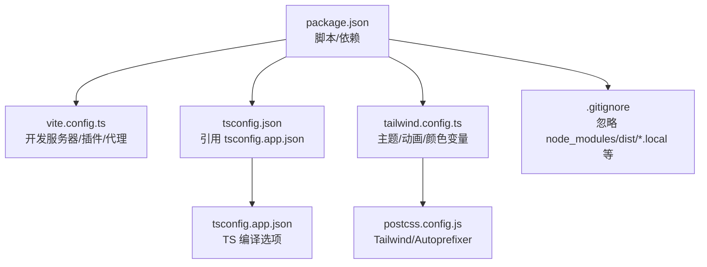
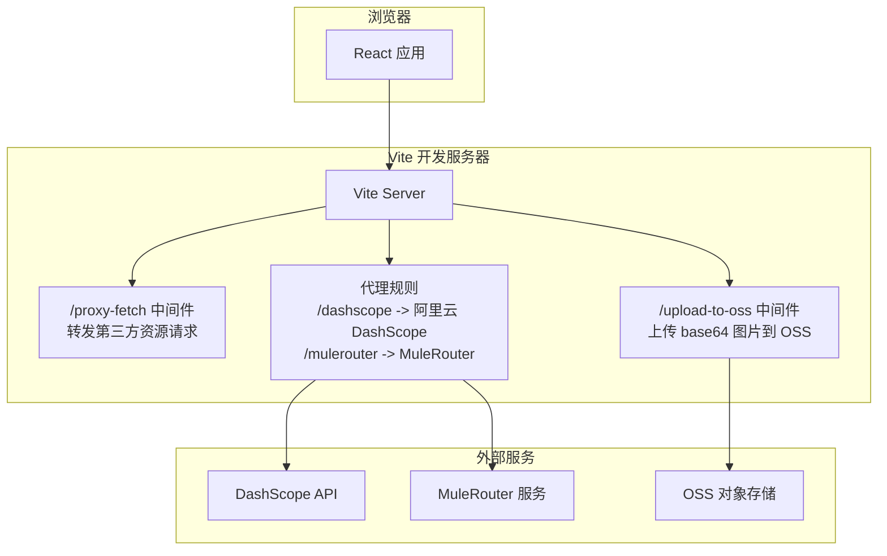
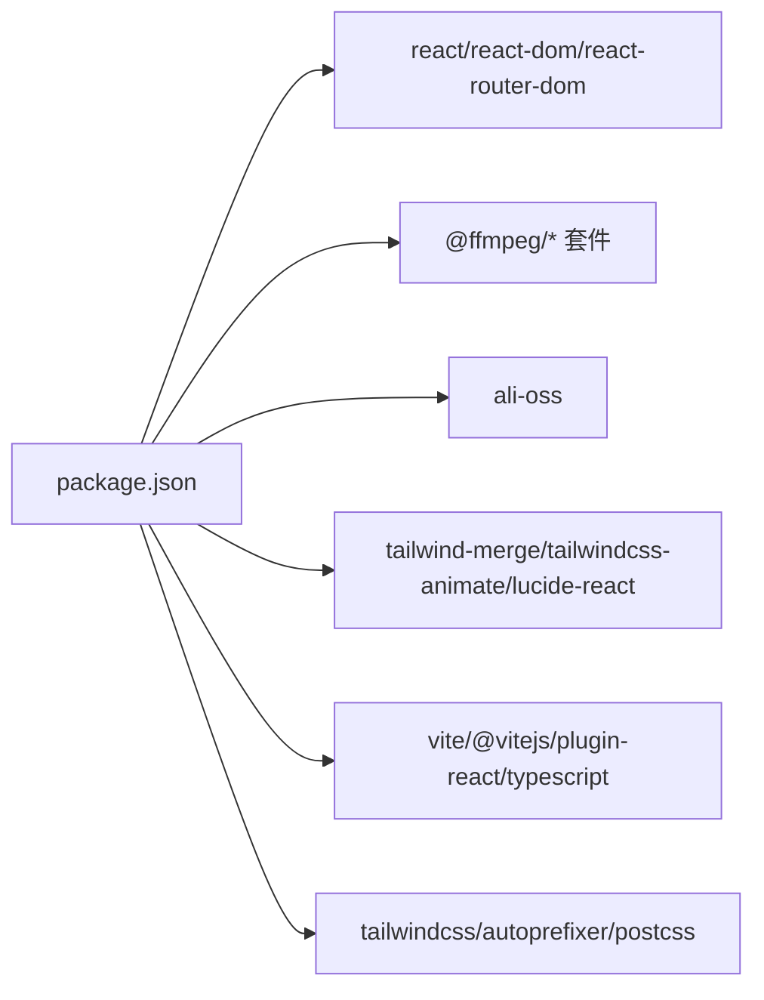

# 开发环境配置

<cite>
**本文引用的文件列表**
- [package.json](file://package.json)
- [vite.config.ts](file://vite.config.ts)
- [tailwind.config.ts](file://tailwind.config.ts)
- [postcss.config.js](file://postcss.config.js)
- [tsconfig.json](file://tsconfig.json)
- [tsconfig.app.json](file://tsconfig.app.json)
- [.gitignore](file://.gitignore)
</cite>

## 目录
1. [简介](#简介)
2. [项目结构](#项目结构)
3. [核心组件](#核心组件)
4. [架构总览](#架构总览)
5. [详细组件分析](#详细组件分析)
6. [依赖分析](#依赖分析)
7. [性能考虑](#性能考虑)
8. [故障排除指南](#故障排除指南)
9. [结论](#结论)
10. [附录](#附录)

## 简介
本文件面向本地开发，提供完整的开发环境配置说明与最佳实践。内容涵盖：
- Node.js 版本要求与依赖安装（npm/yarn）
- Vite 开发服务器配置（端口、热重载、代理、中间件）
- TypeScript 编译配置要点
- Tailwind CSS 主题定制方法
- 环境变量配置与调试技巧
- 常见问题与排障建议

## 项目结构
本项目采用 Vite + React + TypeScript + TailwindCSS 的前端工程化方案，关键配置文件如下：
- package.json：脚本命令与依赖声明
- vite.config.ts：Vite 构建与开发服务器配置
- tsconfig.json / tsconfig.app.json：TypeScript 编译选项
- tailwind.config.ts：Tailwind 主题与动画扩展
- postcss.config.js：PostCSS 插件链（Tailwind + Autoprefixer）
- .gitignore：忽略本地敏感与环境文件



图表来源
- [package.json:1-36](file://package.json#L1-L36)
- [vite.config.ts:1-294](file://vite.config.ts#L1-L294)
- [tsconfig.json:1-7](file://tsconfig.json#L1-L7)
- [tsconfig.app.json:1-26](file://tsconfig.app.json#L1-L26)
- [tailwind.config.ts:1-93](file://tailwind.config.ts#L1-L93)
- [postcss.config.js:1-7](file://postcss.config.js#L1-L7)
- [.gitignore:1-6](file://.gitignore#L1-L6)

章节来源
- [package.json:1-36](file://package.json#L1-L36)
- [vite.config.ts:1-294](file://vite.config.ts#L1-L294)
- [tsconfig.json:1-7](file://tsconfig.json#L1-L7)
- [tsconfig.app.json:1-26](file://tsconfig.app.json#L1-L26)
- [tailwind.config.ts:1-93](file://tailwind.config.ts#L1-L93)
- [postcss.config.js:1-7](file://postcss.config.js#L1-L7)
- [.gitignore:1-6](file://.gitignore#L1-L6)

## 核心组件
- 包管理与脚本
  - 使用 npm 或 yarn 均可；推荐在团队内统一一种。
  - 常用脚本：
    - 启动开发服务：npm run dev 或 yarn dev
    - 构建生产产物：npm run build 或 yarn build
    - 预览构建产物：npm run preview 或 yarn preview
- 开发服务器与插件
  - Vite 作为开发服务器与打包器，启用 React 插件、自定义中间件与代理。
- 样式与主题
  - TailwindCSS + PostCSS + Autoprefixer，通过 CSS 变量实现主题定制。
- TypeScript
  - 基于 tsconfig.app.json 的严格模式与模块解析策略，配合 Vite 进行增量编译。

章节来源
- [package.json:1-36](file://package.json#L1-L36)
- [vite.config.ts:1-294](file://vite.config.ts#L1-L294)
- [tailwind.config.ts:1-93](file://tailwind.config.ts#L1-L93)
- [postcss.config.js:1-7](file://postcss.config.js#L1-L7)
- [tsconfig.json:1-7](file://tsconfig.json#L1-L7)
- [tsconfig.app.json:1-26](file://tsconfig.app.json#L1-L26)

## 架构总览
下图展示了开发时前端与后端/外部服务的交互关系，以及 Vite 提供的中间件能力。



图表来源
- [vite.config.ts:1-294](file://vite.config.ts#L1-L294)

## 详细组件分析

### Node.js 版本与依赖安装
- Node.js 版本
  - 本项目未显式声明引擎版本约束。建议使用较新的 LTS 版本以兼容 Vite 6 与 TS 5.6。
- 依赖安装
  - 使用 npm：
    - npm install
  - 使用 yarn：
    - yarn install
- 运行脚本
  - 开发：npm run dev 或 yarn dev
  - 构建：npm run build 或 yarn build
  - 预览：npm run preview 或 yarn preview

章节来源
- [package.json:1-36](file://package.json#L1-L36)

### Vite 开发服务器配置
- 基本能力
  - 启用 React 插件、路径别名 @ → src、优化依赖预构建排除项。
- 端口设置
  - 当前未显式配置 server.port。如需修改，可在 vite.config.ts 中设置 server.port。
- 热重载
  - 默认开启，无需额外配置。
- 响应头
  - 设置了 COOP/COEP 相关响应头，便于某些浏览器特性使用。
- 代理配置
  - /dashscope → https://dashscope-intl.aliyuncs.com（重写前缀）
  - /mulerouter → https://38gba5w4.mule.page（重写前缀，关闭 HTTPS 校验，设置超时）
- 自定义中间件
  - /proxy-fetch：用于绕过第三方 CDN 无 CORS 头的限制，将目标 URL 作为查询参数传入，服务端转发并透传必要头部。
  - /upload-to-oss：接收 base64 图片数据，上传至阿里云 OSS，返回公网 URL。支持普通 Bucket Endpoint 与接入点（Access Point）两种模式。

```mermaid
sequenceDiagram
participant FE as "前端"
participant VS as "Vite 服务器"
participant MW as "/upload-to-oss 中间件"
participant OSS as "OSS 服务"
FE->>VS : POST /upload-to-oss {image : data : image/*;base64,...}
VS->>MW : 路由匹配
MW->>MW : 读取并校验请求体
alt 使用普通 Bucket Endpoint
MW->>OSS : PUT 对象(带 ACL 公开读)
OSS-->>MW : 返回 url
else 使用接入点(Access Point)
MW->>MW : 构造签名 V1 请求
MW->>OSS : PUT 对象(签名)
OSS-->>MW : 返回 url
end
MW-->>FE : {url : "https : //..."}
```

图表来源
- [vite.config.ts:150-260](file://vite.config.ts#L150-L260)

章节来源
- [vite.config.ts:1-294](file://vite.config.ts#L1-L294)

### TypeScript 编译配置
- 顶层 tsconfig.json 引用 tsconfig.app.json，避免重复配置。
- tsconfig.app.json 关键点
  - target: ES2020
  - module: ESNext
  - moduleResolution: bundler
  - jsx: react-jsx
  - strict: true
  - noUnusedLocals/noUnusedParameters/noFallthroughCasesInSwitch/noUncheckedSideEffectImports: 开启
  - paths: "@/*" → "./src/*"
  - include: ["src"]
- 与 Vite 集成
  - 由 Vite 驱动编译，不生成 JS 输出（noEmit），适合现代前端工作流。

章节来源
- [tsconfig.json:1-7](file://tsconfig.json#L1-L7)
- [tsconfig.app.json:1-26](file://tsconfig.app.json#L1-L26)

### Tailwind CSS 主题定制
- 主题入口
  - tailwind.config.ts 定义 darkMode、content、prefix、theme.extend.colors 等。
- 颜色系统
  - 通过 CSS 变量（如 --primary、--background 等）控制主题色，便于运行时切换。
- 圆角与动画
  - 扩展了 border-radius 与 keyframes/animations，包含折叠面板、脉冲发光、闪烁等动效。
- PostCSS 链
  - postcss.config.js 启用 tailwindcss 与 autoprefixer。

章节来源
- [tailwind.config.ts:1-93](file://tailwind.config.ts#L1-L93)
- [postcss.config.js:1-7](file://postcss.config.js#L1-L7)

### 环境变量与本地开发最佳实践
- 环境变量加载
  - Vite 会在开发模式下自动加载 .env、.env.local 等文件到 process.env。
  - 上传 OSS 中间件优先从 loadEnv('development', cwd, 'OSS_') 读取 OSS_* 前缀的环境变量，其次回退到全局 process.env。
- 需要配置的环境变量（示例键名）
  - OSS_ACCESS_KEY_ID
  - OSS_ACCESS_KEY_SECRET
  - OSS_BUCKET
  - OSS_REGION
  - OSS_ENDPOINT（可选）
  - OSS_ACCESS_POINT_ALIAS（当使用接入点时必填）
- 安全建议
  - 将 .env.local 加入 .gitignore，避免泄露密钥。
  - 仅在前端调用 /upload-to-oss 中转上传，不要在浏览器直接暴露 AK/SK。
- 调试技巧
  - 在终端查看中间件日志（例如 upload-to-oss 的错误信息）。
  - 使用浏览器 Network 面板检查 /upload-to-oss 的请求与响应。
  - 对于代理路径，可通过浏览器访问 /dashscope 和 /mulerouter 验证转发是否生效。

章节来源
- [vite.config.ts:150-182](file://vite.config.ts#L150-L182)
- [.gitignore:1-6](file://.gitignore#L1-L6)

## 依赖分析
- 运行时依赖
  - React、React DOM、React Router DOM
  - FFmpeg WASM 套件（@ffmpeg/core、@ffmpeg/ffmpeg、@ffmpeg/util）
  - 阿里云 OSS SDK（ali-oss）
  - 工具库（class-variance-authority、clsx、tailwind-merge、tailwindcss-animate、lucide-react）
- 开发依赖
  - Vite、@vitejs/plugin-react、TypeScript、TailwindCSS、Autoprefixer、PostCSS



图表来源
- [package.json:1-36](file://package.json#L1-L36)

章节来源
- [package.json:1-36](file://package.json#L1-L36)

## 性能考虑
- 依赖预构建优化
  - 对 @ffmpeg/ffmpeg 与 @ffmpeg/util 进行了 exclude，避免被预构建影响。
- 代理超时
  - /mulerouter 代理设置了较长的超时时间，适用于长耗时任务。
- 静态资源与缓存
  - 开发阶段无需关注生产缓存策略；构建后可根据部署平台配置缓存。

章节来源
- [vite.config.ts:262-294](file://vite.config.ts#L262-L294)

## 故障排除指南
- 无法访问第三方资源（CORS 错误）
  - 现象：浏览器直接 fetch 第三方 CDN 失败。
  - 解决：改用 /proxy-fetch?url=... 经由 Vite 中间件转发。
- 上传图片到 OSS 失败
  - 现象：/upload-to-oss 返回错误或空结果。
  - 排查：
    - 确认 .env.local 已正确配置 OSS_* 环境变量。
    - 若使用接入点（endpoint 包含 oss-accesspoint），需同时配置 OSS_ACCESS_POINT_ALIAS。
    - 检查请求体是否为合法的 data:image/*;base64 格式。
- 代理不可用
  - 现象：/dashscope 或 /mulerouter 请求失败。
  - 排查：
    - 检查网络连通性与域名可达性。
    - 查看 Vite 控制台是否有代理错误日志。
- 端口冲突
  - 现象：启动时报端口占用。
  - 解决：在 vite.config.ts 中为 server 配置 port 字段，或使用其他端口。
- 样式未生效
  - 现象：Tailwind 类无效。
  - 排查：
    - 确认 tailwind.config.ts 的 content 包含源码路径。
    - 确认 postcss.config.js 启用了 tailwindcss 与 autoprefixer。
- TypeScript 报错
  - 现象：类型检查失败。
  - 排查：
    - 检查 tsconfig.app.json 的 strict 与 unused 相关选项。
    - 确保路径别名 @/* 与 import 一致。

章节来源
- [vite.config.ts:1-294](file://vite.config.ts#L1-L294)
- [tailwind.config.ts:1-93](file://tailwind.config.ts#L1-L93)
- [postcss.config.js:1-7](file://postcss.config.js#L1-L7)
- [tsconfig.app.json:1-26](file://tsconfig.app.json#L1-L26)

## 结论
通过上述配置与实践，你可以在本地快速搭建并高效开发该项目。重点在于：
- 使用 Vite 中间件解决跨域与上传问题
- 通过环境变量管理敏感配置
- 利用 Tailwind 的 CSS 变量实现灵活的主题定制
- 遵循严格的 TypeScript 配置提升代码质量

## 附录
- 常用命令速查
  - 安装依赖：npm install / yarn install
  - 启动开发：npm run dev / yarn dev
  - 构建产物：npm run build / yarn build
  - 预览构建：npm run preview / yarn preview

[本节为通用指引，不涉及具体文件分析]