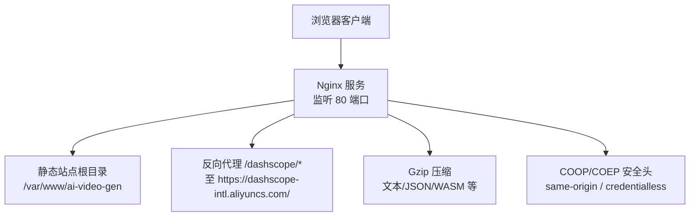
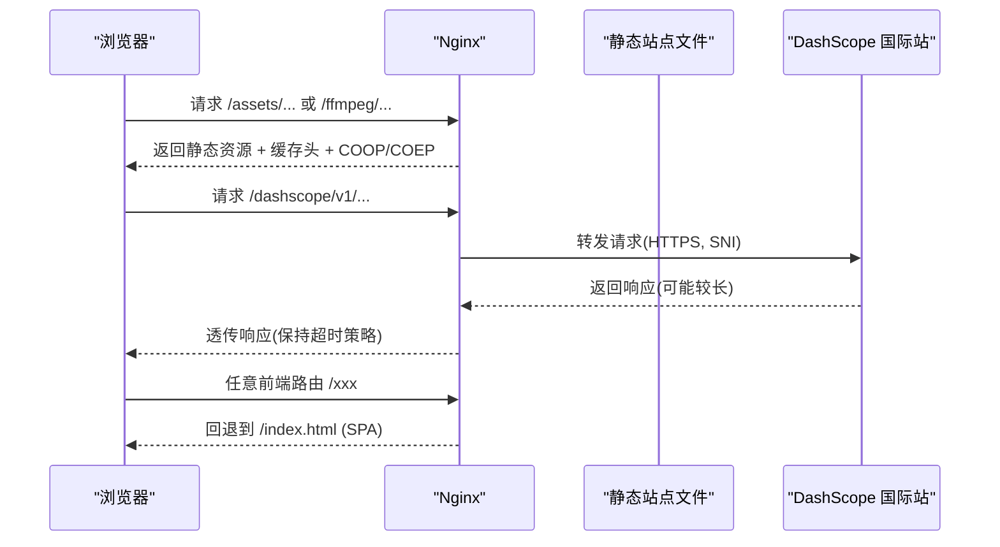
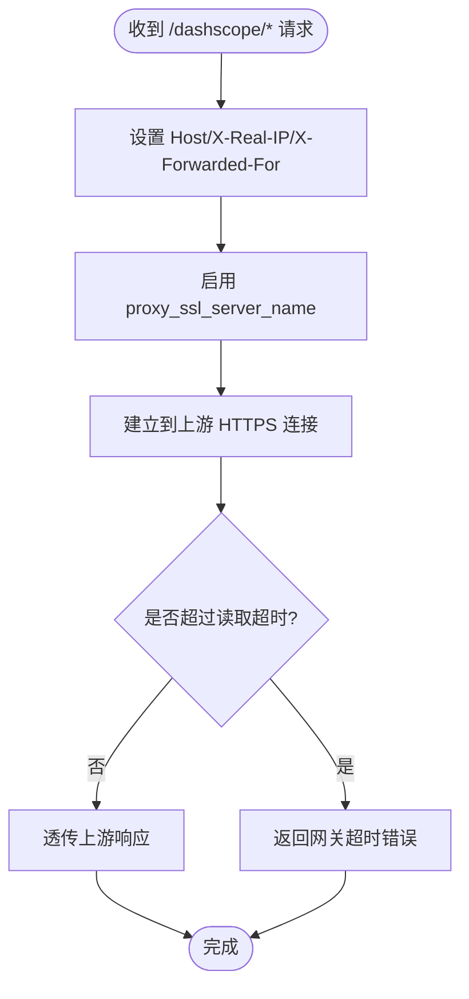
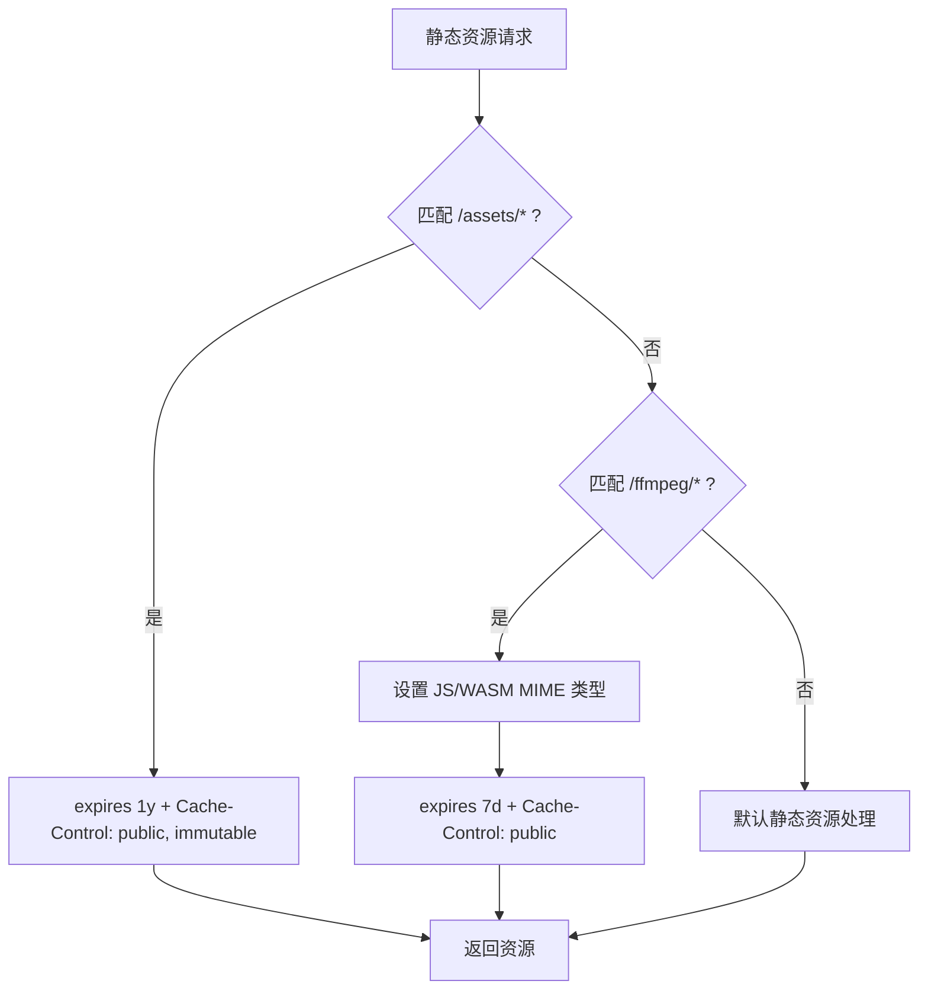
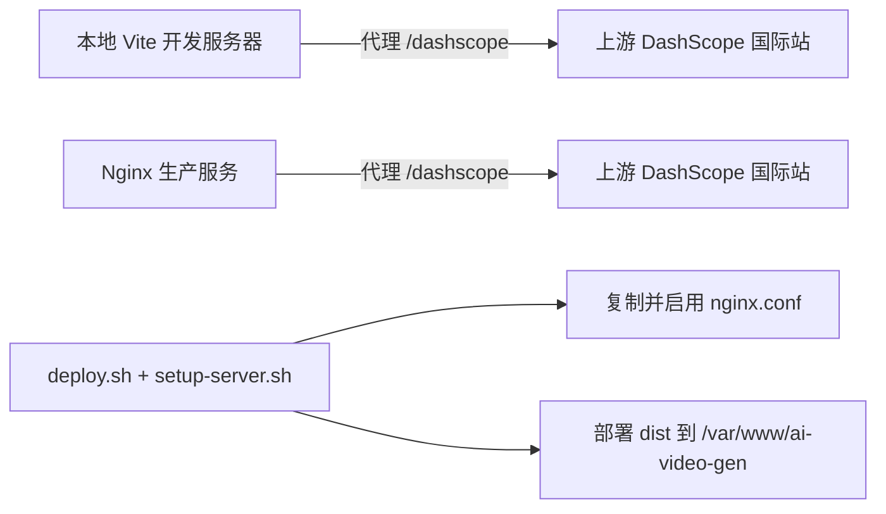

# Nginx服务器配置

<cite>
**本文引用的文件**   
- [deploy/nginx.conf](file://deploy/nginx.conf)
- [deploy/deploy.sh](file://deploy/deploy.sh)
- [deploy/setup-server.sh](file://deploy/setup-server.sh)
- [vite.config.ts](file://vite.config.ts)
</cite>

## 目录
1. [简介](#简介)
2. [项目结构](#项目结构)
3. [核心组件](#核心组件)
4. [架构总览](#架构总览)
5. [详细组件分析](#详细组件分析)
6. [依赖关系分析](#依赖关系分析)
7. [性能调优建议](#性能调优建议)
8. [故障排除指南](#故障排除指南)
9. [结论](#结论)

## 简介
本文件面向使用 Nginx 部署该项目的运维与开发者，围绕以下目标提供可操作的配置说明与最佳实践：
- 反向代理 DashScope API（阿里云百炼）的代理、超时与 SSL 处理
- 静态资源优化策略：缓存控制、Gzip 压缩、MIME 类型设置
- Cross-Origin-Opener-Policy 与 Cross-Origin-Embedder-Policy 的安全考量与启用原因
- SPA 路由回退配置
- 性能调优建议：连接池、内存与并发参数
- 常见问题排查指引

## 项目结构
本项目在 deploy 目录下提供生产可用的 Nginx 配置文件与一键部署脚本。Nginx 作为前端静态站点与外部 API 的反向代理入口，负责安全头注入、静态资源缓存、WASM/JS 正确 MIME 类型、以及长耗时请求的超时控制。

图表来源
- [deploy/nginx.conf:1-56](file://deploy/nginx.conf#L1-L56)

章节来源
- [deploy/nginx.conf:1-56](file://deploy/nginx.conf#L1-L56)
- [deploy/deploy.sh:1-46](file://deploy/deploy.sh#L1-L46)
- [deploy/setup-server.sh:1-59](file://deploy/setup-server.sh#L1-L59)

## 核心组件
- 反向代理与超时控制：将 /dashscope 路径透明转发到 DashScope 国际站，并设置合理的连接与读取超时，适配视频生成类长耗时任务。
- 静态资源与缓存：对 /assets 与 /ffmpeg 分别设置长期缓存与合适的 Cache-Control；为 WASM/JS 指定正确的 MIME 类型。
- 安全响应头：全局与关键 location 下注入 COOP/COEP，满足 ffmpeg.wasm 使用 SharedArrayBuffer 的要求。
- SPA 路由回退：所有未命中静态资源的请求回退到 index.html，支持前端路由。
- 压缩与上传限制：开启 Gzip 压缩，限制最大请求体大小以支持大文件上传场景。

章节来源
- [deploy/nginx.conf:12-23](file://deploy/nginx.conf#L12-L23)
- [deploy/nginx.conf:25-43](file://deploy/nginx.conf#L25-L43)
- [deploy/nginx.conf:45-48](file://deploy/nginx.conf#L45-L48)
- [deploy/nginx.conf:50-56](file://deploy/nginx.conf#L50-L56)

## 架构总览
下图展示了从浏览器到 Nginx 再到上游服务的整体数据流与安全头注入点。

图表来源
- [deploy/nginx.conf:12-23](file://deploy/nginx.conf#L12-L23)
- [deploy/nginx.conf:25-43](file://deploy/nginx.conf#L25-L43)
- [deploy/nginx.conf:45-48](file://deploy/nginx.conf#L45-L48)

## 详细组件分析

### 反向代理 DashScope API
- 代理路径：/dashscope/* 被转发到 https://dashscope-intl.aliyuncs.com/，同时重写 Host 头指向上游域名，确保上游鉴权与路由正确。
- 客户端信息透传：设置 X-Real-IP 与 X-Forwarded-For，便于上游记录真实来源 IP。
- SSL/SNI：启用 proxy_ssl_server_name on，保证 TLS 握手时携带 SNI，避免证书校验失败。
- 超时策略：针对视频生成等长耗时任务，设置较长的 proxy_read_timeout，较短的连接超时以提升失败快速反馈能力。

图表来源
- [deploy/nginx.conf:12-23](file://deploy/nginx.conf#L12-L23)

章节来源
- [deploy/nginx.conf:12-23](file://deploy/nginx.conf#L12-L23)

### 静态资源优化策略
- 缓存控制
  - /assets：设置一年过期与 immutable，适合带哈希的文件名，减少重复请求与带宽消耗。
  - /ffmpeg：设置 7 天过期与 public，兼顾更新频率与缓存命中率。
- Gzip 压缩
  - 启用 gzip，覆盖 text/css、application/json、application/javascript、text/xml、application/xml、application/wasm 等常见类型，降低传输体积。
  - 设置最小压缩长度阈值，避免对小文件压缩造成 CPU 浪费。
- MIME 类型
  - 为 /ffmpeg 显式声明 js 与 wasm 的 MIME 类型，确保浏览器正确解析与执行。

图表来源
- [deploy/nginx.conf:25-43](file://deploy/nginx.conf#L25-L43)
- [deploy/nginx.conf:50-53](file://deploy/nginx.conf#L50-L53)

章节来源
- [deploy/nginx.conf:25-43](file://deploy/nginx.conf#L25-L43)
- [deploy/nginx.conf:50-53](file://deploy/nginx.conf#L50-L53)

### Cross-Origin-Opener-Policy 与 Cross-Origin-Embedder-Policy
- 启用原因：ffmpeg.wasm 需要 SharedArrayBuffer，而现代浏览器要求页面具备 COOP 与 COEP 安全上下文才能启用该特性。
- 配置位置：server 级别与关键 location 下均注入 COOP=same-origin 与 COEP=credentialless，确保主页面与关键资源均可获得所需上下文。
- 安全性考虑：
  - same-origin 会隔离窗口与跨源文档访问，提升抗 XSS 与侧信道攻击能力。
  - credentialless 允许跨源嵌入资源但不传递凭据，平衡了功能与安全性。
  - 若业务后续需要严格隔离，可将 COEP 调整为 require-corp，但需确保所有跨源资源具备 CORP/CORS 策略。

章节来源
- [deploy/nginx.conf:8-10](file://deploy/nginx.conf#L8-L10)
- [deploy/nginx.conf:28-31](file://deploy/nginx.conf#L28-L31)
- [deploy/nginx.conf:40-42](file://deploy/nginx.conf#L40-L42)

### SPA 路由回退
- 通过 try_files 将未命中静态文件的请求回退到 index.html，使前端路由接管导航。
- 适用于 React/Vue 等单页应用的路由模式，避免刷新后出现 404。

章节来源
- [deploy/nginx.conf:45-48](file://deploy/nginx.conf#L45-L48)

### 上传与请求体大小
- client_max_body_size 设置为较大值，以满足批量图片/视频等大文件上传需求。
- 注意与后端/存储系统的上限保持一致，避免中间层拒绝导致上传失败。

章节来源
- [deploy/nginx.conf:55-56](file://deploy/nginx.conf#L55-L56)

## 依赖关系分析
- 本地开发环境（Vite）也提供了 /dashscope 的代理配置，用于本地调试；生产环境统一由 Nginx 代理。
- 部署脚本负责构建产物打包、上传、解压、Nginx 配置安装与服务重启。

图表来源
- [vite.config.ts:277-291](file://vite.config.ts#L277-L291)
- [deploy/deploy.sh:31-38](file://deploy/deploy.sh#L31-L38)
- [deploy/setup-server.sh:31-46](file://deploy/setup-server.sh#L31-L46)

章节来源
- [vite.config.ts:277-291](file://vite.config.ts#L277-L291)
- [deploy/deploy.sh:1-46](file://deploy/deploy.sh#L1-L46)
- [deploy/setup-server.sh:1-59](file://deploy/setup-server.sh#L1-L59)

## 性能调优建议
以下为通用且与本仓库配置相关的优化方向，结合现有超时与压缩策略进行补充：

- 连接与并发
  - worker_processes：根据 CPU 核数设置为 auto 或具体数值，充分利用多核。
  - worker_connections：根据预期并发与系统 ulimit 调整，避免“too many open files”。
  - keepalive_timeout：合理设置以减少频繁建连开销，同时避免空闲连接占用过多资源。
  - sendfile/on：开启零拷贝发送静态文件，提升吞吐。
  - tcp_nopush/tcp_nodelay：配合 sendfile 优化小包与大数据包传输。

- 缓存与压缩
  - 已启用 Gzip，可根据业务增加更多类型（如 image/svg+xml），并评估 gzip_comp_level 与 gzip_buffers 的权衡。
  - 对 /assets 使用强缓存与文件名哈希，减少回源与带宽。

- 超时与稳定性
  - 已为长耗时任务设置较长 proxy_read_timeout；对于 WebSocket 或 SSE 场景，需单独设置 proxy_read_timeout 与 proxy_send_timeout。
  - 对上游健康检查与重试策略可在更高层（如 Ingress/网关）实现。

- 内存与进程
  - 监控 Nginx 进程 RSS 与 page cache，必要时拆分站点或引入 CDN。
  - 调整内核参数（如 net.core.somaxconn、net.ipv4.tcp_tw_reuse）以应对高并发短连接。

- 上传与大文件
  - 已设置较大的 client_max_body_size；如需分片上传，建议在前端实现断点续传与并发分片，减轻单次请求压力。

[本节为通用指导，不直接分析具体文件]

## 故障排除指南
- 无法使用 SharedArrayBuffer
  - 现象：控制台报错提示需要 COOP/COEP。
  - 排查：确认 server 与相关 location 已注入 COOP=same-origin 与 COEP=credentialless；浏览器开发者工具中查看响应头是否存在。
  - 参考：[deploy/nginx.conf:8-10](file://deploy/nginx.conf#L8-L10)、[deploy/nginx.conf:28-31](file://deploy/nginx.conf#L28-L31)、[deploy/nginx.conf:40-42](file://deploy/nginx.conf#L40-L42)

- 视频生成请求超时
  - 现象：长时间无响应或网关超时。
  - 排查：检查 proxy_read_timeout 是否足够；确认上游服务状态与网络质量；必要时逐步增大超时时间。
  - 参考：[deploy/nginx.conf:20-22](file://deploy/nginx.conf#L20-L22)

- 静态资源 404 或无法加载
  - 现象：刷新页面 404 或资源未命中缓存。
  - 排查：确认 try_files 回退到 index.html；检查 /assets 与 /ffmpeg 路径是否正确；确认浏览器缓存策略与文件名哈希。
  - 参考：[deploy/nginx.conf:45-48](file://deploy/nginx.conf#L45-L48)、[deploy/nginx.conf:25-43](file://deploy/nginx.conf#L25-L43)

- 上传失败或过大
  - 现象：上传时报 413 或后端拒绝。
  - 排查：核对 client_max_body_size 与后端/存储上限一致；检查分片与并发策略。
  - 参考：[deploy/nginx.conf:55-56](file://deploy/nginx.conf#L55-L56)

- 部署后访问异常
  - 现象：部署后无法访问或配置未生效。
  - 排查：运行 nginx -t 验证配置语法；确认 sites-enabled 软链接存在；检查 systemctl 状态与日志。
  - 参考：[deploy/setup-server.sh:42-46](file://deploy/setup-server.sh#L42-L46)

章节来源
- [deploy/nginx.conf:8-10](file://deploy/nginx.conf#L8-L10)
- [deploy/nginx.conf:20-22](file://deploy/nginx.conf#L20-L22)
- [deploy/nginx.conf:25-43](file://deploy/nginx.conf#L25-L43)
- [deploy/nginx.conf:45-48](file://deploy/nginx.conf#L45-L48)
- [deploy/nginx.conf:55-56](file://deploy/nginx.conf#L55-L56)
- [deploy/setup-server.sh:42-46](file://deploy/setup-server.sh#L42-L46)

## 结论
本配置以最小化原则实现了生产可用的一站式入口：安全的跨源上下文、稳定的长耗时代理、高效的静态资源缓存与压缩、以及完善的 SPA 路由回退。结合本文的性能建议与排障清单，可在保障安全性的前提下获得良好的用户体验与可扩展性。