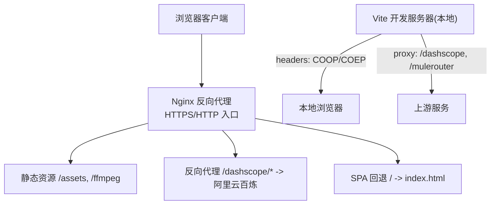
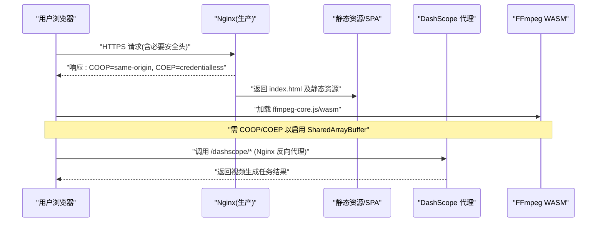
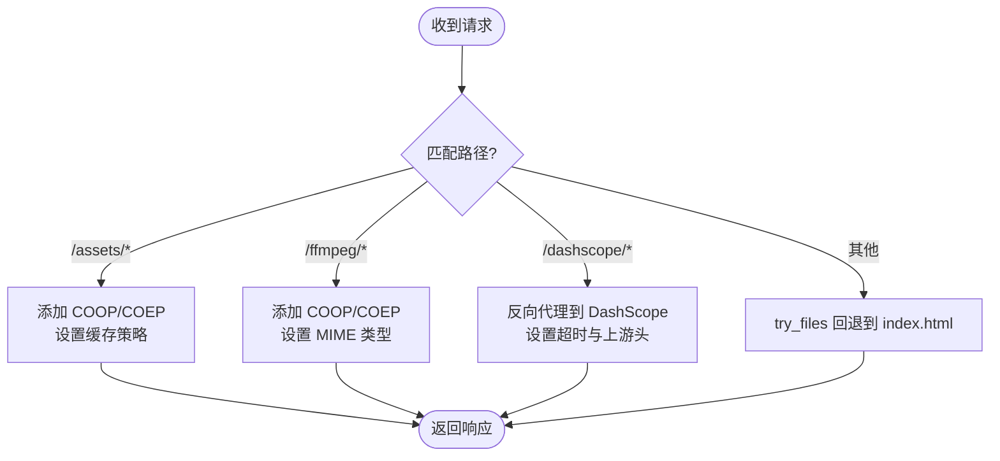
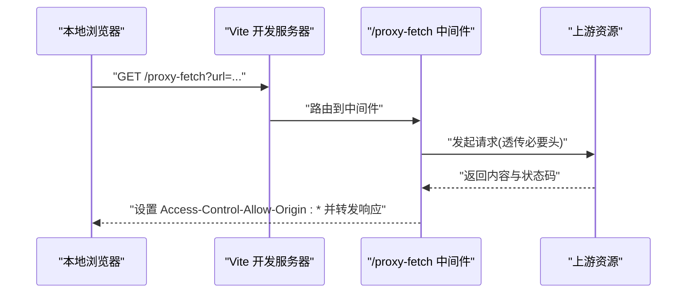
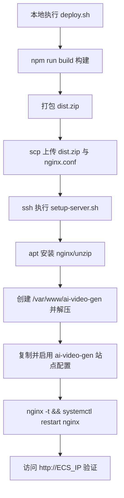
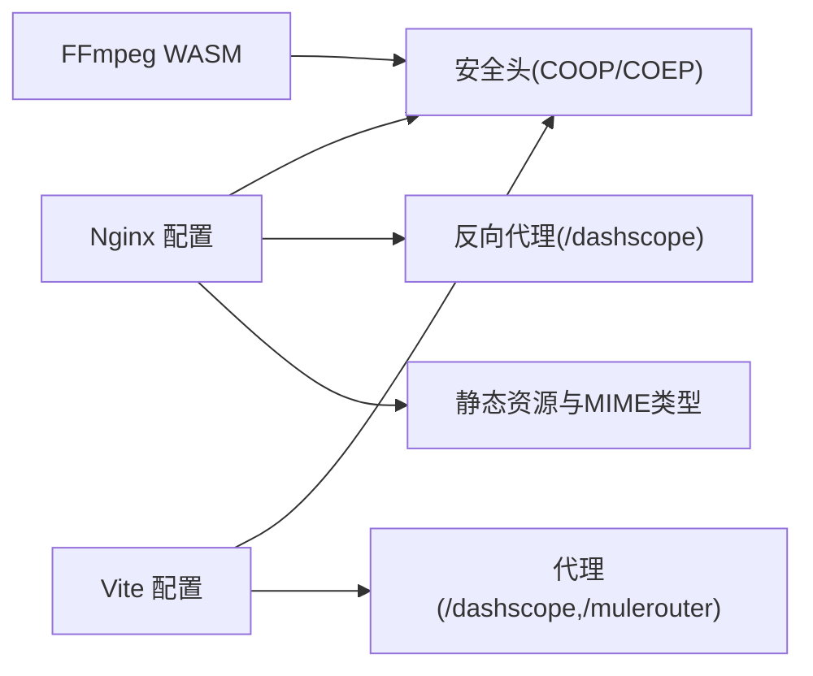

# SSL证书与安全配置

<cite>
**本文引用的文件**   
- [deploy/nginx.conf](file://deploy/nginx.conf)
- [deploy/deploy.sh](file://deploy/deploy.sh)
- [deploy/setup-server.sh](file://deploy/setup-server.sh)
- [vite.config.ts](file://vite.config.ts)
- [index.html](file://index.html)
</cite>

## 目录
1. [简介](#简介)
2. [项目结构](#项目结构)
3. [核心组件](#核心组件)
4. [架构总览](#架构总览)
5. [详细组件分析](#详细组件分析)
6. [依赖关系分析](#依赖关系分析)
7. [性能与容量规划](#性能与容量规划)
8. [故障排查指南](#故障排查指南)
9. [结论](#结论)
10. [附录](#附录)

## 简介
本文件围绕该项目的 HTTPS/SSL 部署、跨域安全策略（COOP/COEP）、CORS 最佳实践、请求大小限制与超时、DDoS 防护建议以及安全头部配置进行系统化说明，并结合仓库中现有的 Nginx 与 Vite 开发服务器配置给出落地方案。文档同时解释为何需要为 FFmpeg WASM 启用 COOP/COEP，并提供可操作的安全审计与漏洞扫描建议。

## 项目结构
本项目采用前端静态站点 + Nginx 反向代理的部署形态：
- 生产环境由 Nginx 提供静态资源服务、反向代理外部 API、设置关键安全头并控制请求体大小与超时。
- 开发环境使用 Vite 内置服务器，同样设置了 COOP/COEP 等安全头，并通过中间件实现跨域代理与上传中转。

图示来源
- [deploy/nginx.conf:1-56](file://deploy/nginx.conf#L1-L56)
- [vite.config.ts:262-293](file://vite.config.ts#L262-L293)

章节来源
- [deploy/nginx.conf:1-56](file://deploy/nginx.conf#L1-L56)
- [vite.config.ts:262-293](file://vite.config.ts#L262-L293)

## 核心组件
- Nginx 配置：定义监听端口、静态资源路径、COOP/COEP 安全头、反向代理到 DashScope、Gzip 压缩、请求体大小限制与超时。
- Vite 开发服务器：在 headers 中注入 COOP/COEP；通过 proxy 将 /dashscope 和 /mulerouter 转发至上游；通过自定义中间件提供 /proxy-fetch 与 /upload-to-oss 能力。
- 部署脚本：一键构建、打包、上传并远程执行初始化脚本，完成 Nginx 安装与站点启用。

章节来源
- [deploy/nginx.conf:1-56](file://deploy/nginx.conf#L1-L56)
- [vite.config.ts:11-66](file://vite.config.ts#L11-L66)
- [vite.config.ts:151-260](file://vite.config.ts#L151-L260)
- [vite.config.ts:262-293](file://vite.config.ts#L262-L293)
- [deploy/deploy.sh:1-46](file://deploy/deploy.sh#L1-L46)
- [deploy/setup-server.sh:1-59](file://deploy/setup-server.sh#L1-L59)

## 架构总览
下图展示了从浏览器到后端服务的完整链路，包括安全头、跨域与代理的关键节点。

图示来源
- [deploy/nginx.conf:8-23](file://deploy/nginx.conf#L8-L23)
- [vite.config.ts:272-291](file://vite.config.ts#L272-L291)

## 详细组件分析

### Nginx 安全与跨域配置
- 全局安全头
  - Cross-Origin-Opener-Policy: same-origin
  - Cross-Origin-Embedder-Policy: credentialless
  - 作用：允许页面使用 SharedArrayBuffer，从而支持 FFmpeg WASM 的多线程与高性能处理。
- 静态资源与 FFmpeg 资源
  - /assets 与 /ffmpeg 均附加 COOP/COEP 头，确保子资源加载时满足隔离要求。
  - /ffmpeg 下显式声明 JS/WASM MIME 类型，避免浏览器误判导致加载失败。
- 反向代理
  - /dashscope/* 代理至阿里云百炼国际站，设置 Host、X-Real-IP、X-Forwarded-For，开启 TLS SNI，并配置连接与读取超时。
- 请求体大小与压缩
  - client_max_body_size 设置为较大值，适配批量图片/视频片段上传场景。
  - 启用 Gzip 并对常见类型与 wasm 进行压缩，提升传输效率。

图示来源
- [deploy/nginx.conf:25-48](file://deploy/nginx.conf#L25-L48)
- [deploy/nginx.conf:12-23](file://deploy/nginx.conf#L12-L23)
- [deploy/nginx.conf:50-56](file://deploy/nginx.conf#L50-L56)

章节来源
- [deploy/nginx.conf:1-56](file://deploy/nginx.conf#L1-L56)

### Vite 开发服务器安全与代理
- 全局安全头
  - server.headers 中设置 COOP=same-origin 与 COEP=credentialless，使本地开发也能体验完整的 WASM 功能。
- 反向代理
  - /dashscope 与 /mulerouter 分别代理到上游服务，统一 rewrite 路径，并设置较长超时以适配长耗时任务。
- 自定义中间件
  - /proxy-fetch：用于绕过第三方 CDN 无 CORS 头的限制，强制返回 Access-Control-Allow-Origin:*，透传必要头部与内容长度，并设置上游超时。
  - /upload-to-oss：接收 base64 图片，校验后上传至 OSS（普通 Bucket 或接入点），返回公网 URL，供后续 AI 服务使用。

图示来源
- [vite.config.ts:11-66](file://vite.config.ts#L11-L66)
- [vite.config.ts:272-291](file://vite.config.ts#L272-L291)

章节来源
- [vite.config.ts:11-66](file://vite.config.ts#L11-L66)
- [vite.config.ts:262-293](file://vite.config.ts#L262-L293)

### 部署流程与服务器初始化
- 本地构建与打包：npm run build 生成 dist，并打包为 zip。
- 上传与远程执行：通过 scp 上传 dist.zip 与 nginx 配置，ssh 执行 setup-server.sh。
- 服务器初始化：安装 Nginx、创建站点目录、解压部署、启用站点配置、测试并重载 Nginx。

图示来源
- [deploy/deploy.sh:21-46](file://deploy/deploy.sh#L21-L46)
- [deploy/setup-server.sh:12-59](file://deploy/setup-server.sh#L12-L59)

章节来源
- [deploy/deploy.sh:1-46](file://deploy/deploy.sh#L1-L46)
- [deploy/setup-server.sh:1-59](file://deploy/setup-server.sh#L1-L59)

## 依赖关系分析
- Nginx 作为入口层，承担 HTTPS 终止、静态资源服务、安全头注入与反向代理职责。
- Vite 开发服务器仅在本地调试时使用，其 headers 与 proxy 配置与生产 Nginx 保持一致性，便于开发与生产行为对齐。
- FFmpeg WASM 依赖 COOP/COEP 启用 SharedArrayBuffer，因此必须在所有相关路径上正确设置这些头。

图示来源
- [deploy/nginx.conf:8-43](file://deploy/nginx.conf#L8-L43)
- [vite.config.ts:272-291](file://vite.config.ts#L272-L291)

章节来源
- [deploy/nginx.conf:1-56](file://deploy/nginx.conf#L1-L56)
- [vite.config.ts:262-293](file://vite.config.ts#L262-L293)

## 性能与容量规划
- 请求体大小限制
  - Nginx 已设置较大的 client_max_body_size，适合批量图片/视频片段上传场景。请根据业务峰值与磁盘空间评估上限。
- 超时配置
  - Nginx 对 DashScope 代理设置了合理的连接与读取超时；Vite 开发代理也设置了较长超时，避免长任务中断。
- 压缩与缓存
  - 启用 Gzip 并对常见类型与 wasm 进行压缩；静态资源设置长期缓存与 immutable 策略，减少带宽占用。

章节来源
- [deploy/nginx.conf:50-56](file://deploy/nginx.conf#L50-L56)
- [deploy/nginx.conf:25-43](file://deploy/nginx.conf#L25-L43)
- [vite.config.ts:277-291](file://vite.config.ts#L277-L291)

## 故障排查指南
- FFmpeg WASM 无法使用 SharedArrayBuffer
  - 检查是否在所有响应路径上都设置了 COOP=same-origin 与 COEP=credentialless。
  - 确认 /ffmpeg 下的 MIME 类型正确，且未被 CSP 或其他策略阻止。
- 反向代理超时或失败
  - 核对 Nginx 的 proxy_read_timeout 与 proxy_connect_timeout 是否满足上游服务耗时。
  - 检查 upstream 可达性与证书有效性（如启用 TLS）。
- 上传失败或体积过大
  - 调整 client_max_body_size 以满足最大上传需求。
  - 检查 /upload-to-oss 中间件的输入格式与环境变量配置。

章节来源
- [deploy/nginx.conf:8-23](file://deploy/nginx.conf#L8-L23)
- [deploy/nginx.conf:50-56](file://deploy/nginx.conf#L50-L56)
- [vite.config.ts:151-260](file://vite.config.ts#L151-L260)

## 结论
当前仓库在生产与开发环境中均已为 FFmpeg WASM 正确设置 COOP/COEP，并在 Nginx 中实现了必要的反向代理、压缩与请求体大小限制。建议在正式上线前补充更完善的安全头部（如 CSP、X-Frame-Options、Referrer-Policy、Permissions-Policy 等）与 HTTPS 证书管理流程，并建立常规的安全审计与漏洞扫描机制，以提升整体安全性与可维护性。

## 附录

### HTTPS 与 SSL 证书安装与配置建议
- 证书获取与管理
  - 推荐使用自动化证书管理工具（例如 certbot）申请与续期 Let’s Encrypt 证书，并将证书放置于系统可信目录。
- Nginx 启用 HTTPS
  - 在 server 块中监听 443 端口，指定 ssl_certificate 与 ssl_certificate_key。
  - 建议启用强加密套件与协议版本（TLS 1.2+），并开启 HSTS（严格传输安全）。
- 自动重定向
  - 将 HTTP 80 的请求重定向到 HTTPS 443，确保全站加密。
- 证书监控与告警
  - 配置证书到期提醒与自动续期，避免线上服务因证书过期而中断。

[本节为通用指导，不直接分析具体代码文件]

### 跨域安全策略（COOP/COEP）与 FFmpeg WASM
- 原因
  - FFmpeg WASM 多线程与高性能特性依赖 SharedArrayBuffer，而现代浏览器要求在具备隔离上下文的页面中才能使用该 API。
- 设置方式
  - 在 Nginx 与 Vite 开发服务器的响应头中设置 Cross-Origin-Opener-Policy: same-origin 与 Cross-Origin-Embedder-Policy: credentialless。
- 注意事项
  - 确保所有子资源（JS/WASM）均可被主页面加载，不被 CSP 或其他策略阻断。
  - 若引入第三方资源，需确保其符合 COEP 要求或位于同源。

章节来源
- [deploy/nginx.conf:8-10](file://deploy/nginx.conf#L8-L10)
- [deploy/nginx.conf:28-42](file://deploy/nginx.conf#L28-L42)
- [vite.config.ts:272-276](file://vite.config.ts#L272-L276)

### CORS 最佳实践与安全考虑
- 最小化暴露面
  - 仅对必要接口开放跨域，避免使用通配符 * 作为允许源。
- 明确方法与头
  - 精确限定允许的 HTTP 方法与请求头，防止滥用。
- 预检请求优化
  - 合理设置 Access-Control-Max-Age，减少 OPTIONS 预检频率。
- 敏感信息保护
  - 谨慎暴露敏感响应头，避免泄露内部实现细节。
- 代理模式
  - 对于第三方无 CORS 的资源，可通过后端代理（如 /proxy-fetch）统一处理，集中管控跨域策略。

章节来源
- [vite.config.ts:11-66](file://vite.config.ts#L11-L66)

### 请求大小限制、超时与 DDoS 防护建议
- 请求大小限制
  - 依据业务需求设置合适的 client_max_body_size，避免超大请求占用过多内存与带宽。
- 超时配置
  - 针对长耗时任务（如视频生成）设置合理的 proxy_read_timeout 与代理层超时，避免长时间挂起。
- DDoS 防护
  - 结合云厂商提供的 WAF/CDN/DDoS 防护能力，限制单 IP 并发与速率。
  - 在 Nginx 层面可使用 limit_req_zone 与 limit_conn_zone 做基础限流与连接数限制。
  - 对上传接口增加鉴权与白名单，降低恶意上传风险。

章节来源
- [deploy/nginx.conf:20-23](file://deploy/nginx.conf#L20-L23)
- [deploy/nginx.conf:55](file://deploy/nginx.conf#L55)

### 安全头部配置清单与建议
- Content-Security-Policy（CSP）
  - 建议逐步收紧 script-src、style-src、img-src、connect-src 等指令，仅允许受信任的来源。
  - 如需内联脚本，建议使用 nonce 或哈希白名单。
- X-Frame-Options
  - 建议设置为 DENY 或 SAMEORIGIN，防止点击劫持。
- Referrer-Policy
  - 建议设置为 strict-origin-when-cross-origin，减少敏感信息泄露。
- Permissions-Policy
  - 按需禁用不必要的浏览器能力（如摄像头、麦克风等），最小化权限暴露。
- Strict-Transport-Security（HSTS）
  - 上线后启用 HSTS，强制浏览器使用 HTTPS。

[本节为通用指导，不直接分析具体代码文件]

### 安全审计与漏洞扫描建议
- 依赖漏洞扫描
  - 定期运行 npm audit 或使用企业级依赖扫描工具，及时修复已知漏洞。
- 容器与镜像扫描
  - 若使用容器化部署，对镜像进行安全扫描，确保基础镜像与依赖包安全。
- 代码与配置审计
  - 审查 Nginx 与 Vite 配置中的安全头与代理规则，确保遵循最小权限原则。
- 渗透测试与合规检查
  - 定期进行渗透测试与合规检查，覆盖 XSS、CSRF、SSRF、越权等常见风险。
- 日志与监控
  - 记录关键安全事件与异常访问，建立告警与响应流程。

[本节为通用指导，不直接分析具体代码文件]