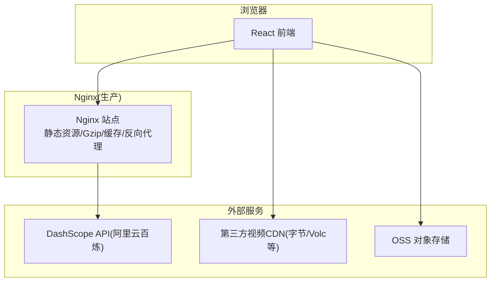
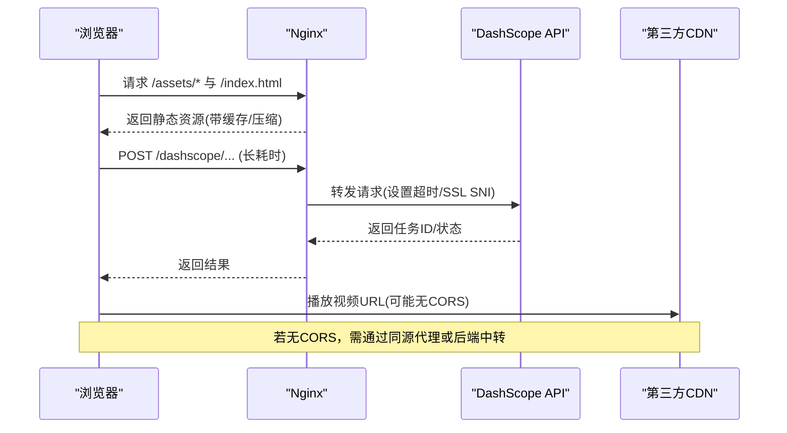
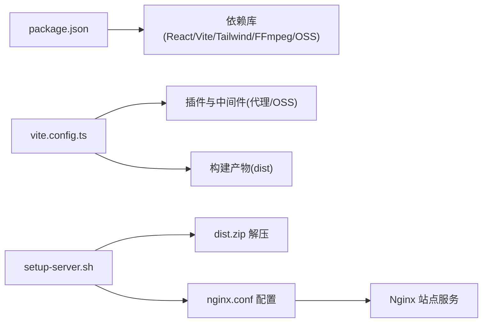

# 性能优化与监控

<cite>
**本文引用的文件列表**
- [deploy/nginx.conf](file://deploy/nginx.conf)
- [deploy/setup-server.sh](file://deploy/setup-server.sh)
- [vite.config.ts](file://vite.config.ts)
- [package.json](file://package.json)
- [src/hooks/useBatchLog.ts](file://src/hooks/useBatchLog.ts)
- [src/hooks/useBatchQueue.ts](file://src/hooks/useBatchQueue.ts)
- [src/lib/video-providers.ts](file://src/lib/video-providers.ts)
- [test-batch.mjs](file://test-batch.mjs)
</cite>

## 目录
1. [简介](#简介)
2. [项目结构](#项目结构)
3. [核心组件](#核心组件)
4. [架构总览](#架构总览)
5. [详细组件分析](#详细组件分析)
6. [依赖关系分析](#依赖关系分析)
7. [性能考量](#性能考量)
8. [故障排查指南](#故障排查指南)
9. [结论](#结论)
10. [附录](#附录)

## 简介
本文件面向生产环境，围绕 Nginx 层性能调优、前端构建优化、CDN 集成与静态资源分发、监控指标收集（访问日志、性能监控、错误追踪）、负载均衡与高可用、容量规划与扩展性、以及性能/基准测试方法，提供系统化指导。文档中的实践均结合仓库中现有配置与代码进行说明，并给出可落地的改进建议。

## 项目结构
本项目为基于 Vite + React 的前端应用，部署时通过 Nginx 提供静态资源服务，并对长耗时 API 进行反向代理；同时包含本地开发阶段的中间件用于跨域代理与对象存储上传中转。关键路径：
- 部署与 Nginx 配置位于 deploy 目录
- 构建与开发期行为由 vite.config.ts 控制
- 批量任务与重试逻辑在 hooks 与 lib 中实现
- 提供批处理测试脚本用于压测与基准验证

图表来源
- [deploy/nginx.conf:1-56](file://deploy/nginx.conf#L1-L56)
- [vite.config.ts:262-293](file://vite.config.ts#L262-L293)

章节来源
- [deploy/nginx.conf:1-56](file://deploy/nginx.conf#L1-L56)
- [deploy/setup-server.sh:1-59](file://deploy/setup-server.sh#L1-L59)
- [vite.config.ts:1-294](file://vite.config.ts#L1-L294)
- [package.json:1-36](file://package.json#L1-L36)

## 核心组件
- Nginx 站点配置：负责静态资源服务、Gzip 压缩、缓存策略、SPA 路由回退、反向代理长耗时接口、请求体大小限制等。
- Vite 构建与开发期插件：提供跨域代理、OSS 上传中转、开发服务器响应头等。
- 前端批量任务与重试：包含队列、降级、简化提示词、日志记录等能力。
- 批处理测试脚本：模拟并发提交与轮询，便于基准测试与容量评估。

章节来源
- [deploy/nginx.conf:1-56](file://deploy/nginx.conf#L1-L56)
- [vite.config.ts:1-294](file://vite.config.ts#L1-L294)
- [src/hooks/useBatchLog.ts:1-38](file://src/hooks/useBatchLog.ts#L1-L38)
- [src/hooks/useBatchQueue.ts:206-244](file://src/hooks/useBatchQueue.ts#L206-L244)
- [test-batch.mjs:1-130](file://test-batch.mjs#L1-L130)

## 架构总览
生产环境下，浏览器访问 Nginx 获取静态资源与 SPA 入口，Nginx 将长耗时 API 请求转发至 DashScope；对于第三方 CDN 返回的视频 URL，若缺少 CORS 头，前端可通过同源代理或后端中转解决。

图表来源
- [deploy/nginx.conf:12-23](file://deploy/nginx.conf#L12-L23)
- [src/lib/video-providers.ts:442-468](file://src/lib/video-providers.ts#L442-L468)

## 详细组件分析

### Nginx 层性能调优
当前配置已具备以下基础能力：
- 静态资源缓存：对 /assets/ 使用长期缓存与不可变策略，提升二次加载速度。
- Gzip 压缩：启用 gzip 并覆盖常见文本与 WASM 类型，降低传输体积。
- 反向代理长耗时接口：对 /dashscope/ 设置合理的连接与读取超时，避免长时间阻塞。
- SPA 路由回退：确保前端路由正常工作。
- 请求体大小限制：允许较大上传（如图片/媒体）。

建议在生产环境中进一步优化的方向（概念性建议）：
- worker 进程与连接池：根据 CPU 核数调整 worker_processes 与 worker_connections，并结合系统 ulimit 与内核参数（如 net.core.somaxconn、net.ipv4.tcp_max_syn_backlog）提升并发处理能力。
- 缓冲区与缓冲策略：针对大响应或流式响应，合理设置 proxy_buffer_size、proxy_buffers、proxy_busy_buffers_size，减少磁盘 I/O。
- 缓存策略增强：对 /ffmpeg/ 等较大资源采用更细粒度的版本化与缓存失效策略；考虑开启 HTTP/2 与 Keep-Alive 复用。
- 安全与兼容性：保持 COOP/COEP 头以支持 SharedArrayBuffer（WASM 场景），并确保仅在内网或可信域名下暴露。

章节来源
- [deploy/nginx.conf:25-43](file://deploy/nginx.conf#L25-L43)
- [deploy/nginx.conf:50-56](file://deploy/nginx.conf#L50-L56)
- [deploy/nginx.conf:12-23](file://deploy/nginx.conf#L12-L23)

### 前端构建优化（代码分割、懒加载、资源压缩）
- 构建工具链：Vite + React，默认已具备按需打包与压缩能力。
- 依赖优化：通过 optimizeDeps.exclude 排除大型库的预构建，避免不必要的依赖扫描开销。
- 开发期代理：提供 /proxy-fetch 与 /mulerouter 代理，解决跨域与第三方资源访问问题。
- 构建产物：生产构建后由 Nginx 提供静态资源，配合长期缓存与 Gzip 提升首屏与后续加载性能。

建议在生产构建阶段引入的代码级优化（概念性建议）：
- 路由级懒加载：对重型页面或面板使用动态 import() 拆分包，减少初始包体积。
- 组件级懒加载：对非首屏组件使用 Suspense + lazy 加载。
- 资源压缩：启用 Brotli（Nginx 侧）替代或补充 Gzip；对图片/视频资源使用现代格式与尺寸适配。
- 资源指纹与版本化：利用 Vite 的哈希文件名与 immutable 缓存策略，提高缓存命中率。

章节来源
- [vite.config.ts:269-271](file://vite.config.ts#L269-L271)
- [vite.config.ts:272-293](file://vite.config.ts#L272-L293)
- [deploy/nginx.conf:50-56](file://deploy/nginx.conf#L50-L56)

### CDN 集成与静态资源分发策略
- 现状：
  - 第三方视频 CDN（如字节跳动/Volc）返回的 URL 通常无 CORS 头，浏览器无法直接 fetch。
  - 开发期通过 /proxy-fetch 中间件进行同源中转，规避跨域限制。
- 生产方案建议（概念性建议）：
  - 将静态资源（/assets、/ffmpeg）托管到企业级 CDN（如阿里云 CDN、CloudFront），并在 Nginx 上配置源站回源与缓存规则。
  - 对视频 URL 增加服务端签名或鉴权，避免直链泄露；必要时在后端统一代理下载与转码。
  - 使用多区域 CDN 节点就近分发，降低延迟与抖动。

章节来源
- [src/lib/video-providers.ts:442-468](file://src/lib/video-providers.ts#L442-L468)
- [vite.config.ts:11-66](file://vite.config.ts#L11-L66)

### 监控指标收集（访问日志、性能监控、错误追踪）
- 访问日志：
  - 建议在 Nginx 中定义自定义日志格式，包含请求时间、状态码、上游响应时间、客户端 IP、User-Agent、Referer、URI 等字段，便于后续分析与告警。
- 性能监控：
  - 前端可采集关键交互事件（点击、提交、失败）与网络指标（TTFB、首字节、完整加载时长），并通过匿名上报接口汇总。
  - 对长耗时任务（视频生成）记录任务 ID、开始/结束时间、重试次数、降级策略触发情况。
- 错误追踪：
  - 统一捕获前端异常与网络错误，附带上下文信息（用户会话、设备、网络环境）上报。
  - 对上游 API 错误（如 DashScope 返回的错误码与消息）进行结构化记录，便于定位问题。

章节来源
- [src/hooks/useBatchLog.ts:1-38](file://src/hooks/useBatchLog.ts#L1-L38)
- [src/hooks/useBatchQueue.ts:206-244](file://src/hooks/useBatchQueue.ts#L206-L244)

### 负载均衡与高可用架构建议
- 单点风险：当前部署脚本安装单个 Nginx 实例，存在单点故障风险。
- 建议方案（概念性建议）：
  - 使用多个 Nginx 实例配合 LVS/HAProxy/云负载均衡器，实现健康检查与自动故障转移。
  - 将静态资源与视频内容下沉到 CDN，减轻源站压力。
  - 对长耗时 API 调用增加熔断与限流，防止雪崩效应。
  - 数据库与对象存储采用多副本与跨区域容灾。

章节来源
- [deploy/setup-server.sh:1-59](file://deploy/setup-server.sh#L1-L59)

### 容量规划与扩展性指导
- 计算维度：
  - 预估峰值 QPS、平均响应时间、P95/P99 延迟目标，据此确定 Nginx worker 数量与连接上限。
  - 根据并发任务量与上游 API 配额，设定合理的重试与降级策略。
- 存储维度：
  - 静态资源与视频文件应存放于对象存储与 CDN，避免本地磁盘成为瓶颈。
- 弹性伸缩：
  - 在云平台上使用自动扩缩容组，依据 CPU/内存/网络带宽指标动态增减实例。
- 成本优化：
  - 合理使用缓存与压缩，降低带宽成本；对冷数据归档到低成本存储。

[本节为通用指导，不直接分析具体文件]

### 性能测试与基准测试方法
- 批处理测试脚本：
  - 提供并发控制器与轮询逻辑，模拟真实任务提交流程，统计成功/失败率与总耗时。
- 指标采集：
  - 记录每个任务的提交时间、轮询间隔、完成时间与错误信息，输出汇总报告。
- 场景设计：
  - 不同并发度（1/2/5/10）与不同任务时长（5s/10s/30s）组合，观察系统吞吐与延迟变化。
  - 加入失败注入（上游超时、网络抖动），验证重试与降级策略的有效性。

章节来源
- [test-batch.mjs:1-130](file://test-batch.mjs#L1-L130)

## 依赖关系分析
- 构建与运行依赖：
  - package.json 定义了运行时与开发时依赖，包括 React、Vite、Tailwind、FFmpeg 相关库与阿里云 OSS SDK。
- 构建期插件与中间件：
  - vite.config.ts 注册了 React 插件、跨域代理中间件与 OSS 上传中间件，影响开发与预览体验。
- 部署脚本：
  - setup-server.sh 自动化安装 Nginx、解压 dist.zip、配置站点并重启服务。

图表来源
- [package.json:1-36](file://package.json#L1-L36)
- [vite.config.ts:262-293](file://vite.config.ts#L262-L293)
- [deploy/setup-server.sh:1-59](file://deploy/setup-server.sh#L1-L59)
- [deploy/nginx.conf:1-56](file://deploy/nginx.conf#L1-L56)

章节来源
- [package.json:1-36](file://package.json#L1-L36)
- [vite.config.ts:1-294](file://vite.config.ts#L1-L294)
- [deploy/setup-server.sh:1-59](file://deploy/setup-server.sh#L1-L59)
- [deploy/nginx.conf:1-56](file://deploy/nginx.conf#L1-L56)

## 性能考量
- 传输层优化：
  - 启用 HTTP/2 与 Keep-Alive，减少握手与连接开销。
  - 使用 Brotli 压缩替代或补充 Gzip，进一步提升压缩比。
- 缓存策略：
  - 对静态资源使用强缓存与版本化文件名，确保更新可控。
  - 对 API 响应按业务语义设置 Cache-Control（如幂等查询可短缓存）。
- 资源加载：
  - 优先加载首屏关键 CSS/JS，其余资源异步加载。
  - 对大图与视频使用懒加载与分片加载。
- 错误与重试：
  - 对不稳定上游实施指数退避重试与熔断，避免放大故障。
- 监控与告警：
  - 建立关键指标看板（QPS、延迟分布、错误率、带宽占用），并设置阈值告警。

[本节为通用指导，不直接分析具体文件]

## 故障排查指南
- 常见问题定位：
  - 跨域问题：第三方 CDN 视频 URL 无 CORS 头导致 fetch 失败，需通过同源代理或后端中转。
  - 长耗时任务超时：Nginx 与上游 API 的超时设置需匹配业务 SLA，避免过早断开。
  - 资源未命中缓存：检查文件名是否含哈希、Cache-Control 是否正确、浏览器是否强制刷新。
- 日志与诊断：
  - 查看 Nginx 访问日志与错误日志，确认请求路径、状态码与上游响应时间。
  - 前端控制台与批处理脚本输出有助于定位任务提交与轮询过程中的问题。
- 恢复措施：
  - 快速回滚到上一稳定版本（替换 dist.zip 并重启 Nginx）。
  - 临时关闭非必要功能（如批量任务）以降低负载。

章节来源
- [src/lib/video-providers.ts:442-468](file://src/lib/video-providers.ts#L442-L468)
- [deploy/nginx.conf:12-23](file://deploy/nginx.conf#L12-L23)
- [test-batch.mjs:1-130](file://test-batch.mjs#L1-L130)

## 结论
本项目在生产环境已具备基础的静态资源服务、缓存与压缩能力，并通过 Nginx 反向代理长耗时 API。为进一步优化性能与稳定性，建议从 Nginx 层（worker/连接/缓冲/HTTP/2/Brotli）、前端构建（懒加载/分包/资源压缩）、CDN 集成（静态与视频分发）、监控体系（日志/指标/错误追踪）、负载均衡与高可用（多实例/健康检查/熔断限流）、容量规划与弹性伸缩等方面持续改进。同时，借助批处理测试脚本开展基准测试，量化优化效果并指导扩容决策。

[本节为总结性内容，不直接分析具体文件]

## 附录
- 部署流程要点：
  - 构建产物打包为 dist.zip，上传至服务器后由 setup-server.sh 解压并配置 Nginx。
  - 确保 nginx.conf 中的静态资源路径、缓存策略与反向代理规则与实际部署一致。
- 环境变量与安全：
  - OSS 凭据应在服务器端配置，避免暴露到前端。
  - 对敏感接口启用鉴权与速率限制，防止滥用。

章节来源
- [deploy/setup-server.sh:1-59](file://deploy/setup-server.sh#L1-L59)
- [deploy/nginx.conf:1-56](file://deploy/nginx.conf#L1-L56)