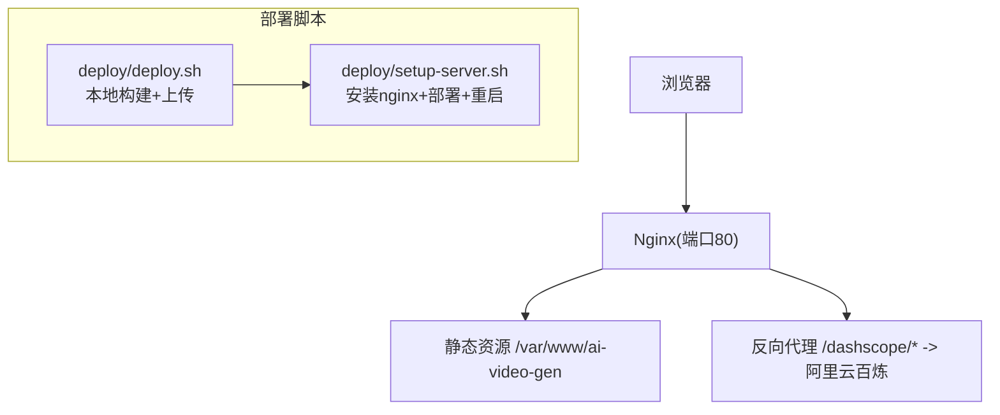
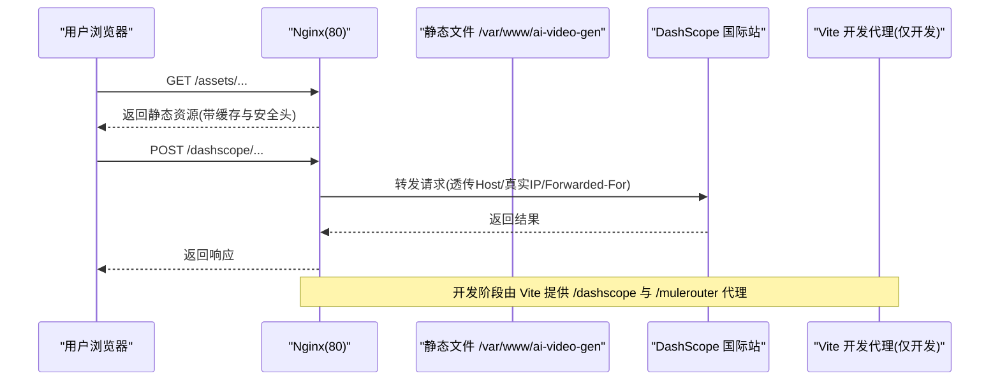
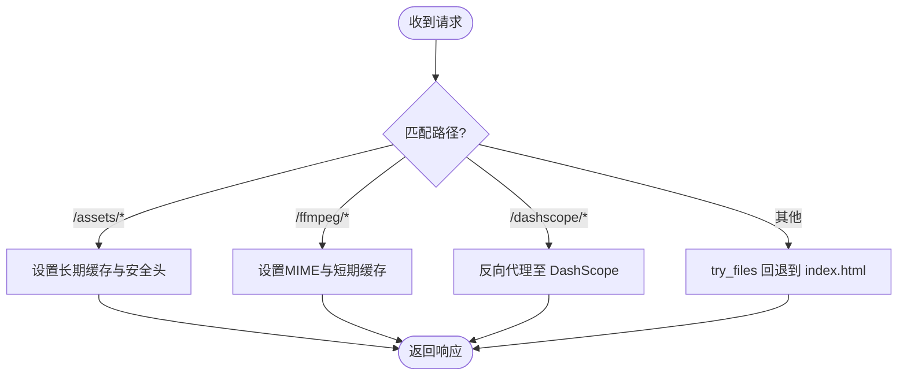
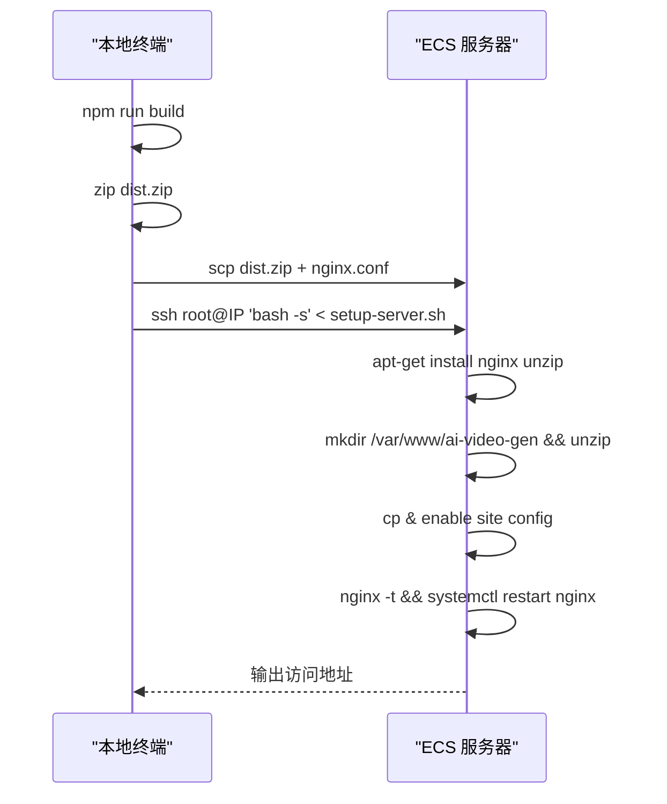
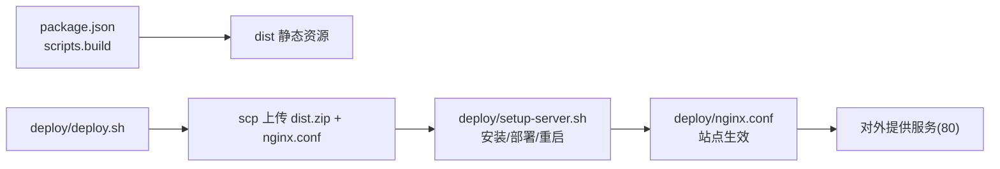

# 生产环境部署

<cite>
**本文引用的文件**
- [deploy/nginx.conf](file://deploy/nginx.conf)
- [deploy/deploy.sh](file://deploy/deploy.sh)
- [deploy/setup-server.sh](file://deploy/setup-server.sh)
- [vite.config.ts](file://vite.config.ts)
- [package.json](file://package.json)
- [ECS启动.txt](file://ECS启动.txt)
</cite>

## 目录
1. [简介](#简介)
2. [项目结构](#项目结构)
3. [核心组件](#核心组件)
4. [架构总览](#架构总览)
5. [详细组件分析](#详细组件分析)
6. [依赖关系分析](#依赖关系分析)
7. [性能调优建议](#性能调优建议)
8. [故障排查指南](#故障排查指南)
9. [结论](#结论)
10. [附录](#附录)

## 简介
本文件面向生产环境，提供基于 Nginx 的静态站点部署方案与自动化部署流程说明。内容覆盖：
- Nginx 反向代理、静态资源缓存、Gzip 压缩与安全头配置
- 一键部署脚本使用方法（本地构建、打包上传、远程初始化）
- SSL/HTTPS 安全设置指引
- 负载均衡与高可用方案建议
- 性能调优建议（连接池、内存、并发等）
- 监控与日志收集配置指南

## 项目结构
仓库包含用于生产部署的关键资产：
- deploy/nginx.conf：Nginx 站点配置（反向代理、缓存、压缩、安全头等）
- deploy/deploy.sh：本地到服务器的快速部署脚本
- deploy/setup-server.sh：服务器端初始化与 Nginx 配置安装脚本
- vite.config.ts：开发期代理与中间件（含 OSS 中转与跨域代理），便于理解生产反向代理需求
- package.json：构建命令与依赖声明
- ECS启动.txt：在 ECS 上快速验证 Nginx 与隧道访问的参考步骤

图示来源
- [deploy/nginx.conf:1-56](file://deploy/nginx.conf#L1-L56)
- [deploy/deploy.sh:1-46](file://deploy/deploy.sh#L1-L46)
- [deploy/setup-server.sh:1-59](file://deploy/setup-server.sh#L1-L59)

章节来源
- [deploy/nginx.conf:1-56](file://deploy/nginx.conf#L1-L56)
- [deploy/deploy.sh:1-46](file://deploy/deploy.sh#L1-L46)
- [deploy/setup-server.sh:1-59](file://deploy/setup-server.sh#L1-L59)
- [package.json:1-36](file://package.json#L1-L36)

## 核心组件
- Nginx 站点配置
  - 监听 80 端口，根目录为 /var/www/ai-video-gen
  - 反向代理 /dashscope/* 至阿里云百炼国际站
  - 静态资源 /assets/ 长期缓存；/ffmpeg/ 指定 MIME 并短期缓存
  - SPA 路由回退至 index.html
  - 开启 Gzip 压缩，限制请求体大小
  - 添加 COOP/COEP 响应头以支持 SharedArrayBuffer（WASM 运行所需）
- 自动化部署脚本
  - 本地执行 npm run build，打包 dist.zip
  - 通过 scp 上传 dist.zip 与 nginx.conf 到服务器
  - 远程执行 setup-server.sh 完成安装、部署、启用站点、测试并重载 Nginx
- 服务器初始化脚本
  - 安装 Nginx 与 unzip
  - 创建网站目录并解压 dist.zip
  - 复制并启用站点配置，禁用默认站点
  - 测试配置语法并重启 Nginx

章节来源
- [deploy/nginx.conf:1-56](file://deploy/nginx.conf#L1-L56)
- [deploy/deploy.sh:1-46](file://deploy/deploy.sh#L1-L46)
- [deploy/setup-server.sh:1-59](file://deploy/setup-server.sh#L1-L59)

## 架构总览
下图展示从浏览器到 Nginx 再到上游服务的请求路径，以及部署脚本的工作流。

图示来源
- [deploy/nginx.conf:12-23](file://deploy/nginx.conf#L12-L23)
- [vite.config.ts:277-291](file://vite.config.ts#L277-L291)

## 详细组件分析

### Nginx 站点配置详解
- 反向代理
  - 将 /dashscope/* 请求转发至 https://dashscope-intl.aliyuncs.com/
  - 透传 Host、X-Real-IP、X-Forwarded-For，启用 SNI
  - 针对长耗时任务设置较长的读取超时与连接超时
- 静态资源与缓存
  - /assets/ 使用一年过期与 immutable 策略，减少重复请求
  - /ffmpeg/ 显式声明 js/wasm 类型，设置合理缓存时间
- SPA 路由
  - try_files 回退到 index.html，确保前端路由正常工作
- 压缩与安全
  - 开启 gzip，对文本、JSON、JS、XML、WASM 等类型进行压缩
  - 设置最大请求体大小，避免过大上传导致错误
  - 全局与关键 location 下添加 COOP/COEP 响应头，满足 WASM 运行要求

图示来源
- [deploy/nginx.conf:25-48](file://deploy/nginx.conf#L25-L48)
- [deploy/nginx.conf:12-23](file://deploy/nginx.conf#L12-L23)

章节来源
- [deploy/nginx.conf:1-56](file://deploy/nginx.conf#L1-L56)

### 自动化部署脚本使用
- 前置条件
  - 本地已安装 Node.js 与 npm
  - 具备目标 ECS 的 SSH 访问权限（root 或具备 sudo 权限的用户）
- 首次部署
  - 在仓库根目录执行：./deploy/deploy.sh <ECS_IP>
  - 脚本会：
    - 本地构建生产版本
    - 打包 dist.zip
    - 上传 dist.zip 与 nginx.conf 到服务器
    - 远程执行 setup-server.sh 完成安装与部署
- 更新部署
  - 再次执行同一命令即可覆盖部署
  - 也可手动上传 dist.zip 后在服务器执行解压与重载 Nginx 的步骤
- 服务器端行为
  - 安装 Nginx 与 unzip
  - 创建 /var/www/ai-video-gen 并解压 dist.zip
  - 启用 ai-video-gen 站点配置，禁用默认站点
  - 测试配置语法并重启 Nginx

图示来源
- [deploy/deploy.sh:1-46](file://deploy/deploy.sh#L1-L46)
- [deploy/setup-server.sh:1-59](file://deploy/setup-server.sh#L1-L59)

章节来源
- [deploy/deploy.sh:1-46](file://deploy/deploy.sh#L1-L46)
- [deploy/setup-server.sh:1-59](file://deploy/setup-server.sh#L1-L59)
- [package.json:6-9](file://package.json#L6-L9)

### SSL 证书与 HTTPS 安全设置
当前 Nginx 配置监听 80 端口，未内置 HTTPS。生产环境建议：
- 申请并放置证书
  - 准备域名与证书文件（如 cert.pem、key.pem）
  - 在 Nginx 中新增 server 块监听 443，指向证书路径
- 强制 HTTPS 跳转
  - 在 80 端口 server 块中返回 301 重定向到 https://your-domain
- 安全头增强
  - 启用 HSTS、CSP、Referrer-Policy 等头部
  - 保留 COOP/COEP 以满足 WASM 运行要求
- 加密套件与协议
  - 仅启用 TLSv1.2 及以上
  - 选择强加密套件，关闭不安全的算法
- 证书自动续期
  - 使用 Let's Encrypt 与 Certbot 实现自动签发与续期
  - 配置定时任务在续期后平滑重载 Nginx

注意：以上为通用实践建议，具体指令需根据操作系统与发行版包管理器进行调整。

[本节为概念性指导，不涉及具体代码文件]

### 负载均衡与高可用部署方案
- 多实例部署
  - 在同一内网或多节点部署多个应用实例（静态站点可共享对象存储或 CDN）
  - 使用 Nginx upstream 定义后端组，按权重或轮询分发
- 健康检查与故障转移
  - 结合第三方健康检查模块或外部探针，剔除异常节点
- 会话与状态
  - 静态站点无状态，天然适合水平扩展
  - 若后续引入服务端逻辑，建议使用外部会话存储（Redis）
- 网络与入口
  - 使用云厂商负载均衡器（SLB/ALB）作为统一入口，再转发到多台 Nginx 实例
  - 配合 DNS 与健康检查实现多活

[本节为概念性指导，不涉及具体代码文件]

### 监控与日志收集
- Nginx 访问与错误日志
  - 自定义 log_format，记录客户端 IP、请求路径、状态码、耗时、UA 等
  - 将日志输出到独立文件，便于集中采集
- 日志采集与可视化
  - 使用 Filebeat/Fluent Bit 等采集工具将日志发送至 ELK/Loki
  - 建立仪表盘，关注错误率、慢请求、带宽占用
- 指标监控
  - 暴露 Nginx stub_status 或使用 OpenMetrics 导出指标
  - 接入 Prometheus + Grafana 进行告警与可视化
- 应用侧日志
  - 前端可通过统一上报接口将关键事件发送到日志服务
  - 后端（如有）集中输出结构化 JSON 日志

[本节为概念性指导，不涉及具体代码文件]

## 依赖关系分析
- 构建与产物
  - package.json 定义了构建脚本与依赖，生产部署依赖 npm run build 产出静态资源
- 开发与生产差异
  - vite.config.ts 提供了开发期的代理与中间件（/dashscope、/mulerouter、/upload-to-oss），生产环境应通过 Nginx 反向代理实现相同能力
- 部署链路
  - deploy/deploy.sh 负责本地构建与上传
  - deploy/setup-server.sh 负责服务器端安装与启用站点
  - deploy/nginx.conf 定义站点行为与反向代理规则

图示来源
- [package.json:6-9](file://package.json#L6-L9)
- [deploy/deploy.sh:21-38](file://deploy/deploy.sh#L21-L38)
- [deploy/setup-server.sh:12-46](file://deploy/setup-server.sh#L12-L46)
- [deploy/nginx.conf:1-56](file://deploy/nginx.conf#L1-L56)

章节来源
- [package.json:1-36](file://package.json#L1-L36)
- [deploy/deploy.sh:1-46](file://deploy/deploy.sh#L1-L46)
- [deploy/setup-server.sh:1-59](file://deploy/setup-server.sh#L1-L59)
- [deploy/nginx.conf:1-56](file://deploy/nginx.conf#L1-L56)
- [vite.config.ts:277-291](file://vite.config.ts#L277-L291)

## 性能调优建议
- Nginx 层
  - 调整 worker_processes 与 worker_connections，结合 CPU 核数与系统 ulimit 优化
  - 启用 keepalive 连接，减少握手开销
  - 合理设置 proxy_read_timeout、proxy_send_timeout 以适应长耗时任务
  - 开启 sendfile、tcp_nopush、tcp_nodelay
  - 使用 HTTP/2 提升多路复用能力（需在 HTTPS 场景）
- 静态资源
  - 使用 CDN 加速静态资源分发，结合强缓存与版本号策略
  - 对大体积资源（如 ffmpeg.wasm）启用分片与断点续传（CDN 能力）
- 压缩
  - 保持 gzip 开启，必要时考虑 brotli（需额外编译模块）
- 内存与并发
  - 控制 client_max_body_size，避免过大请求占用过多内存
  - 结合系统级参数（net.core.somaxconn、fs.file-max）提升并发上限
- 应用侧（如未来引入后端）
  - 连接池与线程池调优，避免资源耗尽
  - 使用外部缓存（Redis）降低数据库压力

[本节为通用性能建议，不涉及具体代码文件]

## 故障排查指南
- 无法访问站点
  - 确认 Nginx 进程与监听端口正常
  - 检查站点配置文件是否被正确启用，默认站点是否冲突
  - 参考 ECS 快速验证步骤，确认 80 端口监听与外网可达
- 静态资源 404 或缓存不生效
  - 检查 /var/www/ai-video-gen 目录结构与权限
  - 确认 /assets/ 与 /ffmpeg/ 路径匹配与缓存头设置
- 反向代理失败
  - 检查 /dashscope/* 的 proxy_pass 与 Host 头是否正确
  - 查看 Nginx 错误日志定位上游不可达或超时问题
- 部署失败
  - 确认本地构建成功且 dist.zip 生成
  - 检查 SSH 连通性与远程执行权限
  - 查看 setup-server.sh 输出信息定位安装或配置错误

章节来源
- [ECS启动.txt:1-23](file://ECS启动.txt#L1-L23)
- [deploy/setup-server.sh:32-46](file://deploy/setup-server.sh#L32-L46)
- [deploy/nginx.conf:12-23](file://deploy/nginx.conf#L12-L23)

## 结论
本项目采用“Nginx 静态站点 + 反向代理”的生产模式，配合一键部署脚本实现了从零到有的快速上线。通过合理的缓存策略、压缩与安全头配置，可在保证功能的同时提升性能与安全性。后续可按需引入 HTTPS、负载均衡、监控与日志体系，进一步提升稳定性与可观测性。

[本节为总结性内容，不涉及具体代码文件]

## 附录
- 快速验证与隧道访问（参考）
  - 在 ECS 上确认 Nginx 安装与站点文件存在
  - 启动并启用 Nginx，检查 80 端口监听
  - 如需临时外网访问，可使用 Cloudflare Tunnel 启动隧道并获取公网 URL

章节来源
- [ECS启动.txt:1-23](file://ECS启动.txt#L1-L23)