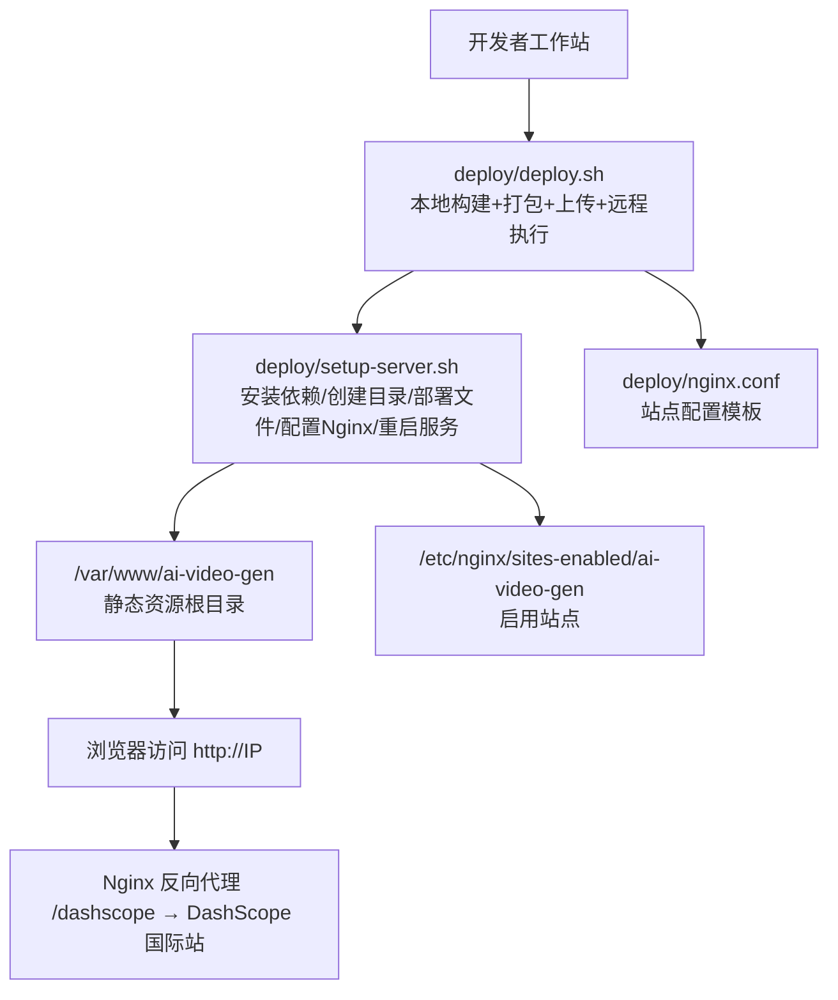
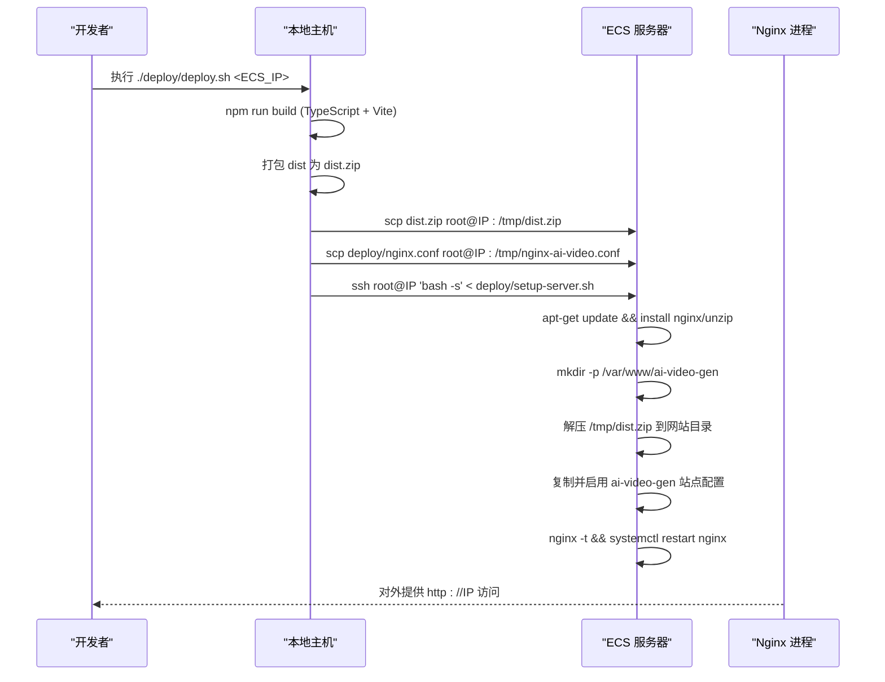
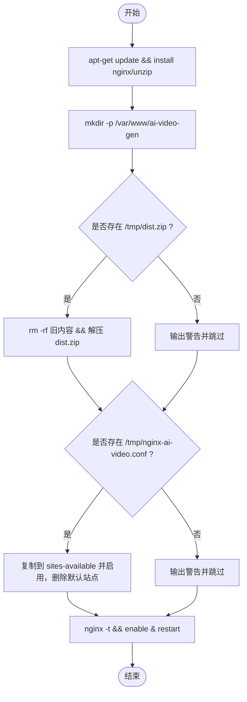
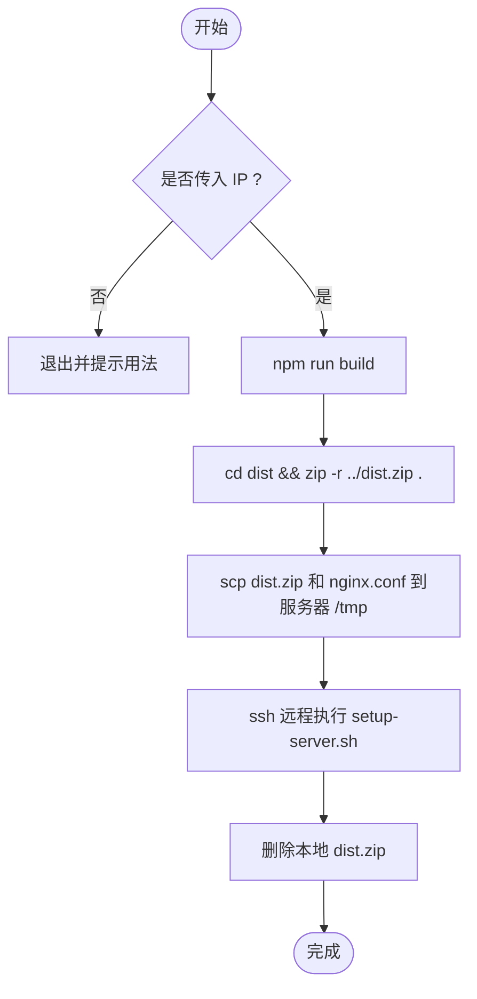
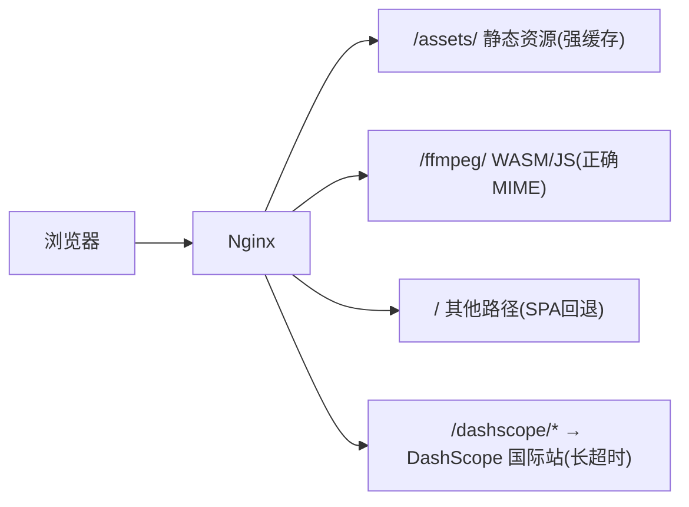
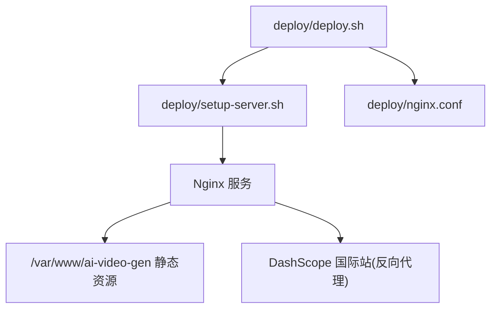

# 自动化部署脚本

<cite>
**本文引用的文件**   
- [deploy/setup-server.sh](file://deploy/setup-server.sh)
- [deploy/deploy.sh](file://deploy/deploy.sh)
- [deploy/nginx.conf](file://deploy/nginx.conf)
- [vite.config.ts](file://vite.config.ts)
- [package.json](file://package.json)
- [ECS启动.txt](file://ECS启动.txt)
</cite>

## 目录
1. [简介](#简介)
2. [项目结构](#项目结构)
3. [核心组件](#核心组件)
4. [架构总览](#架构总览)
5. [详细组件分析](#详细组件分析)
6. [依赖关系分析](#依赖关系分析)
7. [性能与缓存策略](#性能与缓存策略)
8. [故障排查指南](#故障排查指南)
9. [结论](#结论)
10. [附录：环境变量与自定义选项](#附录环境变量与自定义选项)

## 简介
本仓库提供面向静态前端应用（React + Vite）的“一键式”服务器初始化与应用部署方案。通过两个 Bash 脚本完成从环境准备、Nginx 配置到构建产物上传与服务重启的全流程，并配套 Nginx 反向代理与跨域/共享内存头配置，满足 ffmpeg.wasm 运行要求以及长耗时 API 调用场景。

## 项目结构
部署相关的关键文件位于 deploy 目录，包含服务器初始化脚本、应用部署脚本与 Nginx 站点配置；Vite 开发服务器中内置了本地代理与 OSS 中转能力，便于开发与调试。

图示来源
- [deploy/deploy.sh:1-46](file://deploy/deploy.sh#L1-L46)
- [deploy/setup-server.sh:1-59](file://deploy/setup-server.sh#L1-L59)
- [deploy/nginx.conf:1-57](file://deploy/nginx.conf#L1-L57)

章节来源
- [deploy/deploy.sh:1-46](file://deploy/deploy.sh#L1-L46)
- [deploy/setup-server.sh:1-59](file://deploy/setup-server.sh#L1-L59)
- [deploy/nginx.conf:1-57](file://deploy/nginx.conf#L1-L57)

## 核心组件
- setup-server.sh：在目标 ECS 上完成系统更新、Nginx 与 unzip 安装、网站目录创建、dist.zip 解压、Nginx 站点配置启用、配置测试与服务重启。
- deploy.sh：在本地执行 npm 构建、将 dist 打包为 zip、上传至服务器临时目录、同时上传 Nginx 配置文件，并通过 SSH 远程执行 setup-server.sh 完成部署。
- nginx.conf：定义站点根目录、静态资源缓存、WASM 类型映射、SPA 路由回退、Gzip 压缩、DashScope 反向代理及必要的跨域/共享内存响应头。

章节来源
- [deploy/setup-server.sh:1-59](file://deploy/setup-server.sh#L1-L59)
- [deploy/deploy.sh:1-46](file://deploy/deploy.sh#L1-L46)
- [deploy/nginx.conf:1-57](file://deploy/nginx.conf#L1-L57)

## 架构总览
下图展示了端到端的一次完整部署过程，包括本地构建、打包、传输、远程执行与 Nginx 生效。

图示来源
- [deploy/deploy.sh:21-38](file://deploy/deploy.sh#L21-L38)
- [deploy/setup-server.sh:12-46](file://deploy/setup-server.sh#L12-L46)
- [deploy/nginx.conf:1-57](file://deploy/nginx.conf#L1-L57)

## 详细组件分析

### 服务器初始化脚本：setup-server.sh
- 系统更新与依赖安装
  - 使用包管理器更新索引并安装 nginx 与 unzip。
- 网站目录与文件部署
  - 创建 /var/www/ai-video-gen；若存在 /tmp/dist.zip，则清空并解压到该目录。
- Nginx 站点配置
  - 若存在 /tmp/nginx-ai-video.conf，则复制到 sites-available 并启用，同时移除默认站点。
- 服务测试与重启
  - 执行配置语法检查后启用开机自启并重启 Nginx。
- 输出提示
  - 打印公网 IP 与后续增量更新命令。

图示来源
- [deploy/setup-server.sh:12-46](file://deploy/setup-server.sh#L12-L46)

章节来源
- [deploy/setup-server.sh:1-59](file://deploy/setup-server.sh#L1-L59)

### 应用部署脚本：deploy.sh
- 参数校验
  - 必须传入 ECS 公网 IP，用户名可选（默认 root）。
- 本地构建与打包
  - 执行 npm run build（TypeScript 编译 + Vite 构建），将 dist 目录打包为 dist.zip。
- 上传与远程执行
  - 将 dist.zip 与 nginx.conf 上传至服务器 /tmp，随后通过 SSH 远程执行 setup-server.sh。
- 清理与提示
  - 删除本地临时压缩包，输出访问地址。

图示来源
- [deploy/deploy.sh:8-38](file://deploy/deploy.sh#L8-L38)

章节来源
- [deploy/deploy.sh:1-46](file://deploy/deploy.sh#L1-L46)

### Nginx 站点配置：nginx.conf
- 基础设置
  - 监听 80 端口，站点根目录指向 /var/www/ai-video-gen，首页 index.html。
- 安全与跨域头
  - 全局添加 Cross-Origin-Opener-Policy 与 Cross-Origin-Embedder-Policy，以满足 ffmpeg.wasm 对 SharedArrayBuffer 的要求。
- 反向代理
  - 将 /dashscope/* 请求转发至 DashScope 国际站，设置 Host、真实 IP 与转发头，并配置较长读取超时以支持视频生成任务。
- 静态资源优化
  - assets 目录长期缓存且不可变；ffmpeg 目录正确声明 MIME 类型并开启缓存。
- SPA 路由回退
  - 所有未命中路径回退到 index.html。
- 压缩与上传限制
  - 开启 Gzip，指定压缩类型与最小长度；限制客户端请求体大小。

图示来源
- [deploy/nginx.conf:1-57](file://deploy/nginx.conf#L1-L57)

章节来源
- [deploy/nginx.conf:1-57](file://deploy/nginx.conf#L1-L57)

### 构建与开发环境要点
- 构建命令
  - package.json 中定义 build 为 TypeScript 编译与 Vite 构建的组合命令。
- 开发期代理与中转
  - vite.config.ts 中配置了 /dashscope 与 /mulerouter 的本地代理，以及一个用于图片上传到阿里云 OSS 的中转接口（仅开发时有效）。

章节来源
- [package.json:6-9](file://package.json#L6-L9)
- [vite.config.ts:262-293](file://vite.config.ts#L262-L293)

## 依赖关系分析
- 脚本间依赖
  - deploy.sh 依赖 setup-server.sh 完成服务端动作；两者共同依赖 nginx.conf 作为站点配置模板。
- 运行时依赖
  - 服务器需安装 nginx 与 unzip；应用为纯静态资源，无需 Node 运行时。
- 外部服务
  - 通过 Nginx 反向代理访问 DashScope 国际站；生产环境不依赖后端 Node 服务。

图示来源
- [deploy/deploy.sh:31-38](file://deploy/deploy.sh#L31-L38)
- [deploy/setup-server.sh:31-46](file://deploy/setup-server.sh#L31-L46)
- [deploy/nginx.conf:12-23](file://deploy/nginx.conf#L12-L23)

章节来源
- [deploy/deploy.sh:1-46](file://deploy/deploy.sh#L1-L46)
- [deploy/setup-server.sh:1-59](file://deploy/setup-server.sh#L1-L59)
- [deploy/nginx.conf:1-57](file://deploy/nginx.conf#L1-L57)

## 性能与缓存策略
- 静态资源缓存
  - /assets 目录采用一年过期与 immutable 策略，减少重复下载。
- WASM 资源
  - /ffmpeg 目录显式声明 JS/WASM 类型，并开启合理缓存，提升首次加载体验。
- 压缩
  - 启用 Gzip，覆盖常见文本与二进制类型，降低带宽占用。
- 长连接与超时
  - 针对视频生成类长耗时请求，Nginx 侧设置了较长的读取超时，避免中间层提前断开。

章节来源
- [deploy/nginx.conf:25-53](file://deploy/nginx.conf#L25-L53)

## 故障排查指南
- 部署前检查清单
  - 确认本地已安装 Node.js 与 npm，并能成功执行 npm run build。
  - 确认具备目标服务器的 SSH 免密登录或密码可交互输入。
  - 确认目标服务器有公网 IP，且 80 端口未被占用。
  - 确认网络可达，能访问 DashScope 国际站域名。
- 常见问题定位
  - 构建失败：检查 TypeScript 与 Vite 版本兼容性，查看本地构建日志。
  - 上传失败：检查 SSH 权限与网络连通性，确认 /tmp 空间充足。
  - Nginx 配置错误：在服务器上执行 nginx -t 查看具体错误行。
  - 页面无法访问：检查防火墙与安全组是否放行 80 端口；确认 Nginx 进程状态。
  - ffmpeg.wasm 报错：确认 Nginx 已返回 COOP/COEP 头；必要时在浏览器控制台查看跨域/共享内存相关错误。
- 日志与诊断
  - Nginx 错误日志：/var/log/nginx/error.log
  - Nginx 访问日志：/var/log/nginx/access.log
  - 如需通过 Cloudflare Tunnel 暴露本地服务，可参考仓库内 ECS 启动指引进行验证。

章节来源
- [ECS启动.txt:1-23](file://ECS启动.txt#L1-L23)

## 结论
本方案以最小化依赖实现“一键部署”，将构建产物以静态资源形式托管于 Nginx，并通过反向代理对接外部 AI 服务。配合合理的缓存与压缩策略，可在低成本环境下获得良好的首屏与交互体验。建议在正式环境增加 HTTPS、访问控制与监控告警，以提升安全性与可观测性。

## 附录：环境变量与自定义选项

- 环境变量（开发期）
  - 以下变量由 Vite 在开发模式加载，用于图片上传到阿里云 OSS 的中转功能（不影响生产部署）：
    - OSS_ACCESS_KEY_ID
    - OSS_ACCESS_KEY_SECRET
    - OSS_BUCKET
    - OSS_REGION
    - OSS_ENDPOINT
    - OSS_ACCESS_POINT_ALIAS
  - 说明：这些变量仅在开发服务器中使用，不会打包进前端产物。

- 自定义选项
  - 修改站点根目录：调整 nginx.conf 中的 root 指令。
  - 修改监听端口：调整 nginx.conf 中的 listen 指令。
  - 调整上传大小限制：修改 client_max_body_size。
  - 调整代理超时：修改 proxy_read_timeout 与 proxy_connect_timeout。
  - 切换反向代理目标：修改 /dashscope 的 proxy_pass 与 Host 头。

- 回滚策略
  - 保留上一版 dist.zip 或备份 /var/www/ai-video-gen 目录，出现异常时快速恢复。
  - 使用 Nginx 的站点软链接切换，先启用新配置，再回滚到旧链接。
  - 对于增量更新，建议先解压到临时目录，校验后再替换当前目录。

- 故障恢复方案
  - 若 Nginx 启动失败：根据 nginx -t 的错误信息修正配置后重试。
  - 若静态资源缺失：重新执行部署脚本，确保 dist.zip 已正确上传并解压。
  - 若外部 API 不可用：检查 DNS 解析与网络策略，必要时在 Nginx 层增加健康检查与降级逻辑。

章节来源
- [vite.config.ts:151-260](file://vite.config.ts#L151-L260)
- [deploy/nginx.conf:1-57](file://deploy/nginx.conf#L1-L57)