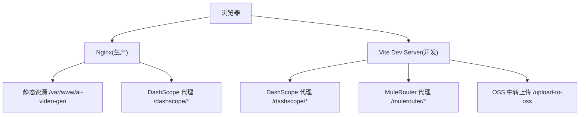
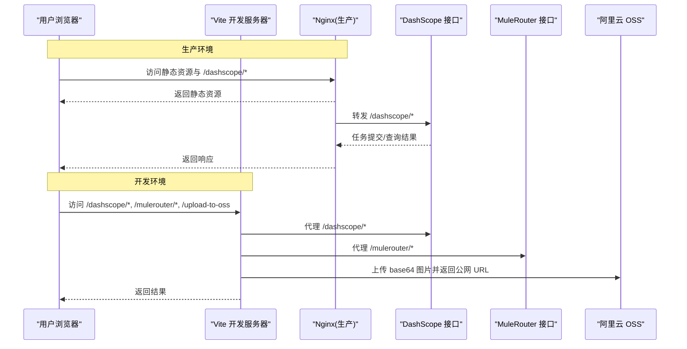
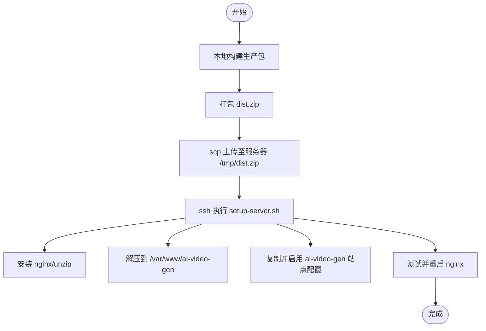
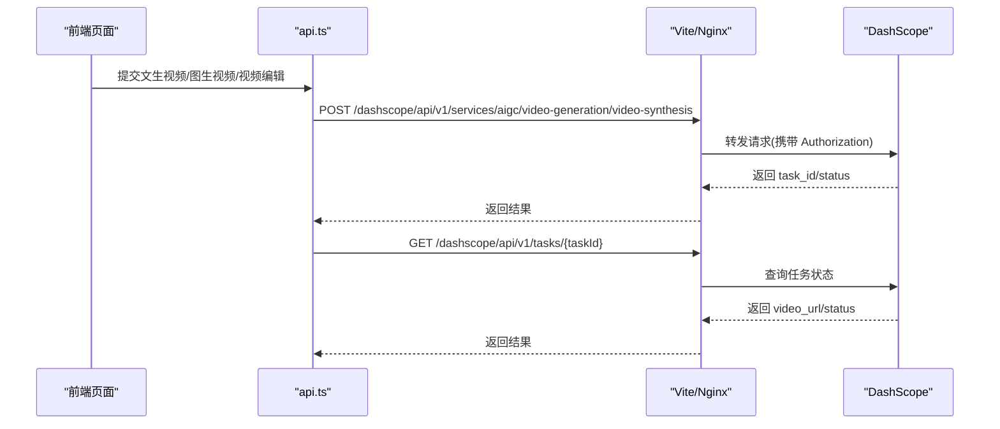
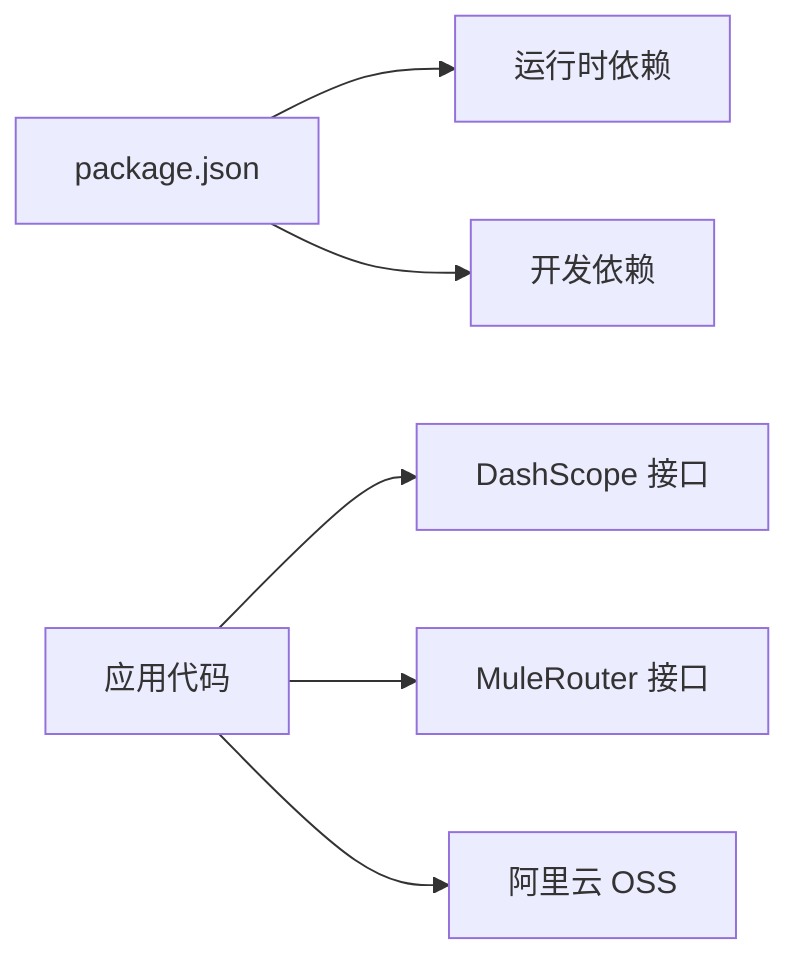

# 部署与配置

<cite>
**本文引用的文件**   
- [package.json](file://package.json)
- [vite.config.ts](file://vite.config.ts)
- [index.html](file://index.html)
- [tsconfig.json](file://tsconfig.json)
- [tailwind.config.ts](file://tailwind.config.ts)
- [deploy/deploy.sh](file://deploy/deploy.sh)
- [deploy/nginx.conf](file://deploy/nginx.conf)
- [deploy/setup-server.sh](file://deploy/setup-server.sh)
- [src/lib/api.ts](file://src/lib/api.ts)
</cite>

## 目录
1. [简介](#简介)
2. [项目结构](#项目结构)
3. [核心组件](#核心组件)
4. [架构总览](#架构总览)
5. [详细组件分析](#详细组件分析)
6. [依赖分析](#依赖分析)
7. [性能考虑](#性能考虑)
8. [故障排除指南](#故障排除指南)
9. [结论](#结论)
10. [附录](#附录)

## 简介
本文件面向运维与开发者，提供从开发环境搭建到生产部署、容器化、安全与性能优化的完整指南。项目为基于 Vite + React 的前端应用，通过 Nginx 静态托管，反向代理阿里云百炼 DashScope API，并支持在开发阶段将本地图片中转上传至阿里云 OSS（含普通 Bucket 与 Access Point 两种模式）。

## 项目结构
- 构建与脚本：使用 Vite 进行开发与构建，TypeScript 编译后由 Vite 打包输出静态资源。
- 开发服务器：Vite 内置中间件实现跨域代理与 OSS 中转上传。
- 生产部署：Nginx 作为静态站点与反向代理，启用 Gzip 与缓存策略。
- 环境变量：通过 .env / .env.local 注入后端凭据，避免暴露到前端。

**图示来源** 
- [vite.config.ts:262-293](file://vite.config.ts#L262-L293)
- [deploy/nginx.conf:1-57](file://deploy/nginx.conf#L1-L57)

**章节来源**
- [package.json:1-36](file://package.json#L1-L36)
- [vite.config.ts:262-293](file://vite.config.ts#L262-L293)
- [deploy/nginx.conf:1-57](file://deploy/nginx.conf#L1-L57)

## 核心组件
- 构建与运行脚本
  - 开发：启动 Vite 开发服务器
  - 构建：先执行 TypeScript 类型检查与增量构建，再执行 Vite 构建
  - 预览：本地预览生产产物
- 开发服务器插件
  - 通用代理：/proxy-fetch 用于绕过第三方 CDN 的 CORS 限制
  - OSS 中转上传：/upload-to-oss 将 base64 图片上传至阿里云 OSS（支持普通 Bucket 与 Access Point）
  - 反向代理：/dashscope 与 /mulerouter 指向外部服务
- 生产 Nginx
  - 静态资源根目录、SPA 回退、Gzip 压缩、长连接超时、COOP/COEP 头设置、资源缓存策略

**章节来源**
- [package.json:6-10](file://package.json#L6-L10)
- [vite.config.ts:11-66](file://vite.config.ts#L11-L66)
- [vite.config.ts:151-260](file://vite.config.ts#L151-L260)
- [vite.config.ts:272-293](file://vite.config.ts#L272-L293)
- [deploy/nginx.conf:1-57](file://deploy/nginx.conf#L1-L57)

## 架构总览
下图展示开发环境与生产环境的请求路径差异与关键中间件。

**图示来源** 
- [vite.config.ts:272-293](file://vite.config.ts#L272-L293)
- [vite.config.ts:151-260](file://vite.config.ts#L151-L260)
- [deploy/nginx.conf:12-23](file://deploy/nginx.conf#L12-L23)

## 详细组件分析

### 开发环境搭建
- Node.js 要求
  - 本项目使用现代包管理与 ES 模块，建议使用较新的 LTS 版本（如 Node 18+），以确保 Vite 与依赖正常工作。
- 安装依赖
  - 在项目根目录执行依赖安装命令以生成 node_modules。
- 启动开发服务器
  - 使用开发脚本启动 Vite 开发服务器，自动加载 .env/.env.local 中的变量。
- 环境变量
  - 在根目录创建 .env.local，按需配置 OSS 相关变量（详见“环境变量与安全”章节）。
- 常见问题
  - 若出现端口占用或权限问题，请调整端口或运行权限。
  - 若需要 HTTPS 调试，可在系统层面配置反向代理或使用工具生成自签名证书。

**章节来源**
- [package.json:6-10](file://package.json#L6-L10)
- [vite.config.ts:151-163](file://vite.config.ts#L151-L163)

### 生产环境部署流程
- 前置准备
  - 准备一台 Linux ECS 实例，开放 80/443 端口。
  - 确保具备 SSH 登录权限。
- 一键部署
  - 本地执行部署脚本，传入目标 ECS IP，脚本会：
    - 本地构建生产包
    - 打包 dist.zip
    - 上传至服务器
    - 远程执行初始化脚本，安装 Nginx、解压静态资源、配置站点、重启服务
- 手动更新
  - 重新构建后，仅替换 /var/www/ai-video-gen 下的静态资源即可。
- Nginx 要点
  - 静态根目录、SPA 回退、Gzip、COOP/COEP 头、长连接超时、资源缓存策略均已配置。

**图示来源** 
- [deploy/deploy.sh:1-46](file://deploy/deploy.sh#L1-L46)
- [deploy/setup-server.sh:1-59](file://deploy/setup-server.sh#L1-L59)
- [deploy/nginx.conf:1-57](file://deploy/nginx.conf#L1-L57)

**章节来源**
- [deploy/deploy.sh:1-46](file://deploy/deploy.sh#L1-L46)
- [deploy/setup-server.sh:1-59](file://deploy/setup-server.sh#L1-L59)
- [deploy/nginx.conf:1-57](file://deploy/nginx.conf#L1-L57)

### Docker 容器化部署方案
说明：仓库未提供 Dockerfile 与编排文件。建议采用以下思路进行容器化（概念性指导，不直接映射具体源码）：
- 多阶段构建
  - 第一阶段：Node 镜像中执行依赖安装与构建，产出 dist 目录。
  - 第二阶段：使用轻量 Nginx 镜像，拷贝 dist 并挂载自定义 nginx.conf。
- 镜像构建与运行
  - 构建镜像后，通过 docker run 或 docker-compose 启动，映射 80/443 端口。
- 环境变量注入
  - 通过环境变量注入 OSS 等敏感信息（注意：生产环境不建议在容器内做 OSS 直传，应改为服务端中转或预签名 URL）。
- 编排建议
  - 使用 Compose 管理 Nginx 与可能的后端服务；如需持久化日志，挂载卷。

[本节为概念性内容，无需“章节来源”]

### 环境变量配置与安全设置
- 环境变量清单（开发/生产）
  - OSS_ACCESS_KEY_ID：阿里云 AccessKey ID
  - OSS_ACCESS_KEY_SECRET：阿里云 AccessKey Secret
  - OSS_BUCKET：Bucket 名称
  - OSS_REGION：地域标识
  - OSS_ENDPOINT：Endpoint（可选，包含 oss-accesspoint 时为接入点模式）
  - OSS_ACCESS_POINT_ALIAS：接入点别名（Access Point 模式必填）
- 加载方式
  - 开发环境：Vite 在 configureServer 时读取 .env/.env.local 并以 OSS_ 前缀过滤注入。
  - 生产环境：建议在 Nginx 层或独立后端服务中处理上传逻辑，避免在容器中暴露密钥。
- 安全建议
  - 不要将密钥写入代码或镜像；使用系统级环境变量或密钥管理服务。
  - 对 OSS 对象设置最小权限策略，必要时使用 RAM 子账号与 STS 临时凭证。
  - 开启 HTTPS（见下节），并在 Nginx 强制跳转。

**章节来源**
- [vite.config.ts:151-163](file://vite.config.ts#L151-L163)
- [vite.config.ts:180-186](file://vite.config.ts#L180-L186)
- [vite.config.ts:217-232](file://vite.config.ts#L217-L232)

### API 调用与反向代理
- 前端调用
  - 视频生成与任务查询统一通过 /dashscope 前缀发起，最终指向阿里云百炼 DashScope 接口。
- 开发代理
  - Vite server.proxy 将 /dashscope 与 /mulerouter 转发至远端服务，便于本地调试。
- 生产代理
  - Nginx location /dashscope/ 反向代理至 https://dashscope-intl.aliyuncs.com，并设置合理的超时时间。

**图示来源** 
- [src/lib/api.ts:125-174](file://src/lib/api.ts#L125-L174)
- [src/lib/api.ts:176-201](file://src/lib/api.ts#L176-L201)
- [vite.config.ts:277-291](file://vite.config.ts#L277-L291)
- [deploy/nginx.conf:12-23](file://deploy/nginx.conf#L12-L23)

**章节来源**
- [src/lib/api.ts:125-174](file://src/lib/api.ts#L125-L174)
- [src/lib/api.ts:176-201](file://src/lib/api.ts#L176-L201)
- [vite.config.ts:277-291](file://vite.config.ts#L277-L291)
- [deploy/nginx.conf:12-23](file://deploy/nginx.conf#L12-L23)

### 静态资源优化与 CDN 设置
- 静态资源缓存
  - Nginx 对 /assets/ 设置长期缓存与 immutable 策略，提升重复访问性能。
- ffmpeg.wasm 资源
  - 正确声明 MIME 类型，设置合理过期时间，并附带 COOP/COEP 头以满足 SharedArrayBuffer 需求。
- CDN 集成
  - 可将 /assets 与 /ffmpeg 迁移至 CDN，并在 Nginx 中将对应路径指向 CDN 域名。
- 预加载与预连接
  - 可在 index.html 中添加 <link rel="preload"> 与 <link rel="preconnect"> 以提升首屏性能。

**章节来源**
- [deploy/nginx.conf:25-43](file://deploy/nginx.conf#L25-L43)
- [index.html:1-15](file://index.html#L1-L15)

### HTTPS 设置
- 申请证书
  - 在云服务商控制台申请免费或付费证书，下载 Nginx 格式证书文件。
- Nginx 配置要点
  - 监听 443，指定 ssl_certificate 与 ssl_certificate_key。
  - 配置 HTTP→HTTPS 强制跳转。
  - 保留必要的 COOP/COEP 头。
- 反向代理 SSL
  - 上游为 HTTPS 时，保持 proxy_ssl_server_name on 并确保证书校验通过。

[本节为通用实践，无需“章节来源”]

### CORS 配置
- 开发环境
  - Vite 中间件对 /proxy-fetch 与 /upload-to-oss 显式设置允许跨域响应头，便于本地调试。
- 生产环境
  - 若前后端同源，无需额外 CORS；若需跨域，请在 Nginx 层精确放行必要源与方法。

**章节来源**
- [vite.config.ts:14-66](file://vite.config.ts#L14-L66)
- [vite.config.ts:164-172](file://vite.config.ts#L164-L172)

### 自动化部署与 CI/CD 集成
- 本地一键部署
  - 使用 deploy/deploy.sh 传入 ECS IP，自动完成构建、打包、上传与远程初始化。
- CI/CD 流水线建议
  - 触发条件：推送至 main 分支或打 Tag。
  - 步骤：
    - 安装依赖与构建
    - 生成 dist.zip
    - 通过 SSH 或 SCP 上传至服务器
    - 远程执行 setup-server.sh 或等效脚本
    - 健康检查与回滚策略
- 版本发布流程
  - 使用 Git Tag 标记版本，CI 根据 Tag 构建并部署，同时记录制品与变更日志。

**章节来源**
- [deploy/deploy.sh:1-46](file://deploy/deploy.sh#L1-L46)
- [deploy/setup-server.sh:1-59](file://deploy/setup-server.sh#L1-L59)

## 依赖分析
- 运行时依赖
  - React、React DOM、路由、Tailwind 生态、FFmpeg WASM、阿里云 OSS SDK。
- 开发依赖
  - Vite、TypeScript、PostCSS、Autoprefixer、Tailwind CSS、React 插件。
- 外部服务
  - 阿里云百炼 DashScope（视频生成）、MuleRouter（可选）、阿里云 OSS（图片上传）。

**图示来源** 
- [package.json:11-34](file://package.json#L11-L34)
- [src/lib/api.ts:125-174](file://src/lib/api.ts#L125-L174)

**章节来源**
- [package.json:11-34](file://package.json#L11-L34)
- [src/lib/api.ts:125-174](file://src/lib/api.ts#L125-L174)

## 性能考虑
- 传输压缩
  - Nginx 已启用 Gzip，覆盖常见文本与 JS/WASM 类型，最小长度阈值合理。
- 缓存策略
  - /assets 使用一年缓存与 immutable；/ffmpeg 设置较短缓存期并保证正确的 MIME。
- 资源体积
  - 构建产物按文件名哈希，利于浏览器缓存命中；可结合 CDN 进一步加速。
- 并发与超时
  - 视频生成任务耗时较长，Nginx 与 Vite 均设置了合适的超时时间，避免中断。
- 预加载
  - 在 index.html 中对关键资源添加 preload/preconnect，减少首屏阻塞。

**章节来源**
- [deploy/nginx.conf:50-56](file://deploy/nginx.conf#L50-L56)
- [deploy/nginx.conf:25-43](file://deploy/nginx.conf#L25-L43)
- [vite.config.ts:277-291](file://vite.config.ts#L277-L291)
- [index.html:1-15](file://index.html#L1-L15)

## 故障排除指南
- 无法访问 DashScope 接口
  - 检查 Nginx 反向代理是否生效，确认 upstream 可达与证书校验正常。
  - 查看 Nginx 错误日志与上游返回码。
- OSS 上传失败
  - 确认 .env.local 中 OSS_* 变量齐全且有效。
  - 若使用 Access Point，必须配置 OSS_ACCESS_POINT_ALIAS。
  - 检查 OSS Bucket 权限与网络连通性。
- 跨域问题
  - 开发环境：确认 /proxy-fetch 与 /upload-to-oss 中间件返回了允许的跨域头。
  - 生产环境：若跨域，需在 Nginx 层精准放行源与方法。
- SharedArrayBuffer 不可用
  - 确认 Nginx/Vite 已设置 Cross-Origin-Opener-Policy 与 Cross-Origin-Embedder-Policy。
- 构建失败
  - 清理 node_modules 与缓存后重试；检查 Node 版本与依赖兼容性。

**章节来源**
- [vite.config.ts:151-186](file://vite.config.ts#L151-L186)
- [vite.config.ts:217-232](file://vite.config.ts#L217-L232)
- [vite.config.ts:272-293](file://vite.config.ts#L272-L293)
- [deploy/nginx.conf:8-11](file://deploy/nginx.conf#L8-L11)

## 结论
本项目提供了完善的开发体验与生产部署能力：Vite 开发服务器内置跨域代理与 OSS 中转上传，Nginx 负责静态资源与反向代理，配合 Gzip 与缓存策略保障性能。通过环境变量与脚本化部署，可实现快速迭代与稳定上线。生产环境建议引入 HTTPS、CDN 与更严格的密钥管理策略，以获得更高的安全性与可用性。

## 附录
- 常用命令
  - 安装依赖：在项目根目录执行依赖安装命令
  - 启动开发：使用开发脚本启动 Vite 开发服务器
  - 构建生产：执行构建脚本生成 dist 目录
  - 本地预览：使用预览脚本查看生产产物
- 配置文件位置
  - 构建与脚本：package.json
  - 开发服务器与代理：vite.config.ts
  - 站点入口：index.html
  - 样式主题：tailwind.config.ts
  - 部署脚本：deploy/deploy.sh、deploy/setup-server.sh
  - Nginx 配置：deploy/nginx.conf
  - API 封装：src/lib/api.ts

**章节来源**
- [package.json:1-36](file://package.json#L1-L36)
- [vite.config.ts:262-293](file://vite.config.ts#L262-L293)
- [index.html:1-15](file://index.html#L1-L15)
- [tailwind.config.ts:1-93](file://tailwind.config.ts#L1-L93)
- [deploy/deploy.sh:1-46](file://deploy/deploy.sh#L1-L46)
- [deploy/setup-server.sh:1-59](file://deploy/setup-server.sh#L1-L59)
- [deploy/nginx.conf:1-57](file://deploy/nginx.conf#L1-L57)
- [src/lib/api.ts:125-174](file://src/lib/api.ts#L125-L174)