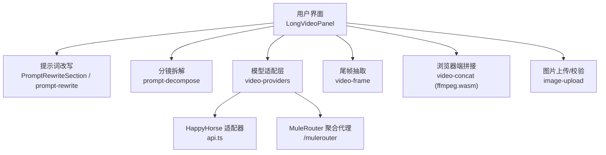
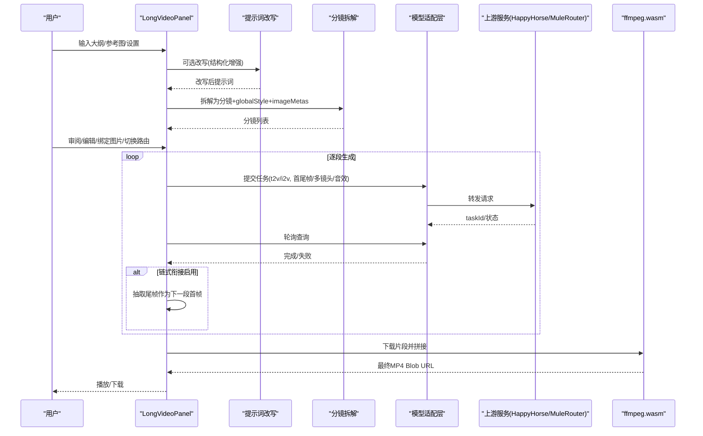
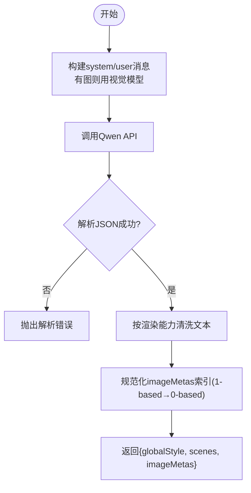
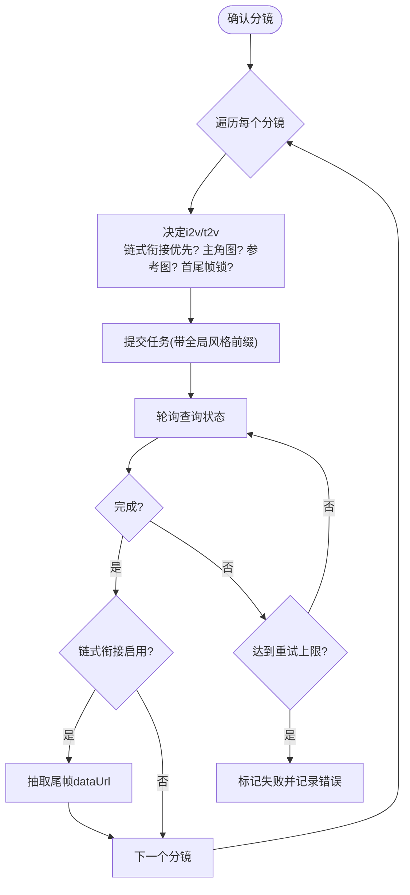
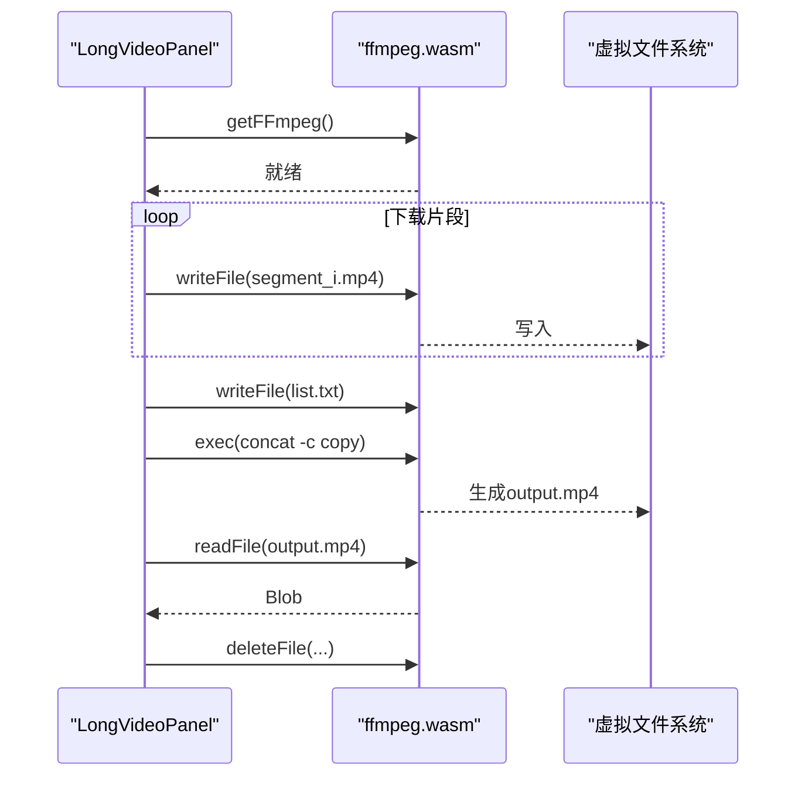
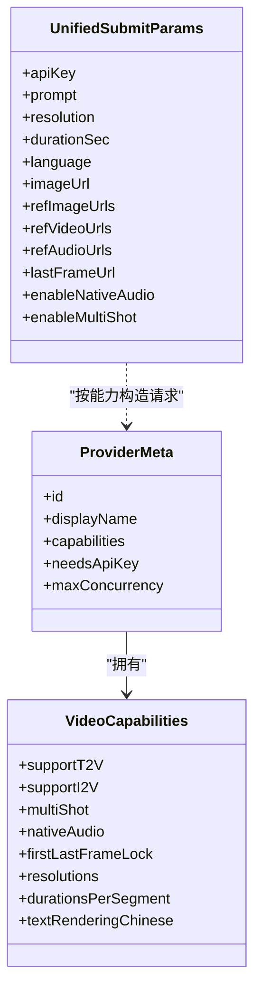
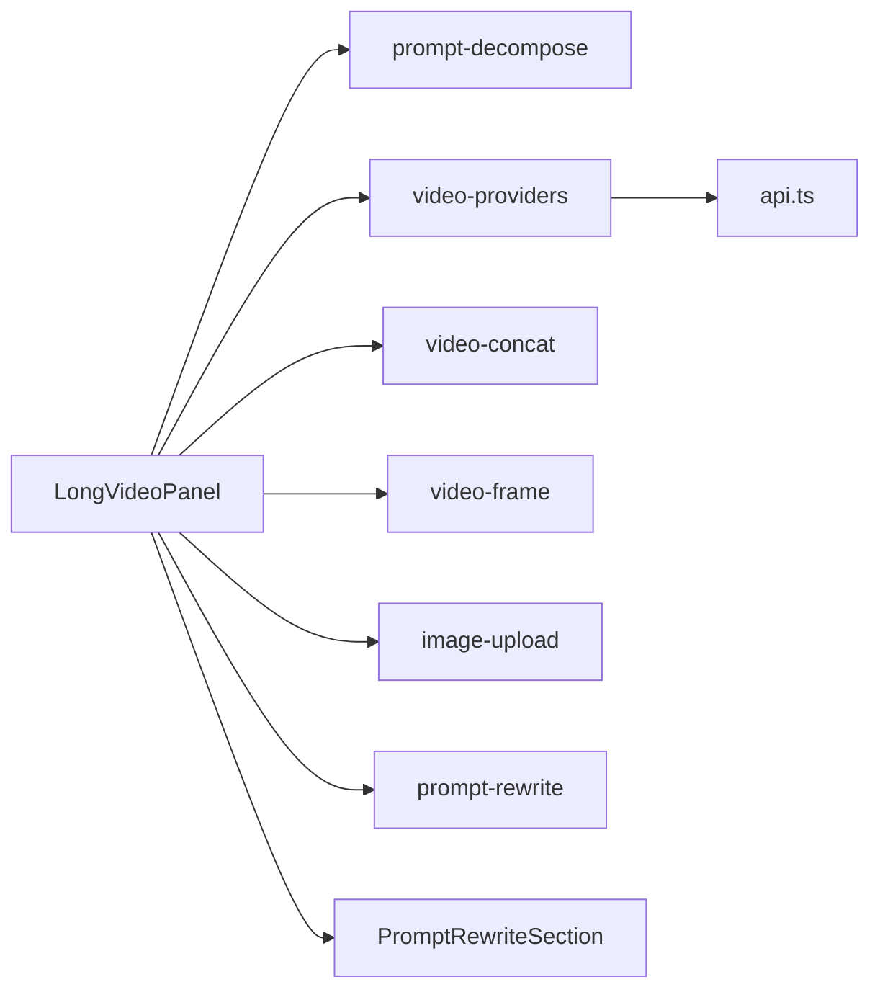

# 长视频生成功能

<cite>
**本文引用的文件列表**
- [LongVideoPanel.tsx](file://src/components/LongVideoPanel.tsx)
- [prompt-decompose.ts](file://src/lib/prompt-decompose.ts)
- [video-providers.ts](file://src/lib/video-providers.ts)
- [api.ts](file://src/lib/api.ts)
- [video-concat.ts](file://src/lib/video-concat.ts)
- [video-frame.ts](file://src/lib/video-frame.ts)
- [image-upload.ts](file://src/lib/image-upload.ts)
- [prompt-rewrite.ts](file://src/lib/prompt-rewrite.ts)
- [PromptRewriteSection.tsx](file://src/components/PromptRewriteSection.tsx)
</cite>

## 目录
1. [简介](#简介)
2. [项目结构](#项目结构)
3. [核心组件](#核心组件)
4. [架构总览](#架构总览)
5. [详细组件分析](#详细组件分析)
6. [依赖关系分析](#依赖关系分析)
7. [性能与优化建议](#性能与优化建议)
8. [故障排查指南](#故障排查指南)
9. [结论](#结论)
10. [附录：端到端操作指南与案例](#附录端到端操作指南与案例)

## 简介
本功能面向“长视频生成”场景，提供从大纲编写、AI改写、分镜拆解、路由选择（文生视频/图生视频）、并发生成、链式衔接、首尾帧硬锁、到浏览器端拼接输出的完整工作流。系统通过统一抽象层对接多个视频模型（HappyHorse、Kling V3 Omni、Muledance 2.0），并内置内容安全审核自动清洗重试、图片压缩与上传、尾帧抽取等工程化能力，确保在复杂叙事结构与视觉效果下稳定产出高质量长视频。

## 项目结构
围绕长视频生成的关键代码分布在以下模块：
- 交互与流程编排：长视频面板组件
- 提示词增强与分镜拆解：Qwen 视觉/文本模型调用
- 多模型适配层：Provider 抽象与 MuleRouter 聚合代理
- 媒体处理：ffmpeg.wasm 拼接、尾帧抽取、图片上传
- 辅助工具：提示词改写 UI 组件

图表来源
- [LongVideoPanel.tsx:1-120](file://src/components/LongVideoPanel.tsx#L1-L120)
- [prompt-decompose.ts:1-60](file://src/lib/prompt-decompose.ts#L1-L60)
- [video-providers.ts:1-70](file://src/lib/video-providers.ts#L1-L70)
- [api.ts:1-40](file://src/lib/api.ts#L1-L40)
- [video-concat.ts:1-40](file://src/lib/video-concat.ts#L1-L40)
- [video-frame.ts:1-30](file://src/lib/video-frame.ts#L1-L30)
- [image-upload.ts:1-30](file://src/lib/image-upload.ts#L1-L30)

章节来源
- [LongVideoPanel.tsx:1-120](file://src/components/LongVideoPanel.tsx#L1-L120)
- [prompt-decompose.ts:1-60](file://src/lib/prompt-decompose.ts#L1-L60)
- [video-providers.ts:1-70](file://src/lib/video-providers.ts#L1-L70)
- [api.ts:1-40](file://src/lib/api.ts#L1-L40)
- [video-concat.ts:1-40](file://src/lib/video-concat.ts#L1-L40)
- [video-frame.ts:1-30](file://src/lib/video-frame.ts#L1-L30)
- [image-upload.ts:1-30](file://src/lib/image-upload.ts#L1-L30)

## 核心组件
- 长视频面板（状态机驱动）：负责配置、改写、拆解、审阅、生成、拼接、完成等阶段流转；维护分段状态、全局风格、并发策略、链式衔接、首尾帧硬锁等。
- 分镜拆解器：基于 Qwen 视觉/文本模型，将总描述拆为若干连续分镜，输出全局风格锚与每段 prompt、可选对话字幕、参考图绑定建议及图像元数据（是否含密集文字）。
- 模型适配层：统一提交/查询接口，按 Provider 路由到 HappyHorse 或 MuleRouter 聚合代理，封装语言提示、分辨率/时长约束、首尾帧参数、原生音效/多镜头开关等。
- 媒体处理：ffmpeg.wasm 在浏览器端拼接 MP4；尾帧抽取用于链式衔接；图片上传至 OSS 或 ImgBB 获取公网 URL。
- 提示词改写：结构化增强画面主体、运镜、光线、风格、氛围等维度，支持多图输入与长视频上下文。

章节来源
- [LongVideoPanel.tsx:170-365](file://src/components/LongVideoPanel.tsx#L170-L365)
- [prompt-decompose.ts:33-201](file://src/lib/prompt-decompose.ts#L33-L201)
- [video-providers.ts:491-544](file://src/lib/video-providers.ts#L491-L544)
- [video-concat.ts:50-109](file://src/lib/video-concat.ts#L50-L109)
- [video-frame.ts:16-68](file://src/lib/video-frame.ts#L16-L68)
- [image-upload.ts:91-110](file://src/lib/image-upload.ts#L91-L110)
- [prompt-rewrite.ts:84-201](file://src/lib/prompt-rewrite.ts#L84-L201)
- [PromptRewriteSection.tsx:22-166](file://src/components/PromptRewriteSection.tsx#L22-L166)

## 架构总览
长视频生成采用“前端编排 + 多模型适配 + 浏览器端媒体处理”的架构。核心流程如下：
- 输入：用户大纲/描述，可选参考图、主角设定、全局风格
- 改写：AI 结构化增强描述（可选）
- 拆解：AI 输出 globalStyle + scenes + imageMetas
- 审阅：用户可编辑分镜、绑定参考图、切换 i2v/t2v 路由
- 生成：按 Provider 能力与链路策略（链式衔接/首尾帧硬锁）提交任务，轮询结果
- 拼接：ffmpeg.wasm 下载片段并合并为最终 MP4

图表来源
- [LongVideoPanel.tsx:298-365](file://src/components/LongVideoPanel.tsx#L298-L365)
- [prompt-decompose.ts:33-201](file://src/lib/prompt-decompose.ts#L33-L201)
- [video-providers.ts:491-544](file://src/lib/video-providers.ts#L491-L544)
- [video-concat.ts:50-109](file://src/lib/video-concat.ts#L50-L109)
- [video-frame.ts:16-68](file://src/lib/video-frame.ts#L16-L68)

## 详细组件分析

### 分镜拆解算法（prompt-decompose）
- 目标：将长文本描述分解为 N 个连续分镜，每个分镜固定时长，并输出全局风格锚 globalStyle，保证全片人物/画风/色调/镜头基调一致。
- 输入：总描述、总时长、单段时长、可选参考图 base64、中文字符渲染能力档位。
- 视觉模式：当存在参考图时，使用视觉模型 qwen-vl-plus，直接观察图片内容以决定哪些分镜适合配图，并对每张图判断是否含“密集文字”，从而决定该图走 i2v 还是 t2v。
- 输出：
  - globalStyle：120-200字全局风格锚，包含人物外形、画风、色调光线、镜头语言、场景锚、品牌关键词、节奏推进等。
  - scenes：数组，每项包含 index、prompt、durationSec、imageIndex（可选）、dialogue（可选）。
  - imageMetas：每张参考图的 hasDenseText 与 reason，供后续路由决策。
- 文本清洗：根据模型中文渲染能力分档（garbled/partial/good）对 globalStyle 和 prompt 进行兜底清洗，避免乱码或叠加文字指令污染。
- 复杂度：主要开销在 LLM 调用与 JSON 解析，时间复杂度近似 O(N)（N 为分镜数），空间复杂度取决于响应体大小。

图表来源
- [prompt-decompose.ts:33-201](file://src/lib/prompt-decompose.ts#L33-L201)

章节来源
- [prompt-decompose.ts:33-201](file://src/lib/prompt-decompose.ts#L33-L201)

### 场景规划与路由逻辑（LongVideoPanel）
- 全局风格锚：globalStyle 始终作为前缀拼接到每段 prompt，确保人物/环境一致性。
- 路由模式：
  - i2v（图生视频）：使用参考图作为首帧，锁定人物/场景；适用于干净参考图。
  - t2v（文生视频）：仅凭 prompt 生成；适用于含密集文字的参考图或未绑定参考图。
- 自动路由：
  - 若某段绑定了参考图且 imageMetas.hasDenseText=false → i2v；否则 t2v。
  - 无参考图 → t2v。
  - 用户可在审阅阶段手动覆盖。
- 链式衔接：
  - 开启后，上一段生成完成后抽取尾帧 dataUrl，作为下一段的 i2v 首帧，实现无缝过渡。
  - 注意：MuleRouter 不支持 base64 首帧，此时会回退原 routeMode。
- 首尾帧硬锁：
  - 仅 Muledance 支持 last_frame_image；第一段强制 i2v 使用上传图作首帧，最后一段也强制 i2v 并传入 last_frame_url 锁定结尾。
- 并发与重试：
  - 单段最多重试次数有限制，遇到 Green net 拦截自动清洗敏感词并重试一次。
  - 轮询间隔约 15 秒，最大轮询次数限制以避免长时间挂起。

图表来源
- [LongVideoPanel.tsx:633-800](file://src/components/LongVideoPanel.tsx#L633-L800)
- [video-frame.ts:16-68](file://src/lib/video-frame.ts#L16-L68)

章节来源
- [LongVideoPanel.tsx:298-365](file://src/components/LongVideoPanel.tsx#L298-L365)
- [LongVideoPanel.tsx:633-800](file://src/components/LongVideoPanel.tsx#L633-L800)
- [video-frame.ts:16-68](file://src/lib/video-frame.ts#L16-L68)

### 视频拼接处理流程（video-concat）
- 引擎：ffmpeg.wasm 在浏览器端执行，避免后端转码成本。
- 步骤：
  - 加载 ffmpeg 核心（带超时保护）。
  - 顺序下载各片段为本地文件。
  - 生成 concat list.txt。
  - 执行 -c copy 流拷贝拼接，不重新编码，速度极快。
  - 读取 output.mp4 并释放临时文件。
- 进度回调：loading/downloading/processing/done 四阶段，百分比实时更新。
- 注意事项：
  - 所有片段需为相同容器/编码才能 -c copy 成功；当前上游返回多为 MP4，通常满足条件。
  - 大文件拼接受限于浏览器内存与磁盘配额，建议控制总时长与并发。

图表来源
- [video-concat.ts:50-109](file://src/lib/video-concat.ts#L50-L109)

章节来源
- [video-concat.ts:50-109](file://src/lib/video-concat.ts#L50-L109)

### 模型适配层与能力矩阵（video-providers）
- Provider 抽象：
  - 统一 submit/queryTask 接口，内部按 provider 路由到具体 adapter。
  - capabilities 声明分辨率、时长、原生音效、多镜头、首尾帧锁、中文字符渲染表现等。
- HappyHorse：
  - 走 DashScope 兼容模式，支持 T2V/I2V，不支持首尾帧硬锁与原生音效。
- MuleRouter 聚合代理：
  - 无需前端 Key，通过 model 字段区分子模式（t2v/i2v/r2v/ref2v）。
  - 首帧/尾帧必须为公网 HTTP(S) URL；base64 会自动降级为 t2v。
  - 支持 nativeAudio、last_frame_image、多模态参考（images/videos/audios）。
- 网络健壮性：
  - 429/5xx 自动重试，指数退避。
  - 第三方 CDN 视频 URL 经 /proxy-fetch 中间件包装，规避 CORS。

图表来源
- [video-providers.ts:28-70](file://src/lib/video-providers.ts#L28-L70)
- [video-providers.ts:167-184](file://src/lib/video-providers.ts#L167-L184)

章节来源
- [video-providers.ts:72-160](file://src/lib/video-providers.ts#L72-L160)
- [video-providers.ts:224-240](file://src/lib/video-providers.ts#L224-L240)
- [video-providers.ts:301-408](file://src/lib/video-providers.ts#L301-L408)
- [video-providers.ts:491-544](file://src/lib/video-providers.ts#L491-L544)
- [api.ts:63-102](file://src/lib/api.ts#L63-L102)

### 图片上传与校验（image-upload）
- 双后端：优先 OSS 中转（零配置前端），失败回退 ImgBB（需前端 Key）。
- 用途：为 MuleRouter 提供公网 HTTP(S) URL，用于 i2v 首帧与首尾帧硬锁。
- 校验：isPublicHttpUrl 排除本地地址，确保符合上游要求。

章节来源
- [image-upload.ts:30-46](file://src/lib/image-upload.ts#L30-L46)
- [image-upload.ts:53-86](file://src/lib/image-upload.ts#L53-L86)
- [image-upload.ts:91-110](file://src/lib/image-upload.ts#L91-L110)

### 提示词改写（prompt-rewrite 与 PromptRewriteSection）
- 目的：将简短描述改写为结构化、更具画面感的提示词，提升生成质量。
- 模式：
  - long-video：输出 rewritten 字符串（含叙事线、视觉风格、节奏设计、分镜概要）与 highlights。
  - 支持多图输入（视觉模型），在分镜概要中标注 [配图N]。
- UI：展示改写结果、允许微调、一键确认/重试/取消。

章节来源
- [prompt-rewrite.ts:57-82](file://src/lib/prompt-rewrite.ts#L57-L82)
- [prompt-rewrite.ts:84-201](file://src/lib/prompt-rewrite.ts#L84-L201)
- [PromptRewriteSection.tsx:22-166](file://src/components/PromptRewriteSection.tsx#L22-L166)

## 依赖关系分析
- LongVideoPanel 依赖：
  - prompt-decompose：分镜拆解
  - video-providers：提交/查询任务
  - api：HappyHorse 适配器
  - video-concat：ffmpeg.wasm 拼接
  - video-frame：尾帧抽取
  - image-upload：图片上传与公网URL校验
  - prompt-rewrite / PromptRewriteSection：提示词改写
- 外部依赖：
  - @ffmpeg/ffmpeg、@ffmpeg/util：浏览器端媒体处理
  - ali-oss：OSS 上传（通过 dev server 中转）
  - Qwen API：分镜拆解与改写
  - MuleRouter 聚合代理：Kling/Muledance 统一入口

图表来源
- [LongVideoPanel.tsx:1-20](file://src/components/LongVideoPanel.tsx#L1-L20)
- [video-providers.ts:1-20](file://src/lib/video-providers.ts#L1-L20)
- [video-concat.ts:1-10](file://src/lib/video-concat.ts#L1-L10)
- [video-frame.ts:1-15](file://src/lib/video-frame.ts#L1-L15)
- [image-upload.ts:1-15](file://src/lib/image-upload.ts#L1-L15)
- [prompt-rewrite.ts:1-20](file://src/lib/prompt-rewrite.ts#L1-L20)
- [PromptRewriteSection.tsx:1-10](file://src/components/PromptRewriteSection.tsx#L1-L10)

章节来源
- [LongVideoPanel.tsx:1-20](file://src/components/LongVideoPanel.tsx#L1-L20)
- [video-providers.ts:1-20](file://src/lib/video-providers.ts#L1-L20)
- [video-concat.ts:1-10](file://src/lib/video-concat.ts#L1-L10)
- [video-frame.ts:1-15](file://src/lib/video-frame.ts#L1-L15)
- [image-upload.ts:1-15](file://src/lib/image-upload.ts#L1-L15)
- [prompt-rewrite.ts:1-20](file://src/lib/prompt-rewrite.ts#L1-L20)
- [PromptRewriteSection.tsx:1-10](file://src/components/PromptRewriteSection.tsx#L1-L10)

## 性能与优化建议
- 并发控制：
  - MuleRouter 类模型建议 maxConcurrency ≤ 2，避免限流丢连接；HappyHorse 可更高。
  - 链式衔接必须串行执行，避免并发导致尾帧不可用。
- 资源管理：
  - 图片压缩：短边不足放大、长边过大缩小，JPEG 0.6 质量，减少传输体积。
  - 尾帧抽取：jpeg 0.85 压缩，控制在 ~150KB 内，避免 base64 过大影响成功率。
- 网络健壮性：
  - 429/5xx 自动重试，指数退避；代理层封装 /proxy-fetch 绕过 CORS。
- 存储与恢复：
  - localStorage 持久化会话状态；IndexedDB 保存最终视频 blob，刷新后可恢复。
- 拼接效率：
  - -c copy 流拷贝，避免重编码；确保片段编码一致，减少失败概率。
- 用户体验：
  - 进度反馈（loading/downloading/processing/done）；错误信息友好提示（如 Green net 拦截清洗后的提示）。

[本节为通用指导，不直接分析具体文件]

## 故障排查指南
- 内容安全审核拦截（Green net）：
  - 现象：提交返回 FAILED 且 message 包含“green net/inappropriate content/content moderation”。
  - 处理：自动清洗敏感词（删除引号内品牌词、安保相关词汇等）并重试一次；仍失败则提示修改 prompt。
- 图片尺寸/比例不符：
  - 现象：上传报错宽高比超限或短边不足。
  - 处理：系统自动缩放与压缩；必要时更换图片。
- MuleRouter 首帧/尾帧必须是公网 URL：
  - 现象：base64 被拒绝或自动降级为 t2v。
  - 处理：通过 uploadImage 上传到 OSS/ImgBB 获取公网 URL。
- 拼接失败：
  - 现象：ffmpeg 报错或无法 -c copy。
  - 处理：检查片段编码/容器一致性；降低分辨率或时长；查看控制台日志。
- 轮询超时：
  - 现象：超过 15 分钟未完成。
  - 处理：检查网络与上游状态；适当增加时长或降低并发。

章节来源
- [LongVideoPanel.tsx:476-567](file://src/components/LongVideoPanel.tsx#L476-L567)
- [LongVideoPanel.tsx:366-432](file://src/components/LongVideoPanel.tsx#L366-L432)
- [video-providers.ts:263-296](file://src/lib/video-providers.ts#L263-L296)
- [video-concat.ts:83-90](file://src/lib/video-concat.ts#L83-L90)

## 结论
长视频生成功能以“全局风格锚 + 分镜拆解 + 智能路由 + 链式衔接/首尾帧硬锁 + 浏览器端拼接”为核心，结合多模型适配与工程化容错机制，能够在复杂叙事与视觉效果需求下稳定产出高质量长视频。通过合理的并发控制、资源管理与错误处理，用户可高效制作专业级内容。

[本节为总结，不直接分析具体文件]

## 附录：端到端操作指南与案例

### 端到端操作流程
- 准备阶段
  - 输入视频大纲/描述，可选择 AI 改写增强画面细节与运镜。
  - 上传参考图（背景/人物/产品），系统自动压缩并尝试上传至 OSS/ImgBB 获取公网 URL。
  - 设置总时长、单段时长、分辨率、语言、并发数、链式衔接、首尾帧硬锁等。
- 分镜拆解与审阅
  - 点击“开始拆解”，等待 AI 输出 globalStyle 与 scenes。
  - 审阅分镜，可编辑 prompt、绑定参考图、切换 i2v/t2v 路由。
  - 如需全片背景一致，可使用“一键同步参考图”将所有未绑图的分镜设为 i2v。
- 生成与衔接
  - 确认后进入生成阶段，系统按 Provider 能力与链路策略提交任务。
  - 链式衔接开启时，自动抽取尾帧作为下一段首帧，确保画面连续。
  - 首尾帧硬锁开启时，第一段与最后一段强制 i2v 并传入对应帧图。
- 拼接与导出
  - 全部片段完成后，进入拼接阶段，ffmpeg.wasm 下载并合并为最终 MP4。
  - 支持预览与下载；最终视频保存在 IndexedDB，刷新后可恢复。

章节来源
- [LongVideoPanel.tsx:298-365](file://src/components/LongVideoPanel.tsx#L298-L365)
- [LongVideoPanel.tsx:633-800](file://src/components/LongVideoPanel.tsx#L633-L800)
- [LongVideoPanel.tsx:874-896](file://src/components/LongVideoPanel.tsx#L874-L896)
- [video-concat.ts:50-109](file://src/lib/video-concat.ts#L50-L109)

### 实际案例：品牌发布会预热短片（复杂叙事与视觉效果）
- 目标：制作 3 分钟品牌预热短片，包含开场延时、产品展示、演讲片段、结尾 Logo 定格。
- 步骤要点：
  - 大纲：清晨城市延时 → 会场布置 → 嘉宾入场 → 主舞台演讲 → 产品特写 → 结尾 Logo 定格。
  - 参考图：会场背景板、产品外观、Logo 矢量图。
  - 全局风格：电影感暖色调、浅景深、统一胶片颗粒质感。
  - 分镜：拆解为 6 段，每段 30 秒；第 1 段与最后一段启用首尾帧硬锁，确保开头/结尾画面一致。
  - 路由：背景板/产品图走 i2v，其余走 t2v；链式衔接关闭（因首尾帧硬锁已保证连贯）。
  - 生成：并发数 2，原生音效开启（Muledance），多镜头关闭。
  - 拼接：ffmpeg.wasm 合并为最终 MP4，导出分享。

章节来源
- [prompt-decompose.ts:50-94](file://src/lib/prompt-decompose.ts#L50-L94)
- [video-providers.ts:131-160](file://src/lib/video-providers.ts#L131-L160)
- [LongVideoPanel.tsx:732-753](file://src/components/LongVideoPanel.tsx#L732-L753)
- [video-concat.ts:83-90](file://src/lib/video-concat.ts#L83-L90)