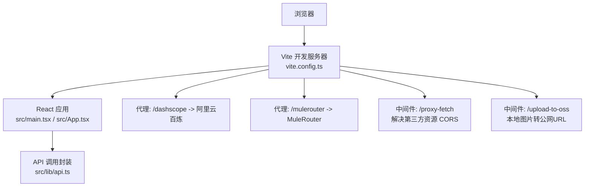
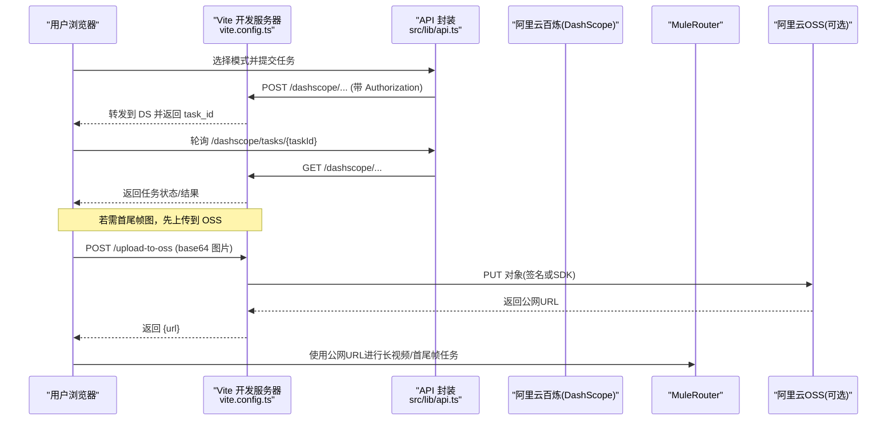
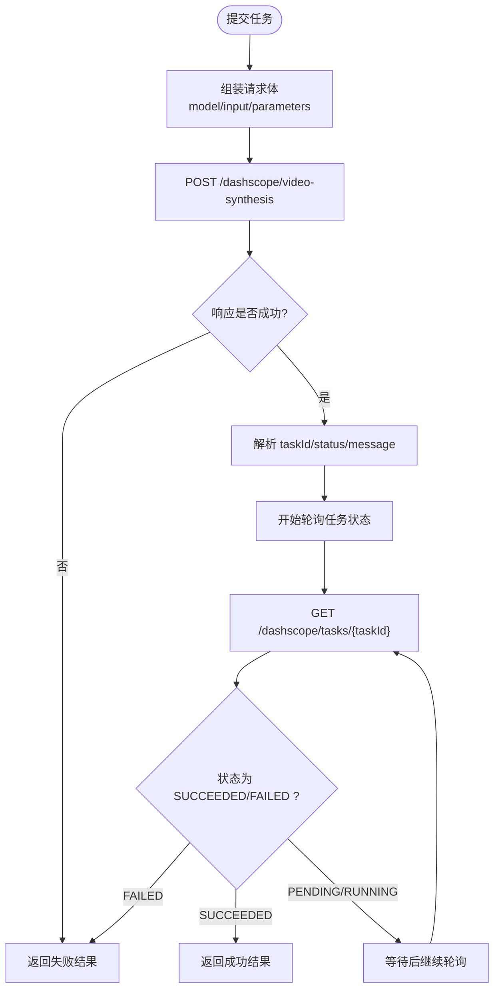

# 快速开始指南

<cite>
**本文引用的文件列表**
- [package.json](file://package.json)
- [vite.config.ts](file://vite.config.ts)
- [src/main.tsx](file://src/main.tsx)
- [src/App.tsx](file://src/App.tsx)
- [src/lib/api.ts](file://src/lib/api.ts)
- [deploy/nginx.conf](file://deploy/nginx.conf)
- [deploy/setup-server.sh](file://deploy/setup-server.sh)
</cite>

## 目录
1. [简介](#简介)
2. [项目结构](#项目结构)
3. [核心组件](#核心组件)
4. [架构总览](#架构总览)
5. [详细组件分析](#详细组件分析)
6. [依赖与配置分析](#依赖与配置分析)
7. [性能考虑](#性能考虑)
8. [故障排除指南](#故障排除指南)
9. [结论](#结论)
10. [附录](#附录)

## 简介
本指南面向首次接触 AI 视频生成平台的新用户，帮助你在最短时间内完成环境准备、依赖安装、API Key 配置、开发服务器启动、生产构建与预览，并覆盖常见问题排查。项目基于 Vite + React + TypeScript 构建，前端通过本地代理访问阿里云百炼（DashScope）接口，支持文本/图片/视频编辑三种视频生成模式，并提供批量任务与长视频能力。

## 项目结构
仓库采用功能模块组织方式：
- 入口与路由：应用入口在 src/main.tsx，主界面逻辑在 src/App.tsx
- 业务 API：src/lib/api.ts 封装了与 DashScope 的交互
- 构建与代理：vite.config.ts 提供开发代理、跨域处理、OSS 中转上传等
- 部署：deploy/nginx.conf 与 deploy/setup-server.sh 用于生产部署

图表来源
- [vite.config.ts:1-294](file://vite.config.ts#L1-L294)
- [src/main.tsx:1-11](file://src/main.tsx#L1-L11)
- [src/App.tsx:1-164](file://src/App.tsx#L1-L164)
- [src/lib/api.ts:1-217](file://src/lib/api.ts#L1-L217)

章节来源
- [package.json:1-36](file://package.json#L1-L36)
- [vite.config.ts:1-294](file://vite.config.ts#L1-L294)
- [src/main.tsx:1-11](file://src/main.tsx#L1-L11)
- [src/App.tsx:1-164](file://src/App.tsx#L1-L164)

## 核心组件
- 应用入口与根组件
  - 入口初始化 React 根节点并挂载 App 组件
  - App 组件管理模式切换、API Key 弹窗、任务提交与轮询、结果展示
- API 封装
  - 统一封装文本到视频、图片到视频、视频编辑三类任务的提交与查询
  - 使用本地代理路径访问 DashScope，避免跨域问题
- 开发服务器插件
  - 通用资源代理 /proxy-fetch，解决第三方 CDN 无 CORS 头的问题
  - OSS 中转上传 /upload-to-oss，将本地 base64 图片上传至阿里云 OSS，返回公网 URL
  - 反向代理 /dashscope 与 /mulerouter，屏蔽跨域与鉴权细节

章节来源
- [src/main.tsx:1-11](file://src/main.tsx#L1-L11)
- [src/App.tsx:1-164](file://src/App.tsx#L1-L164)
- [src/lib/api.ts:1-217](file://src/lib/api.ts#L1-L217)
- [vite.config.ts:1-294](file://vite.config.ts#L1-L294)

## 架构总览
下图展示了从浏览器发起请求到后端服务的全链路流程，包括代理、CORS 处理与任务状态轮询。

图表来源
- [vite.config.ts:262-294](file://vite.config.ts#L262-L294)
- [src/lib/api.ts:125-201](file://src/lib/api.ts#L125-L201)

## 详细组件分析

### 应用入口与根组件
- 入口初始化
  - 创建 React 根节点并渲染 App 组件
- App 组件职责
  - 维护当前模式（文本/图片/视频编辑/批量/长视频）
  - 管理 API Key 弹窗与本地存储
  - 提交任务后轮询任务状态，更新 UI 提示与结果展示

章节来源
- [src/main.tsx:1-11](file://src/main.tsx#L1-L11)
- [src/App.tsx:1-164](file://src/App.tsx#L1-L164)

### API 封装与任务流
- 提交任务
  - 根据模式选择模型名称，组装请求体，携带 Authorization 与异步标志
  - 通过 /dashscope 代理访问百炼接口
- 查询任务
  - 通过 /dashscope/tasks/{taskId} 获取任务状态与结果
- 错误处理
  - 网络异常、非 JSON 响应、HTTP 错误码均被捕获并转换为统一失败结果

图表来源
- [src/lib/api.ts:63-174](file://src/lib/api.ts#L63-L174)
- [src/lib/api.ts:176-201](file://src/lib/api.ts#L176-L201)

章节来源
- [src/lib/api.ts:1-217](file://src/lib/api.ts#L1-L217)

### 开发服务器插件与代理
- 通用资源代理 /proxy-fetch
  - 当第三方资源缺少 CORS 头时，通过本地中间件转发请求并添加允许跨域头
- OSS 中转上传 /upload-to-oss
  - 接收 base64 图片，解码后上传至阿里云 OSS（普通 bucket 或接入点），返回公网 URL
  - 环境变量从 .env.local 读取，不会暴露到前端
- 反向代理
  - /dashscope 指向阿里云百炼国际站
  - /mulerouter 指向 MuleRouter 服务，设置超时以适配长任务

章节来源
- [vite.config.ts:1-294](file://vite.config.ts#L1-L294)

## 依赖与配置分析

### 前置条件与环境要求
- Node.js
  - 建议使用较新的 LTS 版本（例如 v18+），以确保兼容 Vite 6 与相关插件
- 包管理器
  - npm（也可使用 yarn/pnpm，但请确保与 package.json 一致）
- 浏览器兼容性
  - 现代浏览器（Chrome/Edge/Firefox/Safari 最新稳定版）
  - 如需使用 ffmpeg.wasm，需要启用 SharedArrayBuffer；开发服务器已设置必要响应头，生产环境需在 Nginx 中配置对应头

章节来源
- [package.json:1-36](file://package.json#L1-L36)
- [vite.config.ts:272-276](file://vite.config.ts#L272-L276)
- [deploy/nginx.conf:8-11](file://deploy/nginx.conf#L8-L11)

### 依赖安装与网络问题
- 执行安装
  - 在项目根目录运行：npm install
- 常见网络问题与解决方案
  - 国内镜像加速：配置 npm 镜像源或使用 nrm 切换镜像
  - 代理下载：设置 HTTP_PROXY/HTTPS_PROXY 环境变量
  - 权限问题：Windows 下以管理员身份运行终端；macOS/Linux 避免 sudo 直接操作 node_modules
  - 缓存清理：删除 node_modules 与 package-lock.json 后重试安装

章节来源
- [package.json:1-36](file://package.json#L1-L36)

### 阿里云 API Key 与环境变量
- DashScope API Key
  - 在应用内“API Key 设置”弹窗中输入并保存，Key 会存储在浏览器本地存储中
  - 提交任务时自动附加 Authorization 头
- ImgBB API Key（可选）
  - 用于将本地首帧/尾帧图上传到公网图床，供长视频首尾帧硬锁使用
- 阿里云 OSS 环境变量（可选，用于本地图片中转上传）
  - 在项目根目录创建 .env.local，填写以下变量：
    - OSS_ACCESS_KEY_ID
    - OSS_ACCESS_KEY_SECRET
    - OSS_BUCKET
    - OSS_REGION
    - OSS_ENDPOINT（可选，如使用接入点别名则包含 oss-accesspoint）
    - OSS_ACCESS_POINT_ALIAS（可选，使用接入点时必须）
  - 注意：这些变量仅在开发服务器端生效，不会暴露到前端

章节来源
- [src/components/ApiKeyModal.tsx:1-75](file://src/components/ApiKeyModal.tsx#L1-L75)
- [src/App.tsx:17-40](file://src/App.tsx#L17-L40)
- [src/lib/api.ts:125-174](file://src/lib/api.ts#L125-L174)
- [vite.config.ts:151-260](file://vite.config.ts#L151-L260)

### 开发服务器启动与常用脚本
- 启动开发服务器
  - 命令：npm run dev
  - 说明：加载 .env.local 中的环境变量，启用代理与中间件
- 常用脚本
  - npm run build：TypeScript 类型检查与构建
  - npm run preview：本地预览构建产物

章节来源
- [package.json:6-10](file://package.json#L6-L10)
- [vite.config.ts:262-294](file://vite.config.ts#L262-L294)

### 生产环境构建与预览
- 构建
  - 执行 npm run build，输出静态资源到 dist 目录
- 预览
  - 执行 npm run preview，本地验证构建产物
- 部署到服务器
  - 使用提供的部署脚本一键部署：
    - 将 dist.zip 上传到服务器 /tmp/dist.zip
    - 将 nginx 配置文件上传到 /tmp/nginx-ai-video.conf（或直接使用仓库中的 deploy/nginx.conf）
    - 在服务器上执行：bash deploy/setup-server.sh
  - Nginx 关键配置要点：
    - 设置 COOP/COEP 头以支持 SharedArrayBuffer（ffmpeg.wasm）
    - 反向代理 /dashscope 到阿里云百炼
    - SPA 路由回退与静态资源缓存策略

章节来源
- [package.json:6-10](file://package.json#L6-L10)
- [deploy/nginx.conf:1-57](file://deploy/nginx.conf#L1-L57)
- [deploy/setup-server.sh:1-59](file://deploy/setup-server.sh#L1-L59)

## 性能考虑
- 大文件与长任务
  - 开发服务器与 Nginx 均已设置较长超时，适配视频生成耗时
- 静态资源缓存
  - assets 与 ffmpeg 目录设置了长期缓存策略，减少重复请求
- 压缩
  - 开启 gzip 压缩，提升传输效率
- SharedArrayBuffer
  - 生产环境必须正确设置 COOP/COEP 头，否则 ffmpeg.wasm 无法运行

章节来源
- [vite.config.ts:272-294](file://vite.config.ts#L272-L294)
- [deploy/nginx.conf:8-11](file://deploy/nginx.conf#L8-L11)
- [deploy/nginx.conf:25-43](file://deploy/nginx.conf#L25-L43)
- [deploy/nginx.conf:50-56](file://deploy/nginx.conf#L50-L56)

## 故障排除指南
- 端口冲突
  - 现象：启动时报端口占用
  - 解决：修改 vite 默认端口或关闭占用进程；查看终端提示并更换端口
- CORS 跨域问题
  - 现象：浏览器控制台报跨域错误
  - 解决：
    - 使用内置代理 /dashscope 与 /mulerouter
    - 第三方资源通过 /proxy-fetch 中转
    - 生产环境确保 Nginx 正确设置 COOP/COEP 头
- 任务提交失败
  - 现象：提示网络错误或 HTTP 错误码
  - 解决：
    - 确认 DashScope API Key 是否正确且未过期
    - 检查代理是否生效（/dashscope 是否被转发）
    - 查看服务端日志与错误消息中的 request_id
- 本地图片无法作为首尾帧
  - 现象：仅接受公网 URL
  - 解决：
    - 配置 OSS 环境变量并通过 /upload-to-oss 中转上传
    - 或使用 ImgBB 上传获得公网 URL
- 长任务超时
  - 现象：请求超时或长时间无响应
  - 解决：
    - 调整代理与服务端超时时间
    - 优化输入参数（分辨率、时长）
- 构建产物无法访问
  - 现象：刷新页面 404
  - 解决：Nginx 配置 try_files 回退到 index.html

章节来源
- [vite.config.ts:11-66](file://vite.config.ts#L11-L66)
- [vite.config.ts:151-260](file://vite.config.ts#L151-L260)
- [vite.config.ts:277-294](file://vite.config.ts#L277-L294)
- [deploy/nginx.conf:13-23](file://deploy/nginx.conf#L13-L23)
- [deploy/nginx.conf:45-48](file://deploy/nginx.conf#L45-L48)

## 结论
按照本指南完成环境准备、依赖安装、API Key 配置与开发服务器启动后，即可体验文本/图片/视频编辑等多种视频生成功能。生产环境可通过 Nginx 部署并启用必要的跨域与安全头，确保 ffmpeg.wasm 与长任务正常运作。遇到问题时，可参考故障排除章节逐项定位与修复。

## 附录
- 快速命令清单
  - 安装依赖：npm install
  - 启动开发：npm run dev
  - 构建产物：npm run build
  - 本地预览：npm run preview
- 环境变量示例（.env.local）
  - OSS_ACCESS_KEY_ID=your-key-id
  - OSS_ACCESS_KEY_SECRET=your-key-secret
  - OSS_BUCKET=your-bucket
  - OSS_REGION=your-region
  - OSS_ENDPOINT=your-endpoint（可选）
  - OSS_ACCESS_POINT_ALIAS=your-access-point-alias（可选）

章节来源
- [package.json:6-10](file://package.json#L6-L10)
- [vite.config.ts:151-260](file://vite.config.ts#L151-L260)