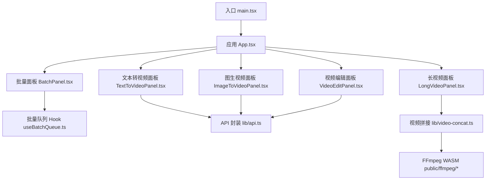
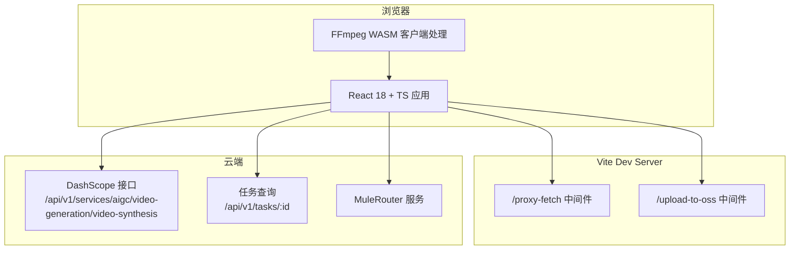
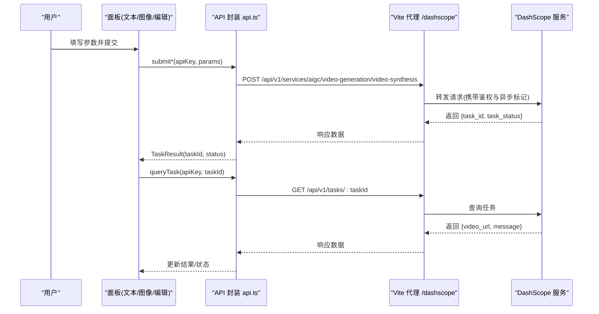
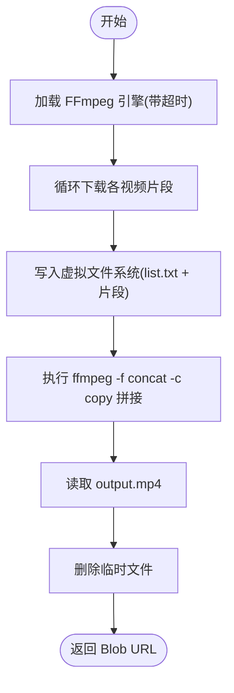
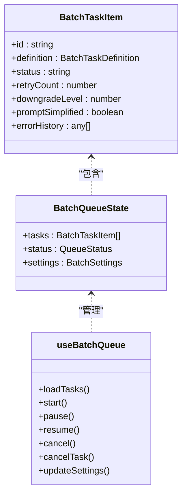
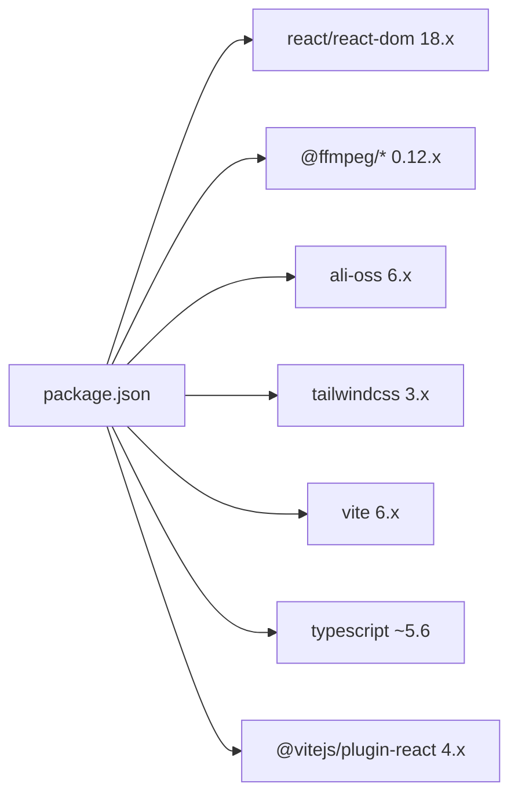

# 技术栈概览

<cite>
**本文引用的文件**   
- [package.json](file://package.json)
- [vite.config.ts](file://vite.config.ts)
- [tailwind.config.ts](file://tailwind.config.ts)
- [postcss.config.js](file://postcss.config.js)
- [tsconfig.json](file://tsconfig.json)
- [src/main.tsx](file://src/main.tsx)
- [src/App.tsx](file://src/App.tsx)
- [src/lib/api.ts](file://src/lib/api.ts)
- [src/components/TextToVideoPanel.tsx](file://src/components/TextToVideoPanel.tsx)
- [src/components/ImageToVideoPanel.tsx](file://src/components/ImageToVideoPanel.tsx)
- [src/components/ErrorBoundary.tsx](file://src/components/ErrorBoundary.tsx)
- [src/lib/video-concat.ts](file://src/lib/video-concat.ts)
- [public/ffmpeg/ffmpeg-core.js](file://public/ffmpeg/ffmpeg-core.js)
- [src/hooks/useBatchQueue.ts](file://src/hooks/useBatchQueue.ts)
- [src/components/batch/BatchPanel.tsx](file://src/components/batch/BatchPanel.tsx)
</cite>

## 目录
1. [简介](#简介)
2. [项目结构](#项目结构)
3. [核心组件](#核心组件)
4. [架构总览](#架构总览)
5. [详细组件分析](#详细组件分析)
6. [依赖分析](#依赖分析)
7. [性能考量](#性能考量)
8. [故障排查指南](#故障排查指南)
9. [结论](#结论)
10. [附录](#附录)

## 简介
本技术栈概览面向AI视频生成平台的前端工程，围绕以下目标展开：
- 前端采用 React 18 + TypeScript，结合 Vite 构建与 Tailwind CSS 原子化样式体系，提供高可维护性与开发体验。
- 在客户端使用 FFmpeg WASM 进行轻量级视频处理（如拼接），避免服务端压力并提升用户体验。
- 集成阿里云百炼 HappyHorse 模型，通过统一 API 封装实现文本/图像到视频、视频编辑等能力。
- 阐述状态管理、组件设计原则与错误处理策略，解释选型理由与优势，并提供版本兼容性与依赖管理说明。

## 项目结构
本项目采用“功能域 + 分层”的组织方式：
- src/components：按业务场景拆分面板与通用 UI 组件
- src/lib：API 封装、批处理逻辑、视频处理工具
- src/hooks：自定义 Hook（批量队列、日志）
- public/ffmpeg：FFmpeg WASM 资源
- 根配置：Vite、Tailwind、PostCSS、TypeScript 等

图表来源
- [src/main.tsx:1-11](file://src/main.tsx#L1-L11)
- [src/App.tsx:1-164](file://src/App.tsx#L1-L164)
- [src/components/TextToVideoPanel.tsx:1-117](file://src/components/TextToVideoPanel.tsx#L1-L117)
- [src/components/ImageToVideoPanel.tsx:1-164](file://src/components/ImageToVideoPanel.tsx#L1-L164)
- [src/components/batch/BatchPanel.tsx:1-58](file://src/components/batch/BatchPanel.tsx#L1-L58)
- [src/hooks/useBatchQueue.ts:1-322](file://src/hooks/useBatchQueue.ts#L1-L322)
- [src/lib/api.ts:1-217](file://src/lib/api.ts#L1-L217)
- [src/lib/video-concat.ts:1-110](file://src/lib/video-concat.ts#L1-L110)
- [public/ffmpeg/ffmpeg-core.js:1-16](file://public/ffmpeg/ffmpeg-core.js#L1-L16)

章节来源
- [src/main.tsx:1-11](file://src/main.tsx#L1-L11)
- [src/App.tsx:1-164](file://src/App.tsx#L1-L164)

## 核心组件
- 应用壳层与路由式布局
  - 入口挂载 React 18 根节点，启用 StrictMode，渲染 App 主布局。
  - App 负责模式切换（文本/图像/视频编辑/长视频/批量）、全局提示、任务轮询与结果展示。
- 业务面板
  - 文本转视频、图生视频、视频编辑面板分别封装输入校验、参数选择与提交流程。
  - 长视频面板用于多片段拼接与导出。
  - 批量面板基于 useBatchQueue 驱动任务队列、并发控制、重试与降级。
- 状态管理与持久化
  - 使用 useReducer 管理批量队列状态，结合 localStorage 持久化，支持刷新恢复与 beforeunload 保护。
- 错误边界
  - ErrorBoundary 捕获子树渲染异常，提供重试按钮与友好提示。

章节来源
- [src/main.tsx:1-11](file://src/main.tsx#L1-L11)
- [src/App.tsx:1-164](file://src/App.tsx#L1-L164)
- [src/components/TextToVideoPanel.tsx:1-117](file://src/components/TextToVideoPanel.tsx#L1-L117)
- [src/components/ImageToVideoPanel.tsx:1-164](file://src/components/ImageToVideoPanel.tsx#L1-L164)
- [src/components/ErrorBoundary.tsx:1-39](file://src/components/ErrorBoundary.tsx#L1-L39)
- [src/hooks/useBatchQueue.ts:1-322](file://src/hooks/useBatchQueue.ts#L1-L322)
- [src/components/batch/BatchPanel.tsx:1-58](file://src/components/batch/BatchPanel.tsx#L1-L58)

## 架构总览
系统由“浏览器前端 + 本地代理 + 云端服务”构成：
- 浏览器侧：React 18 + TS 应用，调用 Vite dev server 中间件完成跨域代理与图片上传中转；必要时在客户端执行 FFmpeg WASM 进行视频拼接。
- 本地代理：Vite 插件提供 /proxy-fetch 与 /upload-to-oss 两个中间件，解决第三方 CDN 无 CORS 头与本地图片需公网 URL 的问题。
- 云端服务：阿里云百炼 DashScope 接口（通过 /dashscope 代理），以及 MuleRouter（/mulerouter 代理）。

图表来源
- [vite.config.ts:1-294](file://vite.config.ts#L1-L294)
- [src/lib/api.ts:1-217](file://src/lib/api.ts#L1-L217)
- [src/lib/video-concat.ts:1-110](file://src/lib/video-concat.ts#L1-L110)

## 详细组件分析

### 阿里云百炼 HappyHorse 模型集成
- 模型与模式映射
  - 文本转视频：happyhorse-1.1-t2v
  - 图生视频：happyhorse-1.1-i2v
  - 视频编辑：happyhorse-1.0-video-edit
- 请求构造
  - 统一通过 /dashscope 前缀访问，设置 Authorization 与 X-DashScope-Async 异步标记。
  - 支持分辨率、时长、语言提示词增强与负面提示词抑制文字乱码。
- 任务轮询
  - 提交后返回 taskId，前端定时 GET /api/v1/tasks/:id 获取 SUCCEEDED/FAILED 状态与视频地址。

图表来源
- [src/lib/api.ts:1-217](file://src/lib/api.ts#L1-L217)
- [vite.config.ts:262-294](file://vite.config.ts#L262-L294)

章节来源
- [src/lib/api.ts:1-217](file://src/lib/api.ts#L1-L217)
- [src/App.tsx:42-112](file://src/App.tsx#L42-L112)

### FFmpeg WASM 客户端视频处理
- 加载与初始化
  - 使用 @ffmpeg/ffmpeg 与 @ffmpeg/util，将 core.js 与 wasm 转为 Blob URL，避免 Worker 网络限制。
  - 提供超时保护，防止永久挂起。
- 拼接流程
  - 下载各片段 -> 写入虚拟文件系统 -> 生成 concat list -> 流拷贝拼接 -> 导出 MP4 -> 清理临时文件。
- 进度反馈
  - 分阶段回调 loading/downloading/processing/done，便于 UI 展示。

图表来源
- [src/lib/video-concat.ts:1-110](file://src/lib/video-concat.ts#L1-L110)
- [public/ffmpeg/ffmpeg-core.js:1-16](file://public/ffmpeg/ffmpeg-core.js#L1-L16)

章节来源
- [src/lib/video-concat.ts:1-110](file://src/lib/video-concat.ts#L1-L110)

### 批量任务队列与状态管理
- 状态模型
  - 使用 useReducer 管理 tasks、status、settings 等，支持加载、更新、取消、重置等操作。
- 调度与并发
  - 每 5s 扫描一次，根据 settings.concurrency 控制并发槽位，自动提交 queued 任务并轮询 polling 任务。
- 失败处理与降级
  - 依据错误信息决定重试、参数降级（分辨率/时长）、简化 Prompt 或永久失败。
- 持久化与恢复
  - 节流保存至 localStorage，页面刷新后可恢复运行态；beforeunload 阻止意外关闭。

图表来源
- [src/hooks/useBatchQueue.ts:1-322](file://src/hooks/useBatchQueue.ts#L1-L322)

章节来源
- [src/hooks/useBatchQueue.ts:1-322](file://src/hooks/useBatchQueue.ts#L1-L322)
- [src/components/batch/BatchPanel.tsx:1-58](file://src/components/batch/BatchPanel.tsx#L1-L58)

### 组件设计与错误处理
- 组件职责单一
  - 每个面板专注一种模式，参数收集与提交逻辑清晰，复用统一的 API 封装。
- 错误边界
  - 对复杂子树（如长视频面板）包裹 ErrorBoundary，避免单点崩溃影响整体。
- 用户反馈
  - Toast 提示成功/失败/信息类消息，轮询期间显示“生成中...”状态。

章节来源
- [src/components/ErrorBoundary.tsx:1-39](file://src/components/ErrorBoundary.tsx#L1-L39)
- [src/App.tsx:114-164](file://src/App.tsx#L114-L164)

## 依赖分析
- 运行时依赖
  - react/react-dom 18.x，react-router-dom 7.x，@ffmpeg/* 系列，ali-oss（Node 端上传），lucide-react 图标库，tailwind-merge/tailwindcss-animate 动画与合并工具。
- 开发依赖
  - vite 6.x，@vitejs/plugin-react 4.x，typescript ~5.6，tailwindcss 3.x，autoprefixer，postcss。
- 关键特性
  - package.json 声明 type: module，全面 ES Module 生态。
  - tsconfig.json 使用 project references 指向 tsconfig.app.json，利于大型项目编译组织。

图表来源
- [package.json:1-36](file://package.json#L1-L36)

章节来源
- [package.json:1-36](file://package.json#L1-L36)
- [tsconfig.json:1-7](file://tsconfig.json#L1-L7)

## 性能考量
- 构建与依赖优化
  - Vite optimizeDeps 排除 @ffmpeg/ffmpeg 与 @ffmpeg/util，避免预构建导致体积膨胀或兼容问题。
- 网络与跨域
  - 通过 /proxy-fetch 中间件透传上游响应并强制添加 CORS 头，解决第三方 CDN 无跨域头的 fetch 问题。
  - /upload-to-oss 中间件在服务端签名上传，避免暴露密钥，同时支持普通 Bucket 与 Access Point 两种模式。
- 客户端视频处理
  - FFmpeg 使用流拷贝（-c copy）拼接，避免重编码，显著降低 CPU 与时间开销。
  - 加载过程增加超时保护，避免长时间阻塞。
- 并发与轮询
  - 批量队列通过 concurrency 控制并发度，轮询间隔固定，避免频繁请求造成抖动。

[本节为通用指导，不直接分析具体文件]

## 故障排查指南
- 无法拉取第三方 CDN 资源
  - 现象：fetch 报跨域错误。
  - 排查：确认是否通过 /proxy-fetch?url=... 访问；检查上游返回的 Content-Type 与长度是否正确透传。
- 图片上传失败
  - 现象：/upload-to-oss 返回环境变量未配置或 base64 格式不正确。
  - 排查：确保 .env.local 中存在 OSS_ACCESS_KEY_ID/OSS_ACCESS_KEY_SECRET/OSS_BUCKET/OSS_REGION；若使用接入点，还需配置 OSS_ACCESS_POINT_ALIAS。
- FFmpeg 加载超时
  - 现象：提示“ffmpeg 加载超时（30秒）”。
  - 排查：确认 /ffmpeg/ffmpeg-core.js 与 ffmpeg-core.wasm 路径可达；检查浏览器 COEP/CORS 相关安全策略；尝试刷新页面。
- 任务一直 RUNNING
  - 现象：轮询多次仍无结果。
  - 排查：检查 /dashscope 代理是否生效；查看后端返回的 task_status 映射；确认网络与鉴权正常。

章节来源
- [vite.config.ts:11-66](file://vite.config.ts#L11-L66)
- [vite.config.ts:151-260](file://vite.config.ts#L151-L260)
- [src/lib/video-concat.ts:28-38](file://src/lib/video-concat.ts#L28-L38)
- [src/lib/api.ts:176-201](file://src/lib/api.ts#L176-L201)

## 结论
本项目以 React 18 + TypeScript 为核心，借助 Vite 的高性能开发与灵活插件机制，结合 Tailwind CSS 原子化样式体系，快速构建出可扩展的视频生成平台。通过 FFmpeg WASM 在客户端完成轻量视频处理，减少服务端压力并提升交互体验；统一封装阿里云百炼 HappyHorse 模型 API，屏蔽差异与细节，提供一致的调用体验。配合完善的错误边界、批量队列与持久化策略，系统在可用性、可维护性与性能方面达到良好平衡。

[本节为总结性内容，不直接分析具体文件]

## 附录

### 构建与运行
- 开发
  - 启动开发服务器：npm run dev
  - 预览构建产物：npm run preview
- 构建
  - 类型检查与打包：npm run build

章节来源
- [package.json:6-10](file://package.json#L6-L10)

### 样式与主题
- Tailwind 配置
  - 深色模式按 class 触发，扩展颜色、圆角、动画与 keyframes。
- PostCSS
  - 启用 tailwindcss 与 autoprefixer 插件。

章节来源
- [tailwind.config.ts:1-93](file://tailwind.config.ts#L1-L93)
- [postcss.config.js:1-7](file://postcss.config.js#L1-L7)

### 环境变量与代理
- 代理规则
  - /dashscope -> https://dashscope-intl.aliyuncs.com
  - /mulerouter -> https://38gba5w4.mule.page
- 上传与跨域
  - /proxy-fetch 用于绕过第三方 CDN 跨域限制
  - /upload-to-oss 用于服务端签名上传至 OSS

章节来源
- [vite.config.ts:262-294](file://vite.config.ts#L262-L294)
- [vite.config.ts:11-66](file://vite.config.ts#L11-L66)
- [vite.config.ts:151-260](file://vite.config.ts#L151-L260)