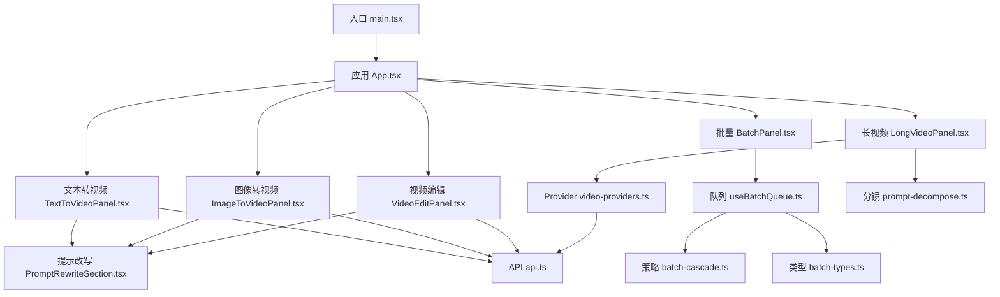
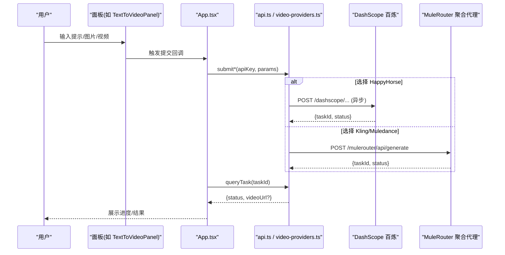
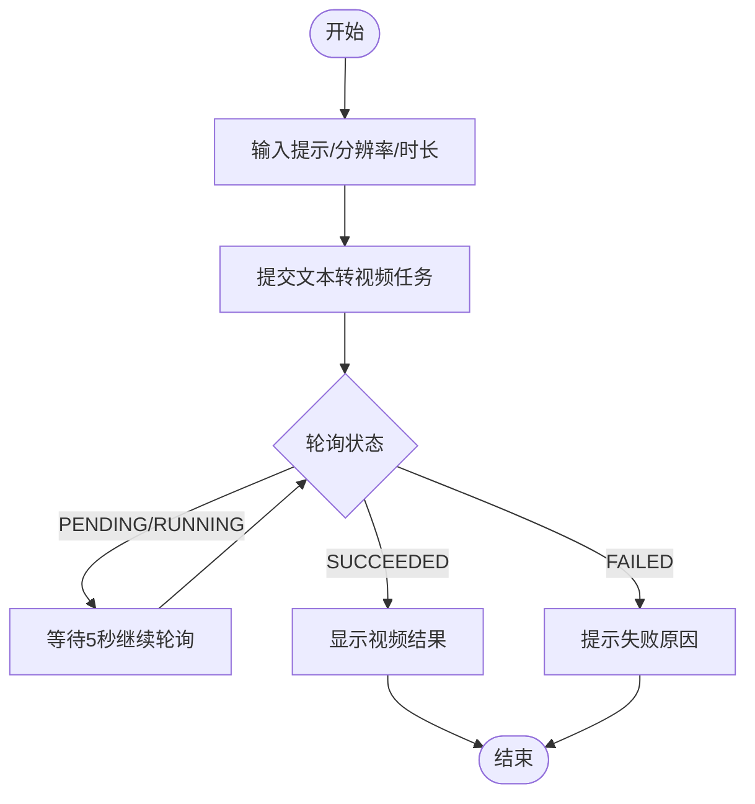
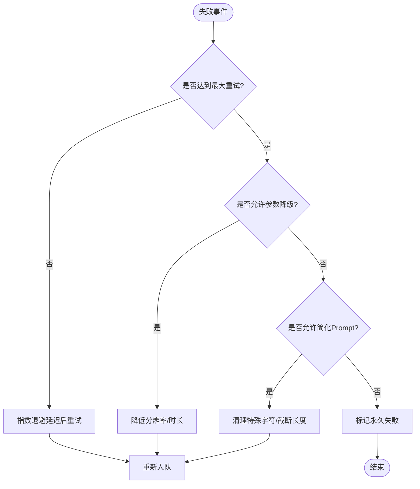
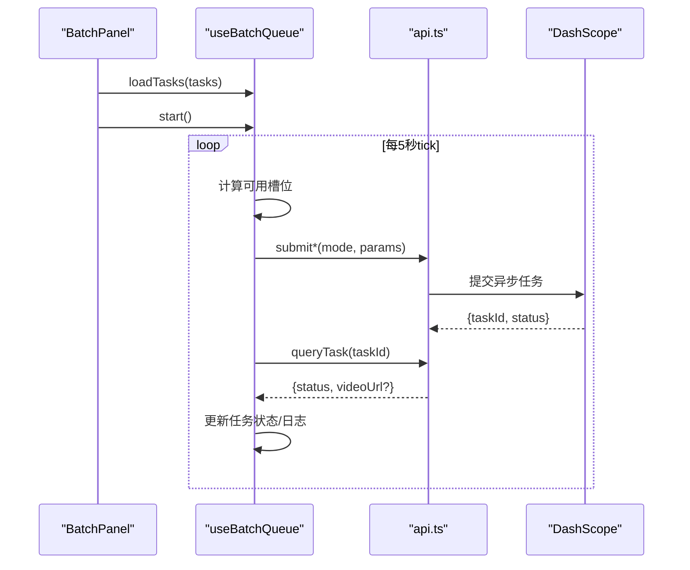
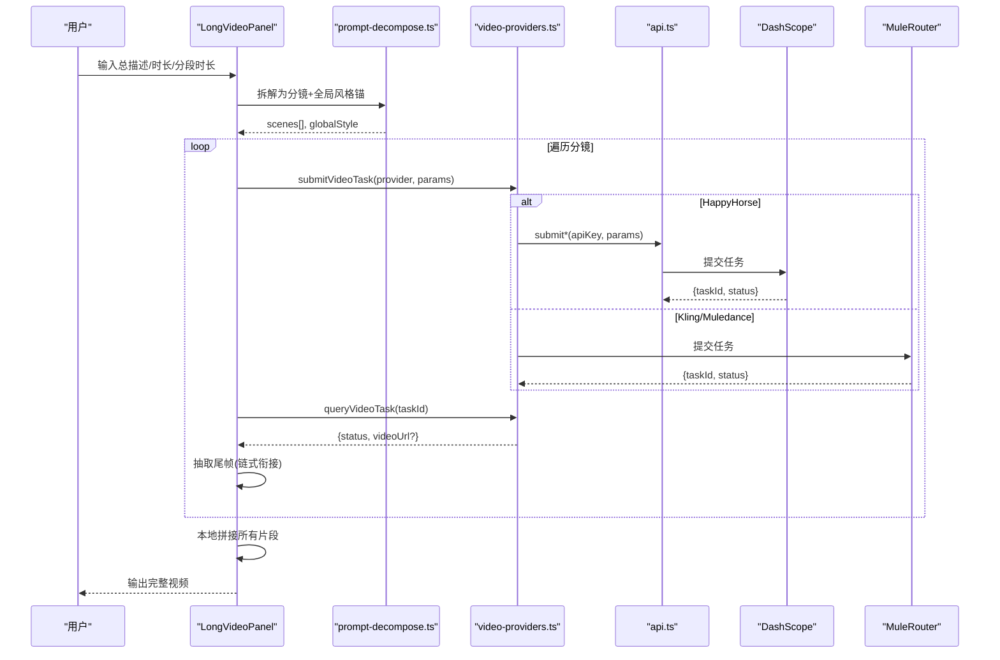
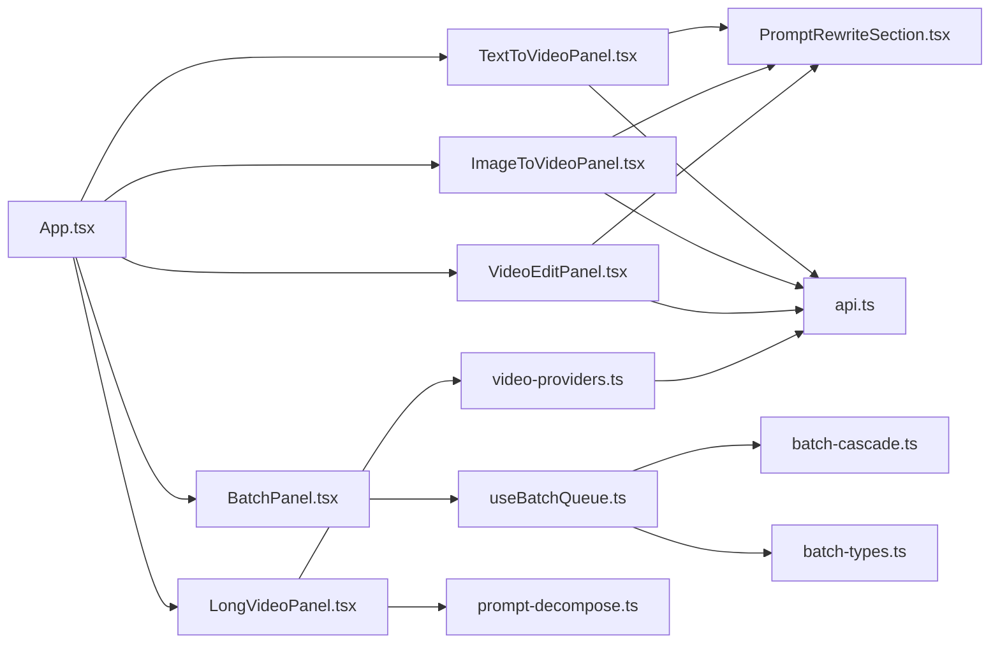

# 项目介绍与特性

<cite>
**本文引用的文件**   
- [package.json](file://package.json)
- [main.tsx](file://src/main.tsx)
- [App.tsx](file://src/App.tsx)
- [api.ts](file://src/lib/api.ts)
- [video-providers.ts](file://src/lib/video-providers.ts)
- [prompt-decompose.ts](file://src/lib/prompt-decompose.ts)
- [batch-types.ts](file://src/lib/batch-types.ts)
- [batch-cascade.ts](file://src/lib/batch-cascade.ts)
- [useBatchQueue.ts](file://src/hooks/useBatchQueue.ts)
- [TextToVideoPanel.tsx](file://src/components/TextToVideoPanel.tsx)
- [ImageToVideoPanel.tsx](file://src/components/ImageToVideoPanel.tsx)
- [VideoEditPanel.tsx](file://src/components/VideoEditPanel.tsx)
- [PromptRewriteSection.tsx](file://src/components/PromptRewriteSection.tsx)
- [LongVideoPanel.tsx](file://src/components/LongVideoPanel.tsx)
- [BatchPanel.tsx](file://src/components/batch/BatchPanel.tsx)
- [ECS启动.txt](file://ECS启动.txt)
</cite>

## 目录
1. [引言](#引言)
2. [项目结构](#项目结构)
3. [核心组件](#核心组件)
4. [架构总览](#架构总览)
5. [详细组件分析](#详细组件分析)
6. [依赖关系分析](#依赖关系分析)
7. [性能与稳定性](#性能与稳定性)
8. [故障排查指南](#故障排查指南)
9. [结论](#结论)
10. [附录：部署与使用要点](#附录部署与使用要点)

## 引言
本项目是一个面向创作者的AI视频生成平台，提供“文本转视频”“图像转视频”“视频编辑”三大核心能力，并配套“批量处理系统”和“长视频分镜拆解与拼接”工作流。平台通过统一的Provider抽象层对接多种视频模型（如HappyHorse、Kling V3 Omni、Muledance 2.0），在浏览器端完成参数编排、任务调度、结果轮询与本地剪辑合成，显著降低传统视频制作的门槛与成本，提升创作效率与一致性。

核心价值主张
- 低门槛高产出：自然语言即可生成短视频，支持图生视频与风格化编辑。
- 智能可控：全局风格锚、分镜规划、首尾帧锁定、链式衔接等能力保障人物与场景一致性。
- 批量高效：高并发队列、自动重试与参数降级，适合素材规模化生产。
- 长片友好：将长需求拆解为多段分镜，逐段生成后本地拼接，兼顾质量与可维护性。

## 项目结构
前端采用React + TypeScript + Vite构建，模块化组织清晰：
- 入口与路由：main.tsx 挂载 App；App.tsx 管理模式切换与任务状态。
- 功能面板：TextToVideoPanel、ImageToVideoPanel、VideoEditPanel 对应三大核心能力。
- 批量系统：BatchPanel + useBatchQueue + batch-* 类型与策略。
- 长视频：LongVideoPanel 负责分镜拆解、生成、拼接与持久化。
- Provider抽象：video-providers.ts 统一封装不同模型的提交与查询。
- 提示词增强：prompt-decompose.ts 调用大模型进行分镜拆解与全局风格锚生成。
- 基础API：api.ts 封装阿里云百炼接口。

图表来源
- [main.tsx:1-11](file://src/main.tsx#L1-L11)
- [App.tsx:1-164](file://src/App.tsx#L1-L164)
- [TextToVideoPanel.tsx:1-117](file://src/components/TextToVideoPanel.tsx#L1-L117)
- [ImageToVideoPanel.tsx:1-164](file://src/components/ImageToVideoPanel.tsx#L1-L164)
- [VideoEditPanel.tsx:1-157](file://src/components/VideoEditPanel.tsx#L1-L157)
- [PromptRewriteSection.tsx:1-167](file://src/components/PromptRewriteSection.tsx#L1-L167)
- [BatchPanel.tsx:1-58](file://src/components/batch/BatchPanel.tsx#L1-L58)
- [useBatchQueue.ts:1-322](file://src/hooks/useBatchQueue.ts#L1-L322)
- [batch-cascade.ts:1-101](file://src/lib/batch-cascade.ts#L1-L101)
- [batch-types.ts:1-123](file://src/lib/batch-types.ts#L1-L123)
- [LongVideoPanel.tsx:1-800](file://src/components/LongVideoPanel.tsx#L1-L800)
- [video-providers.ts:1-559](file://src/lib/video-providers.ts#L1-L559)
- [prompt-decompose.ts:1-295](file://src/lib/prompt-decompose.ts#L1-L295)
- [api.ts:1-217](file://src/lib/api.ts#L1-L217)

章节来源
- [package.json:1-36](file://package.json#L1-L36)
- [main.tsx:1-11](file://src/main.tsx#L1-L11)
- [App.tsx:1-164](file://src/App.tsx#L1-L164)

## 核心组件
- 文本转视频：输入描述、分辨率与时长，可选AI改写后提交；返回异步任务ID并轮询结果。
- 图像转视频：上传首帧或输入图片URL，配合运动描述生成动态视频。
- 视频编辑：上传源视频与参考图，按指令进行风格/角色替换等编辑。
- 批量处理：支持多任务并行、失败重试、参数降级与Prompt简化，提供可视化控制台与日志时间线。
- 长视频：将长需求拆解为多个分镜，支持全局风格锚、首尾帧硬锁、链式衔接与本地拼接。

章节来源
- [TextToVideoPanel.tsx:1-117](file://src/components/TextToVideoPanel.tsx#L1-L117)
- [ImageToVideoPanel.tsx:1-164](file://src/components/ImageToVideoPanel.tsx#L1-L164)
- [VideoEditPanel.tsx:1-157](file://src/components/VideoEditPanel.tsx#L1-L157)
- [BatchPanel.tsx:1-58](file://src/components/batch/BatchPanel.tsx#L1-L58)
- [LongVideoPanel.tsx:1-800](file://src/components/LongVideoPanel.tsx#L1-L800)

## 架构总览
整体采用“前端编排 + 云端模型”的架构：
- 前端负责用户交互、参数校验、任务编排、轮询与本地合成。
- 云端提供两类服务：
  - 阿里云百炼视频生成API（DashScope）
  - 聚合代理（MuleRouter）用于Kling/Muledance等多模型接入
- Provider抽象层屏蔽差异，统一提交与查询接口。

图表来源
- [App.tsx:42-112](file://src/App.tsx#L42-L112)
- [api.ts:63-174](file://src/lib/api.ts#L63-L174)
- [video-providers.ts:491-544](file://src/lib/video-providers.ts#L491-L544)

## 详细组件分析

### 文本转视频（Text-to-Video）
- 功能要点
  - 支持分辨率与时长调节，内置AI改写增强提示词。
  - 提交后进入轮询流程，直至成功或失败。
- 关键路径
  - 提交：submitTextToVideo → DashScope 异步任务
  - 轮询：queryTask → 获取最终视频URL
- 错误处理
  - 网络异常、HTTP非JSON、业务码错误均被捕获并提示。

图表来源
- [TextToVideoPanel.tsx:1-117](file://src/components/TextToVideoPanel.tsx#L1-L117)
- [api.ts:63-174](file://src/lib/api.ts#L63-L174)
- [App.tsx:57-74](file://src/App.tsx#L57-L74)

章节来源
- [TextToVideoPanel.tsx:1-117](file://src/components/TextToVideoPanel.tsx#L1-L117)
- [api.ts:63-174](file://src/lib/api.ts#L63-L174)
- [App.tsx:57-74](file://src/App.tsx#L57-L74)

### 图像转视频（Image-to-Video）
- 功能要点
  - 支持本地上传首帧或外部URL，结合运动描述生成视频。
  - 同样支持AI改写与轮询结果。
- 关键路径
  - 提交：submitImageToVideo → DashScope 异步任务
  - 轮询：queryTask → 获取最终视频URL

章节来源
- [ImageToVideoPanel.tsx:1-164](file://src/components/ImageToVideoPanel.tsx#L1-L164)
- [api.ts:83-102](file://src/lib/api.ts#L83-L102)
- [App.tsx:76-93](file://src/App.tsx#L76-L93)

### 视频编辑（Video Edit）
- 功能要点
  - 上传源视频与可选参考图，按指令进行风格/角色替换等编辑。
- 关键路径
  - 提交：submitVideoEdit → DashScope 异步任务
  - 轮询：queryTask → 获取最终视频URL

章节来源
- [VideoEditPanel.tsx:1-157](file://src/components/VideoEditPanel.tsx#L1-L157)
- [api.ts:104-123](file://src/lib/api.ts#L104-L123)
- [App.tsx:95-112](file://src/App.tsx#L95-L112)

### 批量处理系统（Batch Queue）
- 设计目标
  - 高并发调度：根据并发度控制同时提交的任务数。
  - 自动重试：指数退避重试，记录错误历史。
  - 参数降级：优先降分辨率，再降时长，最后简化Prompt。
  - 持久化：刷新页面恢复队列状态，避免中断丢失。
- 关键数据结构
  - BatchTaskDefinition：待执行任务定义
  - BatchTaskItem：运行时任务项（含状态、重试次数、降级级别等）
  - BatchSettings：并发、最大重试、自动降级、自动简化开关
- 决策流程（容错级联）

图表来源
- [batch-cascade.ts:19-56](file://src/lib/batch-cascade.ts#L19-L56)
- [useBatchQueue.ts:187-264](file://src/hooks/useBatchQueue.ts#L187-L264)
- [batch-types.ts:10-67](file://src/lib/batch-types.ts#L10-L67)

- 队列调度时序

图表来源
- [BatchPanel.tsx:1-58](file://src/components/batch/BatchPanel.tsx#L1-L58)
- [useBatchQueue.ts:98-124](file://src/hooks/useBatchQueue.ts#L98-L124)
- [api.ts:176-201](file://src/lib/api.ts#L176-L201)

章节来源
- [batch-types.ts:1-123](file://src/lib/batch-types.ts#L1-L123)
- [batch-cascade.ts:1-101](file://src/lib/batch-cascade.ts#L1-L101)
- [useBatchQueue.ts:1-322](file://src/hooks/useBatchQueue.ts#L1-L322)
- [BatchPanel.tsx:1-58](file://src/components/batch/BatchPanel.tsx#L1-L58)

### 长视频生成（分镜拆解与拼接）
- 能力概览
  - 分镜拆解：基于Qwen/VL模型输出全局风格锚与分镜列表，并可绑定参考图。
  - 混合路由：根据参考图内容（是否密集文字）决定走i2v或t2v。
  - 首尾帧硬锁：对特定模型实现固定开头/结尾画面。
  - 链式衔接：抽取上段尾帧作为下段首帧，保证连贯。
  - 本地拼接：分段生成完成后在前端合并为完整视频。
- 关键流程

图表来源
- [LongVideoPanel.tsx:299-800](file://src/components/LongVideoPanel.tsx#L299-L800)
- [prompt-decompose.ts:33-201](file://src/lib/prompt-decompose.ts#L33-L201)
- [video-providers.ts:491-544](file://src/lib/video-providers.ts#L491-L544)
- [api.ts:176-201](file://src/lib/api.ts#L176-L201)

章节来源
- [LongVideoPanel.tsx:1-800](file://src/components/LongVideoPanel.tsx#L1-L800)
- [prompt-decompose.ts:1-295](file://src/lib/prompt-decompose.ts#L1-L295)
- [video-providers.ts:1-559](file://src/lib/video-providers.ts#L1-L559)

### 提示词改写（Prompt Rewrite）
- 作用：在提交前由大模型增强提示词，补充运镜、光线、氛围等细节，提高生成质量。
- 交互：一键改写 → 预览结果 → 可微调确认或直接跳过。

章节来源
- [PromptRewriteSection.tsx:1-167](file://src/components/PromptRewriteSection.tsx#L1-L167)

## 依赖关系分析
- 模块耦合
  - App.tsx 作为编排中心，组合各面板与状态。
  - Panel 组件仅负责输入与提交回调，逻辑集中在 hooks 与 lib。
  - Provider 抽象层屏蔽底层差异，便于扩展新模型。
- 外部依赖
  - @ffmpeg/*：前端视频处理（FFmpeg WASM）。
  - ali-oss：对象存储（用于图片上传）。
  - react/react-dom/router：前端框架与路由。
  - tailwindcss：样式体系。

图表来源
- [App.tsx:1-164](file://src/App.tsx#L1-L164)
- [TextToVideoPanel.tsx:1-117](file://src/components/TextToVideoPanel.tsx#L1-L117)
- [ImageToVideoPanel.tsx:1-164](file://src/components/ImageToVideoPanel.tsx#L1-L164)
- [VideoEditPanel.tsx:1-157](file://src/components/VideoEditPanel.tsx#L1-L157)
- [PromptRewriteSection.tsx:1-167](file://src/components/PromptRewriteSection.tsx#L1-L167)
- [BatchPanel.tsx:1-58](file://src/components/batch/BatchPanel.tsx#L1-L58)
- [useBatchQueue.ts:1-322](file://src/hooks/useBatchQueue.ts#L1-L322)
- [batch-cascade.ts:1-101](file://src/lib/batch-cascade.ts#L1-L101)
- [batch-types.ts:1-123](file://src/lib/batch-types.ts#L1-L123)
- [LongVideoPanel.tsx:1-800](file://src/components/LongVideoPanel.tsx#L1-L800)
- [video-providers.ts:1-559](file://src/lib/video-providers.ts#L1-L559)
- [prompt-decompose.ts:1-295](file://src/lib/prompt-decompose.ts#L1-L295)
- [api.ts:1-217](file://src/lib/api.ts#L1-L217)

章节来源
- [package.json:1-36](file://package.json#L1-L36)

## 性能与稳定性
- 并发与限流
  - 批量队列通过并发度限制同时提交数量，避免打满上游。
  - Provider元数据包含推荐最大并发与提交间隔，防止瞬时风暴。
- 重试与退避
  - 指数退避重试，减少瞬时抖动影响。
  - 针对429/5xx的网络层重试，提升鲁棒性。
- 参数降级
  - 先降分辨率，再降时长，最后简化Prompt，最大化成功率。
- 长视频优化
  - 分段生成与本地拼接，避免单次超长请求超时。
  - 链式衔接抽取尾帧，提升段落间连续性。
- 资源与内存
  - 图片压缩与按需转base64，避免常驻大对象占用内存。
  - IndexedDB持久化最终视频Blob，刷新后可恢复。

[本节为通用指导，不直接分析具体文件]

## 故障排查指南
- 常见错误定位
  - 网络错误/响应非JSON：检查代理配置与后端可达性。
  - 内容安全审核拦截：平台已内置清洗与重试，仍失败需调整敏感词。
  - 任务超时：长轮询上限内未完成，建议缩短分段时长或降低分辨率。
- 调试建议
  - 查看批量日志时间线，定位失败任务与错误历史。
  - 打开浏览器控制台，关注Provider层的warn日志与完整响应。
  - 核对API Key与模型能力矩阵（分辨率/时长/特性开关）。

章节来源
- [useBatchQueue.ts:187-264](file://src/hooks/useBatchQueue.ts#L187-L264)
- [video-providers.ts:263-296](file://src/lib/video-providers.ts#L263-L296)
- [LongVideoPanel.tsx:476-567](file://src/components/LongVideoPanel.tsx#L476-L567)

## 结论
本平台以“易用、可控、可扩展”为核心，围绕文本/图像/视频三大能力，构建了从单条到批量、从短片到长片的完整工作流。借助Provider抽象与分镜拆解，平台有效解决了传统视频制作中成本高、周期长、一致性差等痛点，为创作者提供智能化的端到端解决方案。

[本节为总结，不直接分析具体文件]

## 附录：部署与使用要点
- 开发环境
  - 安装依赖并运行开发服务器。
- 生产部署
  - 使用Nginx托管静态资源，并通过Cloudflare Tunnel暴露公网访问。
- 使用步骤
  - 设置API Key（如需），选择模型与参数，提交任务并轮询结果。
  - 批量模式下导入任务清单，调整并发与重试策略后启动。
  - 长视频模式下先拆解分镜，确认后逐段生成并拼接。

章节来源
- [package.json:6-10](file://package.json#L6-L10)
- [ECS启动.txt:1-23](file://ECS启动.txt#L1-L23)