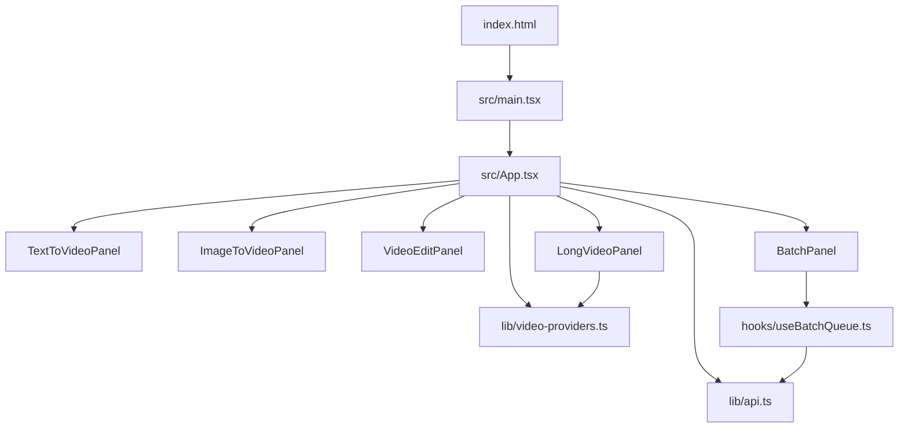
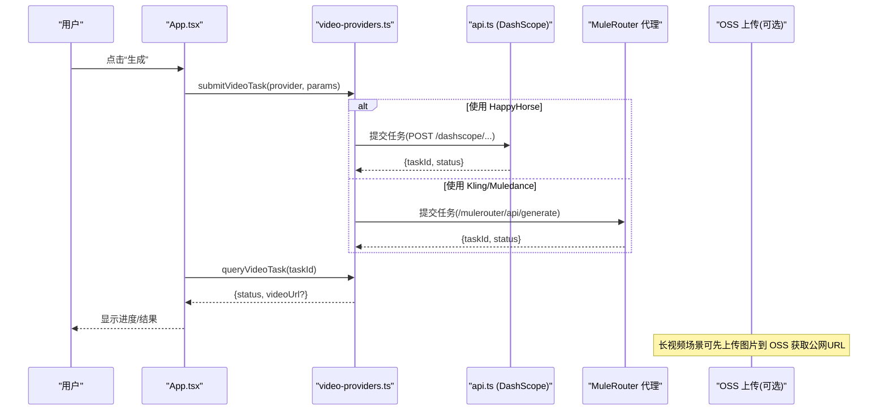
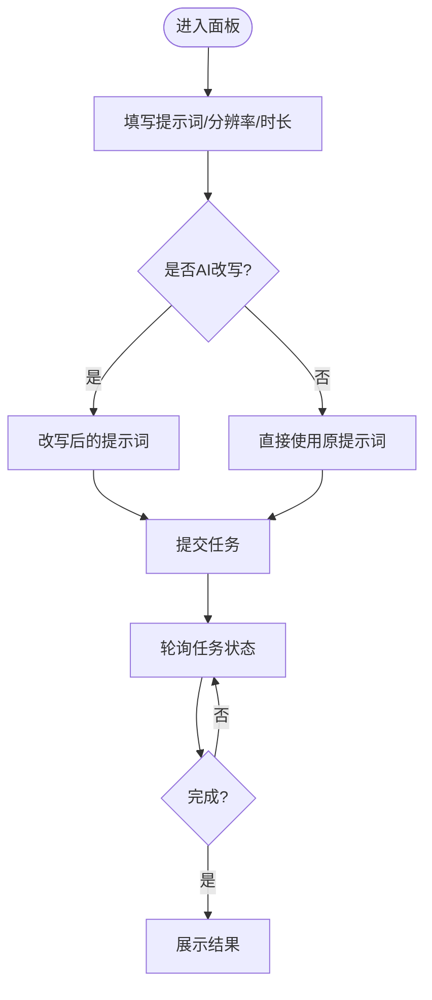
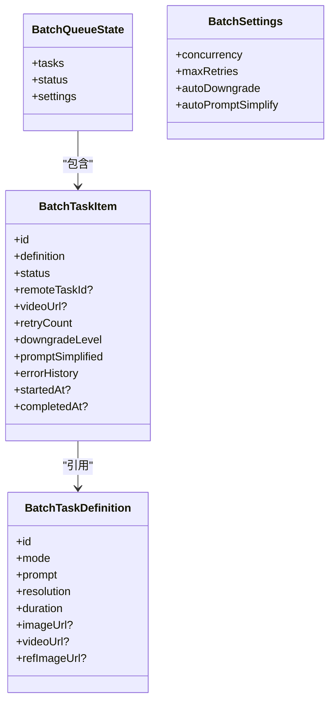
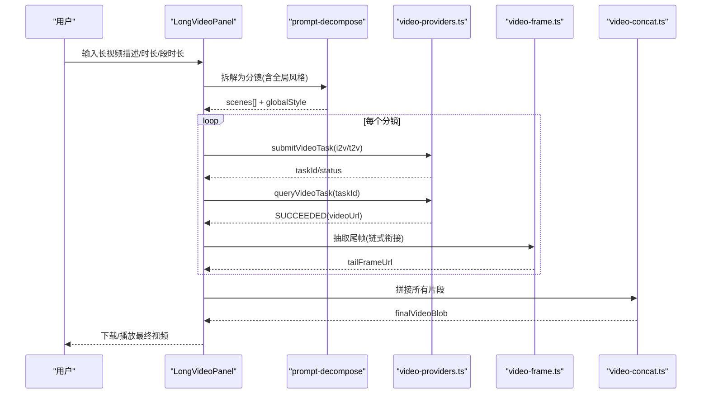
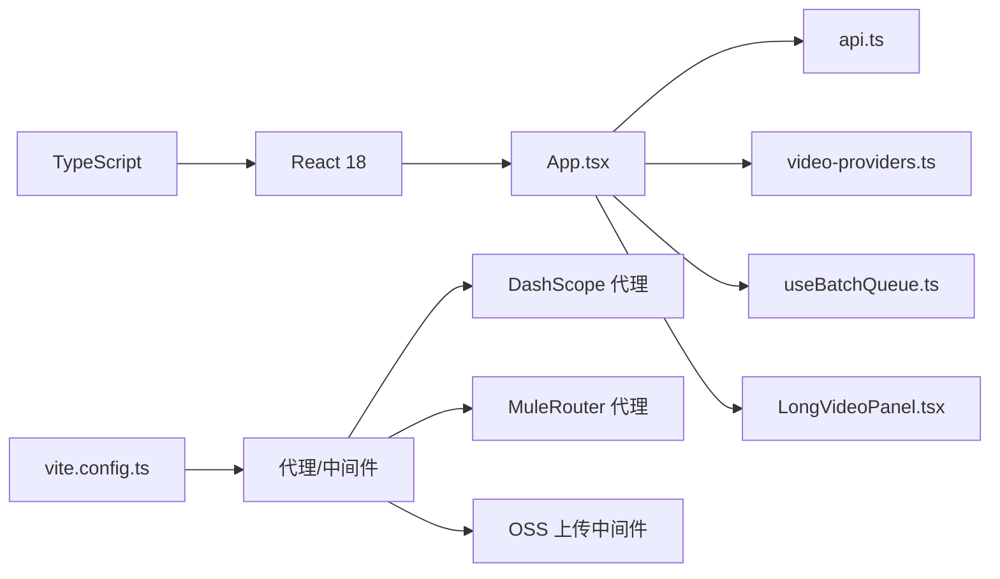

# 项目概述

<cite>
**本文引用的文件**   
- [package.json](file://package.json)
- [vite.config.ts](file://vite.config.ts)
- [index.html](file://index.html)
- [src/main.tsx](file://src/main.tsx)
- [src/App.tsx](file://src/App.tsx)
- [src/lib/api.ts](file://src/lib/api.ts)
- [src/components/TextToVideoPanel.tsx](file://src/components/TextToVideoPanel.tsx)
- [src/components/ImageToVideoPanel.tsx](file://src/components/ImageToVideoPanel.tsx)
- [src/components/VideoEditPanel.tsx](file://src/components/VideoEditPanel.tsx)
- [src/components/batch/BatchPanel.tsx](file://src/components/batch/BatchPanel.tsx)
- [src/hooks/useBatchQueue.ts](file://src/hooks/useBatchQueue.ts)
- [src/lib/batch-types.ts](file://src/lib/batch-types.ts)
- [src/lib/video-providers.ts](file://src/lib/video-providers.ts)
- [src/components/LongVideoPanel.tsx](file://src/components/LongVideoPanel.tsx)
- [deploy/deploy.sh](file://deploy/deploy.sh)
</cite>

## 目录
1. [简介](#简介)
2. [项目结构](#项目结构)
3. [核心组件](#核心组件)
4. [架构总览](#架构总览)
5. [详细组件分析](#详细组件分析)
6. [依赖分析](#依赖分析)
7. [性能考虑](#性能考虑)
8. [故障排查指南](#故障排查指南)
9. [结论](#结论)
10. [附录：快速开始与部署](#附录快速开始与部署)

## 简介
本项目是一个基于 React 18 + TypeScript 的 AI 视频生成平台，提供文本转视频、图像转视频、视频编辑等核心能力，并内置批量处理系统与长视频生成功能。后端集成阿里云百炼 HappyHorse 模型（通过 DashScope），同时通过统一 Provider 抽象层接入 MuleRouter 聚合代理，支持 Kling V3 Omni 与 Muledance 2.0 等多模型能力。前端采用 Vite 构建，开发服务器内嵌跨域代理与资源中转中间件，简化第三方 CDN 访问与图片上传流程。

## 项目结构
- 入口与路由
  - index.html 定义页面标题与描述，挂载根节点
  - src/main.tsx 使用 React 18 createRoot 渲染 App
  - src/App.tsx 作为应用主容器，管理模式切换、任务提交与结果轮询
- 功能面板
  - 文本转视频、图像转视频、视频编辑三个独立面板组件
  - 批量处理面板与长视频面板分别承载批量队列与分镜拼接工作流
- 能力抽象与 API
  - lib/api.ts 封装 DashScope 接口（HappyHorse）
  - lib/video-providers.ts 抽象多模型 Provider，统一提交与查询
- 构建与运行
  - vite.config.ts 配置插件、别名、代理与中间件
  - package.json 声明脚本与依赖

图表来源
- [index.html:1-15](file://index.html#L1-L15)
- [src/main.tsx:1-11](file://src/main.tsx#L1-L11)
- [src/App.tsx:1-164](file://src/App.tsx#L1-L164)
- [src/components/TextToVideoPanel.tsx:1-117](file://src/components/TextToVideoPanel.tsx#L1-L117)
- [src/components/ImageToVideoPanel.tsx:1-164](file://src/components/ImageToVideoPanel.tsx#L1-L164)
- [src/components/VideoEditPanel.tsx:1-157](file://src/components/VideoEditPanel.tsx#L1-L157)
- [src/components/batch/BatchPanel.tsx:1-58](file://src/components/batch/BatchPanel.tsx#L1-L58)
- [src/hooks/useBatchQueue.ts:1-322](file://src/hooks/useBatchQueue.ts#L1-L322)
- [src/lib/api.ts:1-217](file://src/lib/api.ts#L1-L217)
- [src/lib/video-providers.ts:1-559](file://src/lib/video-providers.ts#L1-L559)

章节来源
- [index.html:1-15](file://index.html#L1-L15)
- [src/main.tsx:1-11](file://src/main.tsx#L1-L11)
- [src/App.tsx:1-164](file://src/App.tsx#L1-L164)
- [package.json:1-36](file://package.json#L1-L36)

## 核心组件
- 文本转视频
  - 输入提示词、分辨率、时长；可选 AI 改写后提交
  - 调用 submitTextToVideo 提交异步任务，轮询状态并展示结果
- 图像转视频
  - 支持本地上传或外部 URL；自动选择 base64 或公网 URL 提交
  - 调用 submitImageToVideo 提交异步任务
- 视频编辑
  - 上传源视频与可选参考图，提交 prompt 进行风格/内容编辑
  - 调用 submitVideoEdit 提交异步任务
- 批量处理
  - 支持多提示词、模板组合与文件导入；队列并发控制、重试与降级
  - useBatchQueue 驱动任务生命周期与日志
- 长视频生成
  - 将长需求拆解为多个分镜，支持 i2v/t2v 混合路由、链式衔接、首尾帧硬锁
  - 分段生成后在浏览器端拼接输出最终视频

章节来源
- [src/components/TextToVideoPanel.tsx:1-117](file://src/components/TextToVideoPanel.tsx#L1-L117)
- [src/components/ImageToVideoPanel.tsx:1-164](file://src/components/ImageToVideoPanel.tsx#L1-L164)
- [src/components/VideoEditPanel.tsx:1-157](file://src/components/VideoEditPanel.tsx#L1-L157)
- [src/components/batch/BatchPanel.tsx:1-58](file://src/components/batch/BatchPanel.tsx#L1-L58)
- [src/hooks/useBatchQueue.ts:1-322](file://src/hooks/useBatchQueue.ts#L1-L322)
- [src/components/LongVideoPanel.tsx:1-800](file://src/components/LongVideoPanel.tsx#L1-L800)

## 架构总览
系统由前端 UI、Vite 开发服务器中间件、DashScope/MuleRouter 代理与云存储组成。关键路径包括：
- 任务提交：UI → Provider 抽象层 → DashScope/MuleRouter 代理 → 云端模型服务
- 任务轮询：UI → Provider 抽象层 → 代理 → 返回任务状态与视频 URL
- 资源中转：dev server 中间件解决跨域与图片上传问题

图表来源
- [src/App.tsx:1-164](file://src/App.tsx#L1-L164)
- [src/lib/video-providers.ts:1-559](file://src/lib/video-providers.ts#L1-L559)
- [src/lib/api.ts:1-217](file://src/lib/api.ts#L1-L217)
- [vite.config.ts:1-294](file://vite.config.ts#L1-L294)

## 详细组件分析

### 文本转视频面板
- 功能要点
  - 参数：提示词、分辨率、时长；支持 AI 改写
  - 交互：改写确认后提交或直接跳过改写提交
- 数据流
  - 表单状态 → handleSubmit → App 层提交 → 轮询 → 结果展示

图表来源
- [src/components/TextToVideoPanel.tsx:1-117](file://src/components/TextToVideoPanel.tsx#L1-L117)
- [src/App.tsx:1-164](file://src/App.tsx#L1-L164)
- [src/lib/api.ts:1-217](file://src/lib/api.ts#L1-L217)

章节来源
- [src/components/TextToVideoPanel.tsx:1-117](file://src/components/TextToVideoPanel.tsx#L1-L117)
- [src/App.tsx:1-164](file://src/App.tsx#L1-L164)
- [src/lib/api.ts:1-217](file://src/lib/api.ts#L1-L217)

### 图像转视频面板
- 功能要点
  - 支持本地上传与外部 URL；优先使用 base64 预览图提交
  - 与文本转视频相同的提交与轮询流程
- 注意事项
  - 当使用外部 URL 时，需确保可被服务端访问或通过代理中转

章节来源
- [src/components/ImageToVideoPanel.tsx:1-164](file://src/components/ImageToVideoPanel.tsx#L1-L164)
- [src/App.tsx:1-164](file://src/App.tsx#L1-L164)
- [src/lib/api.ts:1-217](file://src/lib/api.ts#L1-L217)

### 视频编辑面板
- 功能要点
  - 上传源视频与可选参考图；prompt 描述编辑意图
  - 调用视频编辑模型，返回处理后视频
- 数据流
  - 上传/输入 → 提交 → 轮询 → 结果展示

章节来源
- [src/components/VideoEditPanel.tsx:1-157](file://src/components/VideoEditPanel.tsx#L1-L157)
- [src/App.tsx:1-164](file://src/App.tsx#L1-L164)
- [src/lib/api.ts:1-217](file://src/lib/api.ts#L1-L217)

### 批量处理系统
- 设计要点
  - 任务定义与运行时状态分离，支持并发、重试、降级与提示词简化
  - useBatchQueue 维护全局队列状态，持久化与恢复
- 执行流程
  - 加载任务 → 启动队列 → 按并发度提交 → 轮询 → 失败策略（重试/降级/简化/永久失败）

图表来源
- [src/lib/batch-types.ts:1-123](file://src/lib/batch-types.ts#L1-L123)
- [src/hooks/useBatchQueue.ts:1-322](file://src/hooks/useBatchQueue.ts#L1-L322)
- [src/components/batch/BatchPanel.tsx:1-58](file://src/components/batch/BatchPanel.tsx#L1-L58)

章节来源
- [src/components/batch/BatchPanel.tsx:1-58](file://src/components/batch/BatchPanel.tsx#L1-L58)
- [src/hooks/useBatchQueue.ts:1-322](file://src/hooks/useBatchQueue.ts#L1-L322)
- [src/lib/batch-types.ts:1-123](file://src/lib/batch-types.ts#L1-L123)

### 长视频生成功能
- 核心流程
  - 提示词改写 → 分镜拆解 → 审核与绑定参考图 → 分段生成（i2v/t2v 混合）→ 链式衔接 → 浏览器端拼接
- 关键特性
  - 多模型能力矩阵（分辨率、时长、原生音效、多镜头、首尾帧锁定）
  - Green net 安全审核拦截自动清洗并重试一次
  - IndexedDB 持久化最终视频 Blob，localStorage 保存会话状态

图表来源
- [src/components/LongVideoPanel.tsx:1-800](file://src/components/LongVideoPanel.tsx#L1-L800)
- [src/lib/video-providers.ts:1-559](file://src/lib/video-providers.ts#L1-L559)

章节来源
- [src/components/LongVideoPanel.tsx:1-800](file://src/components/LongVideoPanel.tsx#L1-L800)
- [src/lib/video-providers.ts:1-559](file://src/lib/video-providers.ts#L1-L559)

## 依赖分析
- 技术栈
  - React 18 + ReactDOM、TypeScript、Vite、TailwindCSS、PostCSS/Autoprefixer
  - @ffmpeg/* 用于前端视频处理（如帧提取、拼接）
  - ali-oss 用于 Node 端上传至阿里云 OSS（通过 dev server 中间件）
- 关键依赖关系
  - App 层依赖各面板组件与 API/Provider 抽象
  - 批量与长视频模块依赖各自的状态管理与工具库
  - Vite 配置提供 alias、代理与中间件，屏蔽跨域与鉴权细节

图表来源
- [package.json:1-36](file://package.json#L1-L36)
- [vite.config.ts:1-294](file://vite.config.ts#L1-L294)
- [src/App.tsx:1-164](file://src/App.tsx#L1-L164)
- [src/lib/api.ts:1-217](file://src/lib/api.ts#L1-L217)
- [src/lib/video-providers.ts:1-559](file://src/lib/video-providers.ts#L1-L559)
- [src/hooks/useBatchQueue.ts:1-322](file://src/hooks/useBatchQueue.ts#L1-L322)
- [src/components/LongVideoPanel.tsx:1-800](file://src/components/LongVideoPanel.tsx#L1-L800)

章节来源
- [package.json:1-36](file://package.json#L1-L36)
- [vite.config.ts:1-294](file://vite.config.ts#L1-L294)

## 性能考虑
- 并发与限流
  - 批量队列支持并发控制与指数退避重试，避免打满上游
  - MuleRouter 类模型建议较低并发，已内置重试与 429/5xx 处理
- 资源体积
  - 长视频生成中图片压缩与按需转换 base64，减少内存占用
  - 最终视频 Blob 存 IndexedDB，避免 localStorage 容量限制
- 网络优化
  - 开发环境通过 /proxy-fetch 中转第三方 CDN，规避 CORS 导致的额外开销
  - 图片上传经 dev server 中转 OSS，避免前端直传敏感凭据

[本节为通用指导，不直接分析具体文件]

## 故障排查指南
- 常见错误定位
  - 提交失败：检查 apiKey 是否正确、网络连通性与代理是否生效
  - 内容安全拦截：长视频面板内置清洗逻辑，仍失败时需修改提示词
  - 跨域问题：确认 /proxy-fetch 与 /mulerouter 代理配置正确
- 调试建议
  - 查看浏览器控制台日志（Provider 层会打印完整响应）
  - 使用批量日志时间线定位失败原因与重试次数
  - 检查 .env.local 中的 OSS 环境变量是否配置齐全

章节来源
- [src/lib/video-providers.ts:1-559](file://src/lib/video-providers.ts#L1-L559)
- [src/hooks/useBatchQueue.ts:1-322](file://src/hooks/useBatchQueue.ts#L1-L322)
- [vite.config.ts:1-294](file://vite.config.ts#L1-L294)

## 结论
本项目以清晰的组件分层与 Provider 抽象实现了多模型视频生成的统一体验，结合批量与长视频工作流，满足从单条素材到复杂叙事的多样化需求。借助 Vite 中间件与代理机制，有效解决了跨域与鉴权痛点，提升了开发与生产环境的稳定性与易用性。

[本节为总结性内容，不直接分析具体文件]

## 附录：快速开始与部署
- 安装依赖
  - 在项目根目录执行包管理器安装命令
- 启动开发服务器
  - 运行开发脚本，打开浏览器访问本地地址
- 构建生产版本
  - 执行构建脚本，产物位于 dist 目录
- 部署到 ECS
  - 使用 deploy/deploy.sh 一键打包、上传与远程部署

章节来源
- [package.json:1-36](file://package.json#L1-L36)
- [deploy/deploy.sh:1-46](file://deploy/deploy.sh#L1-L46)