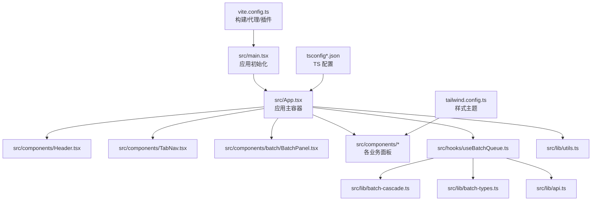
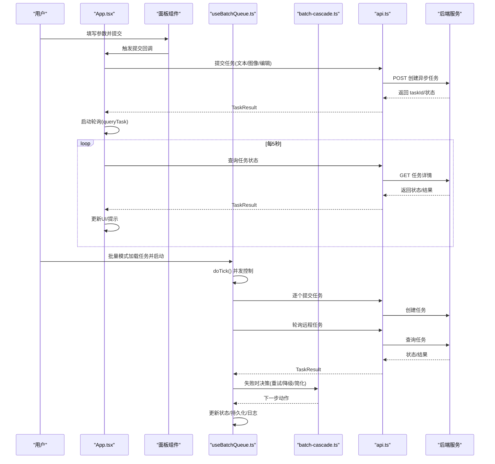
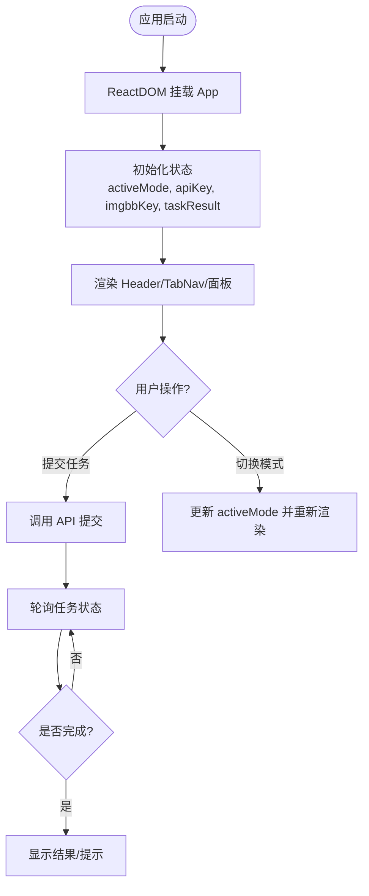
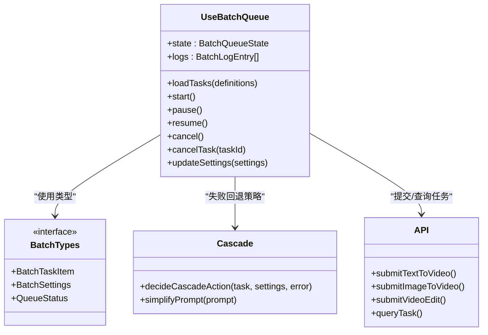
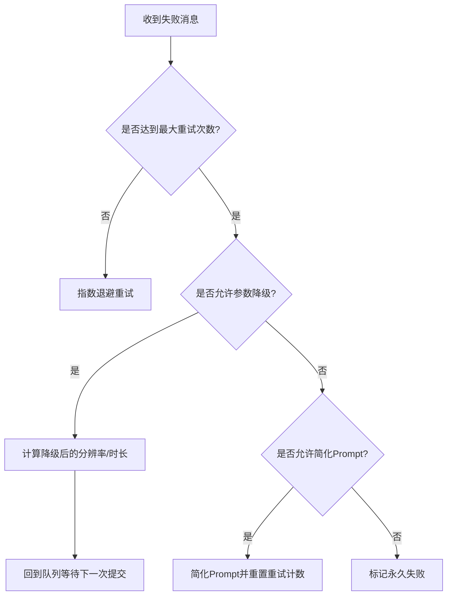
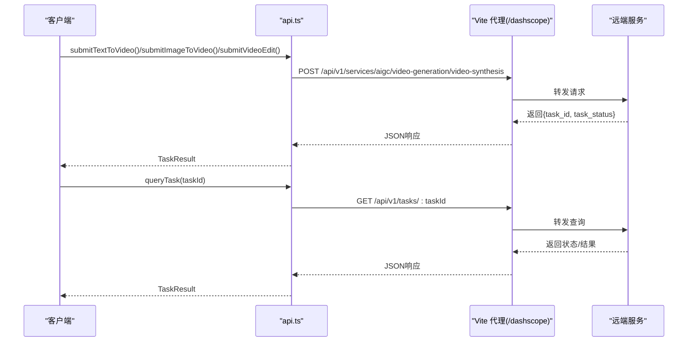
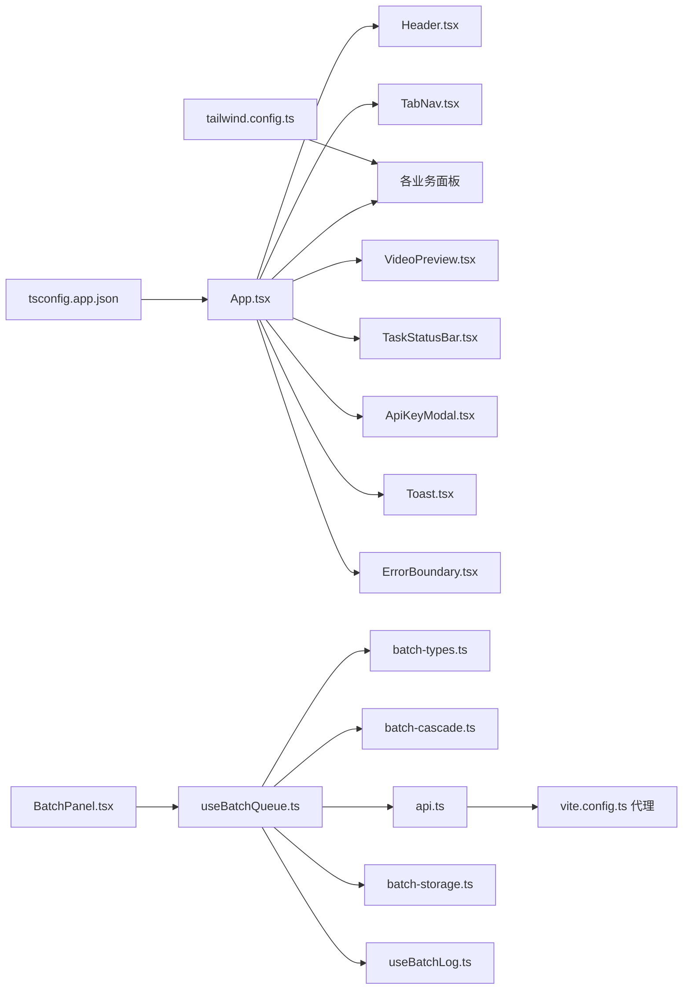

# 项目结构说明

<cite>
**本文引用的文件**
- [src/main.tsx](file://src/main.tsx)
- [src/App.tsx](file://src/App.tsx)
- [vite.config.ts](file://vite.config.ts)
- [tailwind.config.ts](file://tailwind.config.ts)
- [tsconfig.json](file://tsconfig.json)
- [tsconfig.app.json](file://tsconfig.app.json)
- [package.json](file://package.json)
- [src/lib/api.ts](file://src/lib/api.ts)
- [src/lib/batch-types.ts](file://src/lib/batch-types.ts)
- [src/lib/batch-cascade.ts](file://src/lib/batch-cascade.ts)
- [src/hooks/useBatchQueue.ts](file://src/hooks/useBatchQueue.ts)
- [src/components/Header.tsx](file://src/components/Header.tsx)
- [src/components/TabNav.tsx](file://src/components/TabNav.tsx)
- [src/components/batch/BatchPanel.tsx](file://src/components/batch/BatchPanel.tsx)
</cite>

## 目录
1. [简介](#简介)
2. [项目结构](#项目结构)
3. [核心组件](#核心组件)
4. [架构总览](#架构总览)
5. [详细组件分析](#详细组件分析)
6. [依赖关系分析](#依赖关系分析)
7. [性能与构建配置](#性能与构建配置)
8. [故障排查指南](#故障排查指南)
9. [结论](#结论)
10. [附录：最佳实践建议](#附录最佳实践建议)

## 简介
本项目是一个基于 React + Vite + TypeScript 的 AI 视频生成平台前端应用，提供“文生视频”“图生视频”“视频编辑”“批量模式”“长视频”等能力。整体采用清晰的模块分层：入口与路由容器、业务面板组件、可复用 UI 组件、自定义 Hook、以及核心逻辑库（API 封装、批量任务编排、类型定义、工具函数等）。通过 Vite 插件实现本地代理与图片上传中转，结合 Tailwind CSS 完成样式体系。

## 项目结构
- src/main.tsx：React 应用初始化与挂载
- src/App.tsx：应用主容器，负责全局状态、模式切换、任务提交与轮询、弹窗与提示
- src/components：页面级与功能级组件
  - components/ui：基础 UI 原子组件（按钮、卡片等）
  - components/batch：批量模式相关子组件（输入、设置、进度、日志、导出等）
  - 其他页面组件：Header、TabNav、TextToVideoPanel、ImageToVideoPanel、VideoEditPanel、VideoPreview、TaskStatusBar、ApiKeyModal、Toast、ErrorBoundary、LongVideoPanel、PromptRewriteSection
- src/hooks：自定义 Hook
  - useBatchQueue：批量队列调度、重试降级、持久化、日志
  - useBatchLog：批量日志记录
- src/lib：核心逻辑库
  - api.ts：阿里云百炼 HappyHorse API 封装（提交任务、查询任务）
  - batch-types.ts：批量任务类型与默认值
  - batch-cascade.ts：失败回退策略（重试、参数降级、Prompt 简化）
  - batch-storage.ts：队列状态持久化（localStorage）
  - batch-parser.ts：批量任务解析（CSV/JSON 等）
  - prompt-decompose.ts / prompt-rewrite.ts：提示词拆分与改写
  - text-overlay.ts / video-text-overlay.ts：文本叠加处理
  - video-concat.ts / video-frame.ts：视频拼接与帧处理
  - video-providers.ts：视频来源适配
  - utils.ts：通用工具（如 clsx/tailwind-merge 合并）
- 配置文件
  - vite.config.ts：Vite 构建与开发服务器配置（别名、插件、代理、CSP 头）
  - tailwind.config.ts：Tailwind 主题、颜色、动画扩展
  - tsconfig.json / tsconfig.app.json：TypeScript 编译选项与路径映射
  - package.json：脚本与依赖声明

图表来源
- [src/main.tsx:1-11](file://src/main.tsx#L1-L11)
- [src/App.tsx:1-164](file://src/App.tsx#L1-L164)
- [src/components/Header.tsx:1-28](file://src/components/Header.tsx#L1-L28)
- [src/components/TabNav.tsx:1-39](file://src/components/TabNav.tsx#L1-L39)
- [src/components/batch/BatchPanel.tsx:1-58](file://src/components/batch/BatchPanel.tsx#L1-L58)
- [src/hooks/useBatchQueue.ts:1-322](file://src/hooks/useBatchQueue.ts#L1-L322)
- [src/lib/batch-cascade.ts:1-101](file://src/lib/batch-cascade.ts#L1-L101)
- [src/lib/batch-types.ts:1-123](file://src/lib/batch-types.ts#L1-L123)
- [src/lib/api.ts:1-217](file://src/lib/api.ts#L1-L217)
- [src/lib/utils.ts:1-7](file://src/lib/utils.ts#L1-L7)
- [vite.config.ts:1-294](file://vite.config.ts#L1-L294)
- [tailwind.config.ts:1-93](file://tailwind.config.ts#L1-L93)
- [tsconfig.json:1-7](file://tsconfig.json#L1-L7)
- [tsconfig.app.json:1-26](file://tsconfig.app.json#L1-L26)

章节来源
- [src/main.tsx:1-11](file://src/main.tsx#L1-L11)
- [src/App.tsx:1-164](file://src/App.tsx#L1-L164)
- [vite.config.ts:1-294](file://vite.config.ts#L1-L294)
- [tailwind.config.ts:1-93](file://tailwind.config.ts#L1-L93)
- [tsconfig.json:1-7](file://tsconfig.json#L1-L7)
- [tsconfig.app.json:1-26](file://tsconfig.app.json#L1-L26)

## 核心组件
- 应用入口 main.tsx
  - 使用 ReactDOM.createRoot 挂载根节点，启用 StrictMode，渲染 App 组件并引入全局样式。
- 应用主容器 App.tsx
  - 管理全局状态：当前模式、API Key、ImgBB Key、任务结果、提交中标志、Toast 提示。
  - 统一的任务提交流程：根据模式调用对应提交函数，成功后启动轮询；失败时展示错误信息。
  - 条件渲染不同面板：批量模式、长视频模式与其他三种常规模式的布局差异。
  - 集成 ApiKeyModal、Toast、ErrorBoundary 等横切关注点。
- 头部 Header.tsx 与导航 TabNav.tsx
  - Header 提供设置入口；TabNav 提供模式切换，驱动 App 中的 activeMode 状态。
- 批量面板 BatchPanel.tsx
  - 组合输入区、设置区与仪表盘，内部通过 useBatchQueue Hook 驱动批量任务执行与状态展示。

章节来源
- [src/main.tsx:1-11](file://src/main.tsx#L1-L11)
- [src/App.tsx:1-164](file://src/App.tsx#L1-L164)
- [src/components/Header.tsx:1-28](file://src/components/Header.tsx#L1-L28)
- [src/components/TabNav.tsx:1-39](file://src/components/TabNav.tsx#L1-L39)
- [src/components/batch/BatchPanel.tsx:1-58](file://src/components/batch/BatchPanel.tsx#L1-L58)

## 架构总览
从数据流与控制流角度，系统分为三层：
- 表现层：App 与各面板组件，负责用户交互与界面渲染
- 协调层：useBatchQueue Hook，负责批量任务的调度、重试、降级、持久化与日志
- 领域层：lib 下的 API 封装、类型定义、算法与工具

图表来源
- [src/App.tsx:1-164](file://src/App.tsx#L1-L164)
- [src/hooks/useBatchQueue.ts:1-322](file://src/hooks/useBatchQueue.ts#L1-L322)
- [src/lib/batch-cascade.ts:1-101](file://src/lib/batch-cascade.ts#L1-L101)
- [src/lib/api.ts:1-217](file://src/lib/api.ts#L1-L217)

## 详细组件分析

### 应用入口与初始化流程
- main.tsx 负责创建根节点并挂载 App，同时引入全局样式 index.css。
- App.tsx 作为单页应用的主容器，集中管理：
  - 模式切换（text-to-video、image-to-video、video-edit、batch、long-video）
  - 凭据管理（DashScope API Key、ImgBB Key），写入 localStorage
  - 任务生命周期（提交→轮询→完成/失败）
  - 全局提示 Toast 与错误边界 ErrorBoundary

图表来源
- [src/main.tsx:1-11](file://src/main.tsx#L1-L11)
- [src/App.tsx:1-164](file://src/App.tsx#L1-L164)

章节来源
- [src/main.tsx:1-11](file://src/main.tsx#L1-L11)
- [src/App.tsx:1-164](file://src/App.tsx#L1-L164)

### 批量任务编排（useBatchQueue）
- 职责
  - 维护批量队列状态（任务列表、运行状态、设置）
  - 并发控制：根据 settings.concurrency 限制同时提交/轮询数量
  - 失败回退：调用 cascade 策略进行重试、参数降级、Prompt 简化或永久失败
  - 持久化：定时将状态保存到 localStorage，并在刷新后恢复
  - 日志：记录关键事件到 logs
- 关键流程
  - loadTasks：将定义转换为运行时项，初始化为 queued
  - start/pause/resume/cancel：控制队列生命周期
  - doTick：周期性扫描可提交的 queued 任务与需要轮询的 polling 任务
  - processTask：按 mode 调用对应 API 提交
  - pollTask：查询远程任务状态，成功则更新 videoUrl，失败进入 handleFailure
  - handleFailure：依据 decideCascadeAction 决定下一步动作

图表来源
- [src/hooks/useBatchQueue.ts:1-322](file://src/hooks/useBatchQueue.ts#L1-L322)
- [src/lib/batch-types.ts:1-123](file://src/lib/batch-types.ts#L1-L123)
- [src/lib/batch-cascade.ts:1-101](file://src/lib/batch-cascade.ts#L1-L101)
- [src/lib/api.ts:1-217](file://src/lib/api.ts#L1-L217)

章节来源
- [src/hooks/useBatchQueue.ts:1-322](file://src/hooks/useBatchQueue.ts#L1-L322)
- [src/lib/batch-types.ts:1-123](file://src/lib/batch-types.ts#L1-L123)
- [src/lib/batch-cascade.ts:1-101](file://src/lib/batch-cascade.ts#L1-L101)
- [src/lib/api.ts:1-217](file://src/lib/api.ts#L1-L217)

### 失败回退策略（cascade）
- 决策顺序
  1) 指数退避重试（最多 maxRetries 次）
  2) 参数降级（分辨率从高到低，再降低时长）
  3) Prompt 简化（去除特殊字符、截断长度）
  4) 标记永久失败
- 适用场景
  - 网络抖动、服务端限流、资源不足导致的失败

图表来源
- [src/lib/batch-cascade.ts:1-101](file://src/lib/batch-cascade.ts#L1-L101)

章节来源
- [src/lib/batch-cascade.ts:1-101](file://src/lib/batch-cascade.ts#L1-L101)

### API 封装（api.ts）
- 职责
  - 封装三类任务提交接口：文本→视频、图像→视频、视频编辑
  - 统一错误处理与状态映射
  - 提供任务查询接口
- 关键点
  - 通过 Vite 代理路径 /dashscope 访问远端服务，避免 CORS
  - 语言提示注入与负面提示词增强
  - 状态映射：PENDING/RUNNING/SUCCEEDED/FAILED/UNKNOWN

图表来源
- [src/lib/api.ts:1-217](file://src/lib/api.ts#L1-L217)
- [vite.config.ts:272-293](file://vite.config.ts#L272-L293)

章节来源
- [src/lib/api.ts:1-217](file://src/lib/api.ts#L1-L217)
- [vite.config.ts:272-293](file://vite.config.ts#L272-L293)

### 批量面板（BatchPanel）
- 职责
  - 组合输入区、设置区与仪表盘
  - 通过 useBatchQueue 暴露的方法驱动任务加载、启动、暂停、恢复、取消等操作
- 交互要点
  - 未设置 API Key 时阻止启动并提示
  - 任务加载成功后自动切换到仪表盘视图

章节来源
- [src/components/batch/BatchPanel.tsx:1-58](file://src/components/batch/BatchPanel.tsx#L1-L58)
- [src/hooks/useBatchQueue.ts:1-322](file://src/hooks/useBatchQueue.ts#L1-L322)

## 依赖关系分析
- 组件依赖
  - App.tsx 依赖 Header、TabNav、各业务面板、VideoPreview、TaskStatusBar、ApiKeyModal、Toast、ErrorBoundary
  - BatchPanel 依赖 useBatchQueue 与批量子组件
- 逻辑依赖
  - useBatchQueue 依赖 batch-types、batch-cascade、api、batch-storage、useBatchLog
  - api.ts 依赖 Vite 代理路径
- 构建与样式
  - vite.config.ts 定义别名 @ → src，排除 FFmpeg 预构建优化，配置跨域代理与 CSP 头
  - tailwind.config.ts 扩展颜色、圆角、动画，配合 tailwindcss-animate 插件
  - tsconfig.app.json 开启严格模式、路径映射 @/* → ./src/*

图表来源
- [src/App.tsx:1-164](file://src/App.tsx#L1-L164)
- [src/components/batch/BatchPanel.tsx:1-58](file://src/components/batch/BatchPanel.tsx#L1-L58)
- [src/hooks/useBatchQueue.ts:1-322](file://src/hooks/useBatchQueue.ts#L1-L322)
- [src/lib/batch-types.ts:1-123](file://src/lib/batch-types.ts#L1-L123)
- [src/lib/batch-cascade.ts:1-101](file://src/lib/batch-cascade.ts#L1-L101)
- [src/lib/api.ts:1-217](file://src/lib/api.ts#L1-L217)
- [vite.config.ts:1-294](file://vite.config.ts#L1-L294)
- [tailwind.config.ts:1-93](file://tailwind.config.ts#L1-L93)
- [tsconfig.app.json:1-26](file://tsconfig.app.json#L1-L26)

章节来源
- [src/App.tsx:1-164](file://src/App.tsx#L1-L164)
- [src/components/batch/BatchPanel.tsx:1-58](file://src/components/batch/BatchPanel.tsx#L1-L58)
- [src/hooks/useBatchQueue.ts:1-322](file://src/hooks/useBatchQueue.ts#L1-L322)
- [src/lib/batch-types.ts:1-123](file://src/lib/batch-types.ts#L1-L123)
- [src/lib/batch-cascade.ts:1-101](file://src/lib/batch-cascade.ts#L1-L101)
- [src/lib/api.ts:1-217](file://src/lib/api.ts#L1-L217)
- [vite.config.ts:1-294](file://vite.config.ts#L1-L294)
- [tailwind.config.ts:1-93](file://tailwind.config.ts#L1-L93)
- [tsconfig.app.json:1-26](file://tsconfig.app.json#L1-L26)

## 性能与构建配置
- Vite 构建与开发服务器
  - 别名：@ → src，便于绝对路径导入
  - 依赖优化：排除 @ffmpeg/* 包，避免预构建问题
  - 开发服务器头：设置 Cross-Origin-Opener-Policy 与 Cross-Origin-Embedder-Policy，提升共享工作线程能力
  - 代理：/dashscope 与 /mulerouter 转发至远端服务，解决本地开发跨域
  - 自定义中间件：/proxy-fetch 用于绕过第三方 CDN 无 CORS 头的资源获取；/upload-to-oss 用于本地图片转存 OSS 并返回公网 URL
- Tailwind 样式
  - 主题扩展：颜色、圆角、动画 keyframes 与 animation 名称
  - 插件：tailwindcss-animate 提供常用动效
- TypeScript 配置
  - 严格模式、noUnusedLocals/Parameters、noUncheckedSideEffectImports 等规则
  - 路径映射 @/* → ./src/*，统一模块导入风格

章节来源
- [vite.config.ts:1-294](file://vite.config.ts#L1-L294)
- [tailwind.config.ts:1-93](file://tailwind.config.ts#L1-L93)
- [tsconfig.app.json:1-26](file://tsconfig.app.json#L1-L26)
- [tsconfig.json:1-7](file://tsconfig.json#L1-L7)
- [package.json:1-36](file://package.json#L1-L36)

## 故障排查指南
- 无法提交任务
  - 检查是否在 App 中设置了有效的 DashScope API Key
  - 确认 Vite 代理 /dashscope 是否可用（本地开发）
  - 查看 api.ts 的错误处理分支，定位 HTTP 状态码与 message
- 批量任务频繁失败
  - 观察 useBatchQueue 的日志输出，确认失败原因
  - 调整 settings.maxRetries、concurrency，或关闭 autoDowngrade/autoPromptSimplify 以定位问题
  - 参考 cascade 策略，理解重试、降级与简化的触发条件
- 图片上传失败
  - 若使用 /upload-to-oss，检查 .env.local 中 OSS 环境变量是否配置正确
  - 确认 endpoint 是否为接入点（Access Point）或普通 bucket，并按要求提供别名
- 跨域或资源加载异常
  - 使用 /proxy-fetch?url=... 中转第三方资源
  - 检查浏览器控制台 CORS 错误与 CSP 头设置

章节来源
- [src/lib/api.ts:1-217](file://src/lib/api.ts#L1-L217)
- [src/hooks/useBatchQueue.ts:1-322](file://src/hooks/useBatchQueue.ts#L1-L322)
- [vite.config.ts:1-294](file://vite.config.ts#L1-L294)

## 结论
本项目的代码组织清晰、职责划分明确：入口与容器负责状态与流程编排，组件聚焦于界面与交互，Hook 封装复杂的状态机与调度逻辑，lib 提供稳定的领域能力与工具。借助 Vite 插件与 Tailwind 配置，项目在开发与构建阶段具备良好的可扩展性与一致性。新加入的开发者可依据本文档快速定位模块、理解数据流与依赖关系，并遵循最佳实践进行迭代与维护。

## 附录：最佳实践建议
- 组件设计
  - 保持 App 为轻量容器，复杂逻辑下沉至 Hook 或 lib
  - 使用 cn 工具类合并动态 className，避免样式冲突
- 状态管理
  - 批量队列状态尽量不可变更新，使用 reducer 模式
  - 对耗时操作使用节流/防抖与并发控制
- 错误处理
  - 统一错误上报与用户提示，区分临时错误与永久失败
  - 保留错误历史，便于回溯与调试
- 配置与环境
  - 敏感凭据仅保存在后端或环境变量，不暴露到前端
  - 使用 Vite 代理与中间件屏蔽跨域与签名细节
- 构建与发布
  - 合理设置 optimizeDeps 与 server.headers，确保生产环境稳定性
  - 在 CI 中执行 tsc -b 与 vite build，保证类型与产物质量